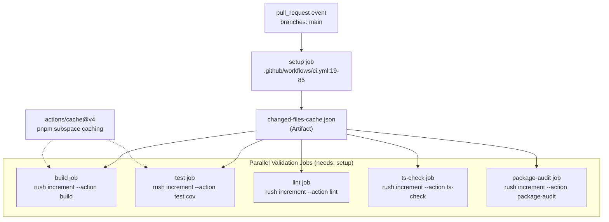
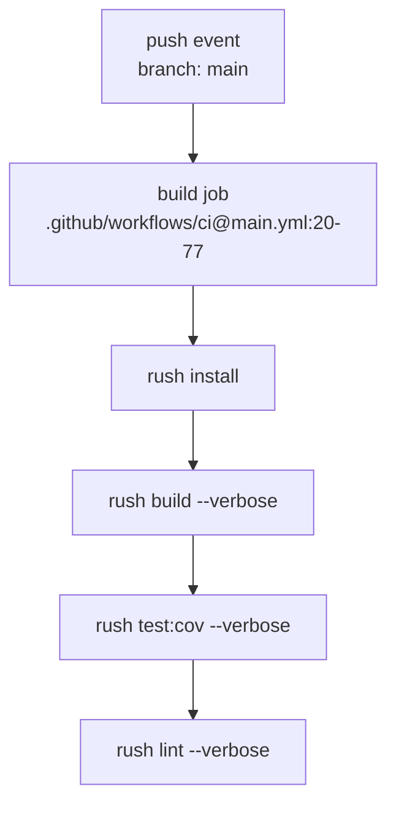
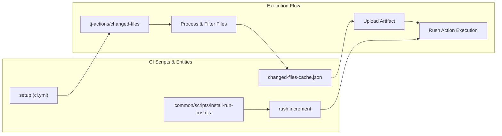

<!-- source: DeepWiki mcp.deepwiki.com · repo coze-dev/coze-studio · page 3.1 Frontend CI Workflows · fetched 2026-10-29 -->

# Frontend CI Workflows

<details>
<summary>Relevant source files</summary>

The following files were used as context for generating this wiki page:

- [.claude/agents/frontend-infrastructure-expert.md](.claude/agents/frontend-infrastructure-expert.md)
- [.github/workflows/ci.yml](.github/workflows/ci.yml)
- [.github/workflows/ci@main.yml](.github/workflows/ci@main.yml)

</details>


## Purpose and Scope

This document details the frontend continuous integration (CI) pipeline that validates all frontend changes before they are merged into the `main` branch. The pipeline utilizes a **Rush.js-based incremental build system** to optimize performance by processing only changed projects for build, test, lint, and type-checking tasks. This system manages a monorepo containing over 170 packages, ensuring high velocity without sacrificing code quality.

For backend CI workflows, see [Backend CI Workflows](3.2). For general pull request validation including commit message conventions and file size checks, see [Pull Request Validation](3.3).

## Workflow Architecture

The frontend CI system consists of two primary GitHub Actions workflows: one for pull requests with incremental validation (`ci.yml`) and one for the main branch with full validation (`ci@main.yml`).

### Pull Request CI Pipeline (Incremental)

The `ci.yml` workflow is designed for speed. It uses a `setup` job to identify changed files and then spawns parallel jobs to validate only the affected packages.



**Diagram: Pull Request CI Pipeline Architecture**
The workflow orchestrates parallel execution of specialized validation tasks, all consuming a centralized cache of changed files.

Sources: [.github/workflows/ci.yml:1-300]()

### Main Branch CI Pipeline (Full)

The `ci@main.yml` workflow runs on every push to the `main` branch. It performs a non-incremental, full validation of the entire monorepo to ensure total system integrity.



**Diagram: Main Branch CI Pipeline Architecture**
This workflow serves as the final source of truth, executing comprehensive checks across all packages regardless of change status.

Sources: [.github/workflows/ci@main.yml:1-77]()

## The Setup Job and Incremental Logic

The `setup` job in `ci.yml` is the core of the incremental system. It determines exactly what needs to be tested to save CI minutes.

### Changed Files Detection
The job uses `tj-actions/changed-files@v45` [[.github/workflows/ci.yml:38-39]()] to identify modified files. It specifically filters out changes in `common/changes/` (Rush's versioning files) to avoid triggering builds for documentation or version bumps [[.github/workflows/ci.yml:47-57]()].

### `changed-files-cache.json`
The filtered list of files is serialized into a JSON array and saved as `changed-files-cache.json` [[.github/workflows/ci.yml:59-60]()]. This file is uploaded as a GitHub Actions artifact [[.github/workflows/ci.yml:79-84]()] so that downstream parallel jobs can download it and pass it to Rush.

### Data Flow: Setup to Parallel Jobs
The `setup` job exports critical metadata via `$GITHUB_OUTPUT` [[.github/workflows/ci.yml:62-63]()]:
- `cache_file`: The filename of the JSON cache.
- `matrix_node_version`: The Node version (22.16.0) [[.github/workflows/ci.yml:23]()].
- `matrix_os`: The runner OS (ubuntu-latest).

Sources: [.github/workflows/ci.yml:19-85]()

## Parallel Job Execution

Each validation job (`build`, `test`, `lint`, `ts-check`, `package-audit`) follows a standardized execution pattern:

1.  **Environment Setup**: Check out code and set up Node.js [[.github/workflows/ci.yml:93-100]()].
2.  **Subspace Caching**: Restore pnpm stores and local caches [[.github/workflows/ci.yml:101-111]()].
3.  **Artifact Retrieval**: Download the `changed-files-cache` artifact generated by the setup job [[.github/workflows/ci.yml:113-116]()].
4.  **Dependency Installation**:
    - Install core tagged projects: `rush install --to tag:core` [[.github/workflows/ci.yml:122]()].
    - Update autoinstallers for plugins [[.github/workflows/ci.yml:123]()].
    - **Incremental Install**: Run `rush increment --action install -p changed-files-cache.json` [[.github/workflows/ci.yml:124]()].
5.  **Incremental Action**: Execute the specific task (e.g., `build`, `test:cov`) only on the projects affected by the changed files [[.github/workflows/ci.yml:127]()].

### Validation Job Details

| Job | Command Action | Purpose |
| :--- | :--- | :--- |
| **Build** | `build` | Compiles TypeScript and bundles assets using Rsbuild/Rspack. |
| **Test** | `test:cov` | Executes Vitest suites and generates coverage reports. |
| **Lint** | `lint` | Runs ESLint and Stylelint to enforce code standards. |
| **TS Check** | `ts-check` | Runs `tsc --noEmit` for static type verification. |
| **Audit** | `package-audit` | Scans dependencies for security vulnerabilities. |

Sources: [.github/workflows/ci.yml:86-300]()

## Subspace and Dependency Caching

The CI system leverages **pnpm subspaces** for granular dependency management. Caching is configured to key off the lockfiles within these subspaces:

```yaml
- name: Cache
  uses: actions/cache@v4
  with:
    path: |
      common/temp/pnpm-local
      common/temp/pnpm-store
      common/temp/install-run
    key: ${{ runner.os }}-rush-store-${{ hashFiles('common/config/subspaces/**/pnpm-lock.yaml') }}
```

This ensures that if a dependency changes in one subspace, other subspaces can still benefit from cached layers.

Sources: [.github/workflows/ci.yml:101-111]()

## Workflow Triggers and Permissions

### Trigger Paths
Both workflows trigger on changes to the following paths [[.github/workflows/ci.yml:5-10]()] [[.github/workflows/ci@main.yml:7-12]()]:
- `github/**`: CI configuration changes.
- `idl/**`: Changes to Thrift interface definitions.
- `frontend/**`: Any frontend package changes.
- `common/**`: Shared configurations and scripts.
- `rush.json`: Monorepo structure changes.

### Security Model
Workflows operate with restricted permissions:
- `contents: read`: Allows checking out code [[.github/workflows/ci.yml:15]()].
- `actions: read`: Allows accessing workflow metadata and artifacts [[.github/workflows/ci.yml:16]()].

Sources: [.github/workflows/ci.yml:1-17](), [.github/workflows/ci@main.yml:1-18]()

## Implementation Entity Map

The following diagram maps the logical CI steps to the specific scripts and files used in the implementation.



**Diagram: Implementation Entity Map**
Associating GitHub Action jobs with the underlying Rush.js scripts and generated artifacts.

Sources: [.github/workflows/ci.yml:19-127](), [.github/workflows/ci@main.yml:56-66]()

---

