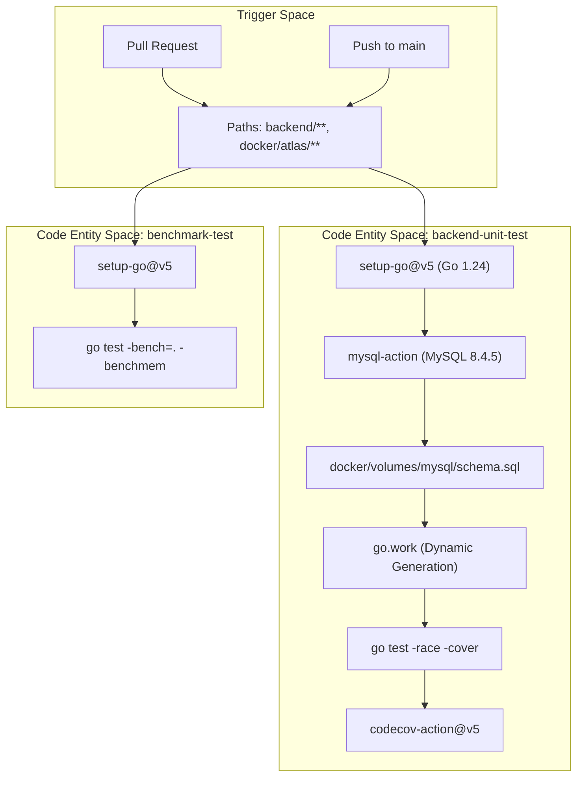
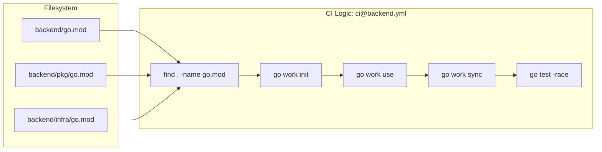

<!-- source: DeepWiki mcp.deepwiki.com · repo coze-dev/coze-studio · page 3.2 Backend CI Workflows · fetched 2026-10-29 -->

# Backend CI Workflows

<details>
<summary>Relevant source files</summary>

The following files were used as context for generating this wiki page:

- [.github/workflows/ci@backend.yml](.github/workflows/ci@backend.yml)
- [backend/.gitignore](backend/.gitignore)

</details>


This document describes the backend CI workflows for Coze Studio's Go codebase. The workflows execute automated unit tests with race detection, benchmark tests, and code coverage reporting through GitHub Actions.

For frontend CI workflows, see [Frontend CI Workflows]() (3.1). For general CI/CD system overview, see [CI/CD System]() (3).

## Workflow Overview

The backend CI pipeline is defined in [.github/workflows/ci@backend.yml:1-126]() and executes on pull requests and pushes to the main branch. The workflow consists of two parallel jobs: `backend-unit-test` for unit tests with race detection and coverage reporting, and `benchmark-test` for performance benchmarks.

### CI Workflow Architecture

The following diagram maps the GitHub Actions workflow steps to the specific tools and files involved in the backend validation process.

"Backend CI Workflow Mapping"


**Sources:**
- [.github/workflows/ci@backend.yml:1-126]()

## MySQL Database Setup

The backend tests require a MySQL database for integration testing. The workflow uses the `mysql-action` to provision MySQL 8.4.5 with specific configuration.

### Database Configuration

| Parameter | Value |
|-----------|-------|
| MySQL Version | 8.4.5 |
| Host Port | 3306 |
| Container Port | 3306 |
| Character Set | utf8mb4 |
| Collation | utf8mb4_general_ci |
| Database Name | opencoze |
| Root Password | root |

The workflow includes a verification step that polls port 3306 for up to 60 seconds to ensure MySQL is ready before proceeding with database initialization [[.github/workflows/ci@backend.yml:56-68]()].

### Database Initialization

Database schema initialization uses a retry mechanism with the `nick-fields/retry` action to handle transient connection issues:

- **Timeout:** 10 minutes
- **Max Attempts:** 20
- **Schema File:** `docker/volumes/mysql/schema.sql`
- **Command:** `mysql -h 127.0.0.1 -P 3306 -u root -proot opencoze < docker/volumes/mysql/schema.sql`

This approach ensures reliable database setup even in environments with slower startup times [[.github/workflows/ci@backend.yml:72-77]()].

**Sources:**
- [.github/workflows/ci@backend.yml:45-77]()

## Unit Test Execution

The unit test execution implements a multi-module Go workspace strategy to test all backend modules together with comprehensive coverage reporting.

### Multi-Module Test Strategy

The test execution script dynamically discovers all Go modules in the repository and constructs a unified test command [[.github/workflows/ci@backend.yml:79-88]()]:

1. **Module Discovery:** Finds all directories containing `go.mod` files via `find . -name "go.mod"`.
2. **Workspace Initialization:** Creates a `go.work` file if it doesn't exist using `go work init`.
3. **Module Registration:** Adds each module to the workspace with `go work use $module`.
4. **Workspace Synchronization:** Runs `go work sync` to resolve dependencies across the monorepo.
5. **Unified Test Execution:** Runs tests across all modules with combined coverage.

"Dynamic Go Workspace Generation"


### Test Configuration Flags

The `go test` command uses several important flags for comprehensive testing [[.github/workflows/ci@backend.yml:88]()]:

| Flag | Purpose |
|------|---------|
| `-race` | Enables Go's race detector to identify concurrent data access issues. |
| `-v` | Verbose output for debugging test failures. |
| `-coverprofile=coverage.out` | Writes coverage data to `COVERAGE_FILE` environment variable. |
| `-gcflags="all=-l -N"` | Disables compiler optimizations (`-N`) and inlining (`-l`) for accurate coverage and debugging. |
| `-coverpkg=$coverpkg` | Comma-separated list of all module packages for coverage calculation across module boundaries. |

**Sources:**
- [.github/workflows/ci@backend.yml:79-88]()

## Coverage Reporting

Test coverage results are automatically uploaded to Codecov using the `codecov-action` with specific configuration for the backend codebase.

### Codecov Configuration

| Parameter | Value |
|-----------|-------|
| Name | coze-studio-backend |
| Coverage File | coverage.out |
| Environment Variables | GOLANG, Coze-Studio, BACKEND |
| Fail on Error | false |
| Token | `secrets.CODECOV_TOKEN` |

The `fail_ci_if_error` is set to `false` to prevent Codecov upload failures from blocking the CI pipeline, as coverage reporting is considered non-critical for merge decisions [[.github/workflows/ci@backend.yml:90-97]()].

**Sources:**
- [.github/workflows/ci@backend.yml:90-97]()

## Benchmark Testing

The `benchmark-test` job runs performance benchmarks in parallel with unit tests to detect performance regressions. This job does not require MySQL setup [[.github/workflows/ci@backend.yml:103-126]()].

### Benchmark Execution

The benchmark test follows the same multi-module discovery pattern as unit tests but uses different `go test` flags optimized for performance measurement:

| Flag | Purpose |
|------|---------|
| `-bench=.` | Runs all benchmark functions matching the pattern. |
| `-benchmem` | Reports memory allocation statistics for each benchmark. |
| `-run=none` | Skips regular test functions, executing only benchmarks. |
| `-race` | Enables race detection during benchmark execution to ensure performance isn't achieved at the cost of safety. |
| `-gcflags="all=-l -N"` | Maintains consistent environment by disabling optimizations. |

This configuration provides comprehensive performance metrics including execution time, memory allocations, and concurrent safety validation through race detection [[.github/workflows/ci@backend.yml:116-125]()].

**Sources:**
- [.github/workflows/ci@backend.yml:103-126]()

## Workflow Triggers

The backend testing workflow is triggered under three conditions:

### Path-Based Triggers

The workflow only executes when changes are detected in specific paths to optimize CI resources [[.github/workflows/ci@backend.yml:3-15]()]:

- `backend/**` - Any changes to backend code.
- `docker/atlas/**` - Database migration changes.
- `.github/workflows/ci@backend.yml` - Workflow definition changes.

### Event-Based Triggers

| Event | Branches | Behavior |
|-------|----------|----------|
| `pull_request` | Any | Runs on PRs with path matches. |
| `push` | `main` | Runs on direct pushes to main. |
| `workflow_dispatch` | Any | Manual trigger from Actions tab. |

**Sources:**
- [.github/workflows/ci@backend.yml:3-17]()

## Job Permissions and Environment

Both test jobs require specific GitHub Actions permissions to function correctly [[.github/workflows/ci@backend.yml:27-30, 106-108]()]:

```yaml
permissions:
  contents: write
  pull-requests: write
  repository-projects: write
```

### Environment Variables

The workflow defines environment variables at multiple scopes:

- **Global**: `DEFAULT_GO_VERSION: "1.24"` [[.github/workflows/ci@backend.yml:21]()].
- **Unit Test Job**: `COVERAGE_FILE: coverage.out` and `BREAKDOWN_FILE: main.breakdown` [[.github/workflows/ci@backend.yml:31-33]()].

**Sources:**
- [.github/workflows/ci@backend.yml:21-33]()
- [.github/workflows/ci@backend.yml:106-108]()

---

