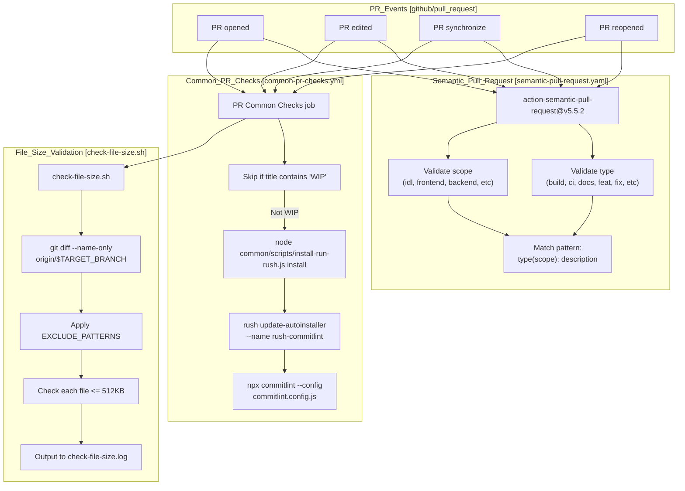
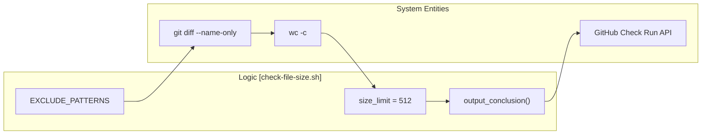

<!-- source: DeepWiki mcp.deepwiki.com · repo coze-dev/coze-studio · page 3.3 Pull Request Validation · fetched 2026-10-29 -->

# Pull Request Validation

<details>
<summary>Relevant source files</summary>

The following files were used as context for generating this wiki page:

- [.github/PULL_REQUEST_TEMPLATE.md](.github/PULL_REQUEST_TEMPLATE.md)
- [.github/scripts/check-file-size.sh](.github/scripts/check-file-size.sh)
- [.github/workflows/common-pr-checks.yml](.github/workflows/common-pr-checks.yml)
- [.github/workflows/semantic-pull-request.yaml](.github/workflows/semantic-pull-request.yaml)

</details>


This document describes the automated validation system that enforces quality standards on all pull requests within the Coze Studio monorepo. The validation system runs multiple independent checks to ensure PRs meet semantic, structural, and size requirements before they can be merged.

For information about license and dependency compliance checks, see [License and Compliance](#3.4). For IDL-specific validation, see [IDL Validation](#3.5). For the broader CI/CD context, see [CI/CD System](#3).

## Validation Pipeline Overview

The PR validation system consists of three primary validation workflows that execute automatically when a PR is opened, edited, or synchronized. These checks ensure that the repository's commit history remains clean and that the repository does not accidentally ingest excessively large files.

Title validation is handled by two distinct mechanisms: `semantic-pull-request.yaml` for high-level structure and `common-pr-checks.yml` (using `rush-commitlint`) for granular rule enforcement.

### Validation Flow Architecture



Sources: [.github/workflows/semantic-pull-request.yaml:1-75](), [.github/workflows/common-pr-checks.yml:1-49](), [.github/scripts/check-file-size.sh:1-108]()

## Semantic PR Title Validation

The `semantic-pull-request.yaml` workflow enforces a strict semantic format for all PR titles using the `amannn/action-semantic-pull-request@v5.5.2` GitHub Action. This ensures that the title is suitable for automated release note generation.

### Required Title Format

All PR titles must match the pattern defined in the PR template:

```
<type>(<scope>): <description>
```

Where:
- `<type>` is one of the allowed commit types.
- `<scope>` is an optional scope identifier.
- `<description>` is a user-oriented description.

### Allowed Types and Scopes

The workflow defines a specific set of allowed types and scopes to categorize changes across the monorepo:

| Category | Allowed Values |
|----------|----------------|
| **Types** | `build`, `ci`, `docs`, `feat`, `fix`, `perf`, `refactor`, `style`, `test`, `chore` |
| **Scopes** | `idl`, `frontend`, `backend`, `infra`, `app`, `singleagent`, `memory`, `search`, `workflow`, `prompt`, `knowledge`, `plugin`, `middleware`, `model`, `database`, `foundation`, `comment`, `ci` |

The `headerPatternCorrespondence` is configured to map these parts to `type`, `scope`, and `subject` respectively [.github/workflows/semantic-pull-request.yaml:74-74]().

Sources: [.github/workflows/semantic-pull-request.yaml:27-74](), [.github/PULL_REQUEST_TEMPLATE.md:24-24]()

## Commit Message Linting via Rush

The `common-pr-checks.yml` workflow performs deeper validation of the PR title by executing `commitlint` through a Rush autoinstaller.

### WIP Bypass Mechanism

A bypass mechanism is implemented to allow developers to push "Work In Progress" PRs without triggering title validation failures. If the PR title contains `WIP` or `wip`, the title format check is skipped [.github/workflows/common-pr-checks.yml:38-38]().

### Implementation Details

The workflow utilizes the `rush-commitlint` autoinstaller to manage linting dependencies:

1.  **Environment Setup**: Uses `node-version: 22.16.0` [.github/workflows/common-pr-checks.yml:31-31]().
2.  **Rush Installation**: Executes `node common/scripts/install-run-rush.js install` [.github/workflows/common-pr-checks.yml:34-34]().
3.  **Autoinstaller Update**: Ensures the `rush-commitlint` toolset is ready via `rush update-autoinstaller --name rush-commitlint` [.github/workflows/common-pr-checks.yml:42-42]().
4.  **Linting**: Pipes the `PR_TITLE` environment variable into `npx commitlint` using the configuration found in `common/autoinstallers/rush-commitlint/commitlint.config.js` [.github/workflows/common-pr-checks.yml:44-44]().

Sources: [.github/workflows/common-pr-checks.yml:31-45]()

## File Size Validation

The `check-file-size.sh` script enforces a strict **512KB** size limit on individual files to prevent large assets or binary files from bloating the repository history [.github/scripts/check-file-size.sh:57-57]().

### Exclusion Patterns

The script maintains an `EXCLUDE_PATTERNS` list to ignore files that are naturally large or auto-generated [.github/scripts/check-file-size.sh:24-44]():
- `pnpm-lock.yaml`
- Auto-generated API and service code (e.g., `packages/arch/bot-api/src/auto-generate/**`)
- Test snapshots (`.snap`) and libraries (`**/lib/**`)
- i18n resources (`studio-i18n-resource/src/**`)

### Operating Modes

| Mode | Trigger | Command Used |
|------|---------|--------------|
| **CI Mode** | `CI=true` | `git diff --name-only --diff-filter=AM "origin/$TARGET_BRANCH..."` [.github/scripts/check-file-size.sh:51-51]() |
| **Local Mode**| Manual/Hook | `git diff --name-only --diff-filter=AM --cached` [.github/scripts/check-file-size.sh:53-53]() |

If a file exceeds the `size_limit` (512KB), the script logs the file path and size. In CI mode, it outputs a JSON conclusion for the GitHub Check Run via `output_conclusion` [.github/scripts/check-file-size.sh:75-80](); in local mode, it exits with code 1 to block the commit [.github/scripts/check-file-size.sh:94-94]().

### Code-to-System Mapping: File Size Check



Sources: [.github/scripts/check-file-size.sh:24-44](), [.github/scripts/check-file-size.sh:50-57](), [.github/scripts/check-file-size.sh:81-95]()

## PR Template Requirements

The `PULL_REQUEST_TEMPLATE.md` acts as the first line of defense, guiding contributors to provide necessary metadata.

### Mandatory Fields
- **PR Type**: Contributors must select the type of change (e.g., `feat`, `fix`) [.github/PULL_REQUEST_TEMPLATE.md:1-16]().
- **Title Format**: A checkbox confirms the title matches `<type>(optional scope): <description>` [.github/PULL_REQUEST_TEMPLATE.md:24-24]().
- **User-Oriented**: The description must be clear for release notes [.github/PULL_REQUEST_TEMPLATE.md:25-25]().

### Optional Metadata
- **Chinese Translation**: Translation of the PR title [.github/PULL_REQUEST_TEMPLATE.md:29-29]().
- **Detailed Description**: Bilingual (EN/ZH) fields for in-depth context [.github/PULL_REQUEST_TEMPLATE.md:32-38]().
- **Issue Linking**: Using the `Fixes #<issue_number>` syntax to automate issue closure [.github/PULL_REQUEST_TEMPLATE.md:40-44]().

Sources: [.github/PULL_REQUEST_TEMPLATE.md:1-45]()

---

