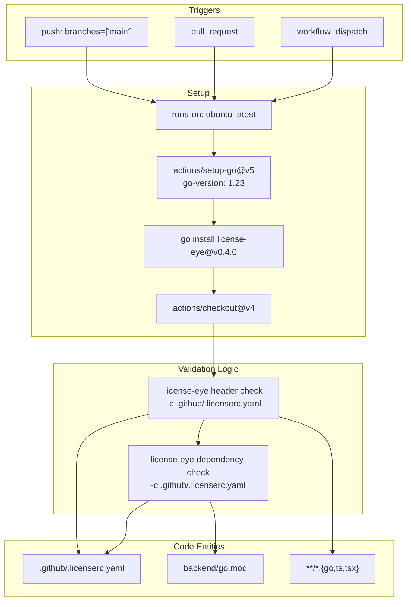
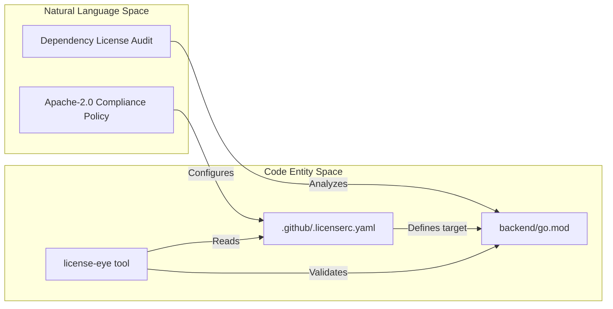

<!-- source: DeepWiki mcp.deepwiki.com · repo coze-dev/coze-studio · page 3.4 License and Compliance · fetched 2026-10-29 -->

# License and Compliance

<details>
<summary>Relevant source files</summary>

The following files were used as context for generating this wiki page:

- [.github/.licenserc.yaml](.github/.licenserc.yaml)
- [.github/workflows/license-check.yaml](.github/workflows/license-check.yaml)
- [LICENSE-APACHE](LICENSE-APACHE)

</details>


## Purpose and Scope

This document explains the automated license header enforcement and dependency license validation system used in Coze Studio's CI/CD pipeline. The system ensures all source files contain proper Apache 2.0 license headers and validates that project dependencies use compatible licenses. The implementation uses Apache SkyWalking's `license-eye` tool, configured via [.github/.licenserc.yaml:1-30]() and enforced through the GitHub Actions workflow [.github/workflows/license-check.yaml:1-39]().

For general CI/CD workflow information, see page 3. For PR validation checks, see page 3.3. For backend CI workflows, see page 3.2.

---

## License Model

Coze Studio is licensed under the Apache License 2.0, as specified in [LICENSE-APACHE:1-178](). The project uses the SPDX identifier `Apache-2.0` and copyright owner `coze-dev` in all file headers [.github/.licenserc.yaml:2-4]().

### License Requirements

| Aspect | Requirement |
|--------|-------------|
| **License Type** | Apache License 2.0 |
| **SPDX Identifier** | `Apache-2.0` |
| **Copyright Owner** | `coze-dev` |
| **Header Format** | SPDX-compliant comment header |
| **Validation Tool** | `license-eye` v0.4.0 |

**Sources:** [.github/.licenserc.yaml:2-4](), [LICENSE-APACHE:1-178]()

---

## License Header Enforcement

### Covered File Types

The license header check applies to primary source file types across the monorepo:

1. **Go Files**: All `*.go` files in the backend and common directories [.github/.licenserc.yaml:7]().
2. **Frontend TypeScript/TSX Files**: All `*.ts` and `*.tsx` files located under `frontend/apps/` and `frontend/packages/` [.github/.licenserc.yaml:8-9]().

### Excluded Paths and Generated Code

To avoid false positives, the system excludes generated code, mock files, and non-source assets. Specifically, code generated by Kitex (RPC), GORM (ORM), and various mock generators are ignored [.github/.licenserc.yaml:21-28]().

| Exclusion Pattern | Reason |
|-------------------|--------|
| `dist`, `licenses` | Build artifacts and third-party license files [.github/.licenserc.yaml:11-12]() |
| `**/*.md` | Documentation files [.github/.licenserc.yaml:13]() |
| `**/testdata/**` | Test fixture data [.github/.licenserc.yaml:14]() |
| `**/go.mod`, `**/go.sum` | Go dependency manifests [.github/.licenserc.yaml:15-16]() |
| `**/assets/assets.gen.go` | Generated asset files [.github/.licenserc.yaml:20]() |
| `**/gorm_gen/**` | Generated GORM database code [.github/.licenserc.yaml:21]() |
| `**/kitex_gen/**` | Generated Kitex RPC code [.github/.licenserc.yaml:22]() |
| `**/*.gen.go`, `**/gen.go` | General generated Go files [.github/.licenserc.yaml:23-24]() |
| `backend/api/**` | Generated API layer code [.github/.licenserc.yaml:25]() |
| `**/*_mock.go`, `**/mock/**` | Mock implementations for testing [.github/.licenserc.yaml:26-28]() |

**Sources:** [.github/.licenserc.yaml:10-28]()

---

## License Check Workflow

The license validation system runs as part of the CI pipeline through GitHub Actions, executing two distinct validation phases: header checking and dependency auditing.

### Workflow Execution Flow

The following diagram illustrates how the `license-check` job interacts with the repository configuration and the `license-eye` tool.

**Diagram: License Check Workflow Integration**


**Sources:** [.github/workflows/license-check.yaml:1-39](), [.github/.licenserc.yaml:1-30]()

---

## License Header Check Implementation

### Workflow Configuration

The `license-check` job executes on push events to the `main` branch, pull requests, and manual triggers [.github/workflows/license-check.yaml:3-9](). It uses Go 1.23 to install the required tooling [.github/workflows/license-check.yaml:18-21]().

### Tool Installation and Execution

The workflow installs `license-eye` version 0.4.0 [.github/workflows/license-check.yaml:23-25](). The header check command validates all source files against the rules defined in the configuration file [.github/workflows/license-check.yaml:32-34]():

```bash
license-eye header check -c .github/.licenserc.yaml
```

This command performs the following operations:
1. **Pattern Matching**: Scans files matching defined paths [.github/.licenserc.yaml:7-9]().
2. **Exclusion Filtering**: Applies exclusion patterns to skip generated code and mocks [.github/.licenserc.yaml:10-28]().
3. **SPDX Validation**: Verifies the presence of `SPDX-License-Identifier: Apache-2.0` [.github/.licenserc.yaml:3]().
4. **Copyright Validation**: Confirms the copyright owner is `coze-dev` [.github/.licenserc.yaml:4]().

**Sources:** [.github/workflows/license-check.yaml:13-34](), [.github/.licenserc.yaml:1-9]()

---

## Dependency License Validation

### Go Module Dependency Auditing

The dependency check validates the licenses of all Go module dependencies referenced in the backend service. This ensures that third-party libraries do not introduce incompatible license terms (e.g., strong copyleft licenses like GPL).

```yaml
# .github/workflows/license-check.yaml:36-38
- name: License Dependency Check
  run: |
    license-eye dependency check -c .github/.licenserc.yaml
```

The configuration explicitly points to the backend dependency manifest:

```yaml
# .github/.licenserc.yaml:29-30
files:
  - ../backend/go.mod
```

### Dependency Check Logic

The following diagram bridges the high-level compliance requirement to the specific file entities analyzed by the `license-eye` tool.

**Diagram: Dependency Compliance Data Flow**


**Sources:** [.github/workflows/license-check.yaml:36-39](), [.github/.licenserc.yaml:29-30]()

---

## Configuration Reference

### Complete License Configuration Structure

The [.github/.licenserc.yaml:1-30]() file defines the rules for both headers and dependencies:

| Configuration Key | Purpose | Value |
|------------------|---------|-------|
| `header.license.spdx-id` | Required SPDX identifier | `Apache-2.0` [.github/.licenserc.yaml:3]() |
| `header.license.copyright-owner` | Required owner string | `coze-dev` [.github/.licenserc.yaml:4]() |
| `header.paths` | Inclusion patterns | `**/*.go`, `frontend/.../*.{ts,tsx}` [.github/.licenserc.yaml:7-9]() |
| `header.paths-ignore` | Exclusion patterns | Generated code, mocks, and docs [.github/.licenserc.yaml:10-28]() |
| `header.files` | Dependency targets | `../backend/go.mod` [.github/.licenserc.yaml:30]() |

### Expected Header Format

The `license-eye` tool expects a comment block at the top of source files. For both Go and TypeScript, this typically follows a standard comment format:

```text
Copyright 2024 coze-dev

SPDX-License-Identifier: Apache-2.0
```

The tool automatically detects the comment syntax (e.g., `//` for Go/TS) based on the file extension and matches it against the configured `spdx-id` and `copyright-owner` [.github/.licenserc.yaml:3-4]().

**Sources:** [.github/.licenserc.yaml:1-30](), [.github/workflows/license-check.yaml:32-38]()

---

