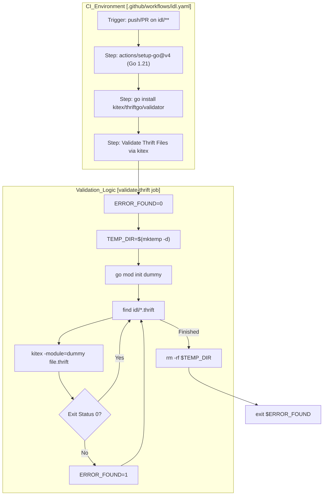
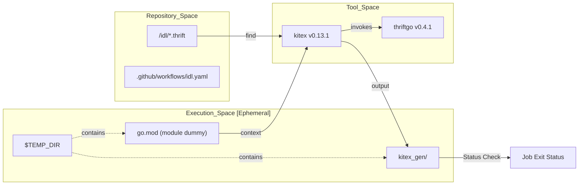

<!-- source: DeepWiki mcp.deepwiki.com · repo coze-dev/coze-studio · page 3.5 IDL Validation · fetched 2026-10-29 -->

# IDL Validation

<details>
<summary>Relevant source files</summary>

The following files were used as context for generating this wiki page:

- [.github/workflows/idl.yaml](.github/workflows/idl.yaml)

</details>


## Purpose and Scope

This page documents the Interface Definition Language (IDL) validation system used to enforce API contract correctness in Coze Studio. The validation process ensures that all Thrift IDL files maintain syntactic correctness and can successfully generate code before changes are merged.

The validation is handled by a dedicated GitHub Actions workflow that utilizes the CloudWeGo Kitex toolchain to perform dry-run code generation in an isolated environment.

## Overview

Coze Studio uses Thrift IDL files to define API contracts between frontend and backend services. These files are the source of truth for communication protocols. The validation system, defined in [.github/workflows/idl.yaml:1](), provides:

- **Syntax validation** of all Thrift files via the `thriftgo` compiler.
- **Code generation verification** using the `kitex` tool.
- **Isolated validation** using a "dummy" Go module pattern to prevent workspace pollution.
- **Automated enforcement** on every Pull Request affecting the `idl/` directory.

Sources: [.github/workflows/idl.yaml:1-13]()

## Validation Workflow Architecture

The validation process is encapsulated in the `validate-thrift` job [.github/workflows/idl.yaml:19](). It runs on `ubuntu-latest` [.github/workflows/idl.yaml:20]() and follows a strict sequence of environment setup, tool installation, and iterative file processing.

### Workflow Triggers
The workflow is triggered by changes to the IDL definitions or the workflow itself:
- **Paths**: `idl/**` or `.github/workflows/idl.yaml` [.github/workflows/idl.yaml:6-13]()
- **Events**: `push` or `pull_request` to the `main` branch [.github/workflows/idl.yaml:3-13]()

### Logical Flow
The following diagram maps the CI workflow steps to the functional logic executed within the runner.


**Diagram: IDL Validation Logic Flow**

Sources: [.github/workflows/idl.yaml:3-71]()

## Toolchain Configuration

The validation relies on specific versions of the CloudWeGo toolchain to ensure consistency with the backend service generation.

### Tool Installation
The workflow installs three primary binaries using `go install` [.github/workflows/idl.yaml:31-34]():

| Tool | Version | Role |
| :--- | :--- | :--- |
| `thriftgo` | `v0.4.1` | The underlying Thrift compiler used for parsing. |
| `kitex` | `v0.13.1` | The main CLI tool for generating Go RPC code. |
| `thrift-gen-validator` | `v0.2.6` | Plugin for generating field validation logic. |

Sources: [.github/workflows/idl.yaml:32-34]()

## Implementation Details

The core validation logic is implemented as a shell script within the `Validate Thrift Files via kitex` step [.github/workflows/idl.yaml:36]().

### The Dummy Module Pattern
To validate Thrift files without affecting the actual Go workspace or requiring complex dependency resolution, the script uses a temporary "dummy" module:
1. It creates a temporary directory using `mktemp -d` [.github/workflows/idl.yaml:42]().
2. It initializes a new Go module named `dummy` via `go mod init dummy` [.github/workflows/idl.yaml:47]().
3. This allows `kitex` to generate code into a clean, isolated environment that is deleted immediately after validation [.github/workflows/idl.yaml:60]().

### Iterative Validation Loop
The script uses a `find` command with null-terminated strings (`-print0`) to safely handle file paths, piping them into a `while` loop [.github/workflows/idl.yaml:50-56]().

For each file, it executes the following command [.github/workflows/idl.yaml:52]():
```bash
kitex -streamx -thrift ignore_initialisms=false -module=dummy "$thrift_file" 2>&1
```

- `-streamx`: Enables streaming extensions.
- `-thrift ignore_initialisms=false`: Ensures strict casing for initialisms (e.g., `ID` vs `Id`).
- `-module=dummy`: Forces the generator to treat the output as part of the temporary module.

### Error Handling
The script does not exit immediately upon finding an error. Instead, it sets an `ERROR_FOUND` flag to `1` [.github/workflows/idl.yaml:54]() and continues validating the remaining files. This provides a complete report of all broken IDL files in a single CI run. The final exit status of the job is determined by this flag [.github/workflows/idl.yaml:64-70]().

Sources: [.github/workflows/idl.yaml:38-70]()

## Data Flow: From IDL to Validation

The following diagram illustrates how IDL files move from the repository into the validation toolchain.


**Diagram: IDL Validation Data Flow**

Sources: [.github/workflows/idl.yaml:42-70]()

## Integration with Development

While this page focuses on the CI validation, these same IDL files are consumed by:
1. **Backend Services**: Using `kitex` to generate Go handlers in the `backend/` directory.
2. **Frontend Clients**: Using `idl2ts` tools to generate TypeScript types for the `frontend/` packages.

The validation workflow ensures that any change pushed to the `idl/` directory is syntactically valid for the backend generator, maintaining the integrity of the contract between the two layers.

Sources: [.github/workflows/idl.yaml:1-13]()

---

