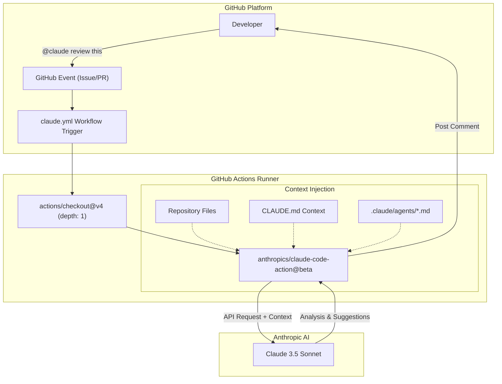
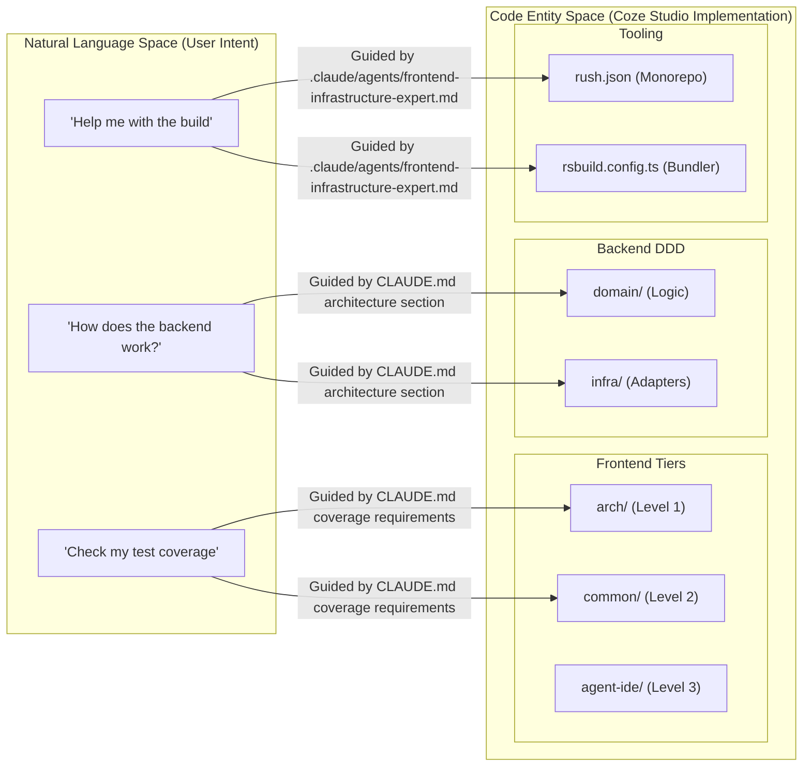

<!-- source: DeepWiki mcp.deepwiki.com · repo coze-dev/coze-studio · page 3.6 AI Assistant Integration · fetched 2026-10-29 -->

# AI Assistant Integration

<details>
<summary>Relevant source files</summary>

The following files were used as context for generating this wiki page:

- [.claude/agents/frontend-infrastructure-expert.md](.claude/agents/frontend-infrastructure-expert.md)
- [.github/workflows/claude.yml](.github/workflows/claude.yml)
- [CLAUDE.md](CLAUDE.md)

</details>


This document describes the AI assistant integration within the Coze Studio repository. It covers the GitHub Actions workflow for real-time assistance via `@claude` mentions, the project-specific guidance provided to the AI, and specialized agent configurations for infrastructure tasks.

## Overview

Coze Studio integrates Claude AI capabilities to assist developers with code reviews, debugging, and architectural guidance. This integration is powered by the `anthropics/claude-code-action@beta` and is governed by repository-specific instructions that help the AI understand the complex monorepo structure.

The integration consists of three main components:
1.  **GitHub Workflow**: Handles event triggers and execution environment.
2.  **Project Guidance (`CLAUDE.md`)**: Provides context on the monorepo architecture, technology stack, and development patterns.
3.  **Specialized Agents**: Custom configurations for specific domains like frontend infrastructure.

**Sources:** [CLAUDE.md:1-8](), [.github/workflows/claude.yml:1-49]()

## Workflow Configuration

The `Claude PR Assistant` workflow manages the lifecycle of AI interactions within GitHub Issues and Pull Requests.

### Trigger Events and Filtering

The workflow monitors several GitHub event types but executes only when the content explicitly mentions `@claude`.

| Event Type | Trigger Condition | Reference |
| :--- | :--- | :--- |
| `issue_comment` | Created | [`.github/workflows/claude.yml:4-5`]() |
| `pull_request_review_comment` | Created | [`.github/workflows/claude.yml:6-7`]() |
| `issues` | Opened or Assigned | [`.github/workflows/claude.yml:8-9`]() |
| `pull_request_review` | Submitted | [`.github/workflows/claude.yml:10-11`]() |

The filtering logic at [`.github/workflows/claude.yml:15-19`]() ensures that the runner is only provisioned when a mention is detected in the comment, review, or issue body.

### Permission Model

The workflow operates under a strict permission model to ensure security while providing the assistant with necessary context:

*   `contents: read`: Allows the assistant to analyze the codebase.
*   `pull-requests: read`: Allows access to PR diffs and discussion history.
*   `issues: read`: Allows access to issue descriptions and metadata.
*   `id-token: write`: Required for secure authentication flows.

**Sources:** [.github/workflows/claude.yml:21-25]()

## System Architecture

The following diagrams illustrate how a developer mention triggers the AI infrastructure and how the assistant maps natural language requests to specific code entities within the monorepo.

### Data Flow: Mention to Response



### Contextual Mapping: Natural Language to Code Entities

This diagram shows how `CLAUDE.md` and agent configurations bridge the gap between user intent and the specific structures of the Coze Studio codebase.



**Sources:** [.github/workflows/claude.yml:1-49](), [CLAUDE.md:73-94](), [.claude/agents/frontend-infrastructure-expert.md:1-17]()

## Project Context and Guidance

To ensure the AI provides accurate advice for the Coze Studio environment, the repository includes a `CLAUDE.md` file. This serves as the primary "brain" for the assistant when working within this monorepo.

### Key Contextual Information

*   **Monorepo Structure**: Explains the Rush.js workspace and the 135+ frontend packages organized into 4 levels [`CLAUDE.md:75-84`]().
*   **Backend Architecture**: Details the Go-based DDD (Domain-Driven Design) approach using the Hertz framework [`CLAUDE.md:86-94`]().
*   **Development Commands**: Lists essential commands for environment setup (`rush update`, `make middleware`), building (`make fe`, `make server`), and testing (`rush test`) [`CLAUDE.md:9-60`]().
*   **Testing Strategy**: Defines coverage requirements (e.g., Level 1 packages require 80% coverage) [`CLAUDE.md:148-159`]().

**Sources:** [CLAUDE.md:1-200]()

## Specialized Agent: Frontend Infrastructure Expert

The repository defines a specialized agent configuration at [`.claude/agents/frontend-infrastructure-expert.md`]() to handle complex tooling tasks.

### Agent Profile

*   **Name**: `frontend-infrastructure-expert`
*   **Model**: Claude 3.5 Sonnet
*   **Scope**: Build tools (Rspack, Webpack), linters (ESLint), monorepo management (`rush.json`), and CI/CD pipelines [`.claude/agents/frontend-infrastructure-expert.md:2-4`]().

### Operational Logic

The agent is instructed to follow a specific diagnostic and implementation flow:
1.  **Context Awareness**: Prioritize existing project structure and dependencies before suggesting changes [`.claude/agents/frontend-infrastructure-expert.md:19-20`]().
2.  **Performance Focus**: Balance developer experience (DX) with build performance [`.claude/agents/frontend-infrastructure-expert.md:20-21`]().
3.  **Troubleshooting**: Systematically check logs and configurations before providing step-by-step solutions [`.claude/agents/frontend-infrastructure-expert.md:25-27`]().

**Sources:** [.claude/agents/frontend-infrastructure-expert.md:1-32]()

## Implementation Details

### Workflow Step Configuration

The core execution step uses the following configuration:

```yaml
- name: Run Claude PR Action
  uses: anthropics/claude-code-action@beta
  with:
    anthropic_api_key: ${{ secrets.ANTHROPIC_API_KEY }}
    timeout_minutes: '60'
```

The action supports an optional `experimental_allowed_domains` parameter to restrict network access, enhancing security by preventing data exfiltration to unauthorized endpoints [`.github/workflows/claude.yml:40-48`]().

### Interaction with Monorepo Tiers

The assistant is trained via `CLAUDE.md` to respect the frontend package tier system:
*   **Level 1 (`arch/`)**: Core infrastructure.
*   **Level 2 (`common/`)**: Shared components.
*   **Level 3 (`agent-ide/`, `workflow/`, `studio/`)**: Feature domains.
*   **Level 4 (`apps/coze-studio`)**: Main application.

This ensures that when a user asks for a change in a Level 3 package, the AI does not suggest adding a circular dependency to a Level 4 package.

**Sources:** [CLAUDE.md:80-84](), [.github/workflows/claude.yml:32-38]()

## Usage Summary

| Feature | Implementation | Purpose |
| :--- | :--- | :--- |
| **Trigger** | `@claude` mention | On-demand AI assistance |
| **Auth** | `ANTHROPIC_API_KEY` | Secure API access |
| **Context** | `CLAUDE.md` | Monorepo-aware reasoning |
| **Specialization** | `.claude/agents/` | Expert-level infrastructure help |
| **Timeout** | 60 Minutes | Prevent runaway CI costs |

**Sources:** [.github/workflows/claude.yml:1-49](), [CLAUDE.md:1-10](), [.claude/agents/frontend-infrastructure-expert.md:1-10]()

---

