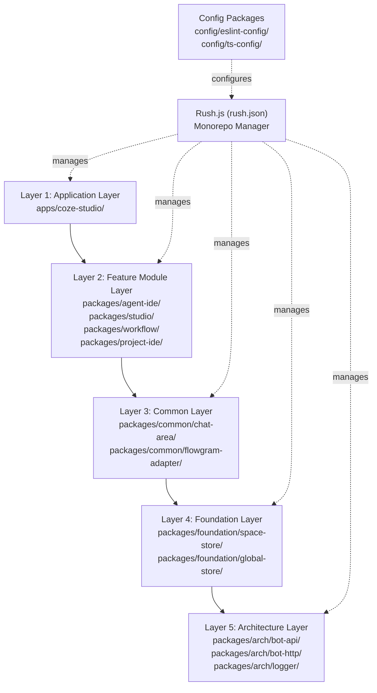
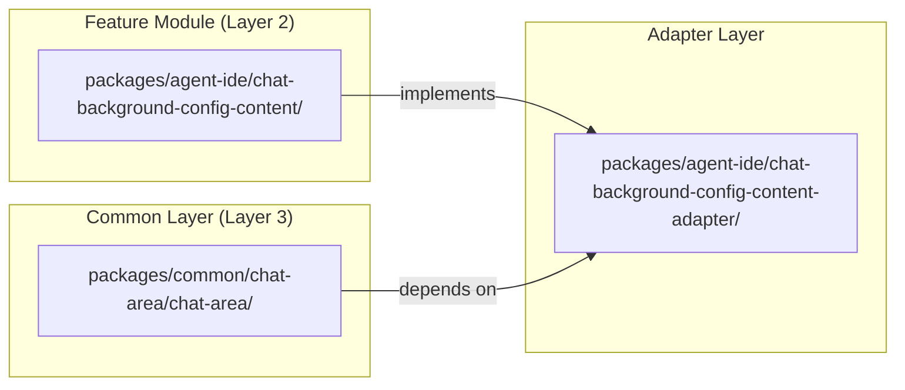
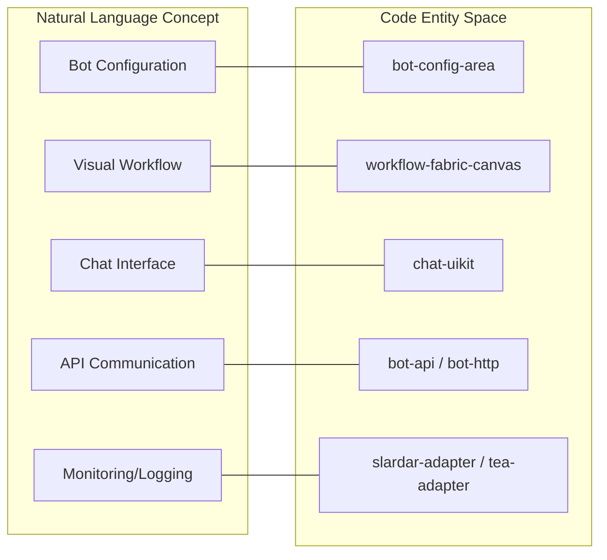

<!-- source: DeepWiki mcp.deepwiki.com · repo coze-dev/coze-studio · page 4 Frontend System · fetched 2026-10-29 -->

# Frontend System

Relevant source files

The following files were used as context for generating this wiki page:

- [.claude/agents/frontend-infrastructure-expert.md](.claude/agents/frontend-infrastructure-expert.md)
- [.dockerignore](.dockerignore)
- [.github/CODEOWNERS](.github/CODEOWNERS)

## Purpose and Scope

The Coze Studio frontend is a sophisticated monorepo containing **over 170 TypeScript/React packages**. It is engineered using a strict 5-layer dependency architecture that ensures modularity, testability, and clear separation of concerns. The system is managed by **Rush.js** and leverages the **adapter pattern** extensively to handle multi-tenancy and dependency injection.

This page serves as a high-level entry point to the frontend codebase, summarizing the architectural layers, package organization, and core feature domains.

For deep dives into specific subsystems, refer to the following child pages:
- [Monorepo Management](#4.1) — Rush.js, pnpm, and subspace configurations.
- [Package Organization](#4.2) — Detailed breakdown of the tier system (Level 1-4).
- [Build System and Tooling](#4.3) — Rsbuild, Rspack, and linting infrastructure.
- [Agent IDE System](#4.4) — The core bot configuration and debugging environment.
- [Studio System](#4.5) — Workspace management, publishing, and bot stores.
- [Workflow System](#4.6) — Visual canvas engine and node execution.
- [Project IDE System](#4.7) — Framework for project-based development.
- [Architecture Layer Packages](#4.8) — Core services like API clients, i18n, and logging.
- [Feature Domains](#4.9) — Shared data, components, and chat UI logic.

---

## Frontend Architecture Overview

The frontend follows a **strict 5-layer dependency architecture** where each layer can only depend on layers below it. This prevents circular dependencies across the massive package graph.

### Five-Layer Architecture

**Sources:** [.github/CODEOWNERS:1-280](), [.claude/agents/frontend-infrastructure-expert.md:8-16]()

### The Adapter Pattern

A defining characteristic of this codebase is the use of **Adapters**. With over 40 `-adapter` packages, the system decouples interfaces from implementations. This allows higher-level feature modules (like `agent-ide`) to inject business logic into lower-level common components (like `chat-area`) without creating upward dependencies.

**Sources:** [.github/CODEOWNERS:69-70](), [.github/CODEOWNERS:80-81](), [.github/CODEOWNERS:83-83]()

---

## Core Systems and Packages

### 1. Application Layer (Layer 1)
The entry point of the entire frontend is located in `apps/coze-studio/`. It composes all feature modules and manages routing.
- **Main App:** `@coze/coze-studio` [[frontend/apps/coze-studio/]]()

### 2. Feature Modules (Layer 2)
These packages contain the primary business logic for the different IDE experiences.
- **Agent IDE:** Manages the "Bot" configuration experience, including prompts, models, and tools.
  - *Key Packages:* `bot-editor-context-store`, `bot-config-area`, `chat-debug-area`. [[frontend/packages/agent-ide/]]()
- **Studio:** Handles workspace-level concerns like bot lists, publishing, and user stores.
  - *Key Packages:* `studio/stores/bot-detail`, `studio/user-store`, `studio/autosave`. [[frontend/packages/studio/]]()
- **Workflow:** A visual programming environment for AI logic.
  - *Key Packages:* `workflow/base`, `workflow/fabric-canvas`, `workflow/nodes`. [[frontend/packages/workflow/]]()
- **Project IDE:** A specialized IDE framework for complex project structures. [[frontend/packages/project-ide/]]()

### 3. Common Layer (Layer 3)
Shared business logic that isn't tied to a specific IDE but is specific to the Coze domain.
- **Chat Area:** The core chat UI and streaming message logic used across all IDEs. [[frontend/packages/common/chat-area/]]()
- **Flowgram Adapter:** Integration logic for the FlowGram canvas engine. [[frontend/packages/common/flowgram-adapter/]]()

### 4. Foundation Layer (Layer 4)
Fundamental application services that manage the "Session" and "Environment".
- **Space Store:** Manages workspace context and multi-tenancy. [[frontend/packages/foundation/space-store/]]()
- **Global Store:** Application-wide state management. [[frontend/packages/foundation/global-store/]]()
- **Local Storage:** Persistent client-side data. [[frontend/packages/foundation/local-storage/]]()

### 5. Architecture Layer (Layer 5)
Low-level infrastructure and utilities.
- **Bot API & HTTP:** The communication layer for backend services. [[frontend/packages/arch/bot-api/]](), [[frontend/packages/arch/bot-http/]]()
- **I18n:** Internationalization framework and resources. [[frontend/packages/arch/i18n/]]()
- **Logger:** Unified logging and monitoring (Slardar/Tea). [[frontend/packages/arch/logger/]]()

---

## Infrastructure and Tooling

The frontend infrastructure is managed by a dedicated suite of tools and configurations:

| Category | Key Entities / Locations |
| :--- | :--- |
| **Monorepo** | Rush.js, `rush.json`, pnpm workspaces |
| **Build Tool** | Rsbuild, Rspack, Webpack |
| **Linting** | ESLint (`config/eslint-config`), Stylelint, Prettier |
| **Type Safety** | TypeScript (`config/ts-config`), IDL-to-TS generation |
| **Testing** | Vitest (`config/vitest-config`) |
| **CSS** | Tailwind CSS, PostCSS |

**Sources:** [.claude/agents/frontend-infrastructure-expert.md:3-16](), [.prettierrc.js:1-4](), [.github/CODEOWNERS:13-16]()

---

## System Mapping: Concepts to Code

To help navigate the codebase, use the following mapping of high-level concepts to their primary code identifiers:

**Sources:** [.github/CODEOWNERS:10](), [.github/CODEOWNERS:42](), [.github/CODEOWNERS:72](), [.github/CODEOWNERS:193](), [.github/CODEOWNERS:38-53]()

---

