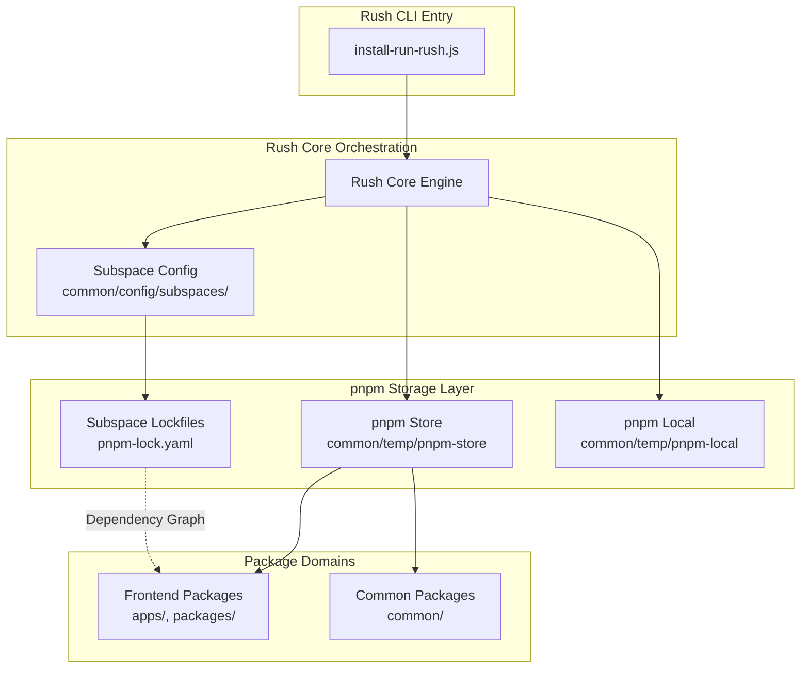
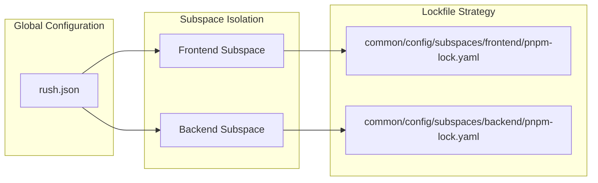
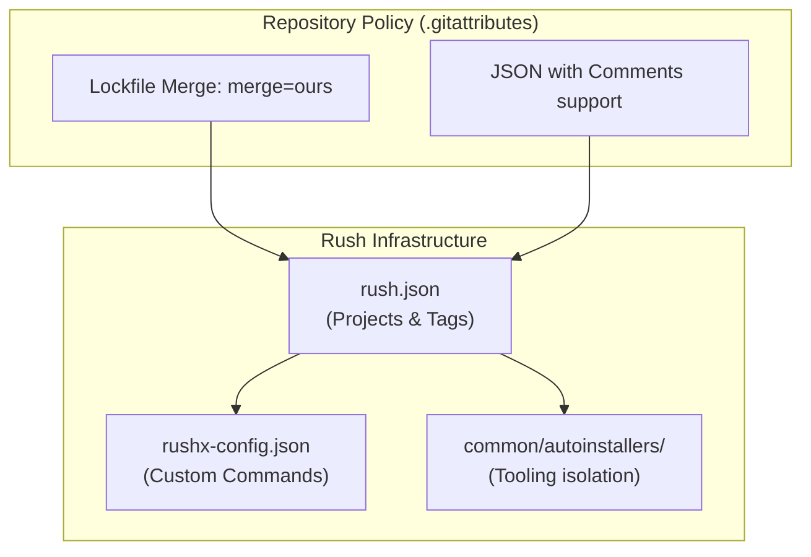

<!-- source: DeepWiki mcp.deepwiki.com · repo coze-dev/coze-studio · page 4.1 Monorepo Management · fetched 2026-10-29 -->

# Monorepo Management

<details>
<summary>Relevant source files</summary>

The following files were used as context for generating this wiki page:

- [.claude/agents/frontend-infrastructure-expert.md](.claude/agents/frontend-infrastructure-expert.md)
- [.gitattributes](.gitattributes)
- [.github/workflows/ci.yml](.github/workflows/ci.yml)

</details>


## Purpose and Scope

This document describes the monorepo management infrastructure for Coze Studio, which orchestrates a large-scale frontend ecosystem using Rush.js. It covers Rush configuration, pnpm 8.15.8 integration, incremental build operations, subspaces, caching strategies, and autoinstaller plugins. The infrastructure is designed to handle 170+ packages with complex dependency graphs and strict architectural tiers.

For information about the overall frontend architecture and package organization, see [Package Organization](4.2). For build tooling and compilation details, see [Build System and Tooling](4.3).

---

## Rush.js Overview

Rush.js serves as the central orchestrator for the Coze Studio monorepo, managing dependencies, builds, and operations across the entire package graph. It provides:

- **Incremental builds**: Only rebuilds packages affected by changes, optimized via a custom `increment` script [[.github/workflows/ci.yml:126-127]()].
- **Parallel execution**: Executes operations across multiple packages simultaneously while respecting dependency order.
- **Subspace isolation**: Separates groups of packages into independent dependency graphs via `common/config/subspaces/` to reduce lockfile contention [[.github/workflows/ci.yml:108-108]()].
- **pnpm integration**: Uses pnpm 8.15.8's efficient storage mechanism with workspace protocol.
- **Autoinstallers**: Self-contained environments for build tools and plugins like `rush-commitlint` [[.github/workflows/common-pr-checks.yml:42-45]()].

The monorepo is accessed via the Rush CLI, which is bootstrapped through `common/scripts/install-run-rush.js` to ensure consistent versioning across all environments without requiring global installation [[.github/workflows/ci.yml:122-124](), [.github/workflows/common-pr-checks.yml:34-34]()].

---

## Package Manager Integration

### pnpm Configuration

Rush.js integrates with pnpm 8.15.8 as the package manager, leveraging its content-addressable storage and workspace capabilities. The integration provides:

| Feature | Implementation |
|---------|----------------|
| **Store Location** | `common/temp/pnpm-store` (local), `common/temp/pnpm-local` (workspace cache) [[.github/workflows/ci.yml:105-106]()] |
| **Workspace Protocol** | Enables cross-package references within the monorepo using `workspace:*` versions. |
| **Installation Strategy** | Incremental installation based on changed files [[.github/workflows/ci.yml:124-124]()] |
| **Cache Optimization** | CI caching keyed on subspace lock files [[.github/workflows/ci.yml:108-108]()] |



**Sources:** [.github/workflows/ci.yml:101-111](), [.github/workflows/ci.yml:122-124]()

### Lock File Management

Lock files are managed with special Git merge strategies defined in `.gitattributes` to prevent invalid results during concurrent development [[.gitattributes:1-6]()]:

```
pnpm-lock.yaml merge=ours
shrinkwrap.yaml merge=binary
npm-shrinkwrap.json merge=binary
yarn.lock merge=binary
```

The `merge=ours` strategy for `pnpm-lock.yaml` ensures that during merges, the current branch's lock file takes precedence to avoid syntax-level merge conflicts. After merging, developers are expected to run `rush update` to regenerate the lock file correctly [[.gitattributes:1-3]()].

**Sources:** [.gitattributes:1-8]()

---

## Subspaces

Subspaces are Rush.js workspaces that isolate groups of packages with independent dependency graphs. The Coze Studio monorepo uses subspaces to separate concerns, primarily to keep the frontend dependency graph isolated from other repository segments.

Each subspace maintains its own `pnpm-lock.yaml` file in `common/config/subspaces/*/pnpm-lock.yaml`. This allows independent versioning of dependencies while sharing the same pnpm store for deduplication across the disk [[.github/workflows/ci.yml:108-108]()].



**Sources:** [.github/workflows/ci.yml:108-108]()

---

## Incremental Operations

### Changed File Detection

The CI pipeline implements a `setup` job that uses `tj-actions/changed-files` to enable incremental operations [[.github/workflows/ci.yml:19-85]()]:

1. **Detection**: Retrieves all changed files in the PR [[.github/workflows/ci.yml:37-39]()].
2. **Filtering**: Excludes files in `common/changes/` (Rush change logs) to avoid false-positive rebuilds [[.github/workflows/ci.yml:47-57]()].
3. **Artifact Generation**: Creates `changed-files-cache.json` containing the list of filtered files [[.github/workflows/ci.yml:59-60]()].
4. **Distribution**: Uploads the JSON as an artifact for downstream jobs like `build`, `test`, and `lint` [[.github/workflows/ci.yml:79-84]()].

### Increment Command Pattern

All CI jobs (build, test, lint, etc.) follow a consistent pattern for incremental operations using the `rush increment` command [[.github/workflows/ci.yml:124-127](), [.github/workflows/ci.yml:165-168](), [.github/workflows/ci.yml:214-217]()]:

| Step | Command | Purpose |
|------|---------|---------|
| **1. Install Core** | `rush install --to tag:core` | Installs foundational packages tagged as core [[.github/workflows/ci.yml:122-122]()]. |
| **2. Update Autoinstallers** | `rush update-autoinstaller --name plugins` | Ensures required plugins are available [[.github/workflows/ci.yml:123-123]()]. |
| **3. Increment Install** | `rush increment --action install -p cache.json` | Installs dependencies only for affected packages [[.github/workflows/ci.yml:124-124]()]. |
| **4. Increment Operation** | `rush increment --action <op> -p cache.json` | Runs target (build/lint/test) on affected packages [[.github/workflows/ci.yml:127-127]()]. |

**Sources:** [.github/workflows/ci.yml:37-67](), [.github/workflows/ci.yml:113-128]()

---

## Autoinstallers

Autoinstallers provide isolated environments for build tools and plugins that are used by Rush itself. They have their own `package.json` and lock file and are updated explicitly via `rush update-autoinstaller` [[.github/workflows/ci.yml:123-123](), [.github/workflows/common-pr-checks.yml:42-42]()].

### Key Autoinstallers
- **plugins**: General Rush plugins for build orchestration [[.github/workflows/ci.yml:123-123]()].
- **rush-commitlint**: Used for validating PR titles and commit messages against `commitlint.config.js` [[.github/workflows/common-pr-checks.yml:42-45]()].
- **rush-lint-staged**: Manages linting of staged files during local development to ensure code quality before commit.

**Sources:** [.github/workflows/ci.yml:123-123](), [.github/workflows/common-pr-checks.yml:42-45]()

---

## Project Metadata and Tags

The monorepo uses project tags defined in `rush.json` to manage the large number of packages. These tags facilitate selective execution and ownership tracking:

- **Team Ownership**: `team-*` (e.g., `team-studio`, `team-workflow`) defines which team is responsible for the package.
- **Dependency Level**: `level-*` (level-1 through level-4) defines the package's position in the architecture tier.
- **Core Status**: `tag:core` identifies foundational packages required for the bootstrap of most operations [[.github/workflows/ci.yml:122-122]()].

---

## Configuration Management

### rushx-config.json
This file defines custom command behaviors and per-package script overrides. It allows the `rush increment` action to map high-level actions (like `test:cov`) to specific package-level scripts across the heterogeneous package types.

### Git Integration
The `.gitattributes` file ensures that JSON files containing comments (common in Rush and TypeScript configs) are handled correctly by syntax highlighters using `linguist-language=JSON-with-Comments` [[.gitattributes:10-16]()].



**Sources:** [.gitattributes:1-16](), [.github/workflows/ci.yml:108-108](), [.github/workflows/common-pr-checks.yml:42-45]()

---

