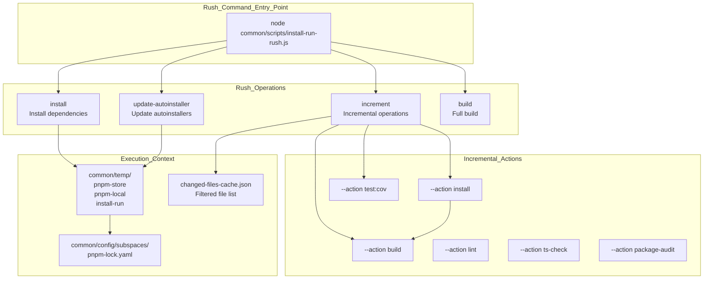
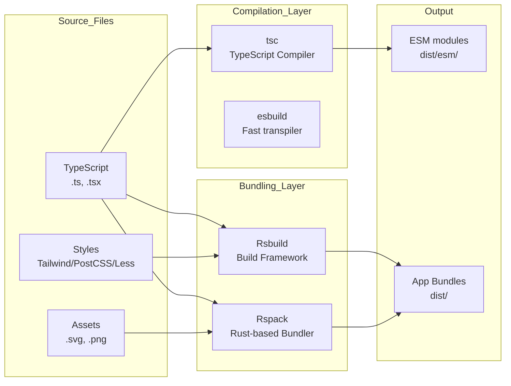
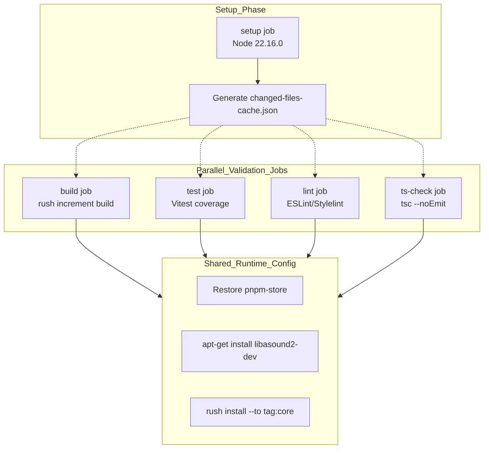

<!-- source: DeepWiki mcp.deepwiki.com · repo coze-dev/coze-studio · page 4.3 Build System and Tooling · fetched 2026-10-29 -->

# Build System and Tooling

Relevant source files

The following files were used as context for generating this wiki page:

- [.claude/agents/frontend-infrastructure-expert.md](.claude/agents/frontend-infrastructure-expert.md)
- [.github/workflows/ci.yml](.github/workflows/ci.yml)
- [.prettierrc.js](.prettierrc.js)

## Purpose and Scope

This document provides a technical deep dive into the build system and developer tooling for the Coze Studio frontend monorepo. It covers the orchestration of 170+ packages using Rush.js, the compilation pipeline featuring Rsbuild and Rspack, and the rigorous code quality enforcement through ESLint, Prettier, Stylelint, and Vitest.

The build system is designed for high-performance incremental execution, ensuring that developer feedback loops remain fast despite the repository's scale.

---

## Build Orchestration

The monorepo uses **Rush.js** as its primary build orchestrator, coordinating operations across all packages while respecting dependency relationships and enabling incremental builds.

### Rush Execution Model

**Sources:** [.github/workflows/ci.yml:119-127](), [.claude/agents/frontend-infrastructure-expert.md:13-14]()

### Rush Command Patterns

The build system uses standardized Rush invocation patterns to manage the dependency graph:

| Command Pattern | Purpose | Usage Context |
|----------------|---------|---------------|
| `rush install --to tag:core` | Install dependencies for core packages | Initial setup, CI bootstrap [ .github/workflows/ci.yml:122]() |
| `rush update-autoinstaller --name plugins` | Update autoinstaller for build plugins | Before incremental builds [ .github/workflows/ci.yml:123]() |
| `rush increment --action build -p <file>` | Build only changed packages and dependents | CI, incremental workflows [ .github/workflows/ci.yml:127]() |
| `rush increment --action test:cov -p <file>` | Run Vitest with coverage for changed packages | CI test job [ .github/workflows/ci.yml:168]() |
| `rush increment --action lint -p <file>` | Run ESLint/Stylelint for changed packages | CI lint job [ .github/workflows/ci.yml:217]() |
| `rush increment --action ts-check -p <file>` | Run `tsc --noEmit` for changed packages | CI type-check job [ .github/workflows/ci.yml:266]() |

**Sources:** [.github/workflows/ci.yml:119-299](), [.claude/agents/frontend-infrastructure-expert.md:3-8]()

---

## Build Pipeline and Tooling

The frontend build system employs a modern stack centered around Rspack for high-speed bundling and TypeScript for type safety.

### Build Tool Stack

**Sources:** [.claude/agents/frontend-infrastructure-expert.md:3-11](), [.vscode/settings.template.json:98-103]()

### TypeScript and Bundling
*   **TypeScript**: Managed via `frontend/config/ts-config/`. The system uses `typescript.tsdk` pointing to the monorepo's specific version to ensure consistency across IDEs and CI [ .vscode/settings.template.json:98-99]().
*   **Rspack/Rsbuild**: The primary bundling engine. It replaces Webpack to provide significantly faster build times by leveraging Rust-based compilation [ .claude/agents/frontend-infrastructure-expert.md:3-11]().
*   **Tailwind CSS & PostCSS**: Integrated into the Rsbuild pipeline for utility-first styling.

### Code Quality and Formatting
The repository enforces a strict, unified code style across all packages:

*   **ESLint**: Configured via `frontend/config/eslint-config/`. It uses Flat Config (`eslint.useFlatConfig: true`) and is probed for JS/TS/React files [ .vscode/settings.template.json:85-94]().
*   **Prettier**: The source of truth for formatting is `frontend/config/eslint-config/.prettierrc.js`, which is imported by the root `.prettierrc.js` [ .prettierrc.js:1-4]().
*   **Stylelint**: Validates CSS, SCSS, and Less files. The VS Code extension is configured to use the version installed in `frontend/config/stylelint-config/` [ .vscode/settings.template.json:140-142]().

---

## CI Build Integration

The CI pipeline orchestrates multiple validation jobs in parallel. Each job leverages the `changed-files-cache.json` to perform incremental operations.

### CI Job Architecture

**Sources:** [.github/workflows/ci.yml:19-299](), [.github/workflows/ci.yml:120-121]()

### Testing with Vitest
Unit and integration tests are executed using **Vitest**.
*   **Coverage**: Generated during the `test:cov` action [ .github/workflows/ci.yml:168]().
*   **Environment**: CI jobs install `libasound2-dev` to support headless environments for packages requiring audio/media APIs [ .github/workflows/ci.yml:121]().

---

## Developer Environment Configuration

The build system is tightly integrated with VS Code to provide a seamless "format-on-save" experience and consistent linting.

### VS Code Tooling Integration

| Tool | Configuration / Extension | Behavior |
|------|---------------------------|----------|
| **Formatting** | `esbenp.prettier-vscode` | Default formatter for TS, JS, JSON, YAML, CSS [ .vscode/settings.template.json:144-176]() |
| **Linting** | `eslint.enable: true` | Real-time feedback using flat config [ .vscode/settings.template.json:93-94]() |
| **Stylelint** | `stylelint.vscode-stylelint` | Validates `css`, `scss`, `less` [ .vscode/settings.template.json:141]() |
| **TypeScript** | `typescript.tsdk` | Uses workspace version for consistent diagnostics [ .vscode/settings.template.json:98]() |
| **Editor** | `editor.formatOnSave: true` | Automatic cleanup on every save [ .vscode/settings.template.json:6]() |

**Sources:** [.vscode/settings.template.json:1-198](), [.vscode/extensions.json:1-10]()

### Infrastructure Utilities
*   **Autoinstallers**: Rush autoinstallers in `common/autoinstallers/` (e.g., `rush-commitlint`, `rush-lint-staged`) automate git hook setup and commit validation [ .claude/agents/frontend-infrastructure-expert.md:13-16]().
*   **Custom Plugins**: Build-time transformations and optimizations are handled by plugins located in `infra/plugins/` and documented for infrastructure experts [ .claude/agents/frontend-infrastructure-expert.md:3-11]().
*   **Performance Tuning**: `typescript.tsserver.maxTsServerMemory` is set to 16GB (16384MB) to handle the large monorepo type graph [ .vscode/settings.template.json:113]().

**Sources:** [.vscode/settings.template.json:113](), [.claude/agents/frontend-infrastructure-expert.md:3-11]()

---

