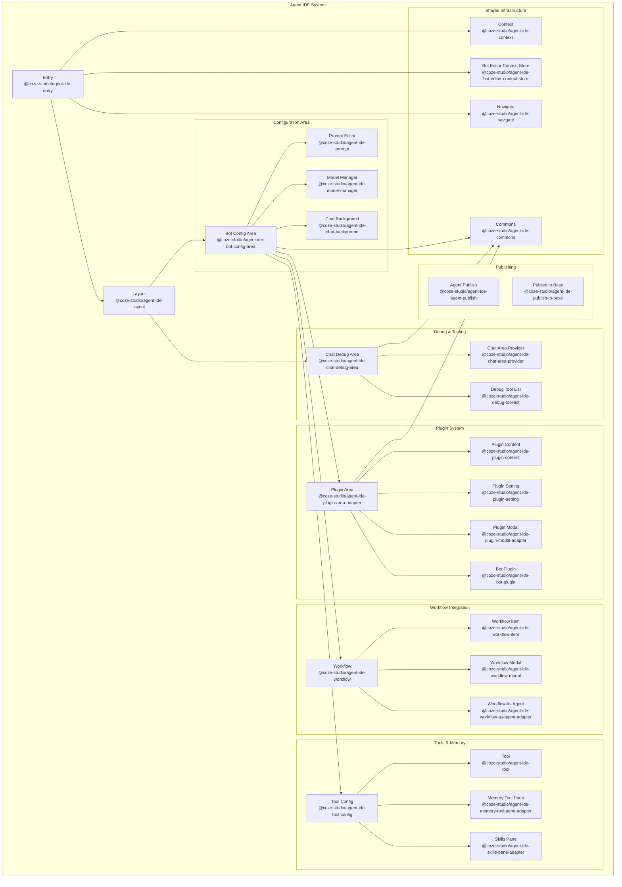
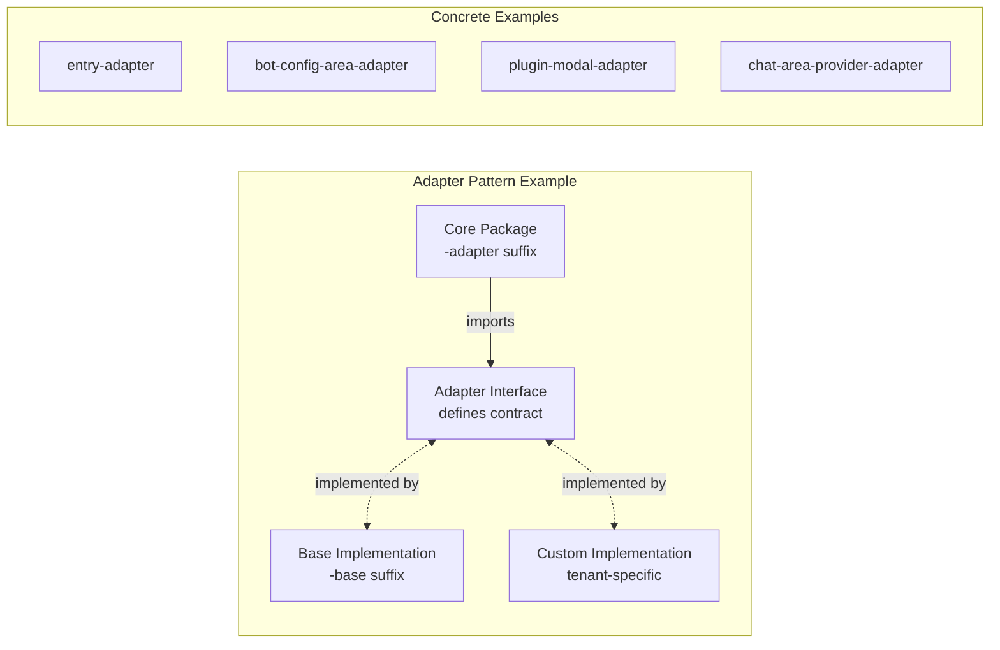
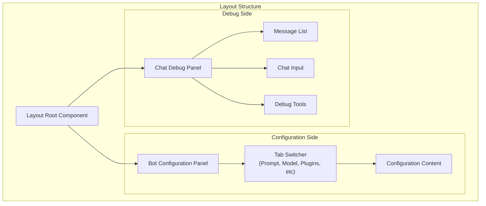
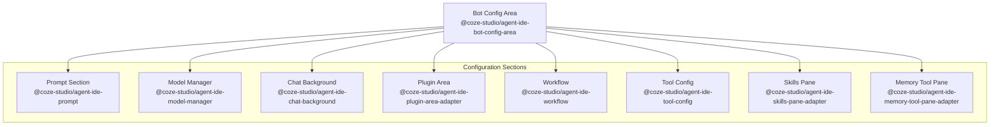
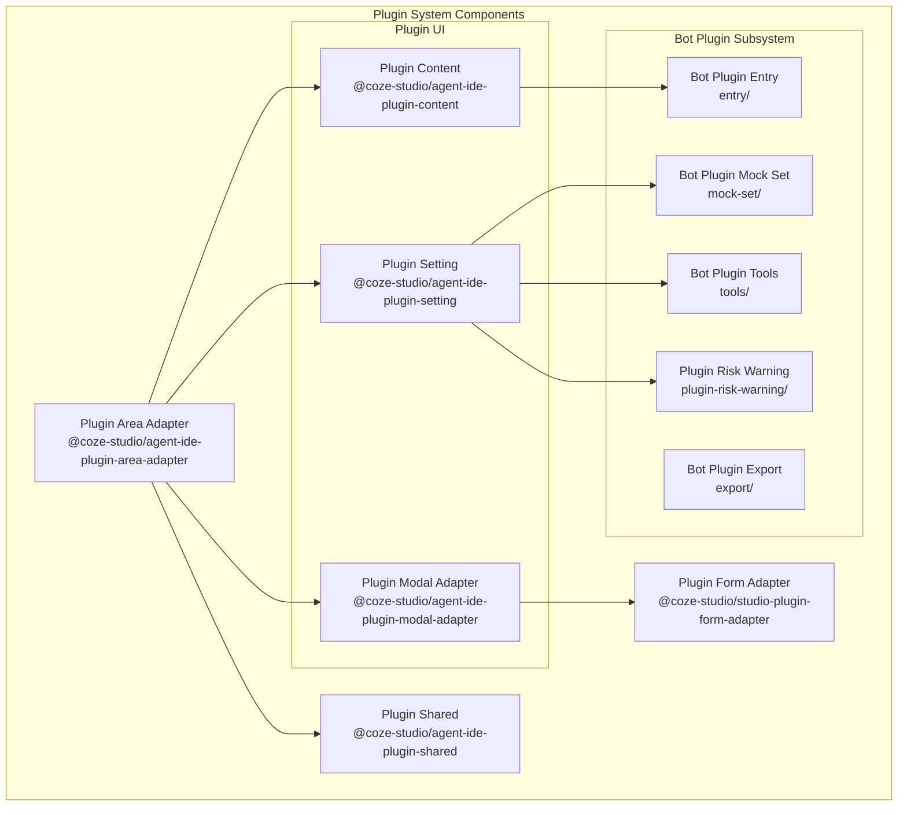
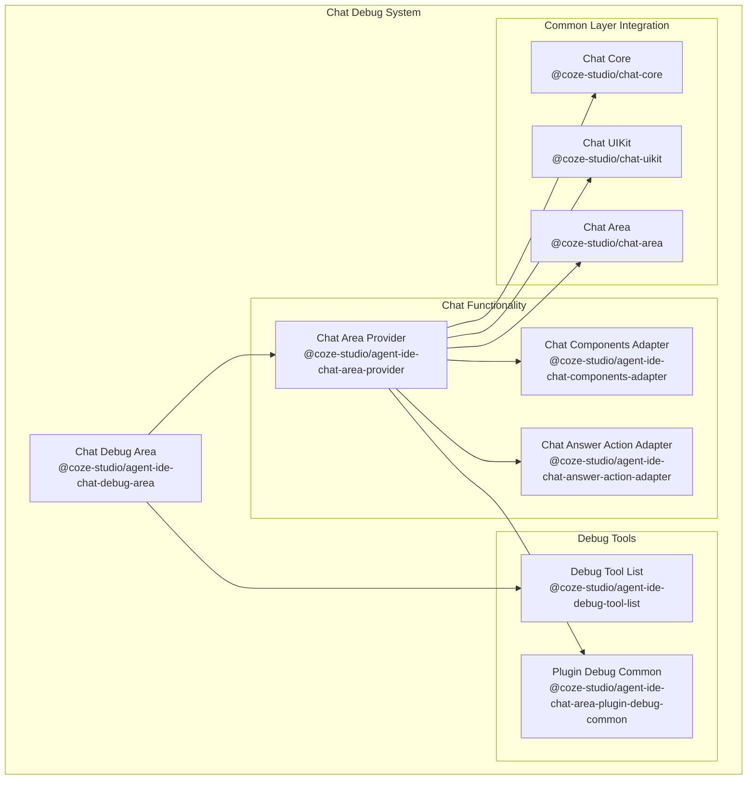
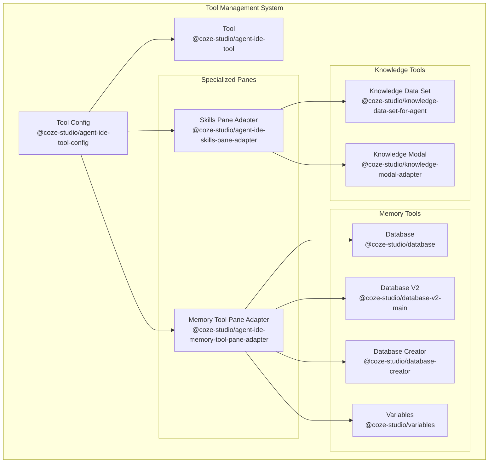
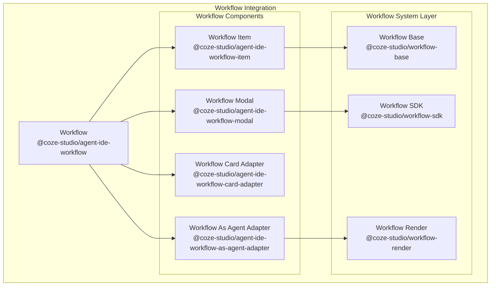
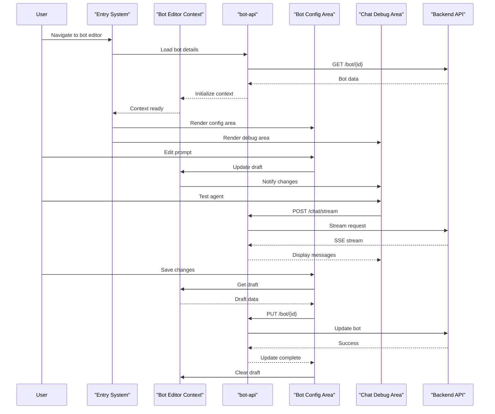

<!-- source: DeepWiki mcp.deepwiki.com · repo coze-dev/coze-studio · page 4.4 Agent IDE System · fetched 2026-10-29 -->

# Agent IDE System

Relevant source files

The following files were used as context for generating this wiki page:

- [.github/.licenserc.yaml](.github/.licenserc.yaml)
- [.github/CODEOWNERS](.github/CODEOWNERS)

## Purpose and Scope

The Agent IDE System is a comprehensive development environment for creating, configuring, testing, and publishing AI agents (bots) within Coze Studio. This system encompasses over 40 specialized packages that provide the core editing interface, debugging tools, plugin management, workflow integration, and publishing capabilities for agent development.

This document covers the Agent IDE feature module located at `frontend/packages/agent-ide/`, which operates at the Feature Module Layer (Layer 2) of the frontend architecture. For information about the broader Studio management features (bot listing, workspace management), see the Studio System documentation. For workflow visual editing capabilities, see the Workflow System documentation.

**Sources:** [.github/CODEOWNERS:7-8](), [.github/CODEOWNERS:61-213]()

## System Architecture

The Agent IDE System follows a modular architecture with adapter-based dependency injection, allowing different implementations to be swapped based on deployment context (multi-tenancy, environment-specific features). The system is composed of several major subsystems organized around the agent development lifecycle.

### High-Level Component Organization

Title: Agent IDE Package Topology

**Sources:** [.github/CODEOWNERS:61-213](), [frontend/packages/agent-ide/]()

### Adapter Pattern Implementation

The Agent IDE extensively uses the adapter pattern to enable dependency injection and support multi-tenancy. This architectural pattern allows different implementations to be provided based on deployment context without changing core business logic.

Title: Agent IDE Adapter Pattern

Key adapter packages in Agent IDE:
- `frontend/packages/agent-ide/entry-adapter/` - Entry point dependency injection
- `frontend/packages/agent-ide/bot-config-area-adapter/` - Bot configuration dependencies
- `frontend/packages/agent-ide/plugin-modal-adapter/` - Plugin UI dependencies
- `frontend/packages/agent-ide/chat-area-provider-adapter/` - Chat functionality dependencies
- `frontend/packages/agent-ide/layout-adapter/` - Layout dependencies

**Sources:** [.github/CODEOWNERS:157-213]()

## Entry Point and Layout

### Entry System

The entry system provides the main initialization and routing for the Agent IDE interface. It coordinates the loading of all subsystems and establishes the context for agent editing.

**Key Packages:**
- `@coze-studio/agent-ide-entry-adapter` - Adapter for entry point dependencies `[frontend/packages/agent-ide/entry-adapter/]()`
- `@coze-studio/agent-ide-entry` - Core entry point implementation `[frontend/packages/agent-ide/entry/]()`

The entry system is responsible for:
- Initializing the agent editor context
- Loading bot details from the backend
- Setting up routing within the agent editor
- Providing navigation utilities

**Sources:** [.github/CODEOWNERS:157-158]()

### Layout System

The layout system defines the spatial organization of the Agent IDE interface, typically featuring a configuration area on the left/center and a debug chat area on the right.

**Key Packages:**
- `@coze-studio/agent-ide-layout-adapter` - Layout dependency injection `[frontend/packages/agent-ide/layout-adapter/]()`
- `@coze-studio/agent-ide-layout` - Layout implementation `[frontend/packages/agent-ide/layout/]()`
- `@coze-studio/agent-ide-navigate` - Navigation utilities `[frontend/packages/agent-ide/navigate/]()`

Title: IDE Layout Structure

**Sources:** [.github/CODEOWNERS:210-211](), [.github/CODEOWNERS:203]()

## Bot Configuration Area

The Bot Configuration Area provides the primary interface for editing agent properties including prompts, model selection, chat background, and tool configuration.

### Configuration Components

Title: Bot Configuration Components

**Key Packages:**
- `@coze-studio/agent-ide-bot-config-area-adapter` - Configuration area adapter `[frontend/packages/agent-ide/bot-config-area-adapter/]()`
- `@coze-studio/agent-ide-bot-config-area` - Configuration area implementation `[frontend/packages/agent-ide/bot-config-area/]()`

**Sources:** [.github/CODEOWNERS:159-160]()

### Prompt Editor

The prompt editor allows developers to craft and manage the system prompts that define agent behavior.

**Key Packages:**
- `@coze-studio/agent-ide-prompt-adapter` - Prompt editor adapter `[frontend/packages/agent-ide/prompt-adapter/]()`
- `@coze-studio/agent-ide-prompt` - Prompt editor implementation `[frontend/packages/agent-ide/prompt/]()`

The prompt editor integrates with `@coze-studio/prompt-kit` from the Common Layer for prompt management and `@coze-studio/md-editor-adapter` for markdown editing.

**Sources:** [.github/CODEOWNERS:200-201]()

### Model Manager

The model manager provides the interface for selecting and configuring AI models for the agent.

**Key Package:**
- `@coze-studio/agent-ide-model-manager` - Model selection and configuration `[frontend/packages/agent-ide/model-manager/]()`

The model manager includes multi-agent model configuration support at `frontend/packages/agent-ide/model-manager/src/components/multi-agent/`.

**Sources:** [.github/CODEOWNERS:92-93]()

### Chat Background Configuration

The chat background system allows customization of the chat interface appearance and behavior.

**Key Packages:**
- `@coze-studio/agent-ide-chat-background` - Main background configuration `[frontend/packages/agent-ide/chat-background/]()`
- `@coze-studio/agent-ide-chat-background-config-content-adapter` - Configuration content adapter `[frontend/packages/agent-ide/chat-background-config-content-adapter/]()`
- `@coze-studio/agent-ide-chat-background-config-content` - Configuration content implementation `[frontend/packages/agent-ide/chat-background-config-content/]()`
- `@coze-studio/agent-ide-chat-background-shared` - Shared background utilities `[frontend/packages/agent-ide/chat-background-shared/]()`

**Sources:** [.github/CODEOWNERS:68-71]()

## Plugin System

The plugin system enables agents to access external tools and capabilities. The Agent IDE provides comprehensive UI for discovering, configuring, and managing plugins.

### Plugin Management Architecture

Title: Plugin Management Architecture

**Core Plugin Packages:**
- `@coze-studio/agent-ide-plugin-area-adapter` - Plugin area orchestration `[frontend/packages/agent-ide/plugin-area-adapter/]()`
- `@coze-studio/agent-ide-plugin-content-adapter` - Plugin content display adapter `[frontend/packages/agent-ide/plugin-content-adapter/]()`
- `@coze-studio/agent-ide-plugin-content` - Plugin content implementation `[frontend/packages/agent-ide/plugin-content/]()`
- `@coze-studio/agent-ide-plugin-setting-adapter` - Plugin settings adapter `[frontend/packages/agent-ide/plugin-setting-adapter/]()`
- `@coze-studio/agent-ide-plugin-setting` - Plugin settings implementation `[frontend/packages/agent-ide/plugin-setting/]()`
- `@coze-studio/agent-ide-plugin-modal-adapter` - Plugin modal adapter `[frontend/packages/agent-ide/plugin-modal-adapter/]()`
- `@coze-studio/agent-ide-plugin-shared` - Shared plugin utilities `[frontend/packages/agent-ide/plugin-shared/]()`

**Sources:** [.github/CODEOWNERS:171-183](), [.github/CODEOWNERS:199]()

### Bot Plugin Subsystem

The bot plugin subsystem provides specialized functionality for plugin management within the bot editor:

**Bot Plugin Packages:**
- `@coze-studio/agent-ide-bot-plugin/entry` - Plugin entry points `[frontend/packages/agent-ide/bot-plugin/entry/]()`
- `@coze-studio/agent-ide-bot-plugin/export` - Plugin export functionality `[frontend/packages/agent-ide/bot-plugin/export/]()`
- `@coze-studio/agent-ide-bot-plugin/mock-set` - Mock data for plugin testing `[frontend/packages/agent-ide/bot-plugin/mock-set/]()`
- `@coze-studio/agent-ide-bot-plugin/tools` - Plugin tool utilities `[frontend/packages/agent-ide/bot-plugin/tools/]()`
- `@coze-studio/agent-ide-bot-plugin/plugin-risk-warning` - Risk warning system for plugins `[frontend/packages/agent-ide/bot-plugin/plugin-risk-warning/]()`

**Sources:** [.github/CODEOWNERS:161-168](), [.github/CODEOWNERS:180]()

## Chat Debug Area

The Chat Debug Area provides real-time testing and debugging capabilities for agents, allowing developers to interact with their agents and inspect execution details.

### Debug Components

Title: Chat Debug System

**Key Packages:**
- `@coze-studio/agent-ide-chat-debug-area` - Main debug area component `[frontend/packages/agent-ide/chat-debug-area/]()`
- `@coze-studio/agent-ide-chat-area-provider-adapter` - Chat area provider adapter `[frontend/packages/agent-ide/chat-area-provider-adapter/]()`
- `@coze-studio/agent-ide-chat-area-provider` - Chat area provider implementation `[frontend/packages/agent-ide/chat-area-provider/]()`
- `@coze-studio/agent-ide-debug-tool-list` - Debug tool list `[frontend/packages/agent-ide/debug-tool-list/]()`
- `@coze-studio/agent-ide-chat-components-adapter` - Chat components adapter `[frontend/packages/agent-ide/chat-components-adapter/]()`
- `@coze-studio/agent-ide-chat-answer-action-adapter` - Answer action adapter `[frontend/packages/agent-ide/chat-answer-action-adapter/]()`
- `@coze-studio/agent-ide-chat-area-plugin-debug-common` - Plugin debug utilities `[frontend/packages/agent-ide/chat-area-plugin-debug-common/]()`

**Sources:** [.github/CODEOWNERS:184-187](), [.github/CODEOWNERS:212-213](), [.github/CODEOWNERS:91]()

## Tool and Skills Management

The Agent IDE provides comprehensive tools and skills management, enabling agents to access various capabilities including custom tools, workflows, knowledge bases, and databases.

### Tool Management Architecture

Title: Tool Management System

**Key Packages:**
- `@coze-studio/agent-ide-tool-config` - Tool configuration interface `[frontend/packages/agent-ide/tool-config/]()`
- `@coze-studio/agent-ide-tool` - Tool implementation `[frontend/packages/agent-ide/tool/]()`
- `@coze-studio/agent-ide-skills-pane-adapter` - Skills pane adapter `[frontend/packages/agent-ide/skills-pane-adapter/]()`
- `@coze-studio/agent-ide-memory-tool-pane-adapter` - Memory tool pane adapter `[frontend/packages/agent-ide/memory-tool-pane-adapter/]()`

**Sources:** [.github/CODEOWNERS:42](), [.github/CODEOWNERS:94](), [.github/CODEOWNERS:208-209]()

## Workflow Integration

The Agent IDE integrates with the Workflow System to enable agents to execute complex multi-step workflows.

Title: Workflow Integration Components

**Key Packages:**
- `@coze-studio/agent-ide-workflow` - Main workflow integration `[frontend/packages/agent-ide/workflow/]()`
- `@coze-studio/agent-ide-workflow-item` - Workflow item display `[frontend/packages/agent-ide/workflow-item/]()`
- `@coze-studio/agent-ide-workflow-modal` - Workflow modal dialog `[frontend/packages/agent-ide/workflow-modal/]()`
- `@coze-studio/agent-ide-workflow-as-agent-adapter` - Workflow-as-agent adapter `[frontend/packages/agent-ide/workflow-as-agent-adapter/]()`

**Sources:** [.github/CODEOWNERS:202](), [.github/CODEOWNERS:204-207]()

## Bot Management and Context

### Bot Editor Context

The bot editor context provides centralized state management for the editing session:

**Key Packages:**
- `@coze-studio/agent-ide-context` - Base context definition `[frontend/packages/agent-ide/context/]()`
- `@coze-studio/agent-ide-bot-editor-context-store` - Bot editor context store `[frontend/packages/agent-ide/bot-editor-context-store/]()`

These packages maintain the current editing state including draft changes, validation status, and edit history.

**Sources:** [.github/CODEOWNERS:66-67]()

### Bot Audit System

The audit system tracks changes and validates bot configurations:

**Key Packages:**
- `@coze-studio/agent-ide-bot-audit-adapter` - Bot audit adapter `[frontend/packages/agent-ide/bot-audit-adapter/]()`
- `@coze-studio/agent-ide-bot-audit-base` - Bot audit base implementation `[frontend/packages/agent-ide/bot-audit-base/]()`

**Sources:** [.github/CODEOWNERS:75-76]()

### Onboarding System

The Agent IDE includes a dedicated onboarding system to guide new users through the agent creation process.

**Key Package:**
- `@coze-studio/agent-ide-onboarding` - Onboarding flows and UI `[frontend/packages/agent-ide/onboarding/]()`

**Sources:** [.github/CODEOWNERS:109]()

## Data Flow

### Agent Editing Lifecycle

Title: Agent Editing Lifecycle Sequence

**Sources:** Based on architecture patterns from `frontend/packages/agent-ide/entry/`, `frontend/packages/agent-ide/bot-editor-context-store/`, `frontend/packages/agent-ide/bot-config-area/`, `frontend/packages/agent-ide/chat-debug-area/`

## Code Ownership

The Agent IDE System is maintained by multiple teams with specific ownership boundaries:

| Component | Primary Owners |
|-----------|---------------|
| Core Agent IDE packages | @Hezi-crypto @duwenhan2byte @catee @evan-crash @haozhenfei |
| Space Bot | @soonco @evan-crash @duwenhan2byte @catee @DingGao-Devin |
| Plugin System | @Hezi-crypto @duwenhan2byte @catee @evan-crash @haozhenfei |
| Chat Debug Area | @soonco @duwenhan2byte @catee @Hezi-crypto @haozhenfei @evan-crash |
| Model Manager | @Hezi-crypto @catee |
| Tool Config | @haozhenfei @catee |
| Publishing | @Hezi-crypto @duwenhan2byte @catee @evan-crash @haozhenfei |
| Onboarding | @Hezi-crypto @catee |

**Sources:** [.github/CODEOWNERS:7-213]()

---

