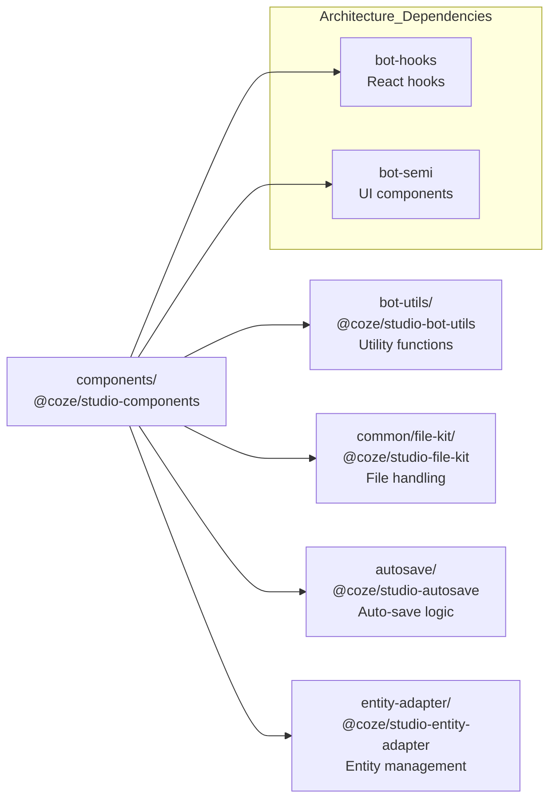
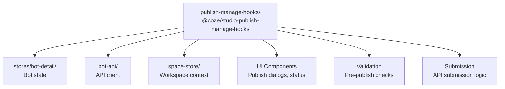
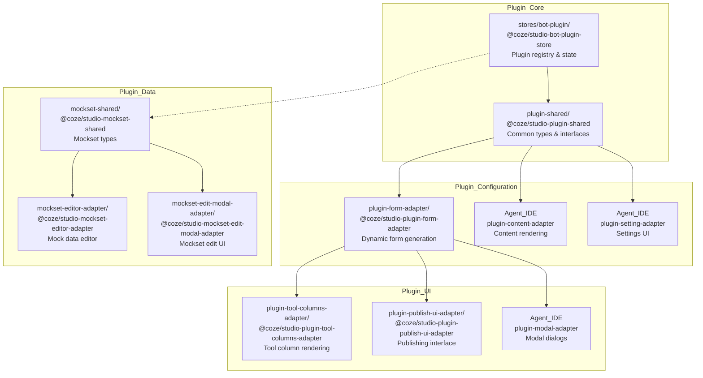
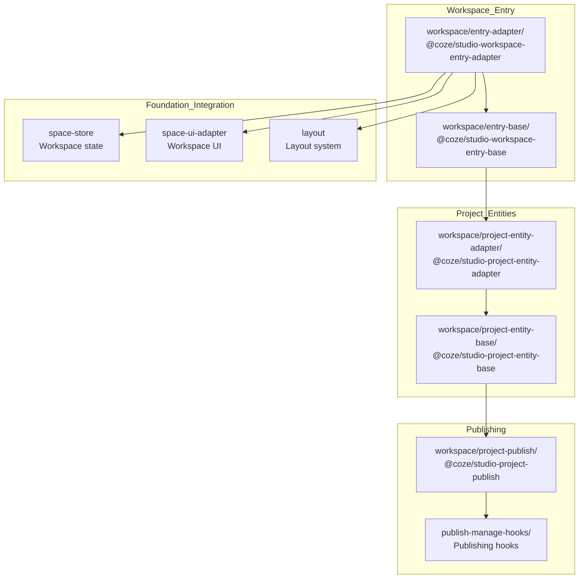
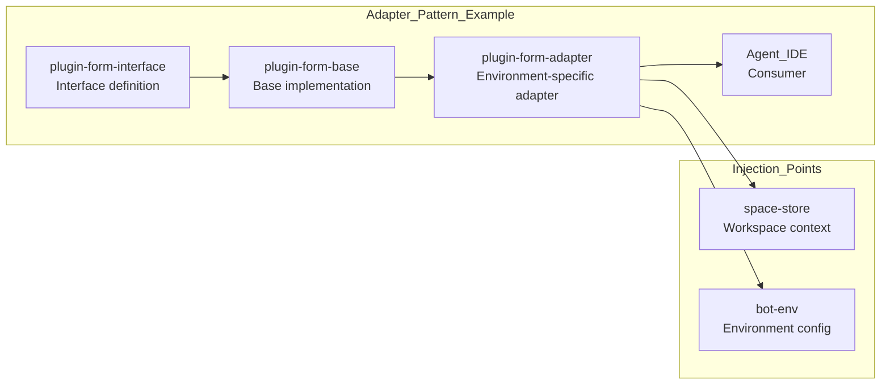

<!-- source: DeepWiki mcp.deepwiki.com · repo coze-dev/coze-studio · page 4.5 Studio System · fetched 2026-10-29 -->

# Studio System

Relevant source files

The following files were used as context for generating this wiki page:

- [.github/CODEOWNERS](.github/CODEOWNERS)

The Studio System is a core feature domain within the Coze Studio frontend that provides bot management, plugin configuration, workspace administration, and premium features. This system consists of 20+ packages located under `/frontend/packages/studio/` and serves as the primary interface for managing bot configurations, plugins, and workspace-level operations.

For information about the Agent IDE development environment, see [Agent IDE System](#4.4). For workflow editing capabilities, see [Workflow System](#4.6). For project development features, see [Project IDE System](#4.7).

## Architecture Overview

The Studio System sits in the Feature Module Layer of the frontend architecture, consuming services from the Foundation Layer (accounts, spaces) and Architecture Layer (API clients, state management) while providing specialized UI and business logic for bot and workspace management.

### Package Structure

```mermaid
graph TB
    subgraph "Studio_Feature_Domain"
        StudioStores["stores/<br/>Bot state management"]
        StudioComponents["components/<br/>Shared UI components"]
        StudioUtils["bot-utils/<br/>Utility functions"]
        StudioAutosave["autosave/<br/>Auto-save functionality"]
        
        subgraph "Plugin_Management"
            PluginStore["stores/bot-plugin/<br/>Plugin state"]
            PluginShared["plugin-shared/<br/>Common plugin types"]
            PluginForm["plugin-form-adapter/<br/>Form configuration"]
            PluginToolColumns["plugin-tool-columns/<br/>Tool column rendering"]
            PluginPublishUI["plugin-publish-ui-adapter/<br/>Publishing UI"]
        end
        
        subgraph "Premium_Features"
            PremiumComponents["premium/premium-components-adapter/<br/>Premium UI components"]
            PremiumStore["premium/premium-store-adapter/<br/>Premium state management"]
        end
        
        subgraph "Workspace_Management"
            WorkspaceEntry["workspace/entry-adapter/<br/>Workspace entry points"]
            ProjectEntity["workspace/project-entity-adapter/<br/>Project entities"]
            ProjectPublish["workspace/project-publish/<br/>Project publishing"]
        end
        
        subgraph "Open_Platform"
            OpenEnv["open-platform/open-env-adapter/<br/>Environment configuration"]
            OpenAuth["open-platform/open-auth/<br/>Authentication"]
            OpenChat["open-platform/open-chat/<br/>Chat integration"]
        end
        
        subgraph "Mockset_&_Testing"
            MocksetEditor["mockset-editor/<br/>Mock data editor"]
            MocksetShared["mockset-shared/<br/>Shared mockset types"]
        end
        
        StudioStores --> StudioComponents
        StudioStores --> StudioUtils
        StudioComponents --> StudioAutosave
        
        PluginStore --> PluginShared
        PluginShared --> PluginForm
        PluginShared --> PluginToolColumns
        PluginShared --> PluginPublishUI
        
        PremiumStore --> PremiumComponents
        
        WorkspaceEntry --> ProjectEntity
        ProjectEntity --> ProjectPublish
        
        OpenEnv --> OpenAuth
        OpenAuth --> OpenChat
        
        MocksetShared --> MocksetEditor
    end
    
    subgraph "Foundation_Layer_Dependencies"
        SpaceStore["space-store<br/>Multi-workspace support"]
        AccountSystem["account-adapter<br/>User management"]
        GlobalStore["global-store<br/>Global state"]
    end
    
    subgraph "Architecture_Layer_Dependencies"
        BotAPI["bot-api<br/>HTTP client"]
        BotHooks["bot-hooks<br/>React hooks"]
        StateManagement["bot-store<br/>State management"]
    end
    
    StudioStores --> SpaceStore
    StudioStores --> AccountSystem
    StudioStores --> GlobalStore
    
    StudioComponents --> BotAPI
    StudioComponents --> BotHooks
    StudioStores --> StateManagement
```

**Sources:**
- [.github/CODEOWNERS:40-266]()

## Core Packages

### Bot State Management

The `stores/` directory contains the primary state management for bot operations. These stores handle the synchronization between the frontend UI and the backend Go services defined in `backend/api/handler/coze/`.

| Package | Purpose | Key Responsibilities |
|---------|---------|---------------------|
| `stores/bot-detail` | Bot detail state | Manages individual bot configurations, settings, and metadata. |
| `stores/bot-plugin` | Plugin state | Handles plugin registration, configuration, and lifecycle. |
| `user-store` | User state | Manages user-specific data and preferences. |

**Sources:**
- [.github/CODEOWNERS:40]()
- [.github/CODEOWNERS:47]()
- [.github/CODEOWNERS:169]()
- [backend/api/handler/coze/public_product_service.go:48-83]()

### Shared Components

The `components/` package provides reusable UI components across the Studio System, integrating with core utilities for file handling and persistence.

**Sources:**
- [.github/CODEOWNERS:77]()
- [.github/CODEOWNERS:58]()
- [.github/CODEOWNERS:52]()
- [.github/CODEOWNERS:57]()
- [.github/CODEOWNERS:214]()

### Publishing Management

The `publish-manage-hooks/` package provides React hooks for managing bot publishing workflows. It interfaces with the backend `PublicDuplicateProduct` and `PublicGetProductDetail` handlers to manage the transition from draft to published entities.

**Sources:**
- [.github/CODEOWNERS:153]()
- [backend/api/handler/coze/public_product_service.go:85-108]()
- [backend/api/handler/coze/public_product_service.go:176-230]()

## Plugin Management Subsystem

The Studio System provides comprehensive plugin management capabilities through a suite of adapter-pattern packages. This subsystem coordinates with the backend `plugin.PluginApplicationSVC` to handle marketplace listings and detail views.

### Plugin Architecture

**Sources:**
- [.github/CODEOWNERS:169]()
- [.github/CODEOWNERS:170]()
- [.github/CODEOWNERS:174]()
- [.github/CODEOWNERS:181]()
- [.github/CODEOWNERS:182-183]()
- [.github/CODEOWNERS:164-167]()
- [backend/api/handler/coze/public_product_service.go:61-66]()

## Workspace Management Subsystem

The Workspace subsystem handles multi-tenant workspace operations, integrating with the `space-store` for context management and `PublicFavoriteProduct` for resource organization.

### Workspace Architecture

**Key Responsibilities:**

| Package | Purpose |
|---------|---------|
| `workspace/entry-adapter` | Workspace entry point routing and initialization. |
| `workspace/entry-base` | Base workspace functionality. |
| `workspace/project-entity-adapter` | Project entity management adapter. |
| `workspace/project-entity-base` | Core project entity logic. |
| `workspace/project-publish` | Project publishing workflows. |

**Sources:**
- [.github/CODEOWNERS:265-266]()
- [.github/CODEOWNERS:219-220]()
- [.github/CODEOWNERS:264]()
- [backend/api/handler/coze/public_product_service.go:110-145]()

## Community and Exploration

The Studio System includes the community package, which manages the exploration of shared components and bots. This integrates with the `explore` store within the `space-bot` package to facilitate discovery.

**Key Components:**
- **Explore Store**: Manages the discovery UI and listing of public bots [frontend/packages/agent-ide/space-bot/src/store/explore/:64]().
- **Component Discovery**: Handles the browsing and selection of shared community components [frontend/packages/studio/community/:235]().

**Sources:**
- [.github/CODEOWNERS:64]()
- [.github/CODEOWNERS:235]()

## DevOps and Debugging Tools

The Studio System incorporates a set of devops-oriented packages for testing, mocking, and debugging agents during the development lifecycle.

### Debugging & Testing Stack

| Package | Role | Code Entity |
|---------|------|-------------|
| `testset-manage` | Manages evaluation test sets | `@coze/studio-testset-manage` |
| `mockset-manage` | Manages API/Plugin mock data | `@coze/studio-mockset-manage` |
| `debug-panel` | Interactive debugging interface | `@coze/studio-debug-panel` |
| `common-modules` | Shared logic for devops tools | `@coze/studio-common-modules` |

**Sources:**
- [.github/CODEOWNERS:216]()
- [.github/CODEOWNERS:217]()
- [.github/CODEOWNERS:221]()
- [.github/CODEOWNERS:222]()

## Key Design Patterns

### Adapter Pattern Usage

The Studio System extensively uses the adapter pattern with `-adapter` suffixed packages to enable environment-specific behavior and multi-tenancy.

**Sources:**
- [.github/CODEOWNERS:174]()
- [.github/CODEOWNERS:18]()
- [.github/CODEOWNERS:35]()

### State Management Pattern

The Studio System uses centralized state management with specialized stores that coordinate with the backend `PublicGetUserFavoriteListV2` and other marketplace services to maintain a consistent view of user assets.

1. **Bot Detail Store** (`stores/bot-detail/`): Single source of truth for bot configuration [frontend/packages/studio/stores/bot-detail/:40]().
2. **Plugin Store** (`stores/bot-plugin/`): Plugin registry and lifecycle management [frontend/packages/studio/stores/bot-plugin/:169]().
3. **User Store** (`user-store/`): User preferences and settings [frontend/packages/studio/user-store/:47]().
4. **Auto-save** (`autosave/`): Automatic persistence of state changes [frontend/packages/studio/autosave/:57]().

**Sources:**
- [.github/CODEOWNERS:40]()
- [.github/CODEOWNERS:169]()
- [.github/CODEOWNERS:47]()
- [.github/CODEOWNERS:57]()
- [backend/api/handler/coze/public_product_service.go:147-174]()

---

