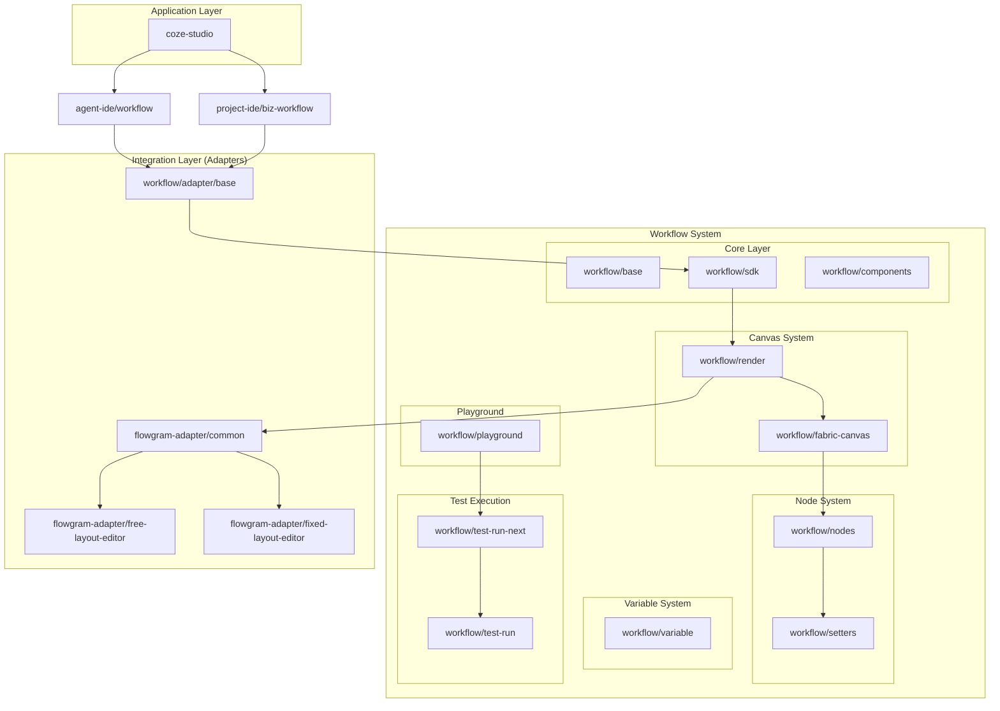
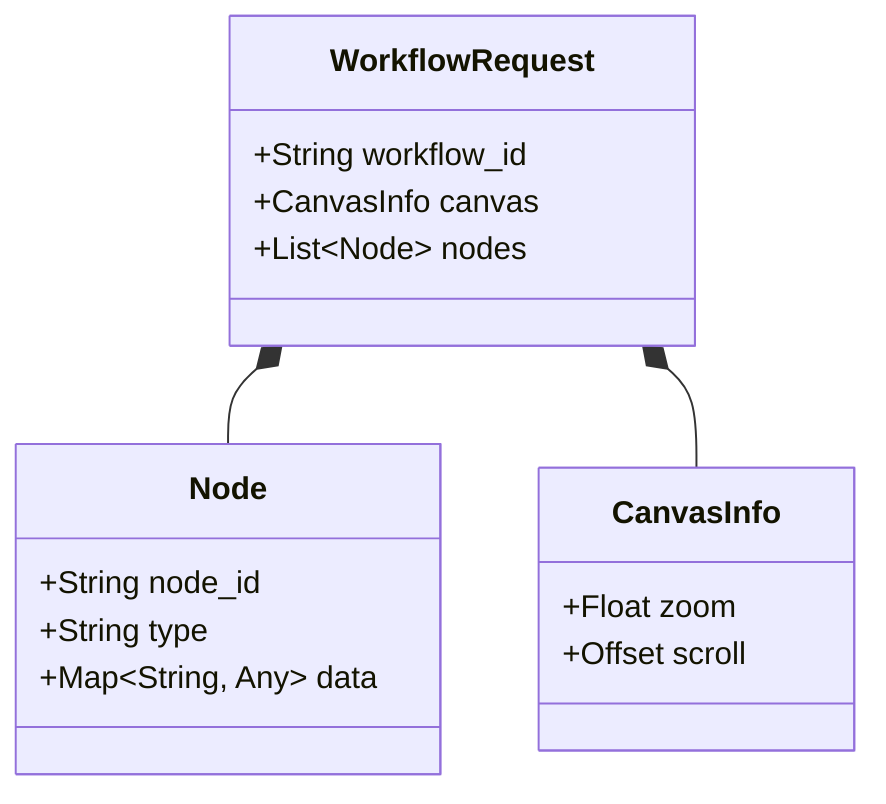

<!-- source: DeepWiki mcp.deepwiki.com · repo coze-dev/coze-studio · page 4.6 Workflow System · fetched 2026-10-29 -->

# Workflow System

Relevant source files

The following files were used as context for generating this wiki page:

- [.github/.licenserc.yaml](.github/.licenserc.yaml)
- [.github/CODEOWNERS](.github/CODEOWNERS)

## Purpose and Scope

The Workflow System is a visual programming engine that enables users to build complex automation logic through a directed graph interface. It integrates a drag-and-drop canvas with a powerful execution runtime, supporting diverse node types (LLM, HTTP, Code, Logic), variable scoping, and real-time debugging. 

The system is built upon the **FlowGram** framework, utilizing a layered architecture of SDKs, adapters, and UI components to serve both the Agent IDE and Project IDE environments.

## System Architecture

The Workflow System follows a modular architecture organized into functional domains with extensive use of the adapter pattern for integration.

### Package Organization

Workflow packages are primarily located under `/frontend/packages/workflow/` and `/frontend/packages/common/flowgram-adapter/`.

| Package Category | Purpose | Key Packages |
|-----------------|---------|--------------|
| **Core SDK** | Base types and orchestration | `workflow/base`, `workflow/sdk` |
| **Canvas & Layout** | Visual rendering and FlowGram integration | `flowgram-adapter/*`, `workflow/fabric-canvas`, `workflow/render` |
| **Node System** | Logic blocks and property editors | `workflow/nodes`, `workflow/setters`, `workflow/adapter/nodes` |
| **Execution & Test** | Runtime simulation and tracing | `workflow/test-run`, `workflow/test-run-next/*`, `workflow/playground` |
| **Data & State** | Variable management and undo/redo | `workflow/variable`, `workflow/history` |

**Sources:** [.github/CODEOWNERS:59-60](), [.github/CODEOWNERS:175-267]()

### High-Level Architecture Diagram

**Sources:** [.github/CODEOWNERS:59-60](), [.github/CODEOWNERS:175-267]()

## Core Packages and SDK

### workflow/base & workflow/sdk
`workflow/base` defines the core domain entities for the workflow engine, including node definitions, edge schemas, and execution contexts [ .github/CODEOWNERS:175 ](). `workflow/sdk` provides the high-level API for manipulating the graph programmatically, handling serialization/deserialization of workflow DSLs [ .github/CODEOWNERS:192 ]().

### flowgram-adapter
This is the bridge to the **FlowGram** visual engine. It is divided into:
*   **common**: Shared logic for graph state and command registries [ .github/CODEOWNERS:59 ]().
*   **free-layout-editor**: Implements the flexible, non-linear canvas used in the main workflow editor [ .github/CODEOWNERS:60 ]().
*   **fixed-layout-editor**: Used for constrained views, such as sub-graphs or simplified logic displays.

## Canvas and Rendering

The canvas system translates abstract workflow definitions into an interactive UI.

### workflow/fabric-canvas
Uses Fabric.js to handle low-level drawing of nodes and connections [ .github/CODEOWNERS:250 ](). It manages:
*   Canvas coordinate transformations (zoom/pan).
*   Connection line (edge) routing logic.
*   Selection state and bounding box calculations.

### workflow/render & workflow/history
`workflow/render` acts as the reactive bridge between the SDK state and the canvas [ .github/CODEOWNERS:255 ](). `workflow/history` implements a command-pattern based undo/redo stack, capturing every mutation to the graph [ .github/CODEOWNERS:256 ]().

## Node and Variable System

Nodes are the primary units of execution, while variables represent the data flowing between them.

### Node Implementation
*   **workflow/nodes**: Contains the React implementations for various node types (LLM, Tool, Condition) [ .github/CODEOWNERS:252 ]().
*   **workflow/setters**: Provides the configuration panels (property inspectors) that appear when a node is selected [ .github/CODEOWNERS:253 ]().
*   **workflow/adapter/nodes**: Allows external systems to inject custom node definitions into the workflow engine [ .github/CODEOWNERS:257 ]().

### workflow/variable
Manages the "Variable Library" within a workflow. It tracks:
*   **Input/Output Variables**: Parameters passed into and returned by the workflow.
*   **Reference Tracking**: Ensures that if a node's output is renamed, all downstream references are updated [ .github/CODEOWNERS:254 ]().

## Test Infrastructure and Playground

The system includes a robust suite for validating workflows before deployment.

### Test Run Lifecycle (test-run-next)
The `test-run-next` suite provides a modernized execution pipeline:
*   **form**: Generates dynamic input forms based on the workflow's defined input variables [ .github/CODEOWNERS:260 ]().
*   **trace**: Captures the execution path, showing which branches were taken and the data state at each node [ .github/CODEOWNERS:262 ]().
*   **shared**: Common logic for status polling and log parsing [ .github/CODEOWNERS:261 ]().

### workflow/playground
A standalone environment for testing workflows in isolation. It utilizes `workflow/adapter/playground` to mock external dependencies like plugin calls or database lookups during the test run [ .github/CODEOWNERS:244, 267 ]().

## Backend Workflow Service

The frontend workflow engine communicates with a Go-based backend to persist data and execute production runs.

### API Handlers
The backend exposes endpoints for lifecycle management in `backend/api/handler/coze/workflow_service.go`:
*   `CreateWorkflow`: Initializes a new workflow entity [ backend/api/handler/coze/workflow_service.go:44-60 ]().
*   `SaveWorkflow`: Persists the canvas JSON and metadata [ backend/api/handler/coze/workflow_service.go:83-100 ]().
*   `PublishWorkflow`: Transitions a workflow from draft to production state [ backend/api/handler/coze/workflow_service.go:179-195 ]().

### Execution Integration
The backend uses the **Eino** framework for AI orchestration. The `workflow_service_test.go` file demonstrates the registration of node adapters (e.g., LLM, Code) which are mapped to their backend execution logic [ backend/api/handler/coze/workflow_service_test.go:117-121 ]().

### Workflow Data Mapping

**Sources:** [backend/api/handler/coze/workflow_service.go:46](), [backend/api/model/workflow/workflow.go]() (inferred from handler logic).

## Integration Patterns

### Adapter-Based Integration
The workflow system is designed to be embedded. The `workflow/adapter/base` package defines the contract that host applications (like `agent-ide`) must implement to provide context, such as the current bot ID or available plugins [ .github/CODEOWNERS:248 ]().

**Sources:**
- **Frontend Core**: [.github/CODEOWNERS:175-267]()
- **FlowGram**: [.github/CODEOWNERS:59-60]()
- **Backend Service**: [backend/api/handler/coze/workflow_service.go:1-200]()
- **Backend Tests**: [backend/api/handler/coze/workflow_service_test.go:1-121]()

---

