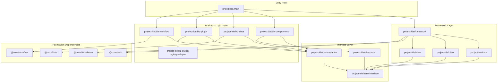
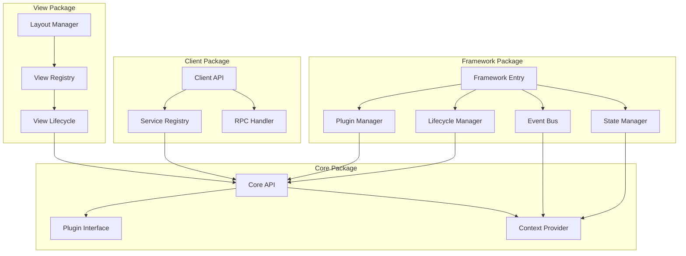
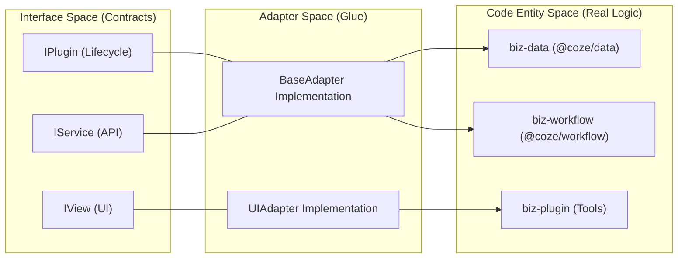
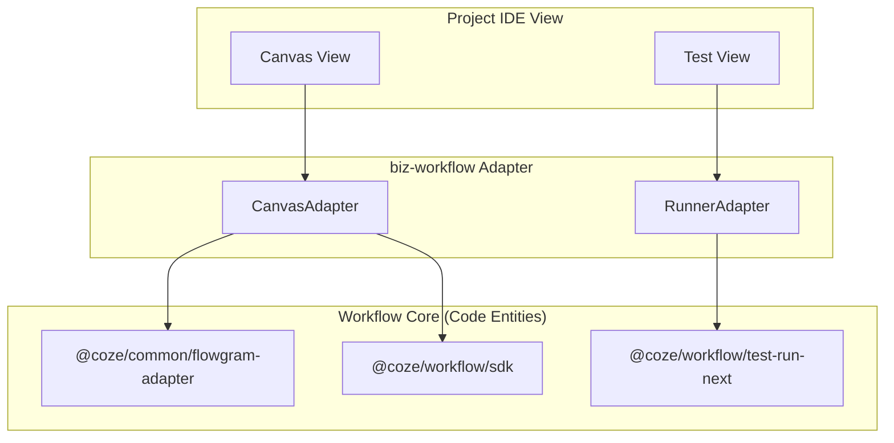

<!-- source: DeepWiki mcp.deepwiki.com · repo coze-dev/coze-studio · page 4.7 Project IDE System · fetched 2026-10-29 -->

# Project IDE System

Relevant source files

The following files were used as context for generating this wiki page:

- [.github/CODEOWNERS](.github/CODEOWNERS)

The Project IDE System provides a development environment for creating and managing workflow-based projects in Coze Studio. This system follows a plugin-based architecture with a clear separation between framework, business logic, and UI layers.

For information about agent-specific development tools, see [Agent IDE System](#4.4). For workflow engine details, see [Workflow System](#4.6). For general architecture patterns, see [Architecture Layer Packages](#4.8).

## Purpose and Architecture

The project-ide system is organized as a collection of packages under `frontend/packages/project-ide/` that provide:

1.  **Framework Layer**: Core architecture defining the plugin system and lifecycle management.
2.  **Adapter Layer**: Interface definitions and adapters for business logic integration.
3.  **Business Logic Layer**: Domain-specific implementations for data, plugins, and workflows.
4.  **UI Layer**: User interface components and adapters.

The system uses the adapter pattern extensively to decouple the framework from business implementations, allowing flexible integration with the broader Coze Studio ecosystem.

Sources: [.github/CODEOWNERS:227-242]()

## Package Structure

The Project IDE is structured to bridge the gap between "Natural Language Space" (user intent/configuration) and "Code Entity Space" (actual logic execution and UI rendering).

**Code Entity Space to System Mapping**

| System Name | Code Package / Entity | Role |
| :--- | :--- | :--- |
| **Project Entry** | `frontend/packages/project-ide/main` | Bootstraps the IDE environment. |
| **Core Framework** | `frontend/packages/project-ide/framework` | Orchestrates plugin lifecycles. |
| **Workflow Adapter** | `biz-workflow` | Bridges `@coze/workflow` to the Project IDE. |
| **Data Adapter** | `biz-data` | Bridges `@coze/data` (Knowledge/Memory) to the IDE. |
| **UI Bridge** | `ui-adapter` | Connects generic UI components to IDE state. |

**System Dependency Flow**

Title: Project IDE Package Dependency Graph

Sources: [.github/CODEOWNERS:227-242]()

## Framework Architecture

The framework layer provides the core infrastructure for the IDE, implementing a plugin system with lifecycle management. It manages how different parts of the IDE (like the workflow canvas or the knowledge base settings) communicate without being tightly coupled.

Title: Framework Internal Components and Data Flow

**Framework Responsibilities**

| Component | Location | Responsibility |
| :--- | :--- | :--- |
| **Plugin Manager** | `framework/` | Load, register, and manage plugins. |
| **Lifecycle Manager** | `framework/` | Handle plugin lifecycle events (init, mount, unmount). |
| **Event Bus** | `framework/` | Inter-plugin communication via pub/sub. |
| **Service Registry** | `client/` | Service discovery for cross-plugin function calls. |
| **Layout Manager** | `view/` | Control view placement and visibility. |

Sources: [.github/CODEOWNERS:231-236]()

## Adapter Pattern Implementation

The project-ide system uses adapters to connect the framework with business logic and external dependencies like the Workflow engine or Knowledge base.

Title: Mapping Interface Space to Implementation Space

**Adapter Layer Contracts**

The `base-interface` package defines contracts that business logic must implement:

| Interface Type | Purpose | Implemented By |
| :--- | :--- | :--- |
| `IPlugin` | Plugin lifecycle and capabilities | `biz-plugin`, `biz-data`, `biz-workflow` |
| `IView` | View rendering and lifecycle | `biz-components` |
| `IService` | Service API definition | `biz-data`, `biz-plugin` |

Sources: [.github/CODEOWNERS:232-233]()

## Business Logic Integration

The business logic layer provides domain-specific functionality through plugins that extend the framework. This includes the integration of Knowledge Bases, Databases, and Workflows.

**Business Packages and External Dependencies**

| Package | Key Components | External Dependencies |
| :--- | :--- | :--- |
| `biz-data` | Knowledge IDE adapter, Memory/Variables | `knowledge-modal-base`, `database-creator` |
| `biz-plugin` | Plugin tool implementations | `studio/stores/bot-plugin-store` |
| `biz-workflow` | Workflow canvas adapter | `workflow/fabric-canvas`, `flowgram-adapter` |
| `biz-components` | Resource tree, Layout components | `components/resource-tree`, `components/scroll-view` |

Sources: [.github/CODEOWNERS:230-242](), [.github/CODEOWNERS:59-60](), [.github/CODEOWNERS:95](), [.github/CODEOWNERS:98]()

## Workflow Integration

The `biz-workflow` package integrates the visual workflow engine into the project IDE. It uses the `flowgram-adapter` to manage the visual canvas and `test-run-next` for debugging.

Title: Workflow System Integration Flow

Sources: [.github/CODEOWNERS:242](), [.github/CODEOWNERS:59-60](), [.github/CODEOWNERS:255](), [.github/CODEOWNERS:258-262]()

## Data Management Plugin

The `biz-data` package integrates knowledge and memory systems. It specifically links the IDE to the Knowledge Base resource processors and the Database creator.

| Component | Responsibility | Source Package |
| :--- | :--- | :--- |
| **Knowledge Processor** | Handles document parsing/indexing UI | `knowledge-resource-processor-core` |
| **Database Creator** | UI for defining database schemas | `data/memory/database-creator` |
| **LLM Plugins** | Integration of AI tools into memory | `data/memory/llm-plugins` |

Sources: [.github/CODEOWNERS:237-239](), [.github/CODEOWNERS:84](), [.github/CODEOWNERS:100]()

## Main Entry Point and Initialization

The `main` package serves as the application entry point. It orchestrates the startup sequence by initializing the framework and then registering all business plugins.

**Initialization Sequence**

1.  **Framework Init**: `Framework.init()` is called to set up the `PluginManager` and `LifecycleManager`.
2.  **Plugin Registration**: The application registers `biz-data`, `biz-plugin`, and `biz-workflow`.
3.  **UI Mounting**: `biz-components` mounts the `ResourceTree` and `Layout` into the DOM.
4.  **Service Discovery**: Plugins register their services (e.g., `WorkflowService`) in the `ServiceRegistry`.

Sources: [.github/CODEOWNERS:227](), [.github/CODEOWNERS:231-236]()

---

