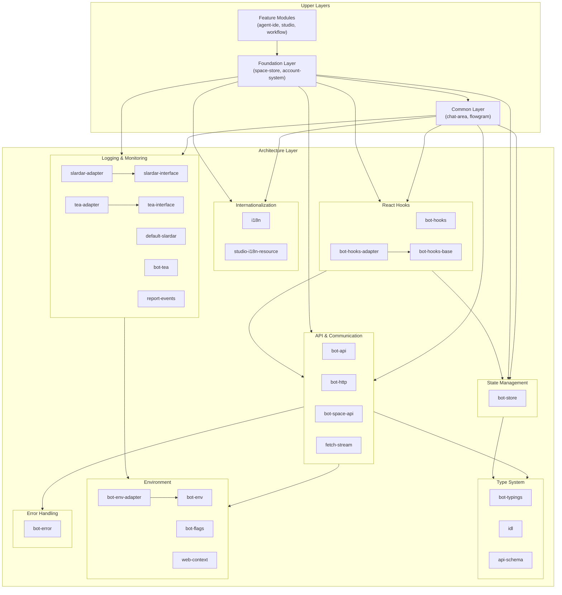
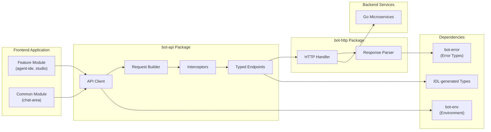
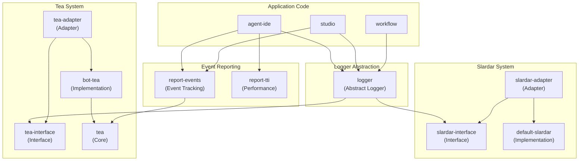
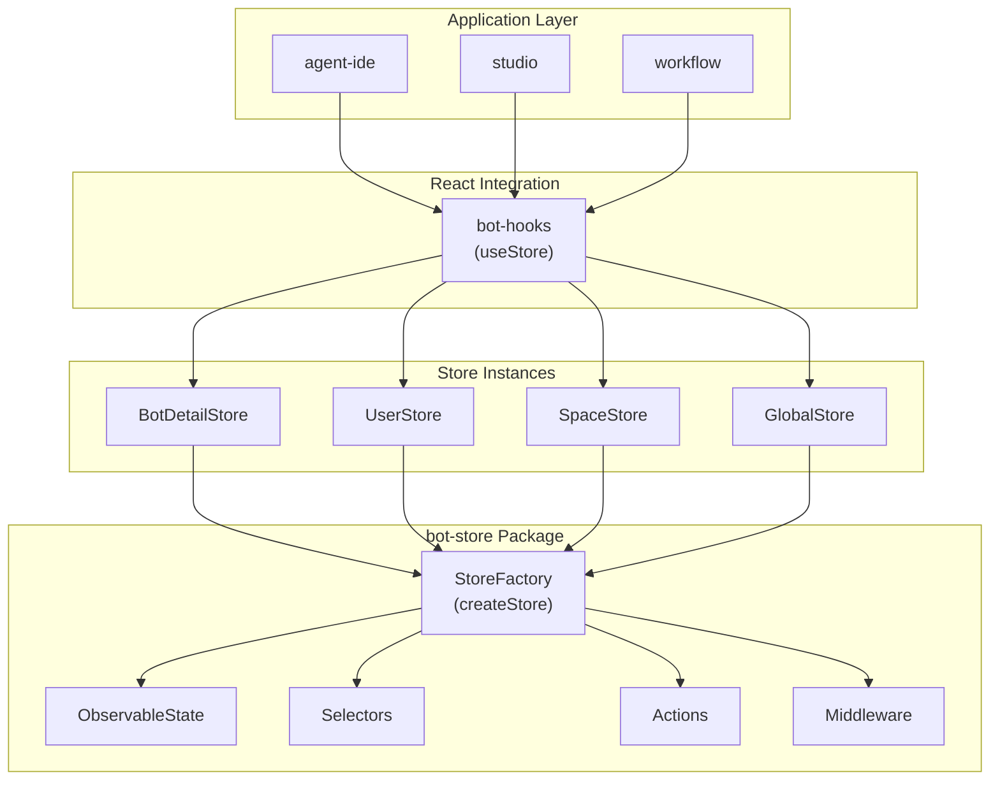
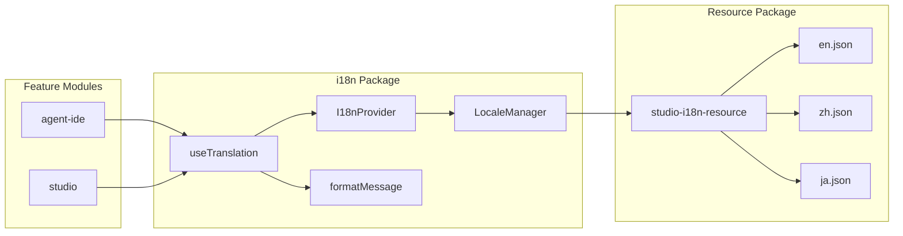
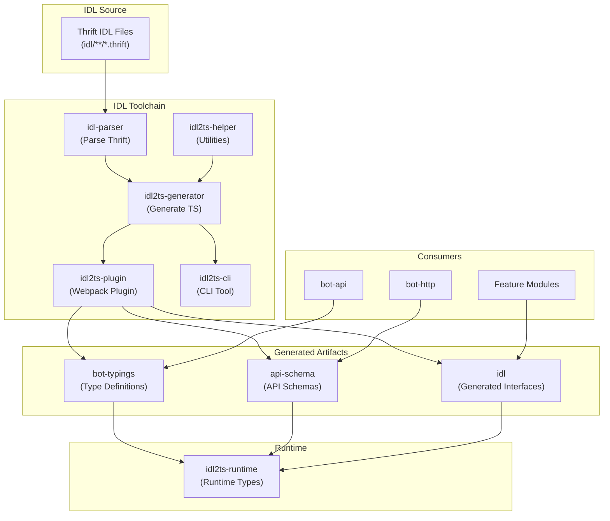
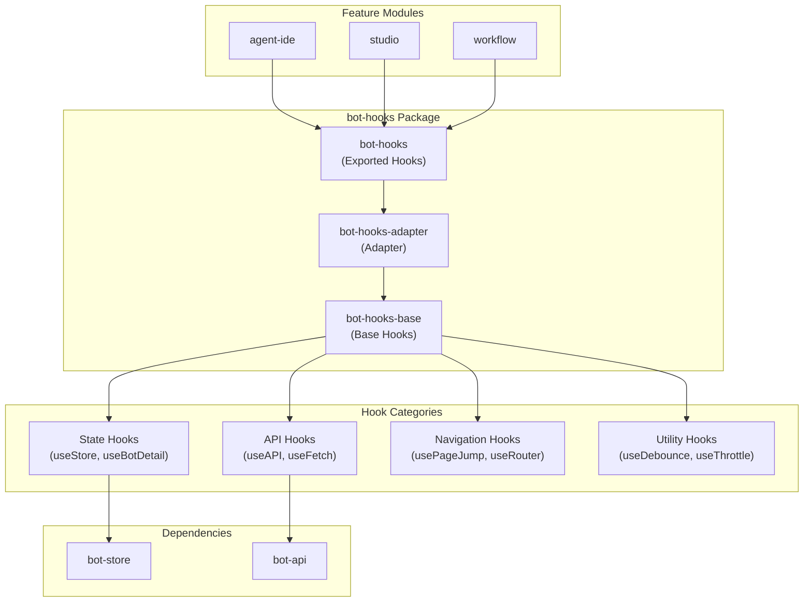
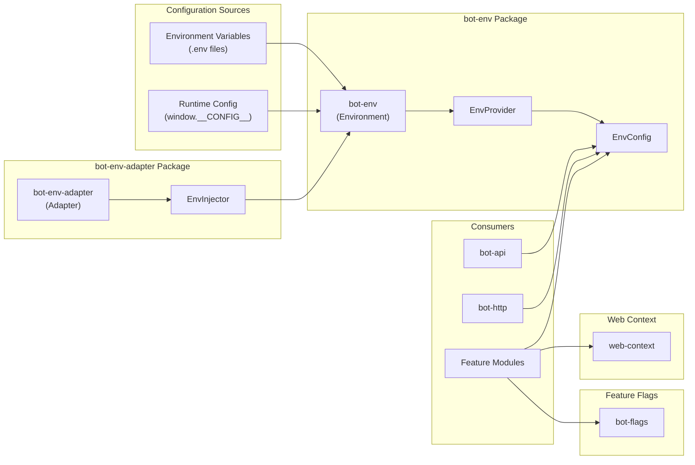
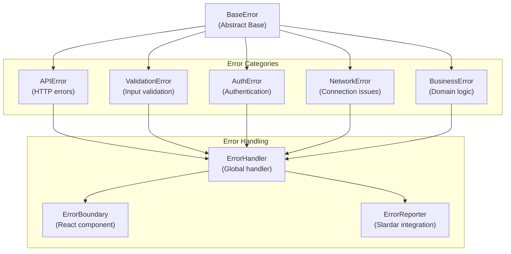

<!-- source: DeepWiki mcp.deepwiki.com · repo coze-dev/coze-studio · page 4.8 Architecture Layer Packages · fetched 2026-10-29 -->

# Architecture Layer Packages

Relevant source files

The following files were used as context for generating this wiki page:

- [.github/.licenserc.yaml](.github/.licenserc.yaml)
- [.github/CODEOWNERS](.github/CODEOWNERS)

## Purpose and Scope

The Architecture Layer provides foundational infrastructure packages that serve as the lowest-level abstraction layer in the Coze Studio frontend system. This layer includes HTTP clients, logging systems, state management, internationalization, type definitions, and React hooks that are consumed by all upper layers (Foundation, Common, Feature Modules, and Applications).

For information about the frontend package organization and layering principles, see [Package Organization](#4.2). For details about specific feature domains that consume these packages, see [Feature Domains](#4.9).

## Architecture Layer Overview

The Architecture Layer comprises approximately 40 packages organized into distinct subsystems located at `frontend/packages/arch/`. Each subsystem follows the adapter pattern for dependency injection, enabling multi-tenancy and environment-specific implementations.

**Package Subsystems**:

| Subsystem | Key Packages | Primary Responsibility |
|-----------|--------------|------------------------|
| API & Communication | `bot-api`, `bot-http`, `bot-space-api`, `fetch-stream` | HTTP client abstraction and request handling |
| Logging & Monitoring | `slardar-*`, `tea-*`, `logger`, `report-events` | Event tracking and error monitoring |
| State Management | `bot-store` | Global state container |
| Internationalization | `i18n`, `studio-i18n-resource` | Multi-language support |
| Type System & IDL | `bot-typings`, `idl`, `api-schema` | Type definitions and IDL-to-TypeScript conversion |
| React Hooks | `bot-hooks`, `bot-hooks-adapter`, `bot-hooks-base` | Reusable React hooks |
| Environment | `bot-env`, `bot-env-adapter`, `bot-flags` | Environment variables and feature flags |
| Error Handling | `bot-error` | Standardized error types |
| Utilities | `bot-utils`, `utils`, `responsive-kit` | Common utility functions |

Sources: [.github/CODEOWNERS:9-28](), [.github/CODEOWNERS:36-54](), [.github/CODEOWNERS:78-82]()

### Architecture Layer Dependency Flow

Sources: [.github/CODEOWNERS:9-28](), [.github/CODEOWNERS:36-54]()

## API & Communication

### bot-api Package

The `bot-api` package provides the primary HTTP client abstraction for communicating with backend services. It is owned by `@Tecvan-fe` and located at `frontend/packages/arch/bot-api/`.

**Core Responsibilities**:
- HTTP request/response handling
- Environment-specific endpoint configuration
- Request interceptors and error handling
- TypeScript type integration from IDL definitions

Sources: [.github/CODEOWNERS:9-10]()

### bot-http Package

The `bot-http` package implements low-level HTTP request handling and response processing. Located at `frontend/packages/arch/bot-http/`, it provides:

- HTTP method wrappers (GET, POST, PUT, DELETE)
- Request/response interceptors
- Error transformation
- Stream handling via `fetch-stream`

Sources: [.github/CODEOWNERS:10]()

### bot-space-api Package

The `bot-space-api` package at `frontend/packages/arch/bot-space-api/` provides API client functionality specific to multi-workspace operations. It is owned by `@Tecvan-fe` and `@duwenhan2byte`.

**Key Features**:
- Workspace-scoped API requests
- Space ID injection
- Multi-tenant request routing

Sources: [.github/CODEOWNERS:43]()

### fetch-stream Package

The `fetch-stream` package at `frontend/packages/arch/fetch-stream/` enables streaming HTTP responses for real-time data processing, particularly for chat streaming and workflow execution. Owned by `@Hezi-crypto` and `@haozhenfei`.

**Use Cases**:
- Chat message streaming
- Workflow execution logs
- Server-Sent Events (SSE) handling

Sources: [.github/CODEOWNERS:55]()

## Logging & Monitoring

The logging subsystem implements a dual-system architecture with Slardar and Tea, both following the adapter pattern for implementation flexibility.

### Logging Architecture

Sources: [.github/CODEOWNERS:11-12](), [.github/CODEOWNERS:36-39](), [.github/CODEOWNERS:53-54]()

### Slardar System

**slardar-interface** `frontend/packages/arch/slardar-interface/`  
Defines the interface contract for Slardar logging. Owned by `@Tecvan-fe` and `@evan-crash`.

**slardar-adapter** `frontend/packages/arch/slardar-adapter/`  
Implements the adapter pattern to inject Slardar implementations. Owned by `@Tecvan-fe` and `@dragooncjw`.

**default-slardar** `frontend/packages/arch/default-slardar/`  
Provides the default Slardar implementation for error monitoring and performance tracking. Owned by `@Tecvan-fe` and `@evan-crash`.

Sources: [.github/CODEOWNERS:12](), [.github/CODEOWNERS:53-54]()

### Tea System

**tea-interface** `frontend/packages/arch/tea-interface/`  
Defines the interface for Tea event tracking. Owned by `@dragooncjw` and `@Tecvan-fe`.

**tea-adapter** `frontend/packages/arch/tea-adapter/`  
Adapter for Tea implementations, enabling environment-specific tracking backends. Owned by `@dragooncjw` and `@Tecvan-fe`.

**bot-tea** `frontend/packages/arch/bot-tea/`  
Bot-specific Tea implementation with custom event schemas. Owned by `@Tecvan-fe`, `@catee`, and `@soonco`.

**tea** `frontend/packages/arch/tea/`  
Core Tea analytics library. Owned by `@Tecvan-fe`, `@evan-crash`, and `@soonco`.

Sources: [.github/CODEOWNERS:36-39]()

### Event Reporting

**report-events** `frontend/packages/arch/report-events/`  
Provides standardized event reporting APIs for tracking user interactions and system events. Owned by `@Tecvan-fe`.

**report-tti** `frontend/packages/arch/report-tti/`  
Tracks Time-to-Interactive (TTI) performance metrics. Owned by `@duwenhan2byte`.

Sources: [.github/CODEOWNERS:32](), [.github/CODEOWNERS:111]()

### logger Package

The `logger` package at `frontend/packages/arch/logger/` provides a unified logging facade that abstracts over Slardar and Tea implementations. Owned by `@Tecvan-fe`.

Sources: [.github/CODEOWNERS:11]()

## State Management

### bot-store Package

The `bot-store` package at `frontend/packages/arch/bot-store/` implements the primary global state management system using a reactive store pattern. Owned by `@Tecvan-fe`, `@catee`, and `@duwenhan2byte`.

**Architecture**:

**Key Features**:
- Reactive state updates
- Type-safe state access via TypeScript
- Selector-based derived state
- Middleware for logging and persistence
- Integration with React via `bot-hooks`

Sources: [.github/CODEOWNERS:28]()

## Internationalization

### i18n Package

The `i18n` package at `frontend/packages/arch/i18n/` provides internationalization infrastructure for multi-language support. Owned by `@Tecvan-fe` and `@leeight`.

**Core Components**:
- `I18nProvider`: React context provider for locale management
- `useTranslation`: Hook for accessing translation functions
- `formatMessage`: Formatting utility for parameterized translations
- Locale detection and switching

Sources: [.github/CODEOWNERS:23-24]()

### studio-i18n-resource Package

Located at `frontend/packages/arch/resources/studio-i18n-resource/`, this package contains translation resource files for multiple locales. Owned by `@dragooncjw` and `@Tecvan-fe`.

**Resource Structure**:
- JSON files per locale (en, zh, ja, etc.)
- Namespaced translation keys
- Type-safe key references via generated TypeScript definitions

Sources: [.github/CODEOWNERS:24]()

## Type System & IDL Tools

### IDL-to-TypeScript Toolchain

The Architecture Layer includes a sophisticated IDL-to-TypeScript code generation toolchain that converts Thrift IDL definitions into type-safe TypeScript interfaces.

Sources: [.github/CODEOWNERS:26](), [.github/CODEOWNERS:144-150]()

### IDL Toolchain Components

**idl-parser** `frontend/infra/idl/idl-parser/`  
Parses Thrift IDL files into an Abstract Syntax Tree (AST). Owned by `@Tecvan-fe` and `@evan-crash`.

**idl2ts-generator** `frontend/infra/idl/idl2ts-generator/`  
Generates TypeScript interfaces, type guards, and serializers from parsed IDL AST. Owned by `@Tecvan-fe` and `@evan-crash`.

**idl2ts-cli** `frontend/infra/idl/idl2ts-cli/`  
Command-line interface for batch IDL-to-TypeScript conversion. Owned by `@Tecvan-fe` and `@evan-crash`.

**idl2ts-plugin** `frontend/infra/idl/idl2ts-plugin/`  
Webpack/Rspack plugin for automatic IDL generation during build. Owned by `@Tecvan-fe` and `@evan-crash`.

**idl2ts-runtime** `frontend/infra/idl/idl2ts-runtime/`  
Runtime utilities for IDL-generated code, including serializers and validators. Owned by `@Tecvan-fe` and `@evan-crash`.

**idl2ts-helper** `frontend/infra/idl/idl2ts-helper/`  
Helper utilities for IDL processing. Owned by `@Tecvan-fe` and `@evan-crash`.

Sources: [.github/CODEOWNERS:144-150]()

### Type Definition Packages

**bot-typings** `frontend/packages/arch/bot-typings/`  
Core TypeScript type definitions for bot-related entities. Owned by `@Tecvan-fe`.

**api-schema** `frontend/packages/arch/api-schema/`  
API request/response schemas generated from IDL. Owned by `@Tecvan-fe` and `@evan-crash`.

**idl** `frontend/packages/arch/idl/`  
Generated TypeScript interfaces from Thrift IDL files. Owned by `@Tecvan-fe`.

Sources: [.github/CODEOWNERS:19](), [.github/CODEOWNERS:26](), [.github/CODEOWNERS:143]()

## React Hooks

The React Hooks subsystem provides reusable hooks following the adapter pattern for dependency injection.

### Hooks Architecture

Sources: [.github/CODEOWNERS:78-81]()

### Hook Packages

**bot-hooks** `frontend/packages/arch/bot-hooks/`  
Primary hook exports consumed by feature modules. Includes:
- State management hooks
- API request hooks
- Page navigation hooks (see `src/page-jump/`)
- Lifecycle hooks

Owned by `@catee`, `@Tecvan-fe`, and `@soonco`.

**bot-hooks-adapter** `frontend/packages/arch/bot-hooks-adapter/`  
Adapter layer enabling environment-specific hook implementations. Owned by `@catee`, `@Tecvan-fe`, and `@soonco`.

**bot-hooks-base** `frontend/packages/arch/bot-hooks-base/`  
Base hook implementations shared across adapters. Owned by `@catee`, `@Tecvan-fe`, and `@soonco`.

**hooks** `frontend/packages/arch/hooks/`  
General-purpose React hooks not specific to bot functionality. Owned by `@Tecvan-fe` and `@evan-crash`.

Sources: [.github/CODEOWNERS:78-81](), [.github/CODEOWNERS:113]()

## Environment & Configuration

### Environment Management

Sources: [.github/CODEOWNERS:17-18](), [.github/CODEOWNERS:20](), [.github/CODEOWNERS:31]()

### Environment Packages

**bot-env** `frontend/packages/arch/bot-env/`  
Core environment configuration management. Provides:
- Environment variable access
- API endpoint configuration
- Runtime feature detection
- Build-time vs runtime config separation

Owned by `@Tecvan-fe` and `@leeight`.

**bot-env-adapter** `frontend/packages/arch/bot-env-adapter/`  
Adapter for injecting environment-specific configurations. Enables:
- Development/staging/production environments
- Multi-tenant configurations
- Custom environment overrides

Owned by `@dragooncjw`, `@Tecvan-fe`, and `@leeight`.

**bot-flags** `frontend/packages/arch/bot-flags/`  
Feature flag management system for progressive rollouts and A/B testing. Owned by `@Tecvan-fe`.

**web-context** `frontend/packages/arch/web-context/`  
Provides browser-specific context information (user agent, viewport, etc.). Owned by `@Tecvan-fe`.

Sources: [.github/CODEOWNERS:17-18](), [.github/CODEOWNERS:20](), [.github/CODEOWNERS:31]()

## Error Handling

### bot-error Package

The `bot-error` package at `frontend/packages/arch/bot-error/` provides standardized error types and error handling utilities. Owned by `@haozhenfei` and `@duwenhan2byte`.

**Core Error Types**:

**Key Features**:
- Hierarchical error types
- Error serialization for logging
- Error code standardization
- Integration with Slardar for error tracking

Sources: [.github/CODEOWNERS:29]()

## Utilities & Infrastructure

### Utility Packages

**bot-utils** `frontend/packages/arch/bot-utils/`  
Bot-specific utility functions including:
- String manipulation
- Date formatting
- Data validation
- Type guards

Owned by `@Tecvan-fe`.

**utils** `frontend/packages/arch/utils/`  
General-purpose utilities not specific to bot functionality. Owned by `@Tecvan-fe` and `@evan-crash`.

**responsive-kit** `frontend/packages/arch/responsive-kit/`  
Responsive design utilities for mobile/desktop adaptation. Owned by `@Tecvan-fe` and `@DingGao-Devin`.

Sources: [.github/CODEOWNERS:44](), [.github/CODEOWNERS:82](), [.github/CODEOWNERS:125]()

### Editor Infrastructure

**bot-monaco-editor** `frontend/packages/arch/bot-monaco-editor/`  
Monaco Editor integration with custom language support and theming. Owned by `@Tecvan-fe`.

**bot-md-box-adapter** `frontend/packages/arch/bot-md-box-adapter/`  
Markdown rendering adapter for consistent markdown display across features. Owned by `@Hezi-crypto`, `@iu1340`, `@dragooncjw`, and `@Tecvan-fe`.

**pdfjs-shadow** `frontend/packages/arch/pdfjs-shadow/`  
PDF.js integration for PDF viewing within the application. Owned by `@Tecvan-fe`.

Sources: [.github/CODEOWNERS:51](), [.github/CODEOWNERS:101](), [.github/CODEOWNERS:135]()

### Foundation SDK

**foundation-sdk** `frontend/packages/arch/foundation-sdk/`  
SDK providing programmatic access to foundation services (accounts, spaces, global state). Located at `frontend/packages/arch/foundation-sdk/` and owned by `@evan-crash` and `@duwenhan2byte`.

**Key Exports**:
- `SpaceSDK`: Workspace management APIs
- `AccountSDK`: User account operations
- `GlobalSDK`: Global state access

Sources: [.github/CODEOWNERS:48]()

### Remote Worker Loading

**load-remote-worker** `frontend/packages/arch/load-remote-worker/`  
Utility for dynamically loading Web Workers from remote URLs, enabling code splitting for heavy computation tasks. Owned by `@Tecvan-fe`.

Sources: [.github/CODEOWNERS:245]()

## Package Ownership and Maintenance

All Architecture Layer packages follow a consistent ownership model defined in `.github/CODEOWNERS`. The primary maintainers are:

| Team/Individual | Packages |
|-----------------|----------|
| `@Tecvan-fe` | Most arch packages (API, logging, env, i18n, types, utilities) |
| `@evan-crash` | Foundation SDK, account systems, environment adapters |
| `@duwenhan2byte` | State management, error handling, space APIs |
| `@catee` | React hooks, bot utilities |
| `@leeight` | Environment configuration, i18n |
| `@dragooncjw` | Adapters (env, tea, slardar) |

This ownership structure ensures clear responsibility for maintenance, bug fixes, and feature development across the Architecture Layer.

Sources: [.github/CODEOWNERS:9-54](), [.github/CODEOWNERS:78-82](), [.github/CODEOWNERS:113](), [.github/CODEOWNERS:125](), [.github/CODEOWNERS:135](), [.github/CODEOWNERS:143-150](), [.github/CODEOWNERS:245]()

---

