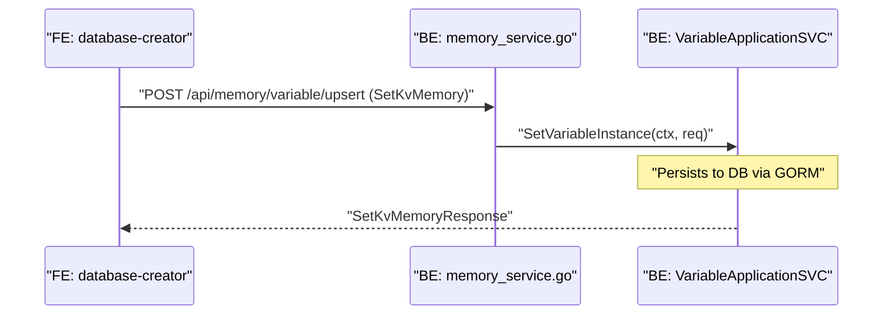
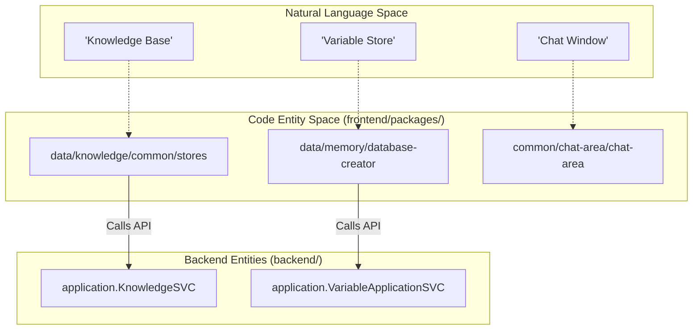

<!-- source: DeepWiki mcp.deepwiki.com · repo coze-dev/coze-studio · page 4.9 Feature Domains · fetched 2026-10-29 -->

# Feature Domains

Relevant source files

The following files were used as context for generating this wiki page:

- [.github/CODEOWNERS](.github/CODEOWNERS)

## Purpose and Scope

This document describes the foundational and shared feature domains in the Coze Studio frontend system. These domains provide specialized functionality for data management (knowledge bases, databases, memory), common communication components (chat areas, uploaders), and reusable UI components. These packages follow the Tier 3 (Feature/Business) and Tier 4 (Component/Library) classifications in the monorepo, providing the building blocks for the primary IDEs.

For information about the primary feature systems, see [4.4 Agent IDE System](), [4.5 Studio System](), [4.6 Workflow System](), and [4.7 Project IDE System]().

---

## Data Domain: Knowledge and Memory

The data domain handles the persistence and processing of AI resources, split between unstructured "Knowledge" (RAG) and structured "Memory" (Databases/Variables).

### Knowledge Management
The Knowledge domain provides document processing, RAG (Retrieval-Augmented Generation) pipeline management, and resource indexing.

| Package | Path | Purpose |
|:---|:---|:---|
| `knowledge-modal-base` | `packages/data/knowledge/knowledge-modal-base` | UI and logic for knowledge creation/configuration modals. |
| `knowledge-resource-processor-core` | `packages/data/knowledge/knowledge-resource-processor-core` | Core logic for parsing and chunking documents. |
| `knowledge-stores` | `packages/data/knowledge/common/stores` | Zustand stores for managing knowledge base state. |

**Backend Integration:**
Knowledge operations in the frontend communicate with the `KnowledgeSVC` in the Go backend, which handles the actual document slicing and embedding.
- `CreateKnowledge` calls `application.KnowledgeSVC.CreateKnowledge` [backend/api/handler/coze/knowledge_service.go:45-45]().
- `CreateDocument` initiates the RAG pipeline via `application.KnowledgeSVC.CreateDocument` [backend/api/handler/coze/knowledge_service.go:145-145]().

### Memory and Databases
The Memory domain manages structured data including Key-Value (KV) memory, project variables, and database tables.

| Package | Path | Purpose |
|:---|:---|:---|
| `database` | `packages/data/memory/database` | Legacy database management implementation. |
| `database-creator` | `packages/data/memory/database-creator` | Utilities for schema definition and table creation. |
| `llm-plugins` | `packages/data/memory/llm-plugins` | Integration for AI-driven memory operations. |

**Data Flow (Frontend to Backend):**

**Sources:**
- [.github/CODEOWNERS:84-84]()
- [.github/CODEOWNERS:95-95]()
- [.github/CODEOWNERS:100-100]()
- [.github/CODEOWNERS:102-102]()
- [backend/api/handler/coze/knowledge_service.go:34-51]()
- [backend/api/handler/coze/memory_service.go:131-159]()

---

## Common Domain: Shared Business Logic

The `common/` directory contains packages that bridge the gap between pure UI components and full feature modules.

### Chat Area System
The Chat Area is a complex subsystem used in both the Agent IDE (for debugging) and the published Bot interface.

*   **`chat-core`**: Headless logic for message history, streaming response handling, and context management [frontend/packages/common/chat-area/chat-core/]() .
*   **`chat-uikit`**: React components for rendering message bubbles, input boxes, and markdown [frontend/packages/common/chat-area/chat-uikit/]() .
*   **`chat-area`**: The high-level composite component that integrates core logic and UI [frontend/packages/common/chat-area/chat-area/]() .
*   **`hooks` & `plugins`**: Extensibility points for custom message types (e.g., tool calls, image generation) [frontend/packages/common/chat-area/hooks/]() .

### Shared Infrastructure
*   **`uploader`**: Unified file upload interface with support for various storage backends via `uploader-adapter` [frontend/packages/common/uploader-adapter/]() .
*   **`biz-components`**: Business-specific UI patterns like user selectors or workspace pickers [frontend/packages/common/biz-components/]() .
*   **`flowgram-adapter`**: Provides the bridge between the Studio logic and the FlowGram visual engine for both free and fixed layouts [frontend/packages/common/flowgram-adapter/free-layout-editor/]() [frontend/packages/common/flowgram-adapter/common/]() .

**Sources:**
- [.github/CODEOWNERS:49-50]()
- [.github/CODEOWNERS:59-60]()
- [.github/CODEOWNERS:72-73]()
- [.github/CODEOWNERS:83-83]()
- [.github/CODEOWNERS:89-89]()

---

## Components Domain: UI Foundation

The `components/` directory contains "pure" UI components that are agnostic of business logic.

| Component | Path | Description |
|:---|:---|:---|
| `bot-semi` | `packages/components/bot-semi` | Customizations and wrappers for the Semi Design system [frontend/packages/components/bot-semi/]() . |
| `bot-icons` | `packages/components/bot-icons` | Centralized icon library for the Studio [frontend/packages/components/bot-icons/]() . |
| `virtual-list` | `packages/components/virtual-list` | High-performance list rendering for large datasets [frontend/packages/components/virtual-list/]() . |
| `resource-tree` | `packages/components/resource-tree` | Tree-view component used for file and knowledge navigation [frontend/packages/components/resource-tree/]() . |
| `scroll-view` | `packages/components/scroll-view` | Customized scroll container with cross-browser consistency [frontend/packages/components/scroll-view/]() . |
| `table-view` | `packages/components/table-view` | Data grid with support for sorting, filtering, and inline editing [frontend/packages/components/table-view/]() . |
| `json-viewer` | `packages/components/json-viewer` | Interactive tree viewer for JSON data, used in debug panels [frontend/packages/components/json-viewer/]() . |
| `loading-button` | `packages/components/loading-button` | Button component with built-in async state handling [frontend/packages/components/loading-button/]() . |

**Sources:**
- [.github/CODEOWNERS:21-22]()
- [.github/CODEOWNERS:86-88]()
- [.github/CODEOWNERS:97-99]()

---

## Implementation Detail: Feature Registration

The system uses a registration pattern to decouple features from the main application shell. This is primarily managed in `data/common/utils`.

**System Name to Code Entity Mapping:**

**Sources:**
- [.github/CODEOWNERS:49-50]()
- [.github/CODEOWNERS:83-83]()
- [.github/CODEOWNERS:95-95]()
- [.github/CODEOWNERS:102-102]()
- [backend/api/handler/coze/knowledge_service.go:45-45]()
- [backend/api/handler/coze/memory_service.go:131-159]()

---

