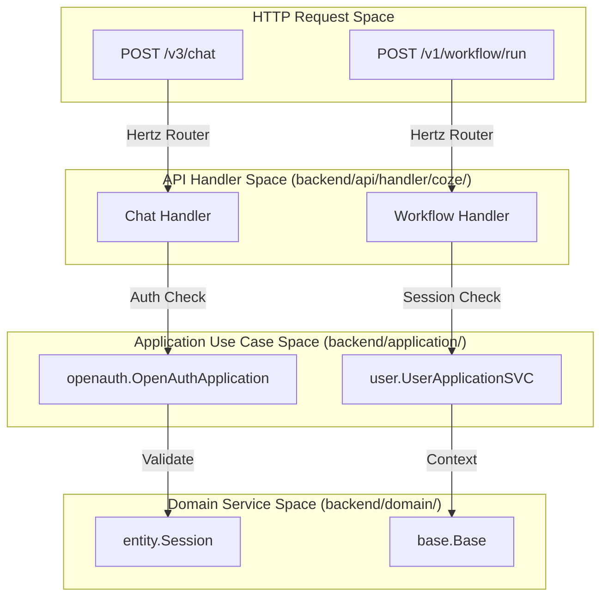
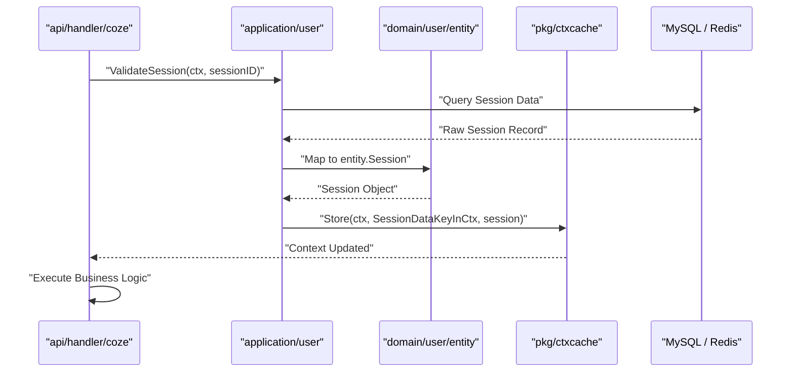

<!-- source: DeepWiki mcp.deepwiki.com · repo coze-dev/coze-studio · page 5.1 Service Architecture · fetched 2026-10-29 -->

# Service Architecture

Relevant source files

The following files were used as context for generating this wiki page:

- [backend/.hz](backend/.hz)
- [backend/api/handler/coze/base.go](backend/api/handler/coze/base.go)
- [backend/api/middleware/ctx_cache.go](backend/api/middleware/ctx_cache.go)
- [backend/api/middleware/host.go](backend/api/middleware/host.go)
- [backend/api/middleware/i18n.go](backend/api/middleware/i18n.go)
- [backend/api/middleware/log.go](backend/api/middleware/log.go)
- [backend/api/middleware/openapi_auth.go](backend/api/middleware/openapi_auth.go)
- [backend/api/middleware/request_inspector.go](backend/api/middleware/request_inspector.go)
- [backend/api/middleware/session.go](backend/api/middleware/session.go)
- [backend/api/model/base/base.go](backend/api/model/base/base.go)

The Coze Studio backend is a Go-based system designed for high-performance AI agent orchestration. It follows **Domain-Driven Design (DDD)** principles to maintain a clean separation between business logic, orchestration, and infrastructure. The service is built upon the **Hertz** HTTP framework for high-concurrency request handling and integrates the **Eino** framework for AI capability orchestration.

## Backend Directory Organization

The backend code is organized into a layered structure that enforces unidirectional dependencies from the outer API layer toward the inner Domain layer. The project uses the `hz` tool for code generation, mapping Thrift IDLs to handlers, models, and routers [backend/.hz:1-7]().

| Layer | Directory | Responsibility |
| :--- | :--- | :--- |
| **API** | `backend/api/` | Entry points, HTTP handlers, routing, and middleware [backend/.hz:4-6](). |
| **Application** | `backend/application/` | Use cases that coordinate domain services and infrastructure (e.g., Agent, Workflow) [backend/api/middleware/openapi_auth.go:29-36](). |
| **Domain** | `backend/domain/` | Pure business logic, entities, and repository interfaces [backend/api/middleware/i18n.go:25-29](). |
| **Crossdomain** | `backend/crossdomain/` | Logic that spans multiple domains or shared business utilities. |
| **Infrastructure** | `backend/infra/` | Technical implementations for DBs, caches, search engines, and AI models. |

**Sources:** [backend/.hz:1-7](), [backend/api/handler/coze/base.go:24-33](), [backend/api/middleware/openapi_auth.go:29-36](), [backend/api/middleware/i18n.go:25-29]()

## Entry Point and Server Setup

The service initializes in `main.go`, where it loads environment variables, sets up the Hertz server, and configures the middleware chain.

### Server Initialization Flow
1. **Environment Loading**: Loads configurations for MySQL, Redis, and AI providers.
2. **Hertz Setup**: Initializes the `hertz` engine with custom configurations.
3. **Middleware Chain**: Injects global cross-cutting concerns such as `AccessLogMW` [backend/api/middleware/log.go:36-83]() and `RequestInspectorMW` [backend/api/middleware/request_inspector.go:36-49]().
4. **Router Registration**: Maps IDL-defined paths to specific handlers in `backend/api/handler/` as defined by the `hz` configuration [backend/.hz:4-6]().

**Sources:** [backend/api/middleware/log.go:36-83](), [backend/api/middleware/request_inspector.go:36-49](), [backend/.hz:4-6]()

## Middleware Architecture

The API layer utilizes a robust middleware stack to handle request pre-processing, security, and context management.

### Key Middleware Components

*   **`ContextCacheMW`**: Initializes a request-scoped cache using `pkg/ctxcache` to avoid redundant data fetching across layers during a single request lifecycle [backend/api/middleware/ctx_cache.go:27-32]().
*   **`RequestInspectorMW`**: Identifies the request type: `RequestAuthTypeWebAPI` (0), `RequestAuthTypeOpenAPI` (1), or `RequestAuthTypeStaticFile` (2) [backend/api/middleware/request_inspector.go:30-49]().
*   **`SessionAuthMW`**: Validates user sessions for Web IDE interactions. It retrieves the session ID from cookies and uses `UserApplicationSVC.ValidateSession` to load user data into the context [backend/api/middleware/session.go:42-76]().
*   **`OpenapiAuthMW`**: Handles Bearer token authentication for programmatic access. It verifies the API key via `OpenAuthApplication.CheckPermission` and stores `apiKeyInfo` in the context cache [backend/api/middleware/openapi_auth.go:113-161]().
*   **`I18nMW`**: Detects locale from the session entity or the `Accept-Language` header to set the context locale via `pkg/i18n` [backend/api/middleware/i18n.go:31-53]().
*   **`AccessLogMW` & `SetLogIDMW`**: `SetLogIDMW` generates a unique UUID for each request [backend/api/middleware/log.go:85-93](), while `AccessLogMW` records latency, status codes, and request/response bodies (truncated to 3KB) [backend/api/middleware/log.go:36-83]().

**Sources:** [backend/api/middleware/ctx_cache.go:27-32](), [backend/api/middleware/request_inspector.go:30-49](), [backend/api/middleware/session.go:42-76](), [backend/api/middleware/openapi_auth.go:113-161](), [backend/api/middleware/i18n.go:31-53](), [backend/api/middleware/log.go:36-93]()

## Code Entity Mapping: API to Application

The following diagram bridges the **Natural Language Space** (User Requests) to the **Code Entity Space**, showing how Hertz handlers delegate to Application services.

**Request Routing and Service Delegation**

**Sources:** [backend/api/middleware/openapi_auth.go:40-62](), [backend/api/middleware/session.go:37-40](), [backend/api/model/base/base.go:200-207]()

## Data Flow and DDD Layers

The system ensures that business logic in the `domain/` layer remains decoupled from technical details in the `infra/` layer through repository interfaces.

**Entity Data Flow**

**Sources:** [backend/api/middleware/session.go:63-75](), [backend/api/middleware/ctx_cache.go:27-32](), [backend/api/model/base/base.go:200-207]()

## Key Service Components

### API Layer (`backend/api/`)
Contains generated models and manual handlers. The `base.Base` struct in `api/model/base/` provides a standard structure for `LogID`, `Caller`, and `TrafficEnv` across all requests [backend/api/model/base/base.go:200-207]().

### Application Layer (`backend/application/`)
This layer coordinates complex operations that involve multiple domains.
*   **`openauth.OpenAuthApplication`**: Manages API key validation and permission checks for OpenAPI requests [backend/api/middleware/openapi_auth.go:137-158]().
*   **`user.UserApplicationSVC`**: Handles session validation and user-related use cases [backend/api/middleware/session.go:63-68]().

### Domain Layer (`backend/domain/`)
Contains the core "intellect" of the system.
*   **`entity.Session`**: Represents an active user session, including `UserEmail` and `Locale` [backend/api/middleware/session.go:80-105]().
*   **`i18n`**: Domain-level internationalization logic for managing multi-language strings [backend/api/middleware/i18n.go:27-35]().

### Infrastructure Layer (`backend/infra/`)
Technical adapters that implement domain interfaces. This includes the database drivers, cache clients, and AI model connectors utilized by the application services.

**Sources:** [backend/api/model/base/base.go:200-207](), [backend/api/middleware/openapi_auth.go:137-158](), [backend/api/middleware/session.go:63-68](), [backend/api/middleware/i18n.go:27-35]()

---

