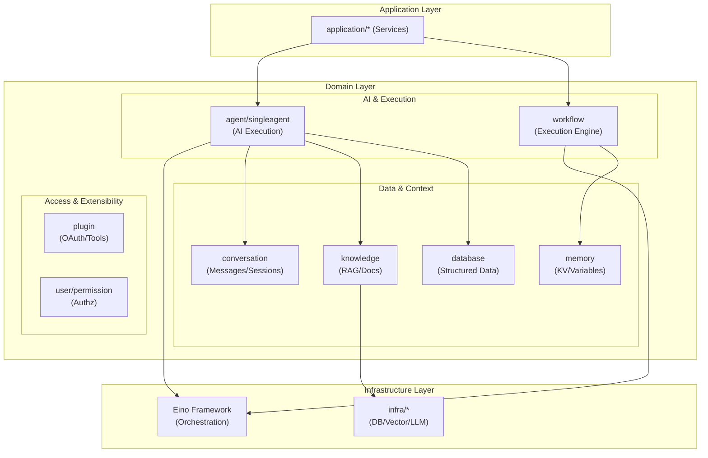
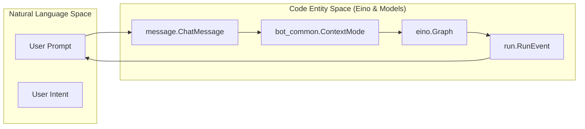
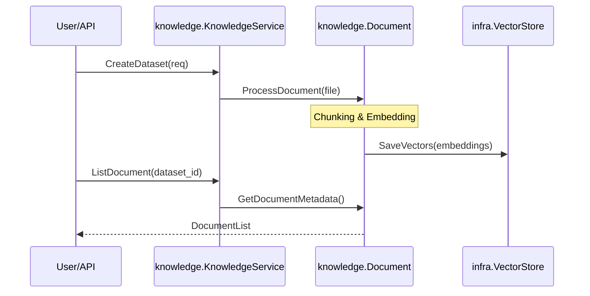

<!-- source: DeepWiki mcp.deepwiki.com · repo coze-dev/coze-studio · page 5.3 Domain Services · fetched 2026-10-29 -->

# Domain Services

Relevant source files

The following files were used as context for generating this wiki page:

- [backend/api/model/app/bot_common/bot_common.go](backend/api/model/app/bot_common/bot_common.go)
- [backend/api/model/app/bot_open_api/bot_open_api.go](backend/api/model/app/bot_open_api/bot_open_api.go)
- [backend/api/model/app/intelligence/intelligence.go](backend/api/model/app/intelligence/intelligence.go)
- [backend/api/model/conversation/conversation/conversation.go](backend/api/model/conversation/conversation/conversation.go)
- [backend/api/model/conversation/message/message.go](backend/api/model/conversation/message/message.go)
- [backend/api/model/conversation/run/run.go](backend/api/model/conversation/run/run.go)
- [backend/api/model/data/database/database_svc.go](backend/api/model/data/database/database_svc.go)
- [backend/api/model/data/knowledge/document.go](backend/api/model/data/knowledge/document.go)
- [backend/api/model/data/knowledge/knowledge.go](backend/api/model/data/knowledge/knowledge.go)
- [backend/api/model/data/variable/kvmemory/kvmemory.go](backend/api/model/data/variable/kvmemory/kvmemory.go)
- [backend/api/model/data/variable/project_memory/project_memory.go](backend/api/model/data/variable/project_memory/project_memory.go)
- [backend/api/model/data/variable/variable_svc.go](backend/api/model/data/variable/variable_svc.go)

## Purpose and Scope

The domain layer contains the core business logic of Coze Studio, organized into specialized domains following Domain-Driven Design (DDD) principles. This layer is responsible for AI agent execution, conversation management, RAG (Retrieval-Augmented Generation) pipelines, workflow orchestration, and memory management. It leverages the **Eino** framework for sophisticated AI orchestration and graph-based execution.

## Domain Architecture Overview

The domain layer is situated between the application layer (which orchestrates use cases) and the infrastructure layer (which handles persistence and external integrations).

**Domain Layer Interaction Diagram**

Sources: [backend/api/model/app/intelligence/intelligence.go:9-11](), [backend/api/model/data/database/database_svc.go:13-51]()

## Core Domains

### 1. Agent Domain (`agent/singleagent`)
The Agent domain handles the lifecycle and execution of AI agents. It integrates with the Eino framework to manage model interactions, tool calls, and state transitions.

*   **Key Responsibilities**: Agent initialization, prompt assembly, and streaming execution.
*   **Intelligence Service**: Manages draft projects, publishing connectors, and versioning for AI applications [backend/api/model/app/intelligence/intelligence.go:14-44]().
*   **Model Configuration**: Defines execution styles such as `ModelStyle_Creative` or `ModelStyle_Precise` [backend/api/model/app/bot_common/bot_common.go:64-69]().

Sources: [backend/api/model/app/intelligence/intelligence.go:14-44](), [backend/api/model/app/bot_common/bot_common.go:62-82]()

### 2. Workflow Domain (`workflow`)
The Workflow domain manages the visual execution engine. Nodes within the workflow can represent Plugins, Knowledge searches, or Database operations [backend/api/model/app/bot_common/bot_common.go:216-227]().

*   **Implementation**: Workflows are stored as DSLs and converted into executable graphs via Eino.
*   **Functionality**: Supports specialized execution types like `ImageFlow` and `MultiAgentRecognize` [backend/api/model/app/bot_common/bot_common.go:219-234]().

Sources: [backend/api/model/app/bot_common/bot_common.go:214-237]()

### 3. Conversation Domain (`conversation`)
Manages the state of chat sessions, including message history and execution runs.

*   **Message Management**: Handles different message types (Bot, User) and meta-types such as `DocumentRef` or `KnowledgeCard` [backend/api/model/conversation/message/message.go:110-125]().
*   **Execution Runs**: Manages `RunEventMessage` and `RunEventError` events during LLM streaming [backend/api/model/conversation/run/run.go:38-44]().
*   **History Control**: Provides `ClearConversationHistoryRequest` to reset sessions [backend/api/model/conversation/conversation/conversation.go:28-32]().

Sources: [backend/api/model/conversation/message/message.go:67-125](), [backend/api/model/conversation/conversation/conversation.go:28-32](), [backend/api/model/conversation/run/run.go:38-44]()

### 4. Knowledge Domain (`knowledge`)
Implements the RAG pipeline, document processing, and vector search integration.

*   **Dataset Management**: Supports creating datasets with specific `FormatType` and `DatasetSource` (Self vs Explore) [backend/api/model/data/knowledge/knowledge.go:71-76](), [backend/api/model/data/knowledge/knowledge.go:113-128]().
*   **Document Operations**: Supports listing documents with pagination and keyword search [backend/api/model/data/knowledge/document.go:79-87]().

Sources: [backend/api/model/data/knowledge/knowledge.go:1-128](), [backend/api/model/data/knowledge/document.go:79-87]()

### 5. Memory & Database Domain (`memory`, `database`)
Provides persistence for agents, ranging from simple KV pairs to structured relational tables.

*   **KV Memory**: Stores `KVItem` entities with update timestamps and system-level flags [backend/api/model/data/variable/kvmemory/kvmemory.go:13-21]().
*   **Project Variables**: Manages `VariableType_KVVariable` and `VariableType_ListVariable` across channels like `Feishu` or `APP` [backend/api/model/data/variable/project_memory/project_memory.go:13-64]().
*   **Database Service**: Handles table schema validation, record updates, and binding databases to specific bots [backend/api/model/data/database/database_svc.go:13-51]().

Sources: [backend/api/model/data/variable/kvmemory/kvmemory.go:13-21](), [backend/api/model/data/variable/project_memory/project_memory.go:13-64](), [backend/api/model/data/database/database_svc.go:13-51]()

## Eino Framework Integration

Coze Studio uses the **Eino** framework for AI orchestration. Eino allows the domain layer to treat AI logic as a directed graph of components.

| Concept | Code Mapping | Role in Domain |
|---------|--------------|----------------|
| **Graph** | `eino.Graph` | Orchestrates the flow between nodes in a Workflow or Agent. |
| **Context Mode** | `ContextMode` | Defines if the transmission is `Chat` or `FunctionCall` [backend/api/model/app/bot_common/bot_common.go:162-170](). |
| **Transmission** | `RunEvent` | Standardized events for message streaming [backend/api/model/conversation/run/run.go:38-44](). |

**Mapping Natural Language to Eino Entities**

Sources: [backend/api/model/app/bot_common/bot_common.go:162-170](), [backend/api/model/conversation/message/message.go:110-125](), [backend/api/model/conversation/run/run.go:38-44]()

## Data Flow: Knowledge Retrieval (RAG)

The following diagram illustrates how a knowledge retrieval request moves through the domain services.

**Knowledge Domain Data Flow**

Sources: [backend/api/model/data/knowledge/knowledge.go:113-128](), [backend/api/model/data/knowledge/document.go:79-87]()

## Key Domain Models

### Message Entity
Messages are the primary unit of interaction in the Conversation domain.

*   **Participant Type**: Defines if the message came from a `Bot` (1) or `User` (2) [backend/api/model/conversation/message/message.go:70-72]().
*   **Extra Info**: Contains metadata such as `input_tokens`, `output_tokens`, `tool_name`, and `plugin_status` for execution tracking [backend/api/model/conversation/message/message.go:178-200]().

### Variable Entity
Used in the Memory domain to maintain state.

*   **VariableType**: Distinguishes between `KVVariable` and `ListVariable` [backend/api/model/data/variable/project_memory/project_memory.go:15-18]().
*   **VariableChannel**: Scopes the variable to `System`, `Custom`, `Location`, or `APP` levels [backend/api/model/data/variable/project_memory/project_memory.go:57-64]().

### OAuth Domain
Handles external service integrations via OAuth.

*   **Authorization**: Manages `OauthAuthorizationCodeReq` to exchange codes for tokens [backend/api/model/app/bot_open_api/bot_open_api.go:13-16]().

Sources: [backend/api/model/conversation/message/message.go:67-200](), [backend/api/model/data/variable/project_memory/project_memory.go:13-64](), [backend/api/model/app/bot_open_api/bot_open_api.go:13-16]()

---

