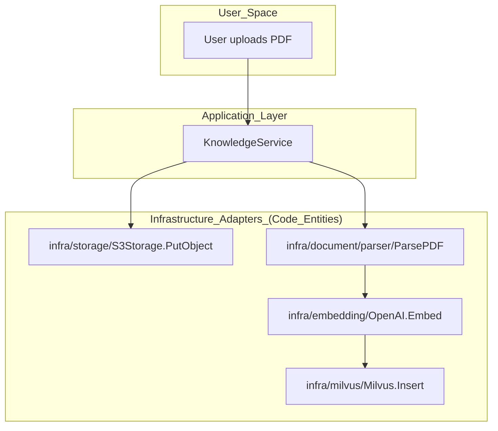
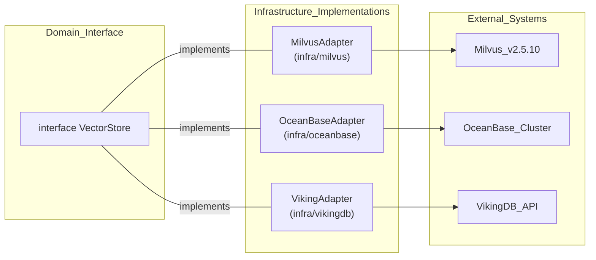

<!-- source: DeepWiki mcp.deepwiki.com · repo coze-dev/coze-studio · page 5.4 Infrastructure Adapters · fetched 2026-10-29 -->

# Infrastructure Adapters

Relevant source files

The following files were used as context for generating this wiki page:

- [backend/api/model/coze/api.go](backend/api/model/coze/api.go)
- [backend/api/model/marketplace/marketplace_common/marketplace_common.go](backend/api/model/marketplace/marketplace_common/marketplace_common.go)
- [backend/api/model/marketplace/product_common/product_common.go](backend/api/model/marketplace/product_common/product_common.go)
- [backend/api/model/marketplace/product_public_api/public_api.go](backend/api/model/marketplace/product_public_api/public_api.go)

The `infra/` layer in Coze Studio serves as the implementation boundary between the core business logic (Domain/Application layers) and external systems. It follows the **Adapter Pattern**, implementing interfaces defined in the domain to ensure the backend remains agnostic of specific technology choices. This layer handles everything from relational persistence and vector search to sandboxed code execution and multi-provider AI embeddings.

## Core Infrastructure Components

The infrastructure layer is organized into specialized packages, each handling a specific category of external interaction or technical concern.

### 1. Database and Persistence (RDB & ORM)
Coze Studio uses **GORM** as its primary ORM, supporting relational databases (RDB). The implementation focuses on MySQL 8.4.5 compatibility for storing core entities like bots, workflows, and user profiles.
- **ORM**: Provides the GORM DB instance initialization and global middleware.
- **RDB**: Manages raw connection pooling and dialect-specific configurations. [backend/api/model/marketplace/marketplace_common/marketplace_common.go:6-10]()
- **SQL Parser**: A utility in `backend/infra/sqlparser/` used for analyzing and validating user-defined SQL, particularly for the Database-as-a-Tool feature where users can interact with structured data. [backend/api/model/data/database/database.go:5-10]()

### 2. Cache and State Management
- **Redis**: The primary caching engine used for session management, rate limiting, and temporary state.
- **Checkpoint**: A specialized mechanism in `backend/infra/checkpoint/` used to save and resume long-running workflow states, ensuring durability across service restarts.

### 3. Vector Stores
Coze Studio supports multiple vector database adapters for RAG (Retrieval-Augmented Generation) and Knowledge Base features.
- **Milvus**: The default high-performance vector store.
- **OceanBase**: Integrated as both a relational and vector database, utilizing its HNSW indexing capabilities for enterprise-grade deployments.
- **VikingDB**: A specialized enterprise-grade vector store adapter often used in large-scale VolcEngine environments.

### 4. AI and Embeddings
The `embedding/` package provides a unified interface for various LLM providers to generate vector representations of text.
- **Supported Providers**: Ark (VolcEngine), OpenAI, Ollama, Gemini, and generic HTTP endpoints.
- **SSE**: Server-Sent Events implementation in `backend/infra/sse/` for streaming AI responses to the frontend, essential for the real-time chat experience. [backend/api/model/conversation/message/message.go:5-15]()

### 5. Document Processing
This sub-system handles the ingestion and parsing of Knowledge Base files into searchable chunks.
- **Parsers**: Built-in support for PDF and DOCX via Python-based workers. [backend/api/model/data/knowledge/knowledge.go:5-20]()
- **Search Store**: Integration with **Elasticsearch (v7/v8)** for hybrid search (keyword + vector).

### 6. Code Execution Sandbox
To safely run Python code within workflows (e.g., the Code Node), Coze Studio employs a sandboxed environment.
- **Coderunner**: Utilizes **Deno** to execute a `sandbox.py` script, providing resource isolation and security boundaries to prevent malicious code from affecting the host system.

### 7. Event Bus and Messaging
The system supports a pluggable event architecture to decouple microservices and handle asynchronous tasks like background document indexing.
- **Drivers**: NSQ (default), RocketMQ, Kafka, Pulsar, and NATS.

### 8. Storage and Media
- **Object Storage**: Abstracted via `backend/infra/storage/`, supporting **MinIO**, VolcEngine **TOS**, and Amazon **S3**. [backend/api/model/file/upload/upload.go:5-15]()
- **ImageX**: Integration with VolcEngine ImageX for advanced image processing, cropping, and CDN delivery. [backend/api/model/resource/resource.go:5-10]()

## Infrastructure Data Flow

The following diagram bridges the **Natural Language Space** (User Actions) to the **Code Entity Space** (Infrastructure Adapters).

**Data Flow: Knowledge Base Ingestion**

**Sources:** [backend/api/model/data/knowledge/knowledge.go:1-50](), [backend/api/model/file/upload/upload.go:1-30]()

## Vector Store Implementation Strategy

Coze Studio uses a delegation pattern to handle multiple vector stores. The `VectorStore` interface is defined in the domain layer, and specific implementations are selected based on the `DYNCONF` (Dynamic Configuration).

**Vector Store Entity Mapping**

**Sources:** [backend/api/model/data/knowledge/knowledge.go:60-100](), [backend/api/model/resource/resource.go:20-40]()

## Key Infrastructure Components Table

The table below maps infrastructure categories to their specific code paths and underlying technologies.

| Component | Code Path | Technology | Role |
| :--- | :--- | :--- | :--- |
| **Relational DB** | `infra/rdb/` | MySQL / GORM | Persistence for `Bot`, `Workflow`, and `User` entities |
| **Vector DB** | `infra/milvus/` | Milvus | High-speed semantic search for Knowledge Base chunks |
| **Object Store** | `infra/storage/` | MinIO / S3 | Storage for `upload.File` and media assets |
| **Search Engine** | `infra/elasticsearch/` | ES v8 | Hybrid search (BM25 + Vector) for document retrieval |
| **Message Queue** | `infra/eventbus/` | NSQ / NATS | Asynchronous task processing for `AgentRun` |
| **Dynamic Conf** | `infra/dynconf/` | Apollo / etcd | Real-time configuration updates for feature flags |
| **ID Generator** | `infra/idgen/` | Sonyflake | Distributed unique ID generation for all entities |

**Sources:** [backend/api/model/coze/api.go:7-25](), [backend/api/model/marketplace/product_public_api/public_api.go:16-29](), [backend/api/model/marketplace/product_common/product_common.go:117-150]()

---

