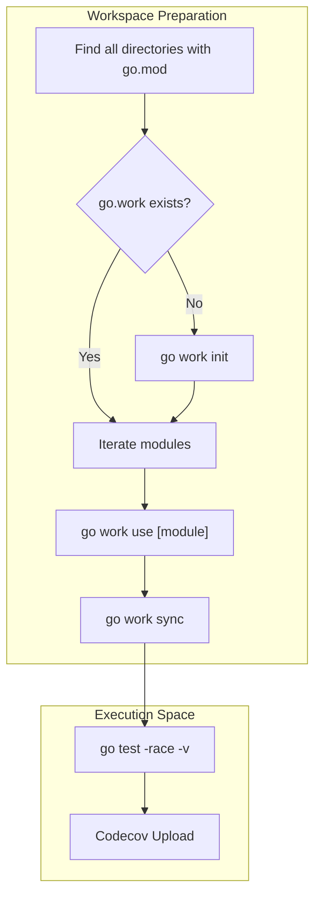
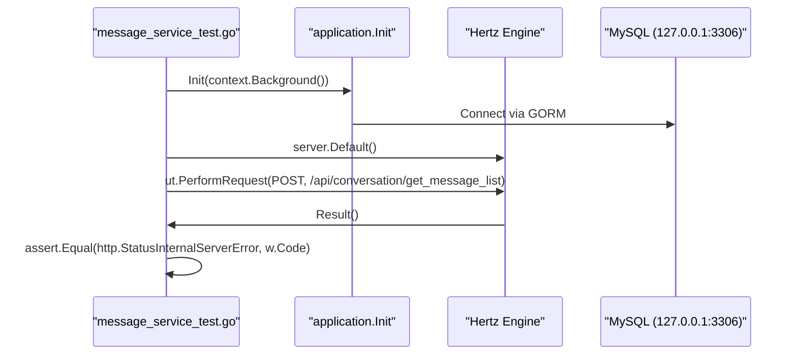

<!-- source: DeepWiki mcp.deepwiki.com · repo coze-dev/coze-studio · page 5.5 Build and Testing · fetched 2026-10-29 -->

# Build and Testing

Relevant source files

The following files were used as context for generating this wiki page:

- [.github/workflows/ci@backend.yml](.github/workflows/ci@backend.yml)
- [backend/.gitignore](backend/.gitignore)
- [backend/api/handler/coze/message_service_test.go](backend/api/handler/coze/message_service_test.go)
- [backend/api/handler/coze/workflow_service_test.go](backend/api/handler/coze/workflow_service_test.go)

## Purpose and Scope

This page provides a technical deep dive into the build and testing infrastructure of the Coze Studio backend. It details the Go compilation process, automated testing strategies (unit, race detection, benchmarks), the dynamic workspace management in CI, and the mock infrastructure used for isolating business logic.

## Go Workspace and Module Management

The backend utilizes a Go workspace (`go.work`) strategy to manage multiple internal modules within the monorepo. In the CI environment, this workspace is generated dynamically to ensure all modules are tested against the current state of the repository.

### Dynamic Workspace Generation
The CI pipeline automatically discovers all Go modules by searching for `go.mod` files and initializing a temporary workspace.

**Workspace Assembly Logic:**
- **Discovery:** The script uses `find . -name "go.mod" -exec dirname {} \;` to locate all module roots [ .github/workflows/ci@backend.yml:81-81 ]().
- **Initialization:** If `go.work` is missing, it is initialized via `go work init` [ .github/workflows/ci@backend.yml:85-85 ]().
- **Module Inclusion:** Each discovered module is added via `go work use $module` [ .github/workflows/ci@backend.yml:86-86 ]().
- **Synchronization:** The `go work sync` command ensures that the workspace's `go.sum` is consistent across all included modules [ .github/workflows/ci@backend.yml:87-87 ]().

### CI Data Flow: Module Discovery to Test Execution

Sources: [ .github/workflows/ci@backend.yml:80-87 ]()

## Testing Infrastructure

The testing strategy employs a multi-layered approach combining standard unit tests, race detection, and performance benchmarking.

### Unit Testing and Race Detection
Backend unit tests are executed using the `-race` flag to detect memory corruption and concurrency bugs.

| Flag | Function |
| :--- | :--- |
| `-race` | Enables the Go race detector to identify unsynchronized data access [ .github/workflows/ci@backend.yml:88-88 ]() |
| `-v` | Verbose output for detailed test logging [ .github/workflows/ci@backend.yml:88-88 ]() |
| `-gcflags="all=-l -N"` | Disables optimizations and inlining to ensure accurate coverage and debugging [ .github/workflows/ci@backend.yml:88-88 ]() |
| `-coverpkg` | Specifies the scope of code coverage across all discovered modules, ensuring cross-module calls are tracked [ .github/workflows/ci@backend.yml:88-88 ]() |

### Benchmark Testing
Performance is tracked via a dedicated `benchmark-test` job. It runs all functions matching the `Benchmark*` pattern while skipping standard tests.

- **Command:** `go test -race -v -bench=. -benchmem -run=none` [ .github/workflows/ci@backend.yml:125-125 ]().
- **Metrics:** Reports execution time and memory allocation statistics (`-benchmem`) [ .github/workflows/ci@backend.yml:125-125 ]().
- **Optimization Flags:** Similar to unit tests, it uses `-gcflags="all=-l -N"` to maintain consistent profiling environments [ .github/workflows/ci@backend.yml:125-125 ]().

Sources: [ .github/workflows/ci@backend.yml:88-125 ]()

## Database Integration Tests

Coze Studio performs integration testing against a real MySQL instance to validate GORM models and SQL queries.

### MySQL Initialization Lifecycle
1.  **Provisioning:** A MySQL 8.4.5 container is started with the `opencoze` database and `utf8mb4` encoding [ .github/workflows/ci@backend.yml:45-54 ]().
2.  **Wait-for-Ready:** The pipeline polls `/proc/net/tcp` to confirm port `3306` (hex `0CEA`) is listening [ .github/workflows/ci@backend.yml:59-66 ]().
3.  **Schema Injection:** The database is initialized using the production-ready schema located at `docker/volumes/mysql/schema.sql` [ .github/workflows/ci@backend.yml:77-77 ]().
4.  **Cleanup:** The container is forcefully removed after the test suite completes [ .github/workflows/ci@backend.yml:102-102 ]().

### Integration Test Execution

Sources: [ .github/workflows/ci@backend.yml:45-102 ](), [ backend/api/handler/coze/message_service_test.go:36-57 ]()

## Mock Infrastructure

For isolating complex domain logic (e.g., AI workflows, external storage), the project uses `gomock` for interface mocking and `mockey` for function patching.

### Internal Mock Packages
Mocks are organized within `backend/internal/mock/` to mirror the infrastructure and domain layers. Key mocks include:
- **ID Generation:** `mock.MockIDGenerator` for deterministic ID creation [ backend/api/handler/coze/workflow_service_test.go:127-127 ]().
- **Storage:** `storageMock.MockStorage` for simulating MinIO/S3 interactions [ backend/api/handler/coze/workflow_service_test.go:133-133 ]().
- **Cross-Domain:** Mocks for `crossuser`, `knowledge`, and `conversation` to simulate service-to-service communication without external dependencies [ backend/api/handler/coze/workflow_service_test.go:134-140 ]().
- **Workflow Variables:** `mockvar.MockStore` for testing variable persistence logic [ backend/api/handler/coze/workflow_service_test.go:128-129 ]().

### Test Runner Pattern
Complex tests, particularly for workflows, utilize a `wfTestRunner` struct to manage the lifecycle of mocks, the `gomock.Controller`, and the Hertz server instance [ backend/api/handler/coze/workflow_service_test.go:123-144 ]().

Sources: [ backend/api/handler/coze/workflow_service_test.go:103-144 ]()

## Coverage and Reporting

Code coverage is a mandatory metric for backend Pull Requests to ensure maintainability.

1.  **Profile Generation:** The `go test` command generates a `coverage.out` file using the `-coverprofile` flag [ .github/workflows/ci@backend.yml:88-88 ]().
2.  **Codecov Upload:** The `codecov/codecov-action@v5` is used to transmit results, tagged with `GOLANG` and `BACKEND` environment variables [ .github/workflows/ci@backend.yml:91-97 ]().
3.  **Breakdown:** The CI environment defines a `BREAKDOWN_FILE` (`main.breakdown`) for detailed coverage analysis [ .github/workflows/ci@backend.yml:33-33 ]().

Sources: [ .github/workflows/ci@backend.yml:32-33 ](), [ .github/workflows/ci@backend.yml:90-97 ]()

## Document Parsing and Python Environment

The backend includes specialized logic for document parsing and code execution, which requires a Python runtime.

- **Code Execution:** Python logic is managed via `backend/infra/coderunner/sandbox.py` [ backend/api/handler/coze/workflow_service_test.go:102-102 ]().
- **Restricted Environment:** The `RestrictedPython` implementation is used within workflow nodes for secure script execution [ backend/.gitignore:40-40 ]().
- **Setup:** Developers initialize the environment via `scripts/setup/python.sh` (referenced in development workflows) to ensure dependencies for PDF and DOCX parsing are isolated within a virtual environment.

Sources: [ backend/api/handler/coze/workflow_service_test.go:102-102 ](), [ backend/.gitignore:40-40 ]()

---

