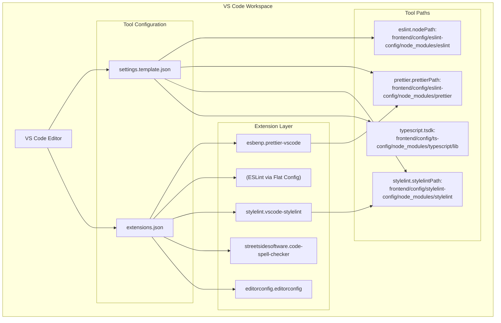
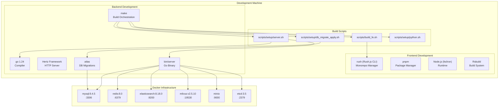
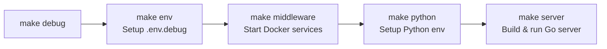
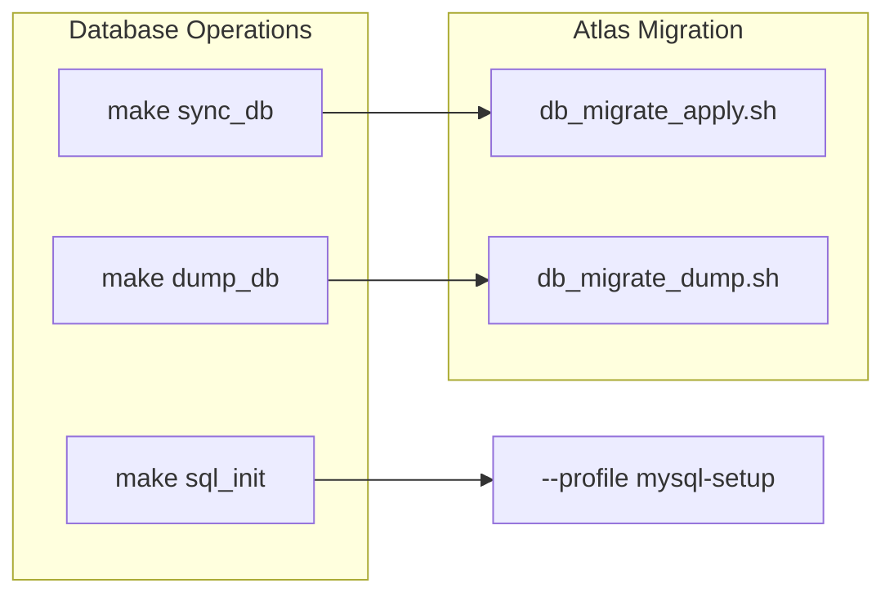

<!-- source: DeepWiki mcp.deepwiki.com · repo coze-dev/coze-studio · page 6 Development Environment · fetched 2026-10-29 -->

# Development Environment

<details>
<summary>Relevant source files</summary>

The following files were used as context for generating this wiki page:

- [CLAUDE.md](CLAUDE.md)
- [Makefile](Makefile)
- [README.md](README.md)

</details>


This document provides an overview of the development environment setup and configuration for Coze Studio. It covers the tools, IDE configuration, and workflows required to develop, build, and test both frontend and backend components locally.

The development environment is centered around VS Code with specific configurations for optimal developer experience. The codebase provides template configuration files in the [.vscode/](.vscode/) directory to standardize tooling across the team.

For step-by-step setup instructions, see [Initial Setup](#6.1). For detailed VS Code configuration, see [VS Code Configuration](#6.2). For code style and formatting guidelines, see [Code Style and Formatting](#6.3). For Git workflow configuration, see [Git Configuration](#6.4). For common development tasks, see [Development Workflows](#6.5).

## Purpose and Scope

This page introduces the development environment architecture, required tools, IDE configuration, and development workflows. It serves as the entry point for understanding how to configure a local development environment for contributing to Coze Studio. The architecture supports both full-stack development with Docker-based services and individual component development (frontend-only or backend-only).

## IDE Configuration Overview

The codebase provides standardized VS Code configuration through two key files:

| File | Purpose | Usage |
|------|---------|-------|
| [.vscode/extensions.json:1-15]() | Recommended VS Code extensions | Automatically prompts users to install |
| [.vscode/settings.template.json:1-198]() | Workspace settings template | Copy to `.vscode/settings.json` locally |

The `extensions.json` file recommends essential extensions including `esbenp.prettier-vscode`, `editorconfig.editorconfig`, `streetsidesoftware.code-spell-checker`, and `stylelint.vscode-stylelint` [[.vscode/extensions.json:3-9]](). The `settings.template.json` configures tool paths, formatter behavior, and TypeScript server settings optimized for the monorepo structure.

Sources: [.vscode/extensions.json:1-15](), [.vscode/settings.template.json:1-198]()

## Development Environment Architecture

The Coze Studio development environment consists of three primary layers: the IDE/Editor Layer (VS Code), the Development Tools Layer (Rush.js, Go toolchain), and the Infrastructure Services Layer (Docker-based middleware).

**IDE Configuration Architecture**



The VS Code configuration uses centralized tool installations from the `frontend/config/` packages rather than workspace-local installations. This ensures consistent tooling versions across all developers. The `eslint.nodePath`, `prettier.prettierPath`, `stylelint.stylelintPath`, and `typescript.tsdk` settings point to these shared installations [[.vscode/settings.template.json:2-3]](), [[.vscode/settings.template.json:98]](), [[.vscode/settings.template.json:142]]().

Sources: [.vscode/extensions.json:1-15](), [.vscode/settings.template.json:1-198]()

**Development Tool Chain Architecture**



The development environment uses `make` targets to orchestrate build scripts. Frontend builds use `rush` commands [[Makefile:5]](). Backend builds compile Go code to the `bin/server` binary [[Makefile:6]](). Configuration files in `docker/` control runtime behavior [[Makefile:11-18]]().

Sources: [Makefile:1-158](), [.nvmrc:1]()

## Required Tools and Technologies

The following tools must be installed on the development machine:

| Tool | Version | Purpose |
|------|---------|---------|
| **VS Code** | Latest | Primary IDE with workspace configuration |
| Node.js | `lts/iron` (v20) | JavaScript runtime [[.nvmrc:1]]() |
| Rush.js | Latest | Monorepo manager for frontend packages |
| Go | 1.24 | Backend compiler and runtime [[README.md:11]]() |
| Docker | Latest | Container runtime for infrastructure services |
| Atlas | Latest | Database schema migration tool [[Makefile:98]]() |
| Make | GNU Make | Build orchestration [[Makefile:1]]() |

### VS Code Extensions

The [.vscode/extensions.json:1-15]() file defines recommended extensions that will be automatically suggested:

| Extension ID | Purpose |
|--------------|---------|
| `editorconfig.editorconfig` | EditorConfig support for consistent coding styles [[.vscode/extensions.json:3]]() |
| `esbenp.prettier-vscode` | Code formatter integration [[.vscode/extensions.json:4]]() |
| `streetsidesoftware.code-spell-checker` | Spell checking [[.vscode/extensions.json:5]]() |
| `stylelint.vscode-stylelint` | CSS/SCSS/Less linting [[.vscode/extensions.json:9]]() |

Sources: [.vscode/extensions.json:1-15](), [.nvmrc:1]()

## Development Modes

Coze Studio supports multiple development modes depending on the scope of work:

### Full Stack Development Mode

The `debug` target in the Makefile starts the complete development environment, including environment setup, middleware, python environment, and the server [[Makefile:23]]().



Sources: [Makefile:23-24]()

### Frontend-Only Development

For frontend development, use the `fe` target which executes the frontend build script [[Makefile:31-33]]().

```bash
make fe
```

Alternatively, navigate to the main application package and start the dev server:
```bash
cd frontend/apps/coze-studio
npm run dev
```
[[CLAUDE.md:37-38]]()

### Backend-Only Development

For backend development with pre-built infrastructure:

```bash
# Start only middleware services
make middleware

# Build and run Go server
make server
```

The `middleware` target starts Docker services defined in [docker/docker-compose-debug.yml:11]() with the `middleware` profile [[Makefile:61-63]]().

Sources: [Makefile:35-42](), [Makefile:61-63]()

## Environment Configuration

Development environment configuration is managed through environment files:

| File | Purpose | Created From |
|------|---------|--------------|
| `docker/.env.debug` | Debug environment variables [[Makefile:16]]() | `docker/.env.debug.example` [[Makefile:28]]() |
| `docker/.env` | Production/Web variables [[Makefile:17]]() | `docker/.env.example` [[Makefile:72]]() |

The `env` target in the Makefile automatically creates the debug environment file if it doesn't exist [[Makefile:25-29]]().

Sources: [Makefile:11-29](), [Makefile:69-73]()

## Database Management Workflow

Database schema management uses Atlas for migrations and schema synchronization [[Makefile:98]]().



The `sync_db` target applies migrations [[Makefile:48-50]](), while `dump_db` exports the current schema to HCL and SQL files [[Makefile:52-55]](), [[Makefile:95-101]]().

Sources: [Makefile:48-60](), [Makefile:95-108]()

## Common Development Commands

| Command | Purpose | Notes |
|---------|---------|-------|
| `make debug` | Start full development environment [[Makefile:23]]() | Orchestrates env, middleware, python, and server |
| `make middleware` | Start Docker infrastructure only [[Makefile:61]]() | Uses `docker-compose-debug.yml` |
| `make server` | Build and run Go backend [[Makefile:35]]() | Triggers `make fe` if static assets are missing |
| `make sync_db` | Apply database migrations [[Makefile:48]]() | Uses `db_migrate_apply.sh` |
| `make python` | Setup Python environment [[Makefile:91]]() | Uses `setup/python.sh` |
| `make clean` | Stop and remove data [[Makefile:87]]() | Removes `./docker/data` |
| `rush update` | Install frontend dependencies [[CLAUDE.md:18]]() | Monorepo-wide update |
| `rush build` | Build all frontend packages [[CLAUDE.md:56]]() | Incremental build by default |

Sources: [Makefile:1-158](), [CLAUDE.md:1-196]()

---

