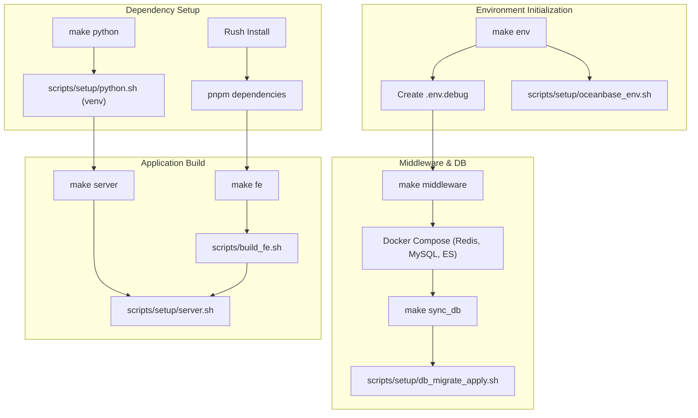
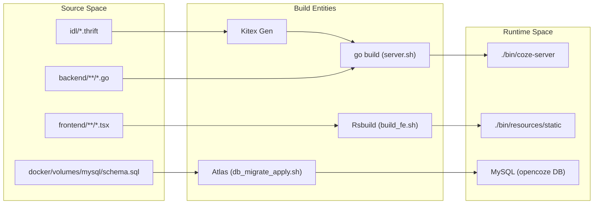

<!-- source: DeepWiki mcp.deepwiki.com · repo coze-dev/coze-studio · page 6.1 Initial Setup · fetched 2026-10-29 -->

# Initial Setup

<details>
<summary>Relevant source files</summary>

The following files were used as context for generating this wiki page:

- [.nvmrc](.nvmrc)
- [Makefile](Makefile)
- [README.md](README.md)

</details>


This page provides step-by-step instructions for setting up the Coze Studio development environment. It covers the configuration of Node.js, Go, Python, and the necessary middleware services using the provided `Makefile` and setup scripts.

## Prerequisites

Before beginning, ensure your system meets the following requirements:
*   **Hardware**: Minimum 2 Core CPU, 4 GB RAM [README.md:43-43]().
*   **Docker**: Docker and Docker Compose installed and running [README.md:44-44]().
*   **Node.js**: Version defined in `.nvmrc` (LTS Iron / Node 22.x) [.nvmrc:1-1]().
*   **Go**: Version 1.24 or higher (Go 1.23.4 is the minimum supported) [README.md:11-11]().
*   **Python**: Required for document parsing and sandbox execution [Makefile:91-94]().

## Setup Flow Overview

The setup process is orchestrated primarily through the `Makefile`, which leverages specialized scripts in `scripts/setup/` to configure the backend, frontend, and database layers.


**Diagram: Coze Studio environment initialization and build flow**

Sources: [Makefile:1-21](), [README.md:41-64]()

## Core Setup Components

### 1. Makefile Targets
The `Makefile` is the central entry point for development tasks. Key targets include:

| Target | Description | Source |
| :--- | :--- | :--- |
| `debug` | Complete local setup: env, middleware, python, and server. | [Makefile:23-23]() |
| `fe` | Executes `scripts/build_fe.sh` to compile frontend assets. | [Makefile:31-33]() |
| `server` | Builds and runs the Go backend server with `APP_ENV=debug`. | [Makefile:35-42]() |
| `middleware` | Starts Docker containers for MySQL, Redis, ES, etc. | [Makefile:61-63]() |
| `web` | Starts the full production-like stack (Web + Server + Middleware). | [Makefile:75-77]() |
| `oceanbase_debug` | Specialized setup using OceanBase as the vector store. | [Makefile:117-117]() |

Sources: [Makefile:23-130]()

### 2. Setup Scripts (`scripts/setup/`)
These bash scripts handle complex environment logic:

*   **`server.sh`**: Handles Go compilation and execution. It is invoked by `make server` with the `-start` flag to initiate the backend [Makefile:41-41]().
*   **`python.sh`**: Sets up the Python virtual environment required for the `coderunner` and document processing domains [Makefile:91-94]().
*   **`db_migrate_apply.sh`**: Applies database schema changes to the running MySQL instance [Makefile:7-7]().
*   **`db_migrate_dump.sh`**: Dumps the current database state to schema files [Makefile:8-8]().
*   **`oceanbase_env.sh`**: Configures environment variables specifically for OceanBase integration [Makefile:114-115]().

Sources: [Makefile:4-10](), [Makefile:114-115]()

## Step-by-Step Instructions

### Step 1: Clone and Environment Prep
Clone the repository and initialize the local environment file.
```bash
git clone https://github.com/coze-dev/coze-studio.git
cd coze-studio
make env
```
This target copies `docker/.env.debug.example` to `docker/.env.debug` if it doesn't exist [Makefile:25-29]().

### Step 2: Node.js and Rush Setup
Coze Studio uses **Rush.js** for monorepo management.
1.  Ensure you are using the correct Node version: `nvm use` (reads from `.nvmrc`) [.nvmrc:1-1]().
2.  Install Rush globally (if not already): `npm install -g @microsoft/rush`.
3.  Install dependencies: `rush update`.

### Step 3: Middleware Initialization
Start the supporting infrastructure (MySQL, Redis, Elasticsearch, MinIO, etc.):
```bash
make middleware
```
This uses `docker/docker-compose-debug.yml` with the `--profile middleware` flag to start only the backend services [Makefile:61-63]().

### Step 4: Database Migration
Once middleware is healthy, initialize the database schema:
```bash
make sync_db
```
This triggers the `mysql-setup` profile to apply migrations [Makefile:48-50]().

### Step 5: Python and Backend Build
Initialize the Python sandbox and build the Go server:
```bash
make python
make server
```
The `server` target will automatically trigger `make fe` if the static directory `./bin/resources/static` is missing [Makefile:36-39]().

## Data Flow: From Source to Execution

The following diagram illustrates how setup scripts transform source code into a running environment.


**Diagram: Build pipeline from IDL/Source to Runtime Binaries**

Sources: [Makefile:4-21](), [Makefile:35-42](), [README.md:27-27]()

## OceanBase Setup (Optional)
For developers utilizing OceanBase as a vector database, use the specialized OceanBase targets:
1.  **Environment**: `make oceanbase_env` [Makefile:114-115]().
2.  **Debug Stack**: `make oceanbase_debug` [Makefile:117-117]().
This replaces the standard MySQL/Milvus components with OceanBase-compatible services defined in `docker/docker-compose-oceanbase_debug.yml` [Makefile:13-13](), [Makefile:121-121]().

## Troubleshooting
*   **Missing Static Files**: If the server fails to start due to missing assets, run `make fe` manually [Makefile:31-33]().
*   **Docker Volumes**: If database state becomes inconsistent, use `make clean` to remove containers and volume data in `./docker/data` [Makefile:87-89]().
*   **Env Mismatch**: Ensure `docker/.env.debug` is correctly populated. The `make env` target only copies the example if the file is missing [Makefile:26-29]().

Sources: [Makefile:1-158](), [README.md:41-72]()

---

