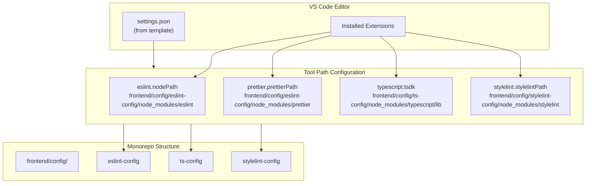
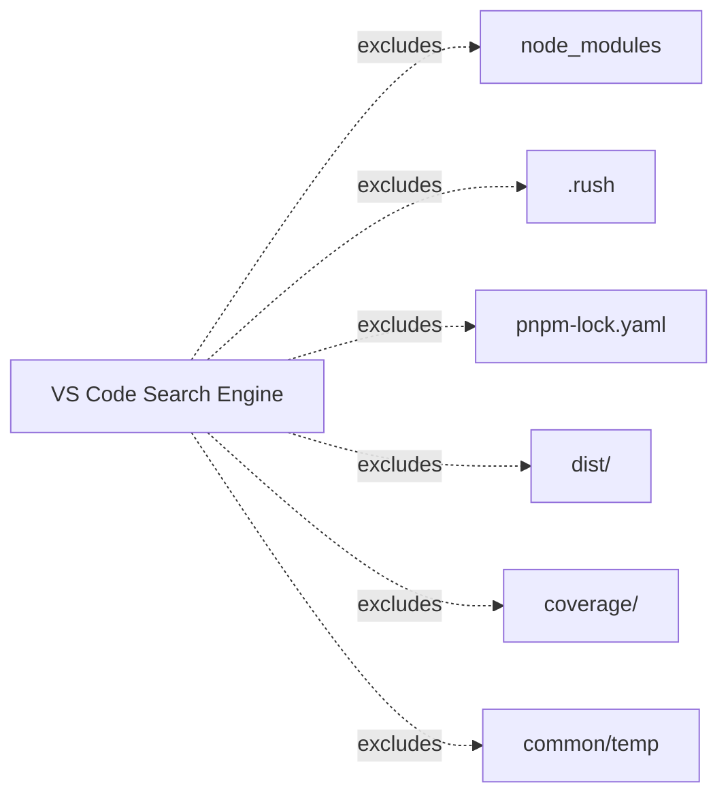

<!-- source: DeepWiki mcp.deepwiki.com · repo coze-dev/coze-studio · page 6.2 VS Code Configuration · fetched 2026-10-29 -->

# VS Code Configuration

<details>
<summary>Relevant source files</summary>

The following files were used as context for generating this wiki page:

- [.vscode/extensions.json](.vscode/extensions.json)
- [.vscode/settings.template.json](.vscode/settings.template.json)

</details>


This document describes the Visual Studio Code workspace configuration for Coze Studio, including recommended extensions and workspace settings. The configuration is designed to provide a consistent development experience across the team with automatic formatting, linting, and optimized TypeScript performance for the monorepo environment.

For initial development environment setup including Node.js and Rush installation, see [Initial Setup](6.1). For code style rules and formatting guidelines, see [Code Style and Formatting](6.3).

## Configuration Files

The VS Code configuration consists of two primary files located in the `.vscode/` directory:

| File | Purpose | Usage |
|------|---------|-------|
| `extensions.json` | Defines recommended and unwanted extensions | Automatically prompts developers to install recommended extensions |
| `settings.template.json` | Workspace settings template | Developers copy this to `settings.json` to apply workspace configuration |

The `settings.template.json` file should be manually copied to `.vscode/settings.json` (which is gitignored) to apply the workspace settings locally.

**Sources:** [.vscode/extensions.json:1-15](), [.vscode/settings.template.json:1-198]()

## Recommended Extensions

The repository recommends several VS Code extensions that provide essential functionality for the development workflow:

| Extension ID | Purpose |
|-------------|---------|
| `editorconfig.editorconfig` | Enforces EditorConfig rules for consistent formatting |
| `esbenp.prettier-vscode` | Prettier formatter integration |
| `streetsidesoftware.code-spell-checker` | Spell checking for code and comments |
| `codezombiech.gitignore` | `.gitignore` file syntax support |
| `aaron-bond.better-comments` | Enhanced comment highlighting |
| `mikestead.dotenv` | `.env` file syntax support |
| `stylelint.vscode-stylelint` | Stylelint integration for CSS/SCSS/LESS |

Two extensions are explicitly marked as unwanted to avoid conflicts with the monorepo's internal import logic:
- `nucllear.vscode-extension-auto-import` 
- `steoates.autoimport`

**Sources:** [.vscode/extensions.json:2-14]()

## Workspace Configuration Architecture

The following diagram illustrates how VS Code settings integrate with the monorepo's tooling infrastructure, specifically mapping settings to the local `node_modules` of configuration packages.

**VS Code to Code Entity Mapping**


The settings template configures VS Code to use tools from specific monorepo packages rather than global installations, ensuring version consistency across the team.

**Sources:** [.vscode/settings.template.json:2-3,98,142]()

## Editor Core Settings

The workspace configures fundamental editor behavior for consistent code formatting:

| Setting | Value | Purpose |
|---------|-------|---------|
| `editor.tabSize` | `2` | Two-space indentation for all files |
| `editor.insertSpaces` | `true` | Use spaces instead of tabs |
| `editor.formatOnSave` | `true` | Automatically format files on save |
| `editor.defaultFormatter` | `"esbenp.prettier-vscode"` | Use Prettier as default formatter |
| `editor.formatOnSaveMode` | `"modificationsIfAvailable"` | Only format modified lines |
| `editor.rulers` | `[80, 120]` | Visual guides at 80 and 120 characters |

The `formatOnSaveMode` set to `"modificationsIfAvailable"` prevents reformatting entire files when only small changes are made, reducing noise in pull requests.

**Sources:** [.vscode/settings.template.json:4-17,80]()

## Code Actions and Auto-Fix Configuration

Code actions on save are explicitly disabled to prevent unintended changes and maintain manual control over import organization:

```jsonc
"editor.codeActionsOnSave": {
  "source.fixAll": "never",
  "source.fixAll.eslint": "never",
  "source.removeUnused": "never",
  "source.organizeImports": "never"
}
```

This configuration ensures that ESLint does not automatically fix issues on save and unused imports are not automatically removed, which is critical in a complex monorepo where automatic organization might conflict with specific dependency tiering.

**Sources:** [.vscode/settings.template.json:10-16]()

## File and Search Configuration

The workspace extensively configures file handling and search behavior to optimize performance in the large monorepo.

### File Associations

Special file associations prevent VS Code from parsing large generated files or build artifacts:

| Pattern | Language | Reason |
|---------|----------|--------|
| `**/pnpm-lock.yaml` | `plaintext` | Prevents freezing when opening large lock files |
| `**/dist/**` | `plaintext` | Build output should not be parsed |
| `*.map` | `plaintext` | Source maps are not edited |
| `*.json` | `jsonc` | Enable JSON with comments support |
| `OWNERS` | `yaml` | Code ownership files |

**Sources:** [.vscode/settings.template.json:40-60]()

### Search and Watcher Exclusions

The following directories are excluded from search and file watching to reduce CPU usage:

**Search Exclusion Logic**


File watchers are also specifically excluded for `**/.git/objects/**` and `**/node_modules/*/**` to prevent high-churn directories from triggering editor overhead.

**Sources:** [.vscode/settings.template.json:19-33,73-77]()

## TypeScript Language Server Configuration

The TypeScript configuration is tuned for performance in the monorepo environment:

### TypeScript SDK and Memory

The workspace uses a specific TypeScript version from the monorepo and allocates significant memory for the language server:

- **SDK Path**: `frontend/config/ts-config/node_modules/typescript/lib` [ .vscode/settings.template.json:98 ]()
- **Max Memory**: `16384` (16GB) [ .vscode/settings.template.json:113 ]()

### Watch Options Optimization

The TypeScript server watch options are configured to leverage native file system events while excluding build output:

```jsonc
"typescript.tsserver.watchOptions": {
  "fallbackPolling": "dynamicPriorityPolling",
  "watchDirectory": "useFsEvents",
  "watchFile": "useFsEventsOnParentDirectory",
  "excludeDirectories": [
    "/**/node_modules",
    "/**/dist",
    "/**/lib",
    "/**/coverage",
    "**/temp"
  ]
}
```

**Sources:** [.vscode/settings.template.json:116-136]()

## ESLint and Stylelint Configuration

ESLint is configured to work with the monorepo's flat config format and specific package nodes:

- **ESLint Path**: `frontend/config/eslint-config/node_modules/eslint` [ .vscode/settings.template.json:2 ]()
- **Stylelint Path**: `frontend/config/stylelint-config/node_modules/stylelint` [ .vscode/settings.template.json:142 ]()
- **Working Directories**: `{"mode": "auto"}` ensures ESLint detects the nearest `package.json` for each monorepo package. [ .vscode/settings.template.json:34-38 ]()

Native CSS, SCSS, and LESS validation is disabled (`css.validate: false`) to allow Stylelint to be the sole authority on style rules.

**Sources:** [.vscode/settings.template.json:137-142]()

## Language-Specific Formatters

The workspace defines specific formatters for various file types to ensure consistency:

| File Type | Formatter |
|-----------|-----------|
| `typescript`, `javascript`, `json`, `yaml`, `html` | `esbenp.prettier-vscode` |
| `less` | `stylelint.vscode-stylelint` |
| `shellscript`, `dotenv`, `ignore` | `foxundermoon.shell-format` |
| `sql` | `adpyke.vscode-sql-formatter` |
| `xml` | `mblode.pretty-formatter` |

**Sources:** [.vscode/settings.template.json:144-195]()

## Setup Instructions

To configure VS Code for development:

1. **Install Recommended Extensions**: Accept the prompt to install extensions listed in `.vscode/extensions.json`.
2. **Apply Settings**: Copy `.vscode/settings.template.json` to `.vscode/settings.json`.
3. **Verify Tooling**: Run `rush install` to ensure the `node_modules` paths for ESLint and TypeScript exist.
4. **Go Configuration**: Ensure the Go extension is installed (though not explicitly in `extensions.json`, it is required for backend development).

**Sources:** [.vscode/extensions.json:1-15](), [.vscode/settings.template.json:1-198]()

---

