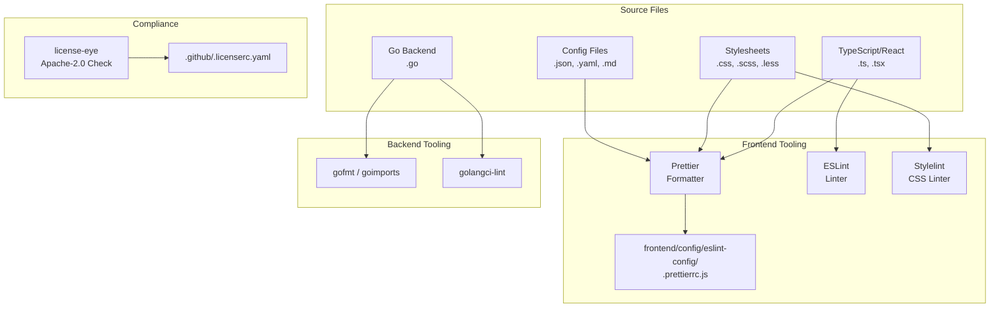
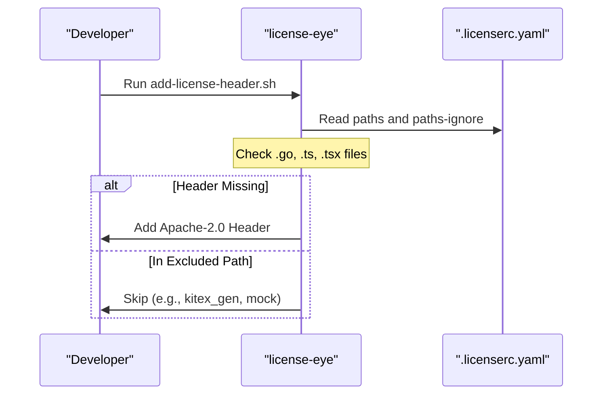

<!-- source: DeepWiki mcp.deepwiki.com · repo coze-dev/coze-studio · page 6.3 Code Style and Formatting · fetched 2026-10-29 -->

# Code Style and Formatting

<details>
<summary>Relevant source files</summary>

The following files were used as context for generating this wiki page:

- [.claude/agents/frontend-infrastructure-expert.md](.claude/agents/frontend-infrastructure-expert.md)
- [.github/.licenserc.yaml](.github/.licenserc.yaml)
- [.prettierrc.js](.prettierrc.js)

</details>


## Purpose and Scope

This document describes the code style and formatting standards enforced across the Coze Studio monorepo. It covers the configuration and integration of linting and formatting tools for both frontend (TypeScript/React) and backend (Go) development environments.

Key tools include:
- **Prettier**: Automated code formatting for frontend and configuration files.
- **ESLint**: JavaScript/TypeScript code quality and style enforcement.
- **Stylelint**: CSS/SCSS/LESS stylesheet linting and formatting.
- **Gofmt/Goimports**: Standard Go code formatting and import management.
- **Golangci-lint**: Comprehensive static analysis for Go backend services.
- **License Header Enforcement**: Apache 2.0 license compliance via `license-eye`.

The configuration is centralized to ensure consistency across the packages managed by Rush.js.

**Sources:** [.prettierrc.js:1-5](), [.github/.licenserc.yaml:1-30](), [.claude/agents/frontend-infrastructure-expert.md:1-32]()

---

## Code Style Architecture

The code style system uses specialized tools for different languages, integrated into the VS Code editor and enforced via CI pipelines.

**Code Style and Formatting Tool Chain**



**Sources:** [.prettierrc.js:1-5](), [.github/.licenserc.yaml:1-30](), [.claude/agents/frontend-infrastructure-expert.md:8-16]()

---

## Frontend Formatting and Linting

### Prettier Configuration
Prettier is the primary formatter for the frontend. The root configuration [.prettierrc.js:2-4]() imports settings from a centralized package located in the `frontend/config/eslint-config/` directory.

```javascript
// .prettierrc.js
module.exports = {
  ...require('./frontend/config/eslint-config/.prettierrc.js'),
};
```

### ESLint and Stylelint
The project uses ESLint for code quality and Stylelint for stylesheet management. These tools are configured to work alongside Prettier to ensure that formatting and logic checks do not conflict. The `frontend-infrastructure-expert` agent is responsible for maintaining these configurations, including custom rules and IDE integrations [.claude/agents/frontend-infrastructure-expert.md:10-16]().

**Sources:** [.prettierrc.js:1-5](), [.claude/agents/frontend-infrastructure-expert.md:1-32]()

---

## Backend Formatting and Linting

Go code follows standard community conventions enforced by the Go toolchain and `golangci-lint`.

### Formatting
- **gofmt**: Enforces standard indentation and layout for all `.go` files.
- **goimports**: Automatically manages import blocks, grouping standard library imports separately from third-party modules.

### Static Analysis
`golangci-lint` is used for deep static analysis. It aggregates multiple linters to check for:
- Dead code and unused variables.
- Common security vulnerabilities.
- Performance pitfalls.
- Proper error handling.

**Sources:** [.github/.licenserc.yaml:7-7](), [.claude/agents/frontend-infrastructure-expert.md:8-16]()

---

## License Header Compliance

All source files must include the Apache-2.0 license header. This is enforced by the `license-eye` tool and configured via `.github/.licenserc.yaml`.

### License Configuration
The configuration specifies the Apache-2.0 SPDX ID and the copyright owner as `coze-dev` [.github/.licenserc.yaml:3-4]().

**License Validation Logic**



### Implementation Details
- **Target Paths**: The tool checks all `.go` files and frontend TypeScript files in `apps/` and `packages/` [.github/.licenserc.yaml:7-9]().
- **Exclusions**: To avoid false positives, the following are ignored [.github/.licenserc.yaml:10-29]():
    - Generated code: `**/kitex_gen/**`, `**/gorm_gen/**`, `**/*.gen.go`.
    - Mocks: `**/*_mock.go`, `backend/internal/mock/**`.
    - Documentation and Metadata: `**/*.md`, `LICENSE`, `NOTICE`, `go.mod`.
    - Build artifacts: `dist/`.

**Sources:** [.github/.licenserc.yaml:1-30]()

---

## Troubleshooting and Maintenance

### Infrastructure Expertise
For modifications to the build system, linting rules, or monorepo configuration, the repository provides a specialized Claude agent profile: `frontend-infrastructure-expert`. This agent is trained to handle [.claude/agents/frontend-infrastructure-expert.md:3-16]():
- Configuring bundlers (rspack, webpack).
- Modifying ESLint rules and configurations.
- Resolving dependency conflicts in `package.json`.
- Optimizing CI/CD pipelines for frontend projects.

### Configuration Best Practices
When updating styles or linting rules, developers should:
1. Prioritize developer experience and build performance [.claude/agents/frontend-infrastructure-expert.md:20]().
2. Ensure configurations are maintainable and well-documented [.claude/agents/frontend-infrastructure-expert.md:21]().
3. Consider cross-platform compatibility (Windows, macOS, Linux) [.claude/agents/frontend-infrastructure-expert.md:23]().

**Sources:** [.claude/agents/frontend-infrastructure-expert.md:1-32](), [.prettierrc.js:1-5]()

---

