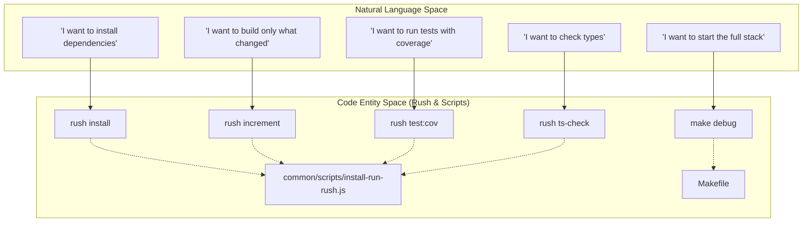
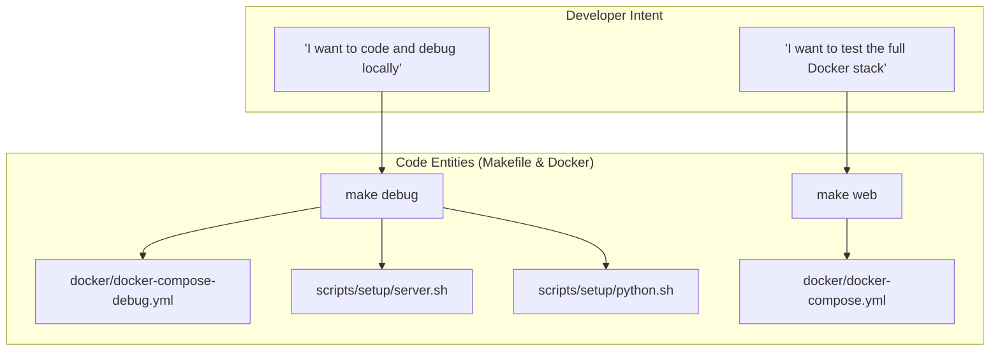

<!-- source: DeepWiki mcp.deepwiki.com · repo coze-dev/coze-studio · page 6.5 Development Workflows · fetched 2026-10-29 -->

# Development Workflows

<details>
<summary>Relevant source files</summary>

The following files were used as context for generating this wiki page:

- [.github/workflows/ci.yml](.github/workflows/ci.yml)
- [CONTRIBUTING.md](CONTRIBUTING.md)
- [Makefile](Makefile)

</details>


This document covers common development tasks and workflows for working in the Coze Studio monorepo. It focuses on practical day-to-day operations using Rush.js commands, incremental build strategies, testing procedures, and debugging techniques.

For initial environment setup, see [Initial Setup](#6.1). For code style enforcement configuration, see [Code Style and Formatting](#6.3). For detailed monorepo management concepts, see [Monorepo Management](#4.1).

---

## Rush.js Command Workflow

Rush.js is the primary tool for orchestrating all development operations in this monorepo. All commands are executed through the `common/scripts/install-run-rush.js` wrapper script, which ensures the correct Rush version is used.

### Command Execution Architecture

The following diagram maps natural language development tasks to the specific Rush commands and scripts defined in the codebase.



**Sources:** [.github/workflows/ci.yml:122-127](), [Makefile:1-23]()

---

## Basic Rush Commands

The following table lists the most commonly used Rush.js commands for daily development:

| Command | Purpose | Usage Example |
|---------|---------|---------------|
| `rush install` | Install all dependencies across the monorepo | `node common/scripts/install-run-rush.js install` |
| `rush build` | Build all projects in dependency order | `node common/scripts/install-run-rush.js build` |
| `rush rebuild` | Clean build all projects | `node common/scripts/install-run-rush.js rebuild` |
| `rush test` | Run tests for all projects | `node common/scripts/install-run-rush.js test` |
| `rush test:cov` | Run tests with coverage reporting | `node common/scripts/install-run-rush.js test:cov` |
| `rush lint` | Run ESLint on all projects | `node common/scripts/install-run-rush.js lint` |
| `rush ts-check` | Run TypeScript type checking | `node common/scripts/install-run-rush.js ts-check` |
| `rush update-autoinstaller` | Update autoinstaller tools | `node common/scripts/install-run-rush.js update-autoinstaller --name plugins` |

### Full Build Workflow

For a complete build from scratch:

```bash
# 1. Install dependencies
node common/scripts/install-run-rush.js install

# 2. Update autoinstallers (build plugins)
node common/scripts/install-run-rush.js update-autoinstaller --name plugins

# 3. Build all packages
node common/scripts/install-run-rush.js build
```

**Sources:** [.github/workflows/ci.yml:119-127](), [CONTRIBUTING.md:43-48]()

---

## Incremental Operations

Incremental operations are critical for efficient development in a large monorepo. They only process packages affected by file changes, dramatically reducing build and test times.

### Incremental Logic Flow

The CI system uses a custom `increment` action that consumes a `changed-files-cache.json` to determine the blast radius of changes.

```mermaid
graph LR
    "Changed Files" --> Filter["Filter common/changes/**"]
    Filter --> JSON["changed-files-cache.json"]
    JSON --> RushInc["rush increment --action <cmd> -p"]
    
    subgraph "Rush Increment Logic"
        RushInc --> DepGraph["Analyze Dependency Graph"]
        DepGraph --> Affected["Identify Affected Packages"]
        Affected --> Execute["Execute Action on Targets"]
    end
```

**Sources:** [.github/workflows/ci.yml:38-67](), [.github/workflows/ci.yml:124-127]()

### Incremental Command Syntax

The general syntax for incremental operations:

```bash
node common/scripts/install-run-rush.js increment --action <action_name> -p <cache_file>
```

Available incremental actions:

| Action | Description | CI Equivalent |
|--------|-------------|---------------|
| `install` | Install dependencies for affected packages | [ci.yml:124]() |
| `build` | Build only affected packages | [ci.yml:127]() |
| `test:cov` | Run tests with coverage for affected packages | [ci.yml:168]() |
| `lint` | Lint only affected packages | [ci.yml:217]() |
| `ts-check` | Type check only affected packages | [ci.yml:258]() |

**Sources:** [.github/workflows/ci.yml:124-258]()

---

## Pull Request Workflow

### Semantic PR Titles
The repository enforces a specific PR title format. PRs must follow the pattern: `type(scope): description`.
Valid types include: `feat`, `fix`, `docs`, `style`, `refactor`, `perf`, `test`, `build`, `ci`, `chore`, `revert`. This is validated by `semantic-pull-request.yaml`.

### Commit Message Linting
Local commits are validated using `rush-commitlint` via an autoinstaller to ensure they match the **AngularJS Git Commit Message Conventions** [CONTRIBUTING.md:35-36](). This is necessary for automated release notes generation.

### Branching Model
The project follows the **git-flow** (or **Feature-driven development (FDD)**) model [CONTRIBUTING.md:7-8]().

**Sources:** [CONTRIBUTING.md:24-42](), [.github/workflows/ci.yml:123]()

---

## Deployment Modes: Debug vs. Production

The `Makefile` defines two primary entry points for running the system: `debug` (local development) and `web` (production-like containerized).

### Deployment Strategy Mapping



### Debug Mode (`make debug`)
- **Purpose**: Local development with hot-reloading and direct binary execution.
- **Workflow**: 
  1. Sets up `.env.debug` from example [Makefile:25-29]().
  2. Starts middleware (MySQL, Redis, ES) via Docker [Makefile:61-63]().
  3. Sets up Python virtual environment for document processing [Makefile:91-93]().
  4. Builds and runs the Go server binary in `debug` mode using `scripts/setup/server.sh` [Makefile:35-42]().

### Production Mode (`make web`)
- **Purpose**: Validates the full containerized environment.
- **Workflow**:
  1. Sets up `.env` from example [Makefile:69-73]().
  2. Starts all services including `coze-server` and `coze-web` (Nginx) using standard `docker-compose.yml` [Makefile:75-78]().

**Sources:** [Makefile:23-42](), [Makefile:61-82](), [Makefile:91-93]()

---

## Targeted Build Operations

Rush.js provides flags to target specific packages or package groups without full incremental analysis.

### Tag-Based Targeting
The repository uses tags to group packages. For example, the CI workflow installs core packages first to establish a baseline:

```bash
# Install only packages tagged with 'core'
node common/scripts/install-run-rush.js install --to tag:core
```

**Sources:** [.github/workflows/ci.yml:122]()

---

## Testing and Linting

### Running Tests
Tests are typically executed per-package or via Rush for the whole monorepo. For backend Go code, developers are encouraged to use `gofmt` and `golangci-lint` before submission [CONTRIBUTING.md:45]().

### Coverage Reporting
The CI pipeline uses `rush test:cov` to run Vitest or relevant test runners with coverage flags [ci.yml:168](). Backend tests include race detection via the `-race` flag in CI.

**Sources:** [CONTRIBUTING.md:43-45](), [.github/workflows/ci.yml:167-177]()

---

