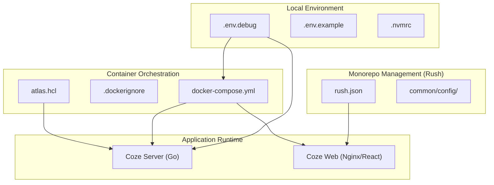
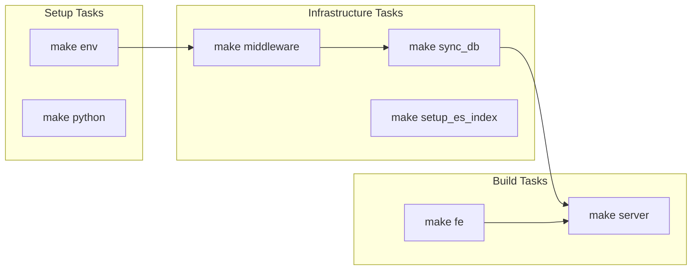

<!-- source: DeepWiki mcp.deepwiki.com · repo coze-dev/coze-studio · page 7 Configuration Management · fetched 2026-10-29 -->

# Configuration Management

Relevant source files

The following files were used as context for generating this wiki page:

- [.dockerignore](.dockerignore)
- [.gitattributes](.gitattributes)
- [Makefile](Makefile)

This page provides a high-level guide to the configuration systems used across the Coze Studio monorepo. It covers how environment variables, service definitions, workspace settings, and container configurations are structured and managed.

For detailed implementation details, refer to the child pages:
- [Environment Configuration](#7.1) — Detailed variable maps for infrastructure and services.
- [Rush Configuration](#7.2) — Monorepo workspace and dependency management.
- [Docker Configuration](#7.3) — Container orchestration and database migrations.

## Overview

Coze Studio employs a multi-layered configuration strategy to manage a complex stack involving a Go backend, a TypeScript frontend, and multiple infrastructure components (MySQL, Redis, Elasticsearch, etc.).

**Diagram: Configuration Architecture Overview**

**Sources:** [Makefile:11-21](), [docker/docker-compose.yml:1-15]()

## Environment Configuration

The system relies heavily on environment variables to toggle features and define service endpoints. For local development, the `Makefile` automates the creation of environment files from templates.

- **Templates**: `docker/.env.example` and `docker/.env.debug.example` serve as the source of truth for required variables [Makefile:28, 72]().
- **Variable Loading**: The `Makefile` uses these files to initialize middleware and application services via `docker compose --env-file` [Makefile:63, 77]().
- **Node.js Versioning**: The `.nvmrc` file ensures consistent Node.js versions across the development team.

For a full list of variables covering MySQL, Redis, Milvus, and AI model secrets, see [Environment Configuration](#7.1).

**Sources:** [Makefile:25-30](), [Makefile:69-73]()

## Rush Workspace Configuration

Coze Studio uses **Rush.js** to manage its monorepo structure. This configuration governs how packages interact, how dependencies are locked, and how common scripts are executed.

- **Dependency Strategy**: Uses `pnpm` as the underlying package manager. Lock files are managed with specific merge strategies in `.gitattributes` to prevent corruption during concurrent updates. Specifically, `pnpm-lock.yaml` is set to `merge=ours` to handle conflicts gracefully [/.gitattributes:3-6]().
- **JSON Handling**: The `.gitattributes` file ensures that Rush's JSON files (which allow comments) are correctly identified as `JSON-with-Comments` for syntax highlighting [/.gitattributes:10-16]().
- **Autoinstallers**: These manage tools like `rush-commitlint` and `rush-lint-staged` without polluting global package namespaces.

For details on subspace configuration and project tags, see [Rush Configuration](#7.2).

**Sources:** [/.gitattributes:1-16]()

## Docker and Infrastructure Configuration

The deployment and local debugging environments are defined through Docker Compose and Atlas for database schema management.

- **Service Topology**: `docker-compose.yml` defines the production-like stack, while `docker-compose-debug.yml` is tailored for local development [Makefile:11, 77]().
- **Build Optimization**: The `.dockerignore` file is strictly configured to exclude `node_modules`, `.rush/temp`, and build artifacts like `**/dist` to keep image sizes minimal and build contexts clean [/.dockerignore:1-11]().
- **Database Migrations**: Managed via **Atlas**. The `Makefile` provides targets to rehash migration files (`atlas-hash`) and dump the current schema to `opencoze_latest_schema.hcl` [Makefile:105-107, 141]().

For service health checks and the Atlas migration pipeline, see [Docker Configuration](#7.3).

**Sources:** [/.dockerignore:1-11](), [Makefile:48-55](), [Makefile:95-104](), [Makefile:105-107]()

## Makefile Orchestration

The `Makefile` acts as the primary entry point for managing these various configurations during development. It coordinates environment setup, database syncing, and service startup.

**Diagram: Makefile Task Flow**

| Target | Purpose | Key Files Referenced |
| :--- | :--- | :--- |
| `make env` | Initializes `.env.debug` from example template | `docker/.env.debug.example` [Makefile:25-30]() |
| `make middleware` | Starts infrastructure (MySQL, Redis, etc.) | `docker/docker-compose-debug.yml` [Makefile:61-64]() |
| `make sync_db` | Applies Atlas migrations to the database | `scripts/setup/db_migrate_apply.sh` [Makefile:48-50]() |
| `make python` | Sets up the virtual environment for doc parsing | `scripts/setup/python.sh` [Makefile:91-93]() |
| `make dump_sql_schema` | Generates `schema.sql` for Helm and Docker | `docker/volumes/mysql/schema.sql` [Makefile:95-104]() |

**Sources:** [Makefile:1-21](), [Makefile:95-104](), [Makefile:131-157]()

---

