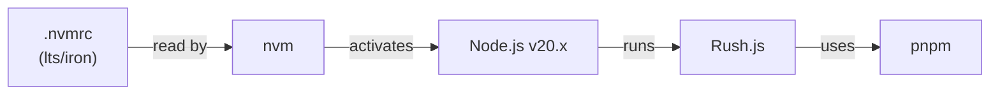
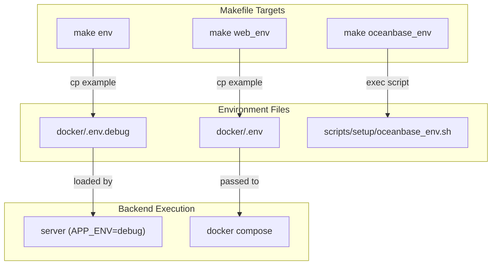
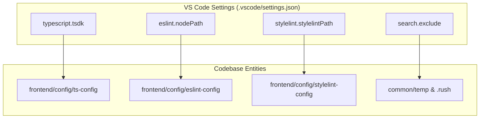

<!-- source: DeepWiki mcp.deepwiki.com · repo coze-dev/coze-studio · page 7.1 Environment Configuration · fetched 2026-10-29 -->

# Environment Configuration

<details>
<summary>Relevant source files</summary>

The following files were used as context for generating this wiki page:

- [.nvmrc](.nvmrc)
- [.vscode/settings.template.json](.vscode/settings.template.json)
- [Makefile](Makefile)

</details>


This page documents environment-specific configuration for the Coze Studio repository, including Node.js version management, environment variable files for infrastructure services, and VS Code editor setup. It covers the configuration required for both local development and containerized environments.

---

## Overview

Coze Studio utilizes a multi-layered configuration approach to ensure consistent development environments across all contributors and deployment targets:

- **Node.js Version**: Enforced via `.nvmrc` to ensure runtime compatibility across the monorepo.
- **Environment Variables**: Managed through `.env` files (based on `docker/.env.example`) to configure MySQL, Redis, Elasticsearch, MinIO, Milvus, and AI model providers.
- **VS Code Settings**: Standardized via `settings.template.json` to synchronize formatting, linting, and TypeScript server performance.
- **Development Workflow**: Orchestrated via a `Makefile` that handles environment file initialization and service setup.

---

## Node.js Version Management

The repository enforces a specific Node.js version using the `.nvmrc` file located at the repository root.

### Version Specification

[.nvmrc:1-1]() specifies:
```
lts/iron
```

This references Node.js LTS version "Iron" (v20.x), ensuring all developers and CI pipelines use a compatible runtime environment for Rush.js and frontend builds.

### Usage with nvm

Developers using [nvm](https://github.com/nvm-sh/nvm) can automatically switch to the correct Node.js version:

```bash
# Install the specified version
nvm install

# Use the specified version
nvm use
```

### Diagram: Node.js Version Resolution



**Sources:**
- [.nvmrc:1-1]()

---

## Infrastructure and Service Configuration

The backend services rely on environment variables to connect to infrastructure and external AI providers. These are managed primarily through the `Makefile` and `.env` files.

### Environment Variable Files

The `Makefile` defines several environment files for different deployment scenarios:

| File | Variable in Makefile | Purpose |
|------|----------------------|---------|
| `docker/.env` | `WEB_ENV_FILE` | Default environment variables for production/Docker Compose web stack [Makefile:17-17](). |
| `docker/.env.debug` | `ENV_FILE` | Debug-specific configuration for local Go execution and middleware [Makefile:16-16](). |
| `docker/.env.debug.example` | N/A | Template for local development; copied to `.env.debug` by `make env` [Makefile:25-29](). |

### Core Configuration Logic

The `Makefile` provides automated targets to initialize these environments:

- **`make env`**: Checks for the existence of `docker/.env.debug`. If missing, it initializes it from the example file [Makefile:25-29]().
- **`make web_env`**: Checks for the existence of `docker/.env`. If missing, it initializes it from the example file [Makefile:69-73]().

### Diagram: Configuration Data Flow

This diagram maps the `Makefile` targets to the configuration files and the code entities they influence.



**Sources:**
- [Makefile:16-18]()
- [Makefile:25-29]()
- [Makefile:69-73]()
- [Makefile:114-115]()

---

## VS Code Configuration

VS Code configuration is standardized through `settings.template.json`. Developers copy this to `.vscode/settings.json` (which is gitignored) to initialize their IDE.

### Core Configuration Areas

#### 1. Tool Paths and SDKs
Specific paths to tools within the monorepo ensure the IDE uses the exact versions managed by Rush:
- **ESLint**: `frontend/config/eslint-config/node_modules/eslint` [.vscode/settings.template.json:2-2]().
- **TypeScript TSDK**: `frontend/config/ts-config/node_modules/typescript/lib` [.vscode/settings.template.json:98-98]().
- **Stylelint**: `frontend/config/stylelint-config/node_modules/stylelint` [.vscode/settings.template.json:142-142]().

#### 2. Performance and Exclusions
To maintain responsiveness in a large monorepo, the following are excluded from search and file watching [.vscode/settings.template.json:19-32,121-135]():
- `**/node_modules`, `**/.rush`, `**/dist`, `**/lib`, `**/coverage`, `common/temp`.

TypeScript server memory is increased to **16GB** (`16384`) to handle the cross-package dependency graph [.vscode/settings.template.json:113-113]().

#### 3. Formatting and Linting
- **Default Formatter**: `esbenp.prettier-vscode` [.vscode/settings.template.json:9-9]().
- **Format on Save**: Enabled specifically for modified lines (`modificationsIfAvailable`) [.vscode/settings.template.json:17-17]().
- **Lock File Handling**: `pnpm-lock.yaml` is treated as `plaintext` to prevent VS Code from freezing during parsing [.vscode/settings.template.json:55-56]().

### Diagram: VS Code to Codebase Mapping



**Sources:**
- [.vscode/settings.template.json:1-198]()

---

## Integration Checklist

When setting up a new development environment:

1.  **Node.js**: Run `nvm use` to match `.nvmrc` [1-1]().
2.  **IDE**: Copy `.vscode/settings.template.json` to `.vscode/settings.json` [1-198]().
3.  **Infrastructure**:
    *   Run `make env` to initialize local debug environment variables [Makefile:25-29]().
    *   Run `make middleware` to start required Docker services (MySQL, Redis, etc.) [Makefile:61-63]().
4.  **Python**: Run `make python` to set up the virtual environment required for document parsing [Makefile:91-93]().
5.  **Database**: Run `make sync_db` to apply Atlas migrations to the local database instance [Makefile:48-50]().

**Sources:**
- [.nvmrc:1-1]()
- [.vscode/settings.template.json:1-198]()
- [Makefile:23-29]()
- [Makefile:91-93]()

---

