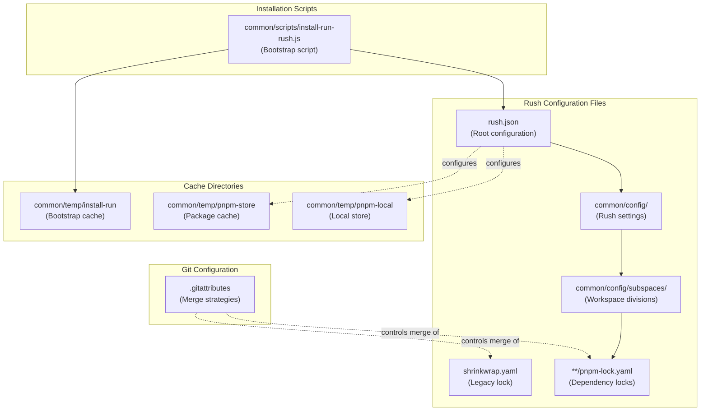
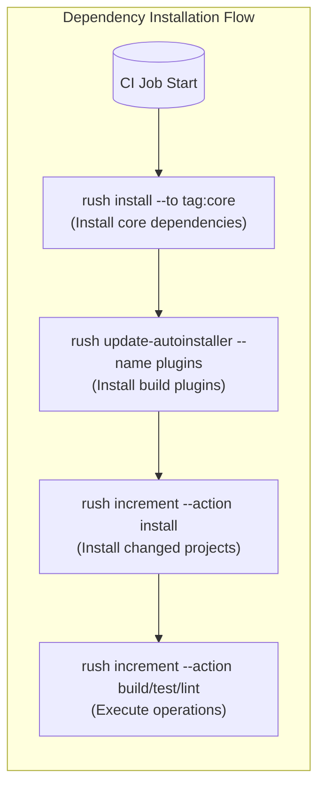
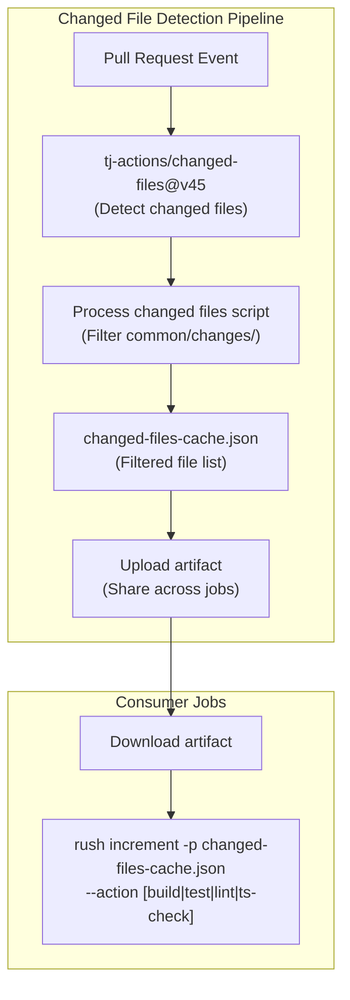
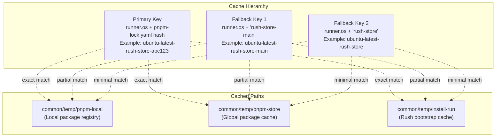
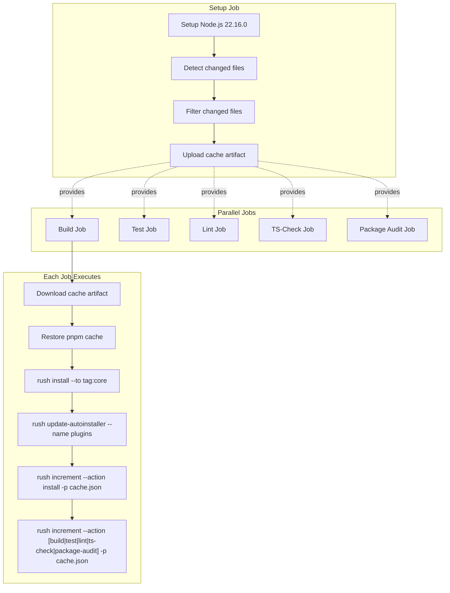

<!-- source: DeepWiki mcp.deepwiki.com · repo coze-dev/coze-studio · page 7.2 Rush Configuration · fetched 2026-10-29 -->

# Rush Configuration

<details>
<summary>Relevant source files</summary>

The following files were used as context for generating this wiki page:

- [.claude/agents/frontend-infrastructure-expert.md](.claude/agents/frontend-infrastructure-expert.md)
- [.gitattributes](.gitattributes)
- [.github/workflows/ci.yml](.github/workflows/ci.yml)

</details>


This document details the Rush.js configuration and management strategies used in the Coze Studio monorepo. It covers the core configuration files, lock file merge strategies, autoinstallers, incremental build operations, and caching mechanisms that enable efficient multi-package development.

For information about setting up the development environment and initial Rush installation, see [Initial Setup](#6.1). For broader monorepo management concepts and package organization, see [Monorepo Management](#4.1).

## Overview

Rush.js serves as the primary orchestrator for the Coze Studio monorepo, managing dependencies across multiple packages, coordinating build operations, and enabling incremental workflows. The configuration system is designed to support parallel development across frontend packages while maintaining consistency and avoiding common monorepo pitfalls like lock file conflicts.

The Rush configuration encompasses:
- Core configuration in `rush.json`
- Lock file management with special Git merge strategies
- Autoinstallers for build-time tooling
- Incremental operation support via changed file detection
- Build cache management for faster CI/CD

## Rush Configuration Files

### Core Configuration Structure

The configuration of Rush in this repository relies on a hierarchical structure of JSON files and Git attributes to manage workspace behavior.

Title: Rush Configuration and Cache Architecture


**Sources:** [.gitattributes:1-17](), [.github/workflows/ci.yml:101-111]()

The `rush.json` file located at the repository root defines the overall Rush configuration, including project declarations, versioning policies, and build orchestration settings. The CI workflows reference specific project tags like `tag:core` to limit the scope of installation during bootstrap [[.github/workflows/ci.yml:122]]().

### Lock File Management and Merge Strategies

The repository implements a sophisticated lock file merge strategy in `.gitattributes` to prevent conflicts during concurrent development:

| Lock File | Merge Strategy | Purpose | Post-Merge Action |
|-----------|---------------|---------|-------------------|
| `pnpm-lock.yaml` | `merge=ours` | Prefer current branch version | Run `rush update` |
| `shrinkwrap.yaml` | `merge=binary` | Treat as binary (conflict on change) | Run `rush update` |
| `npm-shrinkwrap.json` | `merge=binary` | Treat as binary (conflict on change) | Run `rush update` |
| `yarn.lock` | `merge=binary` | Treat as binary (conflict on change) | Run `rush update` |

**Sources:** [.gitattributes:1-6]()

The `merge=ours` strategy for `pnpm-lock.yaml` [[.gitattributes:3]]() means that when merging branches, Git will automatically prefer the current branch's version of this file. This prevents merge conflicts but requires developers to run `rush update` after merging to regenerate the lock file with the correct dependencies.

The binary merge strategy for other lock files causes Git to flag them as conflicting when both branches modify them, forcing manual resolution and ensuring developers don't accidentally commit invalid lock files [[.gitattributes:4-6]]().

## Autoinstallers

Rush autoinstallers are isolated dependency sets for build-time tools. The repository uses autoinstallers to manage plugins and other tooling separately from application dependencies.

### Plugins Autoinstaller

The primary autoinstaller is named `plugins` and is updated via the command:

```bash
rush update-autoinstaller --name plugins
```

**Sources:** [.github/workflows/ci.yml:123](), [.github/workflows/ci.yml:164](), [.github/workflows/ci.yml:213](), [.github/workflows/ci.yml:254](), [.github/workflows/ci.yml:295]()

This autoinstaller is updated in all CI jobs before running incremental operations, ensuring build plugins are available before project-specific operations execute.

Title: Dependency Installation Sequence


**Sources:** [.github/workflows/ci.yml:119-127]()

### Additional Autoinstallers

The repository also utilizes specific autoinstallers for git hooks and commit validation:
- **`rush-commitlint`**: Used for validating commit messages against semantic standards [[.github/workflows/commitlint.yml:28]]().
- **`rush-lint-staged`**: Orchestrates linting on staged files during the pre-commit hook.

## Incremental Build System

The incremental build system is a key optimization that allows Rush to execute operations only on changed packages and their dependents.

### Changed File Detection

The CI workflow implements a custom changed file detection system in the `setup` job [[.github/workflows/ci.yml:19-85]]():

Title: Incremental Detection Logic


**Sources:** [.github/workflows/ci.yml:37-67]()

The detection process:
1. Uses `tj-actions/changed-files@v45` to identify all changed files [[.github/workflows/ci.yml:39]]().
2. Filters out files in `common/changes/` directory using a bash loop [[.github/workflows/ci.yml:49-57]]().
3. Generates a JSON array of changed files: `changed-files-cache.json` [[.github/workflows/ci.yml:60]]().
4. Uploads as an artifact for other jobs to consume [[.github/workflows/ci.yml:80-84]]().

### Incremental Operations

Rush supports multiple incremental operations through the `increment` command, utilizing the `install-run-rush.js` utility:

| Action | Command | Purpose |
|--------|---------|---------|
| `install` | `rush increment --action install -p <cache_file>` | Install dependencies for changed projects |
| `build` | `rush increment --action build -p <cache_file>` | Build changed projects and dependents |
| `test:cov` | `rush increment --action test:cov -p <cache_file>` | Run tests with coverage for changed projects |
| `lint` | `rush increment --action lint -p <cache_file>` | Lint changed projects |
| `ts-check` | `rush increment --action ts-check -p <cache_file>` | Type-check changed projects |
| `package-audit` | `rush increment --action package-audit -p <cache_file>` | Audit dependencies of changed projects |

**Sources:** [.github/workflows/ci.yml:124-127](), [.github/workflows/ci.yml:167-168](), [.github/workflows/ci.yml:216-217](), [.github/workflows/ci.yml:257-258](), [.github/workflows/ci.yml:298-299]()

## Cache Management

The CI system implements comprehensive caching to minimize redundant dependency downloads and installations.

### Cache Key Strategy

The cache configuration uses a primary key based on the hash of lock files within subspaces [[.github/workflows/ci.yml:108]]().

Title: CI Cache Hierarchy


**Sources:** [.github/workflows/ci.yml:101-111]()

The cache configuration:
- **Primary Key:** `${{ runner.os }}-rush-store-${{ hashFiles('common/config/subspaces/**/pnpm-lock.yaml') }}` [[.github/workflows/ci.yml:108]]().
- **Fallback Keys:** Includes `rush-store-main` and a generic `rush-store` key to maximize hit rates [[.github/workflows/ci.yml:110-111]]().

### Cached Directories

The following directories are cached across CI runs to speed up the environment preparation:

1. **`common/temp/pnpm-local`**: Local pnpm registry mirror [[.github/workflows/ci.yml:105]]().
2. **`common/temp/pnpm-store`**: pnpm's global package store [[.github/workflows/ci.yml:106]]().
3. **`common/temp/install-run`**: Rush bootstrap script cache [[.github/workflows/ci.yml:107]]().

## Subspace Configuration

The monorepo uses pnpm subspaces to isolate dependency graphs and improve performance. These are configured under `common/config/subspaces/`. Subspaces allow grouping related projects to share a lock file while maintaining isolation from unrelated projects.

The CI system specifically monitors lock files within these subspaces for cache invalidation [[.github/workflows/ci.yml:108]]().

## Common Rush Commands

### Installation Commands

The repository uses a multi-stage installation approach optimized for CI:

```bash
# 1. Install core dependencies tagged with 'core'
node common/scripts/install-run-rush.js install --to tag:core

# 2. Update the plugins autoinstaller
node common/scripts/install-run-rush.js update-autoinstaller --name plugins

# 3. Install dependencies for changed projects incrementally
node common/scripts/install-run-rush.js increment --action install -p <cache_file>
```

**Sources:** [.github/workflows/ci.yml:119-124]()

### Build and Test Commands

For PR validation, commands are executed incrementally:
```bash
node common/scripts/install-run-rush.js increment --action build -p "${{ needs.setup.outputs.cache_file }}"
node common/scripts/install-run-rush.js increment --action test:cov -p "${{ needs.setup.outputs.cache_file }}"
```

**Sources:** [.github/workflows/ci.yml:127](), [.github/workflows/ci.yml:168]()

### Bootstrap Script

All Rush commands are executed through the bootstrap script `common/scripts/install-run-rush.js` [[.github/workflows/ci.yml:122]](). This script ensures that Rush itself is installed and at the correct version before executing any Rush commands, providing a consistent entry point across different environments.

## CI Workflow Integration

The CI workflow demonstrates how Rush configuration enables efficient parallel execution:

Title: Parallel CI Execution via Rush


**Sources:** [.github/workflows/ci.yml:19-300]()

This architecture minimizes CI execution time by parallelizing independent validation steps and reusing cached dependencies across jobs.

**Sources:** [.github/workflows/ci.yml:1-300](), [.gitattributes:1-17](), [.github/workflows/commitlint.yml:28]()

---

