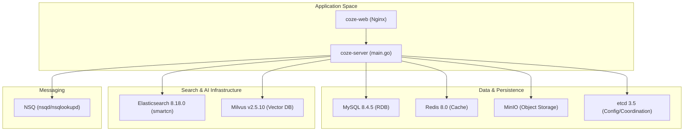
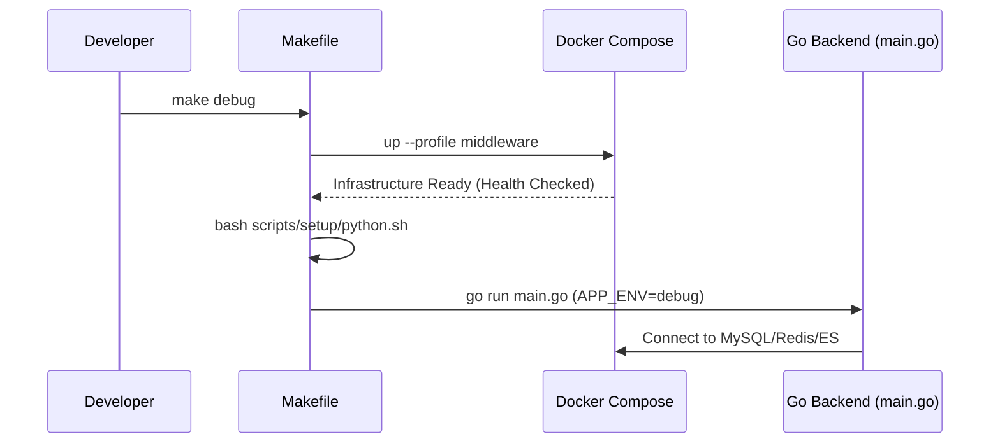

<!-- source: DeepWiki mcp.deepwiki.com · repo coze-dev/coze-studio · page 7.3 Docker Configuration · fetched 2026-10-29 -->

# Docker Configuration

Relevant source files

The following files were used as context for generating this wiki page:

- [.dockerignore](.dockerignore)
- [Makefile](Makefile)
- [backend/Dockerfile](backend/Dockerfile)

This document details the Docker infrastructure setup for Coze Studio, including service configurations, volume management, network topology, and build strategies. Docker is used to orchestrate all infrastructure dependencies required for local development and production deployment.

---

## Docker Build Optimization

### .dockerignore Configuration
The `.dockerignore` file optimizes the Docker build context by excluding unnecessary files, significantly reducing image size and build time.

| Category | Patterns | Reason |
| :--- | :--- | :--- |
| **Dependencies** | `**/node_modules`, `**/node_modules/**` | Excludes massive frontend dependency trees [ .dockerignore:2-3 ](). |
| **Build Artifacts** | `**/dist`, `**/build`, `**/.rush/temp`, `**/.rush/build-cache`, `**/common/temp` | Excludes local build outputs; Docker builds its own [ .dockerignore:6-10 ](). |
| **Dev Tooling** | `**/.git`, `**/.gitignore`, `**/.eslintrc*`, `**/.prettierrc*`, `**/*.log` | Excludes version control and linting configs [ .dockerignore:13-17 ](). |
| **Tests** | `**/__tests__`, `**/*.test.*`, `**/*.spec.*` | Excludes test suites from production images [ .dockerignore:20-22 ](). |
| **IDE/Docs** | `**/.vscode`, `**/.idea`, `**/docs`, `**/README.md`, `**/CHANGELOG.md` | Excludes editor-specific files and documentation [ .dockerignore:25-36 ](). |

**Sources:** [ .dockerignore:1-36 ]()

### Backend Dockerfile (Multi-Stage)
The backend uses a multi-stage build to produce a lean runtime image.

1.  **Stage 1 (Builder):** Uses `golang:1.24-alpine` as the base image [ backend/Dockerfile:2 ](). It installs `git`, `gcc`, and `libc-dev` to compile the `opencoze` binary from `main.go` [ backend/Dockerfile:7-17 ]().
2.  **Stage 2 (Final):** Uses `alpine:3.22.0` [ backend/Dockerfile:21 ]().
    *   **Runtime Dependencies:** Installs `python3`, `python3-dev`, `deno`, `curl`, and `bind-tools` [ backend/Dockerfile:28 ]().
    *   **Virtual Environment:** Creates a Python venv at `/app/.venv` and installs document processing libraries including `pdfplumber`, `python-docx`, `pillow`, and `numpy` [ backend/Dockerfile:34-39 ]().
    *   **Deno Sandbox:** Runs a warm-up for the `pyodide-sandbox` used by the `coderunner` [ backend/Dockerfile:30 ]().
    *   **Application Assets:** Copies the compiled Go binary, Python scripts (`parse_pdf.py`, `parse_docx.py`, `sandbox.py`), and configuration files [ backend/Dockerfile:47-58 ]().
    *   **Execution:** Sets the `PATH` to prioritize the venv and executes `/app/opencoze` [ backend/Dockerfile:64-76 ]().

**Sources:** [ backend/Dockerfile:1-77 ]()

---

## Docker Compose Topology

Coze Studio utilizes different compose files for specific environments, managed via a `Makefile`.

| File | Makefile Target | Purpose |
| :--- | :--- | :--- |
| `docker/docker-compose.yml` | `make web` | Production-like environment including `coze-server` and `coze-web` (Nginx) [ Makefile:75-77 ](). |
| `docker/docker-compose-debug.yml` | `make middleware` | Local development environment starting only infrastructure services [ Makefile:61-63 ](). |
| `docker/docker-compose-oceanbase.yml` | N/A | Deployment using OceanBase as the database backend [ Makefile:12 ](). |
| `docker/docker-compose-oceanbase_debug.yml` | `make oceanbase_debug` | Debug environment specific to OceanBase integration [ Makefile:13, 117-121 ](). |

### Service Dependency Graph
The following diagram maps the infrastructure services defined in the Docker environment to their roles in the codebase.

**Sources:** [ Makefile:61-81 ](), [ backend/Dockerfile:1-77 ]()

---

## Infrastructure Details

### MySQL & Atlas Schema Management
Database schema is managed using **Atlas**. The workflow involves syncing a declarative schema to the live database and dumping the state for migrations.

*   **Schema Sync:** `make sync_db` applies the `opencoze_latest_schema.hcl` to the MySQL instance via a specialized `mysql-setup` profile [ Makefile:48-51 ]().
*   **Schema Dump:** `make dump_sql_schema` inspects the database using `atlas schema inspect` and generates `docker/volumes/mysql/schema.sql`. It uses `sed` to ensure `CREATE TABLE IF NOT EXISTS` and `ENGINE=InnoDB` compatibility [ Makefile:95-99 ]().
*   **Initialization:** `docker/volumes/mysql/sql_init.sql` is appended to the schema for seed data and then copied to Helm chart directories [ Makefile:101-103 ]().
*   **Migration Hashing:** `make atlas-hash` recomputes migration file hashes within `docker/atlas` [ Makefile:105-108 ]().

**Sources:** [ Makefile:7-8 ](), [ Makefile:48-60 ](), [ Makefile:95-108 ]()

### Elasticsearch with SmartCN
Elasticsearch is configured for Chinese language processing.
*   **Plugin:** The environment expects the `smartcn` plugin for tokenization.
*   **Setup:** The `make setup_es_index` command executes `docker/volumes/elasticsearch/setup_es.sh`, which reads index schemas from `docker/volumes/elasticsearch/es_index_schema` and applies them to the configured `$ES_ADDR` [ Makefile:20-21 ](), [ Makefile:109-112 ]().

### Python Sandbox & Tooling
The backend container includes a Deno-based sandbox for secure code execution, specifically for the `coderunner` infrastructure.
*   **Sandbox:** `backend/infra/coderunner/impl/script/sandbox.py` is copied to `/app/sandbox.py` [ backend/Dockerfile:52 ]().
*   **Document Parsers:** Built-in PDF and DOCX parsers are located at `/app/parse_pdf.py` and `/app/parse_docx.py`, utilizing the `pdfplumber` and `python-docx` libraries installed in the venv [ backend/Dockerfile:39, 50-51 ]().

**Sources:** [ backend/Dockerfile:39-52 ]()

---

## Local Development Workflows

### Debug Mode
The `make debug` command is the primary entry point for developers. It orchestrates the environment in the following order:
1.  **Env Setup:** Creates `.env.debug` from `.env.debug.example` [ Makefile:25-29 ]().
2.  **Middleware:** Starts MySQL, Redis, ES, and other infrastructure via `docker-compose-debug.yml` using the `--wait` flag to ensure availability [ Makefile:61-63 ]().
3.  **Python:** Sets up the local Python virtual environment using `scripts/setup/python.sh` [ Makefile:91-93 ]().
4.  **Server:** Compiles and starts the Go backend in debug mode. If frontend resources are missing in `bin/resources/static`, it triggers a frontend build first [ Makefile:35-42 ]().

**Sources:** [ Makefile:23-42 ](), [ Makefile:61-63 ](), [ Makefile:91-93 ]()

### Resource Cleanup
*   **Stop Containers:** `make down` stops all containers across all profiles defined in the debug compose file [ Makefile:83-85 ]().
*   **Wipe Data:** `make clean` calls `down` and then recursively removes the `./docker/data` directory to reset persistent volume state [ Makefile:87-89 ]().

**Sources:** [ Makefile:83-89 ]()

---

