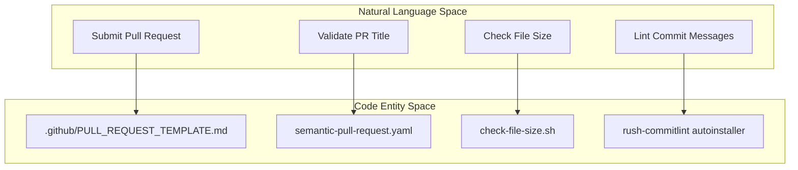
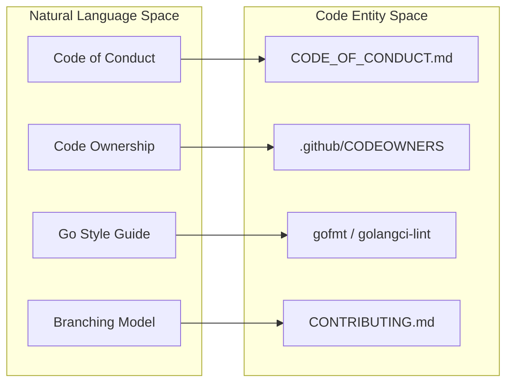

<!-- source: DeepWiki mcp.deepwiki.com · repo coze-dev/coze-studio · page 8 Contributing · fetched 2026-10-29 -->

# Contributing

Relevant source files

The following files were used as context for generating this wiki page:

- [CODE_OF_CONDUCT.md](CODE_OF_CONDUCT.md)
- [CONTRIBUTING.md](CONTRIBUTING.md)
- [README.md](README.md)

This page provides a high-level guide for both external and internal contributors on how to participate in the Coze Studio project. It outlines the standards, processes, and tools used to maintain code quality and community health in this microservices-based monorepo [README.md:27-28]().

---

## Getting Started with Contributing

Before contributing, all participants are expected to adhere to the [Community Guidelines](#8.4), which promotes a harassment-free and inclusive environment [CODE_OF_CONDUCT.md:1-15]().

**Communication Channels:**
*   **Issues:** Use [GitHub Issues](https://github.com/coze-dev/coze-studio/issues) for public bugs and feature requests [CONTRIBUTING.md:10-11]().
*   **Security:** Report security vulnerabilities privately to [opensource-studio@coze.cn](mailto:opensource-studio@coze.cn) instead of using public issues [CONTRIBUTING.md:18-19]().
*   **Community:** Real-time discussion is available via Discord, Telegram, and Feishu.

For a detailed walkthrough on setting up your environment (Go 1.24+, Docker, and Node.js) and making your first contribution, see **[Getting Started with Contributing](#8.1)**.

Sources: [CODE_OF_CONDUCT.md:1-15](), [CONTRIBUTING.md:10-22](), [README.md:11]()

---

## Pull Request Process

Coze Studio follows a structured PR process to ensure every change is documented, tested, and compliant with project standards.

### PR Title and Template
PRs must use the standard template which requires type classification (e.g., `feat`, `fix`, `refactor`) and bilingual (EN/ZH) fields for user-oriented descriptions [CONTRIBUTING.md:35](). Titles must follow the semantic pattern: `[type][scope] description`.

### Validation Pipeline
Every PR triggers automated checks via GitHub Actions:
*   **Semantic Title:** Validates the PR title format using `semantic-pull-request.yaml`.
*   **License Headers:** Ensures `Apache-2.0` headers are present using the `license-eye` tool.
*   **File Size:** Checks that individual files do not exceed the 512KB limit via `check-file-size.sh`.
*   **CI/CD:** Runs the full suite of Rush.js incremental builds for frontend and Go test suites for backend.

For details on title formatting, template fields, and the WIP bypass mechanism, see **[Pull Request Process](#8.2)**.

Sources: [CONTRIBUTING.md:24-42](), [README.md:10]()

---

## Issue Reporting

We use GitHub Issues to track bugs and plan new features. Before filing, contributors should search existing issues to avoid duplicates [CONTRIBUTING.md:25-27]().

| Issue Type | Template Requirements |
| :--- | :--- |
| **Bug Report** | Requires `go env` output, reproduction steps, and version info. |
| **Feature Request** | Requires problem description, proposed solution, and alternatives. |

Providing a reduced test case or a link to the [Golang Playground](https://play.golang.org/) is highly recommended for bug reports [CONTRIBUTING.md:14-16]().

For instructions on providing high-quality reproduction cases, see **[Issue Reporting](#8.3)**.

Sources: [CONTRIBUTING.md:9-17]()

---

## Community Guidelines

The project is governed by clear standards for code ownership and branching strategies to manage the monorepo effectively.

### Code Governance
*   **Code Ownership:** The `CODEOWNERS` file defines team responsibilities for specific directories (e.g., `frontend/`, `backend/`).
*   **Branching Strategy:** We use the `git-flow` model, also known as Feature-Driven Development (FDD) [CONTRIBUTING.md:7-8]().
*   **Commit Convention:** Commits must follow the **AngularJS Git Commit Message Convention** to enable automated release note generation [CONTRIBUTING.md:35-36]().

### Compliance
All contributions must be compatible with the **Apache-2.0 License** [README.md:10](). The development environment keeps up with [Go Official](https://golang.org/project/) releases, and contributors must use `gofmt` and `golangci-lint` before submission [CONTRIBUTING.md:44-45]().

For more on code ownership, license auditing, and branching workflows, see **[Community Guidelines](#8.4)**.

Sources: [CONTRIBUTING.md:6-8](), [CONTRIBUTING.md:35-36](), [CONTRIBUTING.md:44-46](), [CODE_OF_CONDUCT.md:39-50]()

---

## From Contribution to Code

The following diagrams bridge the gap between contribution activities and the underlying code entities that manage them.

### PR Validation Flow
This diagram maps the PR submission process to the specific CI configurations and scripts that validate the contribution.

Sources: [CONTRIBUTING.md:35](), [CONTRIBUTING.md:47]()

### Community Standards Mapping
This diagram associates community guidelines with the files that enforce or document them.

Sources: [CODE_OF_CONDUCT.md:1-5](), [CONTRIBUTING.md:7-8](), [CONTRIBUTING.md:44-46](), [CONTRIBUTING.md:50-52]()

---

