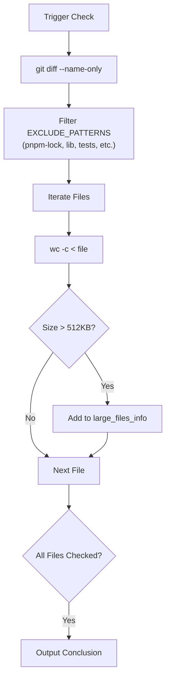
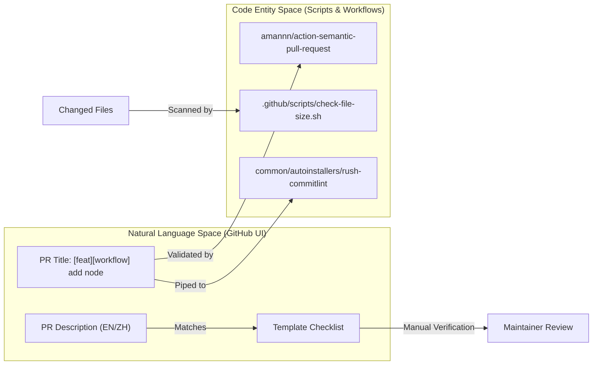

<!-- source: DeepWiki mcp.deepwiki.com · repo coze-dev/coze-studio · page 8.2 Pull Request Process · fetched 2026-10-29 -->

# Pull Request Process

Relevant source files

The following files were used as context for generating this wiki page:

- [.github/PULL_REQUEST_TEMPLATE.md](.github/PULL_REQUEST_TEMPLATE.md)
- [.github/scripts/check-file-size.sh](.github/scripts/check-file-size.sh)
- [.github/workflows/common-pr-checks.yml](.github/workflows/common-pr-checks.yml)
- [.github/workflows/semantic-pull-request.yaml](.github/workflows/semantic-pull-request.yaml)

This page provides a detailed guide to the Pull Request (PR) lifecycle within the Coze Studio monorepo. It covers the mandatory PR template, title formatting rules, automated validation checks (including file size and semantic linting), and the workflow for contributors.

## PR Template and Content Requirements

All pull requests must use the standard template defined in `.github/PULL_REQUEST_TEMPLATE.md` [.github/PULL_REQUEST_TEMPLATE.md:1-45](). The template ensures that every contribution contains the metadata necessary for automated release notes and clear peer review.

### PR Type Classification
The template requires categorizing the PR into one of the following types [.github/PULL_REQUEST_TEMPLATE.md:5-15]():

| Type | Description |
| :--- | :--- |
| `feat` | A new feature [.github/PULL_REQUEST_TEMPLATE.md:8]() |
| `fix` | A bug fix [.github/PULL_REQUEST_TEMPLATE.md:10]() |
| `optimize` | A new optimization [.github/PULL_REQUEST_TEMPLATE.md:9]() |
| `perf` | A code change that improves performance [.github/PULL_REQUEST_TEMPLATE.md:11]() |
| `refactor` | A code change that neither fixes a bug nor adds a feature [.github/PULL_REQUEST_TEMPLATE.md:12]() |
| `docs` | Documentation only changes [.github/PULL_REQUEST_TEMPLATE.md:7]() |
| `style` | Changes that do not affect the meaning of the code (formatting, etc.) [.github/PULL_REQUEST_TEMPLATE.md:13]() |
| `test` | Adding missing tests or correcting existing tests [.github/PULL_REQUEST_TEMPLATE.md:14]() |
| `build` | Changes affecting the build system or external dependencies [.github/PULL_REQUEST_TEMPLATE.md:5]() |
| `ci` | Changes to CI configuration files and scripts [.github/PULL_REQUEST_TEMPLATE.md:6]() |
| `chore` | Changes to the build process or auxiliary tools [.github/PULL_REQUEST_TEMPLATE.md:15]() |

### Bilingual and User-Oriented Descriptions
The PR process emphasizes clarity for end-users:
*   **User-Oriented Titles**: Titles should describe "what" and "why" from a user perspective, as they are attached to Release Notes [.github/PULL_REQUEST_TEMPLATE.md:19-21]().
*   **Bilingual Fields**: The template includes optional sections for translating the PR title into Chinese [.github/PULL_REQUEST_TEMPLATE.md:29]() and providing detailed descriptions in both English (`en`) and Chinese (`zh`) [.github/PULL_REQUEST_TEMPLATE.md:32-37]().
*   **Issue Linking**: PRs should use the `Fixes #<issue number>` syntax to automatically close linked issues upon merging [.github/PULL_REQUEST_TEMPLATE.md:40-44]().

Sources: [.github/PULL_REQUEST_TEMPLATE.md:1-45]()

## Automated Validation Checks

Every PR triggers a series of automated validation workflows to ensure compliance with repository standards.

### Semantic PR Title Validation
The `Semantic Pull Request` workflow [.github/workflows/semantic-pull-request.yaml:1-75]() validates the PR title against a specific regex pattern.

**Title Pattern Logic**
The title must follow the pattern: `[<type>][<optional scope>] <description>` [.github/workflows/semantic-pull-request.yaml:66-73]().

| Component | Validation Rules |
| :--- | :--- |
| **Type** | Must be one of: `build`, `ci`, `docs`, `feat`, `fix`, `perf`, `refactor`, `style`, `test`, `chore` [.github/workflows/semantic-pull-request.yaml:27-37]() |
| **Scope** | Must be one of: `idl`, `frontend`, `backend`, `infra`, `app`, `singleagent`, `memory`, `search`, `workflow`, `prompt`, `knowledge`, `plugin`, `middleware`, `model`, `database`, `foundation`, `comment`, `ci` [.github/workflows/semantic-pull-request.yaml:46-64]() |

### File Size Limits
To prevent the accidental commitment of large binaries or generated assets, the script `.github/scripts/check-file-size.sh` enforces a **512KB** limit per file [.github/scripts/check-file-size.sh:56-57]().

**File Size Check Logic**

The script excludes specific paths like `pnpm-lock.yaml`, `auto-generate` directories, and `__tests__` [.github/scripts/check-file-size.sh:24-44]().

### PR Common Checks
The `PR Common Checks` workflow [.github/workflows/common-pr-checks.yml:1-49]() performs additional linting:
*   **Commitlint**: Uses a Rush autoinstaller (`rush-commitlint`) to run `npx commitlint` against the PR title [.github/workflows/common-pr-checks.yml:42-45]().
*   **WIP Bypass**: If the PR title contains `WIP` or `wip`, the title format check is skipped to allow for ongoing drafts [.github/workflows/common-pr-checks.yml:38]().

Sources: [.github/workflows/semantic-pull-request.yaml:1-75](), [.github/scripts/check-file-size.sh:1-108](), [.github/workflows/common-pr-checks.yml:1-49]()

## PR Data Flow and Entity Mapping

The PR process bridges the gap between the GitHub UI (Natural Language Space) and the repository's validation scripts (Code Entity Space).

**PR Validation Mapping**

### Implementation Details
*   **CI Mode Detection**: The file size script detects if it is running in GitHub Actions via the `CI` environment variable [.github/scripts/check-file-size.sh:21]().
*   **Git Diff Strategy**: In CI, it compares against `origin/$TARGET_BRANCH` [.github/scripts/check-file-size.sh:51](). Locally, it checks `--cached` files [.github/scripts/check-file-size.sh:53]().
*   **Rush Integration**: Common checks utilize `node common/scripts/install-run-rush.js install` to ensure the environment is ready for linting [.github/workflows/common-pr-checks.yml:34]().

Sources: [.github/scripts/check-file-size.sh:21-53](), [.github/workflows/common-pr-checks.yml:34](), [.github/workflows/semantic-pull-request.yaml:66-75]()

---

