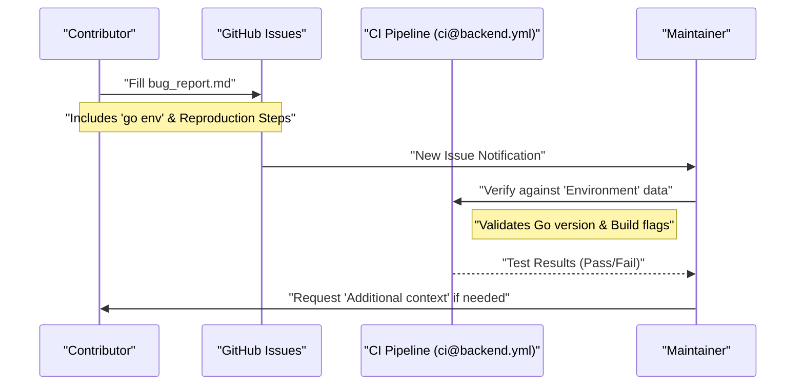

<!-- source: DeepWiki mcp.deepwiki.com · repo coze-dev/coze-studio · page 8.3 Issue Reporting · fetched 2026-10-29 -->

# Issue Reporting

<details>
<summary>Relevant source files</summary>

The following files were used as context for generating this wiki page:

- [.github/ISSUE_TEMPLATE/bug_report.md](.github/ISSUE_TEMPLATE/bug_report.md)
- [.github/ISSUE_TEMPLATE/feature_request.md](.github/ISSUE_TEMPLATE/feature_request.md)

</details>


This document provides technical instructions for reporting bugs and requesting features in the Coze Studio project using the GitHub issue templates. These templates are designed to collect the necessary technical context required for maintainers to diagnose issues across the monorepo's frontend and backend layers.

## Overview

The Coze Studio repository utilizes structured issue templates to facilitate clear and actionable reports. These templates ensure that critical environmental data, such as Go environment variables for backend services or reproduction steps for the frontend IDE, are captured consistently.

**Sources:** [.github/ISSUE_TEMPLATE/bug_report.md:1-41](), [.github/ISSUE_TEMPLATE/feature_request.md:1-25]()

## Issue Template Architecture

The repository defines two primary entry points for community feedback within the `.github/ISSUE_TEMPLATE/` directory.

### Mapping Natural Language Reports to Code Entities

The following diagram bridges the "Natural Language Space" of an issue report to the specific "Code Entity Space" it targets within the Coze Studio architecture.

```mermaid
graph TD
    subgraph "Natural Language Space (Issue Templates)"
        [BugReport] --> ["bug_report.md"]
        [FeatureRequest] --> ["feature_request.md"]
    end

    subgraph "Code Entity Space (Monorepo Targets)"
        [FE_Apps] --> ["apps/coze-studio/"]
        [FE_IDE] --> ["packages/agent-ide/"]
        [FE_Workflow] --> ["packages/workflow/"]
        [BE_API] --> ["api/handler/coze/"]
        [BE_Domain] --> ["domain/agent/"]
        [IDL_Layer] --> ["idl/api.thrift"]
    end

    [BugReport] -->|"Reproduce Steps"| [FE_IDE]
    [BugReport] -->|"go env Output"| [BE_API]
    [FeatureRequest] -->|"Proposed Solution"| [FE_Workflow]
    [FeatureRequest] -->|"Problem Description"| [BE_Domain]
    [BugReport] -->|"Version Info"| [IDL_Layer]
```

**Sources:** [.github/ISSUE_TEMPLATE/bug_report.md:1-41](), [.github/ISSUE_TEMPLATE/feature_request.md:1-25]()

## Bug Report Template

The `bug_report.md` template is mandatory for reporting defects. It requires specific technical metadata to assist in debugging the distributed Go backend and React-based frontend.

### Required Technical Sections

| Section | Code/Technical Requirement | File Reference |
|---------|----------------------------|----------------|
| **Describe the bug** | Concise summary of the defect. | [.github/ISSUE_TEMPLATE/bug_report.md:10-12]() |
| **To Reproduce** | Sequential steps to trigger the error in the UI or API. | [.github/ISSUE_TEMPLATE/bug_report.md:14-20]() |
| **Expected behavior** | The intended logic or state. | [.github/ISSUE_TEMPLATE/bug_report.md:22-24]() |
| **Version** | The specific release or commit hash of the project. | [.github/ISSUE_TEMPLATE/bug_report.md:30-32]() |
| **Environment** | **Mandatory:** The output of the `go env` command. | [.github/ISSUE_TEMPLATE/bug_report.md:34-36]() |

### Data Flow for Bug Triage

The following diagram illustrates how the data provided in a `bug_report.md` flows through the system for validation.



**Sources:** [.github/ISSUE_TEMPLATE/bug_report.md:1-41]()

## Feature Request Template

The `feature_request.md` template is used for proposing enhancements to the AI orchestration capabilities (Eino), visual canvas (FlowGram), or backend domain services.

### Structural Requirements

1.  **Problem Description**: A clear statement of the limitation. For example, "I'm always frustrated when [specific workflow node limitation]" [.github/ISSUE_TEMPLATE/feature_request.md:10-12]().
2.  **Proposed Solution**: A technical description of the desired behavior [.github/ISSUE_TEMPLATE/feature_request.md:14-16]().
3.  **Alternatives Considered**: Evidence of architectural evaluation, such as alternative node types or API structures [.github/ISSUE_TEMPLATE/feature_request.md:18-20]().
4.  **Additional Context**: Supporting visual aids like wireframes or IDL snippets [.github/ISSUE_TEMPLATE/feature_request.md:22-24]().

**Sources:** [.github/ISSUE_TEMPLATE/feature_request.md:1-25]()

## Search-Before-Filing Guidance

Before creating a new issue, contributors must search the existing issue database. This prevents duplication and allows users to contribute to ongoing technical discussions.

### Metadata Configuration

The templates use YAML frontmatter to define the GitHub interface behavior:

*   **Bug Report**: `name: Bug report`, `about: Create a report to help us improve` [.github/ISSUE_TEMPLATE/bug_report.md:1-3]().
*   **Feature Request**: `name: Feature request`, `about: Suggest an idea for this project` [.github/ISSUE_TEMPLATE/feature_request.md:1-3]().

Labels and assignees are left empty (`labels: ''`, `assignees: ''`) to allow the project maintainers to apply the correct team tags (e.g., `team-workflow`, `team-agent-ide`) during the triage process [.github/ISSUE_TEMPLATE/bug_report.md:5-6](), [.github/ISSUE_TEMPLATE/feature_request.md:5-6]().

## Best Practices for Technical Reporting

### Backend-Specific (Go/Hertz/Eino)
*   Always include the `go env` output as requested in the template [.github/ISSUE_TEMPLATE/bug_report.md:36-36]().
*   Provide logs from the `coze-server` container if the error involves API failures.
*   Mention if the issue persists across different database drivers (MySQL vs. OceanBase).

### Frontend-Specific (React/Rsbuild/FlowGram)
*   Include the browser console log and stack trace for runtime exceptions.
*   Identify which package in `packages/*` is the source of the issue (e.g., `packages/workflow` for canvas issues).
*   Specify if the bug is related to the `Rsbuild` dev server or the production build.

**Sources:** [.github/ISSUE_TEMPLATE/bug_report.md:1-41](), [.github/ISSUE_TEMPLATE/feature_request.md:1-25]()

---

