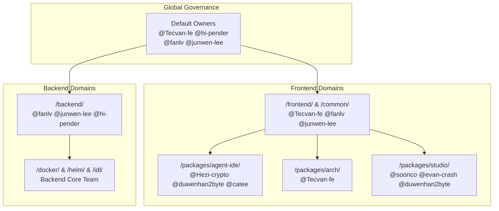
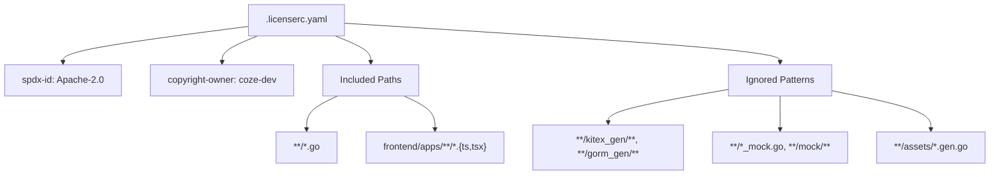
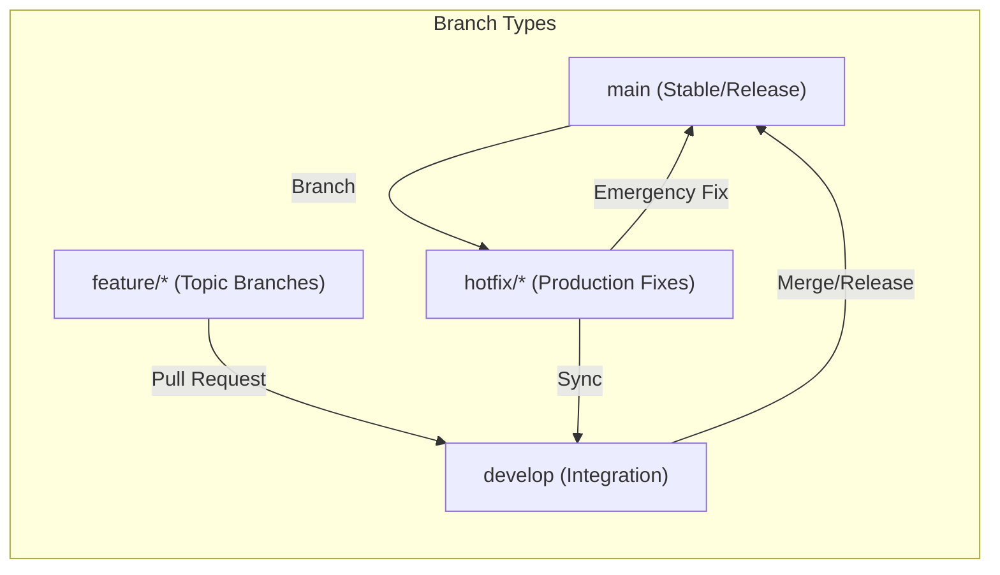

<!-- source: DeepWiki mcp.deepwiki.com · repo coze-dev/coze-studio · page 8.4 Community Guidelines · fetched 2026-10-29 -->

# Community Guidelines

<details>
<summary>Relevant source files</summary>

The following files were used as context for generating this wiki page:

- [.github/.licenserc.yaml](.github/.licenserc.yaml)
- [.github/CODEOWNERS](.github/CODEOWNERS)
- [CODE_OF_CONDUCT.md](CODE_OF_CONDUCT.md)
- [LICENSE-APACHE](LICENSE-APACHE)

</details>


This document describes code ownership responsibilities, license compliance requirements, and community standards for the Coze Studio project. It defines who owns which parts of the codebase, what license obligations must be met, and what behavioral expectations apply to all community participants.

---

## Overview

The Coze Studio project operates under a structured governance model to ensure maintainability and professional conduct. The primary mechanisms include:

1.  **Code Ownership (CODEOWNERS):** Hierarchical review and approval authorities for specific directories [.github/CODEOWNERS:1-280]().
2.  **License Compliance:** Enforcement of the Apache License 2.0 and automated header validation via `.licenserc.yaml` [.github/.licenserc.yaml:1-30]().
3.  **Community Standards:** Adoption of the Contributor Covenant Code of Conduct for behavioral expectations [CODE_OF_CONDUCT.md:1-129]().
4.  **Development Standards:** Use of AngularJS commit conventions and the git-flow/FDD branching strategy for contribution management.

**Sources:** [.github/CODEOWNERS:1-280](), [LICENSE-APACHE:1-178](), [CODE_OF_CONDUCT.md:1-129](), [.github/.licenserc.yaml:1-30]()

---

## Code Ownership System

### CODEOWNERS Structure

The `.github/CODEOWNERS` file establishes a hierarchical ownership model. GitHub automatically requests reviews from designated owners when pull requests modify files under their paths.

**Code Entity Space to Ownership Mapping**


**Sources:** [.github/CODEOWNERS:1-280]()

### Ownership by Area

| Directory Pattern | Owners | Scope |
|------------------|---------|-------|
| `*` (Global Default) | @Tecvan-fe @hi-pender @fanlv @junwen-lee | Default reviewers for all files [.github/CODEOWNERS:1]() |
| `/frontend/` | @Tecvan-fe @fanlv @junwen-lee | All frontend source code [.github/CODEOWNERS:3]() |
| `/backend/` | @fanlv @junwen-lee @hi-pender | All Go backend services [.github/CODEOWNERS:275]() |
| `/frontend/packages/arch/bot-api/` | @Tecvan-fe | Core API interface definitions [.github/CODEOWNERS:9]() |
| `/frontend/packages/agent-ide/tool/` | @catee | Plugin/Tool integration logic [.github/CODEOWNERS:94]() |
| `/idl/` | @fanlv @junwen-lee @hi-pender | Thrift interface definition layer [.github/CODEOWNERS:278]() |
| `/frontend/packages/studio/components/` | @soonco @evan-crash @duwenhan2byte @catee | Shared Studio UI components [.github/CODEOWNERS:77]() |

**Sources:** [.github/CODEOWNERS:1-280]()

---

## License and Compliance

### Apache License 2.0

The project is licensed under the Apache License 2.0 [LICENSE-APACHE:1-178](). Key provisions include:
*   **Grant of Copyright:** Perpetual, worldwide, royalty-free license to reproduce and distribute [LICENSE-APACHE:66-71]().
*   **Grant of Patent:** License for patent claims necessarily infringed by the contribution [LICENSE-APACHE:73-87]().
*   **Redistribution:** Requires preservation of copyright notices and inclusion of the license [LICENSE-APACHE:89-128]().

### Automated Compliance Configuration

The project uses `license-eye` (via `.licenserc.yaml`) to enforce compliance.

**License Header Specification**


*   **Header Enforcement:** All source files in `frontend/apps`, `frontend/packages`, and backend Go files must contain the Apache-2.0 header [.github/.licenserc.yaml:7-9]().
*   **Exclusions:** Generated code such as `kitex_gen`, `gorm_gen`, and mock files are explicitly excluded from header checks to prevent noise [.github/.licenserc.yaml:21-28]().
*   **Documentation:** Markdown files and dependency lock files (go.mod/go.sum) are ignored [.github/.licenserc.yaml:13-16]().

**Sources:** [LICENSE-APACHE:1-178](), [.github/.licenserc.yaml:1-30]()

---

## Community Standards (Code of Conduct)

### Behavioral Expectations

Coze Studio follows the Contributor Covenant to ensure a welcoming environment [CODE_OF_CONDUCT.md:1-13]().

| Category | Examples |
|----------|----------|
| **Positive Behaviors** | Empathy, kindness, respectful feedback, community focus [CODE_OF_CONDUCT.md:17-26]() |
| **Unacceptable Behaviors** | Sexualized language, trolling, harassment, doxxing [CODE_OF_CONDUCT.md:28-37]() |

### Enforcement Ladder

Community leaders (contactable at `conduct@cloudwego.io`) enforce standards via a tiered response model [CODE_OF_CONDUCT.md:61-113]():

1.  **Correction:** Private written warning [CODE_OF_CONDUCT.md:74-81]().
2.  **Warning:** Warning with interaction restrictions [CODE_OF_CONDUCT.md:83-93]().
3.  **Temporary Ban:** Time-limited interaction ban [CODE_OF_CONDUCT.md:95-104]().
4.  **Permanent Ban:** Permanent exclusion from community spaces [CODE_OF_CONDUCT.md:106-113]().

**Sources:** [CODE_OF_CONDUCT.md:1-129]()

---

## Development Standards

### Commit Message Convention

Coze Studio requires the **AngularJS Git Commit Message Convention**. This is strictly enforced because release notes are automatically generated from these messages.

**Commit Structure:**
```text
<type>(<scope>): <subject>

<body>

<footer>
```

*   **Types:** `feat` (new feature), `fix` (bug fix), `docs`, `style`, `refactor`, `perf`, `test`, `chore`.
*   **Enforcement:** Validated via `rush-commitlint` autoinstaller during the git commit hook phase.

### Branching Strategy (Git-Flow/FDD)

The project utilizes a **Feature-Driven Development (FDD)** approach based on git-flow.

**Workflow Logic**


---

## Reporting and Contact

*   **Security Vulnerabilities:** Do not report publicly. Email `opensource-studio@coze.cn`.
*   **CoC Violations:** Email `conduct@cloudwego.io` [CODE_OF_CONDUCT.md:61-63]().
*   **General Support:** Contact the maintainers listed in the global CODEOWNERS section [.github/CODEOWNERS:1]().

**Sources:** [CODE_OF_CONDUCT.md:1-129](), [.github/CODEOWNERS:1-280]()

---

