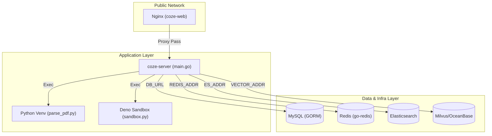
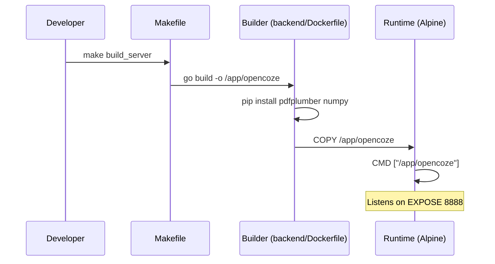

<!-- source: DeepWiki mcp.deepwiki.com · repo coze-dev/coze-studio · page 9 Deployment Guide · fetched 2026-10-29 -->

# Deployment Guide

<details>
<summary>Relevant source files</summary>

The following files were used as context for generating this wiki page:

- [.dockerignore](.dockerignore)
- [Makefile](Makefile)
- [backend/Dockerfile](backend/Dockerfile)

</details>


Coze Studio provides multiple deployment strategies to accommodate different environments, ranging from local development and debugging to production-grade container orchestration. This guide outlines the primary methods for deploying the full stack, including the Go-based backend, React frontend, and required infrastructure services.

## Deployment Strategies Overview

The deployment architecture is designed around a microservices-ready structure, even when running in a single-container mode. The system relies on a suite of infrastructure components including MySQL, Redis, Elasticsearch, and various vector stores.

| Method | Target Environment | Key Components |
| :--- | :--- | :--- |
| **Docker Compose** | Quickstart / Production | `coze-server`, `coze-web`, Nginx, Infrastructure suite |
| **Kubernetes (Helm)** | Enterprise / Scalable | Helm charts, LoadBalancers, Persistent Volumes |
| **Local Debug Mode** | Development | `go run`, `rush build`, Local middleware containers |

### System Requirements
* **Minimum Hardware**: 2 Core CPU, 4 GB RAM.
* **Software**: Docker & Docker Compose, Go 1.24+, Node.js (for frontend builds).

---

## 9.1 Docker Compose Deployment

The Docker Compose deployment is the recommended "Quickstart" path. It orchestrates the `coze-server` (backend) and `coze-web` (frontend via Nginx) alongside necessary middleware.

### Quickstart Execution
To deploy the full web environment, use the provided `Makefile` target:
```bash
make web
```
This command initializes the environment file from `docker/.env.example` and starts the service topology defined in `docker/docker-compose.yml` [[Makefile:75-77]]().

### Key Service Components
* **coze-server**: The Go backend container containing the `opencoze` binary, Python parsers for PDF/Docx, and the Deno-based sandbox for code execution [[backend/Dockerfile:1-77]]().
* **Atlas Migration**: On startup, the system uses Atlas to sync the database schema to MySQL via the `mysql-setup` profile [[Makefile:48-50]]().
* **Elasticsearch**: Includes a setup script for index schema initialization and requires the `smartcn` plugin for Chinese language processing [[Makefile:109-112]]().

For detailed configuration of environment variables and volume mapping, see **[Docker Compose Deployment](#9.1)**.

---

## 9.2 Kubernetes Helm Deployment

For production environments requiring high availability and scaling, Coze Studio provides a comprehensive Helm chart located in `helm/charts/opencoze/`.

### Infrastructure Orchestration
The Helm chart manages the deployment of:
* **Relational Data**: MySQL with automated schema initialization from `files/mysql/schema.sql` [[Makefile:102-103]]().
* **Storage & Cache**: Redis for session/caching and MinIO for object storage.
* **Search & Vectors**: Elasticsearch and Milvus for RAG capabilities.
* **Messaging**: Integration for RocketMQ, NATS, Pulsar, or NSQ as the event bus.

### Configuration
Deployment is controlled via `values.yaml`, allowing for specific `StorageClass` definitions and `LoadBalancer` service types to expose the `coze-web` and `coze-server` components.

For step-by-step cluster setup and operator integration, see **[Kubernetes Helm Deployment](#9.2)**.

---

## 9.3 Alternative Infrastructure Integrations

Coze Studio is designed with an adapter pattern in the `infra/` layer, allowing for the replacement of default infrastructure components with alternative cloud-native or high-performance solutions.

### Vector Database Alternatives
* **OceanBase**: Can replace Milvus for vector storage using HNSW indexing. Dedicated debug environments exist for OceanBase integration via `docker-compose-oceanbase.yml` [[Makefile:12-13]]() and dedicated setup scripts [[Makefile:114-115]]().
* **VikingDB**: Integration for VolcEngine's vector store.

### Event Bus Alternatives
* **NATS/Pulsar**: Beyond the default NSQ/RocketMQ, the system supports NATS (JetStream) and Pulsar for event-driven workflows.
* **Implementation**: These are managed via the `eventbus` domain in the backend `infra/` layer.

For details on switching infrastructure providers, see **[Alternative Infrastructure Integrations](#9.3)**.

---

## Deployment Architecture Mapping

The following diagram maps the deployment services to their corresponding code entities and entry points.

### Service Topology Map

**Sources:** [[backend/Dockerfile:47-52]](), [[Makefile:63-63]](), [[Makefile:77-77]]()

### Deployment Workflow (Code to Container)

**Sources:** [[backend/Dockerfile:17-17]](), [[backend/Dockerfile:39-39]](), [[backend/Dockerfile:72-76]](), [[Makefile:44-46]]()

---

## Local Debug Mode

For developers, a local "Debug" mode allows running services outside of full containerization for faster iteration.

1. **Middleware Only**: Start only the infrastructure (MySQL, Redis, etc.) via Docker using the `middleware` target [[Makefile:61-63]]().
2. **Backend**: Run the Go server with `APP_ENV=debug` using the `server` target [[Makefile:35-41]]().
3. **Frontend**: Build the React assets using the `fe` target [[Makefile:31-33]]().
4. **Python**: Setup the local Python virtual environment for document parsing [[Makefile:91-93]]().

**Sources:**
- `Makefile`: Targets for `web` [[Makefile:75-77]](), `middleware` [[Makefile:61-63]](), `server` [[Makefile:35-42]](), `python` [[Makefile:91-93]](), and `oceanbase_debug` [[Makefile:117-130]]().
- `backend/Dockerfile`: Multi-stage build [[backend/Dockerfile:2-47]]() and runtime dependencies including `deno` and `python3` [[backend/Dockerfile:28-43]]().

---

