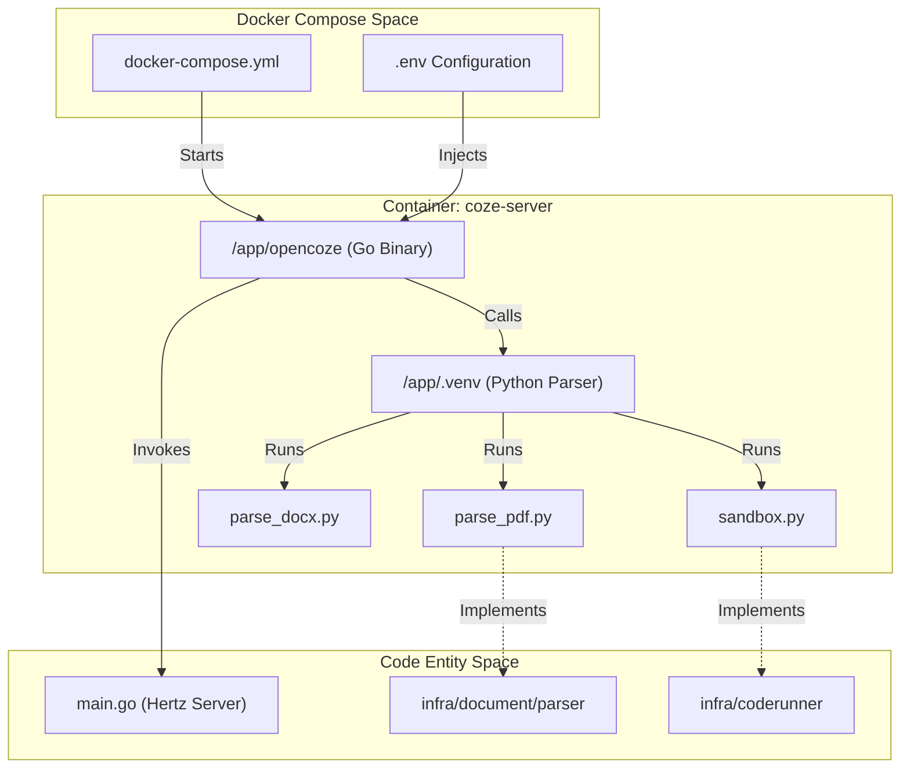
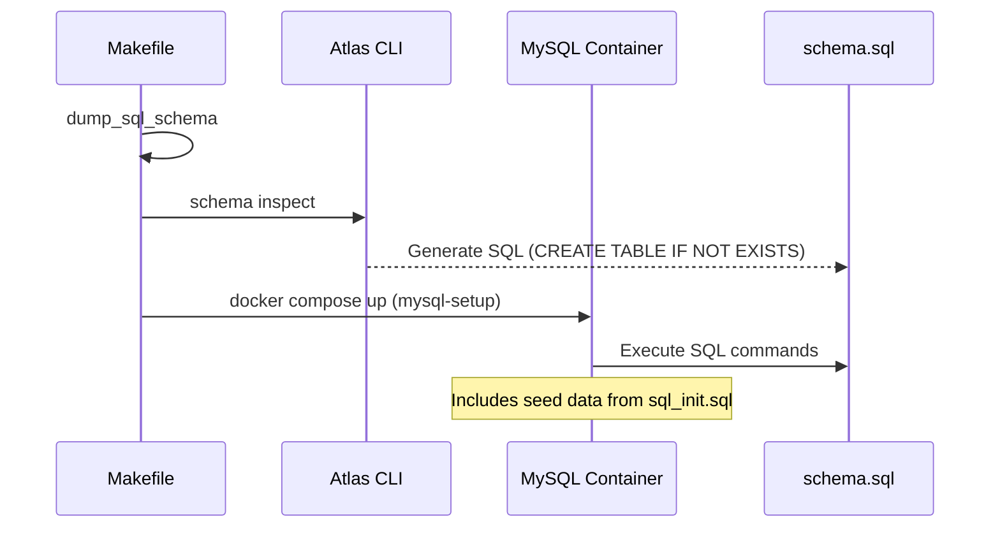

<!-- source: DeepWiki mcp.deepwiki.com · repo coze-dev/coze-studio · page 9.1 Docker Compose Deployment · fetched 2026-10-29 -->

# Docker Compose Deployment

Relevant source files

The following files were used as context for generating this wiki page:

- [.dockerignore](.dockerignore)
- [Makefile](Makefile)
- [backend/Dockerfile](backend/Dockerfile)

The Docker Compose deployment provides a streamlined, single-command orchestration for the entire Coze Studio stack. This method encapsulates the frontend, backend, and all necessary middleware services (databases, caches, search engines) into a unified environment suitable for both production-like evaluation and local development.

## Deployment Workflow and `make web`

The primary entry point for a full-stack deployment is the `make web` command defined in the root `Makefile`. This command automates the environment preparation and container orchestration.

| Command | Action |
| :--- | :--- |
| `make web_env` | Checks for the existence of `docker/.env`. If missing, it copies `docker/.env.example` to initialize the configuration [Makefile:69-73](). |
| `make web` | Triggers `web_env`, then executes `docker compose` using the production-ready `docker/docker-compose.yml` and the `.env` file [Makefile:75-77](). |
| `make down_web` | Stops and removes the web-tier containers [Makefile:79-81](). |

Sources: [Makefile:69-81]()

## Configuration: `.env.example`

The `docker/.env.example` file serves as the template for all service configurations. Key categories include:

*   **Database Credentials**: MySQL connection strings and Atlas migration URLs used for schema synchronization [Makefile:97-98]().
*   **Infrastructure Addresses**: Connection details for Redis, Elasticsearch, MinIO, and etcd.
*   **AI Model Providers**: API keys and endpoints for OpenAI, Ark, Ollama, or Gemini.
*   **Security**: AES keys for plugin token encryption and session management.

Sources: [Makefile:72](), [Makefile:97-98](), [backend/Dockerfile:58]()

## Service Topology and Dependencies

The deployment relies on a specific startup order and health check mechanism to ensure the backend (`coze-server`) only starts once infrastructure is ready.

### Infrastructure Initialization

1.  **MySQL & Atlas**: The database service uses Atlas for schema migrations. The `mysql-setup` profile in the compose file handles the initial schema application from `docker/volumes/mysql/schema.sql` [Makefile:50-51, 95-101]().
2.  **Elasticsearch**: Requires the `smartcn` analysis plugin for Chinese language processing in Knowledge Bases. The `setup_es_index` target initializes the required indices using schemas defined in `docker/volumes/elasticsearch/es_index_schema` [Makefile:109-112]().
3.  **MinIO**: Used for object storage (uploads, document parsing). The deployment initializes default buckets required by the `storage` infrastructure layer [backend/Dockerfile:50-51]().

### Container Architecture

The system is split into two primary application containers:

#### 1. coze-server (Backend)
Built using a multi-stage `Dockerfile` [backend/Dockerfile:1-77]().
*   **Stage 1 (Builder)**: Compiles the Go 1.24 application into a static binary named `opencoze` using `go build` with optimization flags `-s -w` [backend/Dockerfile:1-18]().
*   **Stage 2 (Runtime)**: An Alpine 3.22.0-based image containing:
    *   The compiled `opencoze` binary [backend/Dockerfile:47]().
    *   A Python virtual environment (`/app/.venv`) with dependencies like `pdfplumber`, `python-docx`, and `numpy` for document parsing [backend/Dockerfile:33-43]().
    *   The `sandbox.py` code runner script [backend/Dockerfile:52]().
    *   Deno runtime for secure JavaScript/TypeScript execution environments [backend/Dockerfile:28-30]().

#### 2. coze-web (Frontend & Proxy)
This container serves the static assets generated by the `make fe` command [Makefile:31-33](). It includes an Nginx reverse proxy configuration to:
*   Serve the React-based Studio UI from the static directory [Makefile:19, 36-39]().
*   Route `/api/*` requests to the `coze-server` container on port `8888` [backend/Dockerfile:72]().

### System Component Relationship

The following diagram illustrates the flow from the Docker Compose layer into the code entities and infrastructure.

**Diagram: Docker Deployment Entity Mapping**

Sources: [backend/Dockerfile:17-76](), [Makefile:75-77](), [backend/Dockerfile:50-52]()

## Database Migrations with Atlas

Coze Studio uses **Atlas** to manage the MySQL schema lifecycle. During the Docker Compose startup:
1.  The `ATLAS_URL` environment variable is extracted from the environment file to connect to the MySQL instance [Makefile:97-98]().
2.  The `sync_db` target applies the latest schema defined in `opencoze_latest_schema.hcl` to the database [Makefile:48-51]().
3.  The `sql_init` profile ensures that `sql_init.sql` (containing seed data like default models and roles) is executed and appended to the schema [Makefile:57-60, 101]().

**Diagram: Schema Migration Flow**

Sources: [Makefile:95-103](), [Makefile:57-60](), [Makefile:48-51]()

## Build Context and Optimization

To keep the Docker build context small and efficient, the `.dockerignore` file excludes:
*   `node_modules` and frontend build artifacts (`dist/`, `build/`) [ .dockerignore:1-7]().
*   Rush.js temporary files and build caches (`.rush/temp`, `common/temp`) [ .dockerignore:8-10]().
*   Local development logs and IDE configurations (`.vscode`, `.idea`) [ .dockerignore:17, 30-36]().

This ensures that the `backend/Dockerfile` only receives the necessary Go source code and configuration files during the `COPY` operations, preventing unnecessary layer invalidation [backend/Dockerfile:10-14]().

Sources: [ .dockerignore:1-36](), [backend/Dockerfile:10-14]()

---

