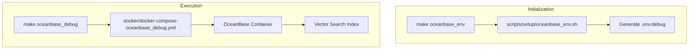
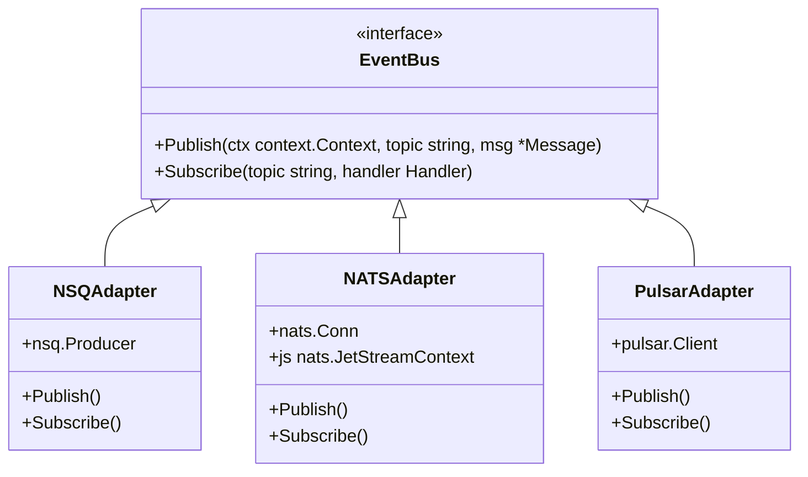
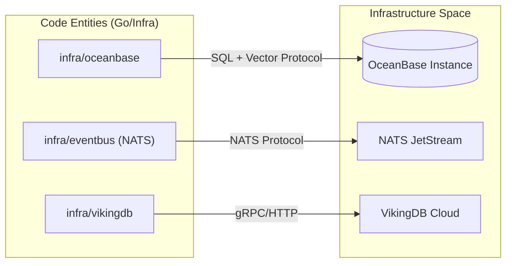

<!-- source: DeepWiki mcp.deepwiki.com · repo coze-dev/coze-studio · page 9.3 Alternative Infrastructure Integrations · fetched 2026-10-29 -->

# Alternative Infrastructure Integrations

Relevant source files

The following files were used as context for generating this wiki page:

- [Makefile](Makefile)
- [README.md](README.md)

Coze Studio is designed with a flexible infrastructure layer that supports multiple providers for critical services such as vector databases and message brokers. While the default stack utilizes Milvus and NSQ, the system provides production-ready integrations for OceanBase, NATS, Pulsar, and VikingDB to accommodate different deployment scales and operational requirements.

## Vector Database Alternatives

Coze Studio supports multiple vector storage backends for Knowledge Base and Memory features. The integration is abstracted through the infrastructure layer, allowing seamless switching via configuration.

### OceanBase Integration

OceanBase serves as a converged database solution, providing both relational storage and vector search capabilities. In Coze Studio, OceanBase can replace Milvus for storing document embeddings and replace MySQL for relational data.

*   **HNSW Indexing**: OceanBase utilizes the Hierarchical Navigable Small World (HNSW) algorithm for efficient vector similarity searches.
*   **Delegation Pattern**: The backend implements a delegation pattern where vector operations are routed to the OceanBase adapter when configured.
*   **Deployment**:
    *   **Docker**: Use `docker-compose-oceanbase.yml` to spin up a local OceanBase instance tailored for Coze [Makefile:12-12]().
    *   **Kubernetes**: Deployment is managed via the `ob-operator` within the Helm environment.

**OceanBase Setup Flow**

*Sources: [Makefile:114-130](), [Makefile:153-156]()*

### VikingDB Integration

For enterprise-scale vector requirements, Coze Studio integrates with VikingDB. This is primarily used in environments where a managed, high-performance vector cloud service is preferred over self-hosted Milvus or OceanBase. The configuration is managed through environment variables defined in the `.env` templates [README.md:75-78]().

## Event Bus Alternatives

The Event Bus is responsible for asynchronous task distribution, such as document indexing and workflow execution triggers. The system supports multiple drivers including NSQ, RocketMQ, Kafka, Pulsar, and NATS.

### NATS Integration

NATS is supported as a high-performance alternative to NSQ or RocketMQ. It supports two primary modes:
1.  **Core NATS**: Used for high-throughput, fire-and-forget messaging.
2.  **JetStream**: Used when persistence and "at-least-once" delivery guarantees are required for critical tasks like long-running workflow executions.

### Pulsar Integration

Apache Pulsar is supported for multi-tenant, high-scalability requirements. It provides a unified messaging model that combines queuing and streaming, making it suitable for complex agentic workflows that require strict ordering and long-term retention.

**Event Bus Abstraction Layer**

*Sources: [README.md:27-27](), [Makefile:61-64]()*

## Infrastructure Configuration Mapping

Switching between these alternative infrastructures is handled primarily through environment variables and the `infra/` layer adapters.

| Service Type | Default | Alternative 1 | Alternative 2 | Configuration File |
| :--- | :--- | :--- | :--- | :--- |
| **Vector DB** | Milvus | OceanBase | VikingDB | `docker/.env.example` |
| **Event Bus** | NSQ | NATS (JetStream) | Pulsar / RocketMQ | `docker/.env.example` |
| **RDB** | MySQL | OceanBase | - | `docker/atlas/atlas.hcl` [Makefile:105-108]() |

## Deployment Patterns

### OceanBase Debug Environment
To run the studio with OceanBase instead of the default MySQL/Milvus combination, use the dedicated make targets:
*   `make oceanbase_env`: Prepares the environment variables by running `scripts/setup/oceanbase_env.sh` [Makefile:114-115]().
*   `make oceanbase_debug`: Launches the middleware and server with OceanBase profiles enabled, utilizing `docker-compose-oceanbase_debug.yml` [Makefile:117-121]().

### Helm Deployment with Alternative Stack
In the Helm chart located at `helm/charts/opencoze/`, the `values.yaml` allows toggling these components. When `oceanbase.enabled` is set to true, the system bypasses the standard MySQL and Milvus initialization in favor of the OceanBase operator managed instance [Makefile:102-103]().

**System Entity Mapping**

*Sources: [Makefile:12-13](), [Makefile:114-130](), [README.md:27-27]()*

## Integration Guides
Detailed integration logic for these components can be found in the following locations:
*   **OceanBase Vector Logic**: `backend/infra/oceanbase/` [Makefile:114-130]().
*   **Message Queue Adapters**: `backend/infra/eventbus/`.
*   **Docker Topology**: `docker/docker-compose-oceanbase.yml` [Makefile:12-12]().
*   **Database Migrations**: Managed via Atlas in `docker/atlas/` [Makefile:105-108]().

`Sources: [Makefile:1-158](), [README.md:1-90]()`

---

