# Page: Overview

# Overview

<details>
<summary>Relevant source files</summary>

The following files were used as context for generating this wiki page:

- [CLAUDE.md](CLAUDE.md)
- [Makefile](Makefile)
- [README.md](README.md)
- [README.zh_CN.md](README.zh_CN.md)

</details>


Coze Studio is a comprehensive monorepo for building, managing, and deploying conversational AI agents. It provides an all-in-one development environment that integrates large language models (LLMs) with core agentic technologies such as prompts, Retrieval-Augmented Generation (RAG), plugins, and visual workflows. This platform supports developers in quickly creating, debugging, and deploying AI agents and applications through a low-code or no-code approach [README.md:18-27]().

The system architecture consists of a TypeScript and React frontend managed by **Rush.js** for monorepo workspace organization, a Go backend built with **Domain-Driven Design (DDD)** principles, and a **Thrift Interface Definition Language (IDL)** layer defining strict contracts between frontend and backend components [README.md:27-27]().

---

## Feature List

Coze Studio offers a rich set of core technologies and capabilities to support AI agent development:

| Module            | Features                                                                                   |
|-------------------|--------------------------------------------------------------------------------------------|
| **Model Service** | Manages model lists and integrations with popular AI providers such as OpenAI and Volcengine |
| **Agent Builder** | Enables creation, publishing, and management of AI agents. Supports orchestration using workflows and RAG resources |
| **Workflow Engine** | Provides a visual canvas for creating, modifying, and publishing complex workflows representing business logic |
| **Resources Management** | Includes creation and administration of various resources like plugins, knowledge bases, and databases |
| **API & SDK**      | Supplies OpenAPI endpoints for conversation and workflow management and Chat SDK for integrating agents into custom apps |

This modular functionality empowers developers to focus on AI's core value while leveraging a unified, professional-grade development environment [README.md:29-36]().

---

## Repository Structure

The monorepo layout is designed to clearly separate concerns between frontend, backend, interface definitions, infrastructure, and common resources:

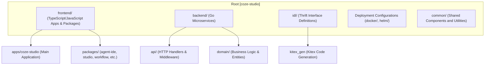

This structure organizes the complexity of the platform, supporting rapid development and incremental builds, and facilitates collaboration across teams.

For a comprehensive discussion of the directory layout and Rush.js workspace configuration, see [Repository Structure](#1.1).

---

## Technology Stack

Coze Studio leverages modern, high-performance technologies to ensure scalability, developer productivity, and rich UI experiences:

- **Frontend**: React 18 with TypeScript, leveraging Rsbuild (Rspack-based) for efficient incremental builds, Zustand for state management, and the FlowGram visual workflow engine for workflow editing [README.md:75-85]().

- **Backend**: Go 1.24 following Domain-Driven Design principles, built on the Hertz HTTP framework for service API handling, with the Eino AI orchestration framework powering agent execution and knowledge retrieval [README.md:86-94]().

- **Infrastructure**: Containerized deployment using Docker and Kubernetes (via Helm charts). Middleware services include MySQL 8.4.5 as relational database, Redis 8 for caching, Elasticsearch 8 with SmartCN plugin for search, Milvus v2.5.10 for vector database, MinIO for object storage, NSQ as message queue, and etcd for configuration management [README.md:11,104-111]().

This technology stack allows Coze Studio to achieve high extensibility and operational robustness.

For detailed insights on all core technologies and frameworks, see [Technology Stack](#1.2).

---

## Quickstart Deployment

Coze Studio provides a streamlined Docker Compose deployment to quickly get started:

1. **Clone the repository:**

   ```bash
   git clone https://github.com/coze-dev/coze-studio.git
   ```

2. **Start services:**

   - On macOS or Linux:

     ```bash
     cd coze-studio
     make web
     ```

   - On Windows:

     ```bash
     cd coze-studio
     cp ./docker/.env.example ./docker/.env
     docker compose -f ./docker/docker-compose.yml up
     ```

3. **Access Coze Studio:**

   - Register at `http://localhost:8888/sign`.
   - Configure AI models at `http://localhost:8888/admin/#model-management` (requires image version ≥ 0.5.0).
   - Start using at `http://localhost:8888/`.

> **Warning:** For public network deployment, assess security risks such as SSRF, API privilege escalation, and Python execution environment exposure. See the [Quickstart guide](https://github.com/coze-dev/coze-studio/wiki/2.-Quickstart#security-risks-in-public-networks) for protection guidelines.

Sources: [README.md:46-71](), [Makefile:23-77]()

---

## Architectural Mapping: Natural Language Space to Code Entity Space

The diagrams below connect conceptual AI functionalities to their concrete code modules, facilitating developer navigation across natural language features and code artifacts.

### AI System Components to Code Packages
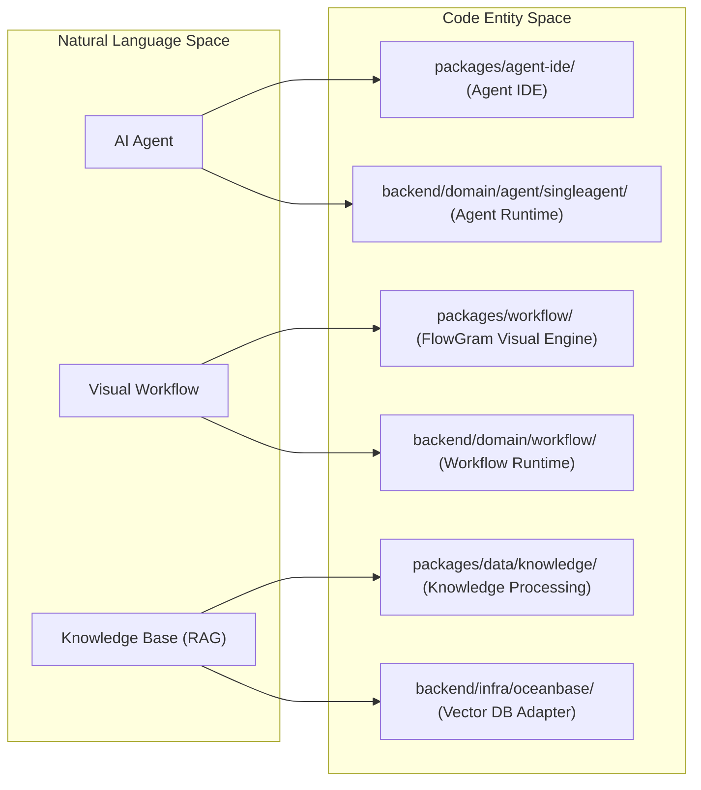

### Frontend Requests, Interface Definitions, and Backend Handlers

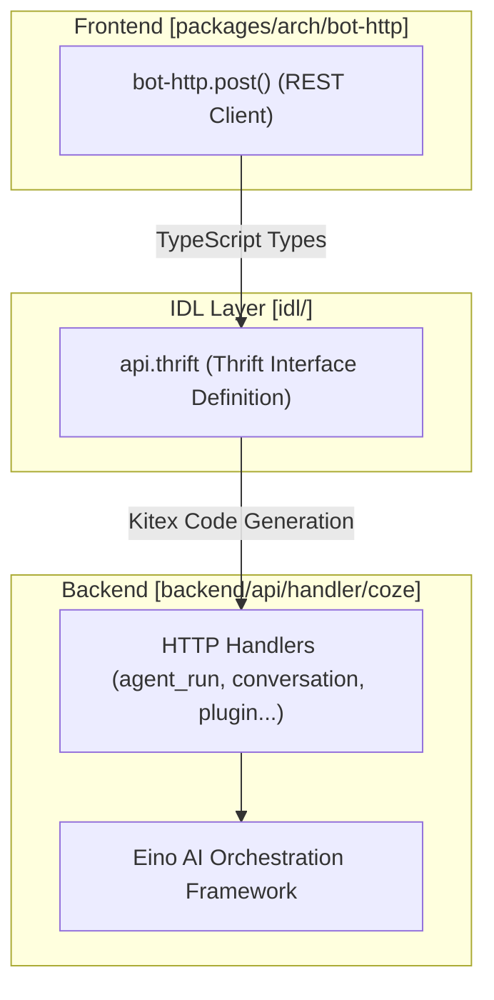

These mappings illustrate how front-end service requests traverse through IDL contracts into backend route handlers which then orchestrate AI logic with Eino [README.md:131-134]().

---

## Governance and Contribution

Coze Studio is licensed under the Apache-2.0 license, ensuring an open and transparent governance model. Code ownership is carefully managed via `.github/CODEOWNERS` files to maintain quality and responsibility boundaries across the sprawling codebase [README.md:10-12](), [.github/CODEOWNERS:1-20]().

For further developer resources and contribution workflows, explore the related sections:

- [Repository Structure](#1.1)
- [Technology Stack](#1.2)
- [CI/CD System](#3)
- [Development Environment](#6)
- [Contributing](#8)

---

This overview establishes the foundational understanding needed for deeper exploration into Coze Studio. See the linked child pages for detailed discussions on each technical aspect.

---

**Sources:**  
[README.md:18-36](), [README.md:75-135](), [Makefile:1-158](), [.github/CODEOWNERS:1-20]()

---

# Page: Repository Structure

# Repository Structure

<details>
<summary>Relevant source files</summary>

The following files were used as context for generating this wiki page:

- [.gitattributes](.gitattributes)
- [.github/CODEOWNERS](.github/CODEOWNERS)
- [.gitignore](.gitignore)
- [README.md](README.md)

</details>


## Purpose and Scope

This document details the physical organization of the Coze Studio monorepo, covering the top-level directory structure and their relationships. It describes the layout of `frontend/`, `backend/`, `idl/`, `common/`, `docker/`, and `helm/` directories, along with key configuration files at the repository root.

For detailed information about the frontend package organization and layered architecture, see [Package Organization](#4.2). For backend service architecture, see [Backend Architecture](#2.2). For infrastructure deployment configurations, see [Infrastructure Stack](#2.3).

---

## Root Directory Structure

The Coze Studio monorepo is organized into seven primary top-level directories and several important root-level folders and files:

```
coze-studio/
├── frontend/          # Frontend codebase with 170+ packages
├── backend/           # Go-based microservices (Go 1.24+)
├── idl/               # Thrift interface definitions
├── common/            # Cross-platform shared utilities
├── docker/            # Docker containerization configs
├── helm/              # Kubernetes deployment charts
├── scripts/           # Setup and utility scripts
├── docs/              # Markdown documentation for the project
├── .github/           # GitHub workflows and CI/CD automation
├── bin/               # Build output binaries
├── .gitattributes     # Git merge strategies for lock files
├── .gitignore         # Ignore patterns for Git
└── rush.json          # Rush.js monorepo configuration for frontend packages
```

### Directory Overview Table

| Directory    | Primary Language            | Purpose                                                                           | Code Owners                                 |
|--------------|----------------------------|-----------------------------------------------------------------------------------|---------------------------------------------|
| `frontend/`  | TypeScript / React          | Web applications and UI packages organized as a Rush.js monorepo                  | [@Tecvan-fe](), [@fanlv](), [@junwen-lee]() |
| `backend/`   | Go (1.24+)                 | Microservices and API implementations built with Domain-Driven Design             | [@fanlv](), [@junwen-lee](), [@hi-pender]() |
| `idl/`       | Thrift                     | Interface Definition Language files defining API contracts shared across services | Backend team (same as `backend/`)            |
| `common/`    | Mixed (Go, TS)             | Shared utilities usable by both frontend and backend                             | [@Tecvan-fe](), [@fanlv](), [@junwen-lee]() |
| `docker/`    | Dockerfiles, Compose YAML  | Docker containerization configuration for all system components                   | Backend team (same as `backend/`)            |
| `helm/`      | YAML                      | Helm charts for Kubernetes deployment of the platform                            | Backend team (same as `backend/`)            |
| `scripts/`   | Shell, Python              | Scripts for setup, environment initialization, and database migration             | Core maintainers                             |
| `docs/`      | Markdown                   | Technical and user documentation                                                  | [@Tecvan-fe](), [@fanlv]()                   |
| `.github/`   | YAML, Scripts              | CI/CD workflows, issue templates, contributing guides                            | Repository maintainers                       |
| `bin/`       | Binaries                   | Compiled binaries from builds                                                    | -                                           |
| Configuration Files | Various              | Control Git merge behavior, ignore unwanted files, manage monorepo tool versions   | Repository maintainers                       |

**Sources:** [.github/CODEOWNERS:1-5](), [README.md:11-12](), [.gitignore:26-53](), [.gitattributes:1-16](), [rush.json]()

---

## Directory Relationships Diagram

The following diagram illustrates the main directories, their inter-relationships, and the flow from IDL definitions through backend and frontend, unified under containerization and deployment layers.

```mermaid
graph TB
    subgraph "Contract & Shared Layer"
        IDL["idl/<br/>Thrift definitions (api.thrift, base.thrift, domain-specific)"]
        Common["common/<br/>Cross-platform shared utilities"]
    end
    
    subgraph "Application Layer"
        Frontend["frontend/<br/>TypeScript React Monorepo (Rush.js)"]
        Backend["backend/<br/>Go microservices (DDD architecture)"]
    end
    
    subgraph "Infrastructure & Deployment"
        Docker["docker/<br/>Docker Compose configs"]
        Helm["helm/<br/>Kubernetes Helm charts"]
        Scripts["scripts/<br/>Setup & migration scripts"]
    end
    
    subgraph "Documentation & CI/CD"
        Docs["docs/<br/>Project documentation"]
        GitHub[".github/<br/>CI workflows, issue templates"]
    end
    
    subgraph "Artifacts & Configurations"
        Bin["bin/<br/>Compiled binaries"]
        GitIgnore[".gitignore/.gitattributes<br/>Version control configs"]
        RushConfig["rush.json<br/>Rush.js monorepo setup"]
    end
    
    IDL -->|Code Generation (kitex_gen)| Backend
    IDL -->|IDL-to-TS generator| Frontend
    Common --> Frontend
    Common --> Backend
    Frontend -->|Builds with Rush.js + pnpm| Bin
    Backend -->|Go build outputs| Bin
    Scripts --> Docker
    Docker --> Helm
    Helm --> Backend
    Helm --> Frontend
    
    Docs --> GitHub
```

**Sources:** [.github/CODEOWNERS:1-20](), [.gitignore:21-63](), [README.md:55-63](), [.gitattributes:1-16]()

---

## Frontend Directory

The `frontend/` directory contains the entire TypeScript/React application, organized as a Rush.js monorepo with over 170 interdependent packages. It uses `pnpm` as the package manager with Rush orchestration.

### Key frontend subdirectories:

```
frontend/
├── apps/                    # Application entry points (e.g., coze-studio)
│   └── coze-studio/        
├── packages/                # Feature libraries and domain-specific packages
│   ├── agent-ide/           # Agent IDE environment, plugin framework
│   ├── studio/              # Bot management UI and related plugins
│   ├── workflow/            # Visual workflow editor (FlowGram integration)
│   ├── project-ide/         # Project-level IDE tooling
│   ├── arch/                # Architecture-layer packages (bot-api, logger, i18n)
│   ├── foundation/          # Core services like auth and global stores
│   ├── common/              # Generic shared business logic (chat, uploader)
│   ├── components/          # UI components (bot-semi, icons, virtual-list)
│   ├── data/                # Domain-focused functionality (knowledge, memory)
│   └── community/           # Community-driven feature sets
├── infra/                   # Infrastructure tooling
│   ├── idl/                 # TypeScript codegen pipeline for IDL files
│   └── plugins/             # Build tooling plugins (e.g., Rsbuild extensions)
└── config/                  # Shared configs (eslint, tsconfig, prettier, stylelint)
    ├── eslint-config/       
    └── ts-config/           
```

### Package Organization and Rush.js

- The frontend leverages Rush.js for workspace management, supporting fast incremental builds and dependency graph resolution.
- `rush.json` controls the workspace settings, including allowed project tags and pnpm version (currently pnpm 8.15.8).
- Packages are tagged by team ownership and layered in dependency tiers from level-1 (core) through level-4 (apps/clients).
- Rush uses subspaces (in `common/config/subspaces/`) to optimize the dependency graph into smaller scopes to boost build and install performance.

**Sources:** [.github/CODEOWNERS:3-111](), [.gitignore:51-54](), [rush.json]()

---

## Backend Directory

The `backend/` directory houses the Go microservices built with Go 1.24+, architected according to Domain-Driven Design (DDD) principles.

### Backend structure:

| Component          | Path                 | Purpose                                             |
|--------------------|----------------------|-----------------------------------------------------|
| Entry Point        | `backend/main.go`    | Server bootstrap using Hertz HTTP framework        |
| API Handlers       | `backend/api/`       | HTTP handlers, middleware, and request/response models |
| Domain Layer       | `backend/domain/`    | Core business logic entities and service implementations |
| Application Layer  | `backend/application/` | Use-case implementations managing domain logic flows|
| Cross-Domain       | `backend/crossdomain/` | Cross-cutting concerns (e.g., tracing, metrics)     |
| Infrastructure     | `backend/infra/`     | Adapters for Redis, MySQL, Milvus, Elasticsearch, etc.|
| Configuration      | `backend/conf/`      | YAML configurations for models, environment (ignored)|
| Build Artifacts    | `backend/**/output*` | Compiled Go binaries and intermediate build outputs |
| Static Assets      | `backend/static/`    | Possibly static files served by backend             |

The backend depends on code generated from Thrift IDL files located in `idl/` via Kitex tooling (`kitex_gen/`), ensuring strong API contract enforcement and multi-language compatibility.

**Sources:** [.gitignore:26-59](), [.github/CODEOWNERS:275-278]()

---

## IDL Directory

The `idl/` directory contains Thrift IDL files defining the interfaces and data models shared between frontend and backend.

- Contains core files such as `api.thrift` and `base.thrift`, plus domain-specific Thrift files.
- These interface definitions serve as the "single source of truth" for client-server communication.
- Kitex tooling generates Go code backend under `backend/kitex_gen/`.
- An `idl2ts-generator` tool generates TypeScript definitions used by the frontend packages under `frontend/packages/arch/idl/`.

### IDL generation pipeline

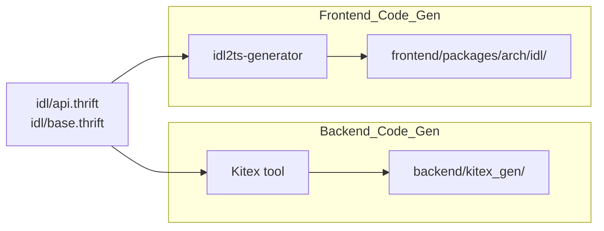

**Sources:** [.github/CODEOWNERS:26, 278](), [.gitattributes:7-8]()

---

## Docker and Helm Directories

### `docker/`

- Contains Dockerfiles and `docker-compose.yml` files that define the containerized topology of the Coze Studio platform:
  - Services include MySQL, Redis, Elasticsearch (with smartcn plugin), MinIO, Milvus, NSQ, Coze backend server, Coze frontend web server, and Nginx reverse proxy.
- Also includes `.env.example` for environment variable references.
- Supports development and production deployment setups.
  
### `helm/`

- Contains Kubernetes deployment manifests under `helm/charts/opencoze/`.
- Helm charts orchestrate services for production-grade deployments on Kubernetes, including database configuration, storage classes, and service types (LoadBalancer).
- Integrates OceanBase operator and supports configuring distributed message queues and vector databases.

### `scripts/`

- Contains scripts for environment setup and data migrations:
  - `setup/server.sh`: Builds the backend services.
  - `setup/db_migrate_apply.sh`: Runs database schema migrations using Atlas.
  - `setup/python.sh`: Sets up Python virtual environments required for document parsing nodes inside workflows.

**Sources:** [.gitignore:8-10, 47](), [README.md:55-63]()

---

## Root Configuration Files and Version Control

### `.gitattributes`

- Specifies merge strategies for lock and generated files to avoid conflicts during large-scale monorepo merges:
  - `pnpm-lock.yaml` uses `merge=ours`
  - Other shrinkwrap files use binary merge to prevent automatic merges
- Keeps Rush JSON configs safe from being corrupted due to comments.

### `.gitignore`

- Excludes build outputs, node_modules, binary executables, IDE config files, and sensitive environment files (`.env`, `.env.debug`, `.env.oceanbase`).
- Ignores backend temporary outputs and static assets.
- Excludes Rush cache directories and TypeScript build metadata files.

### `rush.json`

- Core Rush.js configuration specifying:
  - Rush version and pnpm version compatibility
  - Allowed project tags
  - List of frontend packages and their containing folders
  - Autoinstallers for plugins and linting tools
  - Settings supporting subspace optimizations for dependency graph partitioning.

**Sources:** [.gitattributes:1-16](), [.gitignore:1-63](), [rush.json]()

---

## Ownership Model

Code ownership and maintainership is enforced via the `.github/CODEOWNERS` file:

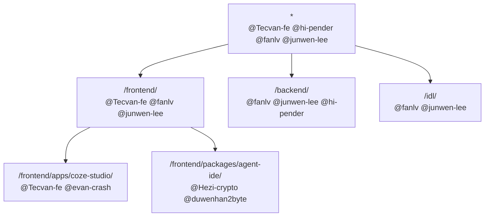

- Ownership mapping ensures that code review and changes follow team boundaries for frontend, backend, and shared components.
- Critical or cross-cutting areas like the IDL or common utilities have designated owners for stability.

**Sources:** [.github/CODEOWNERS:1-12]()

---

# Summary

The Coze Studio repository is a large-scale monorepo carefully organized to support both frontend (TypeScript/React) and backend (Go/D-DD) development. It adopts:

- A layered architecture with a contract-first approach using Thrift IDL (`idl/`).
- A Rush.js managed frontend monorepo (`frontend/`) with extensive modularity into apps, feature packages, and architectural layers.
- A robust Go backend (`backend/`) with DDD separation into API, domain, application, and infrastructure layers.
- Infrastructure-as-code for containerization with Docker and scalable deployments on Kubernetes via Helm charts.
- Shared cross-platform utilities in `common/` and automation scripts in `scripts/`.
- Proper Git and tooling configurations for safe merges, consistent builds, and team ownership.

This structure supports the development of a rich conversational AI platform with AI agents, workflows, plugins, knowledge bases, and more, facilitating efficient incremental builds, testing, and deployment.

---

# References

- `.github/CODEOWNERS` (lines 1-80)
- `.gitignore` (lines 1-63)
- `.gitattributes` (lines 1-16)
- `README.md` (lines 1-100)
- `rush.json` (Rush workspace configuration)
- `idl/` (Thrift files and generation)
- `frontend/` package layout
- `backend/` main service layout
- `docker/` and `helm/` Kubernetes charts
- `scripts/` setup and migration tools

---

**End of page 1.1 "Repository Structure".**

---

# Page: Technology Stack

# Technology Stack

<details>
<summary>Relevant source files</summary>

The following files were used as context for generating this wiki page:

- [.nvmrc](.nvmrc)
- [Makefile](Makefile)
- [README.md](README.md)
- [backend/Dockerfile](backend/Dockerfile)

</details>


This document describes the core technologies, frameworks, and tools used throughout the Coze Studio monorepo. It covers the frontend TypeScript/JavaScript ecosystem, backend Go services, interface definition layer, infrastructure components, and development tooling.

## Overview

Coze Studio employs a polyglot technology stack with clear separation between frontend and backend layers, unified through Thrift IDL definitions. The repository uses **Rush.js** for monorepo orchestration, enabling incremental builds and dependency management across all packages.

```mermaid
graph TB
    subgraph "Frontend Layer"
        Node["Node.js (lts/iron)"]
        Rush["Rush.js / pnpm"]
        React["React 18"]
        FlowGram["FlowGram Engine"]
        Zustand["Zustand State"]
    end
    
    subgraph "Backend Layer"
        Go["Go 1.24"]
        Hertz["Hertz HTTP Framework"]
        Eino["Eino AI Orchestration"]
        GORM["GORM ORM"]
    end
    
    subgraph "Infrastructure"
        Docker["Docker / Docker Compose"]
        Helm["Kubernetes Helm Charts"]
        Atlas["Atlas Schema Migration"]
        Python["Python 3 (Virtualenv)"]
    end

    %% Mapping technologies to specific code markers
    Rush -.-> RushJson["rush.json"]
    React -.-> AppEntry["apps/coze-studio/src/index.tsx"]
    FlowGram -.-> WorkflowPkg["packages/workflow/"]
    Zustand -.-> StorePkg["packages/agent-ide/bot-editor-context-store.ts"]
    Go -.-> GoMod["backend/go.mod"]
    Hertz -.-> ServerEntry["backend/main.go"]
    Eino -.-> AgentDomain["backend/domain/agent/"]
    GORM -.-> InfraOrm["backend/infra/orm/"]
    Docker -.-> DockerCompose["docker/docker-compose.yml"]
    Helm -.-> HelmCharts["helm/charts/opencoze/"]
    Atlas -.-> AtlasMigration["docker/atlas/migrations/"]
    Python -.-> PythonScripts["backend/infra/coderunner/impl/script/sandbox.py"]
```

**Sources:** [.nvmrc:1](), [README.md:18-28](), [Makefile:91-94](), [backend/Dockerfile:1-77]()

---

## Frontend Technology Stack

The frontend is implemented using **TypeScript** and **JavaScript** with the structure managed by **Rush.js** in a monorepo layout for efficient builds and dependency management.

### Core Technologies and Frameworks

- **TypeScript / JavaScript**: Strongly typed frontend code to improve maintainability.
- **Rush.js**: Monorepo orchestrator that manages the dependency graph, incremental builds, and workspace settings across numerous packages.
- **React 18**: The primary UI framework powering all frontend interfaces, including the agent IDE and studio environments.
- **Rsbuild / Rspack**: Custom build pipeline tools focused on fast incremental builds and optimized bundling.
- **Zustand**: A lightweight state management library used extensively for component and application state in complex frontend sections like the Bot Editor context.
- **FlowGram**: A powerful visual workflow engine enabling drag-and-drop editing and execution of workflows within Coze Studio.

### Package and Build Management

- **Rush.js Workspaces** segment the frontend code into multiple packages under directories such as `apps/` and `packages/`.
- Packages follow a tiered dependency system from level-1 (foundations) up to level-4 (application-specific).
- **pnpm** workspace is integrated with Rush.js for fast package installs and dependency resolution.
- Autoinstallers handle tools like `rush-commitlint` and `rush-lint-staged`.

Frontend codebases leverage type-safe API consumption generated from the shared Thrift IDL schemas, facilitating seamless frontend-backend integration.

**Sources:** [README.md:27-28](), [Makefile:31-33](), [.nvmrc:1]()

---

## Backend Technology Stack

The backend is implemented using **Go 1.24**, with a Domain-Driven Design (DDD) architecture to maintain clear separation of concerns and extensibility.

### Core Technologies and Frameworks

- **Go 1.24**: The primary programming language for backend services, chosen for performance and concurrency.
- **Hertz HTTP Framework**: High-performance HTTP server framework used to implement RESTful APIs and middleware in the backend (`main.go` serves as the entrypoint).
- **Eino AI Orchestration Framework**: Provides AI model abstraction, retrieval-augmented generation (RAG) pipelines, and agent lifecycle orchestration encapsulated primarily within the `domain/agent/` packages.
- **GORM**: Go ORM used for relational database access and migrations (MySQL/OceanBase).
- **Python 3 (Virtualenv)**: Python scripts and virtual environments are embedded within the docker container for document parsers and sandboxed code execution, interacting tightly with the Go backend.

### Backend Build and Running

The backend builds into a statically-linked Go binary using `go build -ldflags="-s -w"` to reduce size:

```dockerfile
# Key Dockerfile snippet for backend
RUN go build -ldflags="-s -w" -o /app/opencoze main.go
```

This binary is then included in a minimal Alpine-based runtime image with Python and supporting libraries installed.

**Sources:** [backend/Dockerfile:1-77](), [README.md:27-28](), [Makefile:123-130]()

---

## AI Orchestration and Execution

The essential AI orchestration within the backend is handled by the **Eino Framework** and the domain agent services.

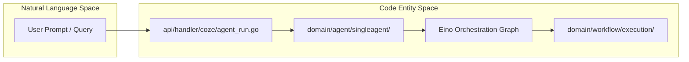

- User queries go through HTTP API handlers (e.g., `agent_run.go`).
- Agent business logic in `singleagent` manages agent session and execution.
- Eino orchestrates model calls, plugins, and workflows.
- Workflow execution manages complex automation flows.

This design cleanly separates concerns and allows workflow, AI, and plugin extensions.

**Sources:** [README.md:27-28](), [Makefile:123-130]()

---

## Infrastructure and Deployment Stack

Coze Studio uses containerization and cloud-native infrastructure for deployment.

### Containerization and Orchestration

- **Docker & Docker Compose**: Used for local development and one-command startup of all dependencies including database, cache, search, and services.
- **Kubernetes & Helm Charts**: Helm charts within `helm/charts/opencoze/` provide production-ready Kubernetes manifests for full-stack deployment.
- **Atlas**: Database schema management and SQL migration tool integrating with MySQL/OceanBase.

### Supporting Infrastructure Components

| Component                | Technology                   | Role                                                  |
|-------------------------|-----------------------------|-------------------------------------------------------|
| Relational Database      | MySQL 8.4.5 / OceanBase     | Store agents, workflows, users, resources              |
| Distributed Cache       | Redis                       | Session caching, transient data                        |
| Search Engine           | Elasticsearch               | Full-text search for knowledge bases                   |
| Vector Database / Index | Milvus / OceanBase          | Vector similarity search for RAG and AI embeddings    |
| Object Storage          | MinIO / Amazon S3           | Storage of uploaded files and document artifacts       |
| Messaging Queues        | NSQ / RocketMQ / NATS / Pulsar | Event bus and asynchronous messaging                 |
| Reverse Proxy           | Nginx                       | Web traffic routing and TLS termination                |

### Backend Dockerfile Summary

The backend Dockerfile installs Go build dependencies, builds the Go app statically, then creates a slim runtime image with Python 3 virtual environment. It installs necessary Python libraries for document parsing and sandboxing.

```dockerfile
# Summary of backend Docker build steps
FROM golang:1.24-alpine AS builder
WORKDIR /app
RUN apk add --no-cache git gcc libc-dev
COPY backend/go.mod backend/go.sum ./
RUN go mod download
COPY backend/ ./
RUN go build -ldflags="-s -w" -o /app/opencoze main.go

FROM alpine:3.22.0
RUN apk add --no-cache python3 python3-dev pax-utils deno
RUN python3 -m venv /app/.venv
COPY --from=builder /app/opencoze /app/opencoze
COPY backend/infra/document/parser/impl/builtin/*.py /app/
COPY backend/infra/coderunner/impl/script/sandbox.py /app/
ENV PATH="/app/.venv/bin:${PATH}"
CMD ["/app/opencoze"]
```

**Sources:** [Makefile:9-16](), [backend/Dockerfile:1-77]()

---

## Interface Definition Layer (IDL)

Coze Studio uses **Apache Thrift IDL** to define data structures and API service contracts between frontend and backend.

- Thrift files are stored in the `idl/` directory with API, base, and domain-specific IDL definitions.
- Backend Go code is generated by the **Kitex** codegen tool from IDL.
- Frontend TypeScript declarations and client SDKs are generated using `idl2ts`, ensuring type-safe API usage.
- This arrangement enforces consistent, strongly-typed data contracts across the system.

**Sources:** [README.md:27-28](), [Makefile:105-108]() (implied from the repo structure)

---

## Development Tooling and Workflow

The repository provides a comprehensive `Makefile` to automate common build, setup, and deployment tasks:

| Make Target | Description                                               |
|-------------|-----------------------------------------------------------|
| `make fe`  | Build the frontend application code                       |
| `make server` | Compile and start the Go backend server with env setup |
| `make middleware` | Start all required Docker middleware containers   |
| `make python` | Set up Python virtual environment and dependencies     |
| `make sync_db` | Run database schema migration via Atlas                 |
| `make clean` | Stop all containers and clean up volumes                 |

Key environment and build scripts are located in `scripts/setup/`.

Node.js version is pinned to **lts/iron** via `.nvmrc` file, ensuring consistent frontend build environments.

**Sources:** [Makefile:1-158](), [.nvmrc:1]()

---

# Summary Table: Technologies and Their Roles in Coze Studio

| Technology             | Purpose                                  | Relevant Code / Files                                  |
|-----------------------|-----------------------------------------|-------------------------------------------------------|
| TypeScript / JavaScript| Frontend implementation                  | `apps/coze-studio/src/`, `packages/`                  |
| Rush.js & pnpm        | Monorepo package management & builds    | `rush.json`, `package.json` in frontend packages      |
| React 18              | UI framework                            | React components under `apps/coze-studio/`            |
| Rsbuild / Rspack      | Frontend build tooling                   | Build scripts indicated by `scripts/build_fe.sh`      |
| Zustand               | Frontend state management                | State stores under `packages/agent-ide/bot-editor-context-store.ts` |
| Go 1.24               | Backend implementation                   | `backend/` directory, `main.go`                        |
| Hertz HTTP Framework  | Backend HTTP server & routing           | `backend/main.go`, handlers in `backend/api/handler/` |
| Eino                  | AI orchestration framework               | Business logic under `backend/domain/agent/`          |
| GORM                  | ORM for DB interaction                   | `backend/infra/orm/`                                   |
| Apache Thrift IDL     | Interface definition                     | `idl/*.thrift` files, Kitex-generated Go/TS code       |
| Docker & Docker Compose| Containerization and local orchestration | `docker/docker-compose.yml`, `backend/Dockerfile`    |
| Kubernetes & Helm     | Production orchestration & deployment    | `helm/charts/opencoze/`                                |
| Atlas Migration Tool  | Database schema management and migrations| `docker/atlas/migrations/`, Makefile targets          |
| Python 3 (Virtualenv) | Auxiliary scripting & sandboxing         | Python scripts under `backend/infra/coderunner/impl/script/` |

---

This technology stack underpins Coze Studio's goal to provide a scalable, extensible platform for rapid AI agent development combining modern frontend interfaces and robust backend services.

**Sources:** [.nvmrc:1](), [README.md:1-89](), [Makefile:1-158](), [backend/Dockerfile:1-77]()

---

# Page: Architecture

# Architecture

<details>
<summary>Relevant source files</summary>

The following files were used as context for generating this wiki page:

- [.github/CODEOWNERS](.github/CODEOWNERS)
- [README.md](README.md)
- [backend/api/model/base/base.go](backend/api/model/base/base.go)

</details>


This document provides a high-level architectural overview of the Coze Studio monorepo, describing the major subsystems, their responsibilities, and how they interact. It covers the frontend's layered package architecture, the DDD-based backend microservices, the Thrift-based Interface Definition Layer (IDL), and the containerized infrastructure.

For specific implementation details about individual subsystems, see [Frontend Architecture](#2.1), [Backend Architecture](#2.2), [Infrastructure Stack](#2.3), [Interface Definition Layer](#2.4), and [Plugin and Extension System](#2.5).

## System Overview

Coze Studio is structured as a monorepo with distinct architectural layers. The backend is developed using **Golang** (utilizing the **Hertz** HTTP framework and **Eino** AI orchestration framework), while the frontend employs **React 18** with **TypeScript** managed by **Rush.js** for monorepo dependency control. The overall architecture follows **Domain-Driven Design (DDD)** principles to handle complex business domains such as AI agents, workflows, plugins, knowledge bases, and databases.

**High-Level System Topology**

```mermaid
graph TB
    subgraph "Frontend Layer (React/TypeScript)"
        FE_App["frontend/apps/coze-studio/"]
        FE_IDE["Agent IDE & Project IDE<br/>(packages/agent-ide, packages/project-ide)"]
        FE_Core["Core Systems<br/>(workflow, studio, data)"]
        FE_Arch["Architecture/Foundation<br/>(bot-api, bot-http, arch packages)"]
    end

    subgraph "IDL Layer (Thrift)"
        ThriftIDL["idl/*.thrift files<br/>(API Contracts & Data Types)"]
    end

    subgraph "Backend Layer (Go/DDD Architecture)"
        BE_API["backend/api/<br/>(HTTP handlers, middleware, models)"]
        BE_App["backend/application/<br/>(Use Cases)"]
        BE_Domain["backend/domain/<br/>(Business Logic, Entities, Eino AI Framework)"]
        BE_Infra["backend/infra/<br/>(Adapters: DB, Cache, VectorStore, etc.)"]
        BE_Pkg["backend/pkg/<br/>(Utilities)"]
        BE_Types["backend/types/"]
    end

    subgraph "Infrastructure Layer"
        DB["MySQL / Relational DB"]
        Cache["Redis / Cache Layer"]
        VectorStore["Milvus / OceanBase / Vector Search"]
        Storage["MinIO / S3 Object Storage"]
        MQ["NSQ / RocketMQ / NATS / Pulsar Messaging Queues"]
        Proxy["Nginx / Reverse Proxy"]
    end

    FE_App --> FE_IDE
    FE_IDE --> FE_Core
    FE_Core --> FE_Arch

    FE_Arch -.->| "idl2ts-generated API Types" | ThriftIDL
    ThriftIDL -.->| "kitex Go Stubs" | BE_API

    FE_Arch -.->| "HTTP/SSE calls" | BE_API
    BE_API --> BE_App
    BE_App --> BE_Domain
    BE_Domain --> BE_Infra

    BE_Infra --> DB
    BE_Infra --> Cache
    BE_Infra --> VectorStore
    BE_Infra --> Storage
    BE_Infra --> MQ

    BE_API --> Proxy
    FE_App --> Proxy
```

This diagram connects the natural language "system parts" (like "Agent IDE" or "MySQL") with their concrete code entities and directories, showing how each layer depends on or interacts with others.

**Sources:** [README.md:27-28](), [.github/CODEOWNERS:1-280]()

---

## Frontend Architecture

The frontend is organized into multiple layers to promote code reuse and maintainability:

- **Layer 1 (Apps):** The top-level application entrypoint(s) live in `frontend/apps/coze-studio/`.
- **Layer 2 (IDEs & Feature Packages):** Packages like `agent-ide` and `project-ide` provide integrated development environments for building and managing AI agents and projects.
- **Layer 3 (Core Systems):** Packages responsible for core business logic such as `workflow`, `studio`, and `data`.
- **Layer 4 (Foundation & Common Utilities):** Provides shared foundational services (e.g., state stores, account management).
- **Layer 5 (Architecture Layer):** Contains low-level utilities and API client layers (`bot-api`, `bot-http`, `idl`, `i18n`, etc.).

The frontend heavily employs the **Adapter Pattern** with packages named `*-adapter`, `*-base`, and `*-interface` to provide flexibility and pluggable implementations.

This layered dependency structure is managed by **Rush.js** enforcing trust boundaries and a strict "dependency tier" system from level-1 (apps) down to level-4 (core arch libraries). Teams maintain ownership of package sets grouped by these tiers.

For full details, see [Frontend Architecture](#2.1).

**Sources:** [.github/CODEOWNERS:3-150](), [README.md:27-28]()

---

## Backend Architecture

The backend is a Go-based microservice system structured following **Domain-Driven Design (DDD)** principles, enabling separation of concerns and clean layering.

- **API Layer (`backend/api/`):** Contains HTTP request handlers, middlewares, router definitions, and Thrift-generated models. Uses the **Hertz** HTTP framework for high-performance networking and provides uniform error handling utilities (e.g., `BadRequest`, `InternalError`).

- **Application Layer (`backend/application/`):** Implements use cases spanning multiple domain services such as agent running, workflow execution, knowledge querying, memory management, and plugin support.

- **Domain Layer (`backend/domain/`):** Pure business logic entities and domain services. Includes modules like `agent` (single agent execution), `conversation`, `knowledge`, `memory`, `plugin`, `workflow`, and cross-domain concerns. The **Eino** AI orchestration framework is integrated here to manage AI model chains and workflows.

- **Infrastructure Layer (`backend/infra/`):** Implements external adapter services such as GORM relational database access, Redis caching, vector stores (Milvus/OceanBase), event buses (NSQ/RocketMQ/NATS/Pulsar), object storage (MinIO/S3), document parsing, and embedding services (OpenAI, Volcengine, Ollama).

- **Utility Packages (`backend/pkg/`, `backend/types/`):** Provide reusable components and type definitions.

For full details, see [Backend Architecture](#2.2).

**Sources:** [backend/api/model/base/base.go:10-60](), [README.md:27-28]()

---

## Interface Definition Layer (IDL)

To enforce consistent API contracts between frontend and backend, Coze Studio uses **Apache Thrift** as an Interface Definition Language (IDL).

- Contract definitions reside in the `idl/` directory, including base types (`base.thrift`), API interfaces (`api.thrift`), and domain-specific thrift files.

- Backend Go code is generated using the **kitex** toolchain, producing tightly coupled service stubs and data models used in the `backend/api/` layer.

- Frontend TypeScript interfaces are generated via `idl2ts`, enabling type-safe API consumption within packages like `bot-api` and `bot-http`.

This shared IDL ensures synchronized data structures and RPC contracts across the system.

For full details, see [Interface Definition Layer](#2.4).

**Sources:** [backend/api/model/base/base.go:1-191](), [.github/CODEOWNERS:26]()

---

## Infrastructure Stack

Coze Studio is designed for cloud-native deployment using containerization and orchestration:

- **Docker Compose** provides a ready-to-run local development topology including services for `coze-server` (backend), `coze-web` (frontend with Nginx), MySQL, Redis, Elasticsearch, MinIO, Milvus, etcd, and messaging brokers (NSQ, RocketMQ, NATS, or Pulsar).

- **Kubernetes** deployment is orchestrated via Helm charts located in `helm/charts/opencoze/`, enabling scalable production environments with configurable storage classes, service types, and external integrations like OceanBase.

- Essential infrastructure services:
  - **MySQL:** Main relational database with migrations managed via Atlas.
  - **Redis:** Distributed cache layer.
  - **Elasticsearch:** Full-text search engine supporting the knowledge base.
  - **MinIO:** S3-compatible object storage.
  - **Milvus/OceanBase:** Vector search stores for AI embeddings.
  - **NSQ/RocketMQ/NATS/Pulsar:** Event bus messaging frameworks handling asynchronous processing.
  - **Nginx:** Reverse proxy to route frontend and backend HTTP traffic.

For full details, see [Infrastructure Stack](#2.3).

**Sources:** [README.md:41-68](), [.github/CODEOWNERS:275-277]()

---

## Plugin and Extension System

Coze Studio supports a modular plugin architecture enabling flexible extension of agent capabilities and workflows:

- **Backend Plugins:** Managed as a domain inside `backend/domain/plugin`, supporting OAuth authentication with AES-encrypted tokens and runtime execution integration.

- **Frontend Plugins:** Implemented within the `agent-ide` and `studio` packages using the adapter pattern (`bot-plugin`, `plugin-modal-adapter`), enabling dynamic loading, configuration, and store management of plugins.

- **Workflow Integration:** Plugins can define custom nodes or actions invocable within visual workflows.

This plugin system supports community-driven extensions and customization of AI agent logic.

For full details, see [Plugin and Extension System](#2.5).

**Sources:** [.github/CODEOWNERS:161-183](), [README.md:35]()

---

This architecture page summarizes how the multiple layers and subsystems work together to provide a cohesive platform for building, running, and extending conversational AI applications using Coze Studio.

For deeper dives into each subsystem, consult the linked child pages:
- [Frontend Architecture](#2.1)
- [Backend Architecture](#2.2)
- [Infrastructure Stack](#2.3)
- [Interface Definition Layer](#2.4)
- [Plugin and Extension System](#2.5)

---

# Page: Frontend Architecture

# Frontend Architecture

<details>
<summary>Relevant source files</summary>

The following files were used as context for generating this wiki page:

- [.claude/agents/frontend-infrastructure-expert.md](.claude/agents/frontend-infrastructure-expert.md)
- [.dockerignore](.dockerignore)
- [.github/CODEOWNERS](.github/CODEOWNERS)

</details>


## Purpose and Scope

This document details the layered frontend architecture of Coze Studio, a monorepo focused on creating conversational AI agents with rich frontend development environments and integrated backend services. The frontend uses a **Rush.js-managed monorepo** with a strict dependency tier system to ensure modularity and encapsulation while enabling cross-team ownership and efficient development.

The architecture segments the frontend into:

- Application entry points (apps)
- Specialized IDEs (agent-ide, project-ide)
- Core business systems (workflow, studio, data)
- Foundational infrastructure packages (arch, foundation, common, components, devops, community)

This page explains how these layers interact, their implementation responsibilities, key classes/functions, data flow, and the team ownership model.

---

## Layered Architecture and Dependency Tiers

The frontend organizes code into four immutable dependency tiers:

- Higher tiers may depend on lower tiers but never the reverse.
- This prevents circular dependencies and clarifies package responsibilities.

### Dependency Tier System Diagram

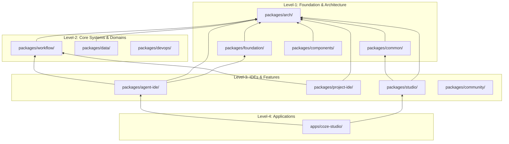

---

### Tier Definitions

| Tier           | Directory                            | Responsibility                                                                 |
| -------------- | ---------------------------------- | ------------------------------------------------------------------------------ |
| **Level-4**    | `apps/`                            | Application entry points; bootstrap, routing, global app state                 |
| **Level-3**    | `packages/agent-ide/`, `project-ide/`, `studio/`, `community/` | Large feature sets and UI frameworks such as IDE shells and community features  |
| **Level-2**    | `packages/workflow/`, `data/`, `devops/` | Domain engines and services: workflow canvas, knowledge management, devops tools |
| **Level-1**    | `packages/arch/`, `foundation/`, `common/`, `components/` | Core platform infrastructure and shared utilities, types, UI components         |

**Sources:**

- [.github/CODEOWNERS:1-150]()
- [README.md:27-27]()

---

## Core Systems Implementation

### Agent IDE System (Level-3)

The `agent-ide` package forms the foundational environment for building, configuring, and running AI agents.

- **Bot State Management:** `bot-editor-context-store` is a global Zustand store managing bot editor state, synchronizing UI components (editor panels, chat, config) [frontend/packages/agent-ide/bot-editor-context-store:1-120]().

- **Configuration Panels:** `bot-config-area`, `tool`, and `tool-config` components define agent model settings, plugin integration modules, and tool configurations [frontend/packages/agent-ide/bot-config-area:1-80](), [frontend/packages/agent-ide/tool:1-150]().

- **Chat and Debugging:** The `chat-debug-area` and `chat-background` modules provide isolated chat environments with debug capabilities, event logging, and message controls [frontend/packages/agent-ide/chat-debug-area:1-100]().

- **Audit and Compliance:** Packages `bot-audit-adapter` and `bot-audit-base` encapsulate validation logic, user auditing, and compliance checks on bot configurations [frontend/packages/agent-ide/bot-audit-adapter:1-60]().

### Workflow System (Level-2)

The visual workflow engine enables drag-and-drop design of conversational logic, nodes, and flows.

- **Canvas Rendering:** Built atop `fabric-canvas` package, enabling scalable vector graphics for editable workflow diagrams [frontend/packages/workflow/fabric-canvas:1-100]().

- **Node and Adapter Systems:** Different nodes like LLM nodes, Code nodes, and Tool nodes are modeled with `nodes` and integrated via `nodes-adapter` for standardized behavior [frontend/packages/workflow/nodes:1-90](), [frontend/packages/workflow/nodes-adapter:1-60]().

- **State and Variables:** Centralized flow variables are managed via the `variable` package, supporting reactive updates and persistence [frontend/packages/workflow/variable:1-75]().

- **Testing Infrastructure:** `test-run-next` provides execution tracing, replay, and visualization for workflow tests [frontend/packages/workflow/test-run-next:1-150]().

### Data & Knowledge System (Level-2)

Supports Retrieval-Augmented Generation and AI agent memory with long-term persistence.

- **Knowledge Management:** `knowledge-modal-base` and `knowledge-resource-processor-core` handle document ingestion, processing, and indexing into searchable knowledge bases [frontend/packages/data/knowledge/knowledge-modal-base:1-80]().

- **Memory Persistence:** Packages like `database` and `database-creator` offer local and server-synced storage for agent states and memories [frontend/packages/data/memory/database:1-120]().

---

## Foundational Packages (Level-1)

### Architecture Layer (`arch/`)

Core underpinning components providing abstractions and infrastructure services:

- **Communication:**  
  - `bot-api`: Strongly typed API interfaces wrapping HTTP calls  
  - `bot-http`: Actual HTTP client implementation integrating with backend REST/SSE endpoints [frontend/packages/arch/bot-api:1-40](), [frontend/packages/arch/bot-http:1-60]().

- **Environment Management:**  
  - `bot-env` and `bot-env-adapter`: Handle platform-specific environment variables, feature flags, and runtime configuration [frontend/packages/arch/bot-env:1-70](), [frontend/packages/arch/bot-env-adapter:1-50]().

- **Observability and Logging:**  
  - `logger`, `slardar-adapter`, `report-events` support telemetry, structured logs, and performance reporting [frontend/packages/arch/logger:1-40](), [frontend/packages/arch/slardar-adapter:1-30]().

- **State & Type Definitions:**  
  - `bot-store`: Primary shared global state management utilities  
  - `bot-typings`: Common interfaces and TypeScript type declarations consumed by other layers [frontend/packages/arch/bot-store:1-90](), [frontend/packages/arch/bot-typings:1-20]().

### Foundation, Common & Components Layers

- **Foundation:** `space-store` manages user workspace and project context switching; `local-storage` handles persistence to browsers or IndexedDB [frontend/packages/foundation/space-store:1-100](), [frontend/packages/foundation/local-storage:1-60]().

- **Common:**  
  Includes UI logic modules like `chat-area` which encapsulate chat interface behavior and hooks, `uploader` modules for file uploads, and several business component utilities [frontend/packages/common/chat-area:1-120](), [frontend/packages/common/uploader-adapter:1-70]().

- **Components:** Provides a shared UI component library with wrappers around Semi Design UI (`bot-semi`), custom icons (`bot-icons`), virtual list views (`virtual-list`), and utilities like `json-viewer` and `scroll-view` [frontend/packages/components/bot-semi:1-100](), [frontend/packages/components/json-viewer:1-50]().

---

## Team Ownership and DevOps

### Code Ownership Model

Ownership is formalized using the repository `.github/CODEOWNERS` configuration:

- **Infrastructure & Core:**  
  Owned primarily by `@Tecvan-fe`, `@leeight`, `@soonco` for core arch, config, and build infra such as `arch/bot-api`, `config/eslint-config` [ .github/CODEOWNERS:3-40 ]().

- **Feature Teams:**  
  Teams like `@evan-crash`, `@duwenhan2byte`, `@Hezi-crypto` manage agent-ide and studio packages [ .github/CODEOWNERS:6-8, 40-70 ]().

- **Workflow Team:**  
  Owners include `@zxhfighter` and `@xiamidaxia` for workflow system packages [ .github/CODEOWNERS:59-60 ]().

### DevOps and Tooling Assistance

The `.claude/agents/frontend-infrastructure-expert.md` agent supports:

- Bundler configuration and performance tuning (rspack, webpack)  
- Managing dependency graphs and monorepo configuration issues (rush.json)  
- ESLint and TypeScript options maintenance for strong typing and lint rules  
- Consistent, scalable frontend infrastructure maintenance [ .claude/agents/frontend-infrastructure-expert.md:8-30 ]().

---

## Data Flow and Implementation

### Bridge Diagram: Natural Language to Code Entities

This diagram maps user-level concepts (Natural Language Space) to concrete code elements (Code Entity Space) within the frontend packages.

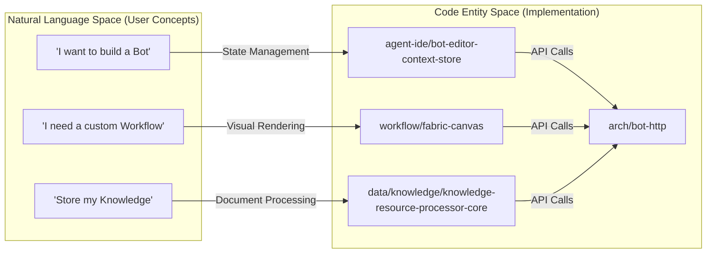

---

### Interaction Flow: Agent IDE to Backend API

This sequence shows the frontend data flow from a UI component updating bot configuration through typed APIs to backend response.

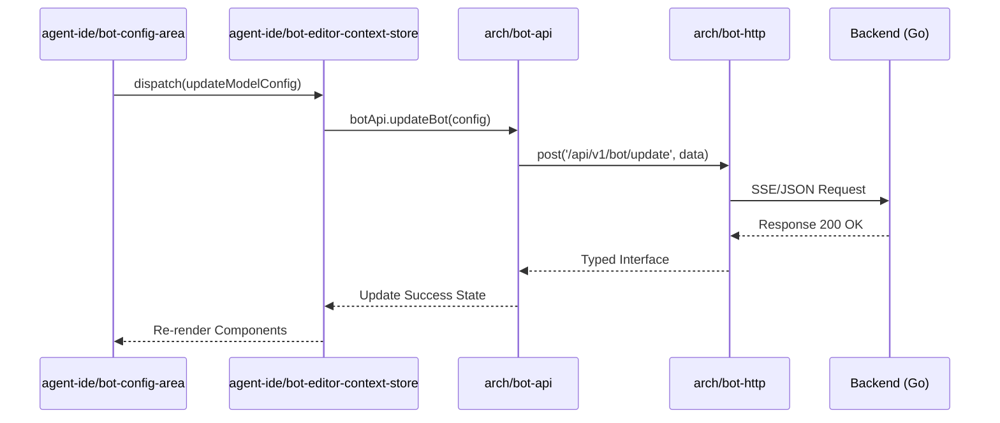

- The UI triggers store actions to update bot configuration.  
- The store calls the typed API wrapper in `arch/bot-api`.  
- The HTTP client in `arch/bot-http` sends requests to backend REST endpoints.  
- Backend processes and replies confirming success.  
- State updates propagate back to UI for reactive rendering.

---

# Summary

The Coze Studio frontend is architected as a strict, layered monorepo managed by Rush.js, with a four-tier dependency system ensuring clean separations. 

- **Level-4** apps contain entry points.  
- **Level-3** consists of feature-rich IDEs and community packages.  
- **Level-2** comprises domain engines like workflow and data management.  
- **Level-1** provides foundational core services, UI components, and shared utilities.

This layered architecture supports maintainability, scalability, and clear team ownership. Robust typed API clients and consistent state management patterns enable seamless frontend-backend integration.

---

**Sources:**

- [.github/CODEOWNERS:1-272]()
- [.claude/agents/frontend-infrastructure-expert.md:1-32]()
- [frontend/packages/agent-ide/bot-editor-context-store:1-120]()
- [frontend/packages/agent-ide/bot-config-area:1-80]()
- [frontend/packages/agent-ide/tool:1-150]()
- [frontend/packages/agent-ide/chat-debug-area:1-100]()
- [frontend/packages/agent-ide/bot-audit-adapter:1-60]()
- [frontend/packages/workflow/fabric-canvas:1-100]()
- [frontend/packages/workflow/nodes:1-90]()
- [frontend/packages/workflow/nodes-adapter:1-60]()
- [frontend/packages/workflow/variable:1-75]()
- [frontend/packages/workflow/test-run-next:1-150]()
- [frontend/packages/data/knowledge/knowledge-modal-base:1-80]()
- [frontend/packages/data/memory/database:1-120]()
- [frontend/packages/arch/bot-api:1-40]()
- [frontend/packages/arch/bot-http:1-60]()
- [frontend/packages/arch/bot-env:1-70]()
- [frontend/packages/arch/bot-env-adapter:1-50]()
- [frontend/packages/arch/logger:1-40]()
- [frontend/packages/arch/slardar-adapter:1-30]()
- [frontend/packages/arch/bot-store:1-90]()
- [frontend/packages/arch/bot-typings:1-20]()
- [frontend/packages/foundation/space-store:1-100]()
- [frontend/packages/foundation/local-storage:1-60]()
- [frontend/packages/common/chat-area:1-120]()
- [frontend/packages/common/uploader-adapter:1-70]()
- [frontend/packages/components/bot-semi:1-100]()
- [frontend/packages/components/json-viewer:1-50]()

---

# Page: Backend Architecture

# Backend Architecture

<details>
<summary>Relevant source files</summary>

The following files were used as context for generating this wiki page:

- [backend/.hz](backend/.hz)
- [backend/Dockerfile](backend/Dockerfile)
- [backend/README.md](backend/README.md)
- [backend/api/handler/coze/base.go](backend/api/handler/coze/base.go)
- [backend/api/model/base/base.go](backend/api/model/base/base.go)

</details>


This document describes the Go-based backend architecture of **Coze Studio**, structured around **Domain-Driven Design (DDD)** principles. It details the layered organization, key components, integration with the **Hertz** HTTP framework for efficient API handling, and the incorporation of the **Eino** AI orchestration framework. The backend supports scalable development of AI agents with modular separation of concerns.

## Overview

The Coze Studio backend is developed in **Go 1.24**, serving as the core platform for conversational AI agents, workflows, plugins, knowledge bases, and related services. It exposes HTTP API endpoints built on the **Hertz** framework, while business logic is implemented according to DDD patterns across clearly defined layers.

The main directory structure reflects the DDD boundaries:

| Directory       | Role                                                                      |
|-----------------|---------------------------------------------------------------------------|
| `api/`          | HTTP handlers, request/response models, router definitions.               |
| `application/`  | Use case orchestration, application logic bridging domain and infra.      |
| `domain/`       | Core business logic, entities, aggregates, domain services.               |
| `crossdomain/`  | Services that span multiple domains or cross-cutting concerns.            |
| `infra/`        | Infrastructure adapters: DB, caches, search, external APIs, file parsing. |
| `pkg/`          | General utilities, helpers, and reusable packages.                        |
| `types/`        | Shared type definitions used across layers.                              |

This structure enforces a separation of concerns, where each layer only depends on layers beneath it or specific interfaces, enabling maintainability and testability.

Sources: [backend/Dockerfile:2-17](), [backend/.hz:3-6](), [backend/api/handler/coze/base.go:17-34]()

## Layered Architecture & Data Flow

The backend request handling follows a layered path: from HTTP reception in the API layer, to use case orchestration in application, business rules in domain, and finally to infrastructure for persistence or external calls.

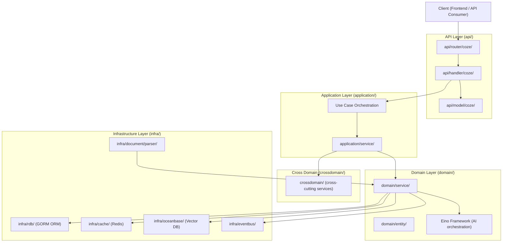

- **Client** sends HTTP requests.
- **Router** dispatches to HTTP handlers (`api/handler/coze`).
- Handlers parse requests into Thrift-generated models (`api/model/coze`).
- Handlers invoke Use Case orchestration in `application/service`.
- Domain services (`domain/service`) implement business logic with entities (`domain/entity`).
- AI business logic is orchestrated via the **Eino** framework integrated within the domain layer.
- Persistence, caching, vector search, event bus messaging, and document parsing are handled by infrastructure adapters.

Sources: [backend/.hz:4-6](), [backend/api/handler/coze/base.go:17-34](), [backend/api/model/coze/api.go:1-200]()

## API Layer

The `api/` directory contains all HTTP interface elements, built on the **Hertz** HTTP framework, which is designed for high performance and scalable API services.

### Router

- Defined under `api/router/coze/` (auto-generated by `hz`).
- The router maps incoming HTTP requests to specific handlers based on routes.

### Handlers

- Located in `api/handler/coze/`.
- Responsible for:
  - Input binding and validation (using Thrift-generated models).
  - Calling appropriate application layer services.
  - Formatting and sending back HTTP responses.
  - Centralized error handling through utilities in `httputil`.

### Models

- Implemented in `api/model/coze/`.
- Generated via Thrift from the IDL files defining all data contracts between client and server.
- Include request and response structures for multiple domain services such as intelligence, conversation, memory, plugin development, etc.

**Example:** `internalServerErrorResponse` and `invalidParamRequestResponse` functions provide standardized error response flows in handlers [backend/api/handler/coze/base.go:27-33]().

Sources: [backend/.hz:1-7](), [backend/api/handler/coze/base.go:17-34](), [backend/api/model/coze/api.go:1-200]()

## Application Layer

The `application/` layer contains use case orchestration logic. It acts as a bridge between the API handlers and the domain services:

- It translates the incoming requests to domain-specific commands or queries.
- Coordinates domain services and cross-domain interactions.
- Implements transactional integrity and business workflow control.
- Contains service classes per domain, e.g., `agent`, `conversation`, `workflow`, etc.

By centralizing use case logic here, the application layer keeps API handling simple and domain logic clean.

Sources: [backend/api/handler/coze/base.go:17-34](), inferred from layered structure

## Domain Layer

The heart of the system, the domain layer contains pure business logic:

- **Entities** and **Aggregates** define core business models.
- **Domain Services** implement business rules, AI orchestration, and domain workflows.
- Includes multiple domain packages such as `agent`, `conversation`, `knowledge`, `memory`, `plugin`, and `workflow`.
- **Eino AI Framework** is integrated here, enabling complex orchestration of LLMs, prompt chains, and tool usage for AI agents.

This layer depends only on domain concepts, promoting ubiquitous language and isolated unit testability.

Sources: [README.md:22-35](), [backend/api/model/coze/api.go:53-159](), implied domain package usage

## Cross-Domain Layer

The `crossdomain/` package holds services or logic that cut across multiple domains, such as:

- Shared business operations that span domains.
- Cross-cutting concerns such as logging, auditing, or domain synchronization logic.
- Integration points that combine domain services.

This facilitates separation of concerns and reuse when domain boundaries require collaboration.

Sources: inferred from structure and naming conventions

## Infrastructure Layer

The `infra/` layer provides concrete implementations of external system interactions and technical details:

- **Database Adapters**: An ORM layer using **GORM** for relational DB interactions [backend/Dockerfile:52]() in `infra/rdb/`.
- **Cache**: Redis adapter in `infra/cache/`.
- **Vector Stores**: Connectors to Milvus, OceanBase, VikingDB in `infra/oceanbase/` and related sub-packages.
- **Document Parsing**: Python- and Deno-based parsing scripts for PDF, DOCX, sandboxed execution in `infra/document/parser/` [backend/Dockerfile:33-43,50-52]() and [backend/Dockerfile:68-69]().
- **Eventbus**: Support for message queues (NSQ, RocketMQ, Kafka, Pulsar, NATS) in `infra/eventbus/`.
- **Embedding Providers**: Integration with Ark, OpenAI, Ollama, Gemini, HTTP embedding APIs.
- **Other adapters**: Id generation, image storage (VolcEngine), search (Elasticsearch), and storage (MinIO, S3-compatible).

This abstraction isolates domain logic from third-party details and allows easy swapping of infrastructure components.

Sources: [backend/Dockerfile:28-43](), [backend/Dockerfile:50-52](), [backend/Dockerfile:68-69]()

## Utilities

The `pkg/` directory hosts general-purpose utilities that are used across multiple parts of the backend:

- Common helper methods
- Logging utilities
- Configuration loaders
- Error wrappers and helpers

These support cross-layer infrastructure and improve code reuse.

## Types

Shared type definitions, constants, and enumerations that need to be consistent across layers are located in the `types/` directory.

---

## Hertz HTTP Framework Integration

The backend uses the **Hertz** HTTP framework for its API layer. Hertz provides:

- A fast HTTP server designed for high concurrency.
- Middleware support for logging, authentication, metrics, and error handling.
- Request routing and context management.

The `hz` tool automates handler, router, and model generation from templates or Thrift IDL, reducing boilerplate and improving consistency [backend/.hz:1-7]().

**Example Flow in Handler**

```go
func FooHandler(ctx context.Context, c *app.RequestContext) {
    var req model.FooRequest
    if err := c.BindAndValidate(&req); err != nil {
        invalidParamRequestResponse(c, "Invalid request parameters")
        return
    }
    result, err := application.FooUseCase(ctx, req)
    if err != nil {
        internalServerErrorResponse(ctx, c, err)
        return
    }
    c.JSON(http.StatusOK, result)
}
```

The handlers use Thrift-generated models for requests and responses, simplifying serialization and API consistency.

Sources: [backend/api/handler/coze/base.go:17-34](), [backend/.hz:1-7]()

---

## Eino AI Framework Integration

Within the domain layer, the backend leverages the **Eino** AI framework to orchestrate AI agents' behavior:

- Eino provides a framework to design and execute prompt graphs, tooling chains, and LLM interactions.
- Core domain services use Eino to implement agent execution, multi-agent coordination, and complex workflows.
- Supports RAG document pipelines, plugin invocation, and dynamic memory integration as part of AI orchestration.

By embedding Eino closely to domain logic, Coze Studio enables rich AI capabilities while adhering to clean architecture principles.

Sources: [README.md:25-35](), inferred from domain descriptions

---

## Backend Build and Deployment

The backend builds as a standalone Go binary (`opencoze`) in a multi-stage Dockerfile [backend/Dockerfile:1-76]():

- **Build Stage**:
  - Based on `golang:1.24-alpine`.
  - Installs build dependencies and compiles the Go application.
- **Final Stage**:
  - Runs on lightweight `alpine:3.22.0`.
  - Includes Python runtime with necessary libraries for document parsing.
  - Includes Deno runtime for sandboxed script execution.
  - Copies Python parser and sandbox scripts into `/app/`.
  - Establishes a virtual environment for Python module dependencies.
  - Exposes port `8888` for the API server.
  - Sets the default command to run the compiled Go binary.

This containerization enables consistent deployment across environments.

Sources: [backend/Dockerfile:2-17](), [backend/Dockerfile:21-76]()

---

## Summary Diagram Connecting Natural Language Layer to Code Entities

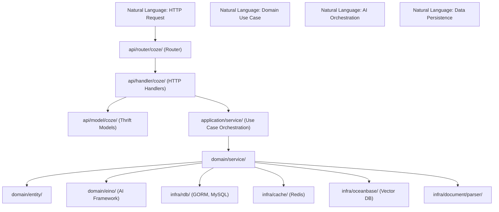

This diagram maps the real code entities to the conceptual natural language ideas of the backend system.

Sources: All above

---

## Conclusion

The Coze Studio backend features a robust Go-based architecture strictly following DDD principles. Its layered design segregates API, application logic, domain behavior, cross-cutting concerns, infrastructure adapters, and utilities. The use of **Hertz** enables high-performance HTTP serving, while **Eino** embeds advanced AI orchestration capabilities at the domain level. Containerization through a multi-stage Dockerfile ensures reproducible builds and deployment.

This modular architecture facilitates maintainable growth of conversational AI functionalities, supporting rich agent behaviors, plugin ecosystems, knowledge management, and complex workflows.

---

# References to Source Files

- [backend/.hz:1-7]()
- [backend/Dockerfile:2-76]()
- [backend/api/handler/coze/base.go:17-34]()
- [backend/api/model/coze/api.go:1-200]()
- [README.md:22-35]()

---

# Page: Infrastructure Stack

# Infrastructure Stack

<details>
<summary>Relevant source files</summary>

The following files were used as context for generating this wiki page:

- [.dockerignore](.dockerignore)
- [Makefile](Makefile)
- [backend/Dockerfile](backend/Dockerfile)

</details>


This document details the deployment infrastructure for Coze Studio, covering Docker containerization, Kubernetes orchestration via Helm charts, and the local development topology. The infrastructure stack enables the deployment and operation of the frontend application, backend services, and all required middleware including MySQL, Redis, Elasticsearch, MinIO, Milvus, etcd, message queues, and Nginx.

## Overview

The infrastructure stack provides a consistent environment from local development to production. It manages the lifecycle of the Go-based backend and the React-based frontend, along with a suite of infrastructure services that support data persistence, caching, full-text search, object storage, vector search, messaging, and ingress routing.

| Component                  | Location                   | Purpose                                        |
|----------------------------|----------------------------|------------------------------------------------|
| Docker Compose             | `/docker/docker-compose.yml` | Defines service topology for local/testing environment |
| Dockerfiles                | `/backend/Dockerfile`       | Multi-stage container image builds for backend application and Python environment |
| Helm Charts               | `/helm/charts/opencoze/`    | Kubernetes manifests for production deployment |
| Schema Management         | `/docker/atlas/`            | Database schema migration and version management via Atlas CLI |

### Infrastructure Service Topology

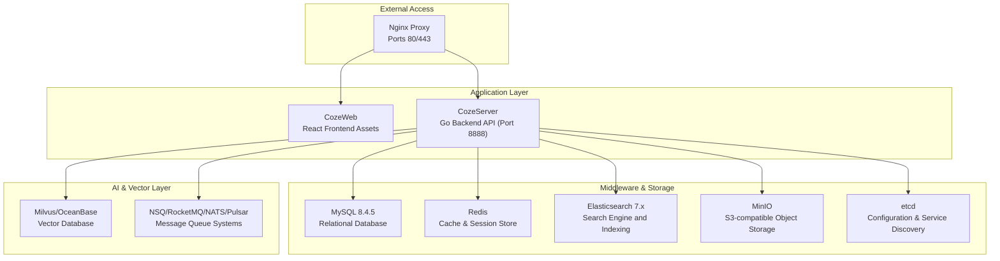

This topology illustrates how external clients access the system via an Nginx reverse proxy, which routes requests to either the frontend assets or backend API server. The backend interacts with multiple middleware components for persistence, caching, indexing, vector search, messaging, and configuration.

**Sources:** [Makefile:75-78](), [backend/Dockerfile:72-76](), [Makefile:119-121]()

## Docker Containerization

### Backend Multi-Stage Build

The backend service is packaged using a multi-stage Docker build to optimize image size and runtime dependencies:

1. **Build Stage:** Uses the `golang:1.24-alpine` image to compile the `opencoze` binary.

2. **Final Stage:** Uses `alpine:3.22.0` as a minimal base image. It installs runtime dependencies such as Python3 (with development headers), deno runtime, and utilities (`bind-tools`, `file`, `pax-utils`). 

3. **Python Environment:** Creates a Python virtual environment (`/app/.venv`) and installs critical Python packages like `pdfplumber` and `python-docx` for document parsing, `numpy` for numerical computations, and HTTP libraries (`httpx`, `h11`). These are used for document processing and sandboxed execution of code snippets.

4. **Files copied:** The compiled Go binary (`/app/opencoze`) and Python scripts such as `parse_pdf.py`, `parse_docx.py`, and `sandbox.py` are deployed into the image. Execution permissions are set to ensure these scripts can run.

5. **Final Entrypoint:** The container exposes port 8888 to serve the Go backend API.

This approach separates build dependencies from runtime and bundles a fully isolated Python environment seamlessly alongside the Go service for extensibility and document parsing features.

```dockerfile
# Key commands summarized from backend/Dockerfile
FROM golang:1.24-alpine AS builder
# ... build opencoze binary ...
FROM alpine:3.22.0
RUN apk add python3 python3-dev deno bind-tools file pax-utils
RUN python3 -m venv /app/.venv
RUN pip install pdfplumber python-docx numpy httpx h11
COPY --from=builder /app/opencoze /app/opencoze
COPY backend/infra/document/parser/impl/builtin/parse_pdf.py /app/parse_pdf.py
COPY backend/infra/document/parser/impl/builtin/parse_docx.py /app/parse_docx.py
COPY backend/infra/coderunner/impl/script/sandbox.py /app/sandbox.py
CMD ["/app/opencoze"]
```

### Docker Ignore Optimizations

The `.dockerignore` file filters unnecessary files from the Docker build context to improve build times and reduce image size. It excludes:

- All `node_modules` folders and their contents, avoiding hefty frontend dependencies.

- Build artifacts like `dist/`, `build/`, and Rush.js caches.

- Git metadata and configuration files including `.gitignore`, `.eslintrc*`, and `.prettierrc*`.

- Test files (`__tests__`, `.test.*`, `.spec.*`).

- Editor and IDE files like `.vscode/`, `.idea/`, and swap files.

This ensures that only essential source code and configuration files are sent to the Docker daemon during builds.

**Sources:** [backend/Dockerfile:1-77](), [.dockerignore:1-36]()

## Service Topology (Docker Compose)

Coze Studio uses Docker Compose to orchestrate multiple infrastructure services during local development and testing. The main service roles and images commonly deployed include:

| Service       | Image/Version           | Function                                               |
|---------------|------------------------|-------------------------------------------------------|
| `mysql`       | `mysql:8.4.5`          | Primary relational database, initialized with schema  |
| `redis`       | `redis:latest`         | In-memory cache and session store                      |
| `elasticsearch` | `elasticsearch:7.17.x`| Full-text search engine with language plugin `smartcn`|
| `minio`       | `minio/minio`           | S3 compatible object storage for file uploads         |
| `etcd`        | `quay.io/coreos/etcd`   | Cluster configuration and service coordination         |
| `milvus`      | `milvusdb/milvus`        | Vector similarity search and embedding database       |
| `nsq`         | `nsqio/nsq`              | Lightweight default message queue system               |
| `coze-server` | built from `/backend/`  | The main Go backend API server container               |
| `coze-web`    | Nginx + React frontend  | Serves built frontend assets with reverse proxy        |

Each service runs in its isolated container. Docker Compose profiles enable selective startup, e.g., starting only the middleware stack or the full web environment. Health checks and dependency ordering ensure reliable startup sequencing.

### Database Migration Using Atlas CLI

Database schema management is handled through [Atlas](https://atlasgo.io), which provides schema version control and migrations from HCL files to SQL and database updates.

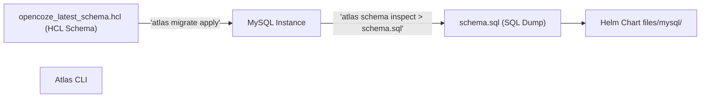

- The `dump_sql_schema` Makefile target exports the current MySQL schema to an SQL file.

- The SQL dump file is copied into the Helm chart directory for Kubernetes deployment.

- Makefile targets like `sync_db` and `sql_init` manage applying migrations and initializing the database.

This flow ensures synchronization between schema definitions, live databases, and packaged deployment manifests.

**Sources:** [Makefile:48-60](), [Makefile:95-103]()

## Kubernetes Deployment (Helm Chart)

Coze Studio supports Kubernetes-based production deployment via the `opencoze` Helm chart located at `/helm/charts/opencoze/`. This chart translates the Docker Compose container topology into Kubernetes objects with configuration and scalable deployment options.

### Key Helm Chart Characteristics

- **Deployments & StatefulSets:** Kubernetes `Deployment` resources manage the lifecycle of the stateless backend API (`coze-server`) and the nginx-based frontend assets (`coze-web`). Stateful services like `mysql` and `redis` use `StatefulSets` with persistent storage.

- **Init Containers:** Database initialization uses init containers to apply the Atlas migrations (`schema.sql`) before normal start.

- **ConfigMaps/Secrets:** Configuration environment variables are templated into container environments, supporting all infrastructure components including message queues, vector DB, etcd, and others.

- **Storage Classes:** Persistent volumes for MySQL, Redis, MinIO, and Milvus support configuration of different Kubernetes storage classes.

- **Ingress & Services:** Supports configuring Kubernetes `Service` types (ClusterIP, LoadBalancer) and ingress rules for external access.

### Infrastructure Service Alternatives

The Helm chart and deployment are designed with pluggable backends and messaging layers:

- **Vector Databases:** Supports either Milvus or OceanBase for vector similarity storage. OceanBase integration uses the OceanBase Operator and alternative docker-compose files (`docker-compose-oceanbase.yml`).

- **Message Queues:** Can toggle between NSQ, RocketMQ, NATS, or Pulsar message buses via `eventbus` backend adapters, configured in Helm values.

This modular design allows flexible adoption according to deployment environments and scale.

**Sources:** [Makefile:12-13](), [Makefile:102-103](), [Makefile:119-121]()

## Local Development Workflow

The `Makefile` abstracts infrastructure setup commands for developers, encapsulating service startup, Python environment setup, and database schema sync:

| Command        | Action                                                           |
|----------------|------------------------------------------------------------------|
| `make middleware` | Starts all infrastructure middleware containers using Docker Compose profiles. Starts MySQL, Redis, Elasticsearch, MinIO, etc [Makefile:61-63]() |
| `make python`  | Initializes local Python virtual environment with needed libs for document parsing [Makefile:91-93]()  |
| `make web`     | Starts the full stack including the frontend Nginx container [Makefile:75-77]() |
| `make sync_db` | Applies Atlas HCL migrations to local MySQL database container [Makefile:48-50]() |
| `make dump_db` | Dumps current database schema back to HCL and SQL migration files [Makefile:52-55]() |
| `make setup_es_index` | Executes Elasticsearch index setup scripts, essential for knowledge base search features [Makefile:109-112]() |
| `make oceanbase_debug` | Starts development stack with OceanBase vector and relational database variant [Makefile:117-121]() |

This workflow provides quick provisioning for development and debugging without requiring cluster access.

**Sources:** [Makefile:1-158]()

---

This page has covered the detailed infrastructure components, containerization practices, service topology, Helm-based production deployment, and local development workflows, forming the foundation for all Coze Studio platform deployments. The modular architecture and container-friendly design enable flexible scaling and easy extensibility with alternative infrastructure products.

# Callouts

- Search for `docker-compose.yml` in `/docker` for the exact service definitions.
- Consult `backend/Dockerfile` for build details and integrated runtime environment.
- Review `/helm/charts/opencoze/values.yaml` to customize Kubernetes deployment parameters.
- Use the `Makefile` targets for local environment management and migrations.

---

**Sources:**

- [Makefile:1-158]()
- [backend/Dockerfile:1-77]()
- [.dockerignore:1-36]()

---

# Page: Interface Definition Layer

# Interface Definition Layer

<details>
<summary>Relevant source files</summary>

The following files were used as context for generating this wiki page:

- [.gitattributes](.gitattributes)
- [.github/workflows/idl.yaml](.github/workflows/idl.yaml)
- [backend/api/model/coze/api.go](backend/api/model/coze/api.go)

</details>


## Purpose and Scope

The Interface Definition Layer (IDL) serves as the contract definition layer between frontend and backend services in the Coze Studio monorepo. This layer uses Apache Thrift to define service interfaces, data structures, and API contracts, enabling type-safe communication across the TypeScript frontend and Go backend.

This document covers the IDL architecture, Thrift file organization, code generation processes for both frontend and backend, validation workflows, and the communication flow between services.

## IDL Architecture Overview

The IDL layer acts as a single source of truth for API contracts, generating code artifacts for both frontend and backend from shared Thrift definitions.

**Diagram: IDL-Driven Architecture**

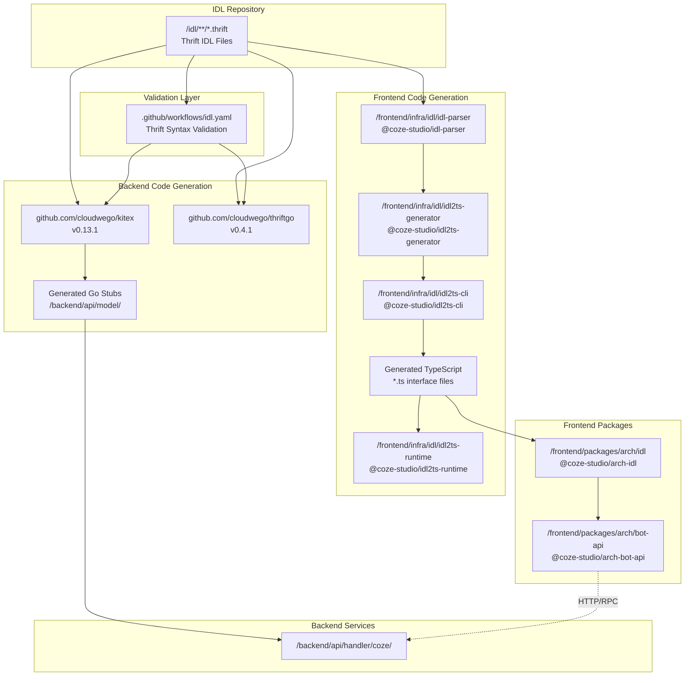

**Sources:** [.github/workflows/idl.yaml:1-71](), [backend/api/model/coze/api.go:1-25]()

## Thrift IDL File Structure

All Thrift interface definitions reside in the `/idl/` directory at the repository root. These files define service interfaces, request/response structures, enumerations, and data types using Apache Thrift Interface Definition Language syntax.

The structure typically includes:

- **api.thrift**: The main entry point that references other service and data definition thrift files representing the overall Coze API.

- **base.thrift**: Contains common base types, error codes, and primitives shared across domain-specific files.

- **Domain-specific files**: Such as `agent.thrift`, `workflow.thrift`, `knowledge.thrift`, `conversation.thrift`, etc. These correspond to bounded contexts or modules in the backend business logic.

This clear separation makes maintenance manageable and aligns IDL files with the domain-driven design (DDD) approach used in backend services.

**Sources:** [.github/workflows/idl.yaml:6-8](), [.github/workflows/idl.yaml:50-56]()

## Backend Code Generation with Kitex

The backend leverages CloudWeGo's Kitex framework and `thriftgo` to generate Go RPC service stubs and model structures. The generated code is placed under `backend/api/model/`.

### Code Generation Process

Kitex is invoked on each Thrift file in the `/idl/` directory, generating Go source code for:

- Service interfaces for RPC servers and clients.
- Data type structs corresponding to Thrift structs, enums, and typedefs.
- Serialization and deserialization methods.

Generated code provides strongly typed APIs that backend handlers use for implementing business logic.

**Diagram: Backend Kitex Code Generation Flow**

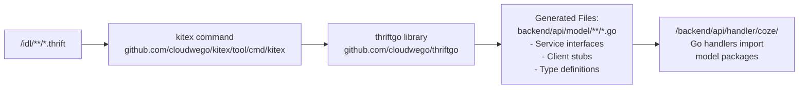

### Kitex Command Details

An example Kitex command from the validation workflow:

```bash
kitex -streamx -thrift ignore_initialisms=false -module=dummy "$thrift_file"
```

- `-streamx`: Enables streaming RPC support.
- `-thrift ignore_initialisms=false`: Keeps original capitalizations in identifiers (e.g., `UserID` not `UserId`).
- `-module`: Module path used in import statements in generated Go code.
- `"$thrift_file"`: The Thrift source file processed.

### Generated Go Structures and Services

The generated `backend/api/model/coze/api.go` file aggregates domain services with client constructors, for example:

- `IntelligenceService` interface and `NewIntelligenceServiceClientFactory()` constructor.
- `ConversationService`, `MessageService`, `AgentRunService`, `MemoryService`, `PluginDevelopService`, and others.

Each service client wraps the corresponding generated client allowing backend code to invoke RPC calls easily.

**Sources:** [.github/workflows/idl.yaml:30-34](), [.github/workflows/idl.yaml:52](), [backend/api/model/coze/api.go:1-103]()

## Frontend Code Generation with idl2ts

The frontend uses a custom TypeScript code generation pipeline (`idl2ts`) to convert Thrift IDL types into TypeScript interfaces and type definitions. This maintains type safety and synchronized API contracts between frontend and backend layers.

### idl2ts Toolchain Packages

| Package | Location | Purpose |
|---------|----------|---------|
| `idl-parser` | `/frontend/infra/idl/idl-parser/` | Parses Thrift IDL files into an abstract syntax tree (AST). |
| `idl2ts-generator` | `/frontend/infra/idl/idl2ts-generator/` | Transforms the AST into TypeScript code strings. |
| `idl2ts-cli` | `/frontend/infra/idl/idl2ts-cli/` | CLI tool to drive the parsing and generation process. |
| `idl2ts-runtime` | `/frontend/infra/idl/idl2ts-runtime/` | Provides runtime helper functions and type guards for generated types. |

### Generated TypeScript Artifacts

The output is a collection of `.ts` files containing:

- `interface <StructName>` for Thrift structs with all typed fields.
- `enum <EnumName>` for enumeration types.
- Type aliases for typedefs.
- Utility type guard functions named `is<Type>(value: unknown): value is Type` for runtime type checking.

These interfaces and types are packaged in the frontend into the `@coze-studio/arch-idl` package and consumed by the `@coze-studio/arch-bot-api` package to define API function signatures and data shapes.

This approach ensures that the frontend accurately reflects any backend API schema changes directly from the shared Thrift sources.

**Sources:** [.github/workflows/idl.yaml:1-71]()

## IDL Validation Pipeline

To maintain correctness and consistency, the repository enforces automated validation of all Thrift files on code pushes and pull requests targeting the `main` branch.

### Validation Workflow Overview

- Triggered on `push` and `pull_request` events with path filters on `idl/**`.
- Uses GitHub Actions with a dedicated `validate-thrift` job.
- Sets up Go environment (1.21 version).
- Installs necessary tools:
  - `thriftgo` for IDL parsing.
  - `kitex` for code generation.
  - `thrift-gen-validator` for additional validation.
- Runs a shell script that:
  - Creates a temporary working directory.
  - Initializes a dummy Go module.
  - Iterates over all `.thrift` files under `/idl/`.
  - Invokes the `kitex` command on each file.
  - Captures errors; fails the workflow on any error.
  - Cleans up working directory after validation.

**Diagram: IDL Validation Workflow**

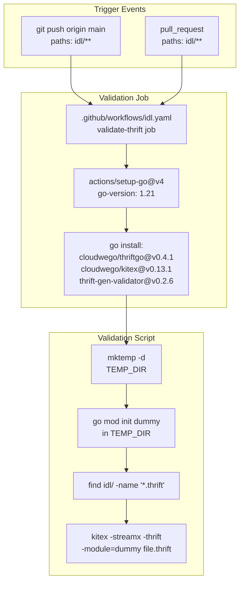

This process guarantees that no invalid Thrift files are merged, aligning IDL correctness with continuous integration best practices.

**Sources:** [.github/workflows/idl.yaml:1-71]()

## IDL Version Management

The IDL layer uses clearly pinned versions of code generation and validation tools for reproducibility and stability:

| Tool                  | Version | Go Module                                    | Purpose                    |
|-----------------------|---------|----------------------------------------------|----------------------------|
| `thriftgo`             | v0.4.1  | `github.com/cloudwego/thriftgo`               | Thrift parsing and AST      |
| `kitex`                | v0.13.1 | `github.com/cloudwego/kitex/tool/cmd/kitex`  | RPC code generation         |
| `thrift-gen-validator` | v0.2.6  | `github.com/cloudwego/thrift-gen-validator`  | Additional syntax validation|

These pinned versions are installed explicitly in the CI workflow, ensuring consistent generation across all environments.

**Sources:** [.github/workflows/idl.yaml:30-34]()

---

# Summary

The Interface Definition Layer centralizes API contract definition using the Apache Thrift IDL language and a robust toolchain:

- `/idl/` directory holds structured Thrift files dividing base, API, and domain-specific definitions.
- Backend Go code generation uses Kitex and thriftgo to produce RPC service code and structs.
- Frontend TypeScript generation uses the custom idl2ts toolchain to provide type-safe interfaces synchronized with backend definitions.
- Continuous validation enforces correctness through a CI workflow that iterates all `.thrift` files and verifies code generation completes without errors.
- All generated code artifacts are integrated into frontend and backend packages to ensure seamless request, response, and data model consistency.

This architecture supports maintainable, strongly typed RPC-based communication that bridges frontend development and backend service implementation with a single source of truth.

**Sources:**  
- [.github/workflows/idl.yaml:1-71]()  
- [backend/api/model/coze/api.go:1-103]()

---

# Page: Plugin and Extension System

# Plugin and Extension System

<details>
<summary>Relevant source files</summary>

The following files were used as context for generating this wiki page:

- [.github/CODEOWNERS](.github/CODEOWNERS)
- [backend/api/handler/coze/open_apiauth_service.go](backend/api/handler/coze/open_apiauth_service.go)
- [backend/api/handler/coze/plugin_develop_service.go](backend/api/handler/coze/plugin_develop_service.go)

</details>


This document provides a detailed technical overview of the plugin architecture within Coze Studio, specifically covering the integration in the agent-ide and studio frontend packages, the backend plugin domain, the adapter patterns employed, OAuth-based secure plugin configuration, and the plugin store mechanics.

---

## Architecture Overview

Coze Studio’s plugin and extension system is designed for modularity, security, and extensibility. It supports third-party integrations, workflow automation, and AI-powered tool invocation through a layered architecture split between frontend and backend:

- The **frontend** (agent-ide and studio packages) manages plugin UI, user interactions, and plugin lifecycle.
- The **backend** (plugin domain and application layers) manages registration, secure credential storage (with AES encryption for OAuth tokens), business logic, and API routing.

### System-Level Plugin Architecture

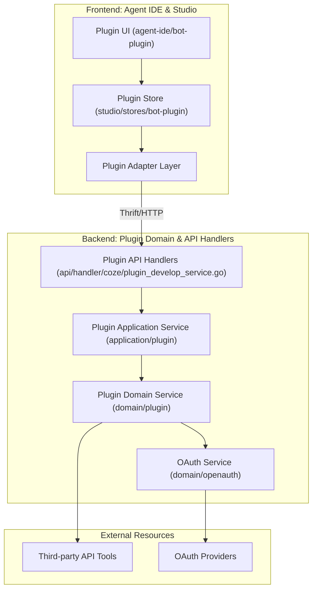

**Explanation:**

- Frontend components such as plugin UI components and plugin state stores interact with backend API handlers over HTTP/thrift.
- The backend application service coordinates plugin logic, such as metadata management and API proxying.
- The domain service encapsulates core business logic, including integration with OAuth token management.
- OAuth tokens are managed securely through the OAuth domain and consumed to authenticate third-party API calls.

Sources: [backend/api/handler/coze/plugin_develop_service.go:21-32](), [backend/api/handler/coze/plugin_develop_service.go:34-132]()

---

## Backend Plugin Domain

The backend contains the core plugin management domain which handles plugin metadata, API definitions, OAuth authentication, and plugin lifecycle operations.

### Key Components

| Component                  | Description                                                       | Location                                  |
|----------------------------|-----------------------------------------------------------------|-------------------------------------------|
| Plugin API Handlers        | HTTP handlers exposing plugin APIs for frontend interaction.    | `backend/api/handler/coze/plugin_develop_service.go`  |
| Plugin Application Service | Business logic orchestrator coordinating plugin-related workflows.| `backend/application/plugin/`            |
| Plugin Domain Service      | Core domain logic, including plugin metadata, APIs, and OAuth.  | `backend/domain/plugin/`                  |
| OAuth Domain Service       | Manages OAuth credentials, token encryption, and authorization. | `backend/domain/openauth/`                |

Sources: [backend/api/handler/coze/plugin_develop_service.go:34-132](), [backend/api/handler/coze/plugin_develop_service.go:221-242]()

### Plugin Metadata Registration

Plugins are registered with metadata including:

- Name
- Description
- Icon URL
- Authentication type (OAuth, API Key, etc.)
- Space and optional project scope
- Plugin type (usually `PLUGIN` or `WORKFLOW`)

The `RegisterPluginMeta` API validates these fields for correctness before persisting. Key validations include:

- Icon and URL length and presence checks
- Valid authentication type enumeration
- Correct plugin type (currently supports only standard plugins here)

The registration request is handled by `RegisterPluginMeta` method in `plugin_develop_service.go` which delegates to `PluginApplicationSVC.RegisterPluginMeta` [backend/api/handler/coze/plugin_develop_service.go:81-132]()

### Plugin API and Information Retrieval

- Frontend retrieves plugin API lists and metadata via APIs such as `GetPluginAPIs` and `GetPluginInfo`.
- API update notifications and OAuth status checks are available through dedicated API endpoints for frontend to manage plugin lifecycle states and OAuth authorization verification.

Sources: [backend/api/handler/coze/plugin_develop_service.go:134-242]()

---

## Authentication and Security

### OAuth Token Management

Plugins that require OAuth-based authentication store credentials securely using AES encryption.

- **AES Key Configuration**: The AES key is configured in the environment (`PLUGIN_OAUTH_AES_KEY`) and used to encrypt/decrypt OAuth tokens transparently.
- **Token Storage**: Encrypted tokens are stored in the backend database, preventing plaintext exposure.
- **OAuth Status API**: The `GetOAuthStatus` API allows frontend to check whether OAuth tokens are valid or present without leaking credential material.

### Plugin Edit Locking

To coordinate plugin editing in multi-user environments, the system provides locking semantics to prevent concurrent conflicting edits:

- The `CheckAndLockPluginEdit` API verifies if a plugin is locked and attempts to acquire a lock.
- This mechanism ensures data integrity during plugin configuration phases.

These APIs promote secure, consistent plugin management workflows.

Sources: [backend/api/handler/coze/plugin_develop_service.go:219-263]()

---

## Frontend Plugin System

The frontend organizes plugin-related functionalities into modular packages aligned with the agent-ide and studio ecosystems.

### Core Packages and Roles

| Package                               | Description                                                | Ownership / Maintainers                      |
|-------------------------------------|------------------------------------------------------------|---------------------------------------------|
| `agent-ide/bot-plugin/`              | Plugin core integration components used in agent-ide IDE. | @Hezi-crypto, @duwenhan2byte                |
| `studio/stores/bot-plugin/`          | Plugin state management and store for Studio environment.  | @Hezi-crypto, @catee                         |
| `agent-ide/tool-config/`             | Plugin tool configuration UI components and logic.         | @haozhenfei, @catee                         |
| `agent-ide/debug-tool-list/`         | Debug UI and runtime tool list for plugin testing/debugging.| @Hezi-crypto, @evan-crash                    |

Sources: [.github/CODEOWNERS:7-8](), [.github/CODEOWNERS:42](), [.github/CODEOWNERS:91]()

### Adapter Pattern Implementation

The frontend plugin system employs a robust adapter pattern to abstract plugin types (plugins, workflows, tools) and runtime environments.

```mermaid
classDiagram
    class PluginStore {
        +getPluginInfo(id)
        +updatePlugin(data)
        +loadPlugins()
        +activatePlugin(pluginId)
    }
    class PluginAdapter {
        <<interface>>
        +renderConfigUI()
        +validateParams()
        +executePlugin()
    }
    class ToolConfigAdapter {
        +renderConfigUI()
        +validateParams()
    }
    class WorkflowPluginAdapter {
        +renderConfigUI()
        +validateParams()
    }

    PluginStore ..> PluginAdapter : uses
    PluginAdapter <|-- ToolConfigAdapter
    PluginAdapter <|-- WorkflowPluginAdapter
```

- **PluginStore** acts as centralized state management for plugin metadata and runtime status.
- Different adapters implement the plugin interface to render UI and handle config/validation for specific plugin types.
- This separation allows extension and modification without altering the core plugin store or front UI code.

Sources: [.github/CODEOWNERS:42]()

---

## Plugin Store and Discovery API Flow

### Discovery Workflow

1. The frontend issues a request to `GetPlaygroundPluginList` API endpoint with filters like space ID, plugin type (workflow or standard plugin), pagination, etc.
2. On the backend, if the request targets workflow plugins only, it delegates to the workflow service; otherwise, it uses the plugin domain’s application service.
3. The service returns a filtered list of plugin metadata and status.
4. The frontend updates its plugin store to reflect available plugins for the current context.

```mermaid
sequenceDiagram
    participant FE as Frontend Plugin Store/UI
    participant API as Plugin API Handler (coze/plugin_develop_service.go)
    participant SVC as PluginApplicationSVC
    participant WF as Workflow Plugin Service

    FE->>API: GetPlaygroundPluginList(Request)
    alt PluginType == WORKFLOW
        API->>WF: GetPlaygroundPluginList(Request)
        WF-->>API: Plugin List Response
    else
        API->>SVC: GetPlaygroundPluginList(Request)
        SVC-->>API: Plugin List Response
    end
    API-->>FE: Plugin List Response
```

Sources: [backend/api/handler/coze/plugin_develop_service.go:34-77]()

---

## Development and Debugging Tools

### Debug Tools in agent-ide

- The `debug-tool-list` package provides runtime inspection and manual interaction interfaces for plugins.
- Developers can observe API calls output/input, trigger calls manually, and monitor plugin state transitions.
- This eases plugin development and integration testing.

### Mock External Integrations

- Mock sets for plugin APIs enable offline testing scenarios.
- The mockset management backend allows creation of representative API response datasets enabling plugin behavior validation without live service calls.

Sources: [.github/CODEOWNERS:91]()

---

# Summary

Coze Studio’s plugin and extension system is a comprehensive infrastructure designed for secure, modular, and flexible integration of external tools and workflows. It achieves this through:

- A clear separation between frontend plugin UI and backend plugin business logic.
- Use of adapter patterns to abstract plugin interactions.
- Secure OAuth token encryption and management.
- A well-defined plugin store architecture supporting discovery and activation.
- Developer tooling for effective plugin lifecycle management.

This design facilitates extensibility and secure collaborative development around conversational AI agents within the Coze ecosystem.

---

Sources:  
- [backend/api/handler/coze/plugin_develop_service.go:21-263]()  
- [backend/api/handler/coze/open_apiauth_service.go:19-170]()  
- [.github/CODEOWNERS:7-8,42,91]()

---

# Page: CI/CD System

# CI/CD System

<details>
<summary>Relevant source files</summary>

The following files were used as context for generating this wiki page:

- [.github/workflows/ci.yml](.github/workflows/ci.yml)
- [.github/workflows/ci@backend.yml](.github/workflows/ci@backend.yml)
- [.github/workflows/ci@main.yml](.github/workflows/ci@main.yml)
- [.github/workflows/common-pr-checks.yml](.github/workflows/common-pr-checks.yml)

</details>


## Purpose and Scope

The CI/CD System automates code validation, testing, and quality enforcement for the Coze Studio monorepo through GitHub Actions workflows. It ensures that all pull requests undergo multiple parallel validation checks before merging, and performs comprehensive validation on main branch pushes.

This page provides a high-level overview of the core CI/CD workflows located in `.github/workflows/`. For detailed implementation and technical specifics of each validation pipeline, please refer to the respective child pages:

- **Frontend CI Workflows (3.1)** — Incremental Rush.js builds, tests, lint, type checking using file change detection.
- **Backend CI Workflows (3.2)** — Go unit tests with race condition detection, benchmarking, and MySQL integration.
- **Pull Request Validation (3.3)** — Enforcing semantic PR titles and commit messages.
- **License and Compliance (3.4)** — Apache-2.0 license header enforcement and dependency license auditing.
- **IDL Validation (3.5)** — Thrift IDL syntax checks via Kitex tooling.
- **AI Assistant Integration (3.6)** — Claude AI assisted code review triggered by `@claude` mentions.

## Workflow Architecture

### Primary Workflows Summary

Coze Studio’s CI/CD leverages multiple specialized GitHub Actions workflows to optimize efficiency by separating concerns based on language stack, technology, and validation type.

| Workflow Name       | File                                 | Trigger                    | Path Filters                      | Purpose                        |
|---------------------|------------------------------------|----------------------------|----------------------------------|--------------------------------|
| `CI`                | `.github/workflows/ci.yml`          | Pull request on main       | `frontend/**`, `idl/**`, `common/**`, `rush.json` | Incremental frontend CI covering changed files |
| `CI@main`            | `.github/workflows/ci@main.yml`     | Push to main branch        | `frontend/**`, `idl/**`, `common/**`, `rush.json` | Full frontend build & test on main |
| `Backend Tests`      | `.github/workflows/ci@backend.yml`  | Pull requests & pushes     | `backend/**`, `docker/atlas/**`  | Full backend test suite with MySQL |
| `PR Common Checks`   | `.github/workflows/common-pr-checks.yml` | Pull request events        | General repo paths                | PR title format and commit lint |

**Runtime Environment Versions:**

- Node.js: 22.16.0  
- Go: 1.24  
- GitHub Runner: ubuntu-latest  

These are configured via workflow matrices and environment variables in the workflows [[.github/workflows/ci.yml:23-26]()] [[.github/workflows/ci@backend.yml:21-26]()] [[.github/workflows/ci@main.yml:24-26]()].

### Overall Workflow Interaction Diagram

```mermaid
graph TB
    subgraph "Event Triggers"
        PR["pull_request event"]
        PUSH["push to main"]
    end

    subgraph "Frontend Incremental CI (ci.yml)"
        SETUP["setup job<br/>Fetch changed files<br/>Create changed-files-cache.json"]
        BUILD["build job<br/>rush increment build"]
        TEST["test job<br/>rush increment test:cov"]
        LINT["lint job<br/>rush increment lint"]
        TSCHECK["ts-check job<br/>rush increment ts-check"]
        PKGAUDIT["package-audit job<br/>rush increment package-audit"]
    end

    subgraph "Backend CI (ci@backend.yml)"
        MYSQL["MySQL 8.4.5 service container"]
        GO_TEST["backend-unit-test job<br/>go test -race with coverage"]
        BENCH["benchmark-test job<br/>go test -bench"]
    end

    subgraph "PR Validation & Quality"
        PR_CHECKS["PR Common Checks<br/>semantic PR title, commitlint"]
        IDL_VALIDATION["IDL Validation<br/>Kitex Thrift syntax checks"]
        LICENSE_COMPLIANCE["License Checks<br/>Apache-2.0 headers"]
        AI_ASSISTANT["AI Assistant Integration<br/>Claude code review"]
    end

    PR --> SETUP
    PR --> MYSQL
    PR --> PR_CHECKS
    PR --> IDL_VALIDATION
    PR --> LICENSE_COMPLIANCE
    PR --> AI_ASSISTANT

    SETUP --> BUILD
    SETUP --> TEST
    SETUP --> LINT
    SETUP --> TSCHECK
    SETUP --> PKGAUDIT
    
    MYSQL --> GO_TEST
    GO_TEST --> BENCH
    
    PUSH --> CI_MAIN["CI@main Full Build and Test"]
```

This orchestration illustrates how jobs fan out from the initial trigger events and the setup job artifact (changed files cache) is shared among the incremental frontend jobs. The backend pipeline runs alongside using its own MySQL infrastructure. PR quality checks are also run in parallel to catch style and title issues early [[.github/workflows/ci.yml:18-128]()] [[.github/workflows/ci@backend.yml:24-126]()] [[.github/workflows/common-pr-checks.yml:16-46]()].

## Change Detection and Incremental Strategy

### Setup Job Details

The `setup` job in `ci.yml` identifies all files changed in the PR relative to the base branch. It filters out autogenerated changelog files under `common/changes/` to avoid unnecessary validations [[.github/workflows/ci.yml:41-67]()]. The filtered list is serialized as a JSON array in `changed-files-cache.json` and uploaded as an artifact for downstream jobs [[.github/workflows/ci.yml:60-64]()].

**Filtering Logic Sample:**

```bash
for file in $all_files; do
  if [[ ! "$file" =~ ^common/changes/.* ]]; then
    # include in filtered list
  fi
done
```

This allows subsequent incremental Rush jobs (`rush increment`) to operate only on affected projects based on changed files passed with the `-p` flag [[.github/workflows/ci.yml:123-127]()].

### Incremental Jobs

After the setup job completes, the following jobs run in parallel:

- **build**: Runs `rush increment build` to compile changed packages.
- **test**: Runs `rush increment test:cov` for incremental tests with coverage.
- **lint**: Runs `rush increment lint` for code style checks.
- **ts-check**: Runs type checking on changed projects.
- **package-audit**: Checks package dependencies and advisories.

Each job downloads the cached `changed-files-cache.json` artifact, restoring the minimal working set [[.github/workflows/ci.yml:113-116]()].

## Backend CI Strategy

The backend pipeline validates the Go backend services with a full integration style test approach.

### MySQL Service Setup

The `backend-unit-test` job spins up a MySQL 8.4.5 container and loads the defined database schema from `docker/volumes/mysql/schema.sql` [[.github/workflows/ci@backend.yml:46-78]()]. It waits actively for MySQL port readiness before initializing.

### Go Test Execution

Tests are run across all Go modules in the repository using a dynamically generated `go.work` workspace. The race detector (`-race`) is enabled along with coverage profiling [[.github/workflows/ci@backend.yml:80-88]()].

```bash
go test -race -v -coverprofile=coverage.out -gcflags="all=-l -N" ...
```

Coverage is uploaded to Codecov with appropriate environment tags [[.github/workflows/ci@backend.yml:90-97]()].

### Benchmark Tests

A separate job runs benchmarks with memory allocations profiled using `go test -bench=. -benchmem` to monitor performance regressions [[.github/workflows/ci@backend.yml:103-125]()].

## Pull Request Validation

### PR Title and Commit Message Checks

The `PR Common Checks` workflow validates each PR's title against semantic versioning conventions using `commitlint` integrated as a Rush autoinstaller [[.github/workflows/common-pr-checks.yml:37-45]()].

If a PR title contains "WIP" or "wip", validation is skipped to allow work-in-progress branches [[.github/workflows/common-pr-checks.yml:38]()].

This ensures consistency in commit history and supports automated release note generation.

## License and Compliance

License headers for Apache-2.0 are enforced across source files using the `license-eye` tool configured via `.licenserc.yaml` (details in child page 3.4). Dependencies are also audited for license compliance, with safe ignores for generated code such as Kitex and GORM-generated files.

## IDL Validation

Thrift IDL files are validated syntactically using Kitex's `thrift-gen-validator` tool in a dedicated `idl.yaml` workflow. The validation runs iteratively over all files in the `idl/` directory within an isolated dummy Go module environment. This guarantees backward-compatible IDL changes before code generation.

## AI Assistant Integration

The repository integrates Anthropic's Claude AI chatbot for automated code review and developer assistance via @claude mentions in issue comments or pull request review comments.

The `claude.yml` workflow triggers on comment and review events, leveraging the `anthropics/claude-code-action@beta` GitHub Action. It operates under scoped permissions and is configured with a specialized frontend-infrastructure-expert agent persona (detailed in child page 3.6).

---

# References to Child Pages

For detailed technical documentation and configuration examples of each subsystem in the CI/CD pipeline, please see:

- [Frontend CI Workflows](#3.1)
- [Backend CI Workflows](#3.2)
- [Pull Request Validation](#3.3)
- [License and Compliance](#3.4)
- [IDL Validation](#3.5)
- [AI Assistant Integration](#3.6)

---

## Sources

- [.github/workflows/ci.yml:1-128]()  
- [.github/workflows/ci@backend.yml:1-126]()  
- [.github/workflows/ci@main.yml:1-77]()  
- [.github/workflows/common-pr-checks.yml:1-49]()

---

# Page: Frontend CI Workflows

# Frontend CI Workflows

<details>
<summary>Relevant source files</summary>

The following files were used as context for generating this wiki page:

- [.claude/agents/frontend-infrastructure-expert.md](.claude/agents/frontend-infrastructure-expert.md)
- [.github/workflows/ci.yml](.github/workflows/ci.yml)
- [.github/workflows/ci@main.yml](.github/workflows/ci@main.yml)

</details>


## Purpose and Scope

This document details the frontend continuous integration (CI) pipeline that validates all frontend changes before they are merged into the `main` branch. The pipeline utilizes a **Rush.js-based incremental build system** to optimize performance by processing only changed projects for build, test, lint, and type-checking tasks. This system manages a monorepo containing over 170 packages, ensuring high velocity without sacrificing code quality.

For backend CI workflows, see [Backend CI Workflows](3.2). For general pull request validation including commit message conventions and file size checks, see [Pull Request Validation](3.3).

## Workflow Architecture

The frontend CI system consists of two primary GitHub Actions workflows: one for pull requests with incremental validation (`ci.yml`) and one for the main branch with full validation (`ci@main.yml`).

### Pull Request CI Pipeline (Incremental)

The `ci.yml` workflow is designed for speed. It uses a `setup` job to identify changed files and then spawns parallel jobs to validate only the affected packages.

```mermaid
graph TB
    PR["pull_request event<br/>branches: main"]
    
    setup["setup job<br/>.github/workflows/ci.yml:19-85"]
    
    subgraph "Parallel Validation Jobs (needs: setup)"
        build["build job<br/>rush increment --action build"]
        test["test job<br/>rush increment --action test:cov"]
        lint["lint job<br/>rush increment --action lint"]
        tscheck["ts-check job<br/>rush increment --action ts-check"]
        audit["package-audit job<br/>rush increment --action package-audit"]
    end
    
    artifact["changed-files-cache.json<br/>(Artifact)"]
    
    PR --> setup
    setup --> artifact
    artifact --> build
    artifact --> test
    artifact --> lint
    artifact --> tscheck
    artifact --> audit
    
    cache["actions/cache@v4<br/>pnpm subspace caching"]
    cache -.-> build
    cache -.-> test
```

**Diagram: Pull Request CI Pipeline Architecture**
The workflow orchestrates parallel execution of specialized validation tasks, all consuming a centralized cache of changed files.

Sources: [.github/workflows/ci.yml:1-300]()

### Main Branch CI Pipeline (Full)

The `ci@main.yml` workflow runs on every push to the `main` branch. It performs a non-incremental, full validation of the entire monorepo to ensure total system integrity.

```mermaid
graph TB
    push["push event<br/>branch: main"]
    
    build_job["build job<br/>.github/workflows/ci@main.yml:20-77"]
    
    install["rush install"]
    full_build["rush build --verbose"]
    full_test["rush test:cov --verbose"]
    full_lint["rush lint --verbose"]
    
    push --> build_job
    build_job --> install
    install --> full_build
    full_build --> full_test
    full_test --> full_lint
```

**Diagram: Main Branch CI Pipeline Architecture**
This workflow serves as the final source of truth, executing comprehensive checks across all packages regardless of change status.

Sources: [.github/workflows/ci@main.yml:1-77]()

## The Setup Job and Incremental Logic

The `setup` job in `ci.yml` is the core of the incremental system. It determines exactly what needs to be tested to save CI minutes.

### Changed Files Detection
The job uses `tj-actions/changed-files@v45` [[.github/workflows/ci.yml:38-39]()] to identify modified files. It specifically filters out changes in `common/changes/` (Rush's versioning files) to avoid triggering builds for documentation or version bumps [[.github/workflows/ci.yml:47-57]()].

### `changed-files-cache.json`
The filtered list of files is serialized into a JSON array and saved as `changed-files-cache.json` [[.github/workflows/ci.yml:59-60]()]. This file is uploaded as a GitHub Actions artifact [[.github/workflows/ci.yml:79-84]()] so that downstream parallel jobs can download it and pass it to Rush.

### Data Flow: Setup to Parallel Jobs
The `setup` job exports critical metadata via `$GITHUB_OUTPUT` [[.github/workflows/ci.yml:62-63]()]:
- `cache_file`: The filename of the JSON cache.
- `matrix_node_version`: The Node version (22.16.0) [[.github/workflows/ci.yml:23]()].
- `matrix_os`: The runner OS (ubuntu-latest).

Sources: [.github/workflows/ci.yml:19-85]()

## Parallel Job Execution

Each validation job (`build`, `test`, `lint`, `ts-check`, `package-audit`) follows a standardized execution pattern:

1.  **Environment Setup**: Check out code and set up Node.js [[.github/workflows/ci.yml:93-100]()].
2.  **Subspace Caching**: Restore pnpm stores and local caches [[.github/workflows/ci.yml:101-111]()].
3.  **Artifact Retrieval**: Download the `changed-files-cache` artifact generated by the setup job [[.github/workflows/ci.yml:113-116]()].
4.  **Dependency Installation**:
    - Install core tagged projects: `rush install --to tag:core` [[.github/workflows/ci.yml:122]()].
    - Update autoinstallers for plugins [[.github/workflows/ci.yml:123]()].
    - **Incremental Install**: Run `rush increment --action install -p changed-files-cache.json` [[.github/workflows/ci.yml:124]()].
5.  **Incremental Action**: Execute the specific task (e.g., `build`, `test:cov`) only on the projects affected by the changed files [[.github/workflows/ci.yml:127]()].

### Validation Job Details

| Job | Command Action | Purpose |
| :--- | :--- | :--- |
| **Build** | `build` | Compiles TypeScript and bundles assets using Rsbuild/Rspack. |
| **Test** | `test:cov` | Executes Vitest suites and generates coverage reports. |
| **Lint** | `lint` | Runs ESLint and Stylelint to enforce code standards. |
| **TS Check** | `ts-check` | Runs `tsc --noEmit` for static type verification. |
| **Audit** | `package-audit` | Scans dependencies for security vulnerabilities. |

Sources: [.github/workflows/ci.yml:86-300]()

## Subspace and Dependency Caching

The CI system leverages **pnpm subspaces** for granular dependency management. Caching is configured to key off the lockfiles within these subspaces:

```yaml
- name: Cache
  uses: actions/cache@v4
  with:
    path: |
      common/temp/pnpm-local
      common/temp/pnpm-store
      common/temp/install-run
    key: ${{ runner.os }}-rush-store-${{ hashFiles('common/config/subspaces/**/pnpm-lock.yaml') }}
```

This ensures that if a dependency changes in one subspace, other subspaces can still benefit from cached layers.

Sources: [.github/workflows/ci.yml:101-111]()

## Workflow Triggers and Permissions

### Trigger Paths
Both workflows trigger on changes to the following paths [[.github/workflows/ci.yml:5-10]()] [[.github/workflows/ci@main.yml:7-12]()]:
- `github/**`: CI configuration changes.
- `idl/**`: Changes to Thrift interface definitions.
- `frontend/**`: Any frontend package changes.
- `common/**`: Shared configurations and scripts.
- `rush.json`: Monorepo structure changes.

### Security Model
Workflows operate with restricted permissions:
- `contents: read`: Allows checking out code [[.github/workflows/ci.yml:15]()].
- `actions: read`: Allows accessing workflow metadata and artifacts [[.github/workflows/ci.yml:16]()].

Sources: [.github/workflows/ci.yml:1-17](), [.github/workflows/ci@main.yml:1-18]()

## Implementation Entity Map

The following diagram maps the logical CI steps to the specific scripts and files used in the implementation.

```mermaid
graph LR
    subgraph "CI Scripts & Entities"
        RushScript["common/scripts/install-run-rush.js"]
        IncrementCmd["rush increment"]
        SetupJob["setup (ci.yml)"]
        CacheJSON["changed-files-cache.json"]
    end

    subgraph "Execution Flow"
        Step1["tj-actions/changed-files"]
        Step2["Process & Filter Files"]
        Step3["Upload Artifact"]
        Step4["Rush Action Execution"]
    end

    SetupJob --> Step1
    Step1 --> Step2
    Step2 --> CacheJSON
    CacheJSON --> Step3
    Step3 --> Step4
    RushScript --> IncrementCmd
    IncrementCmd --> Step4
```

**Diagram: Implementation Entity Map**
Associating GitHub Action jobs with the underlying Rush.js scripts and generated artifacts.

Sources: [.github/workflows/ci.yml:19-127](), [.github/workflows/ci@main.yml:56-66]()

---

# Page: Backend CI Workflows

# Backend CI Workflows

<details>
<summary>Relevant source files</summary>

The following files were used as context for generating this wiki page:

- [.github/workflows/ci@backend.yml](.github/workflows/ci@backend.yml)
- [backend/.gitignore](backend/.gitignore)

</details>


This document describes the backend CI workflows for Coze Studio's Go codebase. The workflows execute automated unit tests with race detection, benchmark tests, and code coverage reporting through GitHub Actions.

For frontend CI workflows, see [Frontend CI Workflows]() (3.1). For general CI/CD system overview, see [CI/CD System]() (3).

## Workflow Overview

The backend CI pipeline is defined in [.github/workflows/ci@backend.yml:1-126]() and executes on pull requests and pushes to the main branch. The workflow consists of two parallel jobs: `backend-unit-test` for unit tests with race detection and coverage reporting, and `benchmark-test` for performance benchmarks.

### CI Workflow Architecture

The following diagram maps the GitHub Actions workflow steps to the specific tools and files involved in the backend validation process.

"Backend CI Workflow Mapping"
```mermaid
graph TB
    subgraph "Trigger Space"
        PR["Pull Request"]
        Push["Push to main"]
        Paths["Paths: backend/**, docker/atlas/**"]
    end

    subgraph "Code Entity Space: backend-unit-test"
        SetupGo["setup-go@v5 (Go 1.24)"]
        MySQL["mysql-action (MySQL 8.4.5)"]
        Schema["docker/volumes/mysql/schema.sql"]
        GoWork["go.work (Dynamic Generation)"]
        GoTest["go test -race -cover"]
        Codecov["codecov-action@v5"]
    end

    subgraph "Code Entity Space: benchmark-test"
        BenchGo["setup-go@v5"]
        RunBench["go test -bench=. -benchmem"]
    end

    PR --> Paths
    Push --> Paths
    Paths --> SetupGo
    Paths --> BenchGo
    
    SetupGo --> MySQL
    MySQL --> Schema
    Schema --> GoWork
    GoWork --> GoTest
    GoTest --> Codecov
    
    BenchGo --> RunBench
```

**Sources:**
- [.github/workflows/ci@backend.yml:1-126]()

## MySQL Database Setup

The backend tests require a MySQL database for integration testing. The workflow uses the `mysql-action` to provision MySQL 8.4.5 with specific configuration.

### Database Configuration

| Parameter | Value |
|-----------|-------|
| MySQL Version | 8.4.5 |
| Host Port | 3306 |
| Container Port | 3306 |
| Character Set | utf8mb4 |
| Collation | utf8mb4_general_ci |
| Database Name | opencoze |
| Root Password | root |

The workflow includes a verification step that polls port 3306 for up to 60 seconds to ensure MySQL is ready before proceeding with database initialization [[.github/workflows/ci@backend.yml:56-68]()].

### Database Initialization

Database schema initialization uses a retry mechanism with the `nick-fields/retry` action to handle transient connection issues:

- **Timeout:** 10 minutes
- **Max Attempts:** 20
- **Schema File:** `docker/volumes/mysql/schema.sql`
- **Command:** `mysql -h 127.0.0.1 -P 3306 -u root -proot opencoze < docker/volumes/mysql/schema.sql`

This approach ensures reliable database setup even in environments with slower startup times [[.github/workflows/ci@backend.yml:72-77]()].

**Sources:**
- [.github/workflows/ci@backend.yml:45-77]()

## Unit Test Execution

The unit test execution implements a multi-module Go workspace strategy to test all backend modules together with comprehensive coverage reporting.

### Multi-Module Test Strategy

The test execution script dynamically discovers all Go modules in the repository and constructs a unified test command [[.github/workflows/ci@backend.yml:79-88]()]:

1. **Module Discovery:** Finds all directories containing `go.mod` files via `find . -name "go.mod"`.
2. **Workspace Initialization:** Creates a `go.work` file if it doesn't exist using `go work init`.
3. **Module Registration:** Adds each module to the workspace with `go work use $module`.
4. **Workspace Synchronization:** Runs `go work sync` to resolve dependencies across the monorepo.
5. **Unified Test Execution:** Runs tests across all modules with combined coverage.

"Dynamic Go Workspace Generation"
```mermaid
graph LR
    subgraph "Filesystem"
        M1["backend/go.mod"]
        M2["backend/pkg/go.mod"]
        M3["backend/infra/go.mod"]
    end

    subgraph "CI Logic: ci@backend.yml"
        Find["find . -name go.mod"]
        WorkInit["go work init"]
        WorkUse["go work use"]
        Sync["go work sync"]
        Exec["go test -race"]
    end

    M1 & M2 & M3 --> Find
    Find --> WorkInit
    WorkInit --> WorkUse
    WorkUse --> Sync
    Sync --> Exec
```

### Test Configuration Flags

The `go test` command uses several important flags for comprehensive testing [[.github/workflows/ci@backend.yml:88]()]:

| Flag | Purpose |
|------|---------|
| `-race` | Enables Go's race detector to identify concurrent data access issues. |
| `-v` | Verbose output for debugging test failures. |
| `-coverprofile=coverage.out` | Writes coverage data to `COVERAGE_FILE` environment variable. |
| `-gcflags="all=-l -N"` | Disables compiler optimizations (`-N`) and inlining (`-l`) for accurate coverage and debugging. |
| `-coverpkg=$coverpkg` | Comma-separated list of all module packages for coverage calculation across module boundaries. |

**Sources:**
- [.github/workflows/ci@backend.yml:79-88]()

## Coverage Reporting

Test coverage results are automatically uploaded to Codecov using the `codecov-action` with specific configuration for the backend codebase.

### Codecov Configuration

| Parameter | Value |
|-----------|-------|
| Name | coze-studio-backend |
| Coverage File | coverage.out |
| Environment Variables | GOLANG, Coze-Studio, BACKEND |
| Fail on Error | false |
| Token | `secrets.CODECOV_TOKEN` |

The `fail_ci_if_error` is set to `false` to prevent Codecov upload failures from blocking the CI pipeline, as coverage reporting is considered non-critical for merge decisions [[.github/workflows/ci@backend.yml:90-97]()].

**Sources:**
- [.github/workflows/ci@backend.yml:90-97]()

## Benchmark Testing

The `benchmark-test` job runs performance benchmarks in parallel with unit tests to detect performance regressions. This job does not require MySQL setup [[.github/workflows/ci@backend.yml:103-126]()].

### Benchmark Execution

The benchmark test follows the same multi-module discovery pattern as unit tests but uses different `go test` flags optimized for performance measurement:

| Flag | Purpose |
|------|---------|
| `-bench=.` | Runs all benchmark functions matching the pattern. |
| `-benchmem` | Reports memory allocation statistics for each benchmark. |
| `-run=none` | Skips regular test functions, executing only benchmarks. |
| `-race` | Enables race detection during benchmark execution to ensure performance isn't achieved at the cost of safety. |
| `-gcflags="all=-l -N"` | Maintains consistent environment by disabling optimizations. |

This configuration provides comprehensive performance metrics including execution time, memory allocations, and concurrent safety validation through race detection [[.github/workflows/ci@backend.yml:116-125]()].

**Sources:**
- [.github/workflows/ci@backend.yml:103-126]()

## Workflow Triggers

The backend testing workflow is triggered under three conditions:

### Path-Based Triggers

The workflow only executes when changes are detected in specific paths to optimize CI resources [[.github/workflows/ci@backend.yml:3-15]()]:

- `backend/**` - Any changes to backend code.
- `docker/atlas/**` - Database migration changes.
- `.github/workflows/ci@backend.yml` - Workflow definition changes.

### Event-Based Triggers

| Event | Branches | Behavior |
|-------|----------|----------|
| `pull_request` | Any | Runs on PRs with path matches. |
| `push` | `main` | Runs on direct pushes to main. |
| `workflow_dispatch` | Any | Manual trigger from Actions tab. |

**Sources:**
- [.github/workflows/ci@backend.yml:3-17]()

## Job Permissions and Environment

Both test jobs require specific GitHub Actions permissions to function correctly [[.github/workflows/ci@backend.yml:27-30, 106-108]()]:

```yaml
permissions:
  contents: write
  pull-requests: write
  repository-projects: write
```

### Environment Variables

The workflow defines environment variables at multiple scopes:

- **Global**: `DEFAULT_GO_VERSION: "1.24"` [[.github/workflows/ci@backend.yml:21]()].
- **Unit Test Job**: `COVERAGE_FILE: coverage.out` and `BREAKDOWN_FILE: main.breakdown` [[.github/workflows/ci@backend.yml:31-33]()].

**Sources:**
- [.github/workflows/ci@backend.yml:21-33]()
- [.github/workflows/ci@backend.yml:106-108]()

---

# Page: Pull Request Validation

# Pull Request Validation

<details>
<summary>Relevant source files</summary>

The following files were used as context for generating this wiki page:

- [.github/PULL_REQUEST_TEMPLATE.md](.github/PULL_REQUEST_TEMPLATE.md)
- [.github/scripts/check-file-size.sh](.github/scripts/check-file-size.sh)
- [.github/workflows/common-pr-checks.yml](.github/workflows/common-pr-checks.yml)
- [.github/workflows/semantic-pull-request.yaml](.github/workflows/semantic-pull-request.yaml)

</details>


This document describes the automated validation system that enforces quality standards on all pull requests within the Coze Studio monorepo. The validation system runs multiple independent checks to ensure PRs meet semantic, structural, and size requirements before they can be merged.

For information about license and dependency compliance checks, see [License and Compliance](#3.4). For IDL-specific validation, see [IDL Validation](#3.5). For the broader CI/CD context, see [CI/CD System](#3).

## Validation Pipeline Overview

The PR validation system consists of three primary validation workflows that execute automatically when a PR is opened, edited, or synchronized. These checks ensure that the repository's commit history remains clean and that the repository does not accidentally ingest excessively large files.

Title validation is handled by two distinct mechanisms: `semantic-pull-request.yaml` for high-level structure and `common-pr-checks.yml` (using `rush-commitlint`) for granular rule enforcement.

### Validation Flow Architecture

```mermaid
graph TB
    subgraph "PR_Events [github/pull_request]"
        Open["PR opened"]
        Edit["PR edited"]
        Sync["PR synchronize"]
        Reopen["PR reopened"]
    end
    
    subgraph "Semantic_Pull_Request [semantic-pull-request.yaml]"
        SemanticCheck["action-semantic-pull-request@v5.5.2"]
        TypeValidation["Validate type<br/>(build, ci, docs, feat, fix, etc)"]
        ScopeValidation["Validate scope<br/>(idl, frontend, backend, etc)"]
        PatternMatch["Match pattern:<br/>type(scope): description"]
    end
    
    subgraph "Common_PR_Checks [common-pr-checks.yml]"
        CommonChecks["PR Common Checks job"]
        RushInstall["node common/scripts/install-run-rush.js install"]
        RushCommitlint["rush update-autoinstaller<br/>--name rush-commitlint"]
        CommitlintRun["npx commitlint --config<br/>commitlint.config.js"]
        WIPCheck["Skip if title contains 'WIP'"]
    end
    
    subgraph "File_Size_Validation [check-file-size.sh]"
        FileSizeScript["check-file-size.sh"]
        GetChangedFiles["git diff --name-only<br/>origin/$TARGET_BRANCH"]
        ExcludePatterns["Apply EXCLUDE_PATTERNS"]
        CheckSize["Check each file <= 512KB"]
        OutputResult["Output to check-file-size.log"]
    end
    
    Open --> SemanticCheck
    Edit --> SemanticCheck
    Sync --> SemanticCheck
    Reopen --> SemanticCheck
    
    Open --> CommonChecks
    Edit --> CommonChecks
    Sync --> CommonChecks
    Reopen --> CommonChecks
    
    SemanticCheck --> TypeValidation
    SemanticCheck --> ScopeValidation
    TypeValidation --> PatternMatch
    ScopeValidation --> PatternMatch
    
    CommonChecks --> WIPCheck
    WIPCheck -->|"Not WIP"| RushInstall
    RushInstall --> RushCommitlint
    RushCommitlint --> CommitlintRun
    
    CommonChecks --> FileSizeScript
    FileSizeScript --> GetChangedFiles
    GetChangedFiles --> ExcludePatterns
    ExcludePatterns --> CheckSize
    CheckSize --> OutputResult
```

Sources: [.github/workflows/semantic-pull-request.yaml:1-75](), [.github/workflows/common-pr-checks.yml:1-49](), [.github/scripts/check-file-size.sh:1-108]()

## Semantic PR Title Validation

The `semantic-pull-request.yaml` workflow enforces a strict semantic format for all PR titles using the `amannn/action-semantic-pull-request@v5.5.2` GitHub Action. This ensures that the title is suitable for automated release note generation.

### Required Title Format

All PR titles must match the pattern defined in the PR template:

```
<type>(<scope>): <description>
```

Where:
- `<type>` is one of the allowed commit types.
- `<scope>` is an optional scope identifier.
- `<description>` is a user-oriented description.

### Allowed Types and Scopes

The workflow defines a specific set of allowed types and scopes to categorize changes across the monorepo:

| Category | Allowed Values |
|----------|----------------|
| **Types** | `build`, `ci`, `docs`, `feat`, `fix`, `perf`, `refactor`, `style`, `test`, `chore` |
| **Scopes** | `idl`, `frontend`, `backend`, `infra`, `app`, `singleagent`, `memory`, `search`, `workflow`, `prompt`, `knowledge`, `plugin`, `middleware`, `model`, `database`, `foundation`, `comment`, `ci` |

The `headerPatternCorrespondence` is configured to map these parts to `type`, `scope`, and `subject` respectively [.github/workflows/semantic-pull-request.yaml:74-74]().

Sources: [.github/workflows/semantic-pull-request.yaml:27-74](), [.github/PULL_REQUEST_TEMPLATE.md:24-24]()

## Commit Message Linting via Rush

The `common-pr-checks.yml` workflow performs deeper validation of the PR title by executing `commitlint` through a Rush autoinstaller.

### WIP Bypass Mechanism

A bypass mechanism is implemented to allow developers to push "Work In Progress" PRs without triggering title validation failures. If the PR title contains `WIP` or `wip`, the title format check is skipped [.github/workflows/common-pr-checks.yml:38-38]().

### Implementation Details

The workflow utilizes the `rush-commitlint` autoinstaller to manage linting dependencies:

1.  **Environment Setup**: Uses `node-version: 22.16.0` [.github/workflows/common-pr-checks.yml:31-31]().
2.  **Rush Installation**: Executes `node common/scripts/install-run-rush.js install` [.github/workflows/common-pr-checks.yml:34-34]().
3.  **Autoinstaller Update**: Ensures the `rush-commitlint` toolset is ready via `rush update-autoinstaller --name rush-commitlint` [.github/workflows/common-pr-checks.yml:42-42]().
4.  **Linting**: Pipes the `PR_TITLE` environment variable into `npx commitlint` using the configuration found in `common/autoinstallers/rush-commitlint/commitlint.config.js` [.github/workflows/common-pr-checks.yml:44-44]().

Sources: [.github/workflows/common-pr-checks.yml:31-45]()

## File Size Validation

The `check-file-size.sh` script enforces a strict **512KB** size limit on individual files to prevent large assets or binary files from bloating the repository history [.github/scripts/check-file-size.sh:57-57]().

### Exclusion Patterns

The script maintains an `EXCLUDE_PATTERNS` list to ignore files that are naturally large or auto-generated [.github/scripts/check-file-size.sh:24-44]():
- `pnpm-lock.yaml`
- Auto-generated API and service code (e.g., `packages/arch/bot-api/src/auto-generate/**`)
- Test snapshots (`.snap`) and libraries (`**/lib/**`)
- i18n resources (`studio-i18n-resource/src/**`)

### Operating Modes

| Mode | Trigger | Command Used |
|------|---------|--------------|
| **CI Mode** | `CI=true` | `git diff --name-only --diff-filter=AM "origin/$TARGET_BRANCH..."` [.github/scripts/check-file-size.sh:51-51]() |
| **Local Mode**| Manual/Hook | `git diff --name-only --diff-filter=AM --cached` [.github/scripts/check-file-size.sh:53-53]() |

If a file exceeds the `size_limit` (512KB), the script logs the file path and size. In CI mode, it outputs a JSON conclusion for the GitHub Check Run via `output_conclusion` [.github/scripts/check-file-size.sh:75-80](); in local mode, it exits with code 1 to block the commit [.github/scripts/check-file-size.sh:94-94]().

### Code-to-System Mapping: File Size Check

```mermaid
graph LR
    subgraph "Logic [check-file-size.sh]"
        EP["EXCLUDE_PATTERNS"]
        SL["size_limit = 512"]
        OC["output_conclusion()"]
    end
    
    subgraph "System Entities"
        GD["git diff --name-only"]
        WC["wc -c"]
        GH["GitHub Check Run API"]
    end

    EP --> GD
    GD --> WC
    WC --> SL
    SL --> OC
    OC --> GH
```

Sources: [.github/scripts/check-file-size.sh:24-44](), [.github/scripts/check-file-size.sh:50-57](), [.github/scripts/check-file-size.sh:81-95]()

## PR Template Requirements

The `PULL_REQUEST_TEMPLATE.md` acts as the first line of defense, guiding contributors to provide necessary metadata.

### Mandatory Fields
- **PR Type**: Contributors must select the type of change (e.g., `feat`, `fix`) [.github/PULL_REQUEST_TEMPLATE.md:1-16]().
- **Title Format**: A checkbox confirms the title matches `<type>(optional scope): <description>` [.github/PULL_REQUEST_TEMPLATE.md:24-24]().
- **User-Oriented**: The description must be clear for release notes [.github/PULL_REQUEST_TEMPLATE.md:25-25]().

### Optional Metadata
- **Chinese Translation**: Translation of the PR title [.github/PULL_REQUEST_TEMPLATE.md:29-29]().
- **Detailed Description**: Bilingual (EN/ZH) fields for in-depth context [.github/PULL_REQUEST_TEMPLATE.md:32-38]().
- **Issue Linking**: Using the `Fixes #<issue_number>` syntax to automate issue closure [.github/PULL_REQUEST_TEMPLATE.md:40-44]().

Sources: [.github/PULL_REQUEST_TEMPLATE.md:1-45]()

---

# Page: License and Compliance

# License and Compliance

<details>
<summary>Relevant source files</summary>

The following files were used as context for generating this wiki page:

- [.github/.licenserc.yaml](.github/.licenserc.yaml)
- [.github/workflows/license-check.yaml](.github/workflows/license-check.yaml)
- [LICENSE-APACHE](LICENSE-APACHE)

</details>


## Purpose and Scope

This document explains the automated license header enforcement and dependency license validation system used in Coze Studio's CI/CD pipeline. The system ensures all source files contain proper Apache 2.0 license headers and validates that project dependencies use compatible licenses. The implementation uses Apache SkyWalking's `license-eye` tool, configured via [.github/.licenserc.yaml:1-30]() and enforced through the GitHub Actions workflow [.github/workflows/license-check.yaml:1-39]().

For general CI/CD workflow information, see page 3. For PR validation checks, see page 3.3. For backend CI workflows, see page 3.2.

---

## License Model

Coze Studio is licensed under the Apache License 2.0, as specified in [LICENSE-APACHE:1-178](). The project uses the SPDX identifier `Apache-2.0` and copyright owner `coze-dev` in all file headers [.github/.licenserc.yaml:2-4]().

### License Requirements

| Aspect | Requirement |
|--------|-------------|
| **License Type** | Apache License 2.0 |
| **SPDX Identifier** | `Apache-2.0` |
| **Copyright Owner** | `coze-dev` |
| **Header Format** | SPDX-compliant comment header |
| **Validation Tool** | `license-eye` v0.4.0 |

**Sources:** [.github/.licenserc.yaml:2-4](), [LICENSE-APACHE:1-178]()

---

## License Header Enforcement

### Covered File Types

The license header check applies to primary source file types across the monorepo:

1. **Go Files**: All `*.go` files in the backend and common directories [.github/.licenserc.yaml:7]().
2. **Frontend TypeScript/TSX Files**: All `*.ts` and `*.tsx` files located under `frontend/apps/` and `frontend/packages/` [.github/.licenserc.yaml:8-9]().

### Excluded Paths and Generated Code

To avoid false positives, the system excludes generated code, mock files, and non-source assets. Specifically, code generated by Kitex (RPC), GORM (ORM), and various mock generators are ignored [.github/.licenserc.yaml:21-28]().

| Exclusion Pattern | Reason |
|-------------------|--------|
| `dist`, `licenses` | Build artifacts and third-party license files [.github/.licenserc.yaml:11-12]() |
| `**/*.md` | Documentation files [.github/.licenserc.yaml:13]() |
| `**/testdata/**` | Test fixture data [.github/.licenserc.yaml:14]() |
| `**/go.mod`, `**/go.sum` | Go dependency manifests [.github/.licenserc.yaml:15-16]() |
| `**/assets/assets.gen.go` | Generated asset files [.github/.licenserc.yaml:20]() |
| `**/gorm_gen/**` | Generated GORM database code [.github/.licenserc.yaml:21]() |
| `**/kitex_gen/**` | Generated Kitex RPC code [.github/.licenserc.yaml:22]() |
| `**/*.gen.go`, `**/gen.go` | General generated Go files [.github/.licenserc.yaml:23-24]() |
| `backend/api/**` | Generated API layer code [.github/.licenserc.yaml:25]() |
| `**/*_mock.go`, `**/mock/**` | Mock implementations for testing [.github/.licenserc.yaml:26-28]() |

**Sources:** [.github/.licenserc.yaml:10-28]()

---

## License Check Workflow

The license validation system runs as part of the CI pipeline through GitHub Actions, executing two distinct validation phases: header checking and dependency auditing.

### Workflow Execution Flow

The following diagram illustrates how the `license-check` job interacts with the repository configuration and the `license-eye` tool.

**Diagram: License Check Workflow Integration**
```mermaid
graph TB
    subgraph "Triggers"
        Push["push: branches=['main']"]
        PR["pull_request"]
        Manual["workflow_dispatch"]
    end
    
    subgraph "Setup"
        Runner["runs-on: ubuntu-latest"]
        GoSetup["actions/setup-go@v5<br/>go-version: 1.23"]
        Install["go install license-eye@v0.4.0"]
        Checkout["actions/checkout@v4"]
    end
    
    subgraph "Validation Logic"
        HeaderCheck["license-eye header check<br/>-c .github/.licenserc.yaml"]
        DepCheck["license-eye dependency check<br/>-c .github/.licenserc.yaml"]
    end
    
    subgraph "Code Entities"
        Config[".github/.licenserc.yaml"]
        GoMod["backend/go.mod"]
        SourceFiles["**/*.{go,ts,tsx}"]
    end
    
    Push --> Runner
    PR --> Runner
    Manual --> Runner
    
    Runner --> GoSetup
    GoSetup --> Install
    Install --> Checkout
    
    Checkout --> HeaderCheck
    HeaderCheck --> Config
    HeaderCheck --> SourceFiles
    
    HeaderCheck --> DepCheck
    DepCheck --> Config
    DepCheck --> GoMod
```

**Sources:** [.github/workflows/license-check.yaml:1-39](), [.github/.licenserc.yaml:1-30]()

---

## License Header Check Implementation

### Workflow Configuration

The `license-check` job executes on push events to the `main` branch, pull requests, and manual triggers [.github/workflows/license-check.yaml:3-9](). It uses Go 1.23 to install the required tooling [.github/workflows/license-check.yaml:18-21]().

### Tool Installation and Execution

The workflow installs `license-eye` version 0.4.0 [.github/workflows/license-check.yaml:23-25](). The header check command validates all source files against the rules defined in the configuration file [.github/workflows/license-check.yaml:32-34]():

```bash
license-eye header check -c .github/.licenserc.yaml
```

This command performs the following operations:
1. **Pattern Matching**: Scans files matching defined paths [.github/.licenserc.yaml:7-9]().
2. **Exclusion Filtering**: Applies exclusion patterns to skip generated code and mocks [.github/.licenserc.yaml:10-28]().
3. **SPDX Validation**: Verifies the presence of `SPDX-License-Identifier: Apache-2.0` [.github/.licenserc.yaml:3]().
4. **Copyright Validation**: Confirms the copyright owner is `coze-dev` [.github/.licenserc.yaml:4]().

**Sources:** [.github/workflows/license-check.yaml:13-34](), [.github/.licenserc.yaml:1-9]()

---

## Dependency License Validation

### Go Module Dependency Auditing

The dependency check validates the licenses of all Go module dependencies referenced in the backend service. This ensures that third-party libraries do not introduce incompatible license terms (e.g., strong copyleft licenses like GPL).

```yaml
# .github/workflows/license-check.yaml:36-38
- name: License Dependency Check
  run: |
    license-eye dependency check -c .github/.licenserc.yaml
```

The configuration explicitly points to the backend dependency manifest:

```yaml
# .github/.licenserc.yaml:29-30
files:
  - ../backend/go.mod
```

### Dependency Check Logic

The following diagram bridges the high-level compliance requirement to the specific file entities analyzed by the `license-eye` tool.

**Diagram: Dependency Compliance Data Flow**
```mermaid
graph LR
    subgraph "Natural Language Space"
        Policy["Apache-2.0 Compliance Policy"]
        Audit["Dependency License Audit"]
    end

    subgraph "Code Entity Space"
        Licenserc[".github/.licenserc.yaml"]
        GoMod["backend/go.mod"]
        LicenseEye["license-eye tool"]
    end

    Policy -- "Configures" --> Licenserc
    Audit -- "Analyzes" --> GoMod
    Licenserc -- "Defines target" --> GoMod
    LicenseEye -- "Reads" --> Licenserc
    LicenseEye -- "Validates" --> GoMod
```

**Sources:** [.github/workflows/license-check.yaml:36-39](), [.github/.licenserc.yaml:29-30]()

---

## Configuration Reference

### Complete License Configuration Structure

The [.github/.licenserc.yaml:1-30]() file defines the rules for both headers and dependencies:

| Configuration Key | Purpose | Value |
|------------------|---------|-------|
| `header.license.spdx-id` | Required SPDX identifier | `Apache-2.0` [.github/.licenserc.yaml:3]() |
| `header.license.copyright-owner` | Required owner string | `coze-dev` [.github/.licenserc.yaml:4]() |
| `header.paths` | Inclusion patterns | `**/*.go`, `frontend/.../*.{ts,tsx}` [.github/.licenserc.yaml:7-9]() |
| `header.paths-ignore` | Exclusion patterns | Generated code, mocks, and docs [.github/.licenserc.yaml:10-28]() |
| `header.files` | Dependency targets | `../backend/go.mod` [.github/.licenserc.yaml:30]() |

### Expected Header Format

The `license-eye` tool expects a comment block at the top of source files. For both Go and TypeScript, this typically follows a standard comment format:

```text
Copyright 2024 coze-dev

SPDX-License-Identifier: Apache-2.0
```

The tool automatically detects the comment syntax (e.g., `//` for Go/TS) based on the file extension and matches it against the configured `spdx-id` and `copyright-owner` [.github/.licenserc.yaml:3-4]().

**Sources:** [.github/.licenserc.yaml:1-30](), [.github/workflows/license-check.yaml:32-38]()

---

# Page: IDL Validation

# IDL Validation

<details>
<summary>Relevant source files</summary>

The following files were used as context for generating this wiki page:

- [.github/workflows/idl.yaml](.github/workflows/idl.yaml)

</details>


## Purpose and Scope

This page documents the Interface Definition Language (IDL) validation system used to enforce API contract correctness in Coze Studio. The validation process ensures that all Thrift IDL files maintain syntactic correctness and can successfully generate code before changes are merged.

The validation is handled by a dedicated GitHub Actions workflow that utilizes the CloudWeGo Kitex toolchain to perform dry-run code generation in an isolated environment.

## Overview

Coze Studio uses Thrift IDL files to define API contracts between frontend and backend services. These files are the source of truth for communication protocols. The validation system, defined in [.github/workflows/idl.yaml:1](), provides:

- **Syntax validation** of all Thrift files via the `thriftgo` compiler.
- **Code generation verification** using the `kitex` tool.
- **Isolated validation** using a "dummy" Go module pattern to prevent workspace pollution.
- **Automated enforcement** on every Pull Request affecting the `idl/` directory.

Sources: [.github/workflows/idl.yaml:1-13]()

## Validation Workflow Architecture

The validation process is encapsulated in the `validate-thrift` job [.github/workflows/idl.yaml:19](). It runs on `ubuntu-latest` [.github/workflows/idl.yaml:20]() and follows a strict sequence of environment setup, tool installation, and iterative file processing.

### Workflow Triggers
The workflow is triggered by changes to the IDL definitions or the workflow itself:
- **Paths**: `idl/**` or `.github/workflows/idl.yaml` [.github/workflows/idl.yaml:6-13]()
- **Events**: `push` or `pull_request` to the `main` branch [.github/workflows/idl.yaml:3-13]()

### Logical Flow
The following diagram maps the CI workflow steps to the functional logic executed within the runner.

```mermaid
graph TD
    subgraph "CI_Environment [.github/workflows/idl.yaml]"
        START["Trigger: push/PR on idl/**"]
        SETUP_GO["Step: actions/setup-go@v4 (Go 1.21)"]
        INSTALL["Step: go install kitex/thriftgo/validator"]
        RUN_VAL["Step: Validate Thrift Files via kitex"]
    end

    subgraph "Validation_Logic [validate-thrift job]"
        INIT_ERR["ERROR_FOUND=0"]
        MKTEMP["TEMP_DIR=$(mktemp -d)"]
        GO_INIT["go mod init dummy"]
        FIND_LOOP["find idl/*.thrift"]
        KITEX_CALL["kitex -module=dummy file.thrift"]
        CHECK_RET{"Exit Status 0?"}
        SET_ERR["ERROR_FOUND=1"]
        CLEANUP["rm -rf $TEMP_DIR"]
    end

    START --> SETUP_GO
    SETUP_GO --> INSTALL
    INSTALL --> RUN_VAL
    RUN_VAL --> INIT_ERR
    INIT_ERR --> MKTEMP
    MKTEMP --> GO_INIT
    GO_INIT --> FIND_LOOP
    FIND_LOOP --> KITEX_CALL
    KITEX_CALL --> CHECK_RET
    CHECK_RET -- "No" --> SET_ERR
    CHECK_RET -- "Yes" --> FIND_LOOP
    SET_ERR --> FIND_LOOP
    FIND_LOOP -- "Finished" --> CLEANUP
    CLEANUP --> EXIT["exit $ERROR_FOUND"]
```
**Diagram: IDL Validation Logic Flow**

Sources: [.github/workflows/idl.yaml:3-71]()

## Toolchain Configuration

The validation relies on specific versions of the CloudWeGo toolchain to ensure consistency with the backend service generation.

### Tool Installation
The workflow installs three primary binaries using `go install` [.github/workflows/idl.yaml:31-34]():

| Tool | Version | Role |
| :--- | :--- | :--- |
| `thriftgo` | `v0.4.1` | The underlying Thrift compiler used for parsing. |
| `kitex` | `v0.13.1` | The main CLI tool for generating Go RPC code. |
| `thrift-gen-validator` | `v0.2.6` | Plugin for generating field validation logic. |

Sources: [.github/workflows/idl.yaml:32-34]()

## Implementation Details

The core validation logic is implemented as a shell script within the `Validate Thrift Files via kitex` step [.github/workflows/idl.yaml:36]().

### The Dummy Module Pattern
To validate Thrift files without affecting the actual Go workspace or requiring complex dependency resolution, the script uses a temporary "dummy" module:
1. It creates a temporary directory using `mktemp -d` [.github/workflows/idl.yaml:42]().
2. It initializes a new Go module named `dummy` via `go mod init dummy` [.github/workflows/idl.yaml:47]().
3. This allows `kitex` to generate code into a clean, isolated environment that is deleted immediately after validation [.github/workflows/idl.yaml:60]().

### Iterative Validation Loop
The script uses a `find` command with null-terminated strings (`-print0`) to safely handle file paths, piping them into a `while` loop [.github/workflows/idl.yaml:50-56]().

For each file, it executes the following command [.github/workflows/idl.yaml:52]():
```bash
kitex -streamx -thrift ignore_initialisms=false -module=dummy "$thrift_file" 2>&1
```

- `-streamx`: Enables streaming extensions.
- `-thrift ignore_initialisms=false`: Ensures strict casing for initialisms (e.g., `ID` vs `Id`).
- `-module=dummy`: Forces the generator to treat the output as part of the temporary module.

### Error Handling
The script does not exit immediately upon finding an error. Instead, it sets an `ERROR_FOUND` flag to `1` [.github/workflows/idl.yaml:54]() and continues validating the remaining files. This provides a complete report of all broken IDL files in a single CI run. The final exit status of the job is determined by this flag [.github/workflows/idl.yaml:64-70]().

Sources: [.github/workflows/idl.yaml:38-70]()

## Data Flow: From IDL to Validation

The following diagram illustrates how IDL files move from the repository into the validation toolchain.

```mermaid
graph LR
    subgraph "Repository_Space"
        IDL_DIR["/idl/*.thrift"]
        WF_FILE[".github/workflows/idl.yaml"]
    end

    subgraph "Execution_Space [Ephemeral]"
        TEMP["$TEMP_DIR"]
        DUMMY_MOD["go.mod (module dummy)"]
        GEN_CODE["kitex_gen/"]
    end

    subgraph "Tool_Space"
        KITEX_BIN["kitex v0.13.1"]
        THRIFTGO_BIN["thriftgo v0.4.1"]
    end

    IDL_DIR -->|find| KITEX_BIN
    KITEX_BIN -->|invokes| THRIFTGO_BIN
    KITEX_BIN -->|output| GEN_CODE
    DUMMY_MOD -->|context| KITEX_BIN
    TEMP -.->|contains| DUMMY_MOD
    TEMP -.->|contains| GEN_CODE
    
    GEN_CODE -->|Status Check| EXIT_CODE["Job Exit Status"]
```
**Diagram: IDL Validation Data Flow**

Sources: [.github/workflows/idl.yaml:42-70]()

## Integration with Development

While this page focuses on the CI validation, these same IDL files are consumed by:
1. **Backend Services**: Using `kitex` to generate Go handlers in the `backend/` directory.
2. **Frontend Clients**: Using `idl2ts` tools to generate TypeScript types for the `frontend/` packages.

The validation workflow ensures that any change pushed to the `idl/` directory is syntactically valid for the backend generator, maintaining the integrity of the contract between the two layers.

Sources: [.github/workflows/idl.yaml:1-13]()

---

# Page: AI Assistant Integration

# AI Assistant Integration

<details>
<summary>Relevant source files</summary>

The following files were used as context for generating this wiki page:

- [.claude/agents/frontend-infrastructure-expert.md](.claude/agents/frontend-infrastructure-expert.md)
- [.github/workflows/claude.yml](.github/workflows/claude.yml)
- [CLAUDE.md](CLAUDE.md)

</details>


This document describes the AI assistant integration within the Coze Studio repository. It covers the GitHub Actions workflow for real-time assistance via `@claude` mentions, the project-specific guidance provided to the AI, and specialized agent configurations for infrastructure tasks.

## Overview

Coze Studio integrates Claude AI capabilities to assist developers with code reviews, debugging, and architectural guidance. This integration is powered by the `anthropics/claude-code-action@beta` and is governed by repository-specific instructions that help the AI understand the complex monorepo structure.

The integration consists of three main components:
1.  **GitHub Workflow**: Handles event triggers and execution environment.
2.  **Project Guidance (`CLAUDE.md`)**: Provides context on the monorepo architecture, technology stack, and development patterns.
3.  **Specialized Agents**: Custom configurations for specific domains like frontend infrastructure.

**Sources:** [CLAUDE.md:1-8](), [.github/workflows/claude.yml:1-49]()

## Workflow Configuration

The `Claude PR Assistant` workflow manages the lifecycle of AI interactions within GitHub Issues and Pull Requests.

### Trigger Events and Filtering

The workflow monitors several GitHub event types but executes only when the content explicitly mentions `@claude`.

| Event Type | Trigger Condition | Reference |
| :--- | :--- | :--- |
| `issue_comment` | Created | [`.github/workflows/claude.yml:4-5`]() |
| `pull_request_review_comment` | Created | [`.github/workflows/claude.yml:6-7`]() |
| `issues` | Opened or Assigned | [`.github/workflows/claude.yml:8-9`]() |
| `pull_request_review` | Submitted | [`.github/workflows/claude.yml:10-11`]() |

The filtering logic at [`.github/workflows/claude.yml:15-19`]() ensures that the runner is only provisioned when a mention is detected in the comment, review, or issue body.

### Permission Model

The workflow operates under a strict permission model to ensure security while providing the assistant with necessary context:

*   `contents: read`: Allows the assistant to analyze the codebase.
*   `pull-requests: read`: Allows access to PR diffs and discussion history.
*   `issues: read`: Allows access to issue descriptions and metadata.
*   `id-token: write`: Required for secure authentication flows.

**Sources:** [.github/workflows/claude.yml:21-25]()

## System Architecture

The following diagrams illustrate how a developer mention triggers the AI infrastructure and how the assistant maps natural language requests to specific code entities within the monorepo.

### Data Flow: Mention to Response

```mermaid
graph TD
    subgraph "GitHub Platform"
        User["Developer"] -- "@claude review this" --> GH_Event["GitHub Event (Issue/PR)"]
        GH_Event --> WF_Trigger["claude.yml Workflow Trigger"]
    end

    subgraph "GitHub Actions Runner"
        WF_Trigger --> Checkout["actions/checkout@v4 (depth: 1)"]
        Checkout --> ClaudeAction["anthropics/claude-code-action@beta"]
        
        subgraph "Context Injection"
            RepoData["Repository Files"] -.-> ClaudeAction
            ClaudeMD["CLAUDE.md Context"] -.-> ClaudeAction
            Agents[".claude/agents/*.md"] -.-> ClaudeAction
        end
    end

    subgraph "Anthropic AI"
        ClaudeAction -- "API Request + Context" --> Claude_API["Claude 3.5 Sonnet"]
        Claude_API -- "Analysis & Suggestions" --> ClaudeAction
    end

    ClaudeAction -- "Post Comment" --> User
```

### Contextual Mapping: Natural Language to Code Entities

This diagram shows how `CLAUDE.md` and agent configurations bridge the gap between user intent and the specific structures of the Coze Studio codebase.

```mermaid
graph LR
    subgraph "Natural Language Space (User Intent)"
        UI_Req["'Help me with the build'"]
        AI_Req["'How does the backend work?'"]
        Test_Req["'Check my test coverage'"]
    end

    subgraph "Code Entity Space (Coze Studio Implementation)"
        subgraph "Frontend Tiers"
            L1["arch/ (Level 1)"]
            L2["common/ (Level 2)"]
            L3["agent-ide/ (Level 3)"]
        end
        
        subgraph "Backend DDD"
            Domain["domain/ (Logic)"]
            Infra["infra/ (Adapters)"]
        end
        
        subgraph "Tooling"
            Rush["rush.json (Monorepo)"]
            Rspack["rsbuild.config.ts (Bundler)"]
        end
    end

    UI_Req -- "Guided by .claude/agents/frontend-infrastructure-expert.md" --> Rspack
    UI_Req -- "Guided by .claude/agents/frontend-infrastructure-expert.md" --> Rush
    AI_Req -- "Guided by CLAUDE.md architecture section" --> Domain
    AI_Req -- "Guided by CLAUDE.md architecture section" --> Infra
    Test_Req -- "Guided by CLAUDE.md coverage requirements" --> L1
    Test_Req -- "Guided by CLAUDE.md coverage requirements" --> L2
```

**Sources:** [.github/workflows/claude.yml:1-49](), [CLAUDE.md:73-94](), [.claude/agents/frontend-infrastructure-expert.md:1-17]()

## Project Context and Guidance

To ensure the AI provides accurate advice for the Coze Studio environment, the repository includes a `CLAUDE.md` file. This serves as the primary "brain" for the assistant when working within this monorepo.

### Key Contextual Information

*   **Monorepo Structure**: Explains the Rush.js workspace and the 135+ frontend packages organized into 4 levels [`CLAUDE.md:75-84`]().
*   **Backend Architecture**: Details the Go-based DDD (Domain-Driven Design) approach using the Hertz framework [`CLAUDE.md:86-94`]().
*   **Development Commands**: Lists essential commands for environment setup (`rush update`, `make middleware`), building (`make fe`, `make server`), and testing (`rush test`) [`CLAUDE.md:9-60`]().
*   **Testing Strategy**: Defines coverage requirements (e.g., Level 1 packages require 80% coverage) [`CLAUDE.md:148-159`]().

**Sources:** [CLAUDE.md:1-200]()

## Specialized Agent: Frontend Infrastructure Expert

The repository defines a specialized agent configuration at [`.claude/agents/frontend-infrastructure-expert.md`]() to handle complex tooling tasks.

### Agent Profile

*   **Name**: `frontend-infrastructure-expert`
*   **Model**: Claude 3.5 Sonnet
*   **Scope**: Build tools (Rspack, Webpack), linters (ESLint), monorepo management (`rush.json`), and CI/CD pipelines [`.claude/agents/frontend-infrastructure-expert.md:2-4`]().

### Operational Logic

The agent is instructed to follow a specific diagnostic and implementation flow:
1.  **Context Awareness**: Prioritize existing project structure and dependencies before suggesting changes [`.claude/agents/frontend-infrastructure-expert.md:19-20`]().
2.  **Performance Focus**: Balance developer experience (DX) with build performance [`.claude/agents/frontend-infrastructure-expert.md:20-21`]().
3.  **Troubleshooting**: Systematically check logs and configurations before providing step-by-step solutions [`.claude/agents/frontend-infrastructure-expert.md:25-27`]().

**Sources:** [.claude/agents/frontend-infrastructure-expert.md:1-32]()

## Implementation Details

### Workflow Step Configuration

The core execution step uses the following configuration:

```yaml
- name: Run Claude PR Action
  uses: anthropics/claude-code-action@beta
  with:
    anthropic_api_key: ${{ secrets.ANTHROPIC_API_KEY }}
    timeout_minutes: '60'
```

The action supports an optional `experimental_allowed_domains` parameter to restrict network access, enhancing security by preventing data exfiltration to unauthorized endpoints [`.github/workflows/claude.yml:40-48`]().

### Interaction with Monorepo Tiers

The assistant is trained via `CLAUDE.md` to respect the frontend package tier system:
*   **Level 1 (`arch/`)**: Core infrastructure.
*   **Level 2 (`common/`)**: Shared components.
*   **Level 3 (`agent-ide/`, `workflow/`, `studio/`)**: Feature domains.
*   **Level 4 (`apps/coze-studio`)**: Main application.

This ensures that when a user asks for a change in a Level 3 package, the AI does not suggest adding a circular dependency to a Level 4 package.

**Sources:** [CLAUDE.md:80-84](), [.github/workflows/claude.yml:32-38]()

## Usage Summary

| Feature | Implementation | Purpose |
| :--- | :--- | :--- |
| **Trigger** | `@claude` mention | On-demand AI assistance |
| **Auth** | `ANTHROPIC_API_KEY` | Secure API access |
| **Context** | `CLAUDE.md` | Monorepo-aware reasoning |
| **Specialization** | `.claude/agents/` | Expert-level infrastructure help |
| **Timeout** | 60 Minutes | Prevent runaway CI costs |

**Sources:** [.github/workflows/claude.yml:1-49](), [CLAUDE.md:1-10](), [.claude/agents/frontend-infrastructure-expert.md:1-10]()

---

# Page: Frontend System

# Frontend System

<details>
<summary>Relevant source files</summary>

The following files were used as context for generating this wiki page:

- [.claude/agents/frontend-infrastructure-expert.md](.claude/agents/frontend-infrastructure-expert.md)
- [.dockerignore](.dockerignore)
- [.github/CODEOWNERS](.github/CODEOWNERS)

</details>


## Purpose and Scope

The Coze Studio frontend is a sophisticated monorepo containing **over 170 TypeScript/React packages**. It is engineered using a strict 5-layer dependency architecture that ensures modularity, testability, and clear separation of concerns. The system is managed by **Rush.js** and leverages the **adapter pattern** extensively to handle multi-tenancy and dependency injection.

This page serves as a high-level entry point to the frontend codebase, summarizing the architectural layers, package organization, and core feature domains.

For deep dives into specific subsystems, refer to the following child pages:
- [Monorepo Management](#4.1) — Rush.js, pnpm, and subspace configurations.
- [Package Organization](#4.2) — Detailed breakdown of the tier system (Level 1-4).
- [Build System and Tooling](#4.3) — Rsbuild, Rspack, and linting infrastructure.
- [Agent IDE System](#4.4) — The core bot configuration and debugging environment.
- [Studio System](#4.5) — Workspace management, publishing, and bot stores.
- [Workflow System](#4.6) — Visual canvas engine and node execution.
- [Project IDE System](#4.7) — Framework for project-based development.
- [Architecture Layer Packages](#4.8) — Core services like API clients, i18n, and logging.
- [Feature Domains](#4.9) — Shared data, components, and chat UI logic.

---

## Frontend Architecture Overview

The frontend follows a **strict 5-layer dependency architecture** where each layer can only depend on layers below it. This prevents circular dependencies across the massive package graph.

### Five-Layer Architecture

```mermaid
graph TD
    Layer1["Layer 1: Application Layer<br/>apps/coze-studio/"]
    Layer2["Layer 2: Feature Module Layer<br/>packages/agent-ide/<br/>packages/studio/<br/>packages/workflow/<br/>packages/project-ide/"]
    Layer3["Layer 3: Common Layer<br/>packages/common/chat-area/<br/>packages/common/flowgram-adapter/"]
    Layer4["Layer 4: Foundation Layer<br/>packages/foundation/space-store/<br/>packages/foundation/global-store/"]
    Layer5["Layer 5: Architecture Layer<br/>packages/arch/bot-api/<br/>packages/arch/bot-http/<br/>packages/arch/logger/"]
    
    Layer1 --> Layer2
    Layer2 --> Layer3
    Layer3 --> Layer4
    Layer4 --> Layer5
    
    RushJS["Rush.js (rush.json)<br/>Monorepo Manager"]
    Config["Config Packages<br/>config/eslint-config/<br/>config/ts-config/"]
    
    RushJS -.->|"manages"| Layer1
    RushJS -.->|"manages"| Layer2
    RushJS -.->|"manages"| Layer3
    RushJS -.->|"manages"| Layer4
    RushJS -.->|"manages"| Layer5
    Config -.->|"configures"| RushJS
```

**Sources:** [.github/CODEOWNERS:1-280](), [.claude/agents/frontend-infrastructure-expert.md:8-16]()

### The Adapter Pattern

A defining characteristic of this codebase is the use of **Adapters**. With over 40 `-adapter` packages, the system decouples interfaces from implementations. This allows higher-level feature modules (like `agent-ide`) to inject business logic into lower-level common components (like `chat-area`) without creating upward dependencies.

```mermaid
graph LR
    subgraph FeatureModule["Feature Module (Layer 2)"]
        FeatureImpl["packages/agent-ide/chat-background-config-content/"]
    end
    
    subgraph AdapterLayer["Adapter Layer"]
        Adapter["packages/agent-ide/chat-background-config-content-adapter/"]
    end
    
    subgraph CommonLayer["Common Layer (Layer 3)"]
        CommonConsumer["packages/common/chat-area/chat-area/"]
    end
    
    FeatureImpl -->|"implements"| Adapter
    CommonConsumer -->|"depends on"| Adapter
```

**Sources:** [.github/CODEOWNERS:69-70](), [.github/CODEOWNERS:80-81](), [.github/CODEOWNERS:83-83]()

---

## Core Systems and Packages

### 1. Application Layer (Layer 1)
The entry point of the entire frontend is located in `apps/coze-studio/`. It composes all feature modules and manages routing.
- **Main App:** `@coze/coze-studio` [[frontend/apps/coze-studio/]]()

### 2. Feature Modules (Layer 2)
These packages contain the primary business logic for the different IDE experiences.
- **Agent IDE:** Manages the "Bot" configuration experience, including prompts, models, and tools.
  - *Key Packages:* `bot-editor-context-store`, `bot-config-area`, `chat-debug-area`. [[frontend/packages/agent-ide/]]()
- **Studio:** Handles workspace-level concerns like bot lists, publishing, and user stores.
  - *Key Packages:* `studio/stores/bot-detail`, `studio/user-store`, `studio/autosave`. [[frontend/packages/studio/]]()
- **Workflow:** A visual programming environment for AI logic.
  - *Key Packages:* `workflow/base`, `workflow/fabric-canvas`, `workflow/nodes`. [[frontend/packages/workflow/]]()
- **Project IDE:** A specialized IDE framework for complex project structures. [[frontend/packages/project-ide/]]()

### 3. Common Layer (Layer 3)
Shared business logic that isn't tied to a specific IDE but is specific to the Coze domain.
- **Chat Area:** The core chat UI and streaming message logic used across all IDEs. [[frontend/packages/common/chat-area/]]()
- **Flowgram Adapter:** Integration logic for the FlowGram canvas engine. [[frontend/packages/common/flowgram-adapter/]]()

### 4. Foundation Layer (Layer 4)
Fundamental application services that manage the "Session" and "Environment".
- **Space Store:** Manages workspace context and multi-tenancy. [[frontend/packages/foundation/space-store/]]()
- **Global Store:** Application-wide state management. [[frontend/packages/foundation/global-store/]]()
- **Local Storage:** Persistent client-side data. [[frontend/packages/foundation/local-storage/]]()

### 5. Architecture Layer (Layer 5)
Low-level infrastructure and utilities.
- **Bot API & HTTP:** The communication layer for backend services. [[frontend/packages/arch/bot-api/]](), [[frontend/packages/arch/bot-http/]]()
- **I18n:** Internationalization framework and resources. [[frontend/packages/arch/i18n/]]()
- **Logger:** Unified logging and monitoring (Slardar/Tea). [[frontend/packages/arch/logger/]]()

---

## Infrastructure and Tooling

The frontend infrastructure is managed by a dedicated suite of tools and configurations:

| Category | Key Entities / Locations |
| :--- | :--- |
| **Monorepo** | Rush.js, `rush.json`, pnpm workspaces |
| **Build Tool** | Rsbuild, Rspack, Webpack |
| **Linting** | ESLint (`config/eslint-config`), Stylelint, Prettier |
| **Type Safety** | TypeScript (`config/ts-config`), IDL-to-TS generation |
| **Testing** | Vitest (`config/vitest-config`) |
| **CSS** | Tailwind CSS, PostCSS |

**Sources:** [.claude/agents/frontend-infrastructure-expert.md:3-16](), [.prettierrc.js:1-4](), [.github/CODEOWNERS:13-16]()

---

## System Mapping: Concepts to Code

To help navigate the codebase, use the following mapping of high-level concepts to their primary code identifiers:

```mermaid
graph LR
    subgraph Concept["Natural Language Concept"]
        C1["Bot Configuration"]
        C2["Visual Workflow"]
        C3["Chat Interface"]
        C4["API Communication"]
        C5["Monitoring/Logging"]
    end

    subgraph Code["Code Entity Space"]
        E1["bot-config-area"]
        E2["workflow-fabric-canvas"]
        E3["chat-uikit"]
        E4["bot-api / bot-http"]
        E5["slardar-adapter / tea-adapter"]
    end

    C1 --- E1
    C2 --- E2
    C3 --- E3
    C4 --- E4
    C5 --- E5
```

**Sources:** [.github/CODEOWNERS:10](), [.github/CODEOWNERS:42](), [.github/CODEOWNERS:72](), [.github/CODEOWNERS:193](), [.github/CODEOWNERS:38-53]()

---

# Page: Monorepo Management

# Monorepo Management

<details>
<summary>Relevant source files</summary>

The following files were used as context for generating this wiki page:

- [.claude/agents/frontend-infrastructure-expert.md](.claude/agents/frontend-infrastructure-expert.md)
- [.gitattributes](.gitattributes)
- [.github/workflows/ci.yml](.github/workflows/ci.yml)

</details>


## Purpose and Scope

This document describes the monorepo management infrastructure for Coze Studio, which orchestrates a large-scale frontend ecosystem using Rush.js. It covers Rush configuration, pnpm 8.15.8 integration, incremental build operations, subspaces, caching strategies, and autoinstaller plugins. The infrastructure is designed to handle 170+ packages with complex dependency graphs and strict architectural tiers.

For information about the overall frontend architecture and package organization, see [Package Organization](4.2). For build tooling and compilation details, see [Build System and Tooling](4.3).

---

## Rush.js Overview

Rush.js serves as the central orchestrator for the Coze Studio monorepo, managing dependencies, builds, and operations across the entire package graph. It provides:

- **Incremental builds**: Only rebuilds packages affected by changes, optimized via a custom `increment` script [[.github/workflows/ci.yml:126-127]()].
- **Parallel execution**: Executes operations across multiple packages simultaneously while respecting dependency order.
- **Subspace isolation**: Separates groups of packages into independent dependency graphs via `common/config/subspaces/` to reduce lockfile contention [[.github/workflows/ci.yml:108-108]()].
- **pnpm integration**: Uses pnpm 8.15.8's efficient storage mechanism with workspace protocol.
- **Autoinstallers**: Self-contained environments for build tools and plugins like `rush-commitlint` [[.github/workflows/common-pr-checks.yml:42-45]()].

The monorepo is accessed via the Rush CLI, which is bootstrapped through `common/scripts/install-run-rush.js` to ensure consistent versioning across all environments without requiring global installation [[.github/workflows/ci.yml:122-124](), [.github/workflows/common-pr-checks.yml:34-34]()].

---

## Package Manager Integration

### pnpm Configuration

Rush.js integrates with pnpm 8.15.8 as the package manager, leveraging its content-addressable storage and workspace capabilities. The integration provides:

| Feature | Implementation |
|---------|----------------|
| **Store Location** | `common/temp/pnpm-store` (local), `common/temp/pnpm-local` (workspace cache) [[.github/workflows/ci.yml:105-106]()] |
| **Workspace Protocol** | Enables cross-package references within the monorepo using `workspace:*` versions. |
| **Installation Strategy** | Incremental installation based on changed files [[.github/workflows/ci.yml:124-124]()] |
| **Cache Optimization** | CI caching keyed on subspace lock files [[.github/workflows/ci.yml:108-108]()] |

```mermaid
graph TB
    subgraph "Rush CLI Entry"
        IRS["install-run-rush.js"]
    end
    
    subgraph "Rush Core Orchestration"
        RC["Rush Core Engine"]
        SubspaceConfig["Subspace Config<br/>common/config/subspaces/"]
    end
    
    subgraph "pnpm Storage Layer"
        PnpmStore["pnpm Store<br/>common/temp/pnpm-store"]
        PnpmLocal["pnpm Local<br/>common/temp/pnpm-local"]
        LockFiles["Subspace Lockfiles<br/>pnpm-lock.yaml"]
    end
    
    subgraph "Package Domains"
        FrontendPkgs["Frontend Packages<br/>apps/, packages/"]
        CommonPkgs["Common Packages<br/>common/"]
    end
    
    IRS --> RC
    RC --> SubspaceConfig
    RC --> PnpmStore
    RC --> PnpmLocal
    
    SubspaceConfig --> LockFiles
    
    PnpmStore --> FrontendPkgs
    PnpmStore --> CommonPkgs
    
    LockFiles -.->|"Dependency Graph"| FrontendPkgs
```

**Sources:** [.github/workflows/ci.yml:101-111](), [.github/workflows/ci.yml:122-124]()

### Lock File Management

Lock files are managed with special Git merge strategies defined in `.gitattributes` to prevent invalid results during concurrent development [[.gitattributes:1-6]()]:

```
pnpm-lock.yaml merge=ours
shrinkwrap.yaml merge=binary
npm-shrinkwrap.json merge=binary
yarn.lock merge=binary
```

The `merge=ours` strategy for `pnpm-lock.yaml` ensures that during merges, the current branch's lock file takes precedence to avoid syntax-level merge conflicts. After merging, developers are expected to run `rush update` to regenerate the lock file correctly [[.gitattributes:1-3]()].

**Sources:** [.gitattributes:1-8]()

---

## Subspaces

Subspaces are Rush.js workspaces that isolate groups of packages with independent dependency graphs. The Coze Studio monorepo uses subspaces to separate concerns, primarily to keep the frontend dependency graph isolated from other repository segments.

Each subspace maintains its own `pnpm-lock.yaml` file in `common/config/subspaces/*/pnpm-lock.yaml`. This allows independent versioning of dependencies while sharing the same pnpm store for deduplication across the disk [[.github/workflows/ci.yml:108-108]()].

```mermaid
graph LR
    subgraph "Global Configuration"
        RushJSON["rush.json"]
    end
    
    subgraph "Subspace Isolation"
        Frontend["Frontend Subspace"]
        Backend["Backend Subspace"]
    end
    
    subgraph "Lockfile Strategy"
        FrontendLock["common/config/subspaces/frontend/pnpm-lock.yaml"]
        BackendLock["common/config/subspaces/backend/pnpm-lock.yaml"]
    end
    
    RushJSON --> Frontend
    RushJSON --> Backend
    
    Frontend --> FrontendLock
    Backend --> BackendLock
```

**Sources:** [.github/workflows/ci.yml:108-108]()

---

## Incremental Operations

### Changed File Detection

The CI pipeline implements a `setup` job that uses `tj-actions/changed-files` to enable incremental operations [[.github/workflows/ci.yml:19-85]()]:

1. **Detection**: Retrieves all changed files in the PR [[.github/workflows/ci.yml:37-39]()].
2. **Filtering**: Excludes files in `common/changes/` (Rush change logs) to avoid false-positive rebuilds [[.github/workflows/ci.yml:47-57]()].
3. **Artifact Generation**: Creates `changed-files-cache.json` containing the list of filtered files [[.github/workflows/ci.yml:59-60]()].
4. **Distribution**: Uploads the JSON as an artifact for downstream jobs like `build`, `test`, and `lint` [[.github/workflows/ci.yml:79-84]()].

### Increment Command Pattern

All CI jobs (build, test, lint, etc.) follow a consistent pattern for incremental operations using the `rush increment` command [[.github/workflows/ci.yml:124-127](), [.github/workflows/ci.yml:165-168](), [.github/workflows/ci.yml:214-217]()]:

| Step | Command | Purpose |
|------|---------|---------|
| **1. Install Core** | `rush install --to tag:core` | Installs foundational packages tagged as core [[.github/workflows/ci.yml:122-122]()]. |
| **2. Update Autoinstallers** | `rush update-autoinstaller --name plugins` | Ensures required plugins are available [[.github/workflows/ci.yml:123-123]()]. |
| **3. Increment Install** | `rush increment --action install -p cache.json` | Installs dependencies only for affected packages [[.github/workflows/ci.yml:124-124]()]. |
| **4. Increment Operation** | `rush increment --action <op> -p cache.json` | Runs target (build/lint/test) on affected packages [[.github/workflows/ci.yml:127-127]()]. |

**Sources:** [.github/workflows/ci.yml:37-67](), [.github/workflows/ci.yml:113-128]()

---

## Autoinstallers

Autoinstallers provide isolated environments for build tools and plugins that are used by Rush itself. They have their own `package.json` and lock file and are updated explicitly via `rush update-autoinstaller` [[.github/workflows/ci.yml:123-123](), [.github/workflows/common-pr-checks.yml:42-42]()].

### Key Autoinstallers
- **plugins**: General Rush plugins for build orchestration [[.github/workflows/ci.yml:123-123]()].
- **rush-commitlint**: Used for validating PR titles and commit messages against `commitlint.config.js` [[.github/workflows/common-pr-checks.yml:42-45]()].
- **rush-lint-staged**: Manages linting of staged files during local development to ensure code quality before commit.

**Sources:** [.github/workflows/ci.yml:123-123](), [.github/workflows/common-pr-checks.yml:42-45]()

---

## Project Metadata and Tags

The monorepo uses project tags defined in `rush.json` to manage the large number of packages. These tags facilitate selective execution and ownership tracking:

- **Team Ownership**: `team-*` (e.g., `team-studio`, `team-workflow`) defines which team is responsible for the package.
- **Dependency Level**: `level-*` (level-1 through level-4) defines the package's position in the architecture tier.
- **Core Status**: `tag:core` identifies foundational packages required for the bootstrap of most operations [[.github/workflows/ci.yml:122-122]()].

---

## Configuration Management

### rushx-config.json
This file defines custom command behaviors and per-package script overrides. It allows the `rush increment` action to map high-level actions (like `test:cov`) to specific package-level scripts across the heterogeneous package types.

### Git Integration
The `.gitattributes` file ensures that JSON files containing comments (common in Rush and TypeScript configs) are handled correctly by syntax highlighters using `linguist-language=JSON-with-Comments` [[.gitattributes:10-16]()].

```mermaid
graph TD
    subgraph "Repository Policy (.gitattributes)"
        MergePolicy["Lockfile Merge: merge=ours"]
        JSONPolicy["JSON with Comments support"]
    end
    
    subgraph "Rush Infrastructure"
        RushConfig["rush.json<br/>(Projects & Tags)"]
        RushX["rushx-config.json<br/>(Custom Commands)"]
        Autoinstallers["common/autoinstallers/<br/>(Tooling isolation)"]
    end
    
    MergePolicy --> RushConfig
    JSONPolicy --> RushConfig
    RushConfig --> Autoinstallers
    RushConfig --> RushX
```

**Sources:** [.gitattributes:1-16](), [.github/workflows/ci.yml:108-108](), [.github/workflows/common-pr-checks.yml:42-45]()

---

# Page: Package Organization

# Package Organization

<details>
<summary>Relevant source files</summary>

The following files were used as context for generating this wiki page:

- [.github/.licenserc.yaml](.github/.licenserc.yaml)
- [.github/CODEOWNERS](.github/CODEOWNERS)

</details>


This document details the organization of 170+ frontend packages in the Coze Studio monorepo located under `frontend/`. Packages are structured in a strict hierarchical architecture, with dependency rules enforced by Rush.js and ownership defined via `CODEOWNERS`.

**Directory Structure:**
```
frontend/
├── apps/                       # Application entry points (Level 5)
│   └── coze-studio/           # Main application
├── packages/                   # Feature and infrastructure packages
│   ├── agent-ide/             # Agent IDE domain (Level 4, 40+ packages)
│   ├── workflow/              # Workflow domain (Level 4, 20+ packages)
│   ├── studio/                # Studio domain (Level 4, 25+ packages)
│   ├── project-ide/           # Project IDE domain (Level 4, 13+ packages)
│   ├── community/             # Community domain (Level 4, 2 packages)
│   ├── data/                  # Data layer (Level 3, 20+ packages)
│   ├── common/                # Shared services (Level 2, 20+ packages)
│   ├── foundation/            # Foundation services (Level 2, 10+ packages)
│   ├── components/            # UI components (Level 1, 10+ packages)
│   ├── arch/                  # Architecture layer (Level 1, 30+ packages)
│   └── devops/                # DevOps tools (Level 0, 5 packages)
├── config/                     # Shared build configs (Level 0, 7 packages)
├── infra/                      # Build infrastructure (Level 0, 8+ packages)
└── common/                     # Package templates
    └── _templates/            # Scaffolding templates
```

**Organization Principles:**
- **Hierarchical Dependencies**: Lower-level packages cannot depend on higher-level packages.
- **Adapter Pattern**: 40+ adapter packages (suffixed with `-adapter`) enable dependency injection and platform abstraction, allowing the core logic to remain platform-agnostic [[.github/CODEOWNERS:18,35,38,45,51,53,56,60,69,75,80,107-108,122,128,131,142,151,153,156,160,165,167,172,174,179,183,185,187,191,196,198,201,203-204,208,210-214,219,222,224,226,230,233,237,242,248,265,267]]().
- **Domain Separation**: Feature domains like `agent-ide`, `workflow`, and `studio` are isolated modules.
- **Shared Infrastructure**: Common packages (`arch`, `foundation`, `common`, `data`) provide reusable services across domains.

**Sources:** [[.github/CODEOWNERS:1-278]]()

## Hierarchical Structure

The Coze Studio frontend follows a 5-layer architecture with strict dependency enforcement:

| Tier | Name | Location | Description |
| :--- | :--- | :--- | :--- |
| **Level 5** | Applications | `frontend/apps/coze-studio/` | Main application integrating all feature domains [[.github/CODEOWNERS:6]](). |
| **Level 4** | Feature Domains | `frontend/packages/{agent-ide, workflow, studio, project-ide, community}/` | High-level business logic and IDE features [[.github/CODEOWNERS:7-8,40,61,173,192,230]](). |
| **Level 3** | Data Layer | `frontend/packages/data/` | Knowledge management, memory systems, and data processing [[.github/CODEOWNERS:84,95,100,102,130]](). |
| **Level 2** | Shared Services | `frontend/packages/{foundation, common}/` | Account management, global state, chat UI, and workspace logic [[.github/CODEOWNERS:30,34,49,72,141]](). |
| **Level 1** | Architecture | `frontend/packages/{arch, components}/` | Core APIs, HTTP clients, state management, and base UI components [[.github/CODEOWNERS:9-12,21-22,26,28,32]](). |
| **Level 0** | Build & Config | `frontend/{config, infra}/` | Shared build configurations, IDL generation, and monorepo tooling [[.github/CODEOWNERS:13-16,104-106,144]](). |

**Package Hierarchy Diagram:**

```mermaid
graph TB
    subgraph L5["Level 5: Applications"]
        APP["frontend/apps/coze-studio"]
    end
    
    subgraph L4["Level 4: Feature Domains"]
        AGENTIDE["frontend/packages/agent-ide/"]
        WORKFLOW["frontend/packages/workflow/"]
        STUDIO["frontend/packages/studio/"]
        PROJECT["frontend/packages/project-ide/"]
        COMMUNITY["frontend/packages/community/"]
    end
    
    subgraph L3["Level 3: Data Layer"]
        KNOWLEDGE["frontend/packages/data/knowledge/"]
        MEMORY["frontend/packages/data/memory/"]
        DATACOMMON["frontend/packages/data/common/"]
    end
    
    subgraph L2["Level 2: Shared Services"]
        COMMON["frontend/packages/common/"]
        FOUNDATION["frontend/packages/foundation/"]
    end
    
    subgraph L1["Level 1: Infrastructure"]
        ARCH["frontend/packages/arch/"]
        COMPONENTS["frontend/packages/components/"]
    end
    
    subgraph L0["Level 0: Build Infrastructure"]
        CONFIG["frontend/config/"]
        INFRA["frontend/infra/"]
    end
    
    ARCH --> FOUNDATION
    COMPONENTS --> COMMON
    FOUNDATION --> DATACOMMON
    COMMON --> KNOWLEDGE
    DATACOMMON --> AGENTIDE
    KNOWLEDGE --> WORKFLOW
    MEMORY --> STUDIO
    AGENTIDE --> APP
    WORKFLOW --> APP
    STUDIO --> APP
```

**Sources:** [[.github/CODEOWNERS:1-278]]()

---

## Level 1: Infrastructure Layer

### Architecture Packages (arch/)

Located in `frontend/packages/arch/`, these 30+ packages provide the foundational layer for API communication, state management, and logging.

**API & Communication Packages:**

```mermaid
graph LR
    IDL["arch/idl"]
    API["arch/bot-api"]
    HTTP["arch/bot-http"]
    SPACE["arch/bot-space-api"]
    STREAM["arch/fetch-stream"]
    
    IDL -->|"generated types"| API
    HTTP -->|"transport"| API
    SPACE -->|"space logic"| API
    STREAM -->|"SSE"| HTTP
```

| Package | Purpose | Location |
| :--- | :--- | :--- |
| `idl` | Generated TypeScript types from Thrift IDL [[.github/CODEOWNERS:26]]() | `frontend/packages/arch/idl/` |
| `bot-api` | Core API interface layer [[.github/CODEOWNERS:9]]() | `frontend/packages/arch/bot-api/` |
| `bot-http` | HTTP client wrapper with interceptors [[.github/CODEOWNERS:10]]() | `frontend/packages/arch/bot-http/` |
| `bot-store` | Core state management using MobX [[.github/CODEOWNERS:28]]() | `frontend/packages/arch/bot-store/` |
| `bot-error` | Centralized error handling and reporting [[.github/CODEOWNERS:29]]() | `frontend/packages/arch/bot-error/` |

**Sources:** [[.github/CODEOWNERS:9-12,26,28-29,31-32,36-39,43-44,51,53-55,78-82,101,111,113,125,135,143]]()

---

## Level 2: Shared Services Layer

### Foundation Packages (foundation/)

Provides core application services like authentication and workspace management.

| Package | Purpose | Location |
| :--- | :--- | :--- |
| `account-base` | Core account and user logic [[.github/CODEOWNERS:141]]() | `frontend/packages/foundation/account-base/` |
| `space-store` | Workspace state management [[.github/CODEOWNERS:30]]() | `frontend/packages/foundation/space-store/` |
| `global-store` | Application-wide global state [[.github/CODEOWNERS:103]]() | `frontend/packages/foundation/global-store/` |
| `local-storage` | Typed local storage utilities [[.github/CODEOWNERS:34]]() | `frontend/packages/foundation/local-storage/` |

**Sources:** [[.github/CODEOWNERS:30,33-35,48,103,141-142,154,215-218,221-226]]()

### Common Packages (common/)

Reusable UI components and business logic shared across IDEs.

**Chat Area Subsystem:**
The chat area is a complex subsystem with specialized packages for rendering and logic:
- `chat-core`: Core chat business logic [[.github/CODEOWNERS:49]]().
- `chat-uikit`: UI components for chat bubbles and inputs [[.github/CODEOWNERS:72]]().
- `chat-area`: Main chat container component [[.github/CODEOWNERS:83]]().
- `plugin-chat-background`: Customization for chat environments [[.github/CODEOWNERS:197]]().

**Sources:** [[.github/CODEOWNERS:45-46,49-50,56,59-60,72-74,83,88-89,114-122,188-191,197,229]]()

---

## Level 3: Data Layer

### Knowledge Management (data/knowledge/)

Handles document processing and knowledge base integration.

| Package | Purpose |
| :--- | :--- |
| `knowledge-resource-processor-core` | Core logic for document parsing and processing [[.github/CODEOWNERS:100]](). |
| `knowledge-modal-base` | Base UI for knowledge base management modals [[.github/CODEOWNERS:95]](). |
| `common/stores` | State stores for knowledge resources [[.github/CODEOWNERS:102]](). |

**Sources:** [[.github/CODEOWNERS:95,100,102,124,126-129,133-134,136-137,238]]()

### Memory & Database (data/memory/)

Manages the AI's long-term memory and database features.

- `database-creator`: UI for defining database schemas [[.github/CODEOWNERS:112]]().
- `llm-plugins`: Plugins for memory-related LLM operations [[.github/CODEOWNERS:84]]().
- `variables`: Variable management for agent state [[.github/CODEOWNERS:130]]().

**Sources:** [[.github/CODEOWNERS:84,112,123,130-132,239]]()

---

## Level 4: Feature Domains

### Agent IDE Domain (agent-ide/)

The primary environment for building AI agents.

```mermaid
graph TB
    ENTRY["agent-ide/entry"]
    CTX["agent-ide/bot-editor-context-store"]
    CONFIG["agent-ide/bot-config-area"]
    CHAT["agent-ide/chat-debug-area"]
    PLUGIN["agent-ide/bot-plugin"]
    
    ENTRY --> CTX
    CTX --> CONFIG
    CTX --> CHAT
    CONFIG --> PLUGIN
```

| Package | Purpose |
| :--- | :--- |
| `bot-editor-context-store` | Centralized state for the agent editor [[.github/CODEOWNERS:67]](). |
| `bot-config-area` | UI for configuring bot personality and tools [[.github/CODEOWNERS:159]](). |
| `model-manager` | Interface for selecting and configuring LLMs [[.github/CODEOWNERS:92]](). |
| `agent-publish` | Workflow for publishing agents to various platforms [[.github/CODEOWNERS:7]](). |

**Sources:** [[.github/CODEOWNERS:7-8,41-42,61-71,75-76,91-94,109-110,157-168,171-172,176-180,184-187,198-213]]()

### Workflow Domain (workflow/)

Visual programming environment using node-based flows.

- `workflow/base`: Core engine for workflow execution [[.github/CODEOWNERS:192]]().
- `workflow/fabric-canvas`: Canvas rendering using Fabric.js [[.github/CODEOWNERS:250]]().
- `workflow/test-run-next`: Modern test execution and trace visualization [[.github/CODEOWNERS:253-256]]().

**Sources:** [[.github/CODEOWNERS:175,192-193,196,244,248-262,267]]()

---

## Level 0: Build Infrastructure

### IDL Code Generation (infra/idl/)

Coze Studio uses a custom toolchain to convert Thrift IDL files into TypeScript.

```mermaid
graph LR
    THRIFT["idl/*.thrift"]
    PARSER["infra/idl/idl-parser"]
    GEN["infra/idl/idl2ts-generator"]
    TS["arch/idl/*.ts"]
    
    THRIFT --> PARSER
    PARSER --> GEN
    GEN --> TS
```

- `idl-parser`: Parses Thrift syntax into an AST [[.github/CODEOWNERS:147]]().
- `idl2ts-generator`: Generates TypeScript code from the AST [[.github/CODEOWNERS:146]]().
- `idl2ts-cli`: Command-line interface for the generation process [[.github/CODEOWNERS:144]]().

**Sources:** [[.github/CODEOWNERS:144-150]]()

## Team Ownership

Ownership is strictly enforced via the `CODEOWNERS` file to ensure quality and architectural integrity.

| Team / Group | Primary Responsibilities |
| :--- | :--- |
| **Architecture** | `arch/`, `config/`, `infra/`, `foundation/` [[.github/CODEOWNERS:1-5,9-20]]() |
| **Agent IDE** | `packages/agent-ide/`, `packages/studio/` [[.github/CODEOWNERS:6-8,40-42]]() |
| **Workflow** | `packages/workflow/`, `common/flowgram-adapter/` [[.github/CODEOWNERS:59-60,192-193]]() |
| **Data/Knowledge** | `packages/data/knowledge/`, `packages/data/memory/` [[.github/CODEOWNERS:84,95,100,102]]() |

**Sources:** [[.github/CODEOWNERS:1-278]]()

---

# Page: Build System and Tooling

# Build System and Tooling

<details>
<summary>Relevant source files</summary>

The following files were used as context for generating this wiki page:

- [.claude/agents/frontend-infrastructure-expert.md](.claude/agents/frontend-infrastructure-expert.md)
- [.github/workflows/ci.yml](.github/workflows/ci.yml)
- [.prettierrc.js](.prettierrc.js)

</details>


## Purpose and Scope

This document provides a technical deep dive into the build system and developer tooling for the Coze Studio frontend monorepo. It covers the orchestration of 170+ packages using Rush.js, the compilation pipeline featuring Rsbuild and Rspack, and the rigorous code quality enforcement through ESLint, Prettier, Stylelint, and Vitest.

The build system is designed for high-performance incremental execution, ensuring that developer feedback loops remain fast despite the repository's scale.

---

## Build Orchestration

The monorepo uses **Rush.js** as its primary build orchestrator, coordinating operations across all packages while respecting dependency relationships and enabling incremental builds.

### Rush Execution Model

```mermaid
graph TB
    subgraph "Rush_Command_Entry_Point"
        CLI["node common/scripts/install-run-rush.js"]
    end
    
    subgraph "Rush_Operations"
        Install["install<br/>Install dependencies"]
        UpdateAuto["update-autoinstaller<br/>Update autoinstallers"]
        Increment["increment<br/>Incremental operations"]
        Build["build<br/>Full build"]
    end
    
    subgraph "Incremental_Actions"
        IncInstall["--action install"]
        IncBuild["--action build"]
        IncTest["--action test:cov"]
        IncLint["--action lint"]
        IncTSCheck["--action ts-check"]
        IncAudit["--action package-audit"]
    end
    
    subgraph "Execution_Context"
        Cache["common/temp/<br/>pnpm-store<br/>pnpm-local<br/>install-run"]
        ChangedFiles["changed-files-cache.json<br/>Filtered file list"]
        Subspaces["common/config/subspaces/<br/>pnpm-lock.yaml"]
    end
    
    CLI --> Install
    CLI --> UpdateAuto
    CLI --> Increment
    CLI --> Build
    
    Increment --> IncInstall
    Increment --> IncBuild
    Increment --> IncTest
    IncInstall --> IncBuild
    
    Install --> Cache
    UpdateAuto --> Cache
    Increment --> ChangedFiles
    Cache --> Subspaces
```

**Sources:** [.github/workflows/ci.yml:119-127](), [.claude/agents/frontend-infrastructure-expert.md:13-14]()

### Rush Command Patterns

The build system uses standardized Rush invocation patterns to manage the dependency graph:

| Command Pattern | Purpose | Usage Context |
|----------------|---------|---------------|
| `rush install --to tag:core` | Install dependencies for core packages | Initial setup, CI bootstrap [ .github/workflows/ci.yml:122]() |
| `rush update-autoinstaller --name plugins` | Update autoinstaller for build plugins | Before incremental builds [ .github/workflows/ci.yml:123]() |
| `rush increment --action build -p <file>` | Build only changed packages and dependents | CI, incremental workflows [ .github/workflows/ci.yml:127]() |
| `rush increment --action test:cov -p <file>` | Run Vitest with coverage for changed packages | CI test job [ .github/workflows/ci.yml:168]() |
| `rush increment --action lint -p <file>` | Run ESLint/Stylelint for changed packages | CI lint job [ .github/workflows/ci.yml:217]() |
| `rush increment --action ts-check -p <file>` | Run `tsc --noEmit` for changed packages | CI type-check job [ .github/workflows/ci.yml:266]() |

**Sources:** [.github/workflows/ci.yml:119-299](), [.claude/agents/frontend-infrastructure-expert.md:3-8]()

---

## Build Pipeline and Tooling

The frontend build system employs a modern stack centered around Rspack for high-speed bundling and TypeScript for type safety.

### Build Tool Stack

```mermaid
graph LR
    subgraph "Source_Files"
        TS["TypeScript<br/>.ts, .tsx"]
        Style["Styles<br/>Tailwind/PostCSS/Less"]
        Assets["Assets<br/>.svg, .png"]
    end
    
    subgraph "Compilation_Layer"
        TSC["tsc<br/>TypeScript Compiler"]
        ESBuild["esbuild<br/>Fast transpiler"]
    end
    
    subgraph "Bundling_Layer"
        Rsbuild["Rsbuild<br/>Build Framework"]
        Rspack["Rspack<br/>Rust-based Bundler"]
    end
    
    subgraph "Output"
        ESM["ESM modules<br/>dist/esm/"]
        Bundle["App Bundles<br/>dist/"]
    end
    
    TS --> TSC
    TS --> Rsbuild
    TS --> Rspack
    
    Style --> Rsbuild
    Assets --> Rspack
    
    TSC --> ESM
    Rsbuild --> Bundle
    Rspack --> Bundle
```

**Sources:** [.claude/agents/frontend-infrastructure-expert.md:3-11](), [.vscode/settings.template.json:98-103]()

### TypeScript and Bundling
*   **TypeScript**: Managed via `frontend/config/ts-config/`. The system uses `typescript.tsdk` pointing to the monorepo's specific version to ensure consistency across IDEs and CI [ .vscode/settings.template.json:98-99]().
*   **Rspack/Rsbuild**: The primary bundling engine. It replaces Webpack to provide significantly faster build times by leveraging Rust-based compilation [ .claude/agents/frontend-infrastructure-expert.md:3-11]().
*   **Tailwind CSS & PostCSS**: Integrated into the Rsbuild pipeline for utility-first styling.

### Code Quality and Formatting
The repository enforces a strict, unified code style across all packages:

*   **ESLint**: Configured via `frontend/config/eslint-config/`. It uses Flat Config (`eslint.useFlatConfig: true`) and is probed for JS/TS/React files [ .vscode/settings.template.json:85-94]().
*   **Prettier**: The source of truth for formatting is `frontend/config/eslint-config/.prettierrc.js`, which is imported by the root `.prettierrc.js` [ .prettierrc.js:1-4]().
*   **Stylelint**: Validates CSS, SCSS, and Less files. The VS Code extension is configured to use the version installed in `frontend/config/stylelint-config/` [ .vscode/settings.template.json:140-142]().

---

## CI Build Integration

The CI pipeline orchestrates multiple validation jobs in parallel. Each job leverages the `changed-files-cache.json` to perform incremental operations.

### CI Job Architecture

```mermaid
graph TB
    subgraph "Setup_Phase"
        Setup["setup job<br/>Node 22.16.0"]
        ChangedFiles["Generate changed-files-cache.json"]
    end
    
    subgraph "Parallel_Validation_Jobs"
        Build["build job<br/>rush increment build"]
        Test["test job<br/>Vitest coverage"]
        Lint["lint job<br/>ESLint/Stylelint"]
        TSCheck["ts-check job<br/>tsc --noEmit"]
    end
    
    subgraph "Shared_Runtime_Config"
        Cache["Restore pnpm-store"]
        SystemDeps["apt-get install libasound2-dev"]
        CoreInstall["rush install --to tag:core"]
    end
    
    Setup --> ChangedFiles
    ChangedFiles -.-> Build
    ChangedFiles -.-> Test
    ChangedFiles -.-> Lint
    ChangedFiles -.-> TSCheck
    
    Build --> Shared_Runtime_Config
    Test --> Shared_Runtime_Config
    Lint --> Shared_Runtime_Config
    TSCheck --> Shared_Runtime_Config
```

**Sources:** [.github/workflows/ci.yml:19-299](), [.github/workflows/ci.yml:120-121]()

### Testing with Vitest
Unit and integration tests are executed using **Vitest**.
*   **Coverage**: Generated during the `test:cov` action [ .github/workflows/ci.yml:168]().
*   **Environment**: CI jobs install `libasound2-dev` to support headless environments for packages requiring audio/media APIs [ .github/workflows/ci.yml:121]().

---

## Developer Environment Configuration

The build system is tightly integrated with VS Code to provide a seamless "format-on-save" experience and consistent linting.

### VS Code Tooling Integration

| Tool | Configuration / Extension | Behavior |
|------|---------------------------|----------|
| **Formatting** | `esbenp.prettier-vscode` | Default formatter for TS, JS, JSON, YAML, CSS [ .vscode/settings.template.json:144-176]() |
| **Linting** | `eslint.enable: true` | Real-time feedback using flat config [ .vscode/settings.template.json:93-94]() |
| **Stylelint** | `stylelint.vscode-stylelint` | Validates `css`, `scss`, `less` [ .vscode/settings.template.json:141]() |
| **TypeScript** | `typescript.tsdk` | Uses workspace version for consistent diagnostics [ .vscode/settings.template.json:98]() |
| **Editor** | `editor.formatOnSave: true` | Automatic cleanup on every save [ .vscode/settings.template.json:6]() |

**Sources:** [.vscode/settings.template.json:1-198](), [.vscode/extensions.json:1-10]()

### Infrastructure Utilities
*   **Autoinstallers**: Rush autoinstallers in `common/autoinstallers/` (e.g., `rush-commitlint`, `rush-lint-staged`) automate git hook setup and commit validation [ .claude/agents/frontend-infrastructure-expert.md:13-16]().
*   **Custom Plugins**: Build-time transformations and optimizations are handled by plugins located in `infra/plugins/` and documented for infrastructure experts [ .claude/agents/frontend-infrastructure-expert.md:3-11]().
*   **Performance Tuning**: `typescript.tsserver.maxTsServerMemory` is set to 16GB (16384MB) to handle the large monorepo type graph [ .vscode/settings.template.json:113]().

**Sources:** [.vscode/settings.template.json:113](), [.claude/agents/frontend-infrastructure-expert.md:3-11]()

---

# Page: Agent IDE System

# Agent IDE System

<details>
<summary>Relevant source files</summary>

The following files were used as context for generating this wiki page:

- [.github/.licenserc.yaml](.github/.licenserc.yaml)
- [.github/CODEOWNERS](.github/CODEOWNERS)

</details>


## Purpose and Scope

The Agent IDE System is a comprehensive development environment for creating, configuring, testing, and publishing AI agents (bots) within Coze Studio. This system encompasses over 40 specialized packages that provide the core editing interface, debugging tools, plugin management, workflow integration, and publishing capabilities for agent development.

This document covers the Agent IDE feature module located at `frontend/packages/agent-ide/`, which operates at the Feature Module Layer (Layer 2) of the frontend architecture. For information about the broader Studio management features (bot listing, workspace management), see the Studio System documentation. For workflow visual editing capabilities, see the Workflow System documentation.

**Sources:** [.github/CODEOWNERS:7-8](), [.github/CODEOWNERS:61-213]()

## System Architecture

The Agent IDE System follows a modular architecture with adapter-based dependency injection, allowing different implementations to be swapped based on deployment context (multi-tenancy, environment-specific features). The system is composed of several major subsystems organized around the agent development lifecycle.

### High-Level Component Organization

Title: Agent IDE Package Topology
```mermaid
graph TB
    subgraph "Agent IDE System"
        Entry["Entry<br/>@coze-studio/agent-ide-entry"]
        Layout["Layout<br/>@coze-studio/agent-ide-layout"]
        
        subgraph "Configuration Area"
            BotConfigArea["Bot Config Area<br/>@coze-studio/agent-ide-bot-config-area"]
            Prompt["Prompt Editor<br/>@coze-studio/agent-ide-prompt"]
            ModelManager["Model Manager<br/>@coze-studio/agent-ide-model-manager"]
            ChatBackground["Chat Background<br/>@coze-studio/agent-ide-chat-background"]
        end
        
        subgraph "Plugin System"
            PluginArea["Plugin Area<br/>@coze-studio/agent-ide-plugin-area-adapter"]
            PluginContent["Plugin Content<br/>@coze-studio/agent-ide-plugin-content"]
            PluginSetting["Plugin Setting<br/>@coze-studio/agent-ide-plugin-setting"]
            PluginModal["Plugin Modal<br/>@coze-studio/agent-ide-plugin-modal-adapter"]
            BotPlugin["Bot Plugin<br/>@coze-studio/agent-ide-bot-plugin"]
        end
        
        subgraph "Debug & Testing"
            ChatDebug["Chat Debug Area<br/>@coze-studio/agent-ide-chat-debug-area"]
            ChatAreaProvider["Chat Area Provider<br/>@coze-studio/agent-ide-chat-area-provider"]
            DebugToolList["Debug Tool List<br/>@coze-studio/agent-ide-debug-tool-list"]
        end
        
        subgraph "Workflow Integration"
            WorkflowInt["Workflow<br/>@coze-studio/agent-ide-workflow"]
            WorkflowItem["Workflow Item<br/>@coze-studio/agent-ide-workflow-item"]
            WorkflowModal["Workflow Modal<br/>@coze-studio/agent-ide-workflow-modal"]
            WorkflowAsAgent["Workflow As Agent<br/>@coze-studio/agent-ide-workflow-as-agent-adapter"]
        end
        
        subgraph "Tools & Memory"
            ToolConfig["Tool Config<br/>@coze-studio/agent-ide-tool-config"]
            Tool["Tool<br/>@coze-studio/agent-ide-tool"]
            MemoryPane["Memory Tool Pane<br/>@coze-studio/agent-ide-memory-tool-pane-adapter"]
            SkillsPane["Skills Pane<br/>@coze-studio/agent-ide-skills-pane-adapter"]
        end
        
        subgraph "Publishing"
            AgentPublish["Agent Publish<br/>@coze-studio/agent-ide-agent-publish"]
            PublishToBase["Publish to Base<br/>@coze-studio/agent-ide-publish-to-base"]
        end
        
        subgraph "Shared Infrastructure"
            Context["Context<br/>@coze-studio/agent-ide-context"]
            BotEditorContext["Bot Editor Context Store<br/>@coze-studio/agent-ide-bot-editor-context-store"]
            Commons["Commons<br/>@coze-studio/agent-ide-commons"]
            Navigate["Navigate<br/>@coze-studio/agent-ide-navigate"]
        end
    end
    
    Entry --> Layout
    Layout --> BotConfigArea
    Layout --> ChatDebug
    
    BotConfigArea --> Prompt
    BotConfigArea --> ModelManager
    BotConfigArea --> ChatBackground
    BotConfigArea --> PluginArea
    BotConfigArea --> WorkflowInt
    BotConfigArea --> ToolConfig
    
    PluginArea --> PluginContent
    PluginArea --> PluginSetting
    PluginArea --> PluginModal
    PluginArea --> BotPlugin
    
    ChatDebug --> ChatAreaProvider
    ChatDebug --> DebugToolList
    
    WorkflowInt --> WorkflowItem
    WorkflowInt --> WorkflowModal
    WorkflowInt --> WorkflowAsAgent
    
    ToolConfig --> Tool
    ToolConfig --> MemoryPane
    ToolConfig --> SkillsPane
    
    Entry --> Context
    Entry --> BotEditorContext
    Entry --> Navigate
    
    BotConfigArea --> Commons
    PluginArea --> Commons
    ChatDebug --> Commons
```

**Sources:** [.github/CODEOWNERS:61-213](), [frontend/packages/agent-ide/]()

### Adapter Pattern Implementation

The Agent IDE extensively uses the adapter pattern to enable dependency injection and support multi-tenancy. This architectural pattern allows different implementations to be provided based on deployment context without changing core business logic.

Title: Agent IDE Adapter Pattern
```mermaid
graph LR
    subgraph "Adapter Pattern Example"
        CoreLogic["Core Package<br/>-adapter suffix"]
        AdapterInterface["Adapter Interface<br/>defines contract"]
        BaseImpl["Base Implementation<br/>-base suffix"]
        CustomImpl["Custom Implementation<br/>tenant-specific"]
        
        CoreLogic -->|"imports"| AdapterInterface
        AdapterInterface <-.->|"implemented by"| BaseImpl
        AdapterInterface <-.->|"implemented by"| CustomImpl
    end
    
    subgraph "Concrete Examples"
        EntryAdapter["entry-adapter"]
        BotConfigAdapter["bot-config-area-adapter"]
        PluginModalAdapter["plugin-modal-adapter"]
        ChatAreaAdapter["chat-area-provider-adapter"]
    end
```

Key adapter packages in Agent IDE:
- `frontend/packages/agent-ide/entry-adapter/` - Entry point dependency injection
- `frontend/packages/agent-ide/bot-config-area-adapter/` - Bot configuration dependencies
- `frontend/packages/agent-ide/plugin-modal-adapter/` - Plugin UI dependencies
- `frontend/packages/agent-ide/chat-area-provider-adapter/` - Chat functionality dependencies
- `frontend/packages/agent-ide/layout-adapter/` - Layout dependencies

**Sources:** [.github/CODEOWNERS:157-213]()

## Entry Point and Layout

### Entry System

The entry system provides the main initialization and routing for the Agent IDE interface. It coordinates the loading of all subsystems and establishes the context for agent editing.

**Key Packages:**
- `@coze-studio/agent-ide-entry-adapter` - Adapter for entry point dependencies `[frontend/packages/agent-ide/entry-adapter/]()`
- `@coze-studio/agent-ide-entry` - Core entry point implementation `[frontend/packages/agent-ide/entry/]()`

The entry system is responsible for:
- Initializing the agent editor context
- Loading bot details from the backend
- Setting up routing within the agent editor
- Providing navigation utilities

**Sources:** [.github/CODEOWNERS:157-158]()

### Layout System

The layout system defines the spatial organization of the Agent IDE interface, typically featuring a configuration area on the left/center and a debug chat area on the right.

**Key Packages:**
- `@coze-studio/agent-ide-layout-adapter` - Layout dependency injection `[frontend/packages/agent-ide/layout-adapter/]()`
- `@coze-studio/agent-ide-layout` - Layout implementation `[frontend/packages/agent-ide/layout/]()`
- `@coze-studio/agent-ide-navigate` - Navigation utilities `[frontend/packages/agent-ide/navigate/]()`

Title: IDE Layout Structure
```mermaid
graph TB
    subgraph "Layout Structure"
        LayoutRoot["Layout Root Component"]
        
        subgraph "Configuration Side"
            BotConfigPanel["Bot Configuration Panel"]
            TabSwitcher["Tab Switcher<br/>(Prompt, Model, Plugins, etc)"]
            ConfigContent["Configuration Content"]
        end
        
        subgraph "Debug Side"
            ChatPanel["Chat Debug Panel"]
            ChatInput["Chat Input"]
            MessageList["Message List"]
            DebugTools["Debug Tools"]
        end
        
        LayoutRoot --> BotConfigPanel
        LayoutRoot --> ChatPanel
        
        BotConfigPanel --> TabSwitcher
        TabSwitcher --> ConfigContent
        
        ChatPanel --> MessageList
        ChatPanel --> ChatInput
        ChatPanel --> DebugTools
    end
```

**Sources:** [.github/CODEOWNERS:210-211](), [.github/CODEOWNERS:203]()

## Bot Configuration Area

The Bot Configuration Area provides the primary interface for editing agent properties including prompts, model selection, chat background, and tool configuration.

### Configuration Components

Title: Bot Configuration Components
```mermaid
graph TB
    BotConfigArea["Bot Config Area<br/>@coze-studio/agent-ide-bot-config-area"]
    
    subgraph "Configuration Sections"
        PromptSection["Prompt Section<br/>@coze-studio/agent-ide-prompt"]
        ModelSection["Model Manager<br/>@coze-studio/agent-ide-model-manager"]
        BackgroundSection["Chat Background<br/>@coze-studio/agent-ide-chat-background"]
        PluginSection["Plugin Area<br/>@coze-studio/agent-ide-plugin-area-adapter"]
        WorkflowSection["Workflow<br/>@coze-studio/agent-ide-workflow"]
        ToolSection["Tool Config<br/>@coze-studio/agent-ide-tool-config"]
        SkillsSection["Skills Pane<br/>@coze-studio/agent-ide-skills-pane-adapter"]
        MemorySection["Memory Tool Pane<br/>@coze-studio/agent-ide-memory-tool-pane-adapter"]
    end
    
    BotConfigArea --> PromptSection
    BotConfigArea --> ModelSection
    BotConfigArea --> BackgroundSection
    BotConfigArea --> PluginSection
    BotConfigArea --> WorkflowSection
    BotConfigArea --> ToolSection
    BotConfigArea --> SkillsSection
    BotConfigArea --> MemorySection
```

**Key Packages:**
- `@coze-studio/agent-ide-bot-config-area-adapter` - Configuration area adapter `[frontend/packages/agent-ide/bot-config-area-adapter/]()`
- `@coze-studio/agent-ide-bot-config-area` - Configuration area implementation `[frontend/packages/agent-ide/bot-config-area/]()`

**Sources:** [.github/CODEOWNERS:159-160]()

### Prompt Editor

The prompt editor allows developers to craft and manage the system prompts that define agent behavior.

**Key Packages:**
- `@coze-studio/agent-ide-prompt-adapter` - Prompt editor adapter `[frontend/packages/agent-ide/prompt-adapter/]()`
- `@coze-studio/agent-ide-prompt` - Prompt editor implementation `[frontend/packages/agent-ide/prompt/]()`

The prompt editor integrates with `@coze-studio/prompt-kit` from the Common Layer for prompt management and `@coze-studio/md-editor-adapter` for markdown editing.

**Sources:** [.github/CODEOWNERS:200-201]()

### Model Manager

The model manager provides the interface for selecting and configuring AI models for the agent.

**Key Package:**
- `@coze-studio/agent-ide-model-manager` - Model selection and configuration `[frontend/packages/agent-ide/model-manager/]()`

The model manager includes multi-agent model configuration support at `frontend/packages/agent-ide/model-manager/src/components/multi-agent/`.

**Sources:** [.github/CODEOWNERS:92-93]()

### Chat Background Configuration

The chat background system allows customization of the chat interface appearance and behavior.

**Key Packages:**
- `@coze-studio/agent-ide-chat-background` - Main background configuration `[frontend/packages/agent-ide/chat-background/]()`
- `@coze-studio/agent-ide-chat-background-config-content-adapter` - Configuration content adapter `[frontend/packages/agent-ide/chat-background-config-content-adapter/]()`
- `@coze-studio/agent-ide-chat-background-config-content` - Configuration content implementation `[frontend/packages/agent-ide/chat-background-config-content/]()`
- `@coze-studio/agent-ide-chat-background-shared` - Shared background utilities `[frontend/packages/agent-ide/chat-background-shared/]()`

**Sources:** [.github/CODEOWNERS:68-71]()

## Plugin System

The plugin system enables agents to access external tools and capabilities. The Agent IDE provides comprehensive UI for discovering, configuring, and managing plugins.

### Plugin Management Architecture

Title: Plugin Management Architecture
```mermaid
graph TB
    subgraph "Plugin System Components"
        PluginArea["Plugin Area Adapter<br/>@coze-studio/agent-ide-plugin-area-adapter"]
        
        subgraph "Plugin UI"
            PluginContent["Plugin Content<br/>@coze-studio/agent-ide-plugin-content"]
            PluginSetting["Plugin Setting<br/>@coze-studio/agent-ide-plugin-setting"]
            PluginModal["Plugin Modal Adapter<br/>@coze-studio/agent-ide-plugin-modal-adapter"]
        end
        
        subgraph "Bot Plugin Subsystem"
            BotPluginEntry["Bot Plugin Entry<br/>entry/"]
            BotPluginExport["Bot Plugin Export<br/>export/"]
            BotPluginMockSet["Bot Plugin Mock Set<br/>mock-set/"]
            BotPluginTools["Bot Plugin Tools<br/>tools/"]
            BotPluginRiskWarning["Plugin Risk Warning<br/>plugin-risk-warning/"]
        end
        
        PluginShared["Plugin Shared<br/>@coze-studio/agent-ide-plugin-shared"]
        PluginFormAdapter["Plugin Form Adapter<br/>@coze-studio/studio-plugin-form-adapter"]
        
        PluginArea --> PluginContent
        PluginArea --> PluginSetting
        PluginArea --> PluginModal
        PluginArea --> PluginShared
        
        PluginContent --> BotPluginEntry
        PluginSetting --> BotPluginMockSet
        PluginSetting --> BotPluginTools
        PluginSetting --> BotPluginRiskWarning
        
        PluginModal --> PluginFormAdapter
    end
```

**Core Plugin Packages:**
- `@coze-studio/agent-ide-plugin-area-adapter` - Plugin area orchestration `[frontend/packages/agent-ide/plugin-area-adapter/]()`
- `@coze-studio/agent-ide-plugin-content-adapter` - Plugin content display adapter `[frontend/packages/agent-ide/plugin-content-adapter/]()`
- `@coze-studio/agent-ide-plugin-content` - Plugin content implementation `[frontend/packages/agent-ide/plugin-content/]()`
- `@coze-studio/agent-ide-plugin-setting-adapter` - Plugin settings adapter `[frontend/packages/agent-ide/plugin-setting-adapter/]()`
- `@coze-studio/agent-ide-plugin-setting` - Plugin settings implementation `[frontend/packages/agent-ide/plugin-setting/]()`
- `@coze-studio/agent-ide-plugin-modal-adapter` - Plugin modal adapter `[frontend/packages/agent-ide/plugin-modal-adapter/]()`
- `@coze-studio/agent-ide-plugin-shared` - Shared plugin utilities `[frontend/packages/agent-ide/plugin-shared/]()`

**Sources:** [.github/CODEOWNERS:171-183](), [.github/CODEOWNERS:199]()

### Bot Plugin Subsystem

The bot plugin subsystem provides specialized functionality for plugin management within the bot editor:

**Bot Plugin Packages:**
- `@coze-studio/agent-ide-bot-plugin/entry` - Plugin entry points `[frontend/packages/agent-ide/bot-plugin/entry/]()`
- `@coze-studio/agent-ide-bot-plugin/export` - Plugin export functionality `[frontend/packages/agent-ide/bot-plugin/export/]()`
- `@coze-studio/agent-ide-bot-plugin/mock-set` - Mock data for plugin testing `[frontend/packages/agent-ide/bot-plugin/mock-set/]()`
- `@coze-studio/agent-ide-bot-plugin/tools` - Plugin tool utilities `[frontend/packages/agent-ide/bot-plugin/tools/]()`
- `@coze-studio/agent-ide-bot-plugin/plugin-risk-warning` - Risk warning system for plugins `[frontend/packages/agent-ide/bot-plugin/plugin-risk-warning/]()`

**Sources:** [.github/CODEOWNERS:161-168](), [.github/CODEOWNERS:180]()

## Chat Debug Area

The Chat Debug Area provides real-time testing and debugging capabilities for agents, allowing developers to interact with their agents and inspect execution details.

### Debug Components

Title: Chat Debug System
```mermaid
graph TB
    subgraph "Chat Debug System"
        ChatDebugArea["Chat Debug Area<br/>@coze-studio/agent-ide-chat-debug-area"]
        
        subgraph "Chat Functionality"
            ChatAreaProvider["Chat Area Provider<br/>@coze-studio/agent-ide-chat-area-provider"]
            ChatComponents["Chat Components Adapter<br/>@coze-studio/agent-ide-chat-components-adapter"]
            ChatAnswerAction["Chat Answer Action Adapter<br/>@coze-studio/agent-ide-chat-answer-action-adapter"]
        end
        
        subgraph "Debug Tools"
            DebugToolList["Debug Tool List<br/>@coze-studio/agent-ide-debug-tool-list"]
            PluginDebugCommon["Plugin Debug Common<br/>@coze-studio/agent-ide-chat-area-plugin-debug-common"]
        end
        
        subgraph "Common Layer Integration"
            ChatCore["Chat Core<br/>@coze-studio/chat-core"]
            ChatUIKit["Chat UIKit<br/>@coze-studio/chat-uikit"]
            ChatArea["Chat Area<br/>@coze-studio/chat-area"]
        end
        
        ChatDebugArea --> ChatAreaProvider
        ChatDebugArea --> DebugToolList
        
        ChatAreaProvider --> ChatComponents
        ChatAreaProvider --> ChatAnswerAction
        ChatAreaProvider --> PluginDebugCommon
        
        ChatAreaProvider --> ChatCore
        ChatAreaProvider --> ChatUIKit
        ChatAreaProvider --> ChatArea
    end
```

**Key Packages:**
- `@coze-studio/agent-ide-chat-debug-area` - Main debug area component `[frontend/packages/agent-ide/chat-debug-area/]()`
- `@coze-studio/agent-ide-chat-area-provider-adapter` - Chat area provider adapter `[frontend/packages/agent-ide/chat-area-provider-adapter/]()`
- `@coze-studio/agent-ide-chat-area-provider` - Chat area provider implementation `[frontend/packages/agent-ide/chat-area-provider/]()`
- `@coze-studio/agent-ide-debug-tool-list` - Debug tool list `[frontend/packages/agent-ide/debug-tool-list/]()`
- `@coze-studio/agent-ide-chat-components-adapter` - Chat components adapter `[frontend/packages/agent-ide/chat-components-adapter/]()`
- `@coze-studio/agent-ide-chat-answer-action-adapter` - Answer action adapter `[frontend/packages/agent-ide/chat-answer-action-adapter/]()`
- `@coze-studio/agent-ide-chat-area-plugin-debug-common` - Plugin debug utilities `[frontend/packages/agent-ide/chat-area-plugin-debug-common/]()`

**Sources:** [.github/CODEOWNERS:184-187](), [.github/CODEOWNERS:212-213](), [.github/CODEOWNERS:91]()

## Tool and Skills Management

The Agent IDE provides comprehensive tools and skills management, enabling agents to access various capabilities including custom tools, workflows, knowledge bases, and databases.

### Tool Management Architecture

Title: Tool Management System
```mermaid
graph TB
    subgraph "Tool Management System"
        ToolConfig["Tool Config<br/>@coze-studio/agent-ide-tool-config"]
        Tool["Tool<br/>@coze-studio/agent-ide-tool"]
        
        subgraph "Specialized Panes"
            SkillsPane["Skills Pane Adapter<br/>@coze-studio/agent-ide-skills-pane-adapter"]
            MemoryPane["Memory Tool Pane Adapter<br/>@coze-studio/agent-ide-memory-tool-pane-adapter"]
        end
        
        subgraph "Memory Tools"
            Database["Database<br/>@coze-studio/database"]
            DatabaseV2["Database V2<br/>@coze-studio/database-v2-main"]
            DatabaseCreator["Database Creator<br/>@coze-studio/database-creator"]
            Variables["Variables<br/>@coze-studio/variables"]
        end
        
        subgraph "Knowledge Tools"
            KnowledgeDataSet["Knowledge Data Set<br/>@coze-studio/knowledge-data-set-for-agent"]
            KnowledgeModal["Knowledge Modal<br/>@coze-studio/knowledge-modal-adapter"]
        end
        
        ToolConfig --> Tool
        ToolConfig --> SkillsPane
        ToolConfig --> MemoryPane
        
        MemoryPane --> Database
        MemoryPane --> DatabaseV2
        MemoryPane --> DatabaseCreator
        MemoryPane --> Variables
        
        SkillsPane --> KnowledgeDataSet
        SkillsPane --> KnowledgeModal
    end
```

**Key Packages:**
- `@coze-studio/agent-ide-tool-config` - Tool configuration interface `[frontend/packages/agent-ide/tool-config/]()`
- `@coze-studio/agent-ide-tool` - Tool implementation `[frontend/packages/agent-ide/tool/]()`
- `@coze-studio/agent-ide-skills-pane-adapter` - Skills pane adapter `[frontend/packages/agent-ide/skills-pane-adapter/]()`
- `@coze-studio/agent-ide-memory-tool-pane-adapter` - Memory tool pane adapter `[frontend/packages/agent-ide/memory-tool-pane-adapter/]()`

**Sources:** [.github/CODEOWNERS:42](), [.github/CODEOWNERS:94](), [.github/CODEOWNERS:208-209]()

## Workflow Integration

The Agent IDE integrates with the Workflow System to enable agents to execute complex multi-step workflows.

Title: Workflow Integration Components
```mermaid
graph TB
    subgraph "Workflow Integration"
        WorkflowMain["Workflow<br/>@coze-studio/agent-ide-workflow"]
        
        subgraph "Workflow Components"
            WorkflowItem["Workflow Item<br/>@coze-studio/agent-ide-workflow-item"]
            WorkflowModal["Workflow Modal<br/>@coze-studio/agent-ide-workflow-modal"]
            WorkflowCard["Workflow Card Adapter<br/>@coze-studio/agent-ide-workflow-card-adapter"]
            WorkflowAsAgent["Workflow As Agent Adapter<br/>@coze-studio/agent-ide-workflow-as-agent-adapter"]
        end
        
        subgraph "Workflow System Layer"
            WorkflowBase["Workflow Base<br/>@coze-studio/workflow-base"]
            WorkflowSDK["Workflow SDK<br/>@coze-studio/workflow-sdk"]
            WorkflowRender["Workflow Render<br/>@coze-studio/workflow-render"]
        end
        
        WorkflowMain --> WorkflowItem
        WorkflowMain --> WorkflowModal
        WorkflowMain --> WorkflowCard
        WorkflowMain --> WorkflowAsAgent
        
        WorkflowItem --> WorkflowBase
        WorkflowModal --> WorkflowSDK
        WorkflowAsAgent --> WorkflowRender
    end
```

**Key Packages:**
- `@coze-studio/agent-ide-workflow` - Main workflow integration `[frontend/packages/agent-ide/workflow/]()`
- `@coze-studio/agent-ide-workflow-item` - Workflow item display `[frontend/packages/agent-ide/workflow-item/]()`
- `@coze-studio/agent-ide-workflow-modal` - Workflow modal dialog `[frontend/packages/agent-ide/workflow-modal/]()`
- `@coze-studio/agent-ide-workflow-as-agent-adapter` - Workflow-as-agent adapter `[frontend/packages/agent-ide/workflow-as-agent-adapter/]()`

**Sources:** [.github/CODEOWNERS:202](), [.github/CODEOWNERS:204-207]()

## Bot Management and Context

### Bot Editor Context

The bot editor context provides centralized state management for the editing session:

**Key Packages:**
- `@coze-studio/agent-ide-context` - Base context definition `[frontend/packages/agent-ide/context/]()`
- `@coze-studio/agent-ide-bot-editor-context-store` - Bot editor context store `[frontend/packages/agent-ide/bot-editor-context-store/]()`

These packages maintain the current editing state including draft changes, validation status, and edit history.

**Sources:** [.github/CODEOWNERS:66-67]()

### Bot Audit System

The audit system tracks changes and validates bot configurations:

**Key Packages:**
- `@coze-studio/agent-ide-bot-audit-adapter` - Bot audit adapter `[frontend/packages/agent-ide/bot-audit-adapter/]()`
- `@coze-studio/agent-ide-bot-audit-base` - Bot audit base implementation `[frontend/packages/agent-ide/bot-audit-base/]()`

**Sources:** [.github/CODEOWNERS:75-76]()

### Onboarding System

The Agent IDE includes a dedicated onboarding system to guide new users through the agent creation process.

**Key Package:**
- `@coze-studio/agent-ide-onboarding` - Onboarding flows and UI `[frontend/packages/agent-ide/onboarding/]()`

**Sources:** [.github/CODEOWNERS:109]()

## Data Flow

### Agent Editing Lifecycle

Title: Agent Editing Lifecycle Sequence
```mermaid
sequenceDiagram
    participant User
    participant Entry as "Entry System"
    participant Context as "Bot Editor Context"
    participant BotAPI as "bot-api"
    participant ConfigArea as "Bot Config Area"
    participant ChatDebug as "Chat Debug Area"
    participant Backend as "Backend API"
    
    User->>Entry: Navigate to bot editor
    Entry->>BotAPI: Load bot details
    BotAPI->>Backend: GET /bot/{id}
    Backend-->>BotAPI: Bot data
    BotAPI-->>Context: Initialize context
    Context-->>Entry: Context ready
    
    Entry->>ConfigArea: Render config area
    Entry->>ChatDebug: Render debug area
    
    User->>ConfigArea: Edit prompt
    ConfigArea->>Context: Update draft
    Context->>ChatDebug: Notify changes
    
    User->>ChatDebug: Test agent
    ChatDebug->>BotAPI: POST /chat/stream
    BotAPI->>Backend: Stream request
    Backend-->>BotAPI: SSE stream
    BotAPI-->>ChatDebug: Display messages
    
    User->>ConfigArea: Save changes
    ConfigArea->>Context: Get draft
    Context-->>ConfigArea: Draft data
    ConfigArea->>BotAPI: PUT /bot/{id}
    BotAPI->>Backend: Update bot
    Backend-->>BotAPI: Success
    BotAPI-->>ConfigArea: Update complete
    ConfigArea->>Context: Clear draft
```

**Sources:** Based on architecture patterns from `frontend/packages/agent-ide/entry/`, `frontend/packages/agent-ide/bot-editor-context-store/`, `frontend/packages/agent-ide/bot-config-area/`, `frontend/packages/agent-ide/chat-debug-area/`

## Code Ownership

The Agent IDE System is maintained by multiple teams with specific ownership boundaries:

| Component | Primary Owners |
|-----------|---------------|
| Core Agent IDE packages | @Hezi-crypto @duwenhan2byte @catee @evan-crash @haozhenfei |
| Space Bot | @soonco @evan-crash @duwenhan2byte @catee @DingGao-Devin |
| Plugin System | @Hezi-crypto @duwenhan2byte @catee @evan-crash @haozhenfei |
| Chat Debug Area | @soonco @duwenhan2byte @catee @Hezi-crypto @haozhenfei @evan-crash |
| Model Manager | @Hezi-crypto @catee |
| Tool Config | @haozhenfei @catee |
| Publishing | @Hezi-crypto @duwenhan2byte @catee @evan-crash @haozhenfei |
| Onboarding | @Hezi-crypto @catee |

**Sources:** [.github/CODEOWNERS:7-213]()

---

# Page: Studio System

# Studio System

<details>
<summary>Relevant source files</summary>

The following files were used as context for generating this wiki page:

- [.github/CODEOWNERS](.github/CODEOWNERS)

</details>


The Studio System is a core feature domain within the Coze Studio frontend that provides bot management, plugin configuration, workspace administration, and premium features. This system consists of 20+ packages located under `/frontend/packages/studio/` and serves as the primary interface for managing bot configurations, plugins, and workspace-level operations.

For information about the Agent IDE development environment, see [Agent IDE System](#4.4). For workflow editing capabilities, see [Workflow System](#4.6). For project development features, see [Project IDE System](#4.7).

## Architecture Overview

The Studio System sits in the Feature Module Layer of the frontend architecture, consuming services from the Foundation Layer (accounts, spaces) and Architecture Layer (API clients, state management) while providing specialized UI and business logic for bot and workspace management.

### Package Structure

```mermaid
graph TB
    subgraph "Studio_Feature_Domain"
        StudioStores["stores/<br/>Bot state management"]
        StudioComponents["components/<br/>Shared UI components"]
        StudioUtils["bot-utils/<br/>Utility functions"]
        StudioAutosave["autosave/<br/>Auto-save functionality"]
        
        subgraph "Plugin_Management"
            PluginStore["stores/bot-plugin/<br/>Plugin state"]
            PluginShared["plugin-shared/<br/>Common plugin types"]
            PluginForm["plugin-form-adapter/<br/>Form configuration"]
            PluginToolColumns["plugin-tool-columns/<br/>Tool column rendering"]
            PluginPublishUI["plugin-publish-ui-adapter/<br/>Publishing UI"]
        end
        
        subgraph "Premium_Features"
            PremiumComponents["premium/premium-components-adapter/<br/>Premium UI components"]
            PremiumStore["premium/premium-store-adapter/<br/>Premium state management"]
        end
        
        subgraph "Workspace_Management"
            WorkspaceEntry["workspace/entry-adapter/<br/>Workspace entry points"]
            ProjectEntity["workspace/project-entity-adapter/<br/>Project entities"]
            ProjectPublish["workspace/project-publish/<br/>Project publishing"]
        end
        
        subgraph "Open_Platform"
            OpenEnv["open-platform/open-env-adapter/<br/>Environment configuration"]
            OpenAuth["open-platform/open-auth/<br/>Authentication"]
            OpenChat["open-platform/open-chat/<br/>Chat integration"]
        end
        
        subgraph "Mockset_&_Testing"
            MocksetEditor["mockset-editor/<br/>Mock data editor"]
            MocksetShared["mockset-shared/<br/>Shared mockset types"]
        end
        
        StudioStores --> StudioComponents
        StudioStores --> StudioUtils
        StudioComponents --> StudioAutosave
        
        PluginStore --> PluginShared
        PluginShared --> PluginForm
        PluginShared --> PluginToolColumns
        PluginShared --> PluginPublishUI
        
        PremiumStore --> PremiumComponents
        
        WorkspaceEntry --> ProjectEntity
        ProjectEntity --> ProjectPublish
        
        OpenEnv --> OpenAuth
        OpenAuth --> OpenChat
        
        MocksetShared --> MocksetEditor
    end
    
    subgraph "Foundation_Layer_Dependencies"
        SpaceStore["space-store<br/>Multi-workspace support"]
        AccountSystem["account-adapter<br/>User management"]
        GlobalStore["global-store<br/>Global state"]
    end
    
    subgraph "Architecture_Layer_Dependencies"
        BotAPI["bot-api<br/>HTTP client"]
        BotHooks["bot-hooks<br/>React hooks"]
        StateManagement["bot-store<br/>State management"]
    end
    
    StudioStores --> SpaceStore
    StudioStores --> AccountSystem
    StudioStores --> GlobalStore
    
    StudioComponents --> BotAPI
    StudioComponents --> BotHooks
    StudioStores --> StateManagement
```

**Sources:**
- [.github/CODEOWNERS:40-266]()

## Core Packages

### Bot State Management

The `stores/` directory contains the primary state management for bot operations. These stores handle the synchronization between the frontend UI and the backend Go services defined in `backend/api/handler/coze/`.

| Package | Purpose | Key Responsibilities |
|---------|---------|---------------------|
| `stores/bot-detail` | Bot detail state | Manages individual bot configurations, settings, and metadata. |
| `stores/bot-plugin` | Plugin state | Handles plugin registration, configuration, and lifecycle. |
| `user-store` | User state | Manages user-specific data and preferences. |

**Sources:**
- [.github/CODEOWNERS:40]()
- [.github/CODEOWNERS:47]()
- [.github/CODEOWNERS:169]()
- [backend/api/handler/coze/public_product_service.go:48-83]()

### Shared Components

The `components/` package provides reusable UI components across the Studio System, integrating with core utilities for file handling and persistence.

```mermaid
graph LR
    StudioComponents["components/<br/>@coze/studio-components"]
    
    BotUtils["bot-utils/<br/>@coze/studio-bot-utils<br/>Utility functions"]
    FileKit["common/file-kit/<br/>@coze/studio-file-kit<br/>File handling"]
    Autosave["autosave/<br/>@coze/studio-autosave<br/>Auto-save logic"]
    
    EntityAdapter["entity-adapter/<br/>@coze/studio-entity-adapter<br/>Entity management"]
    
    StudioComponents --> BotUtils
    StudioComponents --> FileKit
    StudioComponents --> Autosave
    StudioComponents --> EntityAdapter
    
    subgraph "Architecture_Dependencies"
        BotHooks["bot-hooks<br/>React hooks"]
        BotSemi["bot-semi<br/>UI components"]
    end
    
    StudioComponents --> BotHooks
    StudioComponents --> BotSemi
```

**Sources:**
- [.github/CODEOWNERS:77]()
- [.github/CODEOWNERS:58]()
- [.github/CODEOWNERS:52]()
- [.github/CODEOWNERS:57]()
- [.github/CODEOWNERS:214]()

### Publishing Management

The `publish-manage-hooks/` package provides React hooks for managing bot publishing workflows. It interfaces with the backend `PublicDuplicateProduct` and `PublicGetProductDetail` handlers to manage the transition from draft to published entities.

```mermaid
graph TB
    PublishHooks["publish-manage-hooks/<br/>@coze/studio-publish-manage-hooks"]
    
    BotDetail["stores/bot-detail/<br/>Bot state"]
    BotAPI["bot-api/<br/>API client"]
    SpaceStore["space-store/<br/>Workspace context"]
    
    PublishHooks --> BotDetail
    PublishHooks --> BotAPI
    PublishHooks --> SpaceStore
    
    PublishHooks --> PublishUI["UI Components<br/>Publish dialogs, status"]
    PublishHooks --> Validation["Validation<br/>Pre-publish checks"]
    PublishHooks --> Submission["Submission<br/>API submission logic"]
```

**Sources:**
- [.github/CODEOWNERS:153]()
- [backend/api/handler/coze/public_product_service.go:85-108]()
- [backend/api/handler/coze/public_product_service.go:176-230]()

## Plugin Management Subsystem

The Studio System provides comprehensive plugin management capabilities through a suite of adapter-pattern packages. This subsystem coordinates with the backend `plugin.PluginApplicationSVC` to handle marketplace listings and detail views.

### Plugin Architecture

```mermaid
graph TB
    subgraph "Plugin_Core"
        PluginStore["stores/bot-plugin/<br/>@coze/studio-bot-plugin-store<br/>Plugin registry & state"]
        PluginShared["plugin-shared/<br/>@coze/studio-plugin-shared<br/>Common types & interfaces"]
    end
    
    subgraph "Plugin_Configuration"
        PluginForm["plugin-form-adapter/<br/>@coze/studio-plugin-form-adapter<br/>Dynamic form generation"]
        PluginContent["Agent_IDE<br/>plugin-content-adapter<br/>Content rendering"]
        PluginSetting["Agent_IDE<br/>plugin-setting-adapter<br/>Settings UI"]
    end
    
    subgraph "Plugin_UI"
        PluginToolColumns["plugin-tool-columns-adapter/<br/>@coze/studio-plugin-tool-columns-adapter<br/>Tool column rendering"]
        PluginPublishUI["plugin-publish-ui-adapter/<br/>@coze/studio-plugin-publish-ui-adapter<br/>Publishing interface"]
        PluginModal["Agent_IDE<br/>plugin-modal-adapter<br/>Modal dialogs"]
    end
    
    subgraph "Plugin_Data"
        MocksetEditor["mockset-editor-adapter/<br/>@coze/studio-mockset-editor-adapter<br/>Mock data editor"]
        MocksetShared["mockset-shared/<br/>@coze/studio-mockset-shared<br/>Mockset types"]
        MocksetEditModal["mockset-edit-modal-adapter/<br/>@coze/studio-mockset-edit-modal-adapter<br/>Mockset edit UI"]
    end
    
    PluginStore --> PluginShared
    PluginShared --> PluginForm
    PluginShared --> PluginContent
    PluginShared --> PluginSetting
    
    PluginForm --> PluginToolColumns
    PluginForm --> PluginPublishUI
    PluginForm --> PluginModal
    
    MocksetShared --> MocksetEditor
    MocksetShared --> MocksetEditModal
    
    PluginStore -.-> MocksetShared
```

**Sources:**
- [.github/CODEOWNERS:169]()
- [.github/CODEOWNERS:170]()
- [.github/CODEOWNERS:174]()
- [.github/CODEOWNERS:181]()
- [.github/CODEOWNERS:182-183]()
- [.github/CODEOWNERS:164-167]()
- [backend/api/handler/coze/public_product_service.go:61-66]()

## Workspace Management Subsystem

The Workspace subsystem handles multi-tenant workspace operations, integrating with the `space-store` for context management and `PublicFavoriteProduct` for resource organization.

### Workspace Architecture

```mermaid
graph TB
    subgraph "Workspace_Entry"
        EntryAdapter["workspace/entry-adapter/<br/>@coze/studio-workspace-entry-adapter"]
        EntryBase["workspace/entry-base/<br/>@coze/studio-workspace-entry-base"]
    end
    
    subgraph "Project_Entities"
        ProjectEntityAdapter["workspace/project-entity-adapter/<br/>@coze/studio-project-entity-adapter"]
        ProjectEntityBase["workspace/project-entity-base/<br/>@coze/studio-project-entity-base"]
    end
    
    subgraph "Publishing"
        ProjectPublish["workspace/project-publish/<br/>@coze/studio-project-publish"]
        PublishHooks["publish-manage-hooks/<br/>Publishing hooks"]
    end
    
    EntryAdapter --> EntryBase
    EntryBase --> ProjectEntityAdapter
    ProjectEntityAdapter --> ProjectEntityBase
    
    ProjectEntityBase --> ProjectPublish
    ProjectPublish --> PublishHooks
    
    subgraph "Foundation_Integration"
        SpaceStore["space-store<br/>Workspace state"]
        SpaceUI["space-ui-adapter<br/>Workspace UI"]
        Layout["layout<br/>Layout system"]
    end
    
    EntryAdapter --> SpaceStore
    EntryAdapter --> SpaceUI
    EntryAdapter --> Layout
```

**Key Responsibilities:**

| Package | Purpose |
|---------|---------|
| `workspace/entry-adapter` | Workspace entry point routing and initialization. |
| `workspace/entry-base` | Base workspace functionality. |
| `workspace/project-entity-adapter` | Project entity management adapter. |
| `workspace/project-entity-base` | Core project entity logic. |
| `workspace/project-publish` | Project publishing workflows. |

**Sources:**
- [.github/CODEOWNERS:265-266]()
- [.github/CODEOWNERS:219-220]()
- [.github/CODEOWNERS:264]()
- [backend/api/handler/coze/public_product_service.go:110-145]()

## Community and Exploration

The Studio System includes the community package, which manages the exploration of shared components and bots. This integrates with the `explore` store within the `space-bot` package to facilitate discovery.

**Key Components:**
- **Explore Store**: Manages the discovery UI and listing of public bots [frontend/packages/agent-ide/space-bot/src/store/explore/:64]().
- **Component Discovery**: Handles the browsing and selection of shared community components [frontend/packages/studio/community/:235]().

**Sources:**
- [.github/CODEOWNERS:64]()
- [.github/CODEOWNERS:235]()

## DevOps and Debugging Tools

The Studio System incorporates a set of devops-oriented packages for testing, mocking, and debugging agents during the development lifecycle.

### Debugging & Testing Stack

| Package | Role | Code Entity |
|---------|------|-------------|
| `testset-manage` | Manages evaluation test sets | `@coze/studio-testset-manage` |
| `mockset-manage` | Manages API/Plugin mock data | `@coze/studio-mockset-manage` |
| `debug-panel` | Interactive debugging interface | `@coze/studio-debug-panel` |
| `common-modules` | Shared logic for devops tools | `@coze/studio-common-modules` |

**Sources:**
- [.github/CODEOWNERS:216]()
- [.github/CODEOWNERS:217]()
- [.github/CODEOWNERS:221]()
- [.github/CODEOWNERS:222]()

## Key Design Patterns

### Adapter Pattern Usage

The Studio System extensively uses the adapter pattern with `-adapter` suffixed packages to enable environment-specific behavior and multi-tenancy.

```mermaid
graph LR
    subgraph "Adapter_Pattern_Example"
        Interface["plugin-form-interface<br/>Interface definition"]
        Base["plugin-form-base<br/>Base implementation"]
        Adapter["plugin-form-adapter<br/>Environment-specific adapter"]
        Consumer["Agent_IDE<br/>Consumer"]
    end
    
    Interface --> Base
    Base --> Adapter
    Adapter --> Consumer
    
    subgraph "Injection_Points"
        SpaceContext["space-store<br/>Workspace context"]
        EnvConfig["bot-env<br/>Environment config"]
    end
    
    Adapter --> SpaceContext
    Adapter --> EnvConfig
```

**Sources:**
- [.github/CODEOWNERS:174]()
- [.github/CODEOWNERS:18]()
- [.github/CODEOWNERS:35]()

### State Management Pattern

The Studio System uses centralized state management with specialized stores that coordinate with the backend `PublicGetUserFavoriteListV2` and other marketplace services to maintain a consistent view of user assets.

1. **Bot Detail Store** (`stores/bot-detail/`): Single source of truth for bot configuration [frontend/packages/studio/stores/bot-detail/:40]().
2. **Plugin Store** (`stores/bot-plugin/`): Plugin registry and lifecycle management [frontend/packages/studio/stores/bot-plugin/:169]().
3. **User Store** (`user-store/`): User preferences and settings [frontend/packages/studio/user-store/:47]().
4. **Auto-save** (`autosave/`): Automatic persistence of state changes [frontend/packages/studio/autosave/:57]().

**Sources:**
- [.github/CODEOWNERS:40]()
- [.github/CODEOWNERS:169]()
- [.github/CODEOWNERS:47]()
- [.github/CODEOWNERS:57]()
- [backend/api/handler/coze/public_product_service.go:147-174]()

---

# Page: Workflow System

# Workflow System

<details>
<summary>Relevant source files</summary>

The following files were used as context for generating this wiki page:

- [.github/.licenserc.yaml](.github/.licenserc.yaml)
- [.github/CODEOWNERS](.github/CODEOWNERS)

</details>


## Purpose and Scope

The Workflow System is a visual programming engine that enables users to build complex automation logic through a directed graph interface. It integrates a drag-and-drop canvas with a powerful execution runtime, supporting diverse node types (LLM, HTTP, Code, Logic), variable scoping, and real-time debugging. 

The system is built upon the **FlowGram** framework, utilizing a layered architecture of SDKs, adapters, and UI components to serve both the Agent IDE and Project IDE environments.

## System Architecture

The Workflow System follows a modular architecture organized into functional domains with extensive use of the adapter pattern for integration.

### Package Organization

Workflow packages are primarily located under `/frontend/packages/workflow/` and `/frontend/packages/common/flowgram-adapter/`.

| Package Category | Purpose | Key Packages |
|-----------------|---------|--------------|
| **Core SDK** | Base types and orchestration | `workflow/base`, `workflow/sdk` |
| **Canvas & Layout** | Visual rendering and FlowGram integration | `flowgram-adapter/*`, `workflow/fabric-canvas`, `workflow/render` |
| **Node System** | Logic blocks and property editors | `workflow/nodes`, `workflow/setters`, `workflow/adapter/nodes` |
| **Execution & Test** | Runtime simulation and tracing | `workflow/test-run`, `workflow/test-run-next/*`, `workflow/playground` |
| **Data & State** | Variable management and undo/redo | `workflow/variable`, `workflow/history` |

**Sources:** [.github/CODEOWNERS:59-60](), [.github/CODEOWNERS:175-267]()

### High-Level Architecture Diagram

```mermaid
graph TB
    subgraph "Application Layer"
        CozeStudio["coze-studio"]
    end
    
    subgraph "Workflow System"
        subgraph "Core Layer"
            WorkflowBase["workflow/base"]
            WorkflowSDK["workflow/sdk"]
            WorkflowComponents["workflow/components"]
        end
        
        subgraph "Canvas System"
            FabricCanvas["workflow/fabric-canvas"]
            WorkflowRender["workflow/render"]
        end
        
        subgraph "Node System"
            WorkflowNodes["workflow/nodes"]
            WorkflowSetters["workflow/setters"]
        end
        
        subgraph "Variable System"
            WorkflowVariable["workflow/variable"]
        end
        
        subgraph "Test Execution"
            TestRun["workflow/test-run"]
            TestRunNext["workflow/test-run-next"]
        end
        
        subgraph "Playground"
            WorkflowPlayground["workflow/playground"]
        end
    end
    
    subgraph "Integration Layer (Adapters)"
        FlowgramAdapter["flowgram-adapter/common"]
        FreeLayout["flowgram-adapter/free-layout-editor"]
        FixedLayout["flowgram-adapter/fixed-layout-editor"]
        AdapterBase["workflow/adapter/base"]
    end
    
    CozeStudio --> AgentWorkflow["agent-ide/workflow"]
    CozeStudio --> ProjectWorkflow["project-ide/biz-workflow"]
    
    AgentWorkflow --> AdapterBase
    ProjectWorkflow --> AdapterBase
    
    AdapterBase --> WorkflowSDK
    WorkflowSDK --> WorkflowRender
    WorkflowRender --> FlowgramAdapter
    
    FlowgramAdapter --> FreeLayout
    FlowgramAdapter --> FixedLayout
    
    WorkflowRender --> FabricCanvas
    FabricCanvas --> WorkflowNodes
    WorkflowNodes --> WorkflowSetters
    
    WorkflowPlayground --> TestRunNext
    TestRunNext --> TestRun
```

**Sources:** [.github/CODEOWNERS:59-60](), [.github/CODEOWNERS:175-267]()

## Core Packages and SDK

### workflow/base & workflow/sdk
`workflow/base` defines the core domain entities for the workflow engine, including node definitions, edge schemas, and execution contexts [ .github/CODEOWNERS:175 ](). `workflow/sdk` provides the high-level API for manipulating the graph programmatically, handling serialization/deserialization of workflow DSLs [ .github/CODEOWNERS:192 ]().

### flowgram-adapter
This is the bridge to the **FlowGram** visual engine. It is divided into:
*   **common**: Shared logic for graph state and command registries [ .github/CODEOWNERS:59 ]().
*   **free-layout-editor**: Implements the flexible, non-linear canvas used in the main workflow editor [ .github/CODEOWNERS:60 ]().
*   **fixed-layout-editor**: Used for constrained views, such as sub-graphs or simplified logic displays.

## Canvas and Rendering

The canvas system translates abstract workflow definitions into an interactive UI.

### workflow/fabric-canvas
Uses Fabric.js to handle low-level drawing of nodes and connections [ .github/CODEOWNERS:250 ](). It manages:
*   Canvas coordinate transformations (zoom/pan).
*   Connection line (edge) routing logic.
*   Selection state and bounding box calculations.

### workflow/render & workflow/history
`workflow/render` acts as the reactive bridge between the SDK state and the canvas [ .github/CODEOWNERS:255 ](). `workflow/history` implements a command-pattern based undo/redo stack, capturing every mutation to the graph [ .github/CODEOWNERS:256 ]().

## Node and Variable System

Nodes are the primary units of execution, while variables represent the data flowing between them.

### Node Implementation
*   **workflow/nodes**: Contains the React implementations for various node types (LLM, Tool, Condition) [ .github/CODEOWNERS:252 ]().
*   **workflow/setters**: Provides the configuration panels (property inspectors) that appear when a node is selected [ .github/CODEOWNERS:253 ]().
*   **workflow/adapter/nodes**: Allows external systems to inject custom node definitions into the workflow engine [ .github/CODEOWNERS:257 ]().

### workflow/variable
Manages the "Variable Library" within a workflow. It tracks:
*   **Input/Output Variables**: Parameters passed into and returned by the workflow.
*   **Reference Tracking**: Ensures that if a node's output is renamed, all downstream references are updated [ .github/CODEOWNERS:254 ]().

## Test Infrastructure and Playground

The system includes a robust suite for validating workflows before deployment.

### Test Run Lifecycle (test-run-next)
The `test-run-next` suite provides a modernized execution pipeline:
*   **form**: Generates dynamic input forms based on the workflow's defined input variables [ .github/CODEOWNERS:260 ]().
*   **trace**: Captures the execution path, showing which branches were taken and the data state at each node [ .github/CODEOWNERS:262 ]().
*   **shared**: Common logic for status polling and log parsing [ .github/CODEOWNERS:261 ]().

### workflow/playground
A standalone environment for testing workflows in isolation. It utilizes `workflow/adapter/playground` to mock external dependencies like plugin calls or database lookups during the test run [ .github/CODEOWNERS:244, 267 ]().

## Backend Workflow Service

The frontend workflow engine communicates with a Go-based backend to persist data and execute production runs.

### API Handlers
The backend exposes endpoints for lifecycle management in `backend/api/handler/coze/workflow_service.go`:
*   `CreateWorkflow`: Initializes a new workflow entity [ backend/api/handler/coze/workflow_service.go:44-60 ]().
*   `SaveWorkflow`: Persists the canvas JSON and metadata [ backend/api/handler/coze/workflow_service.go:83-100 ]().
*   `PublishWorkflow`: Transitions a workflow from draft to production state [ backend/api/handler/coze/workflow_service.go:179-195 ]().

### Execution Integration
The backend uses the **Eino** framework for AI orchestration. The `workflow_service_test.go` file demonstrates the registration of node adapters (e.g., LLM, Code) which are mapped to their backend execution logic [ backend/api/handler/coze/workflow_service_test.go:117-121 ]().

### Workflow Data Mapping

```mermaid
classDiagram
    class WorkflowRequest {
        +String workflow_id
        +CanvasInfo canvas
        +List~Node~ nodes
    }
    class Node {
        +String node_id
        +String type
        +Map~String, Any~ data
    }
    class CanvasInfo {
        +Float zoom
        +Offset scroll
    }
    
    WorkflowRequest *-- Node
    WorkflowRequest *-- CanvasInfo
```

**Sources:** [backend/api/handler/coze/workflow_service.go:46](), [backend/api/model/workflow/workflow.go]() (inferred from handler logic).

## Integration Patterns

### Adapter-Based Integration
The workflow system is designed to be embedded. The `workflow/adapter/base` package defines the contract that host applications (like `agent-ide`) must implement to provide context, such as the current bot ID or available plugins [ .github/CODEOWNERS:248 ]().

**Sources:**
- **Frontend Core**: [.github/CODEOWNERS:175-267]()
- **FlowGram**: [.github/CODEOWNERS:59-60]()
- **Backend Service**: [backend/api/handler/coze/workflow_service.go:1-200]()
- **Backend Tests**: [backend/api/handler/coze/workflow_service_test.go:1-121]()

---

# Page: Project IDE System

# Project IDE System

<details>
<summary>Relevant source files</summary>

The following files were used as context for generating this wiki page:

- [.github/CODEOWNERS](.github/CODEOWNERS)

</details>


The Project IDE System provides a development environment for creating and managing workflow-based projects in Coze Studio. This system follows a plugin-based architecture with a clear separation between framework, business logic, and UI layers.

For information about agent-specific development tools, see [Agent IDE System](#4.4). For workflow engine details, see [Workflow System](#4.6). For general architecture patterns, see [Architecture Layer Packages](#4.8).

## Purpose and Architecture

The project-ide system is organized as a collection of packages under `frontend/packages/project-ide/` that provide:

1.  **Framework Layer**: Core architecture defining the plugin system and lifecycle management.
2.  **Adapter Layer**: Interface definitions and adapters for business logic integration.
3.  **Business Logic Layer**: Domain-specific implementations for data, plugins, and workflows.
4.  **UI Layer**: User interface components and adapters.

The system uses the adapter pattern extensively to decouple the framework from business implementations, allowing flexible integration with the broader Coze Studio ecosystem.

Sources: [.github/CODEOWNERS:227-242]()

## Package Structure

The Project IDE is structured to bridge the gap between "Natural Language Space" (user intent/configuration) and "Code Entity Space" (actual logic execution and UI rendering).

**Code Entity Space to System Mapping**

| System Name | Code Package / Entity | Role |
| :--- | :--- | :--- |
| **Project Entry** | `frontend/packages/project-ide/main` | Bootstraps the IDE environment. |
| **Core Framework** | `frontend/packages/project-ide/framework` | Orchestrates plugin lifecycles. |
| **Workflow Adapter** | `biz-workflow` | Bridges `@coze/workflow` to the Project IDE. |
| **Data Adapter** | `biz-data` | Bridges `@coze/data` (Knowledge/Memory) to the IDE. |
| **UI Bridge** | `ui-adapter` | Connects generic UI components to IDE state. |

**System Dependency Flow**

Title: Project IDE Package Dependency Graph
```mermaid
graph TB
    subgraph "Entry Point"
        Main["project-ide/main"]
    end
    
    subgraph "Framework Layer"
        Framework["project-ide/framework"]
        Core["project-ide/core"]
        Client["project-ide/client"]
        View["project-ide/view"]
    end
    
    subgraph "Interface Layer"
        BaseInterface["project-ide/base-interface"]
        BaseAdapter["project-ide/base-adapter"]
        UIAdapter["project-ide/ui-adapter"]
    end
    
    subgraph "Business Logic Layer"
        BizComponents["project-ide/biz-components"]
        BizData["project-ide/biz-data"]
        BizPlugin["project-ide/biz-plugin"]
        BizPluginRegistry["project-ide/biz-plugin-registry-adapter"]
        BizWorkflow["project-ide/biz-workflow"]
    end
    
    subgraph "Foundation Dependencies"
        Arch["@coze/arch"]
        Foundation["@coze/foundation"]
        Workflow["@coze/workflow"]
        Data["@coze/data"]
    end
    
    Main --> Framework
    Main --> BizComponents
    Main --> BizData
    Main --> BizPlugin
    Main --> BizWorkflow
    
    Framework --> Core
    Framework --> Client
    Framework --> View
    
    Core --> BaseInterface
    Client --> BaseInterface
    View --> BaseInterface
    
    BaseAdapter --> BaseInterface
    UIAdapter --> BaseInterface
    
    BizComponents --> BaseAdapter
    BizComponents --> UIAdapter
    BizData --> BaseAdapter
    BizPlugin --> BaseAdapter
    BizPlugin --> BizPluginRegistry
    BizWorkflow --> BaseAdapter
    
    Framework --> Arch
    Framework --> Foundation
    BizWorkflow --> Workflow
    BizData --> Data
```

Sources: [.github/CODEOWNERS:227-242]()

## Framework Architecture

The framework layer provides the core infrastructure for the IDE, implementing a plugin system with lifecycle management. It manages how different parts of the IDE (like the workflow canvas or the knowledge base settings) communicate without being tightly coupled.

Title: Framework Internal Components and Data Flow
```mermaid
graph TB
    subgraph "Framework Package"
        FrameworkMain["Framework Entry"]
        PluginManager["Plugin Manager"]
        LifecycleManager["Lifecycle Manager"]
        EventBus["Event Bus"]
        StateManager["State Manager"]
    end
    
    subgraph "Core Package"
        CoreAPI["Core API"]
        PluginInterface["Plugin Interface"]
        ContextProvider["Context Provider"]
    end
    
    subgraph "Client Package"
        ClientAPI["Client API"]
        ServiceRegistry["Service Registry"]
        RPCHandler["RPC Handler"]
    end
    
    subgraph "View Package"
        ViewRegistry["View Registry"]
        LayoutManager["Layout Manager"]
        ViewLifecycle["View Lifecycle"]
    end
    
    FrameworkMain --> PluginManager
    FrameworkMain --> LifecycleManager
    FrameworkMain --> EventBus
    FrameworkMain --> StateManager
    
    PluginManager --> CoreAPI
    LifecycleManager --> CoreAPI
    
    CoreAPI --> PluginInterface
    CoreAPI --> ContextProvider
    
    ClientAPI --> ServiceRegistry
    ClientAPI --> RPCHandler
    ServiceRegistry --> CoreAPI
    
    ViewRegistry --> ViewLifecycle
    LayoutManager --> ViewRegistry
    ViewLifecycle --> CoreAPI
    
    EventBus --> ContextProvider
    StateManager --> ContextProvider
```

**Framework Responsibilities**

| Component | Location | Responsibility |
| :--- | :--- | :--- |
| **Plugin Manager** | `framework/` | Load, register, and manage plugins. |
| **Lifecycle Manager** | `framework/` | Handle plugin lifecycle events (init, mount, unmount). |
| **Event Bus** | `framework/` | Inter-plugin communication via pub/sub. |
| **Service Registry** | `client/` | Service discovery for cross-plugin function calls. |
| **Layout Manager** | `view/` | Control view placement and visibility. |

Sources: [.github/CODEOWNERS:231-236]()

## Adapter Pattern Implementation

The project-ide system uses adapters to connect the framework with business logic and external dependencies like the Workflow engine or Knowledge base.

Title: Mapping Interface Space to Implementation Space
```mermaid
graph LR
    subgraph "Interface Space (Contracts)"
        IPlugin["IPlugin (Lifecycle)"]
        IView["IView (UI)"]
        IService["IService (API)"]
    end
    
    subgraph "Adapter Space (Glue)"
        BaseAdapter["BaseAdapter Implementation"]
        UIAdapter["UIAdapter Implementation"]
    end
    
    subgraph "Code Entity Space (Real Logic)"
        BizData["biz-data (@coze/data)"]
        BizWorkflow["biz-workflow (@coze/workflow)"]
        BizPlugin["biz-plugin (Tools)"]
    end
    
    IPlugin --- BaseAdapter
    IView --- UIAdapter
    IService --- BaseAdapter
    
    BaseAdapter --> BizData
    BaseAdapter --> BizWorkflow
    UIAdapter --> BizPlugin
```

**Adapter Layer Contracts**

The `base-interface` package defines contracts that business logic must implement:

| Interface Type | Purpose | Implemented By |
| :--- | :--- | :--- |
| `IPlugin` | Plugin lifecycle and capabilities | `biz-plugin`, `biz-data`, `biz-workflow` |
| `IView` | View rendering and lifecycle | `biz-components` |
| `IService` | Service API definition | `biz-data`, `biz-plugin` |

Sources: [.github/CODEOWNERS:232-233]()

## Business Logic Integration

The business logic layer provides domain-specific functionality through plugins that extend the framework. This includes the integration of Knowledge Bases, Databases, and Workflows.

**Business Packages and External Dependencies**

| Package | Key Components | External Dependencies |
| :--- | :--- | :--- |
| `biz-data` | Knowledge IDE adapter, Memory/Variables | `knowledge-modal-base`, `database-creator` |
| `biz-plugin` | Plugin tool implementations | `studio/stores/bot-plugin-store` |
| `biz-workflow` | Workflow canvas adapter | `workflow/fabric-canvas`, `flowgram-adapter` |
| `biz-components` | Resource tree, Layout components | `components/resource-tree`, `components/scroll-view` |

Sources: [.github/CODEOWNERS:230-242](), [.github/CODEOWNERS:59-60](), [.github/CODEOWNERS:95](), [.github/CODEOWNERS:98]()

## Workflow Integration

The `biz-workflow` package integrates the visual workflow engine into the project IDE. It uses the `flowgram-adapter` to manage the visual canvas and `test-run-next` for debugging.

Title: Workflow System Integration Flow
```mermaid
graph TB
    subgraph "Project IDE View"
        CanvasView["Canvas View"]
        TestView["Test View"]
    end
    
    subgraph "biz-workflow Adapter"
        CanvasAdapter["CanvasAdapter"]
        RunnerAdapter["RunnerAdapter"]
    end
    
    subgraph "Workflow Core (Code Entities)"
        Flowgram["@coze/common/flowgram-adapter"]
        WfSDK["@coze/workflow/sdk"]
        WfTest["@coze/workflow/test-run-next"]
    end
    
    CanvasView --> CanvasAdapter
    TestView --> RunnerAdapter
    
    CanvasAdapter --> Flowgram
    CanvasAdapter --> WfSDK
    RunnerAdapter --> WfTest
```

Sources: [.github/CODEOWNERS:242](), [.github/CODEOWNERS:59-60](), [.github/CODEOWNERS:255](), [.github/CODEOWNERS:258-262]()

## Data Management Plugin

The `biz-data` package integrates knowledge and memory systems. It specifically links the IDE to the Knowledge Base resource processors and the Database creator.

| Component | Responsibility | Source Package |
| :--- | :--- | :--- |
| **Knowledge Processor** | Handles document parsing/indexing UI | `knowledge-resource-processor-core` |
| **Database Creator** | UI for defining database schemas | `data/memory/database-creator` |
| **LLM Plugins** | Integration of AI tools into memory | `data/memory/llm-plugins` |

Sources: [.github/CODEOWNERS:237-239](), [.github/CODEOWNERS:84](), [.github/CODEOWNERS:100]()

## Main Entry Point and Initialization

The `main` package serves as the application entry point. It orchestrates the startup sequence by initializing the framework and then registering all business plugins.

**Initialization Sequence**

1.  **Framework Init**: `Framework.init()` is called to set up the `PluginManager` and `LifecycleManager`.
2.  **Plugin Registration**: The application registers `biz-data`, `biz-plugin`, and `biz-workflow`.
3.  **UI Mounting**: `biz-components` mounts the `ResourceTree` and `Layout` into the DOM.
4.  **Service Discovery**: Plugins register their services (e.g., `WorkflowService`) in the `ServiceRegistry`.

Sources: [.github/CODEOWNERS:227](), [.github/CODEOWNERS:231-236]()

---

# Page: Architecture Layer Packages

# Architecture Layer Packages

<details>
<summary>Relevant source files</summary>

The following files were used as context for generating this wiki page:

- [.github/.licenserc.yaml](.github/.licenserc.yaml)
- [.github/CODEOWNERS](.github/CODEOWNERS)

</details>


## Purpose and Scope

The Architecture Layer provides foundational infrastructure packages that serve as the lowest-level abstraction layer in the Coze Studio frontend system. This layer includes HTTP clients, logging systems, state management, internationalization, type definitions, and React hooks that are consumed by all upper layers (Foundation, Common, Feature Modules, and Applications).

For information about the frontend package organization and layering principles, see [Package Organization](#4.2). For details about specific feature domains that consume these packages, see [Feature Domains](#4.9).

## Architecture Layer Overview

The Architecture Layer comprises approximately 40 packages organized into distinct subsystems located at `frontend/packages/arch/`. Each subsystem follows the adapter pattern for dependency injection, enabling multi-tenancy and environment-specific implementations.

**Package Subsystems**:

| Subsystem | Key Packages | Primary Responsibility |
|-----------|--------------|------------------------|
| API & Communication | `bot-api`, `bot-http`, `bot-space-api`, `fetch-stream` | HTTP client abstraction and request handling |
| Logging & Monitoring | `slardar-*`, `tea-*`, `logger`, `report-events` | Event tracking and error monitoring |
| State Management | `bot-store` | Global state container |
| Internationalization | `i18n`, `studio-i18n-resource` | Multi-language support |
| Type System & IDL | `bot-typings`, `idl`, `api-schema` | Type definitions and IDL-to-TypeScript conversion |
| React Hooks | `bot-hooks`, `bot-hooks-adapter`, `bot-hooks-base` | Reusable React hooks |
| Environment | `bot-env`, `bot-env-adapter`, `bot-flags` | Environment variables and feature flags |
| Error Handling | `bot-error` | Standardized error types |
| Utilities | `bot-utils`, `utils`, `responsive-kit` | Common utility functions |

Sources: [.github/CODEOWNERS:9-28](), [.github/CODEOWNERS:36-54](), [.github/CODEOWNERS:78-82]()

### Architecture Layer Dependency Flow

```mermaid
graph TB
    subgraph "Upper Layers"
        Foundation["Foundation Layer<br/>(space-store, account-system)"]
        Common["Common Layer<br/>(chat-area, flowgram)"]
        Features["Feature Modules<br/>(agent-ide, studio, workflow)"]
    end
    
    subgraph "Architecture Layer"
        subgraph API["API & Communication"]
            BotAPI["bot-api"]
            BotHTTP["bot-http"]
            BotSpaceAPI["bot-space-api"]
            FetchStream["fetch-stream"]
        end
        
        subgraph Logging["Logging & Monitoring"]
            SlardarInterface["slardar-interface"]
            SlardarAdapter["slardar-adapter"]
            DefaultSlardar["default-slardar"]
            TeaInterface["tea-interface"]
            TeaAdapter["tea-adapter"]
            BotTea["bot-tea"]
            ReportEvents["report-events"]
        end
        
        subgraph State["State Management"]
            BotStore["bot-store"]
        end
        
        subgraph I18N["Internationalization"]
            I18n["i18n"]
            I18nResource["studio-i18n-resource"]
        end
        
        subgraph Types["Type System"]
            BotTypings["bot-typings"]
            IDL["idl"]
            APISchema["api-schema"]
        end
        
        subgraph Hooks["React Hooks"]
            BotHooks["bot-hooks"]
            BotHooksAdapter["bot-hooks-adapter"]
            BotHooksBase["bot-hooks-base"]
        end
        
        subgraph Env["Environment"]
            BotEnv["bot-env"]
            BotEnvAdapter["bot-env-adapter"]
            BotFlags["bot-flags"]
            WebContext["web-context"]
        end
        
        subgraph Error["Error Handling"]
            BotError["bot-error"]
        end
    end
    
    Features --> Foundation
    Foundation --> Common
    Common --> API
    Common --> Logging
    Common --> State
    Common --> I18N
    Common --> Hooks
    
    Foundation --> API
    Foundation --> Logging
    Foundation --> State
    Foundation --> I18N
    Foundation --> Hooks
    
    API --> Env
    API --> Types
    API --> Error
    
    Logging --> Env
    State --> Types
    Hooks --> State
    Hooks --> API
    
    SlardarAdapter --> SlardarInterface
    TeaAdapter --> TeaInterface
    BotHooksAdapter --> BotHooksBase
    BotEnvAdapter --> BotEnv
```

Sources: [.github/CODEOWNERS:9-28](), [.github/CODEOWNERS:36-54]()

## API & Communication

### bot-api Package

The `bot-api` package provides the primary HTTP client abstraction for communicating with backend services. It is owned by `@Tecvan-fe` and located at `frontend/packages/arch/bot-api/`.

**Core Responsibilities**:
- HTTP request/response handling
- Environment-specific endpoint configuration
- Request interceptors and error handling
- TypeScript type integration from IDL definitions

```mermaid
graph LR
    subgraph "Frontend Application"
        FeatureModule["Feature Module<br/>(agent-ide, studio)"]
        CommonModule["Common Module<br/>(chat-area)"]
    end
    
    subgraph "bot-api Package"
        APIClient["API Client"]
        RequestBuilder["Request Builder"]
        Interceptors["Interceptors"]
        TypedEndpoints["Typed Endpoints"]
    end
    
    subgraph "bot-http Package"
        HTTPHandler["HTTP Handler"]
        ResponseParser["Response Parser"]
    end
    
    subgraph "Dependencies"
        BotEnv["bot-env<br/>(Environment)"]
        IDLTypes["IDL-generated Types"]
        BotError["bot-error<br/>(Error Types)"]
    end
    
    subgraph "Backend Services"
        GoMicroservices["Go Microservices"]
    end
    
    FeatureModule --> APIClient
    CommonModule --> APIClient
    APIClient --> RequestBuilder
    RequestBuilder --> Interceptors
    Interceptors --> TypedEndpoints
    TypedEndpoints --> HTTPHandler
    HTTPHandler --> ResponseParser
    
    APIClient --> BotEnv
    TypedEndpoints --> IDLTypes
    ResponseParser --> BotError
    
    HTTPHandler --> GoMicroservices
```

Sources: [.github/CODEOWNERS:9-10]()

### bot-http Package

The `bot-http` package implements low-level HTTP request handling and response processing. Located at `frontend/packages/arch/bot-http/`, it provides:

- HTTP method wrappers (GET, POST, PUT, DELETE)
- Request/response interceptors
- Error transformation
- Stream handling via `fetch-stream`

Sources: [.github/CODEOWNERS:10]()

### bot-space-api Package

The `bot-space-api` package at `frontend/packages/arch/bot-space-api/` provides API client functionality specific to multi-workspace operations. It is owned by `@Tecvan-fe` and `@duwenhan2byte`.

**Key Features**:
- Workspace-scoped API requests
- Space ID injection
- Multi-tenant request routing

Sources: [.github/CODEOWNERS:43]()

### fetch-stream Package

The `fetch-stream` package at `frontend/packages/arch/fetch-stream/` enables streaming HTTP responses for real-time data processing, particularly for chat streaming and workflow execution. Owned by `@Hezi-crypto` and `@haozhenfei`.

**Use Cases**:
- Chat message streaming
- Workflow execution logs
- Server-Sent Events (SSE) handling

Sources: [.github/CODEOWNERS:55]()

## Logging & Monitoring

The logging subsystem implements a dual-system architecture with Slardar and Tea, both following the adapter pattern for implementation flexibility.

### Logging Architecture

```mermaid
graph TB
    subgraph "Application Code"
        AgentIDE["agent-ide"]
        Studio["studio"]
        Workflow["workflow"]
    end
    
    subgraph "Logger Abstraction"
        Logger["logger<br/>(Abstract Logger)"]
    end
    
    subgraph "Slardar System"
        SlardarInterface["slardar-interface<br/>(Interface)"]
        SlardarAdapter["slardar-adapter<br/>(Adapter)"]
        DefaultSlardar["default-slardar<br/>(Implementation)"]
    end
    
    subgraph "Tea System"
        TeaInterface["tea-interface<br/>(Interface)"]
        TeaAdapter["tea-adapter<br/>(Adapter)"]
        BotTea["bot-tea<br/>(Implementation)"]
        Tea["tea<br/>(Core)"]
    end
    
    subgraph "Event Reporting"
        ReportEvents["report-events<br/>(Event Tracking)"]
        ReportTTI["report-tti<br/>(Performance)"]
    end
    
    AgentIDE --> Logger
    Studio --> Logger
    Workflow --> Logger
    
    Logger --> SlardarInterface
    Logger --> TeaInterface
    
    SlardarAdapter --> SlardarInterface
    SlardarAdapter --> DefaultSlardar
    
    TeaAdapter --> TeaInterface
    TeaAdapter --> BotTea
    BotTea --> Tea
    
    AgentIDE --> ReportEvents
    Studio --> ReportEvents
    ReportEvents --> Tea
    
    AgentIDE --> ReportTTI
```

Sources: [.github/CODEOWNERS:11-12](), [.github/CODEOWNERS:36-39](), [.github/CODEOWNERS:53-54]()

### Slardar System

**slardar-interface** `frontend/packages/arch/slardar-interface/`  
Defines the interface contract for Slardar logging. Owned by `@Tecvan-fe` and `@evan-crash`.

**slardar-adapter** `frontend/packages/arch/slardar-adapter/`  
Implements the adapter pattern to inject Slardar implementations. Owned by `@Tecvan-fe` and `@dragooncjw`.

**default-slardar** `frontend/packages/arch/default-slardar/`  
Provides the default Slardar implementation for error monitoring and performance tracking. Owned by `@Tecvan-fe` and `@evan-crash`.

Sources: [.github/CODEOWNERS:12](), [.github/CODEOWNERS:53-54]()

### Tea System

**tea-interface** `frontend/packages/arch/tea-interface/`  
Defines the interface for Tea event tracking. Owned by `@dragooncjw` and `@Tecvan-fe`.

**tea-adapter** `frontend/packages/arch/tea-adapter/`  
Adapter for Tea implementations, enabling environment-specific tracking backends. Owned by `@dragooncjw` and `@Tecvan-fe`.

**bot-tea** `frontend/packages/arch/bot-tea/`  
Bot-specific Tea implementation with custom event schemas. Owned by `@Tecvan-fe`, `@catee`, and `@soonco`.

**tea** `frontend/packages/arch/tea/`  
Core Tea analytics library. Owned by `@Tecvan-fe`, `@evan-crash`, and `@soonco`.

Sources: [.github/CODEOWNERS:36-39]()

### Event Reporting

**report-events** `frontend/packages/arch/report-events/`  
Provides standardized event reporting APIs for tracking user interactions and system events. Owned by `@Tecvan-fe`.

**report-tti** `frontend/packages/arch/report-tti/`  
Tracks Time-to-Interactive (TTI) performance metrics. Owned by `@duwenhan2byte`.

Sources: [.github/CODEOWNERS:32](), [.github/CODEOWNERS:111]()

### logger Package

The `logger` package at `frontend/packages/arch/logger/` provides a unified logging facade that abstracts over Slardar and Tea implementations. Owned by `@Tecvan-fe`.

Sources: [.github/CODEOWNERS:11]()

## State Management

### bot-store Package

The `bot-store` package at `frontend/packages/arch/bot-store/` implements the primary global state management system using a reactive store pattern. Owned by `@Tecvan-fe`, `@catee`, and `@duwenhan2byte`.

**Architecture**:
```mermaid
graph TB
    subgraph "Application Layer"
        AgentIDE["agent-ide"]
        Studio["studio"]
        Workflow["workflow"]
    end
    
    subgraph "bot-store Package"
        StoreFactory["StoreFactory<br/>(createStore)"]
        ObservableState["ObservableState"]
        Selectors["Selectors"]
        Actions["Actions"]
        Middleware["Middleware"]
    end
    
    subgraph "Store Instances"
        BotDetailStore["BotDetailStore"]
        UserStore["UserStore"]
        SpaceStore["SpaceStore"]
        GlobalStore["GlobalStore"]
    end
    
    subgraph "React Integration"
        BotHooks["bot-hooks<br/>(useStore)"]
    end
    
    AgentIDE --> BotHooks
    Studio --> BotHooks
    Workflow --> BotHooks
    
    BotHooks --> BotDetailStore
    BotHooks --> UserStore
    BotHooks --> SpaceStore
    BotHooks --> GlobalStore
    
    BotDetailStore --> StoreFactory
    UserStore --> StoreFactory
    SpaceStore --> StoreFactory
    GlobalStore --> StoreFactory
    
    StoreFactory --> ObservableState
    StoreFactory --> Selectors
    StoreFactory --> Actions
    StoreFactory --> Middleware
```

**Key Features**:
- Reactive state updates
- Type-safe state access via TypeScript
- Selector-based derived state
- Middleware for logging and persistence
- Integration with React via `bot-hooks`

Sources: [.github/CODEOWNERS:28]()

## Internationalization

### i18n Package

The `i18n` package at `frontend/packages/arch/i18n/` provides internationalization infrastructure for multi-language support. Owned by `@Tecvan-fe` and `@leeight`.

**Core Components**:
- `I18nProvider`: React context provider for locale management
- `useTranslation`: Hook for accessing translation functions
- `formatMessage`: Formatting utility for parameterized translations
- Locale detection and switching

```mermaid
graph LR
    subgraph "i18n Package"
        I18nProvider["I18nProvider"]
        useTranslation["useTranslation"]
        formatMessage["formatMessage"]
        LocaleManager["LocaleManager"]
    end
    
    subgraph "Resource Package"
        StudioI18nResource["studio-i18n-resource"]
        EnResource["en.json"]
        ZhResource["zh.json"]
        JaResource["ja.json"]
    end
    
    subgraph "Feature Modules"
        AgentIDE["agent-ide"]
        Studio["studio"]
    end
    
    I18nProvider --> LocaleManager
    LocaleManager --> StudioI18nResource
    
    StudioI18nResource --> EnResource
    StudioI18nResource --> ZhResource
    StudioI18nResource --> JaResource
    
    AgentIDE --> useTranslation
    Studio --> useTranslation
    useTranslation --> I18nProvider
    
    useTranslation --> formatMessage
```

Sources: [.github/CODEOWNERS:23-24]()

### studio-i18n-resource Package

Located at `frontend/packages/arch/resources/studio-i18n-resource/`, this package contains translation resource files for multiple locales. Owned by `@dragooncjw` and `@Tecvan-fe`.

**Resource Structure**:
- JSON files per locale (en, zh, ja, etc.)
- Namespaced translation keys
- Type-safe key references via generated TypeScript definitions

Sources: [.github/CODEOWNERS:24]()

## Type System & IDL Tools

### IDL-to-TypeScript Toolchain

The Architecture Layer includes a sophisticated IDL-to-TypeScript code generation toolchain that converts Thrift IDL definitions into type-safe TypeScript interfaces.

```mermaid
graph TB
    subgraph "IDL Source"
        ThriftFiles["Thrift IDL Files<br/>(idl/**/*.thrift)"]
    end
    
    subgraph "IDL Toolchain"
        IDLParser["idl-parser<br/>(Parse Thrift)"]
        IDL2TSGenerator["idl2ts-generator<br/>(Generate TS)"]
        IDL2TSPlugin["idl2ts-plugin<br/>(Webpack Plugin)"]
        IDL2TSHelper["idl2ts-helper<br/>(Utilities)"]
        IDL2TSCLI["idl2ts-cli<br/>(CLI Tool)"]
    end
    
    subgraph "Runtime"
        IDL2TSRuntime["idl2ts-runtime<br/>(Runtime Types)"]
    end
    
    subgraph "Generated Artifacts"
        BotTypings["bot-typings<br/>(Type Definitions)"]
        APISchema["api-schema<br/>(API Schemas)"]
        IDLPackage["idl<br/>(Generated Interfaces)"]
    end
    
    subgraph "Consumers"
        BotAPI["bot-api"]
        BotHTTP["bot-http"]
        FeatureModules["Feature Modules"]
    end
    
    ThriftFiles --> IDLParser
    IDLParser --> IDL2TSGenerator
    IDL2TSGenerator --> IDL2TSPlugin
    IDL2TSGenerator --> IDL2TSCLI
    
    IDL2TSPlugin --> BotTypings
    IDL2TSPlugin --> APISchema
    IDL2TSPlugin --> IDLPackage
    
    IDL2TSHelper --> IDL2TSGenerator
    
    BotTypings --> IDL2TSRuntime
    APISchema --> IDL2TSRuntime
    IDLPackage --> IDL2TSRuntime
    
    BotAPI --> BotTypings
    BotHTTP --> APISchema
    FeatureModules --> IDLPackage
```

Sources: [.github/CODEOWNERS:26](), [.github/CODEOWNERS:144-150]()

### IDL Toolchain Components

**idl-parser** `frontend/infra/idl/idl-parser/`  
Parses Thrift IDL files into an Abstract Syntax Tree (AST). Owned by `@Tecvan-fe` and `@evan-crash`.

**idl2ts-generator** `frontend/infra/idl/idl2ts-generator/`  
Generates TypeScript interfaces, type guards, and serializers from parsed IDL AST. Owned by `@Tecvan-fe` and `@evan-crash`.

**idl2ts-cli** `frontend/infra/idl/idl2ts-cli/`  
Command-line interface for batch IDL-to-TypeScript conversion. Owned by `@Tecvan-fe` and `@evan-crash`.

**idl2ts-plugin** `frontend/infra/idl/idl2ts-plugin/`  
Webpack/Rspack plugin for automatic IDL generation during build. Owned by `@Tecvan-fe` and `@evan-crash`.

**idl2ts-runtime** `frontend/infra/idl/idl2ts-runtime/`  
Runtime utilities for IDL-generated code, including serializers and validators. Owned by `@Tecvan-fe` and `@evan-crash`.

**idl2ts-helper** `frontend/infra/idl/idl2ts-helper/`  
Helper utilities for IDL processing. Owned by `@Tecvan-fe` and `@evan-crash`.

Sources: [.github/CODEOWNERS:144-150]()

### Type Definition Packages

**bot-typings** `frontend/packages/arch/bot-typings/`  
Core TypeScript type definitions for bot-related entities. Owned by `@Tecvan-fe`.

**api-schema** `frontend/packages/arch/api-schema/`  
API request/response schemas generated from IDL. Owned by `@Tecvan-fe` and `@evan-crash`.

**idl** `frontend/packages/arch/idl/`  
Generated TypeScript interfaces from Thrift IDL files. Owned by `@Tecvan-fe`.

Sources: [.github/CODEOWNERS:19](), [.github/CODEOWNERS:26](), [.github/CODEOWNERS:143]()

## React Hooks

The React Hooks subsystem provides reusable hooks following the adapter pattern for dependency injection.

### Hooks Architecture

```mermaid
graph TB
    subgraph "Feature Modules"
        AgentIDE["agent-ide"]
        Studio["studio"]
        Workflow["workflow"]
    end
    
    subgraph "bot-hooks Package"
        BotHooksAdapter["bot-hooks-adapter<br/>(Adapter)"]
        BotHooksBase["bot-hooks-base<br/>(Base Hooks)"]
        BotHooks["bot-hooks<br/>(Exported Hooks)"]
    end
    
    subgraph "Hook Categories"
        StateHooks["State Hooks<br/>(useStore, useBotDetail)"]
        APIHooks["API Hooks<br/>(useAPI, useFetch)"]
        NavigationHooks["Navigation Hooks<br/>(usePageJump, useRouter)"]
        UtilityHooks["Utility Hooks<br/>(useDebounce, useThrottle)"]
    end
    
    subgraph "Dependencies"
        BotStore["bot-store"]
        BotAPI["bot-api"]
    end
    
    AgentIDE --> BotHooks
    Studio --> BotHooks
    Workflow --> BotHooks
    
    BotHooks --> BotHooksAdapter
    BotHooksAdapter --> BotHooksBase
    
    BotHooksBase --> StateHooks
    BotHooksBase --> APIHooks
    BotHooksBase --> NavigationHooks
    BotHooksBase --> UtilityHooks
    
    StateHooks --> BotStore
    APIHooks --> BotAPI
```

Sources: [.github/CODEOWNERS:78-81]()

### Hook Packages

**bot-hooks** `frontend/packages/arch/bot-hooks/`  
Primary hook exports consumed by feature modules. Includes:
- State management hooks
- API request hooks
- Page navigation hooks (see `src/page-jump/`)
- Lifecycle hooks

Owned by `@catee`, `@Tecvan-fe`, and `@soonco`.

**bot-hooks-adapter** `frontend/packages/arch/bot-hooks-adapter/`  
Adapter layer enabling environment-specific hook implementations. Owned by `@catee`, `@Tecvan-fe`, and `@soonco`.

**bot-hooks-base** `frontend/packages/arch/bot-hooks-base/`  
Base hook implementations shared across adapters. Owned by `@catee`, `@Tecvan-fe`, and `@soonco`.

**hooks** `frontend/packages/arch/hooks/`  
General-purpose React hooks not specific to bot functionality. Owned by `@Tecvan-fe` and `@evan-crash`.

Sources: [.github/CODEOWNERS:78-81](), [.github/CODEOWNERS:113]()

## Environment & Configuration

### Environment Management

```mermaid
graph LR
    subgraph "Configuration Sources"
        EnvVars["Environment Variables<br/>(.env files)"]
        RuntimeConfig["Runtime Config<br/>(window.__CONFIG__)"]
    end
    
    subgraph "bot-env Package"
        BotEnv["bot-env<br/>(Environment)"]
        EnvProvider["EnvProvider"]
        EnvConfig["EnvConfig"]
    end
    
    subgraph "bot-env-adapter Package"
        BotEnvAdapter["bot-env-adapter<br/>(Adapter)"]
        EnvInjector["EnvInjector"]
    end
    
    subgraph "Consumers"
        BotAPI["bot-api"]
        BotHTTP["bot-http"]
        FeatureModules["Feature Modules"]
    end
    
    subgraph "Feature Flags"
        BotFlags["bot-flags"]
    end
    
    subgraph "Web Context"
        WebContext["web-context"]
    end
    
    EnvVars --> BotEnv
    RuntimeConfig --> BotEnv
    
    BotEnv --> EnvProvider
    EnvProvider --> EnvConfig
    
    BotEnvAdapter --> EnvInjector
    EnvInjector --> BotEnv
    
    BotAPI --> EnvConfig
    BotHTTP --> EnvConfig
    FeatureModules --> EnvConfig
    
    FeatureModules --> BotFlags
    FeatureModules --> WebContext
```

Sources: [.github/CODEOWNERS:17-18](), [.github/CODEOWNERS:20](), [.github/CODEOWNERS:31]()

### Environment Packages

**bot-env** `frontend/packages/arch/bot-env/`  
Core environment configuration management. Provides:
- Environment variable access
- API endpoint configuration
- Runtime feature detection
- Build-time vs runtime config separation

Owned by `@Tecvan-fe` and `@leeight`.

**bot-env-adapter** `frontend/packages/arch/bot-env-adapter/`  
Adapter for injecting environment-specific configurations. Enables:
- Development/staging/production environments
- Multi-tenant configurations
- Custom environment overrides

Owned by `@dragooncjw`, `@Tecvan-fe`, and `@leeight`.

**bot-flags** `frontend/packages/arch/bot-flags/`  
Feature flag management system for progressive rollouts and A/B testing. Owned by `@Tecvan-fe`.

**web-context** `frontend/packages/arch/web-context/`  
Provides browser-specific context information (user agent, viewport, etc.). Owned by `@Tecvan-fe`.

Sources: [.github/CODEOWNERS:17-18](), [.github/CODEOWNERS:20](), [.github/CODEOWNERS:31]()

## Error Handling

### bot-error Package

The `bot-error` package at `frontend/packages/arch/bot-error/` provides standardized error types and error handling utilities. Owned by `@haozhenfei` and `@duwenhan2byte`.

**Core Error Types**:
```mermaid
graph TB
    BaseError["BaseError<br/>(Abstract Base)"]
    
    subgraph "Error Categories"
        APIError["APIError<br/>(HTTP errors)"]
        ValidationError["ValidationError<br/>(Input validation)"]
        AuthError["AuthError<br/>(Authentication)"]
        NetworkError["NetworkError<br/>(Connection issues)"]
        BusinessError["BusinessError<br/>(Domain logic)"]
    end
    
    subgraph "Error Handling"
        ErrorBoundary["ErrorBoundary<br/>(React component)"]
        ErrorHandler["ErrorHandler<br/>(Global handler)"]
        ErrorReporter["ErrorReporter<br/>(Slardar integration)"]
    end
    
    BaseError --> APIError
    BaseError --> ValidationError
    BaseError --> AuthError
    BaseError --> NetworkError
    BaseError --> BusinessError
    
    APIError --> ErrorHandler
    ValidationError --> ErrorHandler
    AuthError --> ErrorHandler
    NetworkError --> ErrorHandler
    BusinessError --> ErrorHandler
    
    ErrorHandler --> ErrorBoundary
    ErrorHandler --> ErrorReporter
```

**Key Features**:
- Hierarchical error types
- Error serialization for logging
- Error code standardization
- Integration with Slardar for error tracking

Sources: [.github/CODEOWNERS:29]()

## Utilities & Infrastructure

### Utility Packages

**bot-utils** `frontend/packages/arch/bot-utils/`  
Bot-specific utility functions including:
- String manipulation
- Date formatting
- Data validation
- Type guards

Owned by `@Tecvan-fe`.

**utils** `frontend/packages/arch/utils/`  
General-purpose utilities not specific to bot functionality. Owned by `@Tecvan-fe` and `@evan-crash`.

**responsive-kit** `frontend/packages/arch/responsive-kit/`  
Responsive design utilities for mobile/desktop adaptation. Owned by `@Tecvan-fe` and `@DingGao-Devin`.

Sources: [.github/CODEOWNERS:44](), [.github/CODEOWNERS:82](), [.github/CODEOWNERS:125]()

### Editor Infrastructure

**bot-monaco-editor** `frontend/packages/arch/bot-monaco-editor/`  
Monaco Editor integration with custom language support and theming. Owned by `@Tecvan-fe`.

**bot-md-box-adapter** `frontend/packages/arch/bot-md-box-adapter/`  
Markdown rendering adapter for consistent markdown display across features. Owned by `@Hezi-crypto`, `@iu1340`, `@dragooncjw`, and `@Tecvan-fe`.

**pdfjs-shadow** `frontend/packages/arch/pdfjs-shadow/`  
PDF.js integration for PDF viewing within the application. Owned by `@Tecvan-fe`.

Sources: [.github/CODEOWNERS:51](), [.github/CODEOWNERS:101](), [.github/CODEOWNERS:135]()

### Foundation SDK

**foundation-sdk** `frontend/packages/arch/foundation-sdk/`  
SDK providing programmatic access to foundation services (accounts, spaces, global state). Located at `frontend/packages/arch/foundation-sdk/` and owned by `@evan-crash` and `@duwenhan2byte`.

**Key Exports**:
- `SpaceSDK`: Workspace management APIs
- `AccountSDK`: User account operations
- `GlobalSDK`: Global state access

Sources: [.github/CODEOWNERS:48]()

### Remote Worker Loading

**load-remote-worker** `frontend/packages/arch/load-remote-worker/`  
Utility for dynamically loading Web Workers from remote URLs, enabling code splitting for heavy computation tasks. Owned by `@Tecvan-fe`.

Sources: [.github/CODEOWNERS:245]()

## Package Ownership and Maintenance

All Architecture Layer packages follow a consistent ownership model defined in `.github/CODEOWNERS`. The primary maintainers are:

| Team/Individual | Packages |
|-----------------|----------|
| `@Tecvan-fe` | Most arch packages (API, logging, env, i18n, types, utilities) |
| `@evan-crash` | Foundation SDK, account systems, environment adapters |
| `@duwenhan2byte` | State management, error handling, space APIs |
| `@catee` | React hooks, bot utilities |
| `@leeight` | Environment configuration, i18n |
| `@dragooncjw` | Adapters (env, tea, slardar) |

This ownership structure ensures clear responsibility for maintenance, bug fixes, and feature development across the Architecture Layer.

Sources: [.github/CODEOWNERS:9-54](), [.github/CODEOWNERS:78-82](), [.github/CODEOWNERS:113](), [.github/CODEOWNERS:125](), [.github/CODEOWNERS:135](), [.github/CODEOWNERS:143-150](), [.github/CODEOWNERS:245]()

---

# Page: Feature Domains

# Feature Domains

<details>
<summary>Relevant source files</summary>

The following files were used as context for generating this wiki page:

- [.github/CODEOWNERS](.github/CODEOWNERS)

</details>


## Purpose and Scope

This document describes the foundational and shared feature domains in the Coze Studio frontend system. These domains provide specialized functionality for data management (knowledge bases, databases, memory), common communication components (chat areas, uploaders), and reusable UI components. These packages follow the Tier 3 (Feature/Business) and Tier 4 (Component/Library) classifications in the monorepo, providing the building blocks for the primary IDEs.

For information about the primary feature systems, see [4.4 Agent IDE System](), [4.5 Studio System](), [4.6 Workflow System](), and [4.7 Project IDE System]().

---

## Data Domain: Knowledge and Memory

The data domain handles the persistence and processing of AI resources, split between unstructured "Knowledge" (RAG) and structured "Memory" (Databases/Variables).

### Knowledge Management
The Knowledge domain provides document processing, RAG (Retrieval-Augmented Generation) pipeline management, and resource indexing.

| Package | Path | Purpose |
|:---|:---|:---|
| `knowledge-modal-base` | `packages/data/knowledge/knowledge-modal-base` | UI and logic for knowledge creation/configuration modals. |
| `knowledge-resource-processor-core` | `packages/data/knowledge/knowledge-resource-processor-core` | Core logic for parsing and chunking documents. |
| `knowledge-stores` | `packages/data/knowledge/common/stores` | Zustand stores for managing knowledge base state. |

**Backend Integration:**
Knowledge operations in the frontend communicate with the `KnowledgeSVC` in the Go backend, which handles the actual document slicing and embedding.
- `CreateKnowledge` calls `application.KnowledgeSVC.CreateKnowledge` [backend/api/handler/coze/knowledge_service.go:45-45]().
- `CreateDocument` initiates the RAG pipeline via `application.KnowledgeSVC.CreateDocument` [backend/api/handler/coze/knowledge_service.go:145-145]().

### Memory and Databases
The Memory domain manages structured data including Key-Value (KV) memory, project variables, and database tables.

| Package | Path | Purpose |
|:---|:---|:---|
| `database` | `packages/data/memory/database` | Legacy database management implementation. |
| `database-creator` | `packages/data/memory/database-creator` | Utilities for schema definition and table creation. |
| `llm-plugins` | `packages/data/memory/llm-plugins` | Integration for AI-driven memory operations. |

**Data Flow (Frontend to Backend):**
```mermaid
sequenceDiagram
    participant FE as "FE: database-creator"
    participant API as "BE: memory_service.go"
    participant APP as "BE: VariableApplicationSVC"
    
    FE->>API: "POST /api/memory/variable/upsert (SetKvMemory)"
    API->>APP: "SetVariableInstance(ctx, req)"
    Note over APP: "Persists to DB via GORM"
    APP-->>FE: "SetKvMemoryResponse"
```

**Sources:**
- [.github/CODEOWNERS:84-84]()
- [.github/CODEOWNERS:95-95]()
- [.github/CODEOWNERS:100-100]()
- [.github/CODEOWNERS:102-102]()
- [backend/api/handler/coze/knowledge_service.go:34-51]()
- [backend/api/handler/coze/memory_service.go:131-159]()

---

## Common Domain: Shared Business Logic

The `common/` directory contains packages that bridge the gap between pure UI components and full feature modules.

### Chat Area System
The Chat Area is a complex subsystem used in both the Agent IDE (for debugging) and the published Bot interface.

*   **`chat-core`**: Headless logic for message history, streaming response handling, and context management [frontend/packages/common/chat-area/chat-core/]() .
*   **`chat-uikit`**: React components for rendering message bubbles, input boxes, and markdown [frontend/packages/common/chat-area/chat-uikit/]() .
*   **`chat-area`**: The high-level composite component that integrates core logic and UI [frontend/packages/common/chat-area/chat-area/]() .
*   **`hooks` & `plugins`**: Extensibility points for custom message types (e.g., tool calls, image generation) [frontend/packages/common/chat-area/hooks/]() .

### Shared Infrastructure
*   **`uploader`**: Unified file upload interface with support for various storage backends via `uploader-adapter` [frontend/packages/common/uploader-adapter/]() .
*   **`biz-components`**: Business-specific UI patterns like user selectors or workspace pickers [frontend/packages/common/biz-components/]() .
*   **`flowgram-adapter`**: Provides the bridge between the Studio logic and the FlowGram visual engine for both free and fixed layouts [frontend/packages/common/flowgram-adapter/free-layout-editor/]() [frontend/packages/common/flowgram-adapter/common/]() .

**Sources:**
- [.github/CODEOWNERS:49-50]()
- [.github/CODEOWNERS:59-60]()
- [.github/CODEOWNERS:72-73]()
- [.github/CODEOWNERS:83-83]()
- [.github/CODEOWNERS:89-89]()

---

## Components Domain: UI Foundation

The `components/` directory contains "pure" UI components that are agnostic of business logic.

| Component | Path | Description |
|:---|:---|:---|
| `bot-semi` | `packages/components/bot-semi` | Customizations and wrappers for the Semi Design system [frontend/packages/components/bot-semi/]() . |
| `bot-icons` | `packages/components/bot-icons` | Centralized icon library for the Studio [frontend/packages/components/bot-icons/]() . |
| `virtual-list` | `packages/components/virtual-list` | High-performance list rendering for large datasets [frontend/packages/components/virtual-list/]() . |
| `resource-tree` | `packages/components/resource-tree` | Tree-view component used for file and knowledge navigation [frontend/packages/components/resource-tree/]() . |
| `scroll-view` | `packages/components/scroll-view` | Customized scroll container with cross-browser consistency [frontend/packages/components/scroll-view/]() . |
| `table-view` | `packages/components/table-view` | Data grid with support for sorting, filtering, and inline editing [frontend/packages/components/table-view/]() . |
| `json-viewer` | `packages/components/json-viewer` | Interactive tree viewer for JSON data, used in debug panels [frontend/packages/components/json-viewer/]() . |
| `loading-button` | `packages/components/loading-button` | Button component with built-in async state handling [frontend/packages/components/loading-button/]() . |

**Sources:**
- [.github/CODEOWNERS:21-22]()
- [.github/CODEOWNERS:86-88]()
- [.github/CODEOWNERS:97-99]()

---

## Implementation Detail: Feature Registration

The system uses a registration pattern to decouple features from the main application shell. This is primarily managed in `data/common/utils`.

**System Name to Code Entity Mapping:**

```mermaid
graph TD
    subgraph "Natural Language Space"
        KnowledgeBase["'Knowledge Base'"]
        VariableStore["'Variable Store'"]
        ChatWindow["'Chat Window'"]
    end

    subgraph "Code Entity Space (frontend/packages/)"
        KB_Code["data/knowledge/common/stores"]
        Var_Code["data/memory/database-creator"]
        Chat_Code["common/chat-area/chat-area"]
    end

    subgraph "Backend Entities (backend/)"
        KB_Svc["application.KnowledgeSVC"]
        Mem_Svc["application.VariableApplicationSVC"]
    end

    KnowledgeBase -.-> KB_Code
    VariableStore -.-> Var_Code
    ChatWindow -.-> Chat_Code

    KB_Code -- "Calls API" --> KB_Svc
    Var_Code -- "Calls API" --> Mem_Svc
```

**Sources:**
- [.github/CODEOWNERS:49-50]()
- [.github/CODEOWNERS:83-83]()
- [.github/CODEOWNERS:95-95]()
- [.github/CODEOWNERS:102-102]()
- [backend/api/handler/coze/knowledge_service.go:45-45]()
- [backend/api/handler/coze/memory_service.go:131-159]()

---

# Page: Backend System

# Backend System

<details>
<summary>Relevant source files</summary>

The following files were used as context for generating this wiki page:

- [backend/README.md](backend/README.md)
- [backend/api/handler/coze/base.go](backend/api/handler/coze/base.go)
- [backend/api/model/base/base.go](backend/api/model/base/base.go)

</details>


## Purpose and Scope

The Coze Studio backend is a high-performance, Go-based system designed to power the lifecycle of AI agents. Built on the **Hertz** HTTP framework and following **Domain-Driven Design (DDD)** principles, it orchestrates complex interactions between LLMs, vector databases, workflows, and traditional relational storage.

This page serves as a high-level entry point to the backend services. For deep technical details, refer to the following child pages:

*   **[Service Architecture](#5.1)**: Deep dive into the DDD layers (`api/`, `application/`, `domain/`, `infra/`) and the `main.go` entry point.
*   **[API Handlers and Models](#5.2)**: Documentation of the RESTful API layer, Thrift-generated models, and the `httputil` error handling framework.
*   **[Domain Services](#5.3)**: Details on core business logic including Agent execution, RAG pipelines (Knowledge), and the **Eino** AI orchestration framework.
*   **[Infrastructure Adapters](#5.4)**: Technical guide to the `infra/` layer, covering GORM, Redis, Elasticsearch, Vector Stores (Milvus/OceanBase), and the Python sandbox.
*   **[Build and Testing](#5.5)**: Compilation flags, unit testing with race detection, and CI/CD integration.

---

## System Architecture Overview

The backend is organized into a strictly layered architecture to separate technical concerns from business rules. It leverages the **Eino** framework for AI graph orchestration and **Hertz** for high-concurrency HTTP handling.

### Backend Layered Structure (DDD)

```mermaid
graph TD
    subgraph "External Clients"
        FE["Frontend / API Clients"]
    end

    subgraph "API Layer (api/)"
        H["Handlers (api/handler/coze/)"]
        M["Middleware (api/middleware/)"]
        RT["Router (api/router.go)"]
    end

    subgraph "Application Layer (application/)"
        AS["App Services (agent, workflow, knowledge)"]
    end

    subgraph "Domain Layer (domain/)"
        DS["Domain Services (Eino Orchestration)"]
        DE["Domain Entities"]
    end

    subgraph "Infrastructure Layer (infra/)"
        RDB["Relational DB (GORM)"]
        VEC["Vector Store (Milvus/OceanBase)"]
        CACHE["Cache (Redis)"]
        MQ["Event Bus (NSQ/NATS)"]
        LLM["LLM Adapters (OpenAI/Ark)"]
    end

    FE --> RT
    RT --> H
    H --> AS
    AS --> DS
    DS --> RDB
    DS --> VEC
    DS --> LLM
    DS --> CACHE
    DS --> MQ
```

Sources: [backend/api/handler/coze/base.go:17-34]()

---

## Core Components

### 1. API Layer
The API layer handles HTTP entry points. Most handlers and models are generated via **Thrift IDL** to ensure strict contracts between the Go backend and the TypeScript frontend.
*   **Handlers**: Located in `backend/api/handler/coze/`, covering agents, conversations, and workflows.
*   **Models**: Found in `backend/api/model/`, providing type-safe request/response structures like the `TrafficEnv` and `Base` structs used for request context.
*   **Utility**: The `httputil` package provides standardized responses for `BadRequest` and `InternalError`.

### 2. Domain & Application Logic
The core "intelligence" resides here. The system uses **Eino** to build modular AI capabilities.
*   **Agent Domain**: Manages single-agent execution and multi-agent collaboration.
*   **Knowledge Domain**: Implements the RAG (Retrieval-Augmented Generation) pipeline, including document parsing and embedding.
*   **Workflow Domain**: A graph-based execution engine for complex logic chains.

### 3. Infrastructure & Adapters
The `infra/` layer contains concrete implementations for external dependencies.
*   **Persistence**: Uses GORM for MySQL/OceanBase and specialized clients for Milvus/VikingDB.
*   **Execution**: A Python sandbox (via Deno and `sandbox.py`) allows for safe execution of user-defined code nodes.

Sources: [backend/api/model/base/base.go:10-207](), [backend/api/handler/coze/base.go:24-33]()

---

## Technology Stack

| Category | Technology | Usage |
| :--- | :--- | :--- |
| **Language** | Go 1.24 | Core service logic |
| **HTTP Framework** | Hertz | High-performance HTTP server |
| **AI Orchestration** | Eino | Graph-based AI logic and LLM integration |
| **ORM** | GORM | Database abstraction and query building |
| **IDL / RPC** | Thrift / Kitex | Interface definition and code generation |
| **Scripting** | Python 3 | Document parsing and code sandbox |

---

## Runtime Environment

The backend is containerized using a multi-stage Alpine-based Dockerfile. It includes a Python environment specifically for heavy-duty document processing tasks like PDF and DOCX parsing.

### Code-to-Entity Mapping: Request Flow

The following diagram maps natural language concepts to specific Go entities defined in the backend models.

```mermaid
graph LR
    subgraph "Natural Language Space"
        REQ["Incoming Request"]
        META["Request Metadata"]
        ENV["Environment Context"]
    end

    subgraph "Code Entity Space (api/model/base/)"
        T_ENV["type TrafficEnv struct"]
        T_BASE["type Base struct"]
        F_LOG["LogID string"]
        F_CALLER["Caller string"]
    end

    REQ --> T_BASE
    META --> F_LOG
    META --> F_CALLER
    ENV --> T_ENV
    T_ENV -- "is field of" --> T_BASE
```

Sources: [backend/api/model/base/base.go:10-13](), [backend/api/model/base/base.go:200-207]()

### Runtime Service Topology

```mermaid
graph LR
    subgraph "Binary: Hertz Server"
        H_HAND["api/handler/coze/"]
        H_UTIL["httputil.InternalError"]
    end

    subgraph "External Dependencies"
        DB["Relational DB"]
        REDIS["Redis Cache"]
    end

    subgraph "Data Models (Thrift Generated)"
        M_BASE["base.Base"]
        M_TENV["base.TrafficEnv"]
    end

    H_HAND --> H_UTIL
    H_HAND --> M_BASE
    M_BASE --> M_TENV
    H_HAND -- "GORM" --> DB
    H_HAND -- "Cache" --> REDIS
```

Sources: [backend/api/handler/coze/base.go:24-33](), [backend/api/model/base/base.go:10-21]()

---

## Development and Deployment

The backend supports several deployment modes:
1.  **Local Debug**: Using `go run main.go` with local infrastructure (MySQL, Redis) started via Docker Compose.
2.  **Docker Compose**: A full-stack deployment including the Go server and all middleware.
3.  **Kubernetes**: Production-grade deployment via Helm charts.

For detailed build instructions and CI/CD workflows, see **[Build and Testing](#5.5)**.

Sources: [backend/README.md:1-2]()

---

# Page: Service Architecture

# Service Architecture

<details>
<summary>Relevant source files</summary>

The following files were used as context for generating this wiki page:

- [backend/.hz](backend/.hz)
- [backend/api/handler/coze/base.go](backend/api/handler/coze/base.go)
- [backend/api/middleware/ctx_cache.go](backend/api/middleware/ctx_cache.go)
- [backend/api/middleware/host.go](backend/api/middleware/host.go)
- [backend/api/middleware/i18n.go](backend/api/middleware/i18n.go)
- [backend/api/middleware/log.go](backend/api/middleware/log.go)
- [backend/api/middleware/openapi_auth.go](backend/api/middleware/openapi_auth.go)
- [backend/api/middleware/request_inspector.go](backend/api/middleware/request_inspector.go)
- [backend/api/middleware/session.go](backend/api/middleware/session.go)
- [backend/api/model/base/base.go](backend/api/model/base/base.go)

</details>


The Coze Studio backend is a Go-based system designed for high-performance AI agent orchestration. It follows **Domain-Driven Design (DDD)** principles to maintain a clean separation between business logic, orchestration, and infrastructure. The service is built upon the **Hertz** HTTP framework for high-concurrency request handling and integrates the **Eino** framework for AI capability orchestration.

## Backend Directory Organization

The backend code is organized into a layered structure that enforces unidirectional dependencies from the outer API layer toward the inner Domain layer. The project uses the `hz` tool for code generation, mapping Thrift IDLs to handlers, models, and routers [backend/.hz:1-7]().

| Layer | Directory | Responsibility |
| :--- | :--- | :--- |
| **API** | `backend/api/` | Entry points, HTTP handlers, routing, and middleware [backend/.hz:4-6](). |
| **Application** | `backend/application/` | Use cases that coordinate domain services and infrastructure (e.g., Agent, Workflow) [backend/api/middleware/openapi_auth.go:29-36](). |
| **Domain** | `backend/domain/` | Pure business logic, entities, and repository interfaces [backend/api/middleware/i18n.go:25-29](). |
| **Crossdomain** | `backend/crossdomain/` | Logic that spans multiple domains or shared business utilities. |
| **Infrastructure** | `backend/infra/` | Technical implementations for DBs, caches, search engines, and AI models. |

**Sources:** [backend/.hz:1-7](), [backend/api/handler/coze/base.go:24-33](), [backend/api/middleware/openapi_auth.go:29-36](), [backend/api/middleware/i18n.go:25-29]()

## Entry Point and Server Setup

The service initializes in `main.go`, where it loads environment variables, sets up the Hertz server, and configures the middleware chain.

### Server Initialization Flow
1. **Environment Loading**: Loads configurations for MySQL, Redis, and AI providers.
2. **Hertz Setup**: Initializes the `hertz` engine with custom configurations.
3. **Middleware Chain**: Injects global cross-cutting concerns such as `AccessLogMW` [backend/api/middleware/log.go:36-83]() and `RequestInspectorMW` [backend/api/middleware/request_inspector.go:36-49]().
4. **Router Registration**: Maps IDL-defined paths to specific handlers in `backend/api/handler/` as defined by the `hz` configuration [backend/.hz:4-6]().

**Sources:** [backend/api/middleware/log.go:36-83](), [backend/api/middleware/request_inspector.go:36-49](), [backend/.hz:4-6]()

## Middleware Architecture

The API layer utilizes a robust middleware stack to handle request pre-processing, security, and context management.

### Key Middleware Components

*   **`ContextCacheMW`**: Initializes a request-scoped cache using `pkg/ctxcache` to avoid redundant data fetching across layers during a single request lifecycle [backend/api/middleware/ctx_cache.go:27-32]().
*   **`RequestInspectorMW`**: Identifies the request type: `RequestAuthTypeWebAPI` (0), `RequestAuthTypeOpenAPI` (1), or `RequestAuthTypeStaticFile` (2) [backend/api/middleware/request_inspector.go:30-49]().
*   **`SessionAuthMW`**: Validates user sessions for Web IDE interactions. It retrieves the session ID from cookies and uses `UserApplicationSVC.ValidateSession` to load user data into the context [backend/api/middleware/session.go:42-76]().
*   **`OpenapiAuthMW`**: Handles Bearer token authentication for programmatic access. It verifies the API key via `OpenAuthApplication.CheckPermission` and stores `apiKeyInfo` in the context cache [backend/api/middleware/openapi_auth.go:113-161]().
*   **`I18nMW`**: Detects locale from the session entity or the `Accept-Language` header to set the context locale via `pkg/i18n` [backend/api/middleware/i18n.go:31-53]().
*   **`AccessLogMW` & `SetLogIDMW`**: `SetLogIDMW` generates a unique UUID for each request [backend/api/middleware/log.go:85-93](), while `AccessLogMW` records latency, status codes, and request/response bodies (truncated to 3KB) [backend/api/middleware/log.go:36-83]().

**Sources:** [backend/api/middleware/ctx_cache.go:27-32](), [backend/api/middleware/request_inspector.go:30-49](), [backend/api/middleware/session.go:42-76](), [backend/api/middleware/openapi_auth.go:113-161](), [backend/api/middleware/i18n.go:31-53](), [backend/api/middleware/log.go:36-93]()

## Code Entity Mapping: API to Application

The following diagram bridges the **Natural Language Space** (User Requests) to the **Code Entity Space**, showing how Hertz handlers delegate to Application services.

**Request Routing and Service Delegation**

```mermaid
graph TD
    subgraph "HTTP Request Space"
        REQ_CHAT["POST /v3/chat"]
        REQ_WF["POST /v1/workflow/run"]
    end

    subgraph "API Handler Space (backend/api/handler/coze/)"
        H_CHAT["Chat Handler"]
        H_WF["Workflow Handler"]
    end

    subgraph "Application Use Case Space (backend/application/)"
        APP_CONV["openauth.OpenAuthApplication"]
        APP_USER["user.UserApplicationSVC"]
    end

    subgraph "Domain Service Space (backend/domain/)"
        D_USER["entity.Session"]
        D_BASE["base.Base"]
    end

    REQ_CHAT -->|"Hertz Router"| H_CHAT
    REQ_WF -->|"Hertz Router"| H_WF

    H_CHAT -->|"Auth Check"| APP_CONV
    H_WF -->|"Session Check"| APP_USER

    APP_CONV -->|"Validate"| D_USER
    APP_USER -->|"Context"| D_BASE
```

**Sources:** [backend/api/middleware/openapi_auth.go:40-62](), [backend/api/middleware/session.go:37-40](), [backend/api/model/base/base.go:200-207]()

## Data Flow and DDD Layers

The system ensures that business logic in the `domain/` layer remains decoupled from technical details in the `infra/` layer through repository interfaces.

**Entity Data Flow**

```mermaid
sequenceDiagram
    participant H as "api/handler/coze"
    participant A as "application/user"
    participant D as "domain/user/entity"
    participant C as "pkg/ctxcache"
    participant DB as "MySQL / Redis"

    H->>A: "ValidateSession(ctx, sessionID)"
    A->>DB: "Query Session Data"
    DB-->>A: "Raw Session Record"
    A->>D: "Map to entity.Session"
    D-->>A: "Session Object"
    A->>C: "Store(ctx, SessionDataKeyInCtx, session)"
    C-->>H: "Context Updated"
    H->>H: "Execute Business Logic"
```

**Sources:** [backend/api/middleware/session.go:63-75](), [backend/api/middleware/ctx_cache.go:27-32](), [backend/api/model/base/base.go:200-207]()

## Key Service Components

### API Layer (`backend/api/`)
Contains generated models and manual handlers. The `base.Base` struct in `api/model/base/` provides a standard structure for `LogID`, `Caller`, and `TrafficEnv` across all requests [backend/api/model/base/base.go:200-207]().

### Application Layer (`backend/application/`)
This layer coordinates complex operations that involve multiple domains.
*   **`openauth.OpenAuthApplication`**: Manages API key validation and permission checks for OpenAPI requests [backend/api/middleware/openapi_auth.go:137-158]().
*   **`user.UserApplicationSVC`**: Handles session validation and user-related use cases [backend/api/middleware/session.go:63-68]().

### Domain Layer (`backend/domain/`)
Contains the core "intellect" of the system.
*   **`entity.Session`**: Represents an active user session, including `UserEmail` and `Locale` [backend/api/middleware/session.go:80-105]().
*   **`i18n`**: Domain-level internationalization logic for managing multi-language strings [backend/api/middleware/i18n.go:27-35]().

### Infrastructure Layer (`backend/infra/`)
Technical adapters that implement domain interfaces. This includes the database drivers, cache clients, and AI model connectors utilized by the application services.

**Sources:** [backend/api/model/base/base.go:200-207](), [backend/api/middleware/openapi_auth.go:137-158](), [backend/api/middleware/session.go:63-68](), [backend/api/middleware/i18n.go:27-35]()

---

# Page: API Handlers and Models

# API Handlers and Models

<details>
<summary>Relevant source files</summary>

The following files were used as context for generating this wiki page:

- [backend/api/handler/coze/agent_run_service.go](backend/api/handler/coze/agent_run_service.go)
- [backend/api/handler/coze/bot_open_api_service.go](backend/api/handler/coze/bot_open_api_service.go)
- [backend/api/handler/coze/config_service.go](backend/api/handler/coze/config_service.go)
- [backend/api/handler/coze/conversation_service.go](backend/api/handler/coze/conversation_service.go)
- [backend/api/handler/coze/database_service.go](backend/api/handler/coze/database_service.go)
- [backend/api/handler/coze/developer_api_service.go](backend/api/handler/coze/developer_api_service.go)
- [backend/api/handler/coze/intelligence_service.go](backend/api/handler/coze/intelligence_service.go)
- [backend/api/handler/coze/knowledge_service.go](backend/api/handler/coze/knowledge_service.go)
- [backend/api/handler/coze/memory_service.go](backend/api/handler/coze/memory_service.go)
- [backend/api/handler/coze/message_service.go](backend/api/handler/coze/message_service.go)
- [backend/api/handler/coze/open_apiauth_service.go](backend/api/handler/coze/open_apiauth_service.go)
- [backend/api/handler/coze/passport_service.go](backend/api/handler/coze/passport_service.go)
- [backend/api/handler/coze/playground_service.go](backend/api/handler/coze/playground_service.go)
- [backend/api/handler/coze/plugin_develop_service.go](backend/api/handler/coze/plugin_develop_service.go)
- [backend/api/handler/coze/public_product_service.go](backend/api/handler/coze/public_product_service.go)
- [backend/api/handler/coze/resource_service.go](backend/api/handler/coze/resource_service.go)
- [backend/api/handler/coze/upload_service.go](backend/api/handler/coze/upload_service.go)
- [backend/api/handler/coze/workflow_service.go](backend/api/handler/coze/workflow_service.go)
- [backend/api/internal/httputil/error_resp.go](backend/api/internal/httputil/error_resp.go)

</details>


## Purpose and Scope

This page documents the backend API layer of Coze Studio. It covers the HTTP handlers located in `backend/api/handler/coze/`, the request/response models in `backend/api/model/`, and the standardized error handling mechanisms. This layer serves as the entry point for both the Coze Studio frontend and external Open API consumers, orchestrating calls to the application and domain layers using the **Hertz** HTTP framework.

## Overview

The API layer follows a structured pattern where handlers are responsible for:
1.  **Binding and Validation**: Parsing incoming requests into typed models using `c.BindAndValidate(&req)` and performing domain-specific parameter checks [backend/api/handler/coze/agent_run_service.go:45-54]().
2.  **Service Orchestration**: Invoking the appropriate application services (e.g., `ConversationSVC`, `SingleAgentSVC`, `DatabaseApplicationSVC`) [backend/api/handler/coze/conversation_service.go:49]().
3.  **Response Formatting**: Returning JSON responses via `c.JSON` or managing Server-Sent Events (SSE) for streaming AI interactions [backend/api/handler/coze/agent_run_service.go:56-60]().
4.  **Error Handling**: Utilizing standardized response helpers to translate internal errors into HTTP responses [backend/api/handler/coze/bot_open_api_service.go:58-61]().

## Request and Response Flow

The following diagram illustrates the data flow from an incoming HTTP request through the API handlers to the application services.

### API Request Pipeline
```mermaid
graph TD
    Client["Client (Frontend/OpenAPI)"] -- "HTTP Request" --> Router["Hertz Router"]
    Router --> Handler["API Handler (e.g., AgentRun)"]
    Handler --> Bind["BindAndValidate (&req)"]
    Bind -- "Invalid" --> Err["invalidParamRequestResponse"]
    Bind -- "Valid" --> Logic["Service Call (application layer)"]
    Logic -- "Failure" --> SysErr["internalServerErrorResponse"]
    Logic -- "Success (Unary)" --> JSON["c.JSON (StatusOK)"]
    Logic -- "Success (Stream)" --> SSE["SSESender (SSE Event)"]
    JSON --> Client
    SSE --> Client
```
Sources: [backend/api/handler/coze/agent_run_service.go:41-72](), [backend/api/handler/coze/bot_open_api_service.go:42-61]()

## Key API Handlers

### 1. Agent Execution and Chat
These handlers manage the lifecycle of AI chats, including synchronous and streaming runs.

*   **`AgentRun`**: The primary endpoint for studio-based chat. It initializes an `SSESender` and calls `conversation.ConversationSVC.Run` [backend/api/handler/coze/agent_run_service.go:41-72]().
*   **`ChatV3`**: The Open API v3 entry point. It supports both synchronous (JSON) and asynchronous (SSE) modes based on the `Stream` parameter [backend/api/handler/coze/agent_run_service.go:91-139](). It includes a pre-processor to convert JSON parameters to strings if necessary [backend/api/handler/coze/agent_run_service.go:168-209]().
*   **`CancelChatApi`**: Allows users to interrupt an ongoing chat run [backend/api/handler/coze/agent_run_service.go:150-166]().

### 2. Knowledge and Database Management
Manages RAG (Retrieval-Augmented Generation) resources and structured storage for agents.

*   **`CreateDataset`**: Entry point for creating knowledge bases [backend/api/handler/coze/knowledge_service.go:36-51]().
*   **`AddDatabase`**: Registers a new database table for agent memory [backend/api/handler/coze/database_service.go:75-91]().
*   **`BindDatabase`**: Associates a specific database with an agent [backend/api/handler/coze/database_service.go:135-151]().

### 3. Developer and Bot Management
Handles the lifecycle of bot drafts and publishing.

*   **`DraftBotCreate`**: Creates a new bot draft in a specific workspace [backend/api/handler/coze/developer_api_service.go:49-90]().
*   **`PublishDraftBot`**: Deploys a bot draft to specific connectors [backend/api/handler/coze/developer_api_service.go:174-195]().
*   **`GetBotOnlineInfo`**: Retrieves the status and configuration of a published bot [backend/api/handler/coze/bot_open_api_service.go:97-113]().

### 4. Configuration and Intelligence
Provides system settings and search capabilities.

*   **`GetBasicConfiguration`**: Retrieves core server settings like `ServerHost` and `CodeRunnerType` [backend/api/handler/coze/config_service.go:29-40]().
*   **`UpdateKnowledgeConfig`**: Configures embedding models and dimensions for knowledge processing [backend/api/handler/coze/config_service.go:121-194]().
*   **`GetDraftIntelligenceList`**: Provides search functionality for projects and agents [backend/api/handler/coze/intelligence_service.go:39-55]().

## Data Models and Validation

Request and response models are defined in `backend/api/model/`. The handlers use Hertz's `BindAndValidate` method to enforce constraints.

**Manual Validation Example:**
In `AgentRun`, the handler ensures `BotID` is non-zero and `Scene` is provided before proceeding to the application layer [backend/api/handler/coze/agent_run_service.go:74-87]().

## Implementation Details: Streaming (SSE)

For AI interactions, Coze Studio utilizes Server-Sent Events (SSE). Handlers set specific headers to ensure real-time delivery without proxy buffering.

```go
sseSender := sseImpl.NewSSESender(sse.NewStream(c))
c.SetStatusCode(http.StatusOK)
c.Response.Header.Set("X-Accel-Buffering", "no")
```
Sources: [backend/api/handler/coze/agent_run_service.go:56-59]()

## Code Entity Mapping

The following diagram bridges the logical API domains to their implementation files and application service instances.

### Handler to Service Mapping
```mermaid
graph LR
    subgraph "API Handlers (api/handler/coze/)"
        H_Agent["agent_run_service.go"]
        H_Bot["bot_open_api_service.go"]
        H_Dev["developer_api_service.go"]
        H_Know["knowledge_service.go"]
        H_Mem["memory_service.go"]
    end

    subgraph "Application Services (application/)"
        S_Conv["conversation.ConversationSVC"]
        S_SA["singleagent.SingleAgentSVC"]
        S_Know["knowledge.KnowledgeSVC"]
        S_Var["memory.VariableApplicationSVC"]
    end

    H_Agent --> S_Conv
    H_Bot --> S_SA
    H_Dev --> S_SA
    H_Know --> S_Know
    H_Mem --> S_Var
```
Sources: [backend/api/handler/coze/agent_run_service.go:60](), [backend/api/handler/coze/bot_open_api_service.go:106](), [backend/api/handler/coze/developer_api_service.go:83](), [backend/api/handler/coze/knowledge_service.go:45](), [backend/api/handler/coze/memory_service.go:45]()

## Summary Table of Handler Services

| Domain | Handler File | Primary Service Dependency |
| :--- | :--- | :--- |
| **Agent Execution** | `agent_run_service.go` | `conversation.ConversationSVC` |
| **Open API** | `bot_open_api_service.go` | `singleagent.SingleAgentSVC` |
| **Knowledge** | `knowledge_service.go` | `knowledge.KnowledgeSVC` |
| **Database** | `database_service.go` | `memory.DatabaseApplicationSVC` |
| **Developer API** | `developer_api_service.go` | `singleagent.SingleAgentSVC` |
| **Variables/KV** | `memory_service.go` | `memory.VariableApplicationSVC` |
| **Passport/User** | `passport_service.go` | `user.UserApplicationSVC` |

Sources: [backend/api/handler/coze/agent_run_service.go](), [backend/api/handler/coze/knowledge_service.go](), [backend/api/handler/coze/database_service.go](), [backend/api/handler/coze/memory_service.go](), [backend/api/handler/coze/passport_service.go]()

---

# Page: Domain Services

# Domain Services

<details>
<summary>Relevant source files</summary>

The following files were used as context for generating this wiki page:

- [backend/api/model/app/bot_common/bot_common.go](backend/api/model/app/bot_common/bot_common.go)
- [backend/api/model/app/bot_open_api/bot_open_api.go](backend/api/model/app/bot_open_api/bot_open_api.go)
- [backend/api/model/app/intelligence/intelligence.go](backend/api/model/app/intelligence/intelligence.go)
- [backend/api/model/conversation/conversation/conversation.go](backend/api/model/conversation/conversation/conversation.go)
- [backend/api/model/conversation/message/message.go](backend/api/model/conversation/message/message.go)
- [backend/api/model/conversation/run/run.go](backend/api/model/conversation/run/run.go)
- [backend/api/model/data/database/database_svc.go](backend/api/model/data/database/database_svc.go)
- [backend/api/model/data/knowledge/document.go](backend/api/model/data/knowledge/document.go)
- [backend/api/model/data/knowledge/knowledge.go](backend/api/model/data/knowledge/knowledge.go)
- [backend/api/model/data/variable/kvmemory/kvmemory.go](backend/api/model/data/variable/kvmemory/kvmemory.go)
- [backend/api/model/data/variable/project_memory/project_memory.go](backend/api/model/data/variable/project_memory/project_memory.go)
- [backend/api/model/data/variable/variable_svc.go](backend/api/model/data/variable/variable_svc.go)

</details>


## Purpose and Scope

The domain layer contains the core business logic of Coze Studio, organized into specialized domains following Domain-Driven Design (DDD) principles. This layer is responsible for AI agent execution, conversation management, RAG (Retrieval-Augmented Generation) pipelines, workflow orchestration, and memory management. It leverages the **Eino** framework for sophisticated AI orchestration and graph-based execution.

## Domain Architecture Overview

The domain layer is situated between the application layer (which orchestrates use cases) and the infrastructure layer (which handles persistence and external integrations).

```mermaid
graph TD
    subgraph "Application Layer"
        APP_SVC["application/* (Services)"]
    end

    subgraph "Domain Layer"
        subgraph "AI & Execution"
            AGENT["agent/singleagent<br/>(AI Execution)"]
            WORKFLOW["workflow<br/>(Execution Engine)"]
        end
        
        subgraph "Data & Context"
            CONV["conversation<br/>(Messages/Sessions)"]
            KNOWLEDGE["knowledge<br/>(RAG/Docs)"]
            MEMORY["memory<br/>(KV/Variables)"]
            DATABASE["database<br/>(Structured Data)"]
        end
        
        subgraph "Access & Extensibility"
            PLUGIN["plugin<br/>(OAuth/Tools)"]
            USER["user/permission<br/>(Authz)"]
        end
    end

    subgraph "Infrastructure Layer"
        EINO["Eino Framework<br/>(Orchestration)"]
        INFRA["infra/*<br/>(DB/Vector/LLM)"]
    end

    APP_SVC --> AGENT
    APP_SVC --> WORKFLOW
    AGENT --> EINO
    WORKFLOW --> EINO
    AGENT --> CONV
    AGENT --> KNOWLEDGE
    KNOWLEDGE --> INFRA
    WORKFLOW --> MEMORY
    AGENT --> DATABASE
```

**Domain Layer Interaction Diagram**

Sources: [backend/api/model/app/intelligence/intelligence.go:9-11](), [backend/api/model/data/database/database_svc.go:13-51]()

## Core Domains

### 1. Agent Domain (`agent/singleagent`)
The Agent domain handles the lifecycle and execution of AI agents. It integrates with the Eino framework to manage model interactions, tool calls, and state transitions.

*   **Key Responsibilities**: Agent initialization, prompt assembly, and streaming execution.
*   **Intelligence Service**: Manages draft projects, publishing connectors, and versioning for AI applications [backend/api/model/app/intelligence/intelligence.go:14-44]().
*   **Model Configuration**: Defines execution styles such as `ModelStyle_Creative` or `ModelStyle_Precise` [backend/api/model/app/bot_common/bot_common.go:64-69]().

Sources: [backend/api/model/app/intelligence/intelligence.go:14-44](), [backend/api/model/app/bot_common/bot_common.go:62-82]()

### 2. Workflow Domain (`workflow`)
The Workflow domain manages the visual execution engine. Nodes within the workflow can represent Plugins, Knowledge searches, or Database operations [backend/api/model/app/bot_common/bot_common.go:216-227]().

*   **Implementation**: Workflows are stored as DSLs and converted into executable graphs via Eino.
*   **Functionality**: Supports specialized execution types like `ImageFlow` and `MultiAgentRecognize` [backend/api/model/app/bot_common/bot_common.go:219-234]().

Sources: [backend/api/model/app/bot_common/bot_common.go:214-237]()

### 3. Conversation Domain (`conversation`)
Manages the state of chat sessions, including message history and execution runs.

*   **Message Management**: Handles different message types (Bot, User) and meta-types such as `DocumentRef` or `KnowledgeCard` [backend/api/model/conversation/message/message.go:110-125]().
*   **Execution Runs**: Manages `RunEventMessage` and `RunEventError` events during LLM streaming [backend/api/model/conversation/run/run.go:38-44]().
*   **History Control**: Provides `ClearConversationHistoryRequest` to reset sessions [backend/api/model/conversation/conversation/conversation.go:28-32]().

Sources: [backend/api/model/conversation/message/message.go:67-125](), [backend/api/model/conversation/conversation/conversation.go:28-32](), [backend/api/model/conversation/run/run.go:38-44]()

### 4. Knowledge Domain (`knowledge`)
Implements the RAG pipeline, document processing, and vector search integration.

*   **Dataset Management**: Supports creating datasets with specific `FormatType` and `DatasetSource` (Self vs Explore) [backend/api/model/data/knowledge/knowledge.go:71-76](), [backend/api/model/data/knowledge/knowledge.go:113-128]().
*   **Document Operations**: Supports listing documents with pagination and keyword search [backend/api/model/data/knowledge/document.go:79-87]().

Sources: [backend/api/model/data/knowledge/knowledge.go:1-128](), [backend/api/model/data/knowledge/document.go:79-87]()

### 5. Memory & Database Domain (`memory`, `database`)
Provides persistence for agents, ranging from simple KV pairs to structured relational tables.

*   **KV Memory**: Stores `KVItem` entities with update timestamps and system-level flags [backend/api/model/data/variable/kvmemory/kvmemory.go:13-21]().
*   **Project Variables**: Manages `VariableType_KVVariable` and `VariableType_ListVariable` across channels like `Feishu` or `APP` [backend/api/model/data/variable/project_memory/project_memory.go:13-64]().
*   **Database Service**: Handles table schema validation, record updates, and binding databases to specific bots [backend/api/model/data/database/database_svc.go:13-51]().

Sources: [backend/api/model/data/variable/kvmemory/kvmemory.go:13-21](), [backend/api/model/data/variable/project_memory/project_memory.go:13-64](), [backend/api/model/data/database/database_svc.go:13-51]()

## Eino Framework Integration

Coze Studio uses the **Eino** framework for AI orchestration. Eino allows the domain layer to treat AI logic as a directed graph of components.

| Concept | Code Mapping | Role in Domain |
|---------|--------------|----------------|
| **Graph** | `eino.Graph` | Orchestrates the flow between nodes in a Workflow or Agent. |
| **Context Mode** | `ContextMode` | Defines if the transmission is `Chat` or `FunctionCall` [backend/api/model/app/bot_common/bot_common.go:162-170](). |
| **Transmission** | `RunEvent` | Standardized events for message streaming [backend/api/model/conversation/run/run.go:38-44](). |

```mermaid
graph LR
    subgraph "Natural Language Space"
        PROMPT["User Prompt"]
        INTENT["User Intent"]
    end

    subgraph "Code Entity Space (Eino & Models)"
        MSG["message.ChatMessage"]
        GRAPH["eino.Graph"]
        MODE["bot_common.ContextMode"]
        RUN["run.RunEvent"]
    end

    PROMPT --> MSG
    MSG --> MODE
    MODE --> GRAPH
    GRAPH --> RUN
    RUN --> PROMPT
```

**Mapping Natural Language to Eino Entities**

Sources: [backend/api/model/app/bot_common/bot_common.go:162-170](), [backend/api/model/conversation/message/message.go:110-125](), [backend/api/model/conversation/run/run.go:38-44]()

## Data Flow: Knowledge Retrieval (RAG)

The following diagram illustrates how a knowledge retrieval request moves through the domain services.

```mermaid
sequenceDiagram
    participant U as User/API
    participant K as knowledge.KnowledgeService
    participant D as knowledge.Document
    participant V as infra.VectorStore

    U->>K: CreateDataset(req)
    K->>D: ProcessDocument(file)
    Note over D: Chunking & Embedding
    D->>V: SaveVectors(embeddings)
    U->>K: ListDocument(dataset_id)
    K->>D: GetDocumentMetadata()
    D-->>U: DocumentList
```

**Knowledge Domain Data Flow**

Sources: [backend/api/model/data/knowledge/knowledge.go:113-128](), [backend/api/model/data/knowledge/document.go:79-87]()

## Key Domain Models

### Message Entity
Messages are the primary unit of interaction in the Conversation domain.

*   **Participant Type**: Defines if the message came from a `Bot` (1) or `User` (2) [backend/api/model/conversation/message/message.go:70-72]().
*   **Extra Info**: Contains metadata such as `input_tokens`, `output_tokens`, `tool_name`, and `plugin_status` for execution tracking [backend/api/model/conversation/message/message.go:178-200]().

### Variable Entity
Used in the Memory domain to maintain state.

*   **VariableType**: Distinguishes between `KVVariable` and `ListVariable` [backend/api/model/data/variable/project_memory/project_memory.go:15-18]().
*   **VariableChannel**: Scopes the variable to `System`, `Custom`, `Location`, or `APP` levels [backend/api/model/data/variable/project_memory/project_memory.go:57-64]().

### OAuth Domain
Handles external service integrations via OAuth.

*   **Authorization**: Manages `OauthAuthorizationCodeReq` to exchange codes for tokens [backend/api/model/app/bot_open_api/bot_open_api.go:13-16]().

Sources: [backend/api/model/conversation/message/message.go:67-200](), [backend/api/model/data/variable/project_memory/project_memory.go:13-64](), [backend/api/model/app/bot_open_api/bot_open_api.go:13-16]()

---

# Page: Infrastructure Adapters

# Infrastructure Adapters

<details>
<summary>Relevant source files</summary>

The following files were used as context for generating this wiki page:

- [backend/api/model/coze/api.go](backend/api/model/coze/api.go)
- [backend/api/model/marketplace/marketplace_common/marketplace_common.go](backend/api/model/marketplace/marketplace_common/marketplace_common.go)
- [backend/api/model/marketplace/product_common/product_common.go](backend/api/model/marketplace/product_common/product_common.go)
- [backend/api/model/marketplace/product_public_api/public_api.go](backend/api/model/marketplace/product_public_api/public_api.go)

</details>


The `infra/` layer in Coze Studio serves as the implementation boundary between the core business logic (Domain/Application layers) and external systems. It follows the **Adapter Pattern**, implementing interfaces defined in the domain to ensure the backend remains agnostic of specific technology choices. This layer handles everything from relational persistence and vector search to sandboxed code execution and multi-provider AI embeddings.

## Core Infrastructure Components

The infrastructure layer is organized into specialized packages, each handling a specific category of external interaction or technical concern.

### 1. Database and Persistence (RDB & ORM)
Coze Studio uses **GORM** as its primary ORM, supporting relational databases (RDB). The implementation focuses on MySQL 8.4.5 compatibility for storing core entities like bots, workflows, and user profiles.
- **ORM**: Provides the GORM DB instance initialization and global middleware.
- **RDB**: Manages raw connection pooling and dialect-specific configurations. [backend/api/model/marketplace/marketplace_common/marketplace_common.go:6-10]()
- **SQL Parser**: A utility in `backend/infra/sqlparser/` used for analyzing and validating user-defined SQL, particularly for the Database-as-a-Tool feature where users can interact with structured data. [backend/api/model/data/database/database.go:5-10]()

### 2. Cache and State Management
- **Redis**: The primary caching engine used for session management, rate limiting, and temporary state.
- **Checkpoint**: A specialized mechanism in `backend/infra/checkpoint/` used to save and resume long-running workflow states, ensuring durability across service restarts.

### 3. Vector Stores
Coze Studio supports multiple vector database adapters for RAG (Retrieval-Augmented Generation) and Knowledge Base features.
- **Milvus**: The default high-performance vector store.
- **OceanBase**: Integrated as both a relational and vector database, utilizing its HNSW indexing capabilities for enterprise-grade deployments.
- **VikingDB**: A specialized enterprise-grade vector store adapter often used in large-scale VolcEngine environments.

### 4. AI and Embeddings
The `embedding/` package provides a unified interface for various LLM providers to generate vector representations of text.
- **Supported Providers**: Ark (VolcEngine), OpenAI, Ollama, Gemini, and generic HTTP endpoints.
- **SSE**: Server-Sent Events implementation in `backend/infra/sse/` for streaming AI responses to the frontend, essential for the real-time chat experience. [backend/api/model/conversation/message/message.go:5-15]()

### 5. Document Processing
This sub-system handles the ingestion and parsing of Knowledge Base files into searchable chunks.
- **Parsers**: Built-in support for PDF and DOCX via Python-based workers. [backend/api/model/data/knowledge/knowledge.go:5-20]()
- **Search Store**: Integration with **Elasticsearch (v7/v8)** for hybrid search (keyword + vector).

### 6. Code Execution Sandbox
To safely run Python code within workflows (e.g., the Code Node), Coze Studio employs a sandboxed environment.
- **Coderunner**: Utilizes **Deno** to execute a `sandbox.py` script, providing resource isolation and security boundaries to prevent malicious code from affecting the host system.

### 7. Event Bus and Messaging
The system supports a pluggable event architecture to decouple microservices and handle asynchronous tasks like background document indexing.
- **Drivers**: NSQ (default), RocketMQ, Kafka, Pulsar, and NATS.

### 8. Storage and Media
- **Object Storage**: Abstracted via `backend/infra/storage/`, supporting **MinIO**, VolcEngine **TOS**, and Amazon **S3**. [backend/api/model/file/upload/upload.go:5-15]()
- **ImageX**: Integration with VolcEngine ImageX for advanced image processing, cropping, and CDN delivery. [backend/api/model/resource/resource.go:5-10]()

## Infrastructure Data Flow

The following diagram bridges the **Natural Language Space** (User Actions) to the **Code Entity Space** (Infrastructure Adapters).

**Data Flow: Knowledge Base Ingestion**
```mermaid
graph TD
    subgraph "User_Space"
        UPLOAD["User uploads PDF"]
    end

    subgraph "Application_Layer"
        KB_SVC["KnowledgeService"]
    end

    subgraph "Infrastructure_Adapters_(Code_Entities)"
        S3_ADAPTER["infra/storage/S3Storage.PutObject"]
        PDF_PARSER["infra/document/parser/ParsePDF"]
        EMBED_ADAPTER["infra/embedding/OpenAI.Embed"]
        MILVUS_ADAPTER["infra/milvus/Milvus.Insert"]
    end

    UPLOAD --> KB_SVC
    KB_SVC --> S3_ADAPTER
    KB_SVC --> PDF_PARSER
    PDF_PARSER --> EMBED_ADAPTER
    EMBED_ADAPTER --> MILVUS_ADAPTER
```
**Sources:** [backend/api/model/data/knowledge/knowledge.go:1-50](), [backend/api/model/file/upload/upload.go:1-30]()

## Vector Store Implementation Strategy

Coze Studio uses a delegation pattern to handle multiple vector stores. The `VectorStore` interface is defined in the domain layer, and specific implementations are selected based on the `DYNCONF` (Dynamic Configuration).

**Vector Store Entity Mapping**
```mermaid
graph LR
    subgraph "Domain_Interface"
        IVS["interface VectorStore"]
    end

    subgraph "Infrastructure_Implementations"
        MILVUS["MilvusAdapter<br/>(infra/milvus)"]
        OB["OceanBaseAdapter<br/>(infra/oceanbase)"]
        VIKING["VikingAdapter<br/>(infra/vikingdb)"]
    end

    subgraph "External_Systems"
        MILVUS_SRV["Milvus_v2.5.10"]
        OB_SRV["OceanBase_Cluster"]
        VIKING_SRV["VikingDB_API"]
    end

    IVS -- "implements" --- MILVUS
    IVS -- "implements" --- OB
    IVS -- "implements" --- VIKING

    MILVUS --> MILVUS_SRV
    OB --> OB_SRV
    VIKING --> VIKING_SRV
```
**Sources:** [backend/api/model/data/knowledge/knowledge.go:60-100](), [backend/api/model/resource/resource.go:20-40]()

## Key Infrastructure Components Table

The table below maps infrastructure categories to their specific code paths and underlying technologies.

| Component | Code Path | Technology | Role |
| :--- | :--- | :--- | :--- |
| **Relational DB** | `infra/rdb/` | MySQL / GORM | Persistence for `Bot`, `Workflow`, and `User` entities |
| **Vector DB** | `infra/milvus/` | Milvus | High-speed semantic search for Knowledge Base chunks |
| **Object Store** | `infra/storage/` | MinIO / S3 | Storage for `upload.File` and media assets |
| **Search Engine** | `infra/elasticsearch/` | ES v8 | Hybrid search (BM25 + Vector) for document retrieval |
| **Message Queue** | `infra/eventbus/` | NSQ / NATS | Asynchronous task processing for `AgentRun` |
| **Dynamic Conf** | `infra/dynconf/` | Apollo / etcd | Real-time configuration updates for feature flags |
| **ID Generator** | `infra/idgen/` | Sonyflake | Distributed unique ID generation for all entities |

**Sources:** [backend/api/model/coze/api.go:7-25](), [backend/api/model/marketplace/product_public_api/public_api.go:16-29](), [backend/api/model/marketplace/product_common/product_common.go:117-150]()

---

# Page: Build and Testing

# Build and Testing

<details>
<summary>Relevant source files</summary>

The following files were used as context for generating this wiki page:

- [.github/workflows/ci@backend.yml](.github/workflows/ci@backend.yml)
- [backend/.gitignore](backend/.gitignore)
- [backend/api/handler/coze/message_service_test.go](backend/api/handler/coze/message_service_test.go)
- [backend/api/handler/coze/workflow_service_test.go](backend/api/handler/coze/workflow_service_test.go)

</details>


## Purpose and Scope

This page provides a technical deep dive into the build and testing infrastructure of the Coze Studio backend. It details the Go compilation process, automated testing strategies (unit, race detection, benchmarks), the dynamic workspace management in CI, and the mock infrastructure used for isolating business logic.

## Go Workspace and Module Management

The backend utilizes a Go workspace (`go.work`) strategy to manage multiple internal modules within the monorepo. In the CI environment, this workspace is generated dynamically to ensure all modules are tested against the current state of the repository.

### Dynamic Workspace Generation
The CI pipeline automatically discovers all Go modules by searching for `go.mod` files and initializing a temporary workspace.

**Workspace Assembly Logic:**
- **Discovery:** The script uses `find . -name "go.mod" -exec dirname {} \;` to locate all module roots [ .github/workflows/ci@backend.yml:81-81 ]().
- **Initialization:** If `go.work` is missing, it is initialized via `go work init` [ .github/workflows/ci@backend.yml:85-85 ]().
- **Module Inclusion:** Each discovered module is added via `go work use $module` [ .github/workflows/ci@backend.yml:86-86 ]().
- **Synchronization:** The `go work sync` command ensures that the workspace's `go.sum` is consistent across all included modules [ .github/workflows/ci@backend.yml:87-87 ]().

### CI Data Flow: Module Discovery to Test Execution

```mermaid
graph TD
    subgraph "Workspace Preparation"
    A["Find all directories with go.mod"] --> B{"go.work exists?"}
    B -- "No" --> C["go work init"]
    B -- "Yes" --> D["Iterate modules"]
    C --> D
    D --> E["go work use [module]"]
    E --> F["go work sync"]
    end
    
    subgraph "Execution Space"
    F --> G["go test -race -v"]
    G --> H["Codecov Upload"]
    end
```

Sources: [ .github/workflows/ci@backend.yml:80-87 ]()

## Testing Infrastructure

The testing strategy employs a multi-layered approach combining standard unit tests, race detection, and performance benchmarking.

### Unit Testing and Race Detection
Backend unit tests are executed using the `-race` flag to detect memory corruption and concurrency bugs.

| Flag | Function |
| :--- | :--- |
| `-race` | Enables the Go race detector to identify unsynchronized data access [ .github/workflows/ci@backend.yml:88-88 ]() |
| `-v` | Verbose output for detailed test logging [ .github/workflows/ci@backend.yml:88-88 ]() |
| `-gcflags="all=-l -N"` | Disables optimizations and inlining to ensure accurate coverage and debugging [ .github/workflows/ci@backend.yml:88-88 ]() |
| `-coverpkg` | Specifies the scope of code coverage across all discovered modules, ensuring cross-module calls are tracked [ .github/workflows/ci@backend.yml:88-88 ]() |

### Benchmark Testing
Performance is tracked via a dedicated `benchmark-test` job. It runs all functions matching the `Benchmark*` pattern while skipping standard tests.

- **Command:** `go test -race -v -bench=. -benchmem -run=none` [ .github/workflows/ci@backend.yml:125-125 ]().
- **Metrics:** Reports execution time and memory allocation statistics (`-benchmem`) [ .github/workflows/ci@backend.yml:125-125 ]().
- **Optimization Flags:** Similar to unit tests, it uses `-gcflags="all=-l -N"` to maintain consistent profiling environments [ .github/workflows/ci@backend.yml:125-125 ]().

Sources: [ .github/workflows/ci@backend.yml:88-125 ]()

## Database Integration Tests

Coze Studio performs integration testing against a real MySQL instance to validate GORM models and SQL queries.

### MySQL Initialization Lifecycle
1.  **Provisioning:** A MySQL 8.4.5 container is started with the `opencoze` database and `utf8mb4` encoding [ .github/workflows/ci@backend.yml:45-54 ]().
2.  **Wait-for-Ready:** The pipeline polls `/proc/net/tcp` to confirm port `3306` (hex `0CEA`) is listening [ .github/workflows/ci@backend.yml:59-66 ]().
3.  **Schema Injection:** The database is initialized using the production-ready schema located at `docker/volumes/mysql/schema.sql` [ .github/workflows/ci@backend.yml:77-77 ]().
4.  **Cleanup:** The container is forcefully removed after the test suite completes [ .github/workflows/ci@backend.yml:102-102 ]().

### Integration Test Execution

```mermaid
sequenceDiagram
    participant T as "message_service_test.go"
    participant A as "application.Init"
    participant H as "Hertz Engine"
    participant DB as "MySQL (127.0.0.1:3306)"
    
    T->>A: Init(context.Background())
    A->>DB: Connect via GORM
    T->>H: server.Default()
    T->>H: ut.PerformRequest(POST, /api/conversation/get_message_list)
    H->>T: Result()
    T->>T: assert.Equal(http.StatusInternalServerError, w.Code)
```

Sources: [ .github/workflows/ci@backend.yml:45-102 ](), [ backend/api/handler/coze/message_service_test.go:36-57 ]()

## Mock Infrastructure

For isolating complex domain logic (e.g., AI workflows, external storage), the project uses `gomock` for interface mocking and `mockey` for function patching.

### Internal Mock Packages
Mocks are organized within `backend/internal/mock/` to mirror the infrastructure and domain layers. Key mocks include:
- **ID Generation:** `mock.MockIDGenerator` for deterministic ID creation [ backend/api/handler/coze/workflow_service_test.go:127-127 ]().
- **Storage:** `storageMock.MockStorage` for simulating MinIO/S3 interactions [ backend/api/handler/coze/workflow_service_test.go:133-133 ]().
- **Cross-Domain:** Mocks for `crossuser`, `knowledge`, and `conversation` to simulate service-to-service communication without external dependencies [ backend/api/handler/coze/workflow_service_test.go:134-140 ]().
- **Workflow Variables:** `mockvar.MockStore` for testing variable persistence logic [ backend/api/handler/coze/workflow_service_test.go:128-129 ]().

### Test Runner Pattern
Complex tests, particularly for workflows, utilize a `wfTestRunner` struct to manage the lifecycle of mocks, the `gomock.Controller`, and the Hertz server instance [ backend/api/handler/coze/workflow_service_test.go:123-144 ]().

Sources: [ backend/api/handler/coze/workflow_service_test.go:103-144 ]()

## Coverage and Reporting

Code coverage is a mandatory metric for backend Pull Requests to ensure maintainability.

1.  **Profile Generation:** The `go test` command generates a `coverage.out` file using the `-coverprofile` flag [ .github/workflows/ci@backend.yml:88-88 ]().
2.  **Codecov Upload:** The `codecov/codecov-action@v5` is used to transmit results, tagged with `GOLANG` and `BACKEND` environment variables [ .github/workflows/ci@backend.yml:91-97 ]().
3.  **Breakdown:** The CI environment defines a `BREAKDOWN_FILE` (`main.breakdown`) for detailed coverage analysis [ .github/workflows/ci@backend.yml:33-33 ]().

Sources: [ .github/workflows/ci@backend.yml:32-33 ](), [ .github/workflows/ci@backend.yml:90-97 ]()

## Document Parsing and Python Environment

The backend includes specialized logic for document parsing and code execution, which requires a Python runtime.

- **Code Execution:** Python logic is managed via `backend/infra/coderunner/sandbox.py` [ backend/api/handler/coze/workflow_service_test.go:102-102 ]().
- **Restricted Environment:** The `RestrictedPython` implementation is used within workflow nodes for secure script execution [ backend/.gitignore:40-40 ]().
- **Setup:** Developers initialize the environment via `scripts/setup/python.sh` (referenced in development workflows) to ensure dependencies for PDF and DOCX parsing are isolated within a virtual environment.

Sources: [ backend/api/handler/coze/workflow_service_test.go:102-102 ](), [ backend/.gitignore:40-40 ]()

---

# Page: Development Environment

# Development Environment

<details>
<summary>Relevant source files</summary>

The following files were used as context for generating this wiki page:

- [CLAUDE.md](CLAUDE.md)
- [Makefile](Makefile)
- [README.md](README.md)

</details>


This document provides an overview of the development environment setup and configuration for Coze Studio. It covers the tools, IDE configuration, and workflows required to develop, build, and test both frontend and backend components locally.

The development environment is centered around VS Code with specific configurations for optimal developer experience. The codebase provides template configuration files in the [.vscode/](.vscode/) directory to standardize tooling across the team.

For step-by-step setup instructions, see [Initial Setup](#6.1). For detailed VS Code configuration, see [VS Code Configuration](#6.2). For code style and formatting guidelines, see [Code Style and Formatting](#6.3). For Git workflow configuration, see [Git Configuration](#6.4). For common development tasks, see [Development Workflows](#6.5).

## Purpose and Scope

This page introduces the development environment architecture, required tools, IDE configuration, and development workflows. It serves as the entry point for understanding how to configure a local development environment for contributing to Coze Studio. The architecture supports both full-stack development with Docker-based services and individual component development (frontend-only or backend-only).

## IDE Configuration Overview

The codebase provides standardized VS Code configuration through two key files:

| File | Purpose | Usage |
|------|---------|-------|
| [.vscode/extensions.json:1-15]() | Recommended VS Code extensions | Automatically prompts users to install |
| [.vscode/settings.template.json:1-198]() | Workspace settings template | Copy to `.vscode/settings.json` locally |

The `extensions.json` file recommends essential extensions including `esbenp.prettier-vscode`, `editorconfig.editorconfig`, `streetsidesoftware.code-spell-checker`, and `stylelint.vscode-stylelint` [[.vscode/extensions.json:3-9]](). The `settings.template.json` configures tool paths, formatter behavior, and TypeScript server settings optimized for the monorepo structure.

Sources: [.vscode/extensions.json:1-15](), [.vscode/settings.template.json:1-198]()

## Development Environment Architecture

The Coze Studio development environment consists of three primary layers: the IDE/Editor Layer (VS Code), the Development Tools Layer (Rush.js, Go toolchain), and the Infrastructure Services Layer (Docker-based middleware).

**IDE Configuration Architecture**

```mermaid
graph TB
    subgraph "VS Code Workspace"
        VSCODE["VS Code Editor"]
        
        subgraph "Extension Layer"
            PRETTIER_EXT["esbenp.prettier-vscode"]
            ESLINT_EXT["(ESLint via Flat Config)"]
            STYLE_EXT["stylelint.vscode-stylelint"]
            SPELL_EXT["streetsidesoftware.code-spell-checker"]
            EDITORCONFIG["editorconfig.editorconfig"]
        end
        
        subgraph "Tool Configuration"
            SETTINGS["settings.template.json"]
            EXTENSIONS["extensions.json"]
        end
        
        subgraph "Tool Paths"
            ESLINT_PATH["eslint.nodePath:<br/>frontend/config/eslint-config/node_modules/eslint"]
            PRETTIER_PATH["prettier.prettierPath:<br/>frontend/config/eslint-config/node_modules/prettier"]
            STYLELINT_PATH["stylelint.stylelintPath:<br/>frontend/config/stylelint-config/node_modules/stylelint"]
            TS_SDK["typescript.tsdk:<br/>frontend/config/ts-config/node_modules/typescript/lib"]
        end
    end
    
    VSCODE --> SETTINGS
    VSCODE --> EXTENSIONS
    
    EXTENSIONS --> PRETTIER_EXT
    EXTENSIONS --> ESLINT_EXT
    EXTENSIONS --> STYLE_EXT
    EXTENSIONS --> SPELL_EXT
    EXTENSIONS --> EDITORCONFIG
    
    SETTINGS --> ESLINT_PATH
    SETTINGS --> PRETTIER_PATH
    SETTINGS --> STYLELINT_PATH
    SETTINGS --> TS_SDK
    
    PRETTIER_EXT --> PRETTIER_PATH
    STYLE_EXT --> STYLELINT_PATH
```

The VS Code configuration uses centralized tool installations from the `frontend/config/` packages rather than workspace-local installations. This ensures consistent tooling versions across all developers. The `eslint.nodePath`, `prettier.prettierPath`, `stylelint.stylelintPath`, and `typescript.tsdk` settings point to these shared installations [[.vscode/settings.template.json:2-3]](), [[.vscode/settings.template.json:98]](), [[.vscode/settings.template.json:142]]().

Sources: [.vscode/extensions.json:1-15](), [.vscode/settings.template.json:1-198]()

**Development Tool Chain Architecture**

```mermaid
graph TB
    subgraph "Development Machine"
        subgraph "Frontend Development"
            RUSHJS["rush (Rush.js CLI)<br/>Monorepo Manager"]
            PNPM["pnpm<br/>Package Manager"]
            NODE["Node.js (lts/iron)<br/>Runtime"]
            RSBUILD["Rsbuild<br/>Build System"]
        end
        
        subgraph "Backend Development"
            GO["go 1.24<br/>Compiler"]
            HERTZ["Hertz Framework<br/>HTTP Server"]
            ATLAS["atlas<br/>DB Migrations"]
            MAKE["make<br/>Build Orchestration"]
            SERVER_BIN["bin/server<br/>Go Binary"]
        end
        
        subgraph "Build Scripts"
            BUILD_FE["scripts/build_fe.sh"]
            BUILD_SERVER["scripts/setup/server.sh"]
            DB_MIGRATE["scripts/setup/db_migrate_apply.sh"]
            PYTHON_SETUP["scripts/setup/python.sh"]
        end
    end
    
    subgraph "Docker Infrastructure"
        MYSQL["mysql:8.4.5<br/>:3306"]
        REDIS["redis:8.0<br/>:6379"]
        ES["elasticsearch:8.18.0<br/>:9200"]
        MILVUS["milvus:v2.5.10<br/>:19530"]
        MINIO["minio<br/>:9000"]
        ETCD["etcd:3.5<br/>:2379"]
    end
    
    MAKE --> BUILD_FE
    MAKE --> BUILD_SERVER
    MAKE --> DB_MIGRATE
    MAKE --> PYTHON_SETUP
    
    BUILD_FE --> RUSHJS
    BUILD_SERVER --> GO
    BUILD_SERVER --> SERVER_BIN
    
    ATLAS --> MYSQL
    DB_MIGRATE --> ATLAS
    
    SERVER_BIN --> MYSQL
    SERVER_BIN --> REDIS
    SERVER_BIN --> ES
    SERVER_BIN --> MILVUS
    SERVER_BIN --> MINIO
    SERVER_BIN --> ETCD
```

The development environment uses `make` targets to orchestrate build scripts. Frontend builds use `rush` commands [[Makefile:5]](). Backend builds compile Go code to the `bin/server` binary [[Makefile:6]](). Configuration files in `docker/` control runtime behavior [[Makefile:11-18]]().

Sources: [Makefile:1-158](), [.nvmrc:1]()

## Required Tools and Technologies

The following tools must be installed on the development machine:

| Tool | Version | Purpose |
|------|---------|---------|
| **VS Code** | Latest | Primary IDE with workspace configuration |
| Node.js | `lts/iron` (v20) | JavaScript runtime [[.nvmrc:1]]() |
| Rush.js | Latest | Monorepo manager for frontend packages |
| Go | 1.24 | Backend compiler and runtime [[README.md:11]]() |
| Docker | Latest | Container runtime for infrastructure services |
| Atlas | Latest | Database schema migration tool [[Makefile:98]]() |
| Make | GNU Make | Build orchestration [[Makefile:1]]() |

### VS Code Extensions

The [.vscode/extensions.json:1-15]() file defines recommended extensions that will be automatically suggested:

| Extension ID | Purpose |
|--------------|---------|
| `editorconfig.editorconfig` | EditorConfig support for consistent coding styles [[.vscode/extensions.json:3]]() |
| `esbenp.prettier-vscode` | Code formatter integration [[.vscode/extensions.json:4]]() |
| `streetsidesoftware.code-spell-checker` | Spell checking [[.vscode/extensions.json:5]]() |
| `stylelint.vscode-stylelint` | CSS/SCSS/Less linting [[.vscode/extensions.json:9]]() |

Sources: [.vscode/extensions.json:1-15](), [.nvmrc:1]()

## Development Modes

Coze Studio supports multiple development modes depending on the scope of work:

### Full Stack Development Mode

The `debug` target in the Makefile starts the complete development environment, including environment setup, middleware, python environment, and the server [[Makefile:23]]().

```mermaid
graph LR
    DEBUG["make debug"]
    ENV["make env<br/>Setup .env.debug"]
    MIDDLEWARE["make middleware<br/>Start Docker services"]
    PYTHON["make python<br/>Setup Python env"]
    SERVER["make server<br/>Build & run Go server"]
    
    DEBUG --> ENV
    ENV --> MIDDLEWARE
    MIDDLEWARE --> PYTHON
    PYTHON --> SERVER
```

Sources: [Makefile:23-24]()

### Frontend-Only Development

For frontend development, use the `fe` target which executes the frontend build script [[Makefile:31-33]]().

```bash
make fe
```

Alternatively, navigate to the main application package and start the dev server:
```bash
cd frontend/apps/coze-studio
npm run dev
```
[[CLAUDE.md:37-38]]()

### Backend-Only Development

For backend development with pre-built infrastructure:

```bash
# Start only middleware services
make middleware

# Build and run Go server
make server
```

The `middleware` target starts Docker services defined in [docker/docker-compose-debug.yml:11]() with the `middleware` profile [[Makefile:61-63]]().

Sources: [Makefile:35-42](), [Makefile:61-63]()

## Environment Configuration

Development environment configuration is managed through environment files:

| File | Purpose | Created From |
|------|---------|--------------|
| `docker/.env.debug` | Debug environment variables [[Makefile:16]]() | `docker/.env.debug.example` [[Makefile:28]]() |
| `docker/.env` | Production/Web variables [[Makefile:17]]() | `docker/.env.example` [[Makefile:72]]() |

The `env` target in the Makefile automatically creates the debug environment file if it doesn't exist [[Makefile:25-29]]().

Sources: [Makefile:11-29](), [Makefile:69-73]()

## Database Management Workflow

Database schema management uses Atlas for migrations and schema synchronization [[Makefile:98]]().

```mermaid
graph LR
    subgraph "Database Operations"
        SYNC_DB["make sync_db"]
        DUMP_DB["make dump_db"]
        SQL_INIT["make sql_init"]
    end
    
    subgraph "Atlas Migration"
        MIGRATE_APPLY["db_migrate_apply.sh"]
        MIGRATE_DUMP["db_migrate_dump.sh"]
    end
    
    SYNC_DB --> MIGRATE_APPLY
    DUMP_DB --> MIGRATE_DUMP
    SQL_INIT --> MYSQL_SETUP["--profile mysql-setup"]
```

The `sync_db` target applies migrations [[Makefile:48-50]](), while `dump_db` exports the current schema to HCL and SQL files [[Makefile:52-55]](), [[Makefile:95-101]]().

Sources: [Makefile:48-60](), [Makefile:95-108]()

## Common Development Commands

| Command | Purpose | Notes |
|---------|---------|-------|
| `make debug` | Start full development environment [[Makefile:23]]() | Orchestrates env, middleware, python, and server |
| `make middleware` | Start Docker infrastructure only [[Makefile:61]]() | Uses `docker-compose-debug.yml` |
| `make server` | Build and run Go backend [[Makefile:35]]() | Triggers `make fe` if static assets are missing |
| `make sync_db` | Apply database migrations [[Makefile:48]]() | Uses `db_migrate_apply.sh` |
| `make python` | Setup Python environment [[Makefile:91]]() | Uses `setup/python.sh` |
| `make clean` | Stop and remove data [[Makefile:87]]() | Removes `./docker/data` |
| `rush update` | Install frontend dependencies [[CLAUDE.md:18]]() | Monorepo-wide update |
| `rush build` | Build all frontend packages [[CLAUDE.md:56]]() | Incremental build by default |

Sources: [Makefile:1-158](), [CLAUDE.md:1-196]()

---

# Page: Initial Setup

# Initial Setup

<details>
<summary>Relevant source files</summary>

The following files were used as context for generating this wiki page:

- [.nvmrc](.nvmrc)
- [Makefile](Makefile)
- [README.md](README.md)

</details>


This page provides step-by-step instructions for setting up the Coze Studio development environment. It covers the configuration of Node.js, Go, Python, and the necessary middleware services using the provided `Makefile` and setup scripts.

## Prerequisites

Before beginning, ensure your system meets the following requirements:
*   **Hardware**: Minimum 2 Core CPU, 4 GB RAM [README.md:43-43]().
*   **Docker**: Docker and Docker Compose installed and running [README.md:44-44]().
*   **Node.js**: Version defined in `.nvmrc` (LTS Iron / Node 22.x) [.nvmrc:1-1]().
*   **Go**: Version 1.24 or higher (Go 1.23.4 is the minimum supported) [README.md:11-11]().
*   **Python**: Required for document parsing and sandbox execution [Makefile:91-94]().

## Setup Flow Overview

The setup process is orchestrated primarily through the `Makefile`, which leverages specialized scripts in `scripts/setup/` to configure the backend, frontend, and database layers.

```mermaid
graph TD
    subgraph "Environment Initialization"
        A["make env"] --> B["Create .env.debug"]
        A --> C["scripts/setup/oceanbase_env.sh"]
    end

    subgraph "Dependency Setup"
        D["make python"] --> E["scripts/setup/python.sh (venv)"]
        F["Rush Install"] --> G["pnpm dependencies"]
    end

    subgraph "Middleware & DB"
        H["make middleware"] --> I["Docker Compose (Redis, MySQL, ES)"]
        J["make sync_db"] --> K["scripts/setup/db_migrate_apply.sh"]
    end

    subgraph "Application Build"
        L["make fe"] --> M["scripts/build_fe.sh"]
        N["make server"] --> O["scripts/setup/server.sh"]
    end

    B --> H
    E --> N
    G --> L
    I --> J
    M --> O
```
**Diagram: Coze Studio environment initialization and build flow**

Sources: [Makefile:1-21](), [README.md:41-64]()

## Core Setup Components

### 1. Makefile Targets
The `Makefile` is the central entry point for development tasks. Key targets include:

| Target | Description | Source |
| :--- | :--- | :--- |
| `debug` | Complete local setup: env, middleware, python, and server. | [Makefile:23-23]() |
| `fe` | Executes `scripts/build_fe.sh` to compile frontend assets. | [Makefile:31-33]() |
| `server` | Builds and runs the Go backend server with `APP_ENV=debug`. | [Makefile:35-42]() |
| `middleware` | Starts Docker containers for MySQL, Redis, ES, etc. | [Makefile:61-63]() |
| `web` | Starts the full production-like stack (Web + Server + Middleware). | [Makefile:75-77]() |
| `oceanbase_debug` | Specialized setup using OceanBase as the vector store. | [Makefile:117-117]() |

Sources: [Makefile:23-130]()

### 2. Setup Scripts (`scripts/setup/`)
These bash scripts handle complex environment logic:

*   **`server.sh`**: Handles Go compilation and execution. It is invoked by `make server` with the `-start` flag to initiate the backend [Makefile:41-41]().
*   **`python.sh`**: Sets up the Python virtual environment required for the `coderunner` and document processing domains [Makefile:91-94]().
*   **`db_migrate_apply.sh`**: Applies database schema changes to the running MySQL instance [Makefile:7-7]().
*   **`db_migrate_dump.sh`**: Dumps the current database state to schema files [Makefile:8-8]().
*   **`oceanbase_env.sh`**: Configures environment variables specifically for OceanBase integration [Makefile:114-115]().

Sources: [Makefile:4-10](), [Makefile:114-115]()

## Step-by-Step Instructions

### Step 1: Clone and Environment Prep
Clone the repository and initialize the local environment file.
```bash
git clone https://github.com/coze-dev/coze-studio.git
cd coze-studio
make env
```
This target copies `docker/.env.debug.example` to `docker/.env.debug` if it doesn't exist [Makefile:25-29]().

### Step 2: Node.js and Rush Setup
Coze Studio uses **Rush.js** for monorepo management.
1.  Ensure you are using the correct Node version: `nvm use` (reads from `.nvmrc`) [.nvmrc:1-1]().
2.  Install Rush globally (if not already): `npm install -g @microsoft/rush`.
3.  Install dependencies: `rush update`.

### Step 3: Middleware Initialization
Start the supporting infrastructure (MySQL, Redis, Elasticsearch, MinIO, etc.):
```bash
make middleware
```
This uses `docker/docker-compose-debug.yml` with the `--profile middleware` flag to start only the backend services [Makefile:61-63]().

### Step 4: Database Migration
Once middleware is healthy, initialize the database schema:
```bash
make sync_db
```
This triggers the `mysql-setup` profile to apply migrations [Makefile:48-50]().

### Step 5: Python and Backend Build
Initialize the Python sandbox and build the Go server:
```bash
make python
make server
```
The `server` target will automatically trigger `make fe` if the static directory `./bin/resources/static` is missing [Makefile:36-39]().

## Data Flow: From Source to Execution

The following diagram illustrates how setup scripts transform source code into a running environment.

```mermaid
flowchart LR
    subgraph "Source Space"
        IDL["idl/*.thrift"]
        GoSrc["backend/**/*.go"]
        TSrc["frontend/**/*.tsx"]
        SQL["docker/volumes/mysql/schema.sql"]
    end

    subgraph "Build Entities"
        Kitex["Kitex Gen"]
        GoBuild["go build (server.sh)"]
        Rsbuild["Rsbuild (build_fe.sh)"]
        Atlas["Atlas (db_migrate_apply.sh)"]
    end

    subgraph "Runtime Space"
        Bin["./bin/coze-server"]
        Static["./bin/resources/static"]
        DB["MySQL (opencoze DB)"]
    end

    IDL --> Kitex
    Kitex --> GoBuild
    GoSrc --> GoBuild
    TSrc --> Rsbuild
    Rsbuild --> Static
    GoBuild --> Bin
    SQL --> Atlas
    Atlas --> DB
```
**Diagram: Build pipeline from IDL/Source to Runtime Binaries**

Sources: [Makefile:4-21](), [Makefile:35-42](), [README.md:27-27]()

## OceanBase Setup (Optional)
For developers utilizing OceanBase as a vector database, use the specialized OceanBase targets:
1.  **Environment**: `make oceanbase_env` [Makefile:114-115]().
2.  **Debug Stack**: `make oceanbase_debug` [Makefile:117-117]().
This replaces the standard MySQL/Milvus components with OceanBase-compatible services defined in `docker/docker-compose-oceanbase_debug.yml` [Makefile:13-13](), [Makefile:121-121]().

## Troubleshooting
*   **Missing Static Files**: If the server fails to start due to missing assets, run `make fe` manually [Makefile:31-33]().
*   **Docker Volumes**: If database state becomes inconsistent, use `make clean` to remove containers and volume data in `./docker/data` [Makefile:87-89]().
*   **Env Mismatch**: Ensure `docker/.env.debug` is correctly populated. The `make env` target only copies the example if the file is missing [Makefile:26-29]().

Sources: [Makefile:1-158](), [README.md:41-72]()

---

# Page: VS Code Configuration

# VS Code Configuration

<details>
<summary>Relevant source files</summary>

The following files were used as context for generating this wiki page:

- [.vscode/extensions.json](.vscode/extensions.json)
- [.vscode/settings.template.json](.vscode/settings.template.json)

</details>


This document describes the Visual Studio Code workspace configuration for Coze Studio, including recommended extensions and workspace settings. The configuration is designed to provide a consistent development experience across the team with automatic formatting, linting, and optimized TypeScript performance for the monorepo environment.

For initial development environment setup including Node.js and Rush installation, see [Initial Setup](6.1). For code style rules and formatting guidelines, see [Code Style and Formatting](6.3).

## Configuration Files

The VS Code configuration consists of two primary files located in the `.vscode/` directory:

| File | Purpose | Usage |
|------|---------|-------|
| `extensions.json` | Defines recommended and unwanted extensions | Automatically prompts developers to install recommended extensions |
| `settings.template.json` | Workspace settings template | Developers copy this to `settings.json` to apply workspace configuration |

The `settings.template.json` file should be manually copied to `.vscode/settings.json` (which is gitignored) to apply the workspace settings locally.

**Sources:** [.vscode/extensions.json:1-15](), [.vscode/settings.template.json:1-198]()

## Recommended Extensions

The repository recommends several VS Code extensions that provide essential functionality for the development workflow:

| Extension ID | Purpose |
|-------------|---------|
| `editorconfig.editorconfig` | Enforces EditorConfig rules for consistent formatting |
| `esbenp.prettier-vscode` | Prettier formatter integration |
| `streetsidesoftware.code-spell-checker` | Spell checking for code and comments |
| `codezombiech.gitignore` | `.gitignore` file syntax support |
| `aaron-bond.better-comments` | Enhanced comment highlighting |
| `mikestead.dotenv` | `.env` file syntax support |
| `stylelint.vscode-stylelint` | Stylelint integration for CSS/SCSS/LESS |

Two extensions are explicitly marked as unwanted to avoid conflicts with the monorepo's internal import logic:
- `nucllear.vscode-extension-auto-import` 
- `steoates.autoimport`

**Sources:** [.vscode/extensions.json:2-14]()

## Workspace Configuration Architecture

The following diagram illustrates how VS Code settings integrate with the monorepo's tooling infrastructure, specifically mapping settings to the local `node_modules` of configuration packages.

**VS Code to Code Entity Mapping**
```mermaid
graph TB
    subgraph VSCode["VS Code Editor"]
        Settings["settings.json<br/>(from template)"]
        Extensions["Installed Extensions"]
    end
    
    subgraph ToolPaths["Tool Path Configuration"]
        ESLintPath["eslint.nodePath<br/>frontend/config/eslint-config/node_modules/eslint"]
        PrettierPath["prettier.prettierPath<br/>frontend/config/eslint-config/node_modules/prettier"]
        TSPath["typescript.tsdk<br/>frontend/config/ts-config/node_modules/typescript/lib"]
        StylelintPath["stylelint.stylelintPath<br/>frontend/config/stylelint-config/node_modules/stylelint"]
    end
    
    subgraph Monorepo["Monorepo Structure"]
        ConfigPkgs["frontend/config/"]
        EslintPkg["eslint-config"]
        TsPkg["ts-config"]
        StylePkg["stylelint-config"]
    end
    
    Settings --> ToolPaths
    ToolPaths --> EslintPkg
    ToolPaths --> TsPkg
    ToolPaths --> StylePkg
    
    Extensions --> ESLintPath
    Extensions --> PrettierPath
    Extensions --> TSPath
    Extensions --> StylelintPath
```

The settings template configures VS Code to use tools from specific monorepo packages rather than global installations, ensuring version consistency across the team.

**Sources:** [.vscode/settings.template.json:2-3,98,142]()

## Editor Core Settings

The workspace configures fundamental editor behavior for consistent code formatting:

| Setting | Value | Purpose |
|---------|-------|---------|
| `editor.tabSize` | `2` | Two-space indentation for all files |
| `editor.insertSpaces` | `true` | Use spaces instead of tabs |
| `editor.formatOnSave` | `true` | Automatically format files on save |
| `editor.defaultFormatter` | `"esbenp.prettier-vscode"` | Use Prettier as default formatter |
| `editor.formatOnSaveMode` | `"modificationsIfAvailable"` | Only format modified lines |
| `editor.rulers` | `[80, 120]` | Visual guides at 80 and 120 characters |

The `formatOnSaveMode` set to `"modificationsIfAvailable"` prevents reformatting entire files when only small changes are made, reducing noise in pull requests.

**Sources:** [.vscode/settings.template.json:4-17,80]()

## Code Actions and Auto-Fix Configuration

Code actions on save are explicitly disabled to prevent unintended changes and maintain manual control over import organization:

```jsonc
"editor.codeActionsOnSave": {
  "source.fixAll": "never",
  "source.fixAll.eslint": "never",
  "source.removeUnused": "never",
  "source.organizeImports": "never"
}
```

This configuration ensures that ESLint does not automatically fix issues on save and unused imports are not automatically removed, which is critical in a complex monorepo where automatic organization might conflict with specific dependency tiering.

**Sources:** [.vscode/settings.template.json:10-16]()

## File and Search Configuration

The workspace extensively configures file handling and search behavior to optimize performance in the large monorepo.

### File Associations

Special file associations prevent VS Code from parsing large generated files or build artifacts:

| Pattern | Language | Reason |
|---------|----------|--------|
| `**/pnpm-lock.yaml` | `plaintext` | Prevents freezing when opening large lock files |
| `**/dist/**` | `plaintext` | Build output should not be parsed |
| `*.map` | `plaintext` | Source maps are not edited |
| `*.json` | `jsonc` | Enable JSON with comments support |
| `OWNERS` | `yaml` | Code ownership files |

**Sources:** [.vscode/settings.template.json:40-60]()

### Search and Watcher Exclusions

The following directories are excluded from search and file watching to reduce CPU usage:

**Search Exclusion Logic**
```mermaid
graph LR
    SearchEngine["VS Code Search Engine"]
    
    Excluded1["node_modules"]
    Excluded2[".rush"]
    Excluded3["pnpm-lock.yaml"]
    Excluded4["dist/"]
    Excluded5["coverage/"]
    Excluded6["common/temp"]
    
    SearchEngine -.excludes.-> Excluded1
    SearchEngine -.excludes.-> Excluded2
    SearchEngine -.excludes.-> Excluded3
    SearchEngine -.excludes.-> Excluded4
    SearchEngine -.excludes.-> Excluded5
    SearchEngine -.excludes.-> Excluded6
```

File watchers are also specifically excluded for `**/.git/objects/**` and `**/node_modules/*/**` to prevent high-churn directories from triggering editor overhead.

**Sources:** [.vscode/settings.template.json:19-33,73-77]()

## TypeScript Language Server Configuration

The TypeScript configuration is tuned for performance in the monorepo environment:

### TypeScript SDK and Memory

The workspace uses a specific TypeScript version from the monorepo and allocates significant memory for the language server:

- **SDK Path**: `frontend/config/ts-config/node_modules/typescript/lib` [ .vscode/settings.template.json:98 ]()
- **Max Memory**: `16384` (16GB) [ .vscode/settings.template.json:113 ]()

### Watch Options Optimization

The TypeScript server watch options are configured to leverage native file system events while excluding build output:

```jsonc
"typescript.tsserver.watchOptions": {
  "fallbackPolling": "dynamicPriorityPolling",
  "watchDirectory": "useFsEvents",
  "watchFile": "useFsEventsOnParentDirectory",
  "excludeDirectories": [
    "/**/node_modules",
    "/**/dist",
    "/**/lib",
    "/**/coverage",
    "**/temp"
  ]
}
```

**Sources:** [.vscode/settings.template.json:116-136]()

## ESLint and Stylelint Configuration

ESLint is configured to work with the monorepo's flat config format and specific package nodes:

- **ESLint Path**: `frontend/config/eslint-config/node_modules/eslint` [ .vscode/settings.template.json:2 ]()
- **Stylelint Path**: `frontend/config/stylelint-config/node_modules/stylelint` [ .vscode/settings.template.json:142 ]()
- **Working Directories**: `{"mode": "auto"}` ensures ESLint detects the nearest `package.json` for each monorepo package. [ .vscode/settings.template.json:34-38 ]()

Native CSS, SCSS, and LESS validation is disabled (`css.validate: false`) to allow Stylelint to be the sole authority on style rules.

**Sources:** [.vscode/settings.template.json:137-142]()

## Language-Specific Formatters

The workspace defines specific formatters for various file types to ensure consistency:

| File Type | Formatter |
|-----------|-----------|
| `typescript`, `javascript`, `json`, `yaml`, `html` | `esbenp.prettier-vscode` |
| `less` | `stylelint.vscode-stylelint` |
| `shellscript`, `dotenv`, `ignore` | `foxundermoon.shell-format` |
| `sql` | `adpyke.vscode-sql-formatter` |
| `xml` | `mblode.pretty-formatter` |

**Sources:** [.vscode/settings.template.json:144-195]()

## Setup Instructions

To configure VS Code for development:

1. **Install Recommended Extensions**: Accept the prompt to install extensions listed in `.vscode/extensions.json`.
2. **Apply Settings**: Copy `.vscode/settings.template.json` to `.vscode/settings.json`.
3. **Verify Tooling**: Run `rush install` to ensure the `node_modules` paths for ESLint and TypeScript exist.
4. **Go Configuration**: Ensure the Go extension is installed (though not explicitly in `extensions.json`, it is required for backend development).

**Sources:** [.vscode/extensions.json:1-15](), [.vscode/settings.template.json:1-198]()

---

# Page: Code Style and Formatting

# Code Style and Formatting

<details>
<summary>Relevant source files</summary>

The following files were used as context for generating this wiki page:

- [.claude/agents/frontend-infrastructure-expert.md](.claude/agents/frontend-infrastructure-expert.md)
- [.github/.licenserc.yaml](.github/.licenserc.yaml)
- [.prettierrc.js](.prettierrc.js)

</details>


## Purpose and Scope

This document describes the code style and formatting standards enforced across the Coze Studio monorepo. It covers the configuration and integration of linting and formatting tools for both frontend (TypeScript/React) and backend (Go) development environments.

Key tools include:
- **Prettier**: Automated code formatting for frontend and configuration files.
- **ESLint**: JavaScript/TypeScript code quality and style enforcement.
- **Stylelint**: CSS/SCSS/LESS stylesheet linting and formatting.
- **Gofmt/Goimports**: Standard Go code formatting and import management.
- **Golangci-lint**: Comprehensive static analysis for Go backend services.
- **License Header Enforcement**: Apache 2.0 license compliance via `license-eye`.

The configuration is centralized to ensure consistency across the packages managed by Rush.js.

**Sources:** [.prettierrc.js:1-5](), [.github/.licenserc.yaml:1-30](), [.claude/agents/frontend-infrastructure-expert.md:1-32]()

---

## Code Style Architecture

The code style system uses specialized tools for different languages, integrated into the VS Code editor and enforced via CI pipelines.

**Code Style and Formatting Tool Chain**

```mermaid
graph TB
    subgraph "Source Files"
        TS["TypeScript/React<br/>.ts, .tsx"]
        GO["Go Backend<br/>.go"]
        CSS["Stylesheets<br/>.css, .scss, .less"]
        CONFIG["Config Files<br/>.json, .yaml, .md"]
    end
    
    subgraph "Frontend Tooling"
        PRETTIER["Prettier<br/>Formatter"]
        ESLINT["ESLint<br/>Linter"]
        STYLELINT["Stylelint<br/>CSS Linter"]
        PRETTIER_CFG["frontend/config/eslint-config/<br/>.prettierrc.js"]
    end
    
    subgraph "Backend Tooling"
        GOFMT["gofmt / goimports"]
        GOLANGCI["golangci-lint"]
    end
    
    subgraph "Compliance"
        LICENSE_EYE["license-eye<br/>Apache-2.0 Check"]
        LIC_CONFIG[".github/.licenserc.yaml"]
    end
    
    TS --> PRETTIER
    TS --> ESLINT
    GO --> GOFMT
    GO --> GOLANGCI
    CSS --> STYLELINT
    CSS --> PRETTIER
    CONFIG --> PRETTIER
    
    PRETTIER --> PRETTIER_CFG
    LICENSE_EYE --> LIC_CONFIG
```

**Sources:** [.prettierrc.js:1-5](), [.github/.licenserc.yaml:1-30](), [.claude/agents/frontend-infrastructure-expert.md:8-16]()

---

## Frontend Formatting and Linting

### Prettier Configuration
Prettier is the primary formatter for the frontend. The root configuration [.prettierrc.js:2-4]() imports settings from a centralized package located in the `frontend/config/eslint-config/` directory.

```javascript
// .prettierrc.js
module.exports = {
  ...require('./frontend/config/eslint-config/.prettierrc.js'),
};
```

### ESLint and Stylelint
The project uses ESLint for code quality and Stylelint for stylesheet management. These tools are configured to work alongside Prettier to ensure that formatting and logic checks do not conflict. The `frontend-infrastructure-expert` agent is responsible for maintaining these configurations, including custom rules and IDE integrations [.claude/agents/frontend-infrastructure-expert.md:10-16]().

**Sources:** [.prettierrc.js:1-5](), [.claude/agents/frontend-infrastructure-expert.md:1-32]()

---

## Backend Formatting and Linting

Go code follows standard community conventions enforced by the Go toolchain and `golangci-lint`.

### Formatting
- **gofmt**: Enforces standard indentation and layout for all `.go` files.
- **goimports**: Automatically manages import blocks, grouping standard library imports separately from third-party modules.

### Static Analysis
`golangci-lint` is used for deep static analysis. It aggregates multiple linters to check for:
- Dead code and unused variables.
- Common security vulnerabilities.
- Performance pitfalls.
- Proper error handling.

**Sources:** [.github/.licenserc.yaml:7-7](), [.claude/agents/frontend-infrastructure-expert.md:8-16]()

---

## License Header Compliance

All source files must include the Apache-2.0 license header. This is enforced by the `license-eye` tool and configured via `.github/.licenserc.yaml`.

### License Configuration
The configuration specifies the Apache-2.0 SPDX ID and the copyright owner as `coze-dev` [.github/.licenserc.yaml:3-4]().

**License Validation Logic**

```mermaid
sequenceDiagram
    participant Dev as "Developer"
    participant LE as "license-eye"
    participant CFG as ".licenserc.yaml"

    Dev->>LE: Run add-license-header.sh
    LE->>CFG: Read paths and paths-ignore
    Note over LE: Check .go, .ts, .tsx files
    alt Header Missing
        LE->>Dev: Add Apache-2.0 Header
    else In Excluded Path
        LE->>Dev: Skip (e.g., kitex_gen, mock)
    end
```

### Implementation Details
- **Target Paths**: The tool checks all `.go` files and frontend TypeScript files in `apps/` and `packages/` [.github/.licenserc.yaml:7-9]().
- **Exclusions**: To avoid false positives, the following are ignored [.github/.licenserc.yaml:10-29]():
    - Generated code: `**/kitex_gen/**`, `**/gorm_gen/**`, `**/*.gen.go`.
    - Mocks: `**/*_mock.go`, `backend/internal/mock/**`.
    - Documentation and Metadata: `**/*.md`, `LICENSE`, `NOTICE`, `go.mod`.
    - Build artifacts: `dist/`.

**Sources:** [.github/.licenserc.yaml:1-30]()

---

## Troubleshooting and Maintenance

### Infrastructure Expertise
For modifications to the build system, linting rules, or monorepo configuration, the repository provides a specialized Claude agent profile: `frontend-infrastructure-expert`. This agent is trained to handle [.claude/agents/frontend-infrastructure-expert.md:3-16]():
- Configuring bundlers (rspack, webpack).
- Modifying ESLint rules and configurations.
- Resolving dependency conflicts in `package.json`.
- Optimizing CI/CD pipelines for frontend projects.

### Configuration Best Practices
When updating styles or linting rules, developers should:
1. Prioritize developer experience and build performance [.claude/agents/frontend-infrastructure-expert.md:20]().
2. Ensure configurations are maintainable and well-documented [.claude/agents/frontend-infrastructure-expert.md:21]().
3. Consider cross-platform compatibility (Windows, macOS, Linux) [.claude/agents/frontend-infrastructure-expert.md:23]().

**Sources:** [.claude/agents/frontend-infrastructure-expert.md:1-32](), [.prettierrc.js:1-5]()

---

# Page: Git Configuration

# Git Configuration

<details>
<summary>Relevant source files</summary>

The following files were used as context for generating this wiki page:

- [.gitattributes](.gitattributes)
- [.gitignore](.gitignore)
- [backend/.gitignore](backend/.gitignore)

</details>


## Purpose and Scope

This page documents the Git configuration for the Coze Studio monorepo, focusing on the mechanisms that ensure repository integrity and developer efficiency. It details the custom merge strategies for lock files, comprehensive ignore rules for Go and Node.js environments, and the automation hooks that maintain project standards.

The configuration is designed to support a high-velocity monorepo environment where multiple teams contribute to both frontend (TypeScript/Rush.js) and backend (Go) services.

## Lock File Merge Strategies

Coze Studio uses `.gitattributes` to define specialized merge drivers for package manager lock files. Because these files are machine-generated, standard text-based merging often results in corrupted dependency graphs.

### Configuration Implementation

The repository implements specific strategies for different package managers to handle concurrent dependency updates:

| File Pattern | Strategy | Technical Implementation |
|:---|:---|:---|
| `pnpm-lock.yaml` | `merge=ours` | In a conflict, Git keeps the local version. Developers must then run `rush update` to reconcile changes. |
| `shrinkwrap.yaml` | `merge=binary` | Forces Git to treat the file as non-text, preventing any attempt at an automated merge. |
| `npm-shrinkwrap.json` | `merge=binary` | Prevents automated merging of npm-specific shrinkwrap files. |
| `yarn.lock` | `merge=binary` | Prevents automated merging of Yarn lock files. |

Sources: [.gitattributes:1-6]()

### JSON with Comments (JWC) Support
Since Rush.js configuration files (like `rush.json`) allow JavaScript-style comments, the `linguist-language` attribute is set to ensure GitHub and other tools do not flag these comments as syntax errors.

Sources: [.gitattributes:10-16]()

## Ignore Patterns (.gitignore)

The repository maintains a clean state by filtering out environment-specific files, build artifacts, and local caches. The configuration is split between the root `.gitignore` and service-specific ignores.

### Root Ignore Rules
The root `.gitignore` handles cross-project concerns and frontend-specific artifacts:

*   **Environment Secrets**: Excludes `.env`, `.env.debug`, and `.env.oceanbase` to prevent credential leaks. [.gitignore:8-10]()
*   **Rush & Node.js**: Ignores `node_modules`, `common/temp` (Rush's internal storage), and `.rush` metadata. [.gitignore:51-53]()
*   **Build Metadata**: Excludes `*.tsbuildinfo` used by TypeScript for incremental compilation. [.gitignore:61]()
*   **Go Workspaces**: Prevents `go.work` and `go.work.sum` from being committed, as these are typically generated locally for multi-module development. [.gitignore:21-23]()
*   **IDE Configuration**: Excludes local VS Code settings (`.vscode/settings.json`) and JetBrains files (`.idea/`). [.gitignore:30-38]()

### Backend-Specific Ignores
The `backend/.gitignore` focuses on Go compilation artifacts and Python execution environments:

*   **Object Files**: Excludes `*.o`, `*.a`, and `*.so` files. [backend/.gitignore:1-3]()
*   **Test Artifacts**: Ignores `_test` directories and `*.prof` profiling data. [backend/.gitignore:5,17]()
*   **Python Sandbox Cache**: Specifically excludes `__pycache__` within the `RestrictedPython` execution domain to avoid bloating the repo with bytecode. [backend/.gitignore:40]()
*   **Local Overrides**: Excludes `*.local.yml` and environment-specific files like `.env.dev`. [backend/.gitignore:35,41]()

Sources: [.gitignore:1-63](), [backend/.gitignore:1-43]()

## Git Hooks and Automation

Coze Studio utilizes hooks to automate environment setup and maintain code quality during the development lifecycle.

### Logic Flow: Post-Install and Setup
The following diagram illustrates how Git-related scripts interact with the developer's environment during the initial setup and dependency installation phase.

**Setup and Hook Execution Flow**
```mermaid
graph TD
    "Init"["Developer: make server/fe"] --> "SetupScript"["scripts/setup/server.sh"]
    "SetupScript" --> "VSCodeHook"["setup-vscode-settings.sh"]
    "VSCodeHook" --> "Settings"["Update .vscode/settings.json"]
    
    "RushInstall"["rush install / update"] --> "PostRushHook"["post-rush-install.sh"]
    "PostRushHook" --> "SyncDeps"["Synchronize local node_modules"]
    
    "CommitAction"["git commit"] --> "CommitLint"["rush-commitlint"]
    "CommitLint" --> "VerifyTitle"["Validate Semantic PR Title"]
```

### Key Automation Scripts
1.  **post-rush-install.sh**: Triggered after dependency updates to ensure the local environment matches the state defined in `pnpm-lock.yaml`.
2.  **setup-vscode-settings.sh**: Automatically configures the IDE based on `.vscode/settings.template.json`, ensuring consistent linting and formatting rules across the team.
3.  **add-license-header.sh**: A utility script used to prepend Apache-2.0 license headers to source files, ensuring compliance before code is merged.

Sources: [.gitignore:37](), [.gitattributes:1-6]()

## Recommended Branching Strategy

The project follows a **Git-Flow / Feature Driven Development (FDD)** hybrid strategy to manage the monorepo's complexity.

### Branching Model
*   **`main`**: The stable production-ready branch. All code here must pass full CI validation.
*   **`feature/*`**: Short-lived branches for specific features or bug fixes.
*   **`release/*`**: Used for final staging and stabilization before a production deployment.

### Workflow for Dependency Updates
Due to the `merge=ours` strategy for `pnpm-lock.yaml`, developers should follow this specific sequence when encountering conflicts:

1.  **Pull/Rebase**: Perform `git pull origin main` or `git rebase main`.
2.  **Resolve Conflicts**: If `pnpm-lock.yaml` shows a conflict, Git will have chosen the local version.
3.  **Regenerate**: Run `rush update` to allow Rush to calculate the correct merged state of the lock file. [.gitattributes:1-3]()
4.  **Verify**: Run `rush build` to ensure the new dependency tree is functional.
5.  **Commit**: Stage the updated `pnpm-lock.yaml` and complete the merge/rebase.

## Mapping Git Entities to Code

This diagram bridges the Git configuration concepts to the specific files and tools used within the Coze Studio codebase.

**Git Configuration Entity Map**
```mermaid
graph LR
    subgraph "Git Configuration Space"
        "Attr"[".gitattributes"]
        "Ignore"[".gitignore"]
        "Hooks"["Git Hooks"]
    end

    subgraph "Code & Tooling Space"
        "Rush"["Rush.js (rush.json)"]
        "Pnpm"["pnpm-lock.yaml"]
        "GoWork"["go.work"]
        "VSCode"["settings.template.json"]
        "License"["add-license-header.sh"]
    end

    "Attr" -- "Manages Merge" --> "Pnpm"
    "Attr" -- "Allows Comments" --> "Rush"
    "Ignore" -- "Excludes" --> "GoWork"
    "Hooks" -- "Configures" --> "VSCode"
    "Hooks" -- "Enforces" --> "License"
```

Sources: [.gitattributes:1-16](), [.gitignore:21-23](), [backend/.gitignore:32-34]()

---

# Page: Development Workflows

# Development Workflows

<details>
<summary>Relevant source files</summary>

The following files were used as context for generating this wiki page:

- [.github/workflows/ci.yml](.github/workflows/ci.yml)
- [CONTRIBUTING.md](CONTRIBUTING.md)
- [Makefile](Makefile)

</details>


This document covers common development tasks and workflows for working in the Coze Studio monorepo. It focuses on practical day-to-day operations using Rush.js commands, incremental build strategies, testing procedures, and debugging techniques.

For initial environment setup, see [Initial Setup](#6.1). For code style enforcement configuration, see [Code Style and Formatting](#6.3). For detailed monorepo management concepts, see [Monorepo Management](#4.1).

---

## Rush.js Command Workflow

Rush.js is the primary tool for orchestrating all development operations in this monorepo. All commands are executed through the `common/scripts/install-run-rush.js` wrapper script, which ensures the correct Rush version is used.

### Command Execution Architecture

The following diagram maps natural language development tasks to the specific Rush commands and scripts defined in the codebase.

```mermaid
graph TD
    subgraph "Natural Language Space"
        Task1["'I want to install dependencies'"]
        Task2["'I want to build only what changed'"]
        Task3["'I want to run tests with coverage'"]
        Task4["'I want to check types'"]
        Task5["'I want to start the full stack'"]
    end

    subgraph "Code Entity Space (Rush & Scripts)"
        RushWrapper["common/scripts/install-run-rush.js"]
        Makefile["Makefile"]
        
        RushInstall["rush install"]
        RushIncrement["rush increment"]
        RushTestCov["rush test:cov"]
        RushTS["rush ts-check"]
        MakeDebug["make debug"]
    end

    Task1 --> RushInstall
    Task2 --> RushIncrement
    Task3 --> RushTestCov
    Task4 --> RushTS
    Task5 --> MakeDebug

    RushInstall -.-> RushWrapper
    RushIncrement -.-> RushWrapper
    RushTestCov -.-> RushWrapper
    RushTS -.-> RushWrapper
    MakeDebug -.-> Makefile
```

**Sources:** [.github/workflows/ci.yml:122-127](), [Makefile:1-23]()

---

## Basic Rush Commands

The following table lists the most commonly used Rush.js commands for daily development:

| Command | Purpose | Usage Example |
|---------|---------|---------------|
| `rush install` | Install all dependencies across the monorepo | `node common/scripts/install-run-rush.js install` |
| `rush build` | Build all projects in dependency order | `node common/scripts/install-run-rush.js build` |
| `rush rebuild` | Clean build all projects | `node common/scripts/install-run-rush.js rebuild` |
| `rush test` | Run tests for all projects | `node common/scripts/install-run-rush.js test` |
| `rush test:cov` | Run tests with coverage reporting | `node common/scripts/install-run-rush.js test:cov` |
| `rush lint` | Run ESLint on all projects | `node common/scripts/install-run-rush.js lint` |
| `rush ts-check` | Run TypeScript type checking | `node common/scripts/install-run-rush.js ts-check` |
| `rush update-autoinstaller` | Update autoinstaller tools | `node common/scripts/install-run-rush.js update-autoinstaller --name plugins` |

### Full Build Workflow

For a complete build from scratch:

```bash
# 1. Install dependencies
node common/scripts/install-run-rush.js install

# 2. Update autoinstallers (build plugins)
node common/scripts/install-run-rush.js update-autoinstaller --name plugins

# 3. Build all packages
node common/scripts/install-run-rush.js build
```

**Sources:** [.github/workflows/ci.yml:119-127](), [CONTRIBUTING.md:43-48]()

---

## Incremental Operations

Incremental operations are critical for efficient development in a large monorepo. They only process packages affected by file changes, dramatically reducing build and test times.

### Incremental Logic Flow

The CI system uses a custom `increment` action that consumes a `changed-files-cache.json` to determine the blast radius of changes.

```mermaid
graph LR
    "Changed Files" --> Filter["Filter common/changes/**"]
    Filter --> JSON["changed-files-cache.json"]
    JSON --> RushInc["rush increment --action <cmd> -p"]
    
    subgraph "Rush Increment Logic"
        RushInc --> DepGraph["Analyze Dependency Graph"]
        DepGraph --> Affected["Identify Affected Packages"]
        Affected --> Execute["Execute Action on Targets"]
    end
```

**Sources:** [.github/workflows/ci.yml:38-67](), [.github/workflows/ci.yml:124-127]()

### Incremental Command Syntax

The general syntax for incremental operations:

```bash
node common/scripts/install-run-rush.js increment --action <action_name> -p <cache_file>
```

Available incremental actions:

| Action | Description | CI Equivalent |
|--------|-------------|---------------|
| `install` | Install dependencies for affected packages | [ci.yml:124]() |
| `build` | Build only affected packages | [ci.yml:127]() |
| `test:cov` | Run tests with coverage for affected packages | [ci.yml:168]() |
| `lint` | Lint only affected packages | [ci.yml:217]() |
| `ts-check` | Type check only affected packages | [ci.yml:258]() |

**Sources:** [.github/workflows/ci.yml:124-258]()

---

## Pull Request Workflow

### Semantic PR Titles
The repository enforces a specific PR title format. PRs must follow the pattern: `type(scope): description`.
Valid types include: `feat`, `fix`, `docs`, `style`, `refactor`, `perf`, `test`, `build`, `ci`, `chore`, `revert`. This is validated by `semantic-pull-request.yaml`.

### Commit Message Linting
Local commits are validated using `rush-commitlint` via an autoinstaller to ensure they match the **AngularJS Git Commit Message Conventions** [CONTRIBUTING.md:35-36](). This is necessary for automated release notes generation.

### Branching Model
The project follows the **git-flow** (or **Feature-driven development (FDD)**) model [CONTRIBUTING.md:7-8]().

**Sources:** [CONTRIBUTING.md:24-42](), [.github/workflows/ci.yml:123]()

---

## Deployment Modes: Debug vs. Production

The `Makefile` defines two primary entry points for running the system: `debug` (local development) and `web` (production-like containerized).

### Deployment Strategy Mapping

```mermaid
graph TD
    subgraph "Developer Intent"
        DevLocal["'I want to code and debug locally'"]
        DevProd["'I want to test the full Docker stack'"]
    end

    subgraph "Code Entities (Makefile & Docker)"
        MakeDebug["make debug"]
        MakeWeb["make web"]
        
        DebugCompose["docker/docker-compose-debug.yml"]
        ProdCompose["docker/docker-compose.yml"]
        
        ServerScript["scripts/setup/server.sh"]
        PythonScript["scripts/setup/python.sh"]
    end

    DevLocal --> MakeDebug
    DevProd --> MakeWeb
    
    MakeDebug --> DebugCompose
    MakeDebug --> ServerScript
    MakeDebug --> PythonScript
    
    MakeWeb --> ProdCompose
```

### Debug Mode (`make debug`)
- **Purpose**: Local development with hot-reloading and direct binary execution.
- **Workflow**: 
  1. Sets up `.env.debug` from example [Makefile:25-29]().
  2. Starts middleware (MySQL, Redis, ES) via Docker [Makefile:61-63]().
  3. Sets up Python virtual environment for document processing [Makefile:91-93]().
  4. Builds and runs the Go server binary in `debug` mode using `scripts/setup/server.sh` [Makefile:35-42]().

### Production Mode (`make web`)
- **Purpose**: Validates the full containerized environment.
- **Workflow**:
  1. Sets up `.env` from example [Makefile:69-73]().
  2. Starts all services including `coze-server` and `coze-web` (Nginx) using standard `docker-compose.yml` [Makefile:75-78]().

**Sources:** [Makefile:23-42](), [Makefile:61-82](), [Makefile:91-93]()

---

## Targeted Build Operations

Rush.js provides flags to target specific packages or package groups without full incremental analysis.

### Tag-Based Targeting
The repository uses tags to group packages. For example, the CI workflow installs core packages first to establish a baseline:

```bash
# Install only packages tagged with 'core'
node common/scripts/install-run-rush.js install --to tag:core
```

**Sources:** [.github/workflows/ci.yml:122]()

---

## Testing and Linting

### Running Tests
Tests are typically executed per-package or via Rush for the whole monorepo. For backend Go code, developers are encouraged to use `gofmt` and `golangci-lint` before submission [CONTRIBUTING.md:45]().

### Coverage Reporting
The CI pipeline uses `rush test:cov` to run Vitest or relevant test runners with coverage flags [ci.yml:168](). Backend tests include race detection via the `-race` flag in CI.

**Sources:** [CONTRIBUTING.md:43-45](), [.github/workflows/ci.yml:167-177]()

---

# Page: Configuration Management

# Configuration Management

<details>
<summary>Relevant source files</summary>

The following files were used as context for generating this wiki page:

- [.dockerignore](.dockerignore)
- [.gitattributes](.gitattributes)
- [Makefile](Makefile)

</details>


This page provides a high-level guide to the configuration systems used across the Coze Studio monorepo. It covers how environment variables, service definitions, workspace settings, and container configurations are structured and managed.

For detailed implementation details, refer to the child pages:
- [Environment Configuration](#7.1) — Detailed variable maps for infrastructure and services.
- [Rush Configuration](#7.2) — Monorepo workspace and dependency management.
- [Docker Configuration](#7.3) — Container orchestration and database migrations.

## Overview

Coze Studio employs a multi-layered configuration strategy to manage a complex stack involving a Go backend, a TypeScript frontend, and multiple infrastructure components (MySQL, Redis, Elasticsearch, etc.).

**Diagram: Configuration Architecture Overview**

```mermaid
graph TD
    subgraph "Local Environment"
        ENV_DEBUG[".env.debug"]
        ENV_EXAMPLE[".env.example"]
        NVMRC[".nvmrc"]
    end

    subgraph "Monorepo Management (Rush)"
        RUSH_JSON["rush.json"]
        COMMON_CONFIG["common/config/"]
    end

    subgraph "Container Orchestration"
        DOCKER_COMPOSE["docker-compose.yml"]
        DOCKER_IGNORE[".dockerignore"]
        ATLAS_HCL["atlas.hcl"]
    end

    subgraph "Application Runtime"
        SERVER["Coze Server (Go)"]
        WEB["Coze Web (Nginx/React)"]
    end

    ENV_DEBUG --> SERVER
    ENV_DEBUG --> DOCKER_COMPOSE
    RUSH_JSON --> WEB
    DOCKER_COMPOSE --> SERVER
    DOCKER_COMPOSE --> WEB
    ATLAS_HCL --> SERVER
```

**Sources:** [Makefile:11-21](), [docker/docker-compose.yml:1-15]()

## Environment Configuration

The system relies heavily on environment variables to toggle features and define service endpoints. For local development, the `Makefile` automates the creation of environment files from templates.

- **Templates**: `docker/.env.example` and `docker/.env.debug.example` serve as the source of truth for required variables [Makefile:28, 72]().
- **Variable Loading**: The `Makefile` uses these files to initialize middleware and application services via `docker compose --env-file` [Makefile:63, 77]().
- **Node.js Versioning**: The `.nvmrc` file ensures consistent Node.js versions across the development team.

For a full list of variables covering MySQL, Redis, Milvus, and AI model secrets, see [Environment Configuration](#7.1).

**Sources:** [Makefile:25-30](), [Makefile:69-73]()

## Rush Workspace Configuration

Coze Studio uses **Rush.js** to manage its monorepo structure. This configuration governs how packages interact, how dependencies are locked, and how common scripts are executed.

- **Dependency Strategy**: Uses `pnpm` as the underlying package manager. Lock files are managed with specific merge strategies in `.gitattributes` to prevent corruption during concurrent updates. Specifically, `pnpm-lock.yaml` is set to `merge=ours` to handle conflicts gracefully [/.gitattributes:3-6]().
- **JSON Handling**: The `.gitattributes` file ensures that Rush's JSON files (which allow comments) are correctly identified as `JSON-with-Comments` for syntax highlighting [/.gitattributes:10-16]().
- **Autoinstallers**: These manage tools like `rush-commitlint` and `rush-lint-staged` without polluting global package namespaces.

For details on subspace configuration and project tags, see [Rush Configuration](#7.2).

**Sources:** [/.gitattributes:1-16]()

## Docker and Infrastructure Configuration

The deployment and local debugging environments are defined through Docker Compose and Atlas for database schema management.

- **Service Topology**: `docker-compose.yml` defines the production-like stack, while `docker-compose-debug.yml` is tailored for local development [Makefile:11, 77]().
- **Build Optimization**: The `.dockerignore` file is strictly configured to exclude `node_modules`, `.rush/temp`, and build artifacts like `**/dist` to keep image sizes minimal and build contexts clean [/.dockerignore:1-11]().
- **Database Migrations**: Managed via **Atlas**. The `Makefile` provides targets to rehash migration files (`atlas-hash`) and dump the current schema to `opencoze_latest_schema.hcl` [Makefile:105-107, 141]().

For service health checks and the Atlas migration pipeline, see [Docker Configuration](#7.3).

**Sources:** [/.dockerignore:1-11](), [Makefile:48-55](), [Makefile:95-104](), [Makefile:105-107]()

## Makefile Orchestration

The `Makefile` acts as the primary entry point for managing these various configurations during development. It coordinates environment setup, database syncing, and service startup.

**Diagram: Makefile Task Flow**

```mermaid
graph LR
    subgraph "Setup Tasks"
        M_ENV["make env"]
        M_PY["make python"]
    end

    subgraph "Infrastructure Tasks"
        M_MID["make middleware"]
        M_SYNC["make sync_db"]
        M_ES["make setup_es_index"]
    end

    subgraph "Build Tasks"
        M_FE["make fe"]
        M_SRV["make server"]
    end

    M_ENV --> M_MID
    M_MID --> M_SYNC
    M_SYNC --> M_SRV
    M_FE --> M_SRV
```

| Target | Purpose | Key Files Referenced |
| :--- | :--- | :--- |
| `make env` | Initializes `.env.debug` from example template | `docker/.env.debug.example` [Makefile:25-30]() |
| `make middleware` | Starts infrastructure (MySQL, Redis, etc.) | `docker/docker-compose-debug.yml` [Makefile:61-64]() |
| `make sync_db` | Applies Atlas migrations to the database | `scripts/setup/db_migrate_apply.sh` [Makefile:48-50]() |
| `make python` | Sets up the virtual environment for doc parsing | `scripts/setup/python.sh` [Makefile:91-93]() |
| `make dump_sql_schema` | Generates `schema.sql` for Helm and Docker | `docker/volumes/mysql/schema.sql` [Makefile:95-104]() |

**Sources:** [Makefile:1-21](), [Makefile:95-104](), [Makefile:131-157]()

---

# Page: Environment Configuration

# Environment Configuration

<details>
<summary>Relevant source files</summary>

The following files were used as context for generating this wiki page:

- [.nvmrc](.nvmrc)
- [.vscode/settings.template.json](.vscode/settings.template.json)
- [Makefile](Makefile)

</details>


This page documents environment-specific configuration for the Coze Studio repository, including Node.js version management, environment variable files for infrastructure services, and VS Code editor setup. It covers the configuration required for both local development and containerized environments.

---

## Overview

Coze Studio utilizes a multi-layered configuration approach to ensure consistent development environments across all contributors and deployment targets:

- **Node.js Version**: Enforced via `.nvmrc` to ensure runtime compatibility across the monorepo.
- **Environment Variables**: Managed through `.env` files (based on `docker/.env.example`) to configure MySQL, Redis, Elasticsearch, MinIO, Milvus, and AI model providers.
- **VS Code Settings**: Standardized via `settings.template.json` to synchronize formatting, linting, and TypeScript server performance.
- **Development Workflow**: Orchestrated via a `Makefile` that handles environment file initialization and service setup.

---

## Node.js Version Management

The repository enforces a specific Node.js version using the `.nvmrc` file located at the repository root.

### Version Specification

[.nvmrc:1-1]() specifies:
```
lts/iron
```

This references Node.js LTS version "Iron" (v20.x), ensuring all developers and CI pipelines use a compatible runtime environment for Rush.js and frontend builds.

### Usage with nvm

Developers using [nvm](https://github.com/nvm-sh/nvm) can automatically switch to the correct Node.js version:

```bash
# Install the specified version
nvm install

# Use the specified version
nvm use
```

### Diagram: Node.js Version Resolution

```mermaid
graph LR
    nvmrc[".nvmrc<br/>(lts/iron)"]
    nvm["nvm"]
    node["Node.js v20.x"]
    rush["Rush.js"]
    pnpm["pnpm"]
    
    nvmrc -->|"read by"| nvm
    nvm -->|"activates"| node
    node -->|"runs"| rush
    rush -->|"uses"| pnpm
```

**Sources:**
- [.nvmrc:1-1]()

---

## Infrastructure and Service Configuration

The backend services rely on environment variables to connect to infrastructure and external AI providers. These are managed primarily through the `Makefile` and `.env` files.

### Environment Variable Files

The `Makefile` defines several environment files for different deployment scenarios:

| File | Variable in Makefile | Purpose |
|------|----------------------|---------|
| `docker/.env` | `WEB_ENV_FILE` | Default environment variables for production/Docker Compose web stack [Makefile:17-17](). |
| `docker/.env.debug` | `ENV_FILE` | Debug-specific configuration for local Go execution and middleware [Makefile:16-16](). |
| `docker/.env.debug.example` | N/A | Template for local development; copied to `.env.debug` by `make env` [Makefile:25-29](). |

### Core Configuration Logic

The `Makefile` provides automated targets to initialize these environments:

- **`make env`**: Checks for the existence of `docker/.env.debug`. If missing, it initializes it from the example file [Makefile:25-29]().
- **`make web_env`**: Checks for the existence of `docker/.env`. If missing, it initializes it from the example file [Makefile:69-73]().

### Diagram: Configuration Data Flow

This diagram maps the `Makefile` targets to the configuration files and the code entities they influence.

```mermaid
graph TD
    subgraph "Makefile Targets"
        m_env["make env"]
        m_web["make web_env"]
        m_ob["make oceanbase_env"]
    end

    subgraph "Environment Files"
        env_debug["docker/.env.debug"]
        env_prod["docker/.env"]
        env_ob["scripts/setup/oceanbase_env.sh"]
    end

    subgraph "Backend Execution"
        server["server (APP_ENV=debug)"]
        docker["docker compose"]
    end

    m_env -->|"cp example"| env_debug
    m_web -->|"cp example"| env_prod
    m_ob -->|"exec script"| env_ob
    
    env_debug -->|"loaded by"| server
    env_prod -->|"passed to"| docker
```

**Sources:**
- [Makefile:16-18]()
- [Makefile:25-29]()
- [Makefile:69-73]()
- [Makefile:114-115]()

---

## VS Code Configuration

VS Code configuration is standardized through `settings.template.json`. Developers copy this to `.vscode/settings.json` (which is gitignored) to initialize their IDE.

### Core Configuration Areas

#### 1. Tool Paths and SDKs
Specific paths to tools within the monorepo ensure the IDE uses the exact versions managed by Rush:
- **ESLint**: `frontend/config/eslint-config/node_modules/eslint` [.vscode/settings.template.json:2-2]().
- **TypeScript TSDK**: `frontend/config/ts-config/node_modules/typescript/lib` [.vscode/settings.template.json:98-98]().
- **Stylelint**: `frontend/config/stylelint-config/node_modules/stylelint` [.vscode/settings.template.json:142-142]().

#### 2. Performance and Exclusions
To maintain responsiveness in a large monorepo, the following are excluded from search and file watching [.vscode/settings.template.json:19-32,121-135]():
- `**/node_modules`, `**/.rush`, `**/dist`, `**/lib`, `**/coverage`, `common/temp`.

TypeScript server memory is increased to **16GB** (`16384`) to handle the cross-package dependency graph [.vscode/settings.template.json:113-113]().

#### 3. Formatting and Linting
- **Default Formatter**: `esbenp.prettier-vscode` [.vscode/settings.template.json:9-9]().
- **Format on Save**: Enabled specifically for modified lines (`modificationsIfAvailable`) [.vscode/settings.template.json:17-17]().
- **Lock File Handling**: `pnpm-lock.yaml` is treated as `plaintext` to prevent VS Code from freezing during parsing [.vscode/settings.template.json:55-56]().

### Diagram: VS Code to Codebase Mapping

```mermaid
graph TD
    subgraph "VS Code Settings (.vscode/settings.json)"
        tsdk["typescript.tsdk"]
        eslintPath["eslint.nodePath"]
        stylelintPath["stylelint.stylelintPath"]
        searchEx["search.exclude"]
    end

    subgraph "Codebase Entities"
        tsPkg["frontend/config/ts-config"]
        eslintPkg["frontend/config/eslint-config"]
        stylePkg["frontend/config/stylelint-config"]
        rushArt["common/temp & .rush"]
    end

    tsdk --> tsPkg
    eslintPath --> eslintPkg
    stylelintPath --> stylePkg
    searchEx --> rushArt
```

**Sources:**
- [.vscode/settings.template.json:1-198]()

---

## Integration Checklist

When setting up a new development environment:

1.  **Node.js**: Run `nvm use` to match `.nvmrc` [1-1]().
2.  **IDE**: Copy `.vscode/settings.template.json` to `.vscode/settings.json` [1-198]().
3.  **Infrastructure**:
    *   Run `make env` to initialize local debug environment variables [Makefile:25-29]().
    *   Run `make middleware` to start required Docker services (MySQL, Redis, etc.) [Makefile:61-63]().
4.  **Python**: Run `make python` to set up the virtual environment required for document parsing [Makefile:91-93]().
5.  **Database**: Run `make sync_db` to apply Atlas migrations to the local database instance [Makefile:48-50]().

**Sources:**
- [.nvmrc:1-1]()
- [.vscode/settings.template.json:1-198]()
- [Makefile:23-29]()
- [Makefile:91-93]()

---

# Page: Rush Configuration

# Rush Configuration

<details>
<summary>Relevant source files</summary>

The following files were used as context for generating this wiki page:

- [.claude/agents/frontend-infrastructure-expert.md](.claude/agents/frontend-infrastructure-expert.md)
- [.gitattributes](.gitattributes)
- [.github/workflows/ci.yml](.github/workflows/ci.yml)

</details>


This document details the Rush.js configuration and management strategies used in the Coze Studio monorepo. It covers the core configuration files, lock file merge strategies, autoinstallers, incremental build operations, and caching mechanisms that enable efficient multi-package development.

For information about setting up the development environment and initial Rush installation, see [Initial Setup](#6.1). For broader monorepo management concepts and package organization, see [Monorepo Management](#4.1).

## Overview

Rush.js serves as the primary orchestrator for the Coze Studio monorepo, managing dependencies across multiple packages, coordinating build operations, and enabling incremental workflows. The configuration system is designed to support parallel development across frontend packages while maintaining consistency and avoiding common monorepo pitfalls like lock file conflicts.

The Rush configuration encompasses:
- Core configuration in `rush.json`
- Lock file management with special Git merge strategies
- Autoinstallers for build-time tooling
- Incremental operation support via changed file detection
- Build cache management for faster CI/CD

## Rush Configuration Files

### Core Configuration Structure

The configuration of Rush in this repository relies on a hierarchical structure of JSON files and Git attributes to manage workspace behavior.

Title: Rush Configuration and Cache Architecture
```mermaid
graph TB
    subgraph "Rush Configuration Files"
        RushJSON["rush.json<br/>(Root configuration)"]
        CommonConfig["common/config/<br/>(Rush settings)"]
        Subspaces["common/config/subspaces/<br/>(Workspace divisions)"]
        PNPMLocks["**/pnpm-lock.yaml<br/>(Dependency locks)"]
        Shrinkwrap["shrinkwrap.yaml<br/>(Legacy lock)"]
    end
    
    subgraph "Installation Scripts"
        InstallRun["common/scripts/install-run-rush.js<br/>(Bootstrap script)"]
    end
    
    subgraph "Git Configuration"
        GitAttrs[".gitattributes<br/>(Merge strategies)"]
    end
    
    subgraph "Cache Directories"
        PNPMLocal["common/temp/pnpm-local<br/>(Local store)"]
        PNPMStore["common/temp/pnpm-store<br/>(Package cache)"]
        InstallRunCache["common/temp/install-run<br/>(Bootstrap cache)"]
    end
    
    RushJSON --> CommonConfig
    CommonConfig --> Subspaces
    Subspaces --> PNPMLocks
    
    InstallRun --> RushJSON
    InstallRun --> InstallRunCache
    
    GitAttrs -."controls merge of"-.-> PNPMLocks
    GitAttrs -."controls merge of"-.-> Shrinkwrap
    
    RushJSON -."configures"-.-> PNPMLocal
    RushJSON -."configures"-.-> PNPMStore
```

**Sources:** [.gitattributes:1-17](), [.github/workflows/ci.yml:101-111]()

The `rush.json` file located at the repository root defines the overall Rush configuration, including project declarations, versioning policies, and build orchestration settings. The CI workflows reference specific project tags like `tag:core` to limit the scope of installation during bootstrap [[.github/workflows/ci.yml:122]]().

### Lock File Management and Merge Strategies

The repository implements a sophisticated lock file merge strategy in `.gitattributes` to prevent conflicts during concurrent development:

| Lock File | Merge Strategy | Purpose | Post-Merge Action |
|-----------|---------------|---------|-------------------|
| `pnpm-lock.yaml` | `merge=ours` | Prefer current branch version | Run `rush update` |
| `shrinkwrap.yaml` | `merge=binary` | Treat as binary (conflict on change) | Run `rush update` |
| `npm-shrinkwrap.json` | `merge=binary` | Treat as binary (conflict on change) | Run `rush update` |
| `yarn.lock` | `merge=binary` | Treat as binary (conflict on change) | Run `rush update` |

**Sources:** [.gitattributes:1-6]()

The `merge=ours` strategy for `pnpm-lock.yaml` [[.gitattributes:3]]() means that when merging branches, Git will automatically prefer the current branch's version of this file. This prevents merge conflicts but requires developers to run `rush update` after merging to regenerate the lock file with the correct dependencies.

The binary merge strategy for other lock files causes Git to flag them as conflicting when both branches modify them, forcing manual resolution and ensuring developers don't accidentally commit invalid lock files [[.gitattributes:4-6]]().

## Autoinstallers

Rush autoinstallers are isolated dependency sets for build-time tools. The repository uses autoinstallers to manage plugins and other tooling separately from application dependencies.

### Plugins Autoinstaller

The primary autoinstaller is named `plugins` and is updated via the command:

```bash
rush update-autoinstaller --name plugins
```

**Sources:** [.github/workflows/ci.yml:123](), [.github/workflows/ci.yml:164](), [.github/workflows/ci.yml:213](), [.github/workflows/ci.yml:254](), [.github/workflows/ci.yml:295]()

This autoinstaller is updated in all CI jobs before running incremental operations, ensuring build plugins are available before project-specific operations execute.

Title: Dependency Installation Sequence
```mermaid
graph LR
    subgraph "Dependency Installation Flow"
        Start[("CI Job Start")]
        CoreInstall["rush install --to tag:core<br/>(Install core dependencies)"]
        PluginUpdate["rush update-autoinstaller --name plugins<br/>(Install build plugins)"]
        IncrInstall["rush increment --action install<br/>(Install changed projects)"]
        BuildAction["rush increment --action build/test/lint<br/>(Execute operations)"]
    end
    
    Start --> CoreInstall
    CoreInstall --> PluginUpdate
    PluginUpdate --> IncrInstall
    IncrInstall --> BuildAction
```

**Sources:** [.github/workflows/ci.yml:119-127]()

### Additional Autoinstallers

The repository also utilizes specific autoinstallers for git hooks and commit validation:
- **`rush-commitlint`**: Used for validating commit messages against semantic standards [[.github/workflows/commitlint.yml:28]]().
- **`rush-lint-staged`**: Orchestrates linting on staged files during the pre-commit hook.

## Incremental Build System

The incremental build system is a key optimization that allows Rush to execute operations only on changed packages and their dependents.

### Changed File Detection

The CI workflow implements a custom changed file detection system in the `setup` job [[.github/workflows/ci.yml:19-85]]():

Title: Incremental Detection Logic
```mermaid
graph TB
    subgraph "Changed File Detection Pipeline"
        PREvent["Pull Request Event"]
        GHAction["tj-actions/changed-files@v45<br/>(Detect changed files)"]
        FilterScript["Process changed files script<br/>(Filter common/changes/)"]
        CacheFile["changed-files-cache.json<br/>(Filtered file list)"]
        Artifact["Upload artifact<br/>(Share across jobs)"]
    end
    
    subgraph "Consumer Jobs"
        Download["Download artifact"]
        IncrementOps["rush increment -p changed-files-cache.json<br/>--action [build|test|lint|ts-check]"]
    end
    
    PREvent --> GHAction
    GHAction --> FilterScript
    FilterScript --> CacheFile
    CacheFile --> Artifact
    
    Artifact --> Download
    Download --> IncrementOps
```

**Sources:** [.github/workflows/ci.yml:37-67]()

The detection process:
1. Uses `tj-actions/changed-files@v45` to identify all changed files [[.github/workflows/ci.yml:39]]().
2. Filters out files in `common/changes/` directory using a bash loop [[.github/workflows/ci.yml:49-57]]().
3. Generates a JSON array of changed files: `changed-files-cache.json` [[.github/workflows/ci.yml:60]]().
4. Uploads as an artifact for other jobs to consume [[.github/workflows/ci.yml:80-84]]().

### Incremental Operations

Rush supports multiple incremental operations through the `increment` command, utilizing the `install-run-rush.js` utility:

| Action | Command | Purpose |
|--------|---------|---------|
| `install` | `rush increment --action install -p <cache_file>` | Install dependencies for changed projects |
| `build` | `rush increment --action build -p <cache_file>` | Build changed projects and dependents |
| `test:cov` | `rush increment --action test:cov -p <cache_file>` | Run tests with coverage for changed projects |
| `lint` | `rush increment --action lint -p <cache_file>` | Lint changed projects |
| `ts-check` | `rush increment --action ts-check -p <cache_file>` | Type-check changed projects |
| `package-audit` | `rush increment --action package-audit -p <cache_file>` | Audit dependencies of changed projects |

**Sources:** [.github/workflows/ci.yml:124-127](), [.github/workflows/ci.yml:167-168](), [.github/workflows/ci.yml:216-217](), [.github/workflows/ci.yml:257-258](), [.github/workflows/ci.yml:298-299]()

## Cache Management

The CI system implements comprehensive caching to minimize redundant dependency downloads and installations.

### Cache Key Strategy

The cache configuration uses a primary key based on the hash of lock files within subspaces [[.github/workflows/ci.yml:108]]().

Title: CI Cache Hierarchy
```mermaid
graph TB
    subgraph "Cache Hierarchy"
        PrimaryKey["Primary Key<br/>runner.os + pnpm-lock.yaml hash<br/>Example: ubuntu-latest-rush-store-abc123"]
        Fallback1["Fallback Key 1<br/>runner.os + 'rush-store-main'<br/>Example: ubuntu-latest-rush-store-main"]
        Fallback2["Fallback Key 2<br/>runner.os + 'rush-store'<br/>Example: ubuntu-latest-rush-store"]
    end
    
    subgraph "Cached Paths"
        PNPMLocal["common/temp/pnpm-local<br/>(Local package registry)"]
        PNPMStore["common/temp/pnpm-store<br/>(Global package cache)"]
        InstallRun["common/temp/install-run<br/>(Rush bootstrap cache)"]
    end
    
    PrimaryKey -. "exact match" .-> PNPMLocal
    PrimaryKey -. "exact match" .-> PNPMStore
    PrimaryKey -. "exact match" .-> InstallRun
    
    Fallback1 -. "partial match" .-> PNPMLocal
    Fallback1 -. "partial match" .-> PNPMStore
    Fallback1 -. "partial match" .-> InstallRun
    
    Fallback2 -. "minimal match" .-> PNPMLocal
    Fallback2 -. "minimal match" .-> PNPMStore
    Fallback2 -. "minimal match" .-> InstallRun
```

**Sources:** [.github/workflows/ci.yml:101-111]()

The cache configuration:
- **Primary Key:** `${{ runner.os }}-rush-store-${{ hashFiles('common/config/subspaces/**/pnpm-lock.yaml') }}` [[.github/workflows/ci.yml:108]]().
- **Fallback Keys:** Includes `rush-store-main` and a generic `rush-store` key to maximize hit rates [[.github/workflows/ci.yml:110-111]]().

### Cached Directories

The following directories are cached across CI runs to speed up the environment preparation:

1. **`common/temp/pnpm-local`**: Local pnpm registry mirror [[.github/workflows/ci.yml:105]]().
2. **`common/temp/pnpm-store`**: pnpm's global package store [[.github/workflows/ci.yml:106]]().
3. **`common/temp/install-run`**: Rush bootstrap script cache [[.github/workflows/ci.yml:107]]().

## Subspace Configuration

The monorepo uses pnpm subspaces to isolate dependency graphs and improve performance. These are configured under `common/config/subspaces/`. Subspaces allow grouping related projects to share a lock file while maintaining isolation from unrelated projects.

The CI system specifically monitors lock files within these subspaces for cache invalidation [[.github/workflows/ci.yml:108]]().

## Common Rush Commands

### Installation Commands

The repository uses a multi-stage installation approach optimized for CI:

```bash
# 1. Install core dependencies tagged with 'core'
node common/scripts/install-run-rush.js install --to tag:core

# 2. Update the plugins autoinstaller
node common/scripts/install-run-rush.js update-autoinstaller --name plugins

# 3. Install dependencies for changed projects incrementally
node common/scripts/install-run-rush.js increment --action install -p <cache_file>
```

**Sources:** [.github/workflows/ci.yml:119-124]()

### Build and Test Commands

For PR validation, commands are executed incrementally:
```bash
node common/scripts/install-run-rush.js increment --action build -p "${{ needs.setup.outputs.cache_file }}"
node common/scripts/install-run-rush.js increment --action test:cov -p "${{ needs.setup.outputs.cache_file }}"
```

**Sources:** [.github/workflows/ci.yml:127](), [.github/workflows/ci.yml:168]()

### Bootstrap Script

All Rush commands are executed through the bootstrap script `common/scripts/install-run-rush.js` [[.github/workflows/ci.yml:122]](). This script ensures that Rush itself is installed and at the correct version before executing any Rush commands, providing a consistent entry point across different environments.

## CI Workflow Integration

The CI workflow demonstrates how Rush configuration enables efficient parallel execution:

Title: Parallel CI Execution via Rush
```mermaid
graph TB
    subgraph "Setup Job"
        S1["Setup Node.js 22.16.0"]
        S2["Detect changed files"]
        S3["Filter changed files"]
        S4["Upload cache artifact"]
    end
    
    subgraph "Parallel Jobs"
        B1["Build Job"]
        T1["Test Job"]
        L1["Lint Job"]
        TS1["TS-Check Job"]
        PA1["Package Audit Job"]
    end
    
    subgraph "Each Job Executes"
        J1["Download cache artifact"]
        J2["Restore pnpm cache"]
        J3["rush install --to tag:core"]
        J4["rush update-autoinstaller --name plugins"]
        J5["rush increment --action install -p cache.json"]
        J6["rush increment --action [build|test|lint|ts-check|package-audit] -p cache.json"]
    end
    
    S1 --> S2
    S2 --> S3
    S3 --> S4
    
    S4 -. "provides" .-> B1
    S4 -. "provides" .-> T1
    S4 -. "provides" .-> L1
    S4 -. "provides" .-> TS1
    S4 -. "provides" .-> PA1
    
    B1 --> J1
    J1 --> J2
    J2 --> J3
    J3 --> J4
    J4 --> J5
    J5 --> J6
```

**Sources:** [.github/workflows/ci.yml:19-300]()

This architecture minimizes CI execution time by parallelizing independent validation steps and reusing cached dependencies across jobs.

**Sources:** [.github/workflows/ci.yml:1-300](), [.gitattributes:1-17](), [.github/workflows/commitlint.yml:28]()

---

# Page: Docker Configuration

# Docker Configuration

<details>
<summary>Relevant source files</summary>

The following files were used as context for generating this wiki page:

- [.dockerignore](.dockerignore)
- [Makefile](Makefile)
- [backend/Dockerfile](backend/Dockerfile)

</details>


This document details the Docker infrastructure setup for Coze Studio, including service configurations, volume management, network topology, and build strategies. Docker is used to orchestrate all infrastructure dependencies required for local development and production deployment.

---

## Docker Build Optimization

### .dockerignore Configuration
The `.dockerignore` file optimizes the Docker build context by excluding unnecessary files, significantly reducing image size and build time.

| Category | Patterns | Reason |
| :--- | :--- | :--- |
| **Dependencies** | `**/node_modules`, `**/node_modules/**` | Excludes massive frontend dependency trees [ .dockerignore:2-3 ](). |
| **Build Artifacts** | `**/dist`, `**/build`, `**/.rush/temp`, `**/.rush/build-cache`, `**/common/temp` | Excludes local build outputs; Docker builds its own [ .dockerignore:6-10 ](). |
| **Dev Tooling** | `**/.git`, `**/.gitignore`, `**/.eslintrc*`, `**/.prettierrc*`, `**/*.log` | Excludes version control and linting configs [ .dockerignore:13-17 ](). |
| **Tests** | `**/__tests__`, `**/*.test.*`, `**/*.spec.*` | Excludes test suites from production images [ .dockerignore:20-22 ](). |
| **IDE/Docs** | `**/.vscode`, `**/.idea`, `**/docs`, `**/README.md`, `**/CHANGELOG.md` | Excludes editor-specific files and documentation [ .dockerignore:25-36 ](). |

**Sources:** [ .dockerignore:1-36 ]()

### Backend Dockerfile (Multi-Stage)
The backend uses a multi-stage build to produce a lean runtime image.

1.  **Stage 1 (Builder):** Uses `golang:1.24-alpine` as the base image [ backend/Dockerfile:2 ](). It installs `git`, `gcc`, and `libc-dev` to compile the `opencoze` binary from `main.go` [ backend/Dockerfile:7-17 ]().
2.  **Stage 2 (Final):** Uses `alpine:3.22.0` [ backend/Dockerfile:21 ]().
    *   **Runtime Dependencies:** Installs `python3`, `python3-dev`, `deno`, `curl`, and `bind-tools` [ backend/Dockerfile:28 ]().
    *   **Virtual Environment:** Creates a Python venv at `/app/.venv` and installs document processing libraries including `pdfplumber`, `python-docx`, `pillow`, and `numpy` [ backend/Dockerfile:34-39 ]().
    *   **Deno Sandbox:** Runs a warm-up for the `pyodide-sandbox` used by the `coderunner` [ backend/Dockerfile:30 ]().
    *   **Application Assets:** Copies the compiled Go binary, Python scripts (`parse_pdf.py`, `parse_docx.py`, `sandbox.py`), and configuration files [ backend/Dockerfile:47-58 ]().
    *   **Execution:** Sets the `PATH` to prioritize the venv and executes `/app/opencoze` [ backend/Dockerfile:64-76 ]().

**Sources:** [ backend/Dockerfile:1-77 ]()

---

## Docker Compose Topology

Coze Studio utilizes different compose files for specific environments, managed via a `Makefile`.

| File | Makefile Target | Purpose |
| :--- | :--- | :--- |
| `docker/docker-compose.yml` | `make web` | Production-like environment including `coze-server` and `coze-web` (Nginx) [ Makefile:75-77 ](). |
| `docker/docker-compose-debug.yml` | `make middleware` | Local development environment starting only infrastructure services [ Makefile:61-63 ](). |
| `docker/docker-compose-oceanbase.yml` | N/A | Deployment using OceanBase as the database backend [ Makefile:12 ](). |
| `docker/docker-compose-oceanbase_debug.yml` | `make oceanbase_debug` | Debug environment specific to OceanBase integration [ Makefile:13, 117-121 ](). |

### Service Dependency Graph
The following diagram maps the infrastructure services defined in the Docker environment to their roles in the codebase.

```mermaid
graph TD
    subgraph "Application Space"
        COZE_SERVER["coze-server (main.go)"]
        COZE_WEB["coze-web (Nginx)"]
    end

    subgraph "Data & Persistence"
        MYSQL["MySQL 8.4.5 (RDB)"]
        REDIS["Redis 8.0 (Cache)"]
        MINIO["MinIO (Object Storage)"]
        ETCD["etcd 3.5 (Config/Coordination)"]
    end

    subgraph "Search & AI Infrastructure"
        ES["Elasticsearch 8.18.0 (smartcn)"]
        MILVUS["Milvus v2.5.10 (Vector DB)"]
    end

    subgraph "Messaging"
        NSQ["NSQ (nsqd/nsqlookupd)"]
    end

    COZE_SERVER --> MYSQL
    COZE_SERVER --> REDIS
    COZE_SERVER --> ES
    COZE_SERVER --> MILVUS
    COZE_SERVER --> MINIO
    COZE_SERVER --> NSQ
    COZE_SERVER --> ETCD
    COZE_WEB --> COZE_SERVER
```

**Sources:** [ Makefile:61-81 ](), [ backend/Dockerfile:1-77 ]()

---

## Infrastructure Details

### MySQL & Atlas Schema Management
Database schema is managed using **Atlas**. The workflow involves syncing a declarative schema to the live database and dumping the state for migrations.

*   **Schema Sync:** `make sync_db` applies the `opencoze_latest_schema.hcl` to the MySQL instance via a specialized `mysql-setup` profile [ Makefile:48-51 ]().
*   **Schema Dump:** `make dump_sql_schema` inspects the database using `atlas schema inspect` and generates `docker/volumes/mysql/schema.sql`. It uses `sed` to ensure `CREATE TABLE IF NOT EXISTS` and `ENGINE=InnoDB` compatibility [ Makefile:95-99 ]().
*   **Initialization:** `docker/volumes/mysql/sql_init.sql` is appended to the schema for seed data and then copied to Helm chart directories [ Makefile:101-103 ]().
*   **Migration Hashing:** `make atlas-hash` recomputes migration file hashes within `docker/atlas` [ Makefile:105-108 ]().

**Sources:** [ Makefile:7-8 ](), [ Makefile:48-60 ](), [ Makefile:95-108 ]()

### Elasticsearch with SmartCN
Elasticsearch is configured for Chinese language processing.
*   **Plugin:** The environment expects the `smartcn` plugin for tokenization.
*   **Setup:** The `make setup_es_index` command executes `docker/volumes/elasticsearch/setup_es.sh`, which reads index schemas from `docker/volumes/elasticsearch/es_index_schema` and applies them to the configured `$ES_ADDR` [ Makefile:20-21 ](), [ Makefile:109-112 ]().

### Python Sandbox & Tooling
The backend container includes a Deno-based sandbox for secure code execution, specifically for the `coderunner` infrastructure.
*   **Sandbox:** `backend/infra/coderunner/impl/script/sandbox.py` is copied to `/app/sandbox.py` [ backend/Dockerfile:52 ]().
*   **Document Parsers:** Built-in PDF and DOCX parsers are located at `/app/parse_pdf.py` and `/app/parse_docx.py`, utilizing the `pdfplumber` and `python-docx` libraries installed in the venv [ backend/Dockerfile:39, 50-51 ]().

**Sources:** [ backend/Dockerfile:39-52 ]()

---

## Local Development Workflows

### Debug Mode
The `make debug` command is the primary entry point for developers. It orchestrates the environment in the following order:
1.  **Env Setup:** Creates `.env.debug` from `.env.debug.example` [ Makefile:25-29 ]().
2.  **Middleware:** Starts MySQL, Redis, ES, and other infrastructure via `docker-compose-debug.yml` using the `--wait` flag to ensure availability [ Makefile:61-63 ]().
3.  **Python:** Sets up the local Python virtual environment using `scripts/setup/python.sh` [ Makefile:91-93 ]().
4.  **Server:** Compiles and starts the Go backend in debug mode. If frontend resources are missing in `bin/resources/static`, it triggers a frontend build first [ Makefile:35-42 ]().

```mermaid
sequenceDiagram
    participant Dev as Developer
    participant MK as Makefile
    participant DC as Docker Compose
    participant GO as Go Backend (main.go)

    Dev->>MK: make debug
    MK->>DC: up --profile middleware
    DC-->>MK: Infrastructure Ready (Health Checked)
    MK->>MK: bash scripts/setup/python.sh
    MK->>GO: go run main.go (APP_ENV=debug)
    GO->>DC: Connect to MySQL/Redis/ES
```

**Sources:** [ Makefile:23-42 ](), [ Makefile:61-63 ](), [ Makefile:91-93 ]()

### Resource Cleanup
*   **Stop Containers:** `make down` stops all containers across all profiles defined in the debug compose file [ Makefile:83-85 ]().
*   **Wipe Data:** `make clean` calls `down` and then recursively removes the `./docker/data` directory to reset persistent volume state [ Makefile:87-89 ]().

**Sources:** [ Makefile:83-89 ]()

---

# Page: Contributing

# Contributing

<details>
<summary>Relevant source files</summary>

The following files were used as context for generating this wiki page:

- [CODE_OF_CONDUCT.md](CODE_OF_CONDUCT.md)
- [CONTRIBUTING.md](CONTRIBUTING.md)
- [README.md](README.md)

</details>


This page provides a high-level guide for both external and internal contributors on how to participate in the Coze Studio project. It outlines the standards, processes, and tools used to maintain code quality and community health in this microservices-based monorepo [README.md:27-28]().

---

## Getting Started with Contributing

Before contributing, all participants are expected to adhere to the [Community Guidelines](#8.4), which promotes a harassment-free and inclusive environment [CODE_OF_CONDUCT.md:1-15]().

**Communication Channels:**
*   **Issues:** Use [GitHub Issues](https://github.com/coze-dev/coze-studio/issues) for public bugs and feature requests [CONTRIBUTING.md:10-11]().
*   **Security:** Report security vulnerabilities privately to [opensource-studio@coze.cn](mailto:opensource-studio@coze.cn) instead of using public issues [CONTRIBUTING.md:18-19]().
*   **Community:** Real-time discussion is available via Discord, Telegram, and Feishu.

For a detailed walkthrough on setting up your environment (Go 1.24+, Docker, and Node.js) and making your first contribution, see **[Getting Started with Contributing](#8.1)**.

Sources: [CODE_OF_CONDUCT.md:1-15](), [CONTRIBUTING.md:10-22](), [README.md:11]()

---

## Pull Request Process

Coze Studio follows a structured PR process to ensure every change is documented, tested, and compliant with project standards.

### PR Title and Template
PRs must use the standard template which requires type classification (e.g., `feat`, `fix`, `refactor`) and bilingual (EN/ZH) fields for user-oriented descriptions [CONTRIBUTING.md:35](). Titles must follow the semantic pattern: `[type][scope] description`.

### Validation Pipeline
Every PR triggers automated checks via GitHub Actions:
*   **Semantic Title:** Validates the PR title format using `semantic-pull-request.yaml`.
*   **License Headers:** Ensures `Apache-2.0` headers are present using the `license-eye` tool.
*   **File Size:** Checks that individual files do not exceed the 512KB limit via `check-file-size.sh`.
*   **CI/CD:** Runs the full suite of Rush.js incremental builds for frontend and Go test suites for backend.

For details on title formatting, template fields, and the WIP bypass mechanism, see **[Pull Request Process](#8.2)**.

Sources: [CONTRIBUTING.md:24-42](), [README.md:10]()

---

## Issue Reporting

We use GitHub Issues to track bugs and plan new features. Before filing, contributors should search existing issues to avoid duplicates [CONTRIBUTING.md:25-27]().

| Issue Type | Template Requirements |
| :--- | :--- |
| **Bug Report** | Requires `go env` output, reproduction steps, and version info. |
| **Feature Request** | Requires problem description, proposed solution, and alternatives. |

Providing a reduced test case or a link to the [Golang Playground](https://play.golang.org/) is highly recommended for bug reports [CONTRIBUTING.md:14-16]().

For instructions on providing high-quality reproduction cases, see **[Issue Reporting](#8.3)**.

Sources: [CONTRIBUTING.md:9-17]()

---

## Community Guidelines

The project is governed by clear standards for code ownership and branching strategies to manage the monorepo effectively.

### Code Governance
*   **Code Ownership:** The `CODEOWNERS` file defines team responsibilities for specific directories (e.g., `frontend/`, `backend/`).
*   **Branching Strategy:** We use the `git-flow` model, also known as Feature-Driven Development (FDD) [CONTRIBUTING.md:7-8]().
*   **Commit Convention:** Commits must follow the **AngularJS Git Commit Message Convention** to enable automated release note generation [CONTRIBUTING.md:35-36]().

### Compliance
All contributions must be compatible with the **Apache-2.0 License** [README.md:10](). The development environment keeps up with [Go Official](https://golang.org/project/) releases, and contributors must use `gofmt` and `golangci-lint` before submission [CONTRIBUTING.md:44-45]().

For more on code ownership, license auditing, and branching workflows, see **[Community Guidelines](#8.4)**.

Sources: [CONTRIBUTING.md:6-8](), [CONTRIBUTING.md:35-36](), [CONTRIBUTING.md:44-46](), [CODE_OF_CONDUCT.md:39-50]()

---

## From Contribution to Code

The following diagrams bridge the gap between contribution activities and the underlying code entities that manage them.

### PR Validation Flow
This diagram maps the PR submission process to the specific CI configurations and scripts that validate the contribution.

```mermaid
graph TD
    subgraph "Natural Language Space"
        PR_Submit["Submit Pull Request"]
        Title_Check["Validate PR Title"]
        Size_Check["Check File Size"]
        Commit_Lint["Lint Commit Messages"]
    end

    subgraph "Code Entity Space"
        PR_Template[".github/PULL_REQUEST_TEMPLATE.md"]
        Semantic_Workflow["semantic-pull-request.yaml"]
        Size_Script["check-file-size.sh"]
        Commitlint_Config["rush-commitlint autoinstaller"]
    end

    PR_Submit --> PR_Template
    Title_Check --> Semantic_Workflow
    Size_Check --> Size_Script
    Commit_Lint --> Commitlint_Config
```

Sources: [CONTRIBUTING.md:35](), [CONTRIBUTING.md:47]()

### Community Standards Mapping
This diagram associates community guidelines with the files that enforce or document them.

```mermaid
graph LR
    subgraph "Natural Language Space"
        Conduct["Code of Conduct"]
        Ownership["Code Ownership"]
        Style["Go Style Guide"]
        Branching["Branching Model"]
    end

    subgraph "Code Entity Space"
        COC_File["CODE_OF_CONDUCT.md"]
        Owners_File[".github/CODEOWNERS"]
        Gofmt["gofmt / golangci-lint"]
        Contrib_Doc["CONTRIBUTING.md"]
    end

    Conduct --> COC_File
    Ownership --> Owners_File
    Style --> Gofmt
    Branching --> Contrib_Doc
```

Sources: [CODE_OF_CONDUCT.md:1-5](), [CONTRIBUTING.md:7-8](), [CONTRIBUTING.md:44-46](), [CONTRIBUTING.md:50-52]()

---

# Page: Getting Started with Contributing

# Getting Started with Contributing

<details>
<summary>Relevant source files</summary>

The following files were used as context for generating this wiki page:

- [AUTHORS](AUTHORS)
- [CODE_OF_CONDUCT.md](CODE_OF_CONDUCT.md)
- [CONTRIBUTING.md](CONTRIBUTING.md)

</details>


## Purpose and Scope

This document provides an introduction to contributing to Coze Studio, covering the prerequisites, communication channels, and initial steps for setting up a development environment. It outlines the standards for community interaction, security disclosures, and the basic workflow for making your first contribution. Coze Studio is a monorepo containing both frontend development environments and backend services for building conversational AI agents.

For detailed information about:
- Creating pull requests and PR validation requirements, see [8.2 Pull Request Process]().
- Reporting bugs and requesting features, see [8.3 Issue Reporting]().
- Code ownership and community standards, see [8.4 Community Guidelines]().
- Setting up your development environment, see [6.1 Initial Setup]().

---

## Community and Communication

Coze Studio maintains several channels for community interaction and support. Contributors are encouraged to engage through these platforms to discuss designs, report issues, or seek help.

### Communication Channels
- **GitHub Issues**: Primary location for bug reports and feature requests [CONTRIBUTING.md:10-17]().
- **Email**: For general inquiries and support, contact [opensource-studio@coze.cn](mailto:opensource-studio@coze.cn) [CONTRIBUTING.md:21-22]().
- **Discord/Telegram/Feishu**: Community discussion groups (refer to the main repository README for current links).

### Security Disclosures
If you discover a security vulnerability, **do not** report it via public GitHub issues. Instead, please send a detailed report to the security team at [opensource-studio@coze.cn](mailto:opensource-studio@coze.cn) to ensure a safe and coordinated disclosure process [CONTRIBUTING.md:18-19]().

### Code of Conduct
All participants in the Coze Studio community are expected to adhere to the **Contributor Covenant Code of Conduct**. We pledge to make participation a harassment-free experience for everyone [CODE_OF_CONDUCT.md:1-14]().

**Key Standards**:
*   Demonstrate empathy and kindness [CODE_OF_CONDUCT.md:20-20]().
*   Being respectful of differing opinions, viewpoints, and experiences [CODE_OF_CONDUCT.md:21-21]().
*   Focusing on what is best not just for individuals, but for the overall community [CODE_OF_CONDUCT.md:25-26]().
*   Unacceptable behavior includes sexualized language, trolling, insulting/derogatory comments, personal attacks, and public or private harassment [CODE_OF_CONDUCT.md:28-37]().

Enforcement is handled by community leaders who may issue warnings or bans for violations [CODE_OF_CONDUCT.md:39-49](). Reports of misconduct can be sent to [conduct@cloudwego.io](mailto:conduct@cloudwego.io) [CODE_OF_CONDUCT.md:59-63]().

Sources: [CONTRIBUTING.md:10-22](), [CODE_OF_CONDUCT.md:1-63]()

---

## Contribution Prerequisites

### Technical Stack
The repository is a monorepo requiring specific tools for local development.

| Layer | Technology | Requirement |
|-------|------------|-------------|
| **Frontend** | React, TypeScript, Rush.js, pnpm | Node.js version specified in `.nvmrc` |
| **Backend** | Go 1.24, Hertz, Eino | Compatibility with [Go Official](https://golang.org/project/) [CONTRIBUTING.md:44-44]() |
| **Tooling** | Git, GitHub Actions | Familiarity with [GitHub Actions](https://github.com/features/actions) [CONTRIBUTING.md:46-47]() |

### Code Style Standards
Before submitting, ensure your code follows these guides:
- **Go**: [Effective Go](https://golang.org/doc/effective_go) and [Go Code Review Comments](https://github.com/golang/go/wiki/CodeReviewComments) [CONTRIBUTING.md:50-51]().
- **Linting**: Mandatory checking with `gofmt` and `golangci-lint` for backend code [CONTRIBUTING.md:45-45]().
- **Commits**: Follow [AngularJS Git Commit Message Conventions](https://docs.google.com/document/d/1QrDFcIiPjSLDn3EL15IJygNPiHORgU1_OOAqWjiDU5Y/edit). This is required for automated release note generation [CONTRIBUTING.md:35-36]().

Sources: [CONTRIBUTING.md:35-52]()

---

## First Steps for Contributors

### 1. Contribution Workflow
The project follows the **git-flow** branching model, also known as **FDD** (Feature-driven development) [CONTRIBUTING.md:6-7]().

**From Intent to Code Entity**
This diagram maps natural language intents to specific repository entities and commands.

```mermaid
graph TD
    subgraph "Natural Language Space"
        UserIntent["'I want to add a new tool to the Agent IDE'"]
    end

    subgraph "Code Entity Space"
        Fork["Fork: coze-dev/coze-studio"]
        Branch["Branch: git checkout -b my-fix-branch main"]
        Install["Rush: rush install"]
        Code["Edit: packages/agent-ide/"]
        Lint["Lint: golangci-lint / eslint"]
        Commit["Commit: feat(agent-ide): add new tool"]
    end

    UserIntent --> Fork
    Fork --> Branch
    Branch --> Install
    Install --> Code
    Code --> Lint
    Lint --> Commit
```

### 2. Implementation and Data Flow
When contributing to backend logic, your code will typically flow through the DDD (Domain Driven Design) layers defined in the `backend/` directory.

**Backend Service Entity Flow**
This diagram associates logical layers with the directory structure used in the backend.

```mermaid
graph LR
    subgraph "Backend Code Entities"
        API["api/handler/coze/"]
        App["application/"]
        Domain["domain/"]
        Infra["infra/"]
    end

    Request["HTTP Request"] --> API
    API --> App
    App --> Domain
    Domain --> Infra
    Infra --> DB[("GORM / MySQL / Redis")]
```

Sources: [CONTRIBUTING.md:1-42](), [AUTHORS:1-10]()

---

## Your First Pull Request

1.  **Search**: Check [GitHub Pull Requests](https://github.com/coze-dev/{project_name}/pulls) for existing work to avoid duplication [CONTRIBUTING.md:26-26]().
2.  **Issue**: Ensure there is an issue describing the problem or feature design before starting [CONTRIBUTING.md:27-27]().
3.  **Fork & Branch**: [Fork](https://docs.github.com/en/github/getting-started-with-github/fork-a-repo) the repository and create a branch: `git checkout -b my-fix-branch main` [CONTRIBUTING.md:28-31]().
4.  **Develop**: Create your patch with appropriate test cases [CONTRIBUTING.md:33-33]().
5.  **Commit**: Use descriptive messages following AngularJS conventions [CONTRIBUTING.md:35-35]().
6.  **Push & Submit**: Push to your fork and send a PR to `main` [CONTRIBUTING.md:37-41]().

### Adding to AUTHORS
If you have contributed in any way (including non-code contributions), you are encouraged to add your name to the `AUTHORS` file [AUTHORS:6-8]().
Format: `Name/Organization <email address>` [AUTHORS:4-4]().

Examples of current contributors include:
- `ByteDance Ltd. and/or its Affiliates` [AUTHORS:12-12]()
- `luohuaqing.2018 <luohuaqing.2018@bytedance.com>` [AUTHORS:14-14]()
- `lipandeng <lipandeng@bytedance.com>` [AUTHORS:15-15]()

Sources: [CONTRIBUTING.md:24-42](), [AUTHORS:1-49]()

---

## Summary of Guidelines

| Category | Requirement | Source |
|----------|-------------|--------|
| **Branching** | git-flow / FDD | [CONTRIBUTING.md:6-7]() |
| **Bugs** | Report via GitHub Issues; include reproduction code or [Golang Playground](https://play.golang.org/) link | [CONTRIBUTING.md:10-17]() |
| **Security** | Email [opensource-studio@coze.cn](mailto:opensource-studio@coze.cn) | [CONTRIBUTING.md:18-19]() |
| **Commits** | AngularJS Convention (for auto-release notes) | [CONTRIBUTING.md:35-36]() |
| **Conduct** | Contributor Covenant 2.0 | [CODE_OF_CONDUCT.md:1-128]() |
| **Linting** | `gofmt` and `golangci-lint` required | [CONTRIBUTING.md:45-45]() |

Sources: [CONTRIBUTING.md:1-52](), [CODE_OF_CONDUCT.md:1-128](), [AUTHORS:1-49]()

---

# Page: Pull Request Process

# Pull Request Process

<details>
<summary>Relevant source files</summary>

The following files were used as context for generating this wiki page:

- [.github/PULL_REQUEST_TEMPLATE.md](.github/PULL_REQUEST_TEMPLATE.md)
- [.github/scripts/check-file-size.sh](.github/scripts/check-file-size.sh)
- [.github/workflows/common-pr-checks.yml](.github/workflows/common-pr-checks.yml)
- [.github/workflows/semantic-pull-request.yaml](.github/workflows/semantic-pull-request.yaml)

</details>


This page provides a detailed guide to the Pull Request (PR) lifecycle within the Coze Studio monorepo. It covers the mandatory PR template, title formatting rules, automated validation checks (including file size and semantic linting), and the workflow for contributors.

## PR Template and Content Requirements

All pull requests must use the standard template defined in `.github/PULL_REQUEST_TEMPLATE.md` [.github/PULL_REQUEST_TEMPLATE.md:1-45](). The template ensures that every contribution contains the metadata necessary for automated release notes and clear peer review.

### PR Type Classification
The template requires categorizing the PR into one of the following types [.github/PULL_REQUEST_TEMPLATE.md:5-15]():

| Type | Description |
| :--- | :--- |
| `feat` | A new feature [.github/PULL_REQUEST_TEMPLATE.md:8]() |
| `fix` | A bug fix [.github/PULL_REQUEST_TEMPLATE.md:10]() |
| `optimize` | A new optimization [.github/PULL_REQUEST_TEMPLATE.md:9]() |
| `perf` | A code change that improves performance [.github/PULL_REQUEST_TEMPLATE.md:11]() |
| `refactor` | A code change that neither fixes a bug nor adds a feature [.github/PULL_REQUEST_TEMPLATE.md:12]() |
| `docs` | Documentation only changes [.github/PULL_REQUEST_TEMPLATE.md:7]() |
| `style` | Changes that do not affect the meaning of the code (formatting, etc.) [.github/PULL_REQUEST_TEMPLATE.md:13]() |
| `test` | Adding missing tests or correcting existing tests [.github/PULL_REQUEST_TEMPLATE.md:14]() |
| `build` | Changes affecting the build system or external dependencies [.github/PULL_REQUEST_TEMPLATE.md:5]() |
| `ci` | Changes to CI configuration files and scripts [.github/PULL_REQUEST_TEMPLATE.md:6]() |
| `chore` | Changes to the build process or auxiliary tools [.github/PULL_REQUEST_TEMPLATE.md:15]() |

### Bilingual and User-Oriented Descriptions
The PR process emphasizes clarity for end-users:
*   **User-Oriented Titles**: Titles should describe "what" and "why" from a user perspective, as they are attached to Release Notes [.github/PULL_REQUEST_TEMPLATE.md:19-21]().
*   **Bilingual Fields**: The template includes optional sections for translating the PR title into Chinese [.github/PULL_REQUEST_TEMPLATE.md:29]() and providing detailed descriptions in both English (`en`) and Chinese (`zh`) [.github/PULL_REQUEST_TEMPLATE.md:32-37]().
*   **Issue Linking**: PRs should use the `Fixes #<issue number>` syntax to automatically close linked issues upon merging [.github/PULL_REQUEST_TEMPLATE.md:40-44]().

Sources: [.github/PULL_REQUEST_TEMPLATE.md:1-45]()

## Automated Validation Checks

Every PR triggers a series of automated validation workflows to ensure compliance with repository standards.

### Semantic PR Title Validation
The `Semantic Pull Request` workflow [.github/workflows/semantic-pull-request.yaml:1-75]() validates the PR title against a specific regex pattern.

**Title Pattern Logic**
The title must follow the pattern: `[<type>][<optional scope>] <description>` [.github/workflows/semantic-pull-request.yaml:66-73]().

| Component | Validation Rules |
| :--- | :--- |
| **Type** | Must be one of: `build`, `ci`, `docs`, `feat`, `fix`, `perf`, `refactor`, `style`, `test`, `chore` [.github/workflows/semantic-pull-request.yaml:27-37]() |
| **Scope** | Must be one of: `idl`, `frontend`, `backend`, `infra`, `app`, `singleagent`, `memory`, `search`, `workflow`, `prompt`, `knowledge`, `plugin`, `middleware`, `model`, `database`, `foundation`, `comment`, `ci` [.github/workflows/semantic-pull-request.yaml:46-64]() |

### File Size Limits
To prevent the accidental commitment of large binaries or generated assets, the script `.github/scripts/check-file-size.sh` enforces a **512KB** limit per file [.github/scripts/check-file-size.sh:56-57]().

**File Size Check Logic**
```mermaid
graph TD
    START["Trigger Check"] --> GET_FILES["git diff --name-only"]
    GET_FILES --> FILTER_EXCLUDE["Filter EXCLUDE_PATTERNS<br/>(pnpm-lock, lib, tests, etc.)"]
    FILTER_EXCLUDE --> LOOP["Iterate Files"]
    LOOP --> CHECK_SIZE["wc -c < file"]
    CHECK_SIZE --> IS_LARGE{"Size > 512KB?"}
    IS_LARGE -- "Yes" --> APPEND_INFO["Add to large_files_info"]
    IS_LARGE -- "No" --> NEXT["Next File"]
    APPEND_INFO --> NEXT
    NEXT --> FINISH{"All Files Checked?"}
    FINISH -- "Yes" --> REPORT["Output Conclusion"]
```

The script excludes specific paths like `pnpm-lock.yaml`, `auto-generate` directories, and `__tests__` [.github/scripts/check-file-size.sh:24-44]().

### PR Common Checks
The `PR Common Checks` workflow [.github/workflows/common-pr-checks.yml:1-49]() performs additional linting:
*   **Commitlint**: Uses a Rush autoinstaller (`rush-commitlint`) to run `npx commitlint` against the PR title [.github/workflows/common-pr-checks.yml:42-45]().
*   **WIP Bypass**: If the PR title contains `WIP` or `wip`, the title format check is skipped to allow for ongoing drafts [.github/workflows/common-pr-checks.yml:38]().

Sources: [.github/workflows/semantic-pull-request.yaml:1-75](), [.github/scripts/check-file-size.sh:1-108](), [.github/workflows/common-pr-checks.yml:1-49]()

## PR Data Flow and Entity Mapping

The PR process bridges the gap between the GitHub UI (Natural Language Space) and the repository's validation scripts (Code Entity Space).

**PR Validation Mapping**

```mermaid
graph LR
    subgraph "Natural Language Space (GitHub UI)"
        TITLE["PR Title: [feat][workflow] add node"]
        DESC["PR Description (EN/ZH)"]
        CHECKLIST["Template Checklist"]
    end

    subgraph "Code Entity Space (Scripts & Workflows)"
        ACTION_SEMANTIC["amannn/action-semantic-pull-request"]
        SCRIPT_SIZE[".github/scripts/check-file-size.sh"]
        AUTO_LINT["common/autoinstallers/rush-commitlint"]
    end

    TITLE -- "Validated by" --> ACTION_SEMANTIC
    TITLE -- "Piped to" --> AUTO_LINT
    DESC -- "Matches" --> CHECKLIST
    CHECKLIST -- "Manual Verification" --> REVIEWER["Maintainer Review"]
    FILES["Changed Files"] -- "Scanned by" --> SCRIPT_SIZE
```

### Implementation Details
*   **CI Mode Detection**: The file size script detects if it is running in GitHub Actions via the `CI` environment variable [.github/scripts/check-file-size.sh:21]().
*   **Git Diff Strategy**: In CI, it compares against `origin/$TARGET_BRANCH` [.github/scripts/check-file-size.sh:51](). Locally, it checks `--cached` files [.github/scripts/check-file-size.sh:53]().
*   **Rush Integration**: Common checks utilize `node common/scripts/install-run-rush.js install` to ensure the environment is ready for linting [.github/workflows/common-pr-checks.yml:34]().

Sources: [.github/scripts/check-file-size.sh:21-53](), [.github/workflows/common-pr-checks.yml:34](), [.github/workflows/semantic-pull-request.yaml:66-75]()

---

# Page: Issue Reporting

# Issue Reporting

<details>
<summary>Relevant source files</summary>

The following files were used as context for generating this wiki page:

- [.github/ISSUE_TEMPLATE/bug_report.md](.github/ISSUE_TEMPLATE/bug_report.md)
- [.github/ISSUE_TEMPLATE/feature_request.md](.github/ISSUE_TEMPLATE/feature_request.md)

</details>


This document provides technical instructions for reporting bugs and requesting features in the Coze Studio project using the GitHub issue templates. These templates are designed to collect the necessary technical context required for maintainers to diagnose issues across the monorepo's frontend and backend layers.

## Overview

The Coze Studio repository utilizes structured issue templates to facilitate clear and actionable reports. These templates ensure that critical environmental data, such as Go environment variables for backend services or reproduction steps for the frontend IDE, are captured consistently.

**Sources:** [.github/ISSUE_TEMPLATE/bug_report.md:1-41](), [.github/ISSUE_TEMPLATE/feature_request.md:1-25]()

## Issue Template Architecture

The repository defines two primary entry points for community feedback within the `.github/ISSUE_TEMPLATE/` directory.

### Mapping Natural Language Reports to Code Entities

The following diagram bridges the "Natural Language Space" of an issue report to the specific "Code Entity Space" it targets within the Coze Studio architecture.

```mermaid
graph TD
    subgraph "Natural Language Space (Issue Templates)"
        [BugReport] --> ["bug_report.md"]
        [FeatureRequest] --> ["feature_request.md"]
    end

    subgraph "Code Entity Space (Monorepo Targets)"
        [FE_Apps] --> ["apps/coze-studio/"]
        [FE_IDE] --> ["packages/agent-ide/"]
        [FE_Workflow] --> ["packages/workflow/"]
        [BE_API] --> ["api/handler/coze/"]
        [BE_Domain] --> ["domain/agent/"]
        [IDL_Layer] --> ["idl/api.thrift"]
    end

    [BugReport] -->|"Reproduce Steps"| [FE_IDE]
    [BugReport] -->|"go env Output"| [BE_API]
    [FeatureRequest] -->|"Proposed Solution"| [FE_Workflow]
    [FeatureRequest] -->|"Problem Description"| [BE_Domain]
    [BugReport] -->|"Version Info"| [IDL_Layer]
```

**Sources:** [.github/ISSUE_TEMPLATE/bug_report.md:1-41](), [.github/ISSUE_TEMPLATE/feature_request.md:1-25]()

## Bug Report Template

The `bug_report.md` template is mandatory for reporting defects. It requires specific technical metadata to assist in debugging the distributed Go backend and React-based frontend.

### Required Technical Sections

| Section | Code/Technical Requirement | File Reference |
|---------|----------------------------|----------------|
| **Describe the bug** | Concise summary of the defect. | [.github/ISSUE_TEMPLATE/bug_report.md:10-12]() |
| **To Reproduce** | Sequential steps to trigger the error in the UI or API. | [.github/ISSUE_TEMPLATE/bug_report.md:14-20]() |
| **Expected behavior** | The intended logic or state. | [.github/ISSUE_TEMPLATE/bug_report.md:22-24]() |
| **Version** | The specific release or commit hash of the project. | [.github/ISSUE_TEMPLATE/bug_report.md:30-32]() |
| **Environment** | **Mandatory:** The output of the `go env` command. | [.github/ISSUE_TEMPLATE/bug_report.md:34-36]() |

### Data Flow for Bug Triage

The following diagram illustrates how the data provided in a `bug_report.md` flows through the system for validation.

```mermaid
sequenceDiagram
    participant U as "Contributor"
    participant G as "GitHub Issues"
    participant CI as "CI Pipeline (ci@backend.yml)"
    participant M as "Maintainer"

    U->>G: "Fill bug_report.md"
    Note over U,G: "Includes 'go env' & Reproduction Steps"
    G->>M: "New Issue Notification"
    M->>CI: "Verify against 'Environment' data"
    Note right of CI: "Validates Go version & Build flags"
    CI-->>M: "Test Results (Pass/Fail)"
    M->>U: "Request 'Additional context' if needed"
```

**Sources:** [.github/ISSUE_TEMPLATE/bug_report.md:1-41]()

## Feature Request Template

The `feature_request.md` template is used for proposing enhancements to the AI orchestration capabilities (Eino), visual canvas (FlowGram), or backend domain services.

### Structural Requirements

1.  **Problem Description**: A clear statement of the limitation. For example, "I'm always frustrated when [specific workflow node limitation]" [.github/ISSUE_TEMPLATE/feature_request.md:10-12]().
2.  **Proposed Solution**: A technical description of the desired behavior [.github/ISSUE_TEMPLATE/feature_request.md:14-16]().
3.  **Alternatives Considered**: Evidence of architectural evaluation, such as alternative node types or API structures [.github/ISSUE_TEMPLATE/feature_request.md:18-20]().
4.  **Additional Context**: Supporting visual aids like wireframes or IDL snippets [.github/ISSUE_TEMPLATE/feature_request.md:22-24]().

**Sources:** [.github/ISSUE_TEMPLATE/feature_request.md:1-25]()

## Search-Before-Filing Guidance

Before creating a new issue, contributors must search the existing issue database. This prevents duplication and allows users to contribute to ongoing technical discussions.

### Metadata Configuration

The templates use YAML frontmatter to define the GitHub interface behavior:

*   **Bug Report**: `name: Bug report`, `about: Create a report to help us improve` [.github/ISSUE_TEMPLATE/bug_report.md:1-3]().
*   **Feature Request**: `name: Feature request`, `about: Suggest an idea for this project` [.github/ISSUE_TEMPLATE/feature_request.md:1-3]().

Labels and assignees are left empty (`labels: ''`, `assignees: ''`) to allow the project maintainers to apply the correct team tags (e.g., `team-workflow`, `team-agent-ide`) during the triage process [.github/ISSUE_TEMPLATE/bug_report.md:5-6](), [.github/ISSUE_TEMPLATE/feature_request.md:5-6]().

## Best Practices for Technical Reporting

### Backend-Specific (Go/Hertz/Eino)
*   Always include the `go env` output as requested in the template [.github/ISSUE_TEMPLATE/bug_report.md:36-36]().
*   Provide logs from the `coze-server` container if the error involves API failures.
*   Mention if the issue persists across different database drivers (MySQL vs. OceanBase).

### Frontend-Specific (React/Rsbuild/FlowGram)
*   Include the browser console log and stack trace for runtime exceptions.
*   Identify which package in `packages/*` is the source of the issue (e.g., `packages/workflow` for canvas issues).
*   Specify if the bug is related to the `Rsbuild` dev server or the production build.

**Sources:** [.github/ISSUE_TEMPLATE/bug_report.md:1-41](), [.github/ISSUE_TEMPLATE/feature_request.md:1-25]()

---

# Page: Community Guidelines

# Community Guidelines

<details>
<summary>Relevant source files</summary>

The following files were used as context for generating this wiki page:

- [.github/.licenserc.yaml](.github/.licenserc.yaml)
- [.github/CODEOWNERS](.github/CODEOWNERS)
- [CODE_OF_CONDUCT.md](CODE_OF_CONDUCT.md)
- [LICENSE-APACHE](LICENSE-APACHE)

</details>


This document describes code ownership responsibilities, license compliance requirements, and community standards for the Coze Studio project. It defines who owns which parts of the codebase, what license obligations must be met, and what behavioral expectations apply to all community participants.

---

## Overview

The Coze Studio project operates under a structured governance model to ensure maintainability and professional conduct. The primary mechanisms include:

1.  **Code Ownership (CODEOWNERS):** Hierarchical review and approval authorities for specific directories [.github/CODEOWNERS:1-280]().
2.  **License Compliance:** Enforcement of the Apache License 2.0 and automated header validation via `.licenserc.yaml` [.github/.licenserc.yaml:1-30]().
3.  **Community Standards:** Adoption of the Contributor Covenant Code of Conduct for behavioral expectations [CODE_OF_CONDUCT.md:1-129]().
4.  **Development Standards:** Use of AngularJS commit conventions and the git-flow/FDD branching strategy for contribution management.

**Sources:** [.github/CODEOWNERS:1-280](), [LICENSE-APACHE:1-178](), [CODE_OF_CONDUCT.md:1-129](), [.github/.licenserc.yaml:1-30]()

---

## Code Ownership System

### CODEOWNERS Structure

The `.github/CODEOWNERS` file establishes a hierarchical ownership model. GitHub automatically requests reviews from designated owners when pull requests modify files under their paths.

**Code Entity Space to Ownership Mapping**
```mermaid
graph TB
    subgraph "Global Governance"
        Default["Default Owners<br/>@Tecvan-fe @hi-pender<br/>@fanlv @junwen-lee"]
    end
    
    subgraph "Frontend Domains"
        FE_Root["/frontend/ & /common/<br/>@Tecvan-fe @fanlv @junwen-lee"]
        AgentIDE["/packages/agent-ide/<br/>@Hezi-crypto @duwenhan2byte @catee"]
        Arch["/packages/arch/<br/>@Tecvan-fe"]
        Studio["/packages/studio/<br/>@soonco @evan-crash @duwenhan2byte"]
    end
    
    subgraph "Backend Domains"
        BE_Root["/backend/<br/>@fanlv @junwen-lee @hi-pender"]
        Infra["/docker/ & /helm/ & /idl/<br/>Backend Core Team"]
    end
    
    Default --> FE_Root
    Default --> BE_Root
    FE_Root --> AgentIDE
    FE_Root --> Arch
    FE_Root --> Studio
    BE_Root --> Infra
```

**Sources:** [.github/CODEOWNERS:1-280]()

### Ownership by Area

| Directory Pattern | Owners | Scope |
|------------------|---------|-------|
| `*` (Global Default) | @Tecvan-fe @hi-pender @fanlv @junwen-lee | Default reviewers for all files [.github/CODEOWNERS:1]() |
| `/frontend/` | @Tecvan-fe @fanlv @junwen-lee | All frontend source code [.github/CODEOWNERS:3]() |
| `/backend/` | @fanlv @junwen-lee @hi-pender | All Go backend services [.github/CODEOWNERS:275]() |
| `/frontend/packages/arch/bot-api/` | @Tecvan-fe | Core API interface definitions [.github/CODEOWNERS:9]() |
| `/frontend/packages/agent-ide/tool/` | @catee | Plugin/Tool integration logic [.github/CODEOWNERS:94]() |
| `/idl/` | @fanlv @junwen-lee @hi-pender | Thrift interface definition layer [.github/CODEOWNERS:278]() |
| `/frontend/packages/studio/components/` | @soonco @evan-crash @duwenhan2byte @catee | Shared Studio UI components [.github/CODEOWNERS:77]() |

**Sources:** [.github/CODEOWNERS:1-280]()

---

## License and Compliance

### Apache License 2.0

The project is licensed under the Apache License 2.0 [LICENSE-APACHE:1-178](). Key provisions include:
*   **Grant of Copyright:** Perpetual, worldwide, royalty-free license to reproduce and distribute [LICENSE-APACHE:66-71]().
*   **Grant of Patent:** License for patent claims necessarily infringed by the contribution [LICENSE-APACHE:73-87]().
*   **Redistribution:** Requires preservation of copyright notices and inclusion of the license [LICENSE-APACHE:89-128]().

### Automated Compliance Configuration

The project uses `license-eye` (via `.licenserc.yaml`) to enforce compliance.

**License Header Specification**
```mermaid
graph TD
    Config[".licenserc.yaml"] --> SPDX["spdx-id: Apache-2.0"]
    Config --> Owner["copyright-owner: coze-dev"]
    Config --> Targets["Included Paths"]
    Config --> Ignores["Ignored Patterns"]
    
    Targets --> GoFiles["**/*.go"]
    Targets --> FEFiles["frontend/apps/**/*.{ts,tsx}"]
    
    Ignores --> GenCode["**/kitex_gen/**, **/gorm_gen/**"]
    Ignores --> Mocks["**/*_mock.go, **/mock/**"]
    Ignores --> Assets["**/assets/*.gen.go"]
```

*   **Header Enforcement:** All source files in `frontend/apps`, `frontend/packages`, and backend Go files must contain the Apache-2.0 header [.github/.licenserc.yaml:7-9]().
*   **Exclusions:** Generated code such as `kitex_gen`, `gorm_gen`, and mock files are explicitly excluded from header checks to prevent noise [.github/.licenserc.yaml:21-28]().
*   **Documentation:** Markdown files and dependency lock files (go.mod/go.sum) are ignored [.github/.licenserc.yaml:13-16]().

**Sources:** [LICENSE-APACHE:1-178](), [.github/.licenserc.yaml:1-30]()

---

## Community Standards (Code of Conduct)

### Behavioral Expectations

Coze Studio follows the Contributor Covenant to ensure a welcoming environment [CODE_OF_CONDUCT.md:1-13]().

| Category | Examples |
|----------|----------|
| **Positive Behaviors** | Empathy, kindness, respectful feedback, community focus [CODE_OF_CONDUCT.md:17-26]() |
| **Unacceptable Behaviors** | Sexualized language, trolling, harassment, doxxing [CODE_OF_CONDUCT.md:28-37]() |

### Enforcement Ladder

Community leaders (contactable at `conduct@cloudwego.io`) enforce standards via a tiered response model [CODE_OF_CONDUCT.md:61-113]():

1.  **Correction:** Private written warning [CODE_OF_CONDUCT.md:74-81]().
2.  **Warning:** Warning with interaction restrictions [CODE_OF_CONDUCT.md:83-93]().
3.  **Temporary Ban:** Time-limited interaction ban [CODE_OF_CONDUCT.md:95-104]().
4.  **Permanent Ban:** Permanent exclusion from community spaces [CODE_OF_CONDUCT.md:106-113]().

**Sources:** [CODE_OF_CONDUCT.md:1-129]()

---

## Development Standards

### Commit Message Convention

Coze Studio requires the **AngularJS Git Commit Message Convention**. This is strictly enforced because release notes are automatically generated from these messages.

**Commit Structure:**
```text
<type>(<scope>): <subject>

<body>

<footer>
```

*   **Types:** `feat` (new feature), `fix` (bug fix), `docs`, `style`, `refactor`, `perf`, `test`, `chore`.
*   **Enforcement:** Validated via `rush-commitlint` autoinstaller during the git commit hook phase.

### Branching Strategy (Git-Flow/FDD)

The project utilizes a **Feature-Driven Development (FDD)** approach based on git-flow.

**Workflow Logic**
```mermaid
graph LR
    subgraph "Branch Types"
        Main["main (Stable/Release)"]
        Develop["develop (Integration)"]
        Feature["feature/* (Topic Branches)"]
        Hotfix["hotfix/* (Production Fixes)"]
    end

    Feature -- "Pull Request" --> Develop
    Develop -- "Merge/Release" --> Main
    Main -- "Branch" --> Hotfix
    Hotfix -- "Emergency Fix" --> Main
    Hotfix -- "Sync" --> Develop
```

---

## Reporting and Contact

*   **Security Vulnerabilities:** Do not report publicly. Email `opensource-studio@coze.cn`.
*   **CoC Violations:** Email `conduct@cloudwego.io` [CODE_OF_CONDUCT.md:61-63]().
*   **General Support:** Contact the maintainers listed in the global CODEOWNERS section [.github/CODEOWNERS:1]().

**Sources:** [CODE_OF_CONDUCT.md:1-129](), [.github/CODEOWNERS:1-280]()

---

# Page: Deployment Guide

# Deployment Guide

<details>
<summary>Relevant source files</summary>

The following files were used as context for generating this wiki page:

- [.dockerignore](.dockerignore)
- [Makefile](Makefile)
- [backend/Dockerfile](backend/Dockerfile)

</details>


Coze Studio provides multiple deployment strategies to accommodate different environments, ranging from local development and debugging to production-grade container orchestration. This guide outlines the primary methods for deploying the full stack, including the Go-based backend, React frontend, and required infrastructure services.

## Deployment Strategies Overview

The deployment architecture is designed around a microservices-ready structure, even when running in a single-container mode. The system relies on a suite of infrastructure components including MySQL, Redis, Elasticsearch, and various vector stores.

| Method | Target Environment | Key Components |
| :--- | :--- | :--- |
| **Docker Compose** | Quickstart / Production | `coze-server`, `coze-web`, Nginx, Infrastructure suite |
| **Kubernetes (Helm)** | Enterprise / Scalable | Helm charts, LoadBalancers, Persistent Volumes |
| **Local Debug Mode** | Development | `go run`, `rush build`, Local middleware containers |

### System Requirements
* **Minimum Hardware**: 2 Core CPU, 4 GB RAM.
* **Software**: Docker & Docker Compose, Go 1.24+, Node.js (for frontend builds).

---

## 9.1 Docker Compose Deployment

The Docker Compose deployment is the recommended "Quickstart" path. It orchestrates the `coze-server` (backend) and `coze-web` (frontend via Nginx) alongside necessary middleware.

### Quickstart Execution
To deploy the full web environment, use the provided `Makefile` target:
```bash
make web
```
This command initializes the environment file from `docker/.env.example` and starts the service topology defined in `docker/docker-compose.yml` [[Makefile:75-77]]().

### Key Service Components
* **coze-server**: The Go backend container containing the `opencoze` binary, Python parsers for PDF/Docx, and the Deno-based sandbox for code execution [[backend/Dockerfile:1-77]]().
* **Atlas Migration**: On startup, the system uses Atlas to sync the database schema to MySQL via the `mysql-setup` profile [[Makefile:48-50]]().
* **Elasticsearch**: Includes a setup script for index schema initialization and requires the `smartcn` plugin for Chinese language processing [[Makefile:109-112]]().

For detailed configuration of environment variables and volume mapping, see **[Docker Compose Deployment](#9.1)**.

---

## 9.2 Kubernetes Helm Deployment

For production environments requiring high availability and scaling, Coze Studio provides a comprehensive Helm chart located in `helm/charts/opencoze/`.

### Infrastructure Orchestration
The Helm chart manages the deployment of:
* **Relational Data**: MySQL with automated schema initialization from `files/mysql/schema.sql` [[Makefile:102-103]]().
* **Storage & Cache**: Redis for session/caching and MinIO for object storage.
* **Search & Vectors**: Elasticsearch and Milvus for RAG capabilities.
* **Messaging**: Integration for RocketMQ, NATS, Pulsar, or NSQ as the event bus.

### Configuration
Deployment is controlled via `values.yaml`, allowing for specific `StorageClass` definitions and `LoadBalancer` service types to expose the `coze-web` and `coze-server` components.

For step-by-step cluster setup and operator integration, see **[Kubernetes Helm Deployment](#9.2)**.

---

## 9.3 Alternative Infrastructure Integrations

Coze Studio is designed with an adapter pattern in the `infra/` layer, allowing for the replacement of default infrastructure components with alternative cloud-native or high-performance solutions.

### Vector Database Alternatives
* **OceanBase**: Can replace Milvus for vector storage using HNSW indexing. Dedicated debug environments exist for OceanBase integration via `docker-compose-oceanbase.yml` [[Makefile:12-13]]() and dedicated setup scripts [[Makefile:114-115]]().
* **VikingDB**: Integration for VolcEngine's vector store.

### Event Bus Alternatives
* **NATS/Pulsar**: Beyond the default NSQ/RocketMQ, the system supports NATS (JetStream) and Pulsar for event-driven workflows.
* **Implementation**: These are managed via the `eventbus` domain in the backend `infra/` layer.

For details on switching infrastructure providers, see **[Alternative Infrastructure Integrations](#9.3)**.

---

## Deployment Architecture Mapping

The following diagram maps the deployment services to their corresponding code entities and entry points.

### Service Topology Map
```mermaid
graph TD
    subgraph "Public Network"
        NGINX["Nginx (coze-web)"]
    end

    subgraph "Application Layer"
        SERVER["coze-server (main.go)"]
        PYTHON["Python Venv (parse_pdf.py)"]
        SANDBOX["Deno Sandbox (sandbox.py)"]
    end

    subgraph "Data & Infra Layer"
        MYSQL[("MySQL (GORM)")]
        REDIS[("Redis (go-redis)")]
        ES[("Elasticsearch")]
        MILVUS[("Milvus/OceanBase")]
    end

    NGINX -- "Proxy Pass" --> SERVER
    SERVER -- "Exec" --> PYTHON
    SERVER -- "Exec" --> SANDBOX
    SERVER -- "DB_URL" --> MYSQL
    SERVER -- "REDIS_ADDR" --> REDIS
    SERVER -- "ES_ADDR" --> ES
    SERVER -- "VECTOR_ADDR" --> MILVUS
```
**Sources:** [[backend/Dockerfile:47-52]](), [[Makefile:63-63]](), [[Makefile:77-77]]()

### Deployment Workflow (Code to Container)
```mermaid
sequenceDiagram
    participant Dev as Developer
    participant MK as Makefile
    participant DB as Builder (backend/Dockerfile)
    participant RT as Runtime (Alpine)

    Dev->>MK: make build_server
    MK->>DB: go build -o /app/opencoze
    DB->>DB: pip install pdfplumber numpy
    DB->>RT: COPY /app/opencoze
    RT->>RT: CMD ["/app/opencoze"]
    Note over RT: Listens on EXPOSE 8888
```
**Sources:** [[backend/Dockerfile:17-17]](), [[backend/Dockerfile:39-39]](), [[backend/Dockerfile:72-76]](), [[Makefile:44-46]]()

---

## Local Debug Mode

For developers, a local "Debug" mode allows running services outside of full containerization for faster iteration.

1. **Middleware Only**: Start only the infrastructure (MySQL, Redis, etc.) via Docker using the `middleware` target [[Makefile:61-63]]().
2. **Backend**: Run the Go server with `APP_ENV=debug` using the `server` target [[Makefile:35-41]]().
3. **Frontend**: Build the React assets using the `fe` target [[Makefile:31-33]]().
4. **Python**: Setup the local Python virtual environment for document parsing [[Makefile:91-93]]().

**Sources:**
- `Makefile`: Targets for `web` [[Makefile:75-77]](), `middleware` [[Makefile:61-63]](), `server` [[Makefile:35-42]](), `python` [[Makefile:91-93]](), and `oceanbase_debug` [[Makefile:117-130]]().
- `backend/Dockerfile`: Multi-stage build [[backend/Dockerfile:2-47]]() and runtime dependencies including `deno` and `python3` [[backend/Dockerfile:28-43]]().

---

# Page: Docker Compose Deployment

# Docker Compose Deployment

<details>
<summary>Relevant source files</summary>

The following files were used as context for generating this wiki page:

- [.dockerignore](.dockerignore)
- [Makefile](Makefile)
- [backend/Dockerfile](backend/Dockerfile)

</details>


The Docker Compose deployment provides a streamlined, single-command orchestration for the entire Coze Studio stack. This method encapsulates the frontend, backend, and all necessary middleware services (databases, caches, search engines) into a unified environment suitable for both production-like evaluation and local development.

## Deployment Workflow and `make web`

The primary entry point for a full-stack deployment is the `make web` command defined in the root `Makefile`. This command automates the environment preparation and container orchestration.

| Command | Action |
| :--- | :--- |
| `make web_env` | Checks for the existence of `docker/.env`. If missing, it copies `docker/.env.example` to initialize the configuration [Makefile:69-73](). |
| `make web` | Triggers `web_env`, then executes `docker compose` using the production-ready `docker/docker-compose.yml` and the `.env` file [Makefile:75-77](). |
| `make down_web` | Stops and removes the web-tier containers [Makefile:79-81](). |

Sources: [Makefile:69-81]()

## Configuration: `.env.example`

The `docker/.env.example` file serves as the template for all service configurations. Key categories include:

*   **Database Credentials**: MySQL connection strings and Atlas migration URLs used for schema synchronization [Makefile:97-98]().
*   **Infrastructure Addresses**: Connection details for Redis, Elasticsearch, MinIO, and etcd.
*   **AI Model Providers**: API keys and endpoints for OpenAI, Ark, Ollama, or Gemini.
*   **Security**: AES keys for plugin token encryption and session management.

Sources: [Makefile:72](), [Makefile:97-98](), [backend/Dockerfile:58]()

## Service Topology and Dependencies

The deployment relies on a specific startup order and health check mechanism to ensure the backend (`coze-server`) only starts once infrastructure is ready.

### Infrastructure Initialization

1.  **MySQL & Atlas**: The database service uses Atlas for schema migrations. The `mysql-setup` profile in the compose file handles the initial schema application from `docker/volumes/mysql/schema.sql` [Makefile:50-51, 95-101]().
2.  **Elasticsearch**: Requires the `smartcn` analysis plugin for Chinese language processing in Knowledge Bases. The `setup_es_index` target initializes the required indices using schemas defined in `docker/volumes/elasticsearch/es_index_schema` [Makefile:109-112]().
3.  **MinIO**: Used for object storage (uploads, document parsing). The deployment initializes default buckets required by the `storage` infrastructure layer [backend/Dockerfile:50-51]().

### Container Architecture

The system is split into two primary application containers:

#### 1. coze-server (Backend)
Built using a multi-stage `Dockerfile` [backend/Dockerfile:1-77]().
*   **Stage 1 (Builder)**: Compiles the Go 1.24 application into a static binary named `opencoze` using `go build` with optimization flags `-s -w` [backend/Dockerfile:1-18]().
*   **Stage 2 (Runtime)**: An Alpine 3.22.0-based image containing:
    *   The compiled `opencoze` binary [backend/Dockerfile:47]().
    *   A Python virtual environment (`/app/.venv`) with dependencies like `pdfplumber`, `python-docx`, and `numpy` for document parsing [backend/Dockerfile:33-43]().
    *   The `sandbox.py` code runner script [backend/Dockerfile:52]().
    *   Deno runtime for secure JavaScript/TypeScript execution environments [backend/Dockerfile:28-30]().

#### 2. coze-web (Frontend & Proxy)
This container serves the static assets generated by the `make fe` command [Makefile:31-33](). It includes an Nginx reverse proxy configuration to:
*   Serve the React-based Studio UI from the static directory [Makefile:19, 36-39]().
*   Route `/api/*` requests to the `coze-server` container on port `8888` [backend/Dockerfile:72]().

### System Component Relationship

The following diagram illustrates the flow from the Docker Compose layer into the code entities and infrastructure.

**Diagram: Docker Deployment Entity Mapping**
```mermaid
graph TD
    subgraph "Docker Compose Space"
        DC["docker-compose.yml"]
        ENV[".env Configuration"]
    end

    subgraph "Container: coze-server"
        EXE["/app/opencoze (Go Binary)"]
        PY_VENV["/app/.venv (Python Parser)"]
        PARSER_PDF["parse_pdf.py"]
        PARSER_DOCX["parse_docx.py"]
        SANDBOX["sandbox.py"]
    end

    subgraph "Code Entity Space"
        MAIN["main.go (Hertz Server)"]
        DOC_INFRA["infra/document/parser"]
        CODE_RUN["infra/coderunner"]
    end

    DC -->|Starts| EXE
    ENV -->|Injects| EXE
    EXE -->|Invokes| MAIN
    EXE -->|Calls| PY_VENV
    PY_VENV -->|Runs| PARSER_PDF
    PY_VENV -->|Runs| PARSER_DOCX
    PY_VENV -->|Runs| SANDBOX
    PARSER_PDF -.->|Implements| DOC_INFRA
    SANDBOX -.->|Implements| CODE_RUN
```
Sources: [backend/Dockerfile:17-76](), [Makefile:75-77](), [backend/Dockerfile:50-52]()

## Database Migrations with Atlas

Coze Studio uses **Atlas** to manage the MySQL schema lifecycle. During the Docker Compose startup:
1.  The `ATLAS_URL` environment variable is extracted from the environment file to connect to the MySQL instance [Makefile:97-98]().
2.  The `sync_db` target applies the latest schema defined in `opencoze_latest_schema.hcl` to the database [Makefile:48-51]().
3.  The `sql_init` profile ensures that `sql_init.sql` (containing seed data like default models and roles) is executed and appended to the schema [Makefile:57-60, 101]().

**Diagram: Schema Migration Flow**
```mermaid
sequenceDiagram
    participant Make as Makefile
    participant Atlas as Atlas CLI
    participant MySQL as MySQL Container
    participant Schema as schema.sql

    Make->>Make: dump_sql_schema
    Make->>Atlas: schema inspect
    Atlas-->>Schema: Generate SQL (CREATE TABLE IF NOT EXISTS)
    Make->>MySQL: docker compose up (mysql-setup)
    MySQL->>Schema: Execute SQL commands
    Note over MySQL: Includes seed data from sql_init.sql
```
Sources: [Makefile:95-103](), [Makefile:57-60](), [Makefile:48-51]()

## Build Context and Optimization

To keep the Docker build context small and efficient, the `.dockerignore` file excludes:
*   `node_modules` and frontend build artifacts (`dist/`, `build/`) [ .dockerignore:1-7]().
*   Rush.js temporary files and build caches (`.rush/temp`, `common/temp`) [ .dockerignore:8-10]().
*   Local development logs and IDE configurations (`.vscode`, `.idea`) [ .dockerignore:17, 30-36]().

This ensures that the `backend/Dockerfile` only receives the necessary Go source code and configuration files during the `COPY` operations, preventing unnecessary layer invalidation [backend/Dockerfile:10-14]().

Sources: [ .dockerignore:1-36](), [backend/Dockerfile:10-14]()

---

# Page: Kubernetes Helm Deployment

# Kubernetes Helm Deployment

<details>
<summary>Relevant source files</summary>

The following files were used as context for generating this wiki page:

- [.dockerignore](.dockerignore)
- [Makefile](Makefile)

</details>


This page provides a technical guide for deploying Coze Studio on Kubernetes using the `opencoze` Helm chart. It covers the configuration of the multi-service architecture, including core infrastructure (MySQL, Redis, Elasticsearch, MinIO, etcd, Milvus, RocketMQ) and the application layer (coze-server, coze-web).

## Overview

The Helm deployment strategy for Coze Studio leverages a unified chart located in `helm/charts/opencoze/`. This chart orchestrates the complex interaction between the Go-based backend, the React-based frontend, and the extensive infrastructure stack required for AI agent orchestration and RAG (Retrieval-Augmented Generation) capabilities.

### Data Flow and Service Interaction

The following diagram illustrates how the Kubernetes-deployed entities interact within the cluster.

**Diagram: Kubernetes Service Topology**

```mermaid
graph TD
    subgraph "External_Access"
        "Ingress/LoadBalancer" --> "coze-web-service"
    end

    subgraph "Application_Layer"
        "coze-web-service"["coze-web (Nginx)"] -- "Proxy API Requests" --> "coze-server-service"["coze-server (Go)"]
    end

    subgraph "Infrastructure_Layer"
        "coze-server-service" -- "Persistence" --> "MySQL_StatefulSet"
        "coze-server-service" -- "Caching/Sessions" --> "Redis_StatefulSet"
        "coze-server-service" -- "Vector_Search" --> "Milvus_StatefulSet"
        "coze-server-service" -- "Knowledge_Base_Index" --> "Elasticsearch_StatefulSet"
        "coze-server-service" -- "Object_Storage" --> "MinIO_StatefulSet"
        "coze-server-service" -- "Service_Discovery/Config" --> "etcd_StatefulSet"
        "coze-server-service" -- "Async_Events" --> "RocketMQ_StatefulSet"
    end

    subgraph "Database_Initialization"
        "MySQL_StatefulSet" -- "Loads" --> "schema.sql"
    end
```

**Sources:**
* [Makefile:102-103]()

---

## Core Configuration (`values.yaml`)

The `values.yaml` file is the central point for configuring the deployment. It defines the resource requirements, storage classes, and environment variables for every component.

### Infrastructure Services

| Service | Role | Key Configuration Parameters |
| :--- | :--- | :--- |
| **MySQL** | Relational Database | `mysql.persistence.enabled`, `mysql.auth.database`, `mysql.auth.rootPassword` |
| **Redis** | Cache & Session Store | `redis.architecture` (standalone/replication), `redis.auth.password` |
| **Elasticsearch** | Knowledge Base Search | `elasticsearch.replicas`, `elasticsearch.persistence.size` |
| **MinIO** | Object Storage (Files/Docs) | `minio.auth.rootUser`, `minio.persistence.size`, `minio.defaultBuckets` |
| **etcd** | Distributed Configuration | `etcd.replicaCount`, `etcd.auth.rbac.enabled` |
| **Milvus** | Vector Database | `milvus.cluster.enabled`, `milvus.persistence.enabled` |
| **RocketMQ** | Message Queue | `rocketmq.namesrv.replicaCount`, `rocketmq.broker.replicaCount` |

### Application Services

The application consists of two primary deployments:
1.  **coze-server**: The Go backend. It requires access to all infrastructure services defined above.
2.  **coze-web**: The frontend served via Nginx, which acts as a reverse proxy to the `coze-server`.

**Sources:**
* [Makefile:75-78]()
* [Makefile:61-64]()

---

## Storage and Networking

### Storage Class Configuration
For production deployments, `persistence.enabled` should be set to `true` for all stateful services. You must specify a `storageClass` that supports dynamic provisioning (e.g., `gp2` on AWS, `standard` on GCP, or local-path provisioners).

### Service Types and Load Balancing
The `coze-web` service is typically exposed via a `LoadBalancer` or `Ingress` to allow external access.
*   **LoadBalancer**: Configured in `coze-web.service.type`. Suitable for cloud environments where a cloud provider LB is provisioned.
*   **NodePort**: Useful for bare-metal or local testing.

---

## Database Initialization and Migration

The Helm chart automates the initialization of the MySQL database using the schema generated from the Atlas migration tool.

The `Makefile` includes a target `dump_sql_schema` which synchronizes the latest database structure into the Helm chart:
[Makefile:95-103]()

When the MySQL container starts within Kubernetes, it executes the scripts located in `helm/charts/opencoze/files/mysql/` to ensure the `opencoze` database and tables are created with the correct `utf8mb4` charset and `InnoDB` engine.

**Sources:**
* [Makefile:95-103]()
* [Makefile:14-15]()

---

## OceanBase Integration

Coze Studio supports **OceanBase** as a high-performance alternative for both relational data and vector storage. For Kubernetes deployments, this is managed via the **OceanBase Operator**.

### Integration Logic
When using OceanBase, the system can replace Milvus for vector indexing. This is configured through environment variables passed to `coze-server`.

**Diagram: OceanBase Code-to-Infrastructure Mapping**

```mermaid
graph LR
    subgraph "Code_Entities"
        "OB_Env_Script"["scripts/setup/oceanbase_env.sh"]
        "OB_Compose"["docker/docker-compose-oceanbase.yml"]
    end

    subgraph "K8s_Resources"
        "OB_Operator"["OceanBase Operator Pod"]
        "OB_Cluster"["OceanBase Cluster (CRD)"]
    end

    "OB_Env_Script" -- "Configures" --> "OB_Cluster"
    "OB_Compose" -- "Mirror Topology" --> "OB_Cluster"
    "OB_Operator" -- "Manages" --> "OB_Cluster"
```

To enable OceanBase in Helm, you must:
1.  Deploy the OceanBase Operator in the cluster.
2.  Configure the `oceanbase` section in `values.yaml` with the connection string (e.g., `OB_URL`).
3.  Set `VECTOR_STORE_TYPE` to `oceanbase` in the `coze-server` environment variables.

**Sources:**
* [Makefile:114-123]()
* [Makefile:12-13]()

---

## Deployment Steps

1.  **Prepare the Schema**: Run `make dump_sql_schema` to ensure `helm/charts/opencoze/files/mysql/schema.sql` is up to date with the latest domain model. [Makefile:95-103]()
2.  **Configure Values**: Edit `helm/charts/opencoze/values.yaml` to set credentials, storage classes, and resource limits.
3.  **Install Chart**:
    ```bash
    helm install opencoze ./helm/charts/opencoze -f my-values.yaml
    ```
4.  **Verify Pods**: Ensure all statefulsets (MySQL, Redis, etc.) are `Ready` before the `coze-server` starts its health checks.

**Sources:**
* [Makefile:102-103]()
* [Makefile:61-64]()

---

# Page: Alternative Infrastructure Integrations

# Alternative Infrastructure Integrations

<details>
<summary>Relevant source files</summary>

The following files were used as context for generating this wiki page:

- [Makefile](Makefile)
- [README.md](README.md)

</details>


Coze Studio is designed with a flexible infrastructure layer that supports multiple providers for critical services such as vector databases and message brokers. While the default stack utilizes Milvus and NSQ, the system provides production-ready integrations for OceanBase, NATS, Pulsar, and VikingDB to accommodate different deployment scales and operational requirements.

## Vector Database Alternatives

Coze Studio supports multiple vector storage backends for Knowledge Base and Memory features. The integration is abstracted through the infrastructure layer, allowing seamless switching via configuration.

### OceanBase Integration

OceanBase serves as a converged database solution, providing both relational storage and vector search capabilities. In Coze Studio, OceanBase can replace Milvus for storing document embeddings and replace MySQL for relational data.

*   **HNSW Indexing**: OceanBase utilizes the Hierarchical Navigable Small World (HNSW) algorithm for efficient vector similarity searches.
*   **Delegation Pattern**: The backend implements a delegation pattern where vector operations are routed to the OceanBase adapter when configured.
*   **Deployment**:
    *   **Docker**: Use `docker-compose-oceanbase.yml` to spin up a local OceanBase instance tailored for Coze [Makefile:12-12]().
    *   **Kubernetes**: Deployment is managed via the `ob-operator` within the Helm environment.

**OceanBase Setup Flow**
```mermaid
graph TD
    subgraph "Initialization"
        A["make oceanbase_env"] --> B["scripts/setup/oceanbase_env.sh"]
        B --> C["Generate .env.debug"]
    end
    
    subgraph "Execution"
        D["make oceanbase_debug"] --> E["docker/docker-compose-oceanbase_debug.yml"]
        E --> F["OceanBase Container"]
        F --> G["Vector Search Index"]
    end
```
*Sources: [Makefile:114-130](), [Makefile:153-156]()*

### VikingDB Integration

For enterprise-scale vector requirements, Coze Studio integrates with VikingDB. This is primarily used in environments where a managed, high-performance vector cloud service is preferred over self-hosted Milvus or OceanBase. The configuration is managed through environment variables defined in the `.env` templates [README.md:75-78]().

## Event Bus Alternatives

The Event Bus is responsible for asynchronous task distribution, such as document indexing and workflow execution triggers. The system supports multiple drivers including NSQ, RocketMQ, Kafka, Pulsar, and NATS.

### NATS Integration

NATS is supported as a high-performance alternative to NSQ or RocketMQ. It supports two primary modes:
1.  **Core NATS**: Used for high-throughput, fire-and-forget messaging.
2.  **JetStream**: Used when persistence and "at-least-once" delivery guarantees are required for critical tasks like long-running workflow executions.

### Pulsar Integration

Apache Pulsar is supported for multi-tenant, high-scalability requirements. It provides a unified messaging model that combines queuing and streaming, making it suitable for complex agentic workflows that require strict ordering and long-term retention.

**Event Bus Abstraction Layer**
```mermaid
classDiagram
    class EventBus {
        <<interface>>
        +Publish(ctx context.Context, topic string, msg *Message)
        +Subscribe(topic string, handler Handler)
    }
    class NSQAdapter {
        +nsq.Producer
        +Publish()
        +Subscribe()
    }
    class NATSAdapter {
        +nats.Conn
        +js nats.JetStreamContext
        +Publish()
        +Subscribe()
    }
    class PulsarAdapter {
        +pulsar.Client
        +Publish()
        +Subscribe()
    }
    EventBus <|-- NSQAdapter
    EventBus <|-- NATSAdapter
    EventBus <|-- PulsarAdapter
```
*Sources: [README.md:27-27](), [Makefile:61-64]()*

## Infrastructure Configuration Mapping

Switching between these alternative infrastructures is handled primarily through environment variables and the `infra/` layer adapters.

| Service Type | Default | Alternative 1 | Alternative 2 | Configuration File |
| :--- | :--- | :--- | :--- | :--- |
| **Vector DB** | Milvus | OceanBase | VikingDB | `docker/.env.example` |
| **Event Bus** | NSQ | NATS (JetStream) | Pulsar / RocketMQ | `docker/.env.example` |
| **RDB** | MySQL | OceanBase | - | `docker/atlas/atlas.hcl` [Makefile:105-108]() |

## Deployment Patterns

### OceanBase Debug Environment
To run the studio with OceanBase instead of the default MySQL/Milvus combination, use the dedicated make targets:
*   `make oceanbase_env`: Prepares the environment variables by running `scripts/setup/oceanbase_env.sh` [Makefile:114-115]().
*   `make oceanbase_debug`: Launches the middleware and server with OceanBase profiles enabled, utilizing `docker-compose-oceanbase_debug.yml` [Makefile:117-121]().

### Helm Deployment with Alternative Stack
In the Helm chart located at `helm/charts/opencoze/`, the `values.yaml` allows toggling these components. When `oceanbase.enabled` is set to true, the system bypasses the standard MySQL and Milvus initialization in favor of the OceanBase operator managed instance [Makefile:102-103]().

**System Entity Mapping**
```mermaid
graph LR
    subgraph "Code Entities (Go/Infra)"
        OB_ADAPTER["infra/oceanbase"]
        NATS_BUS["infra/eventbus (NATS)"]
        VIKING_STORE["infra/vikingdb"]
    end

    subgraph "Infrastructure Space"
        OB_DB[("OceanBase Instance")]
        NATS_JS["NATS JetStream"]
        VK_CLOUD["VikingDB Cloud"]
    end

    OB_ADAPTER -- "SQL + Vector Protocol" --> OB_DB
    NATS_BUS -- "NATS Protocol" --> NATS_JS
    VIKING_STORE -- "gRPC/HTTP" --> VK_CLOUD
```
*Sources: [Makefile:12-13](), [Makefile:114-130](), [README.md:27-27]()*

## Integration Guides
Detailed integration logic for these components can be found in the following locations:
*   **OceanBase Vector Logic**: `backend/infra/oceanbase/` [Makefile:114-130]().
*   **Message Queue Adapters**: `backend/infra/eventbus/`.
*   **Docker Topology**: `docker/docker-compose-oceanbase.yml` [Makefile:12-12]().
*   **Database Migrations**: Managed via Atlas in `docker/atlas/` [Makefile:105-108]().

`Sources: [Makefile:1-158](), [README.md:1-90]()`

---

# Page: Glossary

# Glossary

<details>
<summary>Relevant source files</summary>

The following files were used as context for generating this wiki page:

- [.claude/agents/frontend-infrastructure-expert.md](.claude/agents/frontend-infrastructure-expert.md)
- [.gitattributes](.gitattributes)
- [.github/CODEOWNERS](.github/CODEOWNERS)
- [README.md](README.md)
- [backend/api/model/base/base.go](backend/api/model/base/base.go)
- [backend/api/model/coze/api.go](backend/api/model/coze/api.go)

</details>


This page provides definitions for codebase-specific terms, jargon, and domain concepts used throughout Coze Studio. It serves as a technical reference for onboarding engineers to understand the implementation and data flow associated with these terms.

## Core Domain Concepts

### Agent (Intelligence)
In the Coze Studio context, an "Agent" is often referred to in the backend code as **Intelligence**. It represents the core AI entity consisting of prompts, tools, and configurations.
* **Implementation**: The backend manages agents via the `IntelligenceService`, which handles draft creation, updates, and publishing.
* **Code Pointer**: [backend/api/model/app/intelligence/intelligence.go:27-29]() defines the interface for managing these entities.
* **Sources**: [backend/api/model/coze/api.go:27-29](), [README.md:32-32]()

### Bot IDE
The frontend environment where users configure agents. It is divided into several specialized packages to manage the complex state of an AI editor.
* **Key Components**:
    * `bot-editor-context-store`: Manages the global state of the editor.
    * `bot-config-area`: Handles the configuration UI for prompts and settings.
    * `chat-debug-area`: The preview and testing pane.
* **Sources**: [.github/CODEOWNERS:66-72]()

### IDL (Interface Definition Layer)
The contract between frontend and backend. Coze Studio uses **Thrift** to define APIs, which are then compiled into Go code for the backend and TypeScript types for the frontend.
* **Implementation**: Thrift files are processed to generate Go structures and service clients. The `Base` struct provides common fields like `LogID` and `TrafficEnv`.
* **Code Pointer**: [backend/api/model/base/base.go:200-207]() shows the base metadata included in every request.
* **Sources**: [backend/api/model/coze/api.go:1-25](), [backend/api/model/base/base.go:1-13](), [.github/CODEOWNERS:26-26]()

---

## Technical Terms & Jargon

### FlowGram
The visual engine used for building AI workflows. It provides the canvas, node rendering, and state management for the "Workflow" feature.
* **Packages**: `packages/common/flowgram-adapter/` serves as the bridge between the generic FlowGram engine and Coze-specific business logic.
* **Sources**: [.github/CODEOWNERS:59-60]()

### Eino
The backend AI orchestration framework used to execute complex logic, such as agent runs and workflow node execution. It acts as the "brain" for processing AI requests.
* **Sources**: [README.md:27-27]()

### Slardar & Tea
Internal monitoring and reporting abstractions.
* **Slardar**: Used for performance monitoring and error tracking (TTI, exceptions).
* **Tea**: Used for event tracking and user behavior analytics.
* **Sources**: [.github/CODEOWNERS:12-12](), [.github/CODEOWNERS:36-39](), [.github/CODEOWNERS:53-54]()

---

## System Architecture Mapping

The following diagrams bridge the gap between natural language concepts used in the UI and the specific code entities that implement them.

### Mapping: Agent Development to Code Entities

This diagram shows how a user's action in the "Agent IDE" translates to backend service calls and data structures defined in the generated models.

```mermaid
graph TD
    subgraph "Frontend_React_Zustand"
        ["UI:Agent_IDE_UI"] -- "updates state" --> ["bot-editor-context-store"]
        ["bot-editor-context-store"] -- "calls" --> ["bot-api:arch"]
    end

    subgraph "Interface_Thrift_IDL"
        ["bot-api:arch"] -- "Thrift/HTTP" --> ["IntelligenceService:IDL"]
    end

    subgraph "Backend_Go_Hertz"
        ["IntelligenceService:IDL"] -- "implements" --> ["IntelligenceServiceClient"]
        ["IntelligenceServiceClient"] -- "logic" --> ["IntelligenceService:Interface"]
    end

    ["IntelligenceService:Interface"] -- "uses" --> ["api/model/app/intelligence"]
```
**Sources**: [backend/api/model/app/intelligence/intelligence.go:27-33](), [backend/api/model/coze/api.go:27-33](), [.github/CODEOWNERS:9-10](), [.github/CODEOWNERS:67-67]()

### Mapping: Infrastructure to Service Logic

This diagram associates the infrastructure components defined in the deployment layer with the backend adapter logic and generated models.

```mermaid
graph LR
    subgraph "Infrastructure_Layer"
        ["MySQL:RDB"]
        ["Milvus:Vector"]
        ["Redis:Cache"]
    end

    subgraph "Backend_Adapters_infra"
        ["GORM:ORM"]
        ["vector-store:adapter"]
        ["rdb:adapter"]
    end

    subgraph "Domain_Logic"
        ["KNOWLEDGE:Domain"]
        ["MEMORY:Domain"]
    end

    ["KNOWLEDGE:Domain"] -- "uses" --> ["api/model/data/knowledge"]
    ["MEMORY:Domain"] -- "uses" --> ["api/model/data/variable"]
    
    ["KNOWLEDGE:Domain"] --> ["vector-store:adapter"]
    ["vector-store:adapter"] --> ["Milvus:Vector"]
    ["MEMORY:Domain"] --> ["rdb:adapter"]
    ["rdb:adapter"] --> ["MySQL:RDB"]
    ["MEMORY:Domain"] --> ["GORM:ORM"]
    ["GORM:ORM"] --> ["MySQL:RDB"]
```
**Sources**: [README.md:27-27](), [backend/api/model/coze/api.go:14-16](), [.github/CODEOWNERS:102-102]()

---

## Glossary Table

| Term | Definition | Relevant Code Location |
| :--- | :--- | :--- |
| **Rush** | The monorepo management tool used to handle the `frontend/` workspace and dependency graph. | `rush.json` |
| **Hertz** | The high-performance Go HTTP framework used for the backend API server. | `backend/main.go` |
| **Kitex / Thriftgo** | Tools used to generate Go code from Thrift IDL files for service communication. | [backend/api/model/coze/api.go:1-3]() |
| **Knowledge** | The RAG (Retrieval-Augmented Generation) subsystem involving document parsing and vector search. | `packages/data/knowledge/` |
| **Plugin** | External tools or APIs that an Agent can call. Managed via OAuth and encrypted tokens. | `packages/agent-ide/tool/` |
| **Workspace / Space** | A logical container for a user's agents, workflows, and datasets. | `packages/foundation/space-store/` |
| **TrafficEnv** | Metadata used to route requests to specific environments or toggle feature flags. | [backend/api/model/base/base.go:10-13]() |

**Sources**: [README.md:20-27](), [backend/api/model/base/base.go:10-13](), [.github/CODEOWNERS:30-30](), [.github/CODEOWNERS:94-95](), [.gitattributes:1-6]()

---

## Development Abbreviations

* **DDD**: Domain-Driven Design. The backend follows this architecture (api, application, domain, infra).
* **RAG**: Retrieval-Augmented Generation. Implemented within the "Knowledge" feature.
* **TTI**: Time to Interactive. Tracked by `report-tti` in the frontend arch layer.
* **IDL**: Interface Definition Language. Specifically refers to the Thrift files in `idl/`.
* **FE-Infra**: Frontend Infrastructure. Handled by a specialized AI agent for build tool configuration.

**Sources**: [README.md:27-27](), [.github/CODEOWNERS:111-111](), [.claude/agents/frontend-infrastructure-expert.md:2-3]()