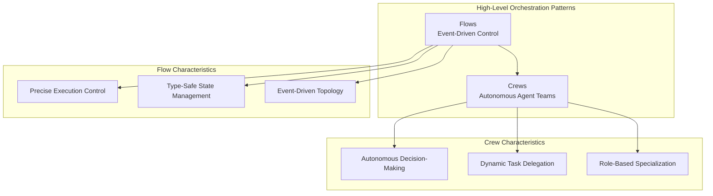
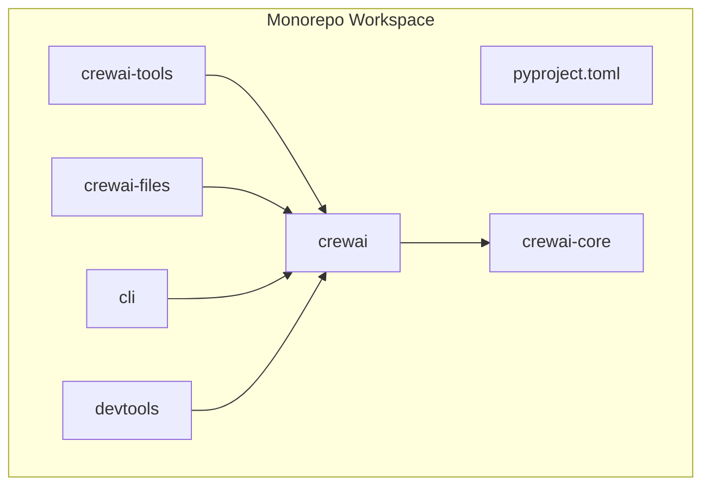
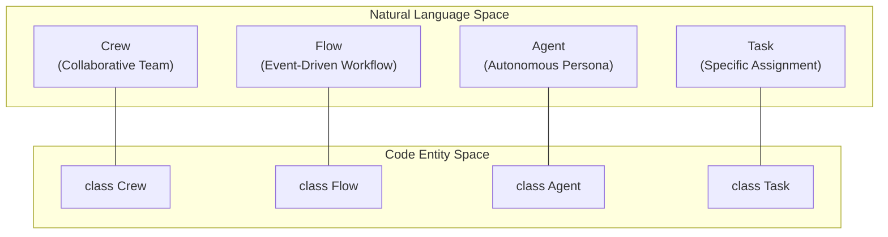

<!-- source: DeepWiki mcp.deepwiki.com · repo crewAIInc/crewAI · page 1 Introduction to CrewAI · fetched 2026-11-09 -->

# Introduction to CrewAI

Relevant source files

The following files were used as context for generating this wiki page:

- [README.md](README.md)
- [docs/edge/ar/index.mdx](docs/edge/ar/index.mdx)
- [docs/edge/ar/introduction.mdx](docs/edge/ar/introduction.mdx)

## Purpose and Scope

This document provides a high-level overview of the CrewAI framework, its architectural philosophy, and the structure of its codebase. It covers the fundamental distinction between **Crews** (autonomous agent teams) and **Flows** (event-driven orchestration), explains the monorepo organization, and introduces core packages and components.

As a parent page, this document keeps technical details high-level and delegates deep-dive explanations to child pages:
- For workspace layout and uv workspace management, see [Workspace and Monorepo Architecture](#1.1).
- For internal package structures, optional extras, and version synchronization, see [Package Structure and Dependencies](#1.2).
- For fundamental runtime concepts like Agents, Tasks, Crews, Flows, and Memory, see [Core Concepts Overview](#1.3).

Sources: [README.md:56-65](), [docs/edge/ar/introduction.mdx:10-18]()

## What is CrewAI?

CrewAI is an open-source Python framework designed for building production-ready multi-agent workflows. It provides high-level abstractions and low-level APIs to enable autonomous agent collaboration and precise, event-driven control [README.md:58-60]().

**Key Characteristics:**
- **Framework Type:** Multi-agent automation framework [README.md:56-58]().
- **Language Target:** Python 3.10–3.14 (development targets 3.12) [.github/CONTRIBUTING.md:15]().
- **License:** MIT [README.md:39-41]().
- **Package Manager:** `uv` workspace and dependency management [.github/CONTRIBUTING.md:16]().

Sources: [README.md:56-65](), [.github/CONTRIBUTING.md:13-17]()

## Core Architecture Philosophy: Crews vs Flows

CrewAI balances autonomy with determinism by separating collaborative agent intelligence from event-driven control flow [docs/edge/ar/introduction.mdx:27-29]().

**Comparison Table:**

| Feature | Crews | Flows |
| :--- | :--- | :--- |
| **Primary Goal** | Autonomous Collaboration [README.md:61]() | Event-Driven Control [README.md:62]() |
| **State** | Managed via Task context | Persistent State Management [docs/edge/ar/introduction.mdx:42]() |
| **Logic** | Role-based delegation [docs/edge/ar/introduction.mdx:59]() | Conditional branching, loops [docs/edge/ar/introduction.mdx:44]() |
| **Unit of Work** | `Task` | `Step` (can be a Crew or Python function) |

Sources: [README.md:56-65](), [docs/edge/ar/introduction.mdx:27-69]()

## Monorepo and Package Architecture

CrewAI is structured as a monorepo managed via `uv` workspaces under the `lib/` directory [.github/CONTRIBUTING.md:30-32](). The repository contains several internal packages (`crewai`, `crewai-tools`, `crewai-files`, `crewai-core`, `cli`, `devtools`) that separate concerns between core execution, tool integrations, file handling, and developer tooling.

For complete details on internal packages, optional extras, and workspace dependency management, see [Workspace and Monorepo Architecture](#1.1) and [Package Structure and Dependencies](#1.2).

Sources: [.github/CONTRIBUTING.md:30-40]()

## Core Concepts Overview

CrewAI revolves around several interconnected primitives that bridge natural language requirements to precise code entities. 

For a deep dive into how Agents, Tasks, Crews, Flows, Processes, and Memory relate at runtime, see [Core Concepts Overview](#1.3).

Sources: [.github/CONTRIBUTING.md:36](), [docs/edge/ar/introduction.mdx:14-15]()

## Enterprise and Deployment (AMP)

For production environments requiring commercial control planes, monitoring, and governance, CrewAI provides the **CrewAI AMP Suite** [README.md:69](). AMP offers managed cloud or on-premise deployments [README.md:81](), real-time tracing [README.md:75](), role-based access control, and enterprise integration connectors [README.md:77]().

Sources: [README.md:67-84]()

---

