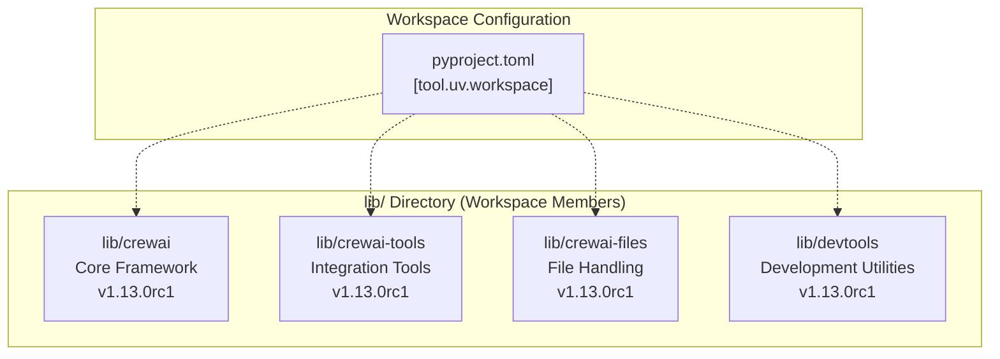
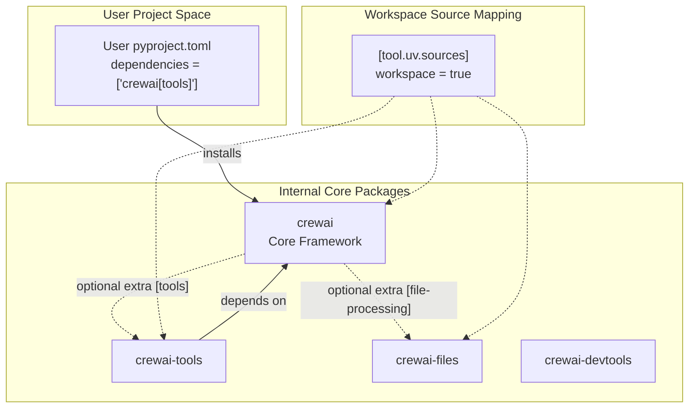
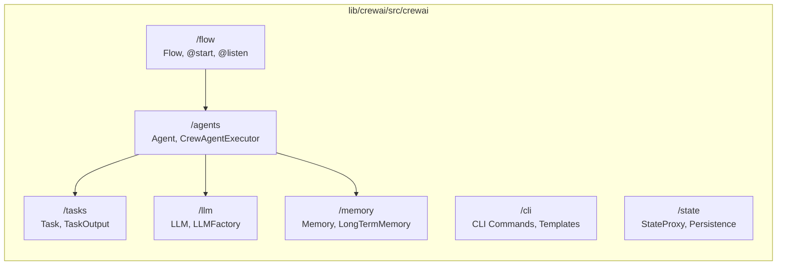
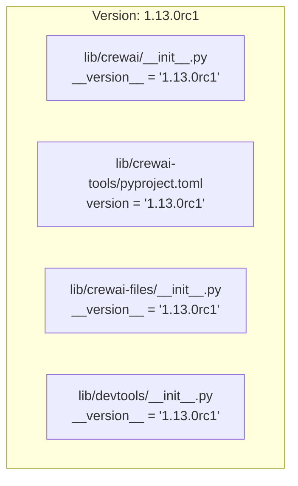

<!-- source: DeepWiki mcp.deepwiki.com · repo crewAIInc/crewAI · page 1.2 Package Structure and Dependencies · fetched 2026-11-09 -->

# Package Structure and Dependencies

Relevant source files

The following files were used as context for generating this wiki page:

- [.github/CONTRIBUTING.md](.github/CONTRIBUTING.md)
- [docs/edge/ar/installation.mdx](docs/edge/ar/installation.mdx)

This document details the internal package structure of the CrewAI monorepo, dependency relationships between packages, external dependencies, the optional extras system, and version synchronization mechanisms. For information about the monorepo workspace configuration and development tooling, see [Workspace and Monorepo Architecture](1.1). For dependency management with `uv` in user projects, see [Dependency Management with UV](8.3).

## Package Overview

The CrewAI monorepo is managed as a `uv` workspace containing four primary internal packages located in the `lib/` directory. These packages are developed in tandem to provide the core framework, specialized tools, and utility services.

Title: Monorepo Workspace Structure

**Sources:** [.github/CONTRIBUTING.md:30-40](), [lib/crewai/src/crewai/__init__.py:45](), [lib/devtools/src/crewai_devtools/__init__.py:3](), [lib/crewai-files/src/crewai_files/__init__.py:155]()

The workspace members serve the following roles:

| Package | Path | Version | Purpose |
|---------|------|---------|---------|
| `crewai` | `lib/crewai` | 1.13.0rc1 | Primary framework containing `Agent`, `Task`, `Crew`, and `Flow` implementations. |
| `crewai-tools` | `lib/crewai-tools` | 1.13.0rc1 | A collection of 100+ pre-built tools for agents (Web search, DBs, etc.). |
| `crewai-files` | `lib/crewai-files` | 1.13.0rc1 | Multimodal file handling and provider-specific constraint management. |
| `crewai-devtools` | `lib/devtools` | 1.13.0rc1 | Internal tooling for releases, testing, and development automation. |

**Sources:** [.github/CONTRIBUTING.md:32-40]()

## Package Dependency Graph

The following diagram illustrates the dependency flow within the monorepo and how external user projects consume these packages.

Title: Internal and External Dependency Flow

**Sources:** [.github/CONTRIBUTING.md:32-40](), [.github/CONTRIBUTING.md:150-161]()

### Key Dependency Characteristics

- **Tight Coupling of Tools**: `crewai-tools` depends directly on `crewai` to ensure that tool schemas and execution logic remain compatible with the core agent executor.
- **Multimodal Integration**: The `crewai-files` package provides the logic for handling complex file types (images, audio) and is integrated into `crewai` via the `file-processing` extra [lib/crewai-files/src/crewai_files/__init__.py:85-155]().
- **Local Development**: When developing inside the monorepo, `uv` uses workspace sources to link packages locally, ensuring changes in `crewai` are immediately available to `crewai-tools` [.github/CONTRIBUTING.md:150-161]().

**Sources:** [.github/CONTRIBUTING.md:32-40](), [.github/CONTRIBUTING.md:150-161](), [lib/crewai-files/src/crewai_files/__init__.py:85-155]()

## Core Framework Structure

The `crewai` package is organized into functional modules that handle specific aspects of agentic orchestration.

Title: Core Framework Internal Organization

**Sources:** [.github/CONTRIBUTING.md:32-36](), [.github/codeql/codeql-config.yml:21]()

### External Core Dependencies

The framework leverages several critical third-party libraries:
- **Pydantic**: Used for all configuration objects, state management, and data validation [lib/crewai/src/crewai/agents/agent_builder/base_agent.py:1-50]().
- **Instructor**: Facilitates structured outputs from LLMs.
- **LanceDB / ChromaDB**: Default backends for the memory system.
- **Textual**: Powers the interactive Checkpoint TUI for Flow recovery.

**Sources:** [lib/crewai/src/crewai/agents/agent_builder/base_agent.py:1-50]()

## Optional Extras System

CrewAI utilizes an "extras" system to keep the base installation lightweight. Users install specific groups of dependencies based on their needs.

| Extra Name | Purpose | Key Dependencies |
|------------|---------|------------------|
| `tools` | Integration tools | `crewai-tools` |
| `file-processing` | Multimodal support | `crewai-files` |
| `mem0` | Advanced memory | `mem0ai` |
| `qdrant` | Vector storage | `qdrant-client` |
| `a2a` | Agent-to-Agent protocol | `pydantic`, `nkeys` |
| `google-genai` | Google models | `google-generativeai` |

**Sources:** [.github/CONTRIBUTING.md:25](), [.github/codeql/codeql-config.yml:14]()

## Files Package: `crewai-files`

The `crewai-files` package is a specialized utility for multimodal inputs. It manages the lifecycle of files and ensures they meet provider-specific requirements.

- **Entity Definitions**: Defines `ImageFile`, `AudioFile`, `VideoFile`, and `PDFFile` [lib/crewai-files/src/crewai_files/__init__.py:92-131]().
- **Provider Constraints**: Contains hardcoded limits for different LLM providers (e.g., `OPENAI_CONSTRAINTS`, `ANTHROPIC_CONSTRAINTS`) to prevent API errors during file uploads [lib/crewai-files/src/crewai_files/__init__.py:86-89]().
- **Resolution Logic**: The `FileResolver` class handles the mapping of file paths to provider-ready objects [lib/crewai-files/src/crewai_files/__init__.py:105-144]().

**Sources:** [lib/crewai-files/src/crewai_files/__init__.py:85-155]()

## Version Synchronization

To maintain stability across the ecosystem, all internal packages are version-locked. When a new version of the core framework is released, all sibling packages are updated to the same version number.

Title: Monorepo Version Lock

**Sources:** [lib/crewai/src/crewai/__init__.py:45](), [lib/crewai-files/src/crewai_files/__init__.py:155](), [lib/devtools/src/crewai_devtools/__init__.py:3]()

---

