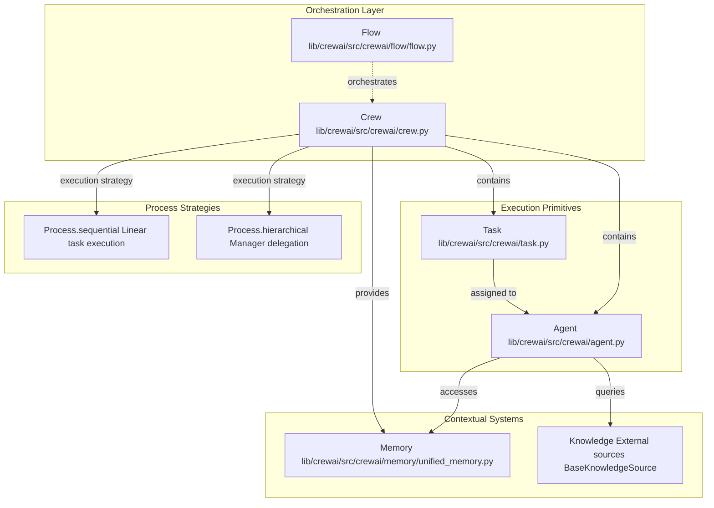
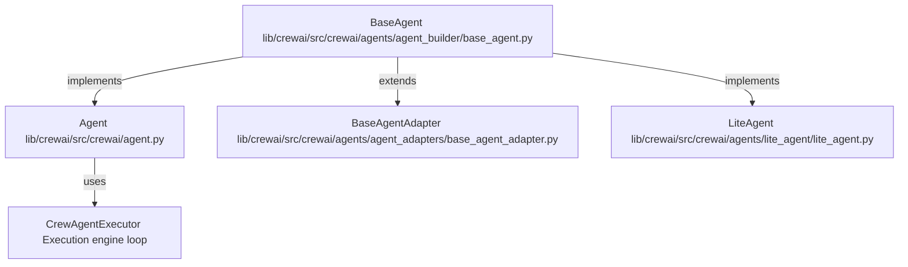
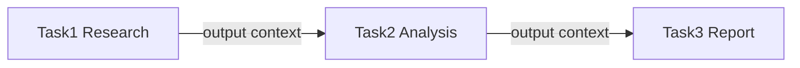
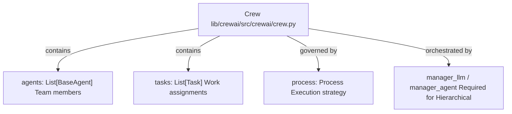
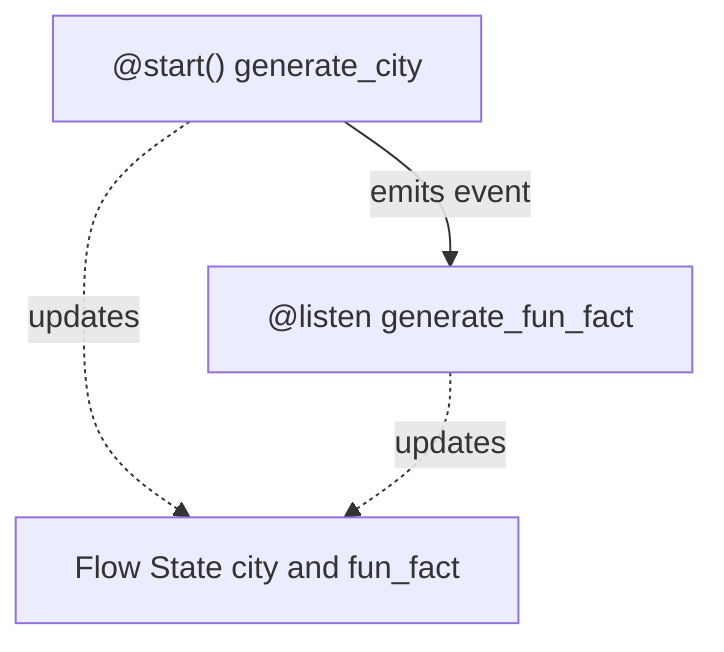

<!-- source: DeepWiki mcp.deepwiki.com · repo crewAIInc/crewAI · page 1.3 Core Concepts Overview · fetched 2026-11-09 -->

# Core Concepts Overview

Relevant source files

The following files were used as context for generating this wiki page:

- [docs/edge/ar/concepts/agents.mdx](docs/edge/ar/concepts/agents.mdx)
- [docs/edge/ar/concepts/crews.mdx](docs/edge/ar/concepts/crews.mdx)
- [docs/edge/ar/concepts/flows.mdx](docs/edge/ar/concepts/flows.mdx)
- [docs/edge/ar/concepts/processes.mdx](docs/edge/ar/concepts/processes.mdx)

## Purpose and Scope

This page introduces the fundamental building blocks of the CrewAI framework and explains how they relate to each other. These concepts form the foundation for building multi-agent AI systems in CrewAI.

Core concepts covered:
- **Agents**: Autonomous AI entities with defined roles, goals, and backstories [docs/edge/ar/concepts/agents.mdx:10-17]().
- **Tasks**: Units of work with clear descriptions and expected outputs [docs/edge/ar/concepts/tasks.mdx:10-15]().
- **Crews**: Orchestration mechanism for teams of agents executing tasks [docs/edge/ar/concepts/crews.mdx:10-12]().
- **Processes**: Execution strategies (Sequential, Hierarchical) that determine task delegation [docs/edge/ar/concepts/processes.mdx:17-18]().
- **Flows**: Event-driven orchestration for production workflows and state management [docs/edge/ar/concepts/flows.mdx:10-12]().
- **Memory**: Context preservation and knowledge sharing across executions [docs/edge/ar/concepts/memory.mdx:10-12]().

---

## Conceptual Architecture

CrewAI provides two complementary orchestration paradigms: **Crews** for autonomous agent collaboration and **Flows** for controlled workflow orchestration. Both leverage the same underlying primitives: Agents and Tasks.

### High-Level Component Relationships

Sources: [docs/edge/ar/concepts/flows.mdx:10-21](), [docs/edge/ar/concepts/crews.mdx:14-35](), [docs/edge/ar/concepts/memory.mdx:10-13]()

---

## Agents: Autonomous AI Entities

Agents are the fundamental execution units. In CrewAI, an `Agent` is a specialized unit capable of making decisions based on its role and goal, using tools, and collaborating with others [docs/edge/ar/concepts/agents.mdx:10-17]().

### Agent Core Attributes

| Attribute | Parameter | Type | Purpose |
|-----------|-----------|------|---------|
| **Role** | `role` | `str` | Defines function and expertise [docs/edge/ar/concepts/agents.mdx:42](). |
| **Goal** | `goal` | `str` | Individual objective guiding decisions [docs/edge/ar/concepts/agents.mdx:43](). |
| **Backstory** | `backstory` | `str` | Provides context and personality [docs/edge/ar/concepts/agents.mdx:44](). |
| **LLM** | `llm` | `Union[str, LLM, Any]` | The language model powering the agent [docs/edge/ar/concepts/agents.mdx:45](). |
| **Tools** | `tools` | `List[BaseTool]` | Capabilities available to the agent [docs/edge/ar/concepts/agents.mdx:46](). |
| **Memory** | `memory` | `bool` | Whether the agent uses memory [docs/edge/ar/concepts/agents.mdx:16](). |

### Agent Class Hierarchy

Sources: [docs/edge/ar/concepts/agents.mdx:40-69](), [docs/edge/ar/concepts/agents.mdx:10-17]()

---

## Tasks: Units of Work

A `Task` is a specific assignment completed by an agent. It provides all necessary details for execution, including description and expected output [docs/edge/ar/concepts/tasks.mdx:10-12]().

### Task Core Attributes

| Attribute | Parameter | Type | Purpose |
|-----------|-----------|------|---------|
| **Description** | `description` | `str` | Clear statement of what the task entails [docs/edge/ar/concepts/tasks.mdx:50](). |
| **Expected Output** | `expected_output` | `str` | Detailed description of completion criteria [docs/edge/ar/concepts/tasks.mdx:51](). |
| **Agent** | `agent` | `Optional[BaseAgent]` | Responsible agent for the task [docs/edge/ar/concepts/tasks.mdx:53](). |
| **Context** | `context` | `List[Task]` | Tasks whose output is used as context [docs/edge/ar/concepts/tasks.mdx:55](). |
| **Guardrail** | `guardrail` | `Callable` | Function to validate task output [docs/edge/ar/concepts/tasks.mdx:65](). |

### Task Execution Flow

Tasks can be executed **Sequentially** (in order of definition) or **Hierarchically** (assigned by a manager based on expertise) [docs/edge/ar/concepts/tasks.mdx:31-35]().

Sources: [docs/edge/ar/concepts/tasks.mdx:48-67](), [docs/edge/ar/concepts/tasks.mdx:31-35]()

---

## Crews: Agent Team Orchestration

A `Crew` represents a collaborative group of agents working together to achieve a set of tasks. It defines the execution strategy and overall workflow [docs/edge/ar/concepts/crews.mdx:10]().

### Crew Class Structure

### Key Execution Methods
- `kickoff()`: Starts the crew execution [docs/edge/ar/concepts/crews.mdx:47]().
- `kickoff_async()`: Non-blocking execution.
- `train()`: Training the crew on specific data.

Sources: [docs/edge/ar/concepts/crews.mdx:14-35](), [docs/edge/ar/concepts/crews.mdx:41-47]()

---

## Processes: Execution Strategies

Processes coordinate task execution, similar to project management in human teams [docs/edge/ar/concepts/processes.mdx:11]().

| Process Type | Description | Requirements |
|--------------|-------------|--------------|
| **Sequential** | Tasks are executed one after another in the defined order [docs/edge/ar/concepts/processes.mdx:17](). | Default process. |
| **Hierarchical** | Tasks are delegated by a manager agent based on agent skills [docs/edge/ar/concepts/processes.mdx:18](). | Requires `manager_llm` or `manager_agent` [docs/edge/ar/concepts/processes.mdx:18](). |

Sources: [docs/edge/ar/concepts/processes.mdx:15-18](), [docs/edge/ar/concepts/processes.mdx:36-46]()

---

## Flows: Event-Driven Orchestration

Flows allow developers to combine multiple crews and custom logic into a structured, event-driven workflow. They provide built-in state management and execution control [docs/edge/ar/concepts/flows.mdx:10-12]().

### Flow Components
- **State**: A type-safe Pydantic model shared across the flow [docs/edge/ar/concepts/flows.mdx:188-192]().
- **@start()**: Defines entry points [docs/edge/ar/concepts/flows.mdx:102]().
- **@listen()**: Triggers methods based on the completion of others [docs/edge/ar/concepts/flows.mdx:110]().
- **@router()**: Implements conditional branching logic.

Sources: [docs/edge/ar/concepts/flows.mdx:28-84](), [docs/edge/ar/concepts/flows.mdx:100-113]()

---

## Memory: Context Preservation

CrewAI features a **Unified Memory System** that uses an LLM to analyze and store content with inferred scope and importance [docs/edge/ar/concepts/memory.mdx:10]().

### Hierarchical Scopes
Memories are organized in a tree-like structure (e.g., `/project/alpha`, `/agent/researcher`), providing context-aware retrieval [docs/edge/ar/concepts/memory.mdx:163-180]().

### Memory Operations
- `remember(content, scope)`: Stores information; LLM infers metadata [docs/edge/ar/concepts/memory.mdx:22]().
- `recall(query)`: Retrieves ranked matches based on semantic similarity, recency, and importance [docs/edge/ar/concepts/memory.mdx:25]().
- `extract_memories(text)`: Extracts atomic facts from raw text [docs/edge/ar/concepts/memory.mdx:65]().

Sources: [docs/edge/ar/concepts/memory.mdx:10-12](), [docs/edge/ar/concepts/memory.mdx:16-38](), [docs/edge/ar/concepts/memory.mdx:163-180]()

---

## Code Entity Reference

| Concept | Class / Interface | File Path |
|---------|-------------------|-----------|
| **Agent** | `Agent` | [lib/crewai/src/crewai/agent.py:1-96]() |
| **Task** | `Task` | [lib/crewai/src/crewai/task.py:1-120]() |
| **Crew** | `Crew` | [lib/crewai/src/crewai/crew.py:129-306]() |
| **Flow** | `Flow` | [lib/crewai/src/crewai/flow/flow.py:1-47]() |
| **Process** | `Process` (Enum) | [lib/crewai/src/crewai/process.py:1-11]() |
| **Memory** | `Memory` | [lib/crewai/src/crewai/memory/unified_memory.py:1-50]() |

Sources: [docs/edge/ar/concepts/agents.mdx:40-69](), [docs/edge/ar/concepts/tasks.mdx:48-67](), [docs/edge/ar/concepts/crews.mdx:14-35]()

---

