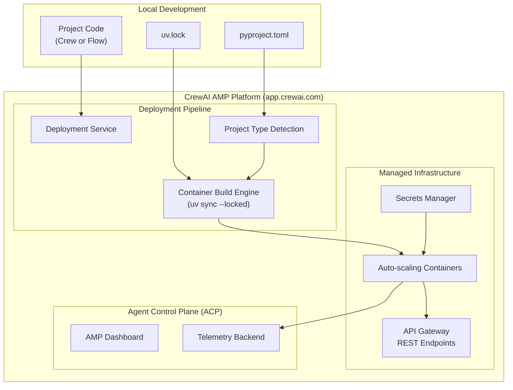
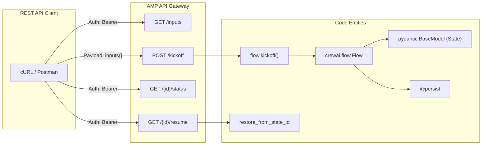

<!-- source: DeepWiki mcp.deepwiki.com · repo crewAIInc/crewAI · page 10 Enterprise Features (CrewAI AMP) · fetched 2026-11-09 -->

# Enterprise Features (CrewAI AMP)

Relevant source files

The following files were used as context for generating this wiki page:

- [docs/edge/ar/api-reference/introduction.mdx](docs/edge/ar/api-reference/introduction.mdx)
- [docs/edge/ar/concepts/production-architecture.mdx](docs/edge/ar/concepts/production-architecture.mdx)

## Purpose and Scope

This document provides an overview of CrewAI AMP (Agent Management Platform), the enterprise platform for deploying, monitoring, and scaling AI agent crews and flows in production environments. AMP extends the open-source CrewAI framework with managed infrastructure, observability, and collaboration features designed for production deployments.

This page covers the platform architecture, deployment pipeline, authentication mechanisms, and core platform components. For details on specific topics:
- [Deployment Architecture](#10.1) — Deployment architecture, project type detection (crew vs flow), and container builds.
- [Deployment Methods](#10.2) — CLI (`crewai deploy create`), Web Interface, and Deploy API for CI/CD.
- [Secrets Manager](#10.3) — Secure storage for API keys and integration with AWS/Azure/GCP secret stores.
- [Control Plane and Monitoring](#10.4) — Dashboard features, traces, metrics, and OpenTelemetry integration.
- [Crew Studio](#10.5) — No-code visual interface and AI-assisted crew generation.
- [Enterprise Security and Governance](#10.6) — RBAC, SSO, PII redaction, and audit trails.
- [Marketplace and Agent Repositories](#10.7) — Reusable assets and tool sharing.
- [Automation Triggers and Integrations](#10.8) — Slack, Gmail, and webhook triggers.

**Sources:** [docs/edge/ar/concepts/production-architecture.mdx:128-131]()

---

## Platform Overview

CrewAI AMP is a managed platform hosted at `app.crewai.com` that provides infrastructure for deploying and operating AI agent applications. The platform handles containerization, scaling, API endpoint provisioning, and observability for projects built with the CrewAI framework.

### Core Capabilities

| Feature | Description |
|---------|-------------|
| **Managed Deployments** | Automated build and containerization of Crew and Flow projects. |
| **REST API Generation** | Auto-generated endpoints for `/inputs`, `/kickoff`, and `/status`. |
| **Agent Control Plane** | Unified operations center for fleet health, LLM consumption, and PII policies. |
| **Secrets Management** | Secure handling of environment variables and integration with external secret stores. |
| **Observability** | Execution traces, metrics, and OpenTelemetry (OTLP) export support. |
| **Enterprise SSO** | Authentication via Okta, Microsoft Entra ID, and Auth0. |
| **RBAC** | Granular Role-Based Access Control for teams and resources. |

**Sources:** [docs/edge/ar/concepts/production-architecture.mdx:128-135]()

---

## System Architecture

### AMP in the CrewAI Ecosystem

**CrewAI AMP System Architecture**

The platform validates project structure using `uv.lock` for deterministic builds.

**Sources:** [docs/edge/ar/concepts/production-architecture.mdx:10-18](), [docs/edge/ar/concepts/production-architecture.mdx:133-135]()

---

## REST API and Connectivity

Every deployed automation provides a standardized REST interface. Authentication is handled via Bearer Tokens, which can be Organization-level or User-scoped (Personal Access Tokens).

### API Endpoint Mapping

**Natural Language to Code Entity Bridge: API Endpoints**

This diagram maps REST operations to the underlying framework entities. When a flow is kicked off via the API, the `@persist` decorator can be used to save the `Flow` state to a database, allowing for resumption or human-in-the-loop interactions. The `GET /{id}/resume` endpoint allows for restoring a flow from a previous state using `restore_from_state_id`.

**Sources:** [docs/edge/ar/api-reference/introduction.mdx:19-26](), [docs/edge/ar/api-reference/introduction.mdx:33-39](), [docs/edge/ar/concepts/production-architecture.mdx:42-50](), [docs/edge/ar/concepts/production-architecture.mdx:143-147](), [docs/edge/ar/concepts/production-architecture.mdx:77-80](), [docs/edge/ar/concepts/production-architecture.mdx:150-152]()

---

## Agent Control Plane (ACP) and Governance

The Agent Control Plane serves as the unified operations center for all live automations, providing deep insights into agent behavior and security.

*   **Production Flows:** Production applications are recommended to use the `Flow` orchestrator for structured state management and monitoring.
*   **Security Configuration:** Metadata can be attached to agent fingerprints via `agent.security_config.fingerprint.metadata` to provide project-specific context for audit trails.

**Sources:** [docs/edge/ar/concepts/production-architecture.mdx:8-18]()

---

## Deployment Methods

AMP supports multiple workflows for moving from local development to production:

1.  **CLI Deployment:** Using `crewai deploy create` to automatically detect project type, package dependencies, and push to AMP.
2.  **Web Interface:** Connecting a GitHub repository directly to AMP for automated builds on push.
3.  **Asynchronous Execution:** For long-running production tasks, `kickoff_async` is recommended to avoid blocking API interfaces.

**Sources:** [docs/edge/ar/concepts/production-architecture.mdx:133-135](), [docs/edge/ar/concepts/production-architecture.mdx:137-138]()

---

## Summary of Enterprise Components

| Component | Role in Ecosystem |
|-----------|-------------------|
| **AMP Dashboard** | Central control plane for managing automations, secrets, and team access. |
| **@persist Decorator** | Enables flow state persistence for recovery and human-in-the-loop. |
| **uv.lock** | Mandatory file for ensuring production environments match development. |
| **Flow Orchestrator** | The recommended entry point for production-grade agent applications. |

For more details on deploying your first automation, see [Deployment Methods](#10.2).

**Sources:** [docs/edge/ar/concepts/production-architecture.mdx:10-18](), [docs/edge/ar/concepts/production-architecture.mdx:143-147]()

---

