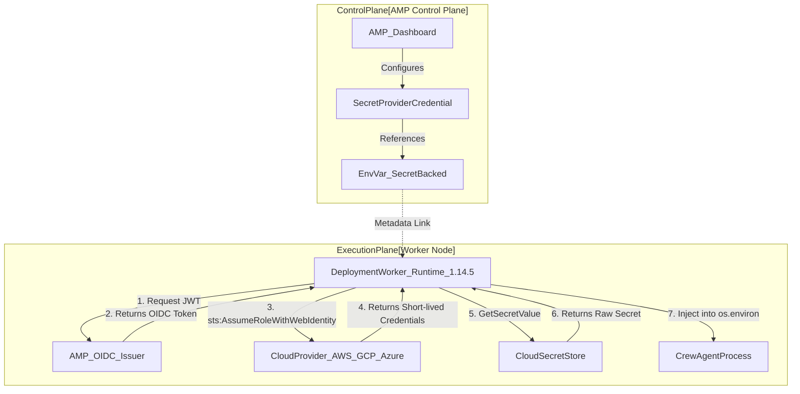
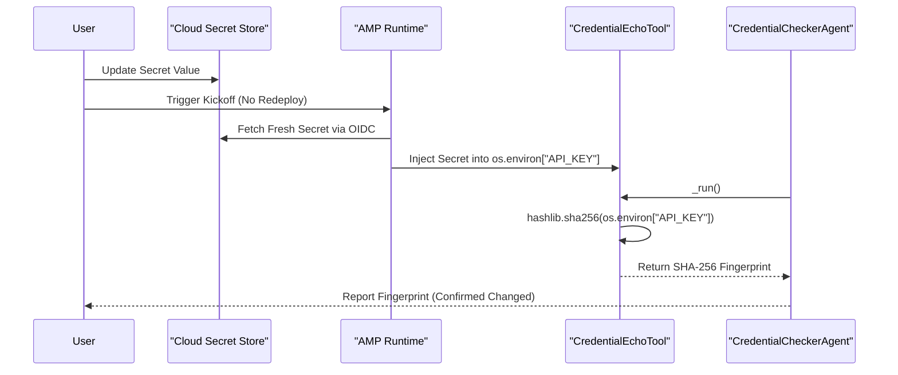

<!-- source: DeepWiki mcp.deepwiki.com · repo crewAIInc/crewAI · page 10.3 Secrets Manager · fetched 2026-11-09 -->

# Secrets Manager

Relevant source files

The following files were used as context for generating this wiki page:

- [.env.test](.env.test)

The **AMP Secrets Manager** is an enterprise-grade security feature within the CrewAI Agent Management Platform (AMP) designed to manage sensitive credentials, API keys, and environment variables without exposing raw values in configuration files or the platform UI. It supports two primary integration paths: **Static Credentials** for simple setups and **Workload Identity Federation** for high-security, rotation-aware production environments.

### Core Architecture and Data Flow

The Secrets Manager acts as a bridge between external cloud secret stores (AWS Secrets Manager, Google Cloud Secret Manager, Azure Key Vault) and the CrewAI runtime.

#### Runtime Secret Resolution Flow
The following diagram illustrates how secrets are resolved during a Crew execution:

**Diagram: Secret Resolution and Injection Process**

Sources: [.github/security.md:3-5](), [docs/edge/ar/concepts/production-architecture.mdx:128-131]()

### Integration Methods

The system supports two distinct paths for connecting to cloud providers, differing primarily in how they handle credential rotation and persistence.

| Feature | Static Credentials | Workload Identity (OIDC Federation) |
| :--- | :--- | :--- |
| **Authentication** | Long-lived Access Keys / Service Account JSON | Short-lived OIDC tokens issued per worker execution |
| **Rotation Propagation** | Resolved at **deployment time**; requires re-deploy to update | Resolved at **execution time**; updates propagate instantly |
| **Storage** | Encrypted keys stored in AMP | No long-term cloud credentials stored in AMP |
| **Minimum Runtime** | `1.14.5` | `1.14.5` |

Sources: [docs/edge/ar/concepts/production-architecture.mdx:128-135]()

### Cloud Provider Configuration

#### 1. AWS Secrets Manager
- **Static Path:** Uses IAM User access keys or `sts:AssumeRole` with an optional `External ID`.
- **Workload Identity:** Uses OIDC Federation. AWS STS validates the AMP-issued JWT against a configured IAM Identity Provider.

#### 2. Google Cloud Secret Manager
- **Static Path:** Requires a Service Account JSON key with `roles/secretmanager.secretAccessor`.
- **Workload Identity:** Utilizes Workload Identity Pools. The AMP OIDC issuer is registered as a provider, mapping `assertion.sub` to a Google principal.

#### 3. Azure Key Vault
- **Static Path:** Uses Entra App Registration with a Client Secret. Azure RBAC (`Key Vault Secrets User`) is preferred over Access Policies.
- **Workload Identity:** Uses Federated Identity Credentials on the App Registration, trusting the `api://AzureADTokenExchange` audience.

### Implementation Details: Secret Referencing

Secrets are referenced in the AMP environment variable configuration using a specific syntax to handle structured data. The `.env.test` file provides examples of various environment variables that would typically be managed as secrets [.env.test:12-139]().

- **Direct Mapping:** Mapping an environment variable (e.g., `OPENAI_API_KEY` [.env.test:12]()) directly to a secret name in the provider.
- **JSON Key Extraction:** For secrets stored as JSON objects, use the `#` delimiter: `secret-name#json_key` (e.g., `db-creds#password`).
- **Azure Normalization:** Azure Key Vault does not support underscores. AMP automatically converts underscores in the "Secret Name" field to dashes (e.g., `db_password` → `db-password`) when calling the Azure API.

Sources: [.env.test:12-139]()

### Security and Permissions (RBAC)

Access to the Secrets Manager is governed by specific RBAC features in the platform:

1. `secret_providers`: Controls access to the "Secret Provider Credentials" configuration page.
2. `workload_identity_configs`: Controls management of OIDC federation settings.
3. `environment_variables`: Controls the ability to link these providers to specific deployment variables.

Sources: [.github/security.md:1-15]()

### Rotation Verification

To verify that secret rotation is functioning without redeploying (when using Workload Identity), a verification Crew can be implemented.

**Diagram: Rotation Verification Logic**

The `CredentialEchoTool` is used to confirm the value change without leaking the raw secret into logs by returning a SHA-256 fingerprint.

Sources: [docs/edge/ar/concepts/production-architecture.mdx:86-99](), [docs/edge/ar/concepts/production-architecture.mdx:118-122]()

---

