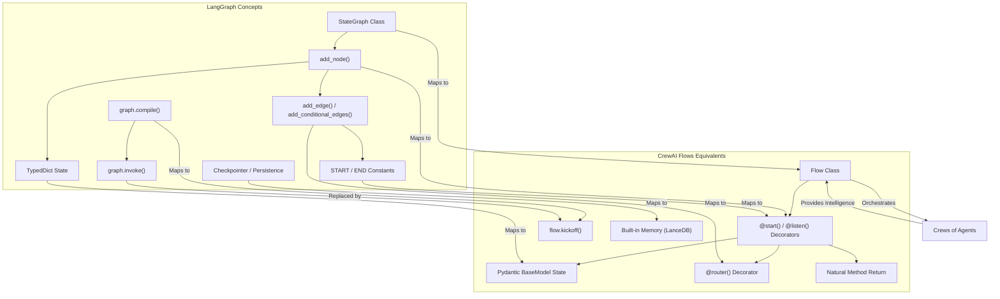

<!-- source: DeepWiki mcp.deepwiki.com · repo crewAIInc/crewAI · page 11.1 Upgrading and Migration · fetched 2026-11-09 -->

# Upgrading and Migration

<details>
<summary>Relevant source files</summary>

The following files were used as context for generating this wiki page:

- [docs/edge/ar/changelog.mdx](docs/edge/ar/changelog.mdx)
- [docs/edge/ar/guides/flows/inputs-id-deprecation.mdx](docs/edge/ar/guides/flows/inputs-id-deprecation.mdx)
- [docs/edge/ar/guides/migration/migrating-from-langgraph.mdx](docs/edge/ar/guides/migration/migrating-from-langgraph.mdx)
- [docs/edge/ar/guides/migration/upgrading-crewai.mdx](docs/edge/ar/guides/migration/upgrading-crewai.mdx)

</details>


This page provides comprehensive guidance on upgrading CrewAI versions, understanding breaking changes, and migrating existing projects from other frameworks like LangGraph. It covers practical steps for updating your CrewAI installation, adapting to API changes, and leveraging new features.

## Upgrading CrewAI Versions

CrewAI releases regularly introduce new capabilities and improvements. This section details the process for keeping your `crewai` CLI tool and project virtual environments updated.

### Two Locations for CrewAI Installation

CrewAI can be installed in two primary locations on your system, and these installations are upgraded independently:

| What | How it's installed | How to upgrade |
|---|---|---|
| **Global `crewai` CLI tool** | `uv tool install crewai` | `uv tool install crewai --upgrade` |
| **Project `venv`** (where your code runs) | `crewai install` / `uv sync` | `uv add "crewai[...]>=X.Y.Z"` then `crewai install` |

It's common for the global CLI tool and the project `venv` version to be out of sync. The version within your project's `venv` is the one that dictates the behavior of your running code. You can check the global CLI version with `crewai --version` and the project `venv` version with `uv pip show crewai` [docs/edge/ar/guides/migration/upgrading-crewai.mdx:24-25]().

### Why `crewai install` Alone Doesn't Upgrade

The `crewai install` command is a wrapper around `uv sync` [docs/edge/ar/guides/migration/upgrading-crewai.mdx:28](). It installs packages exactly as specified in your current `uv.lock` file and does not automatically upgrade version constraints [docs/edge/ar/guides/migration/upgrading-crewai.mdx:28-30]().

To truly upgrade, you must:
1. Update the version constraint in `pyproject.toml`.
2. Re-resolve the lock file.
3. Synchronize your virtual environment.

The `uv add` command performs all three steps in one go [docs/edge/ar/guides/migration/upgrading-crewai.mdx:37]().

### How to Upgrade Your Project

To upgrade CrewAI within your project's virtual environment:

```bash
# Elevates the constraint and re-locks in one command
uv add "crewai[tools]>=1.14.4"

# Syncs the venv (crewai install calls uv sync under the hood)
crewai install

# Verify
uv pip show crewai
# → Version: 1.14.4
```
[docs/edge/ar/guides/migration/upgrading-crewai.mdx:42-52]()

Replace `[tools]` with any extras your project uses (e.g., `[tools,anthropic]`). You can check the `dependencies` list in your `pyproject.toml` if unsure [docs/edge/ar/guides/migration/upgrading-crewai.mdx:54]().

If you manually edit `pyproject.toml`, you still need to run `uv lock --upgrade-package crewai` to re-resolve the lock file before `crewai install` picks up the new version [docs/edge/ar/guides/migration/upgrading-crewai.mdx:56-58]().

### Upgrading the Global CLI Tool

The global CLI tool is separate from your project's virtual environment. Upgrade it using:

```bash
uv tool install crewai --upgrade
```
[docs/edge/ar/guides/migration/upgrading-crewai.mdx:65-67]()

If your shell warns about `PATH` after upgrading, update it with `uv tool update-shell` [docs/edge/ar/guides/migration/upgrading-crewai.mdx:69-72](). This operation does not affect your project's virtual environment [docs/edge/ar/guides/migration/upgrading-crewai.mdx:74]().

### Checking Both Versions

You can verify the versions of both the global CLI and your project's `venv`:

```bash
# Global CLI version
crewai --version

# Project venv version
uv pip show crewai | grep Version
```
[docs/edge/ar/guides/migration/upgrading-crewai.mdx:78-84]()

It's not strictly necessary for them to match, but the project `venv` version is what matters for runtime behavior [docs/edge/ar/guides/migration/upgrading-crewai.mdx:86]().

CrewAI requires `Python >=3.10, <3.14` [docs/edge/ar/guides/migration/upgrading-crewai.mdx:89](). If `uv` is installed against an older interpreter, recreate your project's `venv` with a supported Python version before running `crewai install` [docs/edge/ar/guides/migration/upgrading-crewai.mdx:89-91]().

Sources:
- [docs/edge/ar/guides/migration/upgrading-crewai.mdx:7-91]()

## Breaking Changes and Migration Notes

Most upgrades require only minor adjustments. The following areas highlight common breaking changes or areas that might lead to confusing stack traces.

### Import Paths: `tools` and `BaseTool`

The official location for importing tools is `crewai.tools` [docs/edge/ar/guides/migration/upgrading-crewai.mdx:100](). Older import paths, while still present in some tutorials, should be updated.

```python
# Before
from crewai_tools import BaseTool
from crewai.agents.tools import tool

# After
from crewai.tools import BaseTool, tool
```
[docs/edge/ar/guides/migration/upgrading-crewai.mdx:103-109]()

Both the `@tool` decorator and the `BaseTool` class are now located in `crewai.tools` [docs/edge/ar/guides/migration/upgrading-crewai.mdx:111](). Internal agent symbols like `AgentFinish` are no longer part of the public API; consider using event listeners or `Task` callbacks instead [docs/edge/ar/guides/migration/upgrading-crewai.mdx:111-113]().

### `Agent` Parameter Changes

The `Agent` class has seen some parameter adjustments:

```python
from crewai import Agent

agent = Agent(
    role="Researcher",
    goal="Find authoritative sources on {topic}",
    backstory="You are a careful, source-driven researcher.",
    llm="gpt-4o-mini",   # Model name as string or LLM object
    verbose=True,        # bool, not an integer log level
    max_iter=15,         # Default changed across versions — specify explicitly
    allow_delegation=False,
)
```
[docs/edge/ar/guides/migration/upgrading-crewai.mdx:117-127]()

- The `llm` parameter now accepts either a model name as a string (resolved via the configured provider) or an `LLM` object for more granular control [docs/edge/ar/guides/migration/upgrading-crewai.mdx:129]().
- `verbose` is a simple boolean (`bool`). Passing an integer no longer toggles log levels [docs/edge/ar/guides/migration/upgrading-crewai.mdx:130]().
- The default value for `max_iter` has changed across versions. If your agent silently stops iterating after the first tool call, explicitly set `max_iter` [docs/edge/ar/guides/migration/upgrading-crewai.mdx:131-132]().

### `Crew` Parameters

The `Crew` class also has updated parameters:

```python
from crewai import Crew, Process

crew = Crew(
    agents=[...],
    tasks=[...],
    process=Process.sequential,   # or Process.hierarchical
    memory=True,
    cache=True,
    embedder={"provider": "openai", "config": {"model": "text-embedding-3-small"}},
)
```
[docs/edge/ar/guides/migration/upgrading-crewai.mdx:136-145]()

- When using `process=Process.hierarchical`, you must provide either `manager_llm=` or `manager_agent=`. Failing to do so will raise a validation error during `kickoff` [docs/edge/ar/guides/migration/upgrading-crewai.mdx:147]().
- If `memory=True` is enabled and you are not using OpenAI's default embeddings, you must provide an `embedder` dictionary. Refer to the "Memory and Embedder Configuration" section below [docs/edge/ar/guides/migration/upgrading-crewai.mdx:148-149]().

### Structured `Task` Output

To enforce type-hinted output for a `Task` result, use `output_pydantic`, `output_json`, or `output_file`:

```python
from pydantic import BaseModel
from crewai import Task

class Article(BaseModel):
    title: str
    body: str

write = Task(
    description="Write an article about {topic}",
    expected_output="A short article with a title and body",
    agent=writer,
    output_pydantic=Article,        # The class, not an instance of it
    output_file="output/article.md",
)
```
[docs/edge/ar/guides/migration/upgrading-crewai.mdx:153-170]()

Note that `output_pydantic` expects the **class itself**, not an instance of it. Passing `Article(title="", body="")` is a common mistake that results in a confusing validation error [docs/edge/ar/guides/migration/upgrading-crewai.mdx:172]().

### Memory and Embedder Configuration

If `memory=True` is enabled and you are not using the default OpenAI embeddings, you must explicitly pass an `embedder` configuration:

```python
crew = Crew(
    agents=[...],
    tasks=[...],
    memory=True,
    embedder={
        "provider": "ollama",
        "config": {"model": "nomic-embed-text"},
    },
)
```
[docs/edge/ar/guides/migration/upgrading-crewai.mdx:179-188]()

Ensure that the relevant provider credentials (`OPENAI_API_KEY`, `OLLAMA_HOST`, etc.) are set in your `.env` file [docs/edge/ar/guides/migration/upgrading-crewai.mdx:190](). Memory storage paths are local to the project by default. If you change embedders, delete the project's memory folder, as dimensions do not mix [docs/edge/ar/guides/migration/upgrading-crewai.mdx:190]().

Sources:
- [docs/edge/ar/guides/migration/upgrading-crewai.mdx:93-190]()

## Migrating from `inputs.id` to `restore_from_state_id` for `@persist` Flows

The method of passing `id` within `inputs` to rehydrate a `@persist` flow is **deprecated** and scheduled for removal in a future release [docs/edge/ar/guides/flows/inputs-id-deprecation.mdx:7-8](). The alternative, `restore_from_state_id`, is available in CrewAI **v1.14.5 and later** [docs/edge/ar/guides/flows/inputs-id-deprecation.mdx:8]().

### Overview of the Change

Previously, the `id` field within `inputs` served a dual purpose:
1. It identified which snapshot to rehydrate from for `@persist` [docs/edge/ar/guides/flows/inputs-id-deprecation.mdx:45-46]().
2. It became the identifier for the new flow execution (`state.id`), meaning all subsequent `@persist` writes from this kickoff would fall under the same UUID [docs/edge/ar/guides/flows/inputs-id-deprecation.mdx:47-48]().

This dual functionality caused issues, as two kickoffs passing the same `inputs.id` were not distinct executions; they shared an ID and persistence history [docs/edge/ar/guides/flows/inputs-id-deprecation.mdx:49-50]().

The `restore_from_state_id` field separates these responsibilities. It tells `@persist` which snapshot to rehydrate from, while allowing the new execution to receive a fresh `state.id` [docs/edge/ar/guides/flows/inputs-id-deprecation.mdx:51-52]().

### Migration Steps

If you are currently kicking off a `@persist` flow using `inputs={"id": ...}`:

```python
# Deprecated
flow = CounterFlow()
flow.kickoff(inputs={"id": "abcd1234-5678-90ef-ghij-klmnopqrstuv"})
```
[docs/edge/ar/guides/flows/inputs-id-deprecation.mdx:20-23]()

Migrate to `restore_from_state_id`:

```python
# Supported
flow = CounterFlow()
flow.kickoff(restore_from_state_id="abcd1234-5678-90ef-ghij-klmnopqrstuv")
```
[docs/edge/ar/guides/flows/inputs-id-deprecation.mdx:27-30]()

The two approaches have different lineage meanings:
- `inputs={"id": <uuid>}` (deprecated) — **Resume**: Writes under the provided ID, extending the same `flow_uuid` history [docs/edge/ar/guides/flows/inputs-id-deprecation.mdx:34]().
- `restore_from_state_id=<uuid>` — **Fork**: Rehydrates state from the snapshot, then writes under a new `state.id`. The source flow's history is preserved [docs/edge/ar/guides/flows/inputs-id-deprecation.mdx:35-36]().

For most production scenarios, where you want to restart a flow initialized from a previous state, forking is the desired behavior [docs/edge/ar/guides/flows/inputs-id-deprecation.mdx:38]().

### Removal Schedule

The `inputs.id` for `@persist` rehydration is scheduled for removal in a future CrewAI version [docs/edge/ar/guides/flows/inputs-id-deprecation.mdx:54](). Existing flows will continue to work, but new code should use `restore_from_state_id`, and existing flows should be migrated at the next opportunity [docs/edge/ar/guides/flows/inputs-id-deprecation.mdx:54-56]().

### AMP Migration

If you deploy your flows to CrewAI AMP, the migration extends to the payload sent to your deployed crew.

#### Kickoff Payload Migration

If you are currently kicking off a deployed flow by including `id` in `inputs`:

```bash
# Deprecated
curl -X POST \
  -H "Content-Type: application/json" \
  -H "Authorization: Bearer YOUR_CREW_TOKEN" \
  -d '{"inputs": {"id": "abcd1234-5678-90ef-ghij-klmnopqrstuv", "topic": "AI Agent Frameworks"}}' \
  https://your-crew-url.crewai.com/kickoff
```
[docs/edge/ar/guides/flows/inputs-id-deprecation.mdx:66-72]()

Move the UUID to a top-level `restoreFromStateId` field:

```bash
# Supported
curl -X POST \
  -H "Content-Type: application/json" \
  -H "Authorization: Bearer YOUR_CREW_TOKEN" \
  -d '{
        "inputs": {"topic": "AI Agent Frameworks"},
        "restoreFromStateId": "abcd1234-5678-90ef-ghij-klmnopqrstuv"
      }' \
  https://your-crew-url.crewai.com/kickoff
```
[docs/edge/ar/guides/flows/inputs-id-deprecation.mdx:76-83]()

`restoreFromStateId` sits alongside `inputs` in the kickoff payload, not inside it. The `inputs` object now only carries values actually consumed by your flow [docs/edge/ar/guides/flows/inputs-id-deprecation.mdx:85]().

#### Impact of Reusing `inputs.id` in AMP

When AMP receives a kickoff for a flow where `inputs.id` matches an existing execution, it resolves to the existing record instead of creating a new one [docs/edge/ar/guides/flows/inputs-id-deprecation.mdx:90](). This leads to visible symptoms on the deployment dashboard:

- **Execution Status**: The status of the new run overwrites the previous one. Completed executions might revert to `running`, or `completed` runs might become `error` if the new kickoff fails [docs/edge/ar/guides/flows/inputs-id-deprecation.mdx:93-95]().
- **Tracing**: OTel traces accumulate across kickoffs because they share the same execution ID. Previous run traces are either replaced or mixed with the new run's traces, making step-by-step replay inconsistent [docs/edge/ar/guides/flows/inputs-id-deprecation.mdx:96-98]().
- **Executions List**: Kickoffs that should appear as separate rows collapse into a single entry, obscuring history [docs/edge/ar/guides/flows/inputs-id-deprecation.mdx:99-100]().

Migrating to `restoreFromStateId` ensures each kickoff is treated as its own execution, with its own state, tracing, and entry in the list, while still allowing state rehydration from a previous run [docs/edge/ar/guides/flows/inputs-id-deprecation.mdx:102]().

Sources:
- [docs/edge/ar/guides/flows/inputs-id-deprecation.mdx:7-102]()

## Migrating from LangGraph to CrewAI Flows

If you have built agent workflows using LangGraph, CrewAI Flows offers a more streamlined and production-ready framework with a simpler mental model.

### Mental Model Shift

LangGraph requires you to think in terms of **graphs**: nodes, edges, and state dictionaries. Each workflow is a directed graph where transitions explicitly link computational steps [docs/edge/ar/guides/migration/migrating-from-langgraph.mdx:16-17]().

CrewAI Flows encourages thinking in terms of **events**: methods that start things, methods that listen for results, and methods that route execution. The workflow topology emerges from decorator annotations rather than explicit graph construction [docs/edge/ar/guides/migration/migrating-from-langgraph.mdx:19-20]().

### LangGraph to CrewAI Flows Equivalents

| LangGraph Concept | CrewAI Flows Equivalent |
|---|---|
| `StateGraph` class | `Flow` class |
| `add_node()` | Methods decorated with `@start`, `@listen` |
| `add_edge()` / `add_conditional_edges()` | `@listen()` / `@router()` decorators |
| `TypedDict` state | Pydantic `BaseModel` state |
| `START` / `END` constants | `@start()` decorator / natural method return |
| `graph.compile()` | `flow.kickoff()` |
| Checkpointer / persistence | Built-in memory (backed by LanceDB) |
[docs/edge/ar/guides/migration/migrating-from-langgraph.mdx:26-33]()

### Key Differences and Advantages

#### Simpler Sequential Pipelines

In CrewAI Flows, there's no explicit graph construction, edge linking, or compilation step. Execution order is declared directly where the logic resides. `@start()` defines the entry point, and `@listen(method_name)` connects steps [docs/edge/ar/guides/migration/migrating-from-langgraph.mdx:40-41]().

#### Conditional Routing with `@router()`

The `@router()` decorator transforms a method into a decision point. It returns a string that matches a listener, eliminating the need for mapping dictionaries or separate routing functions. Branching logic reads like a Python `if` statement because it is [docs/edge/ar/guides/migration/migrating-from-langgraph.mdx:45-47]().

#### Integrating AI Agent Crews within Flows

This is where CrewAI's power truly shines. Flows orchestrate entire **Crews** of autonomous Agents, not just individual LLM calls. Flows provide the orchestration layer, while Crews provide the intelligence layer. Each step in a Flow can trigger a full team of collaborative Agents [docs/edge/ar/guides/migration/migrating-from-langgraph.mdx:51-55]().

#### Parallel Execution and Synchronization

The `and_()` operator on the `@listen` decorator ensures a method executes only after *all* preceding methods have completed. There's also `or_()` to proceed once *any* preceding task is complete [docs/edge/ar/guides/migration/migrating-from-langgraph.mdx:59-61]().

### Why CrewAI Flows for Production

- **Built-in State Persistence**: Flow state is backed by LanceDB [docs/edge/ar/guides/migration/migrating-from-langgraph.mdx:66]().
- **Type-Safe State Management**: Pydantic models provide validation, serialization, and IDE support [docs/edge/ar/guides/migration/migrating-from-langgraph.mdx:67]().
- **Native Agent Orchestration**: Crews are a first-class primitive [docs/edge/ar/guides/migration/migrating-from-langgraph.mdx:68]().
- **Simpler Mental Model**: Decorators declare intent [docs/edge/ar/guides/migration/migrating-from-langgraph.mdx:69]().
- **CLI Integration**: Run Flows with `crewai run` [docs/edge/ar/guides/migration/migrating-from-langgraph.mdx:70]().

### Migration Cheat Sheet

1.  **Map your state**: Convert `TypedDict` to a Pydantic `BaseModel` [docs/edge/ar/guides/migration/migrating-from-langgraph.mdx:75]().
2.  **Convert nodes to methods**: Each `add_node` function becomes a method on your `Flow` subclass [docs/edge/ar/guides/migration/migrating-from-langgraph.mdx:76]().
3.  **Replace edges with decorators**: `add_edge(START, "first_node")` becomes `@start()`. `add_edge("a", "b")` becomes `@listen(a)` [docs/edge/ar/guides/migration/migrating-from-langgraph.mdx:77-78]().
4.  **Replace conditional edges with `@router`**: The routing function and `add_conditional_edges()` become a single `@router()` method [docs/edge/ar/guides/migration/migrating-from-langgraph.mdx:79-80]().
5.  **Replace `compile + invoke` with `kickoff`**: Remove `graph.compile()`. Call `flow.kickoff()` instead [docs/edge/ar/guides/migration/migrating-from-langgraph.mdx:81-82]().
6.  **Identify Crew opportunities**: Any node with complex, multi-step agent logic is a candidate for extraction into a Crew [docs/edge/ar/guides/migration/migrating-from-langgraph.mdx:83-84]().

### Getting Started with CrewAI Flows

```bash
pip install crewai
crewai create flow my_first_flow
cd my_first_flow
```
[docs/edge/ar/guides/migration/migrating-from-langgraph.mdx:88-91]()

Then, run your flow:

```bash
crewai run
```
[docs/edge/ar/guides/migration/migrating-from-langgraph.mdx:95]()

### Diagram: LangGraph to CrewAI Flows Conceptual Mapping


**Diagram 1: LangGraph to CrewAI Flows Conceptual Mapping**

This diagram illustrates the direct mapping of core concepts from LangGraph to CrewAI Flows, highlighting how graph-based constructs are replaced by event-driven decorators and native CrewAI features.

Sources:
- [docs/edge/ar/guides/migration/migrating-from-langgraph.mdx:16-103]()

---

