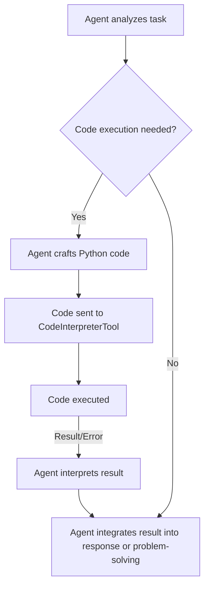
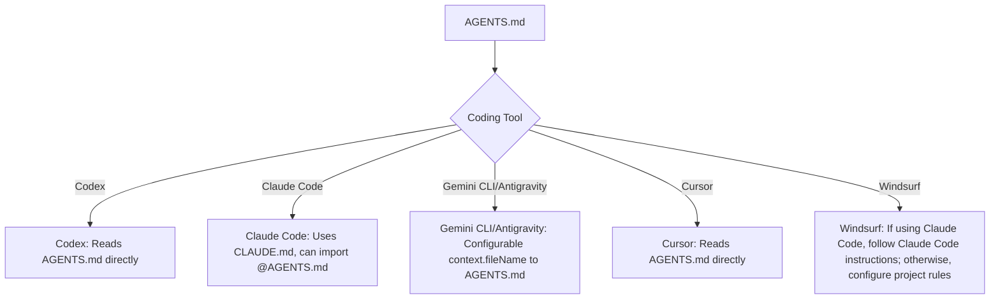

<!-- source: DeepWiki mcp.deepwiki.com · repo crewAIInc/crewAI · page 11.2 Prompt Customization and Coding Agents · fetched 2026-11-09 -->

# Prompt Customization and Coding Agents

<details>
<summary>Relevant source files</summary>

The following files were used as context for generating this wiki page:

- [docs/edge/ar/guides/advanced/customizing-prompts.mdx](docs/edge/ar/guides/advanced/customizing-prompts.mdx)
- [docs/edge/ar/guides/coding-tools/agents-md.mdx](docs/edge/ar/guides/coding-tools/agents-md.mdx)
- [docs/edge/ar/learn/coding-agents.mdx](docs/edge/ar/learn/coding-agents.mdx)

</details>


This page details how to customize prompts and translations within CrewAI, enable and configure coding agents, and provides guidance on using `AGENTS.md` for coding tools. Understanding these aspects allows for fine-grained control over agent behavior, language support, and integration with various coding environments.

## Prompt Customization

CrewAI provides a flexible prompt system that allows for deep customization, enabling agents to be optimized for specific LLMs, languages, domains, and use cases.

### Why Customize Prompts?

While CrewAI's default prompts are effective for many scenarios, low-level customization offers significant advantages:
1.  **LLM Optimization**: Different LLMs (e.g., GPT-4, Claude, Llama) perform best with prompt formats tailored to their unique architectures.
2.  **Language Support**: Build agents that operate exclusively in non-English languages, handling nuances precisely.
3.  **Domain Specialization**: Adapt prompts for highly specialized industries like healthcare, finance, or law.
4.  **Tone and Style Adjustment**: Make agents more formal, casual, creative, or analytical.
5.  **Custom Use Cases**: Utilize advanced prompt structures and formats for complex, project-specific requirements.

Sources: [docs/edge/ar/guides/advanced/customizing-prompts.mdx:10-17]()

### Understanding CrewAI's Prompt System

CrewAI uses a modular prompt system that can be extensively customized. Key components include:
*   **Agent Templates**: Control each agent's approach to its designated role.
*   **Prompt Slices**: Govern specialized behaviors such as tasks, tool usage, and output structure.
*   **Error Handling**: Direct how agents respond to failures, exceptions, and timeouts.
*   **Tool-Specific Prompts**: Define detailed instructions for how tools should be invoked or used.

The original prompt templates can be found in the CrewAI repository, specifically in the `en.json` translation file [https://github.com/crewAIInc/crewAI/blob/main/lib/crewai/src/crewai/translations/en.json](). These can be overridden or adapted as needed.

Sources: [docs/edge/ar/guides/advanced/customizing-prompts.mdx:24-29]()

### Default System Instructions

CrewAI automatically injects default system instructions into agent prompts, which might not be immediately apparent. Understanding these injections is crucial for production systems requiring full prompt transparency.

When an agent is defined with a `role`, `goal`, and `backstory`, CrewAI adds additional system instructions controlling formatting and behavior.

Sources: [docs/edge/ar/guides/advanced/customizing-prompts.mdx:37-40]()

#### Automatically Injected Instructions

*   **For Agents without Tools**:
    ```text
    "I MUST use these formats, my job depends on it!"
    ```
*   **For Agents with Tools**:
    ```text
    "IMPORTANT: Use the following format in your response:

    Thought: you should always think about what to do
    Action: the action to take, only one name of [tool_names]
    Action Input: the input to the action, just a simple JSON object...
    ```
*   **For Structured Outputs (JSON/Pydantic)**:
    ```text
    "Ensure your final answer contains only the content in the following format: {output_format}
    Ensure the final output does not include any code block markers like ```json or ```python."
    ```

Sources: [docs/edge/ar/guides/advanced/customizing-prompts.mdx:43-61]()

#### Viewing the Complete System Prompt

To inspect the exact prompt sent to the LLM, you can generate and print it using the `Prompts` utility class.

```python
from crewai import Agent, Crew, Task
from crewai.utilities.prompts import Prompts

# Create your agent
agent = Agent(
    role="Data Analyst",
    goal="Analyze data and provide insights",
    backstory="You are an expert data analyst with 10 years of experience.",
    verbose=True
)

# Create a sample task
task = Task(
    description="Analyze the sales data and identify trends",
    expected_output="A detailed analysis with key insights and trends",
    agent=agent
)

# Create the prompt generator
prompt_generator = Prompts(
    agent=agent,
    has_tools=len(agent.tools) > 0,
    use_system_prompt=agent.use_system_prompt
)

# Generate and inspect the actual prompt
generated_prompt = prompt_generator.task_execution()

# Print the complete system prompt that will be sent to the LLM
if "system" in generated_prompt:
    print("=== SYSTEM PROMPT ===")
    print(generated_prompt["system"])
    print("\n=== USER PROMPT ===")
    print(generated_prompt["user"])
else:
    print("=== COMPLETE PROMPT ===")
    print(generated_prompt["prompt"])

# You can also see how the task description gets formatted
print("\n=== TASK CONTEXT ===")
print(f"Task Description: {task.description}")
print(f"Expected Output: {task.expected_output}")
```

Sources: [docs/edge/ar/guides/advanced/customizing-prompts.mdx:67-110]()

### Overriding Default Instructions

There are several options to gain full control over prompts:

#### Option 1: Custom Templates (Recommended)

You can define custom `system_template` and `prompt_template` directly on the `Agent` instance. This allows you to completely control the system and user messages.

```python
from crewai import Agent

# Define your own system template without default instructions
custom_system_template = """You are {role}. {backstory}
Your goal is: {goal}

Respond naturally and conversationally. Focus on providing helpful, accurate information."""

custom_prompt_template = """Task: {input}

Please complete this task thoughtfully."""

agent = Agent(
    role="Research Assistant",
    goal="Help users find accurate information",
    backstory="You are a helpful research assistant.",
    system_template=custom_system_template,
    prompt_template=custom_prompt_template,
    use_system_prompt=True  # Use separate system/user messages
)
```

Sources: [docs/edge/ar/guides/advanced/customizing-prompts.mdx:117-137]()

#### Option 2: Custom Prompt File

Create a `custom_prompts.json` file to override specific prompt slices.

```json
{
  "slices": {
    "no_tools": "\nProvide your best answer in a natural, conversational way.",
    "tools": "\nYou have access to these tools: {tools}\n\nUse them when helpful, but respond naturally.",
    "formatted_task_instructions": "Format your response as: {output_format}"
  }
}
```

Then, pass the `prompt_file` argument to the `Crew` initialization.

```python
crew = Crew(
    agents=[agent],
    tasks=[task],
    prompt_file="custom_prompts.json",
    verbose=True
)
```

For programmatic access to prompt slices, use the `get_i18n` utility:

```python
from crewai.utilities.i18n import get_i18n

i18n = get_i18n("custom_prompts.json")
format_slice = i18n.slice("format")
tool_prompt = i18n.tools("ask_question")
```

Sources: [docs/edge/ar/guides/advanced/customizing-prompts.mdx:140-174]()

#### Option 3: Disable System Prompts

For models that do not benefit from separate system prompts, you can disable them by setting `use_system_prompt=False` on the agent.

```python
agent = Agent(
    role="Analyst",
    goal="Analyze data",
    backstory="Expert analyst",
    use_system_prompt=False  # Disables system prompt separation
)
```

Sources: [docs/edge/ar/guides/advanced/customizing-prompts.mdx:177-183]()

### Debugging with Monitoring Tools

For production transparency, use monitoring platforms to track all prompts and LLM interactions. This allows you to see the exact prompts (including default instructions) sent to the LLMs. Refer to the [Observability documentation](/ar/observability/overview)() for detailed integration guides with platforms like Langfuse, MLflow, and Weights & Biases.

Sources: [docs/edge/ar/guides/advanced/customizing-prompts.mdx:187-192]()

## Coding Agents

CrewAI agents can be empowered to write and execute code, significantly enhancing their problem-solving capabilities for computational or programmatic tasks.

### Enabling Code Execution

To enable code execution for an agent, set the `allow_code_execution` parameter to `True` during agent creation. By default, this parameter is `False`.

```python
from crewai import Agent

coding_agent = Agent(
    role="Senior Python Developer",
    goal="Craft well-designed and thought-out code",
    backstory="You are a senior Python developer with extensive experience in software architecture and best practices.",
    allow_code_execution=True
)
```

Sources: [docs/edge/ar/learn/coding-agents.mdx:13-24]()

### Important Considerations

1.  **Model Selection**: It is highly recommended to use more capable models like Claude 3.5 Sonnet and GPT-4 when enabling code execution.
2.  **Error Handling**: The code execution feature includes error handling. If the executed code raises an exception, the agent receives the error message and can attempt to correct the code. The `max_retry_limit` parameter (default 2) controls the maximum number of retries.
3.  **Dependencies**: To use the code execution feature, the `crewai_tools` package must be installed.

Sources: [docs/edge/ar/learn/coding-agents.mdx:32-38]()

### Code Execution Process

The process for code execution by an agent involves several steps:


**Diagram: Code Execution Flow**

1.  **Task Analysis**: The agent analyzes the task and determines that code execution is necessary.
2.  **Code Crafting**: The agent crafts the Python code required to solve the problem.
3.  **Code Execution**: The code is sent to the internal code execution tool (`CodeInterpreterTool`).
4.  **Result Interpretation**: The agent interprets the result and integrates it into its response or uses it for further problem-solving.

Sources: [docs/edge/ar/learn/coding-agents.mdx:42-54]()

### Example Usage

```python
from crewai import Agent, Task, Crew

coding_agent = Agent(
    role="Python Data Analyst",
    goal="Analyze data and provide insights using Python",
    backstory="You are an experienced data analyst with strong Python skills.",
    allow_code_execution=True
)

data_analysis_task = Task(
    description="Analyze the given dataset and calculate the average age of participants.",
    agent=coding_agent
)

analysis_crew = Crew(
    agents=[coding_agent],
    tasks=[data_analysis_task]
)

result = analysis_crew.kickoff()
print(result)
```

Sources: [docs/edge/ar/learn/coding-agents.mdx:59-80]()

## AGENTS.md for Coding Tools

`AGENTS.md` is a lightweight, repository-local instruction file that provides consistent, project-specific guidance to coding tools. It should be placed at the root of a project and serves as the authoritative source for how assistants should operate, including conventions, commands, syntax notes, and boundaries.

Sources: [docs/edge/ar/guides/coding-tools/agents-md.mdx:10-11]()

### Creating a Project with CLI

When using the CrewAI CLI to create a project structure, `AGENTS.md` is automatically added to the root.

```bash
# Crew
crewai create crew my_crew

# Flow
crewai create flow my_flow

# Tool repository
crewai tool create my_tool
```

Sources: [docs/edge/ar/guides/coding-tools/agents-md.mdx:13-25]()

### Guiding Assistants to AGENTS.md

Different coding tools and environments can be configured to utilize `AGENTS.md` for project context.


**Diagram: AGENTS.md Integration with Coding Tools**

#### Codex

Codex can be guided by `AGENTS.md` files placed in your repository. Use it to provide continuous project context such as conventions, commands, and workflow expectations.

Sources: [docs/edge/ar/guides/coding-tools/agents-md.mdx:29-32]()

#### Claude Code

Claude Code stores project memory in `CLAUDE.md`. It can be initialized with `/init` and edited with `/memory`. Claude Code also supports imports within `CLAUDE.md`, allowing you to add a single line like `@AGENTS.md` to pull in shared instructions without duplication. You can also simply rename `AGENTS.md` to `CLAUDE.md`.

```bash
mv AGENTS.md CLAUDE.md
```

Sources: [docs/edge/ar/guides/coding-tools/agents-md.mdx:34-42]()

#### Gemini CLI and Google Antigravity

Gemini CLI and Antigravity load a project context file (default: `GEMINI.md`) from the repository root and parent folders. You can configure it to read `AGENTS.md` instead (or in addition) by setting `context.fileName` in Gemini CLI settings. For example, set it to `AGENTS.md` only, or include both `AGENTS.md` and `GEMINI.md` if you want to retain each tool's format. You can also simply rename `AGENTS.md` to `GEMINI.md`.

```bash
mv AGENTS.md GEMINI.md
```

Sources: [docs/edge/ar/guides/coding-tools/agents-md.mdx:44-52]()

#### Cursor

Cursor supports `AGENTS.md` as a project instruction file. Place it in the project root to provide guidance to the Cursor coding assistant.

Sources: [docs/edge/ar/guides/coding-tools/agents-md.mdx:54-57]()

#### Windsurf

Claude Code provides official integration with Windsurf. If using Claude Code within Windsurf, follow the Claude Code instructions above and import `AGENTS.md` from `CLAUDE.md`. If using the native Windsurf assistant, configure its project rules or instructions feature (if available) to read `AGENTS.md` or paste the contents directly.

Sources: [docs/edge/ar/guides/coding-tools/agents-md.mdx:59-61]()

---

