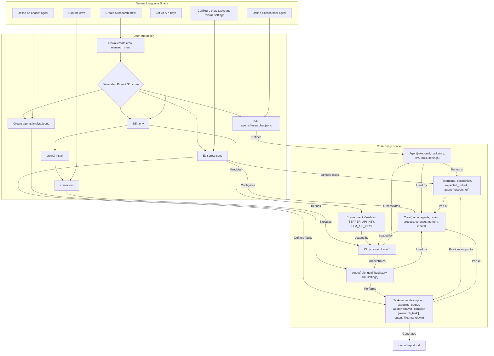

<!-- source: DeepWiki mcp.deepwiki.com · repo crewAIInc/crewAI · page 11.3 Examples and Cookbooks · fetched 2026-11-09 -->

# 11.3 Examples and Cookbooks

<details>
<summary>Relevant source files</summary>

The following files were used as context for generating this wiki page:

- [docs/edge/ar/examples/cookbooks.mdx](docs/edge/ar/examples/cookbooks.mdx)
- [docs/edge/ar/examples/example.mdx](docs/edge/ar/examples/example.mdx)
- [docs/edge/ar/guides/crews/first-crew.mdx](docs/edge/ar/guides/crews/first-crew.mdx)

</details>


This page serves as a central reference for example projects and cookbooks that demonstrate end-to-end implementations of Crews and Flows within the CrewAI framework. These resources are designed to help users quickly understand common patterns, best practices, and advanced features through practical, runnable code.

## Quickstarts and Cookbooks

Cookbooks provide focused examples, often in Jupyter Notebook format, to illustrate specific CrewAI features or patterns. They are ideal for quickly learning how to implement a particular functionality.

### Collaboration
This cookbook demonstrates how to coordinate multiple agents on shared tasks, showcasing the collaborative capabilities of CrewAI. It includes a comprehensive collaboration pattern notebook.
[docs/edge/ar/examples/cookbooks.mdx:11-13]()

### Planning
Learn how to enable agents to think through multi-stage plans before execution, utilizing planning tools to achieve complex goals.
[docs/edge/ar/examples/cookbooks.mdx:15-17]()

### Reasoning
Explore self-reflection loops, critique prompts, and structured reasoning patterns to enhance agent intelligence and decision-making.
[docs/edge/ar/examples/cookbooks.mdx:19-21]()

### Structured Guardrails
This example illustrates how to apply task-level guardrails with retry mechanisms, validation functions, and safe alternatives to ensure robust and reliable agent outputs.
[docs/edge/ar/examples/cookbooks.mdx:25-27]()

### Gemini Search Grounding
Connect CrewAI with Gemini, leveraging search grounding for factual, citation-rich outputs.
[docs/edge/ar/examples/cookbooks.mdx:29-31]()

### Gemini Video Summaries
Create video summaries using Gemini's multimodal model and CrewAI orchestration.
[docs/edge/ar/examples/cookbooks.mdx:33-35]()

For a complete list of quickstarts and to request new cookbooks, refer to the official CrewAI quickstarts repository and community forum.
[docs/edge/ar/examples/cookbooks.mdx:39-44]()

Sources:
- [docs/edge/ar/examples/cookbooks.mdx]()

## Example Projects

The CrewAI examples repository provides more comprehensive, production-ready applications demonstrating how Crews and Flows can be combined to solve real-world problems. These examples are categorized by their primary focus: Crews, Flows, and Integrations.

### Crews

These examples showcase various Crew configurations, demonstrating how different agents can be orchestrated to achieve specific objectives.

#### Marketing Strategy Crew
A multi-agent crew designed for planning marketing campaigns.
[docs/edge/ar/examples/example.mdx:10-12]()

#### Surprise Trip Crew
An example of a crew that plans personalized surprise trips.
[docs/edge/ar/examples/example.mdx:13-15]()

#### Match Profile to Positions Crew
This crew matches resumes to job positions using vector search.
[docs/edge/ar/examples/example.mdx:16-18]()

#### Job Posting Crew
Automates the creation of job descriptions.
[docs/edge/ar/examples/example.mdx:19-21]()

#### Game Builder Crew
A multi-agent team that designs and builds Python games.
[docs/edge/ar/examples/example.mdx:22-24]()

#### Recruitment Crew
Focuses on sourcing and evaluating candidates.
[docs/edge/ar/examples/example.mdx:25-27]()

For a full list of Crew examples, visit the CrewAI examples repository.
[docs/edge/ar/examples/example.mdx:29-31]()

Sources:
- [docs/edge/ar/examples/example.mdx]()

### Flows

These examples demonstrate the use of Flows for event-driven orchestration, state management, and complex control flow.

#### Content Creator Flow
A multi-crew content creation flow with routing capabilities.
[docs/edge/ar/examples/example.mdx:37-39]()

#### Email Auto Responder Flow
Monitors emails and provides automated responses.
[docs/edge/ar/examples/example.mdx:40-42]()

#### Lead Score Flow
Qualifies leads with human intervention.
[docs/edge/ar/examples/example.mdx:43-45]()

#### Meeting Assistant Flow
Processes notes with various integrations.
[docs/edge/ar/examples/example.mdx:46-48]()

#### Self-Evaluation Loop Flow
An iterative self-improvement workflow.
[docs/edge/ar/examples/example.mdx:49-51]()

#### Write a Book (Flows)
Creates chapters in parallel using Flows.
[docs/edge/ar/examples/example.mdx:52-54]()

For a full list of Flow examples, visit the CrewAI examples repository.
[docs/edge/ar/examples/example.mdx:56-58]()

Sources:
- [docs/edge/ar/examples/example.mdx]()

### Integrations

These examples highlight how CrewAI can integrate with other frameworks and specific LLM providers.

#### CrewAI ↔ LangGraph
Demonstrates integration with the LangGraph framework.
[docs/edge/ar/examples/example.mdx:63-65]()

#### Azure OpenAI
Shows how to use CrewAI with Azure OpenAI models.
[docs/edge/ar/examples/example.mdx:66-68]()

#### NVIDIA Models
Integrations with the NVIDIA ecosystem.
[docs/edge/ar/examples/example.mdx:69-71]()

For a full list of integration examples, visit the CrewAI examples repository.
[docs/edge/ar/examples/example.mdx:73-75]()

Sources:
- [docs/edge/ar/examples/example.mdx]()

### Notebooks

Interactive examples for learning and experimentation.

#### Simple QA Crew + Flow
A basic example combining a QA Crew with a Flow.
[docs/edge/ar/examples/example.mdx:80-82]()

For all interactive notebooks, visit the CrewAI examples repository.
[docs/edge/ar/examples/example.mdx:83-85]()

Sources:
- [docs/edge/ar/examples/example.mdx]()

## Building Your First Crew (JSON-first Approach)

This section provides a step-by-step guide to creating a collaborative AI crew using the JSON-first configuration approach, which is the recommended modern way to define crews.

### Project Structure

When you create a new crew using `crewai create crew <crew_name>`, the CLI generates a standard project structure.
[docs/edge/ar/guides/crews/first-crew.mdx:20-21]()

```text
<crew_name>/
├── .gitignore
├── .env
├── agents/
│   └── researcher.jsonc
├── crew.jsonc
├── knowledge/
├── pyproject.toml
├── README.md
├── skills/
└── tools/
```
[docs/edge/ar/guides/crews/first-crew.mdx:27-39]()

This structure separates agent definitions (`agents/*.jsonc`), crew and task configurations (`crew.jsonc`), and other resources like knowledge bases and skills. For those preferring the classic Python-based configuration, the `--classic` flag can be used with the `crewai create` command.
[docs/edge/ar/guides/crews/first-crew.mdx:41-43]()

### Defining Agents

Agents are defined in individual `.jsonc` files within the `agents/` directory. Each file specifies the agent's `role`, `goal`, `backstory`, `llm`, `tools`, and `settings`. The file name (e.g., `researcher.jsonc`) corresponds to the agent's identifier used in `crew.jsonc`.
[docs/edge/ar/guides/crews/first-crew.mdx:46-47]()

#### Example: Researcher Agent
```jsonc agents/researcher.jsonc
{
  "role": "Senior Research Specialist for {topic}",
  "goal": "Find comprehensive and accurate information about {topic}, with a focus on recent developments and key insights.",
  "backstory": "You are an experienced research specialist who organizes complex information into clear, useful notes.",
  "llm": "provider/model-id",
  "tools": ["SerperDevTool"],
  "settings": {
    "verbose": true,
    "allow_delegation": false
  }
}
```
[docs/edge/ar/guides/crews/first-crew.mdx:49-61]()

#### Example: Analyst Agent
```jsonc agents/analyst.jsonc
{
  "role": "Report Analyst for {topic}",
  "goal": "Turn research findings into a clear, well-structured report.",
  "backstory": "You are a careful analyst with strong technical writing skills and a talent for extracting useful insights.",
  "llm": "provider/model-id",
  "settings": {
    "verbose": true,
    "allow_delegation": false
  }
}
```
[docs/edge/ar/guides/crews/first-crew.mdx:63-74]()

The `llm` field should be replaced with your specific LLM provider and model ID, such as `openai/gpt-4o`.
[docs/edge/ar/guides/crews/first-crew.mdx:55-55, 70-70, 78-79]()

### Defining Tasks and Crew Settings

The `crew.jsonc` file defines the overall crew configuration, including the list of agents, tasks, process type, and global settings.
[docs/edge/ar/guides/crews/first-crew.mdx:81-82]()

```jsonc crew.jsonc
{
  "name": "Research Crew",
  "agents": ["researcher", "analyst"],
  "tasks": [
    {
      "name": "research_task",
      "description": "Conduct thorough research on {topic}. Focus on key concepts, recent developments, major challenges, notable applications, and future outlook.",
      "expected_output": "A comprehensive research document with organized sections, specific facts, and useful examples about {topic}.",
      "agent": "researcher"
    },
    {
      "name": "analysis_task",
      "description": "Analyze the research findings and create a polished report on {topic}. Include an executive summary, key insights, trend analysis, and recommendations.",
      "expected_output": "A professional markdown report with clear headings, a concise summary, main findings, and recommendations.",
      "agent": "analyst",
      "context": ["research_task"],
      "output_file": "output/report.md",
      "markdown": true
    }
  ],
  "process": "sequential",
  "verbose": true,
  "memory": true,
  "inputs": {
    "topic": "Artificial Intelligence in Healthcare"
  }
}
```
[docs/edge/ar/guides/crews/first-crew.mdx:84-111]()

Key elements in `crew.jsonc`:
- `"agents"`: A list of agent identifiers (matching the filenames in `agents/`).
- `"tasks"`: An array of task definitions. Each task specifies its `name`, `description`, `expected_output`, and the `agent` responsible for it.
- `"context"`: For a task, this field specifies the names of previous tasks whose outputs should be provided as context to the current task.
- `"output_file"`: Specifies a file path to save the task's output.
- `"markdown"`: If `true`, indicates the output should be formatted as markdown.
- `"process"`: Defines the execution flow (e.g., `"sequential"`).
- `"inputs"`: Provides default values for variables used in agent roles or task descriptions (e.g., `{topic}`). If an input is not provided here, `crewai run` will prompt the user for it.
[docs/edge/ar/guides/crews/first-crew.mdx:100-100, 101-101, 102-102, 105-105, 106-106, 107-107, 108-110]()

### Environment Variables

Sensitive information like API keys should be stored in the `.env` file.
[docs/edge/ar/guides/crews/first-crew.mdx:117-123]()

```sh
SERPER_API_KEY=your_serper_api_key
# Add your model provider key as well.
```
[docs/edge/ar/guides/crews/first-crew.mdx:119-122]()

### Installation and Execution

After configuring the agents and crew, install dependencies and run the crew using the CrewAI CLI.
[docs/edge/ar/guides/crews/first-crew.mdx:128-130]()

```bash
crewai install
crewai run
```
[docs/edge/ar/guides/crews/first-crew.mdx:128-130]()

Upon completion, the output will be saved to the specified `output_file`.
[docs/edge/ar/guides/crews/first-crew.mdx:132-132]()

**Security Warning**: Always run JSON crew projects from trusted sources, as `custom:<name>` tools and `{"python": "module.attribute"}` references execute local Python code when the crew is loaded.
[docs/edge/ar/guides/crews/first-crew.mdx:135-137]()

Sources:
- [docs/edge/ar/guides/crews/first-crew.mdx]()

### Diagram: JSON-first Crew Configuration Flow



Sources:
- [docs/edge/ar/guides/crews/first-crew.mdx:27-39]()
- [docs/edge/ar/guides/crews/first-crew.mdx:49-61]()
- [docs/edge/ar/guides/crews/first-crew.mdx:63-74]()
- [docs/edge/ar/guides/crews/first-crew.mdx:84-111]()
- [docs/edge/ar/guides/crews/first-crew.mdx:119-122]()
- [crewai/cli/main.py]() (Implicitly, as the entry point for `crewai run`)

---

