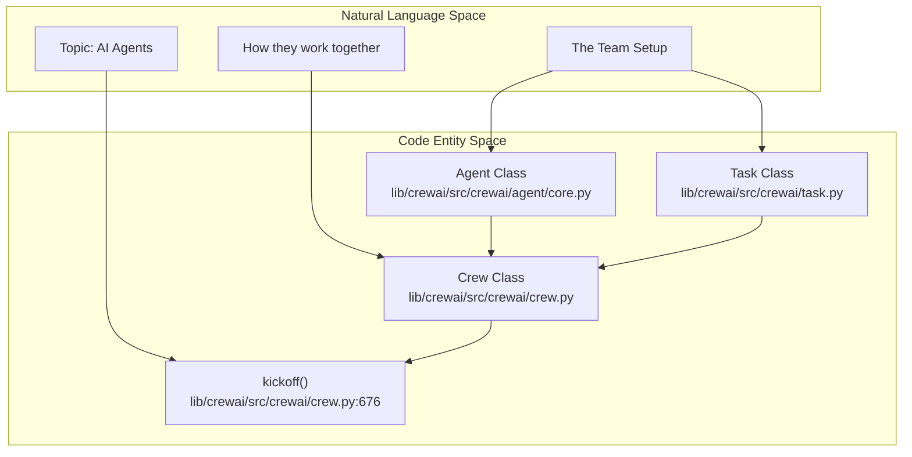
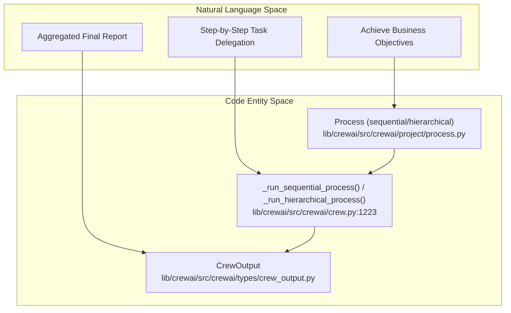
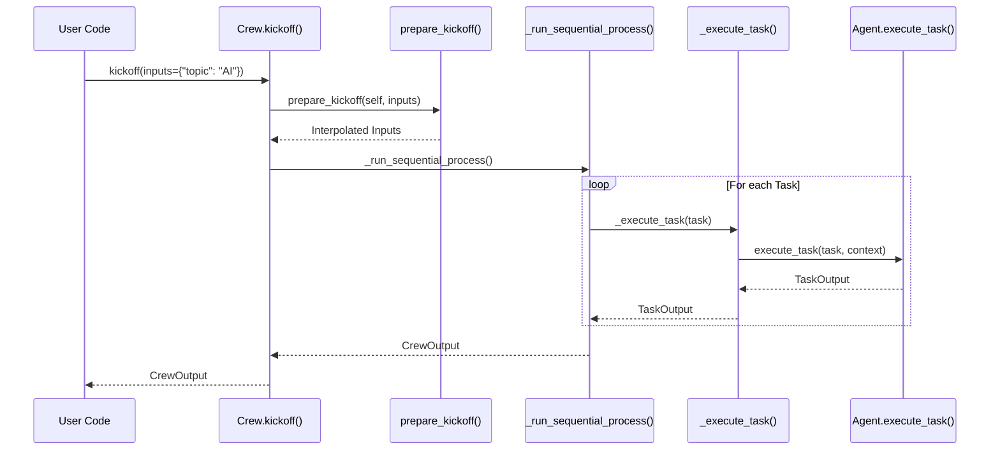
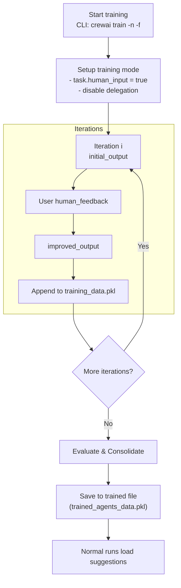

<!-- source: DeepWiki mcp.deepwiki.com · repo crewAIInc/crewAI · page 2.1 Crew Configuration and Orchestration · fetched 2026-11-09 -->

# Crew Configuration and Orchestration

Relevant source files

The following files were used as context for generating this wiki page:

- [docs/edge/ar/concepts/crews.mdx](docs/edge/ar/concepts/crews.mdx)
- [docs/edge/ar/concepts/planning.mdx](docs/edge/ar/concepts/planning.mdx)
- [docs/edge/ar/concepts/processes.mdx](docs/edge/ar/concepts/processes.mdx)
- [docs/edge/ar/concepts/training.mdx](docs/edge/ar/concepts/training.mdx)
- [docs/edge/ar/learn/hierarchical-process.mdx](docs/edge/ar/learn/hierarchical-process.mdx)

This page covers how to configure and orchestrate Crews in CrewAI. A Crew represents a collaborative group of agents working together to achieve a set of tasks. This documentation includes defining crews using JSONC/YAML or decorators, configuring process types (sequential vs hierarchical), managing the planning feature, executing crews via various kickoff methods, and managing lifecycles including training and async execution.

---

## Crew Class Overview

The `Crew` class [lib/crewai/src/crewai/crew.py:136-306]() is the central orchestration component. It manages agents, tasks, and their execution flow, inheriting from `FlowTrackable` and `BaseModel` for workflow integration and Pydantic validation.

### Core Attributes

| Attribute | Type | Default | Description |
|-----------|------|---------|-------------|
| `agents` | `list[BaseAgent]` | `[]` | List of agents in the crew [lib/crewai/src/crewai/crew.py:143]() |
| `tasks` | `list[Task]` | `[]` | List of tasks to be executed [lib/crewai/src/crewai/crew.py:142]() |
| `process` | `Process` | `Process.sequential` | Execution process (sequential/hierarchical) [lib/crewai/src/crewai/crew.py:152-153]() |
| `verbose` | `bool` | `False` | Level of logging detail [lib/crewai/src/crewai/crew.py:154]() |
| `memory` | `bool` | `False` | Enable unified memory features [lib/crewai/src/crewai/crew.py:146-147]() |
| `cache` | `bool` | `True` | Cache tool execution results [lib/crewai/src/crewai/crew.py:148-149]() |
| `planning` | `bool` | `False` | Generate step-by-step plans before execution [lib/crewai/src/crewai/crew.py:167]() |
| `max_rpm` | `int \| None` | `None` | Overrides individual agent RPM limits [lib/crewai/src/crewai/crew.py:156-157]() |
| `manager_llm` | `BaseLLM \| None` | `None` | LLM for the manager agent in hierarchical processes [lib/crewai/src/crewai/crew.py:144]() |
| `knowledge_sources` | `list` | `None` | Knowledge sources accessible to all agents in the crew [docs/edge/ar/concepts/crews.mdx:34]() |
| `stream` | `bool` | `False` | Enable streaming output for real-time updates [docs/edge/ar/concepts/crews.mdx:35]() |

Sources: [lib/crewai/src/crewai/crew.py:136-306](), [docs/edge/ar/concepts/crews.mdx:14-35]()

### Validation and Constraints

The Crew class performs strict validation at initialization [lib/crewai/src/crewai/crew.py:404-564]():
- **Hierarchical Process**: Requires either a `manager_llm` or a `manager_agent` [lib/crewai/src/crewai/crew.py:404-426]().
- **Sequential Process**: Every task must have an assigned agent [lib/crewai/src/crewai/crew.py:449-460]().
- **Task Dependencies**: Context dependencies cannot reference future tasks [lib/crewai/src/crewai/crew.py:548-564]().
- **Async Tasks**: Only one async task is permitted, and it must be the last in the list [lib/crewai/src/crewai/crew.py:462-481]().

Sources: [lib/crewai/src/crewai/crew.py:404-564]()

---

## Configuration Methods

CrewAI supports three primary methods for configuration: JSONC/YAML (recommended for new projects), the `@CrewBase` decorator, and direct instantiation.

### Natural Language to Code Entity Mapping: Crew Initialization

Sources: [lib/crewai/src/crewai/crew.py:136-172](), [lib/crewai/src/crewai/agent/core.py:126-151](), [lib/crewai/src/crewai/task.py:87-110]()

### JSONC/YAML Configuration (Recommended)

New projects created via `crewai create crew <name>` use `crew.jsonc` or `crew.json` to define settings [docs/edge/ar/concepts/crews.mdx:45-49](). The CLI tool `crewai run` automatically detects these files and loads the referenced agents and tasks [docs/edge/ar/concepts/crews.mdx:47]().

Sources: [docs/edge/ar/concepts/crews.mdx:41-49]()

### Decorator-Based Configuration (CrewBase)

The `@CrewBase` pattern uses methods to define agents and tasks.
- `@agent`: Marks a method that returns an `Agent` [lib/crewai/tests/test_project.py:43-89]().
- `@task`: Marks a method that returns a `Task` [lib/crewai/tests/test_project.py:43-89]().
- `@crew`: Marks the method that instantiates the `Crew` using `self.agents` and `self.tasks` [lib/crewai/tests/test_project.py:43-89]().

Sources: [lib/crewai/tests/test_project.py:43-89]()

---

## Execution and Orchestration

### Natural Language to Code Entity Mapping: Crew Execution

Sources: [lib/crewai/src/crewai/crew.py:1223-1320](), [lib/crewai/src/crewai/types/crew_output.py:1-50]()

### Execution Data Flow

Sources: [lib/crewai/src/crewai/crew.py:676-735](), [lib/crewai/src/crewai/crew.py:1223-1320](), [lib/crewai/src/crewai/crews/utils.py:60-63]()

### Kickoff Methods

CrewAI provides multiple ways to trigger execution, ranging from synchronous to native asynchronous methods [docs/edge/ar/learn/kickoff-async.mdx:13-19]():

- **`kickoff()`**: Synchronous execution. Handles input interpolation and routes execution to sequential or hierarchical logic [lib/crewai/src/crewai/crew.py:676-735]().
- **`akickoff()`**: Native asynchronous implementation. Uses `async/await` across the entire chain, including memory and knowledge operations [docs/edge/ar/learn/kickoff-async.mdx:24-32]().
- **`kickoff_async()`**: Thread-based asynchronous execution. Wraps the synchronous `kickoff()` in `asyncio.to_thread` [docs/edge/ar/learn/kickoff-async.mdx:162-168]().
- **`kickoff_for_each()`**: Executes the crew for each set of inputs in a list [lib/crewai/src/crewai/crew.py:737-762]().
- **`akickoff_for_each()`**: Native async version of `kickoff_for_each` for processing multiple input sets concurrently [docs/edge/ar/learn/kickoff-async.mdx:121-123]().

Sources: [lib/crewai/src/crewai/crew.py:676-762](), [docs/edge/ar/learn/kickoff-async.mdx:13-168]()

---

## Advanced Features

### Planning
When `planning=True` is set [docs/edge/ar/concepts/planning.mdx:15-27](), the crew sends information to an `AgentPlanner` before execution. The planner generates a step-by-step plan for each task [docs/edge/ar/concepts/planning.mdx:10-11]().
- **`planning_llm`**: Users can specify a custom LLM for planning (default is `gpt-4o-mini`) [docs/edge/ar/concepts/planning.mdx:33-55]().

Sources: [docs/edge/ar/concepts/planning.mdx:1-55]()

### Training and Lifecycle Management
The training feature allows improving agent performance through human feedback [docs/edge/ar/concepts/training.mdx:8-15]().
- **CLI**: `crewai train -n <n_iterations> -f <filename.pkl>` [docs/edge/ar/concepts/training.mdx:24-26]().
- **Process**: During training, tasks are set to `human_input = True` and delegation is disabled [docs/edge/ar/concepts/training.mdx:67]().
- **Output**: After iterations, the system consolidates feedback into `suggestions` that are automatically loaded in subsequent non-training runs to guide the agent [docs/edge/ar/concepts/training.mdx:101-106]().

### Training Data Flow

Sources: [docs/edge/ar/concepts/training.mdx:65-87]()

---

## Callbacks and Hooks

| Callback | Attribute | Timing |
|----------|-----------|--------|
| **Task Callback** | `task_callback` | Executed after each task finishes [lib/crewai/src/crewai/crew.py:222-225]() |
| **Step Callback** | `step_callback` | Executed after every agent step [lib/crewai/src/crewai/crew.py:218-222]() |
| **Kickoff Hooks** | `before_kickoff_callbacks` / `after_kickoff_callbacks` | Run before the crew starts or after it completes [lib/crewai/src/crewai/crew.py:226-241]() |

Sources: [lib/crewai/src/crewai/crew.py:218-241](), [docs/edge/ar/concepts/crews.mdx:27-28]()

---

