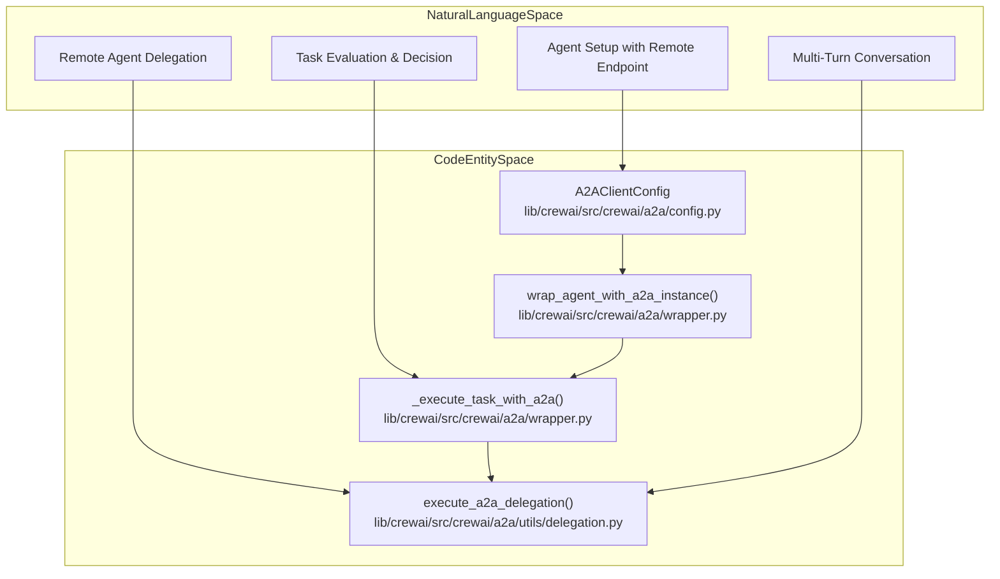
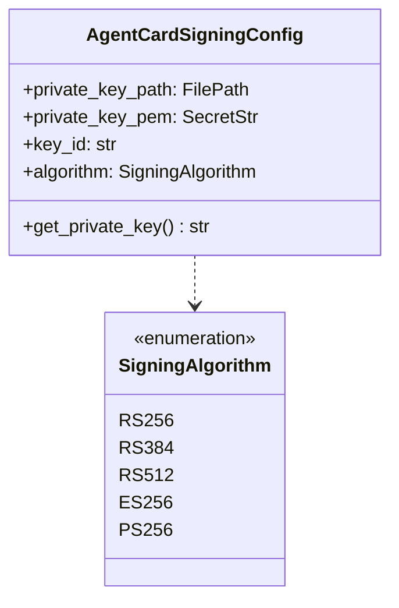
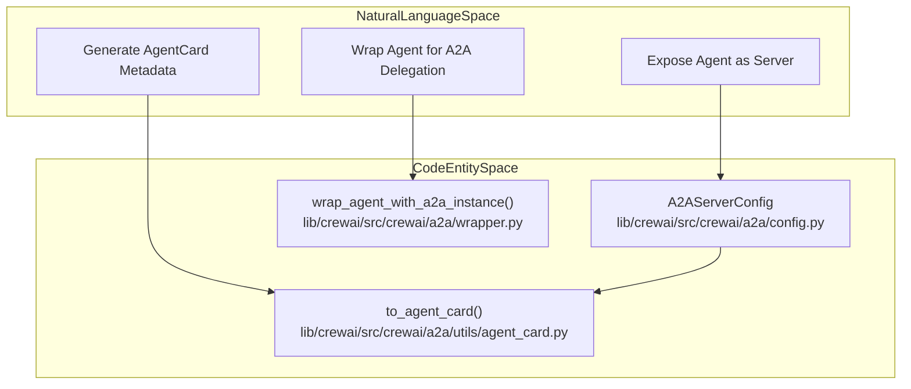

<!-- source: DeepWiki mcp.deepwiki.com · repo crewAIInc/crewAI · page 2.4 Agent-to-Agent (A2A) Protocol · fetched 2026-11-09 -->

# Agent-to-Agent (A2A) Protocol

Relevant source files

The following files were used as context for generating this wiki page:

- [.github/codeql/codeql-config.yml](.github/codeql/codeql-config.yml)
- [docs/edge/ar/learn/a2a-agent-delegation.mdx](docs/edge/ar/learn/a2a-agent-delegation.mdx)

## Purpose and Scope

This document details the implementation of the Agent-to-Agent (A2A) protocol within CrewAI. The A2A protocol establishes a standardized mechanism for autonomous agents to delegate tasks, exchange structured payloads, maintain multi-turn conversations across system boundaries, and expose agent instances as A2A-compliant servers. 

For general agent configuration, refer to [Agents](#2.2). For task execution semantics, see [Tasks](#2.3). For state persistence during long-running delegation sequences, refer to [Checkpointing and Flow Recovery](#8.2).

Sources: `[docs/edge/ar/learn/a2a-agent-delegation.mdx:10-25]`, `[lib/crewai/src/crewai/a2a/wrapper.py:1-51]`

---

## Overview and Architecture

CrewAI treats the A2A protocol as a first-class delegation primitive. When an agent is configured with A2A parameters, it dynamically evaluates incoming tasks to decide whether to execute them locally or delegate them to a remote A2A-compliant agent.

Below is a diagram mapping the conceptual delegation flow (Natural Language Space) to the concrete execution functions and classes in the codebase (Code Entity Space).

### Diagram: Natural Language to Code Entity Mapping for A2A Delegation

Sources: `[lib/crewai/src/crewai/a2a/config.py:458-538]`, `[lib/crewai/src/crewai/a2a/wrapper.py:97-238]`, `[lib/crewai/src/crewai/a2a/utils/delegation.py:89-118]`

---

## Configuration Types

CrewAI provides explicit configuration dataclasses and Pydantic models for managing client connections and server exposures.

### A2AClientConfig

The `A2AClientConfig` class configures an agent to discover and communicate with remote A2A agents.

| Field | Type | Default | Description |
|-------|------|---------|-------------|
| `endpoint` | `str` | *required* | Target endpoint URL (typically `.well-known/agent-card.json`) |
| `auth` | `ClientAuthScheme \| None` | `None` | Authentication scheme (Bearer, API Key, OAuth2) |
| `timeout` | `int` | `120` | Request timeout in seconds |
| `max_turns` | `int` | `10` | Maximum conversation turns with the remote agent |
| `response_model` | `type[BaseModel] \| None` | `None` | Optional Pydantic model for strict structured validation |
| `fail_fast` | `bool` | `True` | Raise connection errors immediately vs. failing soft |
| `trust_remote_completion_status` | `bool` | `False` | Return remote agent payload directly upon completion |
| `updates` | `UpdateConfig` | `StreamingConfig()` | Update mechanism (Streaming, Polling, or Push Notifications) |
| `accepted_output_modes` | `list[str]` | `["application/json"]` | Supported MIME types |
| `extensions` | `list[str]` | `[]` | Protocol extension URIs |
| `transport` | `ClientTransportConfig` | *(defaults)* | Transport configuration parameters |

Sources: `[lib/crewai/src/crewai/a2a/config.py:458-538]`

### A2AServerConfig

The `A2AServerConfig` class exposes an agent as a standardized A2A server instance.

| Field | Type | Default | Description |
|-------|------|---------|-------------|
| `name` | `str \| None` | *(agent role)* | Human-readable server name |
| `description` | `str \| None` | *(goal + backstory)* | Description of agent skills |
| `version` | `str` | `"1.0.0"` | Agent Card version string |
| `skills` | `list[AgentSkill]` | `[]` | Exposed agent capabilities |
| `capabilities` | `AgentCapabilities` | `AgentCapabilities(...)` | Feature flags (streaming, push notifications) |
| `protocol_version` | `ProtocolVersion` | `"0.3.0"` | A2A protocol spec version |
| `signing_config` | `AgentCardSigningConfig \| None` | `None` | JWS cryptographic signing settings |
| `transport` | `ServerTransportConfig` | *(defaults)* | Transport and binding settings |
| `auth` | `ServerAuthScheme \| None` | `None` | Server-side authentication schemes |

Sources: `[lib/crewai/src/crewai/a2a/config.py:540-691]`

### Authentication Schemes and AgentCardSigningConfig

Authentication is handled via modular auth schemes defined in configuration. Cryptographic signing of `AgentCard` metadata uses `AgentCardSigningConfig`.

Sources: `[lib/crewai/src/crewai/a2a/config.py:71-131]`

---

## Agent Wrapping, Method Injection, and AgentCard Generation

### Diagram: Method Wrapping and Agent Card Generation Mapping

Sources: `[lib/crewai/src/crewai/a2a/config.py:540-691]`, `[lib/crewai/src/crewai/a2a/utils/agent_card.py:1-100]`, `[lib/crewai/src/crewai/a2a/wrapper.py:38-39]`

When an agent is initialized with an `A2AServerConfig`, `inject_a2a_server_methods()` injects the `to_agent_card()` builder method. For client instances, `wrap_agent_with_a2a_instance()` intercepts `execute_task`, `aexecute_task`, `kickoff`, and `kickoff_async` to inject prompt augmentations and delegation handlers.

Sources: `[lib/crewai/src/crewai/a2a/wrapper.py:97-238]`, `[lib/crewai/src/crewai/a2a/utils/agent_card.py:1-100]`

---

## Delegation Flow and Multi-Turn Conversations

1. **Agent Card Discovery**: Remote agent cards are fetched concurrently via `_fetch_agent_cards_concurrently()` with caching enabled (`cache_ttl`).
2. **Prompt Augmentation**: `_augment_prompt_with_a2a()` inserts remote capability manifests into the agent prompt context.
3. **Execution Routing**: When the LLM chooses delegation (`is_a2a=true`), `execute_a2a_delegation()` or `aexecute_a2a_delegation()` orchestrates the remote procedure call.
4. **Multi-Turn Handling**: Conversation state is tracked via `DelegationState` to handle back-and-forth communication across multiple turns up to `max_turns`.

Sources: `[lib/crewai/src/crewai/a2a/wrapper.py:61-95]`, `[lib/crewai/src/crewai/a2a/utils/agent_card.py:103-154]`, `[lib/crewai/src/crewai/a2a/utils/delegation.py:89-200]`

---

## Transport Protocols and Update Mechanisms

CrewAI supports JSON-RPC, gRPC, and HTTP+JSON transports. Transport negotiation is managed by `negotiate_transport()` comparing client configuration against remote server agent cards.

Update mechanisms are registered in `HANDLER_REGISTRY`:
- `StreamingConfig` -> `StreamingHandler` (Server-Sent Events)
- `PollingConfig` -> `PollingHandler` (Periodic polling)
- `PushNotificationConfig` -> `PushNotificationHandler` (Webhooks)

Sources: `[lib/crewai/src/crewai/a2a/config.py:132-359]`, `[lib/crewai/src/crewai/a2a/types.py:100-104]`, `[lib/crewai/src/crewai/a2a/utils/delegation.py:63-133]`

---

## Events and Error Handling

### Events
The A2A system emits fine-grained telemetry events through the event bus:
- `A2ADelegationStartedEvent`
- `A2AMessageSentEvent`
- `A2AResponseReceivedEvent`
- `A2AConversationCompletedEvent`

Sources: `[lib/crewai/src/crewai/events/types/a2a_events.py:57-190]`, `[lib/crewai/src/crewai/events/event_types.py:1-26]`

### Error Codes
A2A errors conform to JSON-RPC 2.0 conventions alongside specialized framework extensions:
- `-32700`: Parse error
- `-32601`: Method not found
- `-32001`: Task not found
- `-32015`: Transport negotiation failed

Sources: `[lib/crewai/src/crewai/a2a/errors.py:25-100]`

---

## Enterprise A2A Features

Enterprise deployments leverage secure mutual TLS (mTLS), JWS-signed agent card verification, and centralized secrets management via CrewAI AMP to govern multi-organization agent federation. Enterprise runners enforce strict audit logging and prompt injection guardrails on all incoming A2A message payloads.

Sources: `[lib/crewai/src/crewai/a2a/config.py:71-131]`, `[lib/crewai/src/crewai/a2a/wrapper.py:1-51]`

---

