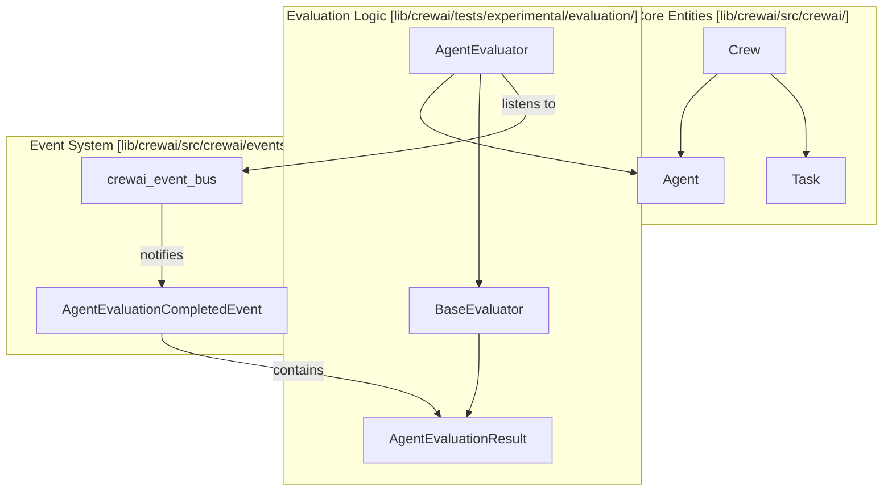
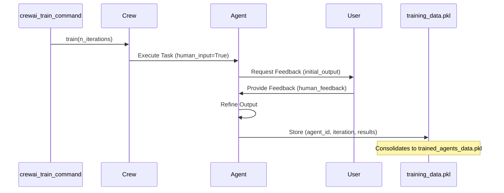

<!-- source: DeepWiki mcp.deepwiki.com · repo crewAIInc/crewAI · page 2.6 Agent Evaluation and Testing · fetched 2026-11-09 -->

# Agent Evaluation and Testing

<details>
<summary>Relevant source files</summary>

The following files were used as context for generating this wiki page:

- [docs/edge/ar/concepts/testing.mdx](docs/edge/ar/concepts/testing.mdx)
- [docs/edge/ar/guides/concepts/evaluating-use-cases.mdx](docs/edge/ar/guides/concepts/evaluating-use-cases.mdx)

</details>


This page documents the experimental `AgentEvaluator` framework, evaluation metrics, the experiment runner, and how to test agent performance using built-in CLI and hook mechanisms within CrewAI.

## CLI-Based Testing

The `crewai test` command allows for automated, multi-iteration testing of a crew to establish performance baselines and identify regressions.

### Execution and Metrics
Running `crewai test` executes the crew for a specified number of iterations (defaulting to 2) using a designated evaluator model (defaulting to `gpt-4o-mini`) [docs/edge/ar/concepts/testing.mdx:12-14]().

The command generates a performance table summarizing:
*   **Task Scores**: A 1-10 rating for each task completed by the agents [docs/edge/ar/concepts/testing.mdx:36-45]().
*   **Crew Score**: An aggregated average performance score for the entire crew [docs/edge/ar/concepts/testing.mdx:46]().
*   **Execution Time**: The total duration in seconds for each run [docs/edge/ar/concepts/testing.mdx:47]().

```bash
# Run 5 iterations using GPT-4o as the evaluator
crewai test --n_iterations 5 --model gpt-4o
```
Sources: [docs/edge/ar/concepts/testing.mdx:20-30]()

## AgentEvaluator Framework

The `AgentEvaluator` is the central orchestrator for running deep evaluations on one or more agents within a `Crew`. It manages the execution state, coordinates specialized evaluators, and aggregates results.

### Key Components and Data Flow
The `AgentEvaluator` operates by listening to the `crewai_event_bus` for agent-related events. When an agent completes a task, the evaluator triggers the configured metrics.

1.  **Initialization**: The `AgentEvaluator` is initialized with a list of `Agent` instances and a collection of `BaseEvaluator` implementations [lib/crewai/tests/experimental/evaluation/test_agent_evaluator.py:60-62]().
2.  **Execution State**: It maintains an internal `_execution_state` to track iterations, which is used for multi-run testing and training cycles [lib/crewai/tests/experimental/evaluation/test_agent_evaluator.py:54-55]().
3.  **Event Handling**: It emits and listens for specific lifecycle events:
    *   `AgentEvaluationStartedEvent`: Triggered when a metric begins analysis [lib/crewai/tests/experimental/evaluation/test_agent_evaluator.py:151-154]().
    *   `AgentEvaluationCompletedEvent`: Triggered upon successful scoring and feedback generation [lib/crewai/tests/experimental/evaluation/test_agent_evaluator.py:156-164]().
    *   `AgentEvaluationFailedEvent`: Triggered if an error occurs during the evaluation process [lib/crewai/tests/experimental/evaluation/test_agent_evaluator.py:165-166]().

### Agent Evaluation Architecture

Title: "Agent Evaluation System Components"

Sources: [lib/crewai/tests/experimental/evaluation/test_agent_evaluator.py:12-27](), [lib/crewai/tests/experimental/evaluation/test_agent_evaluator.py:48-49]()

## Evaluation Metrics

CrewAI provides several built-in evaluators, each focusing on a specific `MetricCategory`. These metrics return an `EvaluationScore` containing a numerical value (1-5) and text-based feedback.

| Evaluator Class | Metric Category | Focus Area |
| :--- | :--- | :--- |
| `GoalAlignmentEvaluator` | `GOAL_ALIGNMENT` | How well output matches the agent's goal and task description [lib/crewai/tests/experimental/evaluation/test_agent_evaluator.py:113](). |
| `SemanticQualityEvaluator` | `SEMANTIC_QUALITY` | Linguistic quality and coherence of the response [lib/crewai/tests/experimental/evaluation/test_agent_evaluator.py:114](). |
| `ToolSelectionEvaluator` | `TOOL_SELECTION` | Whether the agent chose the correct tool for the context [lib/crewai/tests/experimental/evaluation/test_agent_evaluator.py:115](). |
| `ToolInvocationEvaluator` | `TOOL_INVOCATION` | Correctness of the parameters passed to tools [lib/crewai/tests/experimental/evaluation/test_agent_evaluator.py:117](). |
| `ReasoningEfficiencyEvaluator` | `REASONING_EFFICIENCY` | Logical steps taken and number of iterations used [lib/crewai/tests/experimental/evaluation/test_agent_evaluator.py:118](). |
| `ParameterExtractionEvaluator` | `PARAMETER_EXTRACTION` | Accuracy in extracting structured data from context [lib/crewai/tests/experimental/evaluation/test_agent_evaluator.py:116](). |

The utility function `create_default_evaluator(agents=...)` can be used to quickly instantiate an `AgentEvaluator` equipped with all standard metrics [lib/crewai/tests/experimental/evaluation/test_agent_evaluator.py:108-125]().

Sources: [lib/crewai/tests/experimental/evaluation/test_agent_evaluator.py:108-125]()

## Training as a Testing Mechanism

The `crewai train` feature serves as a specialized testing loop where human feedback is used to evaluate and correct agent behavior.

### Training Data Flow
During training, the system captures `initial_output`, `human_feedback`, and `improved_output` [docs/edge/ar/concepts/training.mdx:91-94](). This data is stored in `training_data.pkl` before being consolidated into `trained_agents_data.pkl` [docs/edge/ar/concepts/training.mdx:110-117]().

Title: "Training and Feedback Loop"

Sources: [docs/edge/ar/concepts/training.mdx:65-87](), [docs/edge/ar/concepts/training.mdx:95-97]()

### Model Requirements for Evaluation
When using smaller LLMs (≤7B parameters) for training evaluation, performance may degrade in areas like JSON output accuracy and reasoning depth [docs/edge/ar/concepts/training.mdx:125-140](). It is recommended to use models like `gpt-4o` or `claude-3-sonnet` for reliable training assessments [docs/edge/ar/concepts/training.mdx:154-156]().

## Hook-Based Testing

For granular technical testing, developers can use hooks to intercept execution state.

*   **`LLMCallHookContext`**: Provides access to `messages` (conversation history), `response` (raw LLM string), and `model_name` [lib/crewai/src/crewai/hooks/llm_hooks.py:51-57]().
*   **`ToolCallHookContext`**: Provides access to `tool_name` and `tool_input` (arguments passed) [lib/crewai/src/crewai/hooks/tool_hooks.py:44-47]().

These can be registered via `register_before_llm_call_hook` or `register_before_tool_call_hook` to validate behavior during automated tests [lib/crewai/src/crewai/hooks/llm_hooks.py:161-164](), [lib/crewai/src/crewai/hooks/tool_hooks.py:124-127]().

Sources:
- `docs/edge/ar/concepts/testing.mdx`
- `docs/edge/ar/concepts/training.mdx`
- `lib/crewai/tests/experimental/evaluation/test_agent_evaluator.py`
- `lib/crewai/src/crewai/hooks/llm_hooks.py`
- `lib/crewai/src/crewai/hooks/tool_hooks.py`

---

