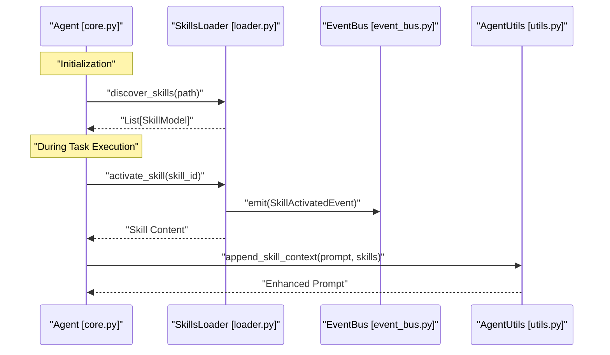
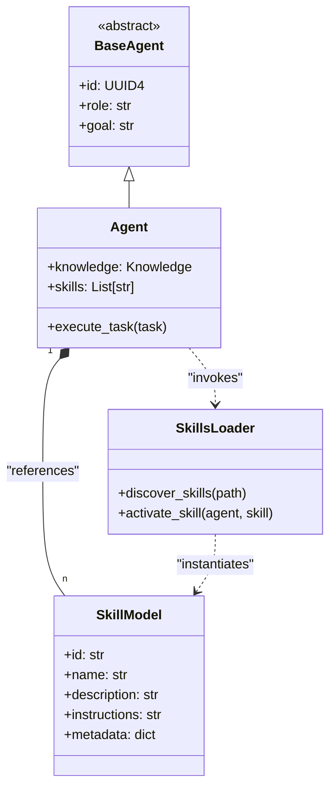

<!-- source: DeepWiki mcp.deepwiki.com · repo crewAIInc/crewAI · page 2.7 Agent Skills · fetched 2026-11-09 -->

# Agent Skills

<details>
<summary>Relevant source files</summary>

The following files were used as context for generating this wiki page:

- [docs/edge/ar/concepts/skills.mdx](docs/edge/ar/concepts/skills.mdx)

</details>


The Agent Skills system in CrewAI provides a mechanism for injecting domain-specific context, behavioral guidelines, and specialized instructions into an agent's prompt. Unlike static backstories, skills are filesystem-based packages that provide expertise without requiring code changes, allowing for modularity and specialized "playbooks" for agent behavior.

## Purpose and Scope

The purpose of this page is to document the Agent Skills architecture, covering how domain-specific context is injected via `SKILL.md` files, progressive disclosure levels, the `SkillsLoader` implementation, and its integration with the `Agent` execution lifecycle.

Sources: [docs/edge/ar/concepts/skills.mdx:10-21](), [lib/crewai/src/crewai/skills/loader.py:81-81]()

---

## Overview

Skills are defined as modular units of expertise that an agent can "activate." This system uses a combination of filesystem-based discovery (via `SKILL.md` files) and a structured loading process to enhance the `Agent`'s system prompt with relevant context.

### Skills vs. Tools
A critical distinction in the framework is the difference between a Skill and a Tool:
- **Skills**: Inject *instructions and context* (e.g., a code review checklist). They tell the agent *how to think* [docs/edge/ar/concepts/skills.mdx:17-17]().
- **Tools**: Provide *callable functions* (e.g., `SerperDevTool`). They allow the agent to *take action* [docs/edge/ar/concepts/skills.mdx:18-18]().

### Key Components

| Component | Description |
| :--- | :--- |
| **SkillModel** | A Pydantic representation of a skill, containing instructions and YAML metadata [lib/crewai/src/crewai/skills/models.py:82-82](). |
| **SkillsLoader** | Responsible for discovering and activating skills from project directories [lib/crewai/src/crewai/skills/loader.py:81-81](). |
| **SKILL.md** | The source file for a skill, containing a YAML frontmatter for metadata and Markdown for instructions [docs/edge/ar/concepts/skills.mdx:185-201](). |
| **SkillActivatedEvent** | An event emitted when a skill is successfully injected into an agent's execution context [lib/crewai/src/crewai/agent/core.py:71-71](). |

Sources: [lib/crewai/src/crewai/agent/core.py:71-82](), [lib/crewai/src/crewai/skills/models.py:82-82](), [lib/crewai/src/crewai/skills/loader.py:81-81](), [docs/edge/ar/concepts/skills.mdx:10-21]()

---

## Data Flow and Implementation

The integration of skills occurs during the agent's initialization and task preparation phases. The `Agent` class utilizes utility functions to append skill-related context to the final prompt sent to the LLM.

### Skill Activation Sequence

The following diagram illustrates how the `Agent` interacts with the `SkillsLoader` to inject context into the execution flow.

Agent Skill Injection Flow

Sources: [lib/crewai/src/crewai/agent/core.py:81-81](), [lib/crewai/src/crewai/agent/utils.py:37-37](), [lib/crewai/src/crewai/skills/loader.py:81-81](), [lib/crewai/src/crewai/events/event_bus.py:52-52]()

### Prompt Enhancement
The function `append_skill_context` is the primary entry point for modifying the agent's prompt with skill data [lib/crewai/src/crewai/agent/utils.py:37-37](). It takes the base prompt and the activated `SkillModel` instances to produce a unified instruction set that is injected into the agent's instructions [docs/edge/ar/concepts/skills.mdx:12-12]().

Sources: [lib/crewai/src/crewai/agent/utils.py:37-37](), [docs/edge/ar/concepts/skills.mdx:12-12]()

---

## Technical Architecture

The relationship between the Agent and its skills is managed through the `BaseAgent` abstraction and implemented concretely in the `Agent` class.

Skill System Class Relationships

Sources: [lib/crewai/src/crewai/agents/agent_builder/base_agent.py:73-121](), [lib/crewai/src/crewai/agent/core.py:126-151](), [lib/crewai/src/crewai/skills/models.py:82-82](), [docs/edge/ar/concepts/skills.mdx:70-76]()

---

## Skill Configuration and Structure

A skill is a directory containing a mandatory `SKILL.md` file and optional supporting assets.

### Folder Structure
```text
skills/
└── code-review/
    ├── SKILL.md          # Required: Metadata + Instructions
    ├── references/       # Optional: Reference documents
    ├── scripts/          # Optional: Supporting scripts
    └── assets/           # Optional: Static files
```
Sources: [docs/edge/ar/concepts/skills.mdx:38-44]()

### SKILL.md Format
The `SKILL.md` file uses a YAML frontmatter to define the skill's identity and requirements.

| Field | Required | Description |
| :--- | :--- | :--- |
| `name` | Yes | 1-64 chars. Identifies the skill [docs/edge/ar/concepts/skills.mdx:50-50](). |
| `description` | Yes | Describes the purpose and guidelines [docs/edge/ar/concepts/skills.mdx:51-51](). |
| `metadata` | No | Arbitrary key-value pairs (author, version) [docs/edge/ar/concepts/skills.mdx:52-55](). |

Sources: [docs/edge/ar/concepts/skills.mdx:38-55]()

---

## Skill Lifecycle and CLI

Skills are managed via the `crewai` CLI, which supports creation, publishing, and installation.

### Commands
- **Create**: `crewai skill create <name>` generates the folder structure and template [docs/edge/ar/concepts/skills.mdx:32-32]().
- **Publish**: `crewai skill publish` pushes the skill to the CrewAI registry, scoped to your organization [docs/edge/ar/concepts/skills.mdx:193-193]().
- **Install**: `crewai skill install @org/name` pulls the skill into the local project or global cache [docs/edge/ar/concepts/skills.mdx:208-208]().

### Local vs. Global Storage
- **In-Project**: Installed in `./skills/{name}/` within a CrewAI project [docs/edge/ar/concepts/skills.mdx:211-211]().
- **Global Cache**: Stored in `~/.crewai/skills/{org}/{name}/` when installed outside a project [docs/edge/ar/concepts/skills.mdx:211-211]().

Sources: [docs/edge/ar/concepts/skills.mdx:175-212]()

---

## AGENTS.md for External Tools

While `SKILL.md` is for CrewAI agents, the framework also supports `AGENTS.md` for guiding external coding tools like Cursor, Windsurf, or Claude Code.

- **Purpose**: Provides project-specific instructions (conventions, commands, architecture notes) to external AI assistants [docs/edge/ar/guides/coding-tools/agents-md.mdx:10-10]().
- **Integration**: Can be renamed to `CLAUDE.md` or `GEMINI.md` to support specific tool requirements [docs/edge/ar/guides/coding-tools/agents-md.mdx:40-50]().

Sources: [docs/edge/ar/guides/coding-tools/agents-md.mdx:8-61]()

---

## Observability

The activation of skills is tracked via the CrewAI telemetry and event system. Every time a skill is added to an agent's context, a `SkillActivatedEvent` is triggered [lib/crewai/src/crewai/agent/core.py:71-71](). This allows developers to trace which skills were active during a specific task execution.

| Event Type | Trigger Point | Data Captured |
| :--- | :--- | :--- |
| `SkillActivatedEvent` | During `activate_skill` call | Skill ID, Agent ID, Timestamp |

Sources: [lib/crewai/src/crewai/agent/core.py:71-71](), [lib/crewai/src/crewai/events/event_bus.py:52-52]()

---

