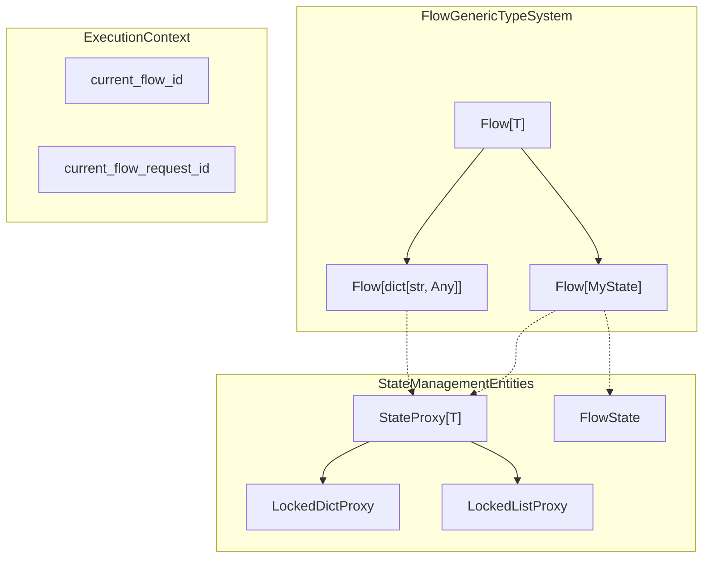
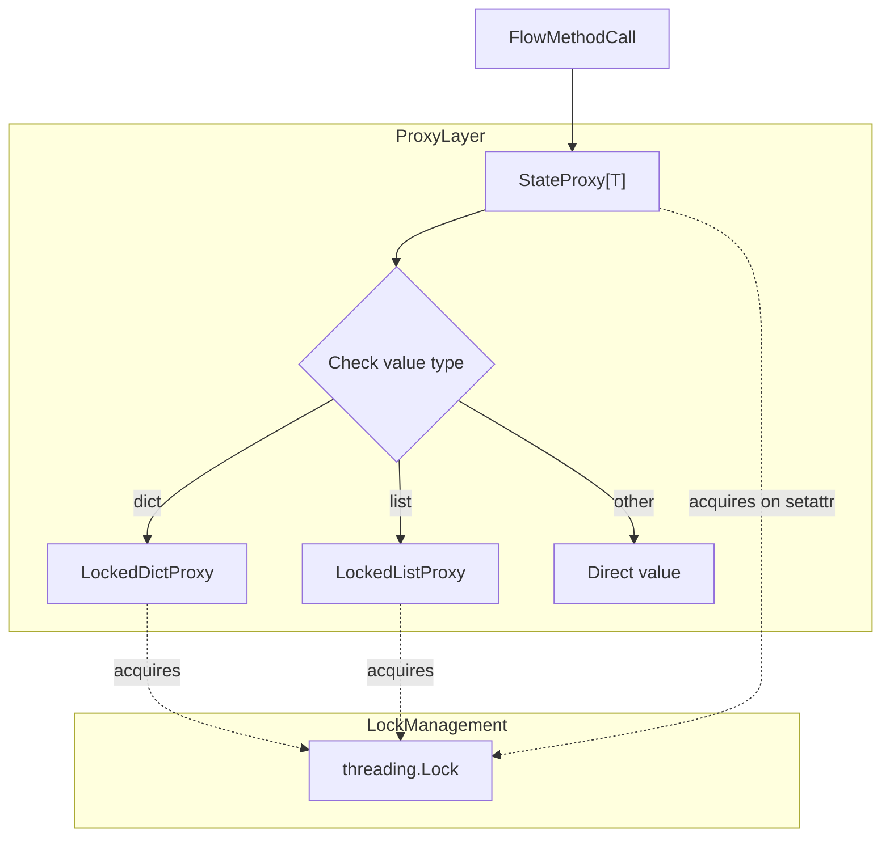
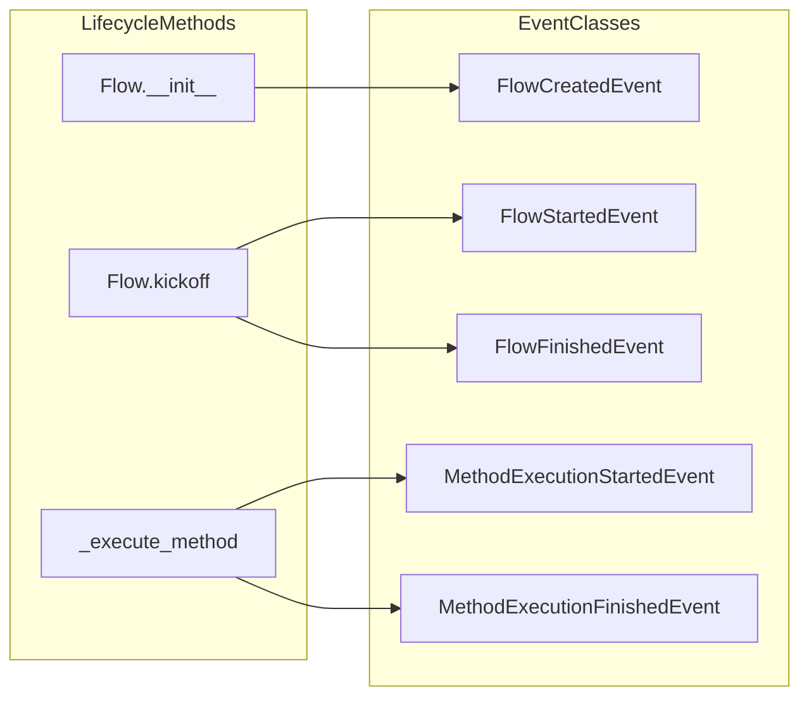

<!-- source: DeepWiki mcp.deepwiki.com · repo crewAIInc/crewAI · page 3.1 Flow Creation and Structure · fetched 2026-11-09 -->

# Flow Creation and Structure

<details>
<summary>Relevant source files</summary>

The following files were used as context for generating this wiki page:

- [docs/edge/ar/concepts/flows.mdx](docs/edge/ar/concepts/flows.mdx)
- [docs/edge/ar/guides/flows/first-flow.mdx](docs/edge/ar/guides/flows/first-flow.mdx)
- [docs/edge/ar/guides/flows/inputs-id-deprecation.mdx](docs/edge/ar/guides/flows/inputs-id-deprecation.mdx)

</details>


## Purpose and Scope

This document explains the `Flow` class architecture, including how to create flows with typed state management, thread-safe state proxies, and the metaclass-based method registration system. It covers the foundational structure needed to build event-driven workflows in CrewAI.

For information about flow decorators (`@start`, `@listen`, `@router`), see [Flow Decorators](3.2). For state persistence and recovery, see [State Management and Persistence](3.3). For composing Crews within Flows, see [Composing Crews within Flows](3.4).

Sources: [docs/edge/ar/concepts/flows.mdx:8-21](), [lib/crewai/src/crewai/flow/flow.py:47]()

## Flow Class Overview

The `Flow` class is the base for all event-driven workflows in CrewAI. It provides structured orchestration over multiple Crews with state management, conditional execution, and routing capabilities. Flows are the recommended production architecture pattern because they offer precise control, state management, and observability.

### Code Entity Space: Flow Architecture
This diagram maps the natural language concepts of "State" and "Execution" to their specific code entities in `crewai.flow.flow`.



Sources: [lib/crewai/src/crewai/flow/flow.py:47](), [lib/crewai/src/crewai/flow/flow.py:47](), [lib/crewai/src/crewai/flow/flow.py:47](), [lib/crewai/src/crewai/flow/flow_context.py:1-15]()

### Basic Flow Structure

A minimal Flow requires:
1. Inheritance from `Flow` (optionally parameterized with state type)
2. At least one `@start()` method to define an entry point
3. Optional `@listen()` and `@router()` methods to define execution topology

```python
from crewai.flow.flow import Flow, start, listen

class SimpleFlow(Flow):
    @start()
    def first_step(self):
        print("Flow started")
        return "data"
    
    @listen(first_step)
    def second_step(self, data):
        print(f"Received: {data}")
```

The `Flow` class uses a metaclass `FlowMeta` that automatically discovers and registers all decorated methods at class creation time.

Sources: [lib/crewai/src/crewai/flow/flow.py:47](), [lib/crewai/src/crewai/flow/flow.py:47]()

## State Management

Flows manage state in two ways: **unstructured** (plain dictionaries) or **structured** (Pydantic `BaseModel`). Both approaches are wrapped in thread-safe proxies to prevent race conditions when parallel listeners modify state.

### Unstructured State (dict)

When no type parameter is provided, the Flow uses a plain dictionary for state. Every unstructured state automatically receives a unique `id` field (UUID) for tracking executions, generated during state initialization.

Sources: [lib/crewai/src/crewai/flow/flow.py:47]()

### Structured State (Pydantic BaseModel)

For type safety and validation, parameterize `Flow` with a Pydantic model. This ensures all state fields are typed and validated. All Pydantic state models automatically inherit from `FlowState`, which adds a unique `id` field for tracking.

Sources: [lib/crewai/src/crewai/flow/flow.py:47](), [lib/crewai/src/crewai/flow/flow.py:47]()

### Thread-Safe State Proxies

All state access goes through proxy classes to ensure thread safety when parallel listeners modify state concurrently.



Sources: [lib/crewai/src/crewai/flow/flow.py:47](), [lib/crewai/src/crewai/flow/flow.py:47](), [lib/crewai/src/crewai/flow/flow.py:47]()

#### StateProxy Implementation

The `StateProxy` class wraps either a dict or Pydantic model and uses `__setattr__` and `__getattr__` to control access:
- **Reads**: Direct access to underlying state.
- **Writes**: Acquire `_proxy_lock` before modification.
- **Nested collections**: Automatically wrapped in `LockedDictProxy` or `LockedListProxy`.

Sources: [lib/crewai/src/crewai/flow/flow.py:47]()

## Flow Initialization and Lifecycle

### Flow.__init__ Signature

```python
def __init__(
    self,
    persistence: FlowPersistence | None = None,
    tracing: bool | None = None,
    suppress_flow_events: bool = False,
    **kwargs: Any,
) -> None
```

Sources: [lib/crewai/src/crewai/flow/flow.py:47]()

### Initialization Sequence

1. **Instance Setup**: Initializes `_methods`, `_state_lock`, and `_pending_and_listeners`.
2. **State Creation**: Calls `_create_initial_state()` to determine if state is structured or unstructured and wraps it in a `StateProxy`.
3. **Tracing**: Configures OpenTelemetry tracing via `should_enable_tracing()`.
4. **Event Emission**: Emits `FlowCreatedEvent` via the `crewai_event_bus`.
5. **Memory**: Auto-creates a `Memory` instance unless `_skip_auto_memory` is set.

Sources: [lib/crewai/src/crewai/flow/flow.py:47](), [lib/crewai/src/crewai/events/types/flow_events.py:23-28]()

### Code Entity Space: Initialization and Events
This diagram connects the initialization lifecycle to the specific Event classes emitted during execution.



Sources: [lib/crewai/src/crewai/flow/flow.py:47](), [lib/crewai/src/crewai/flow/flow.py:47](), [lib/crewai/src/crewai/events/types/flow_events.py:8-92]()

## The FlowMeta Metaclass

The `FlowMeta` metaclass inspects the class definition during class creation and registers all flow-related methods. This registration happens **once per class definition**, not per instance.

### Metaclass Registration Process

The metaclass looks for these attributes on methods (set by decorators):
- `__is_start_method__`: Marks method as entry point.
- `__trigger_methods__`: List of methods that trigger this listener.
- `__is_router__`: Marks method as a router.
- `__router_paths__`: Possible return values for routing.

Sources: [lib/crewai/src/crewai/flow/flow.py:47]()

## Flow-First Mindset for Production

CrewAI recommends starting with Flows for production applications, even when orchestrating a single Crew. Wrapping Crews in Flows provides structure, control, and observability.

### Why Use Flows in Production

| Benefit | Description |
|---------|-------------|
| **State Management** | Typed state (Pydantic) persists across steps, passed to Crews as inputs. |
| **Control Flow** | Loops, conditionals, branching via `@router()` and `@listen()` decorators. |
| **Persistence** | `@persist` decorator and `FlowPersistence` backends enable pause/resume. |
| **Human-in-the-Loop** | `@human_feedback` decorator pauses for human review and routing. |
| **Observability** | Structured events emitted at Flow, Crew, and Task levels. |

Sources: [lib/crewai/src/crewai/flow/flow.py:47](), [lib/crewai/src/crewai/flow/human_feedback.py:1-54](), [lib/crewai/src/crewai/events/types/flow_events.py:1-213]()

### Human-in-the-Loop (HITL) Integration

The `@human_feedback` decorator allows flows to pause and wait for human input. This can be synchronous (blocking) using the `ConsoleProvider` or asynchronous (non-blocking) using custom providers that raise `HumanFeedbackPending`.

Sources: [lib/crewai/src/crewai/flow/human_feedback.py:193-207](), [lib/crewai/src/crewai/flow/async_feedback/types.py:141-188](), [lib/crewai/src/crewai/flow/async_feedback/providers.py:19-57]()

---

