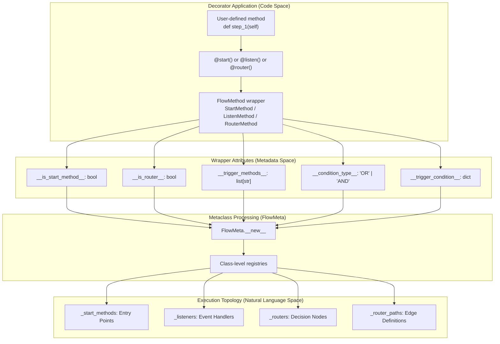
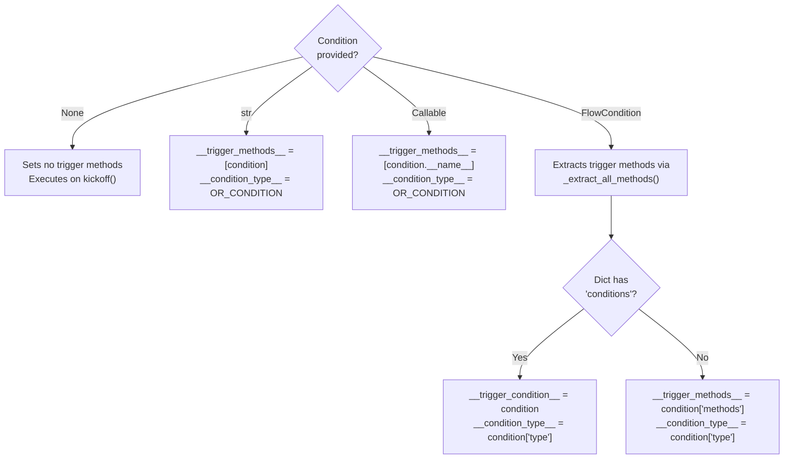
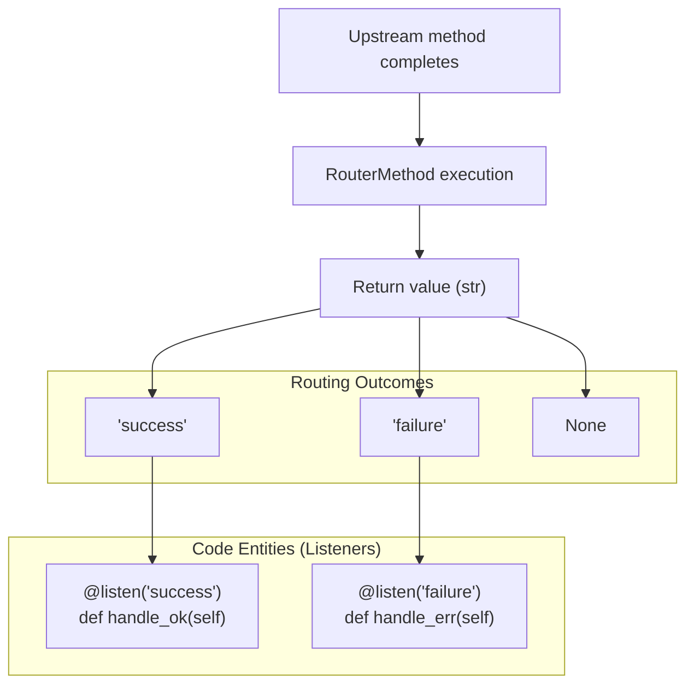

<!-- source: DeepWiki mcp.deepwiki.com · repo crewAIInc/crewAI · page 3.2 Flow Decorators · fetched 2026-11-09 -->

# Flow Decorators

<details>
<summary>Relevant source files</summary>

The following files were used as context for generating this wiki page:

- [docs/edge/ar/concepts/flows.mdx](docs/edge/ar/concepts/flows.mdx)

</details>


Flow decorators provide a declarative syntax for defining event-driven workflow execution paths in CrewAI Flows. They transform standard class methods into execution nodes by injecting metadata that the `FlowMeta` metaclass uses to construct an execution topology.

## Decorator Architecture

The flow system uses a wrapper pattern to store metadata on methods before the `Flow` class is instantiated. When a method is decorated, it is wrapped in a specialized class from `crewai.flow.flow_wrappers`.

### Code Entity Space to Natural Language Space
This diagram maps the internal Python classes used for decoration to their conceptual roles in a Flow topology.


**Sources**: [lib/crewai/src/crewai/flow/flow.py:47](), [lib/crewai/src/crewai/flow/flow_wrappers.py:41-160]()

### Decorator Wrapper Classes

| Wrapper Class | Base Class | Purpose | Decorator |
|---------------|------------|---------|-----------|
| `StartMethod` | `FlowMethod` | Entry point method | `@start` |
| `ListenMethod` | `FlowMethod` | Condition-triggered method | `@listen` |
| `RouterMethod` | `FlowMethod` | Conditional routing method | `@router` |
| `HumanFeedbackMethod` | `FlowMethod` | Human-in-the-loop node | `@human_feedback` |

**Sources**: [lib/crewai/src/crewai/flow/flow_wrappers.py:144-160](), [lib/crewai/src/crewai/flow/human_feedback.py:193-207]()

## @start Decorator

The `@start` decorator marks a method as a flow entry point. Flows can have multiple start methods that execute in parallel when `kickoff()` or `kickoff_async()` is called [lib/crewai/src/crewai/flow/flow.py:47]().

### Syntax and Implementation
The decorator parses the `condition` to populate `__trigger_methods__` and `__condition_type__` on the `StartMethod` instance. If no condition is provided, it fires immediately upon flow start [lib/crewai/src/crewai/flow/flow.py:47]().


**Sources**: [lib/crewai/src/crewai/flow/flow.py:47](), [lib/crewai/src/crewai/flow/flow_wrappers.py:144-152]()

## @listen Decorator

The `@listen` decorator creates a method that executes when specified trigger conditions are met [lib/crewai/src/crewai/flow/flow.py:47](). It is the primary mechanism for chaining flow execution.

### Logic Condition Handling
The flow execution engine handles two primary condition types imported from `crewai.flow.constants`:

| Type | Constant | Evaluation Logic |
|------|----------|------------------|
| **OR** | `OR_CONDITION` | Executes when **ANY** trigger method completes. Uses `_fired_or_listeners` and `_or_listeners_lock` to prevent race conditions [lib/crewai/src/crewai/flow/flow.py:47](). |
| **AND** | `AND_CONDITION` | Executes when **ALL** trigger methods complete. Tracks progress in `_pending_and_listeners` [lib/crewai/src/crewai/flow/flow.py:47](). |

**Sources**: [lib/crewai/src/crewai/flow/flow.py:47](), [lib/crewai/src/crewai/flow/flow.py:47](), [lib/crewai/src/crewai/flow/types.py:90-95]()

## @router Decorator

The `@router` decorator defines a decision node. The method returns a string which the flow engine matches against listeners [lib/crewai/src/crewai/flow/flow.py:47]().

### Router Execution Flow
When a router completes, its return value is treated as a completed virtual "method name". This allows for dynamic branching based on LLM output or logic [lib/crewai/src/crewai/flow/flow.py:47]().


**Sources**: [lib/crewai/src/crewai/flow/flow.py:47](), [lib/crewai/tests/test_flow.py:164-192]()

## @human_feedback Decorator

The `@human_feedback` decorator enables human-in-the-loop (HITL) workflows. It can act as a standard step or a router depending on the `emit` parameter [lib/crewai/src/crewai/flow/human_feedback.py:168-175]().

### Logic and Routing
If `emit` is provided, the method is marked with `__is_router__ = True` [lib/crewai/src/crewai/flow/human_feedback.py:193-207](). The framework uses an LLM (default `gpt-4o-mini`) to map free-text human feedback into one of the specified `emit` outcomes [lib/crewai/src/crewai/flow/human_feedback.py:108-115]().

| Parameter | Description |
|-----------|-------------|
| `message` | Prompt shown to the human |
| `emit` | List of possible routing outcomes (e.g., `["approve", "reject"]`) |
| `llm` | LLM used to categorize feedback into `emit` outcomes |
| `provider` | Custom provider for async/non-blocking feedback (e.g., Slack, Email) |

**Sources**: [lib/crewai/src/crewai/flow/human_feedback.py:168-207]()

## Condition Combinators

The `or_()` and `and_()` functions are utility helpers that generate `FlowCondition` structures for complex triggering logic [lib/crewai/src/crewai/flow/flow.py:47]().

- **`or_(*conditions)`**: Creates a condition dictionary with `type: "OR"` [lib/crewai/src/crewai/flow/flow.py:47]().
- **`and_(*conditions)`**: Creates a condition dictionary with `type: "AND"` [lib/crewai/src/crewai/flow/flow.py:47]().

### Complex Logic Example
```python
@listen(or_(and_("task_a", "task_b"), "emergency_stop"))
def handle_completion(self):
    # Executes if (task_a AND task_b) are done, OR if emergency_stop is triggered
    pass
```
**Sources**: [lib/crewai/tests/test_flow.py:967-1037]()

## Event Lifecycle
Decorators trigger specific events on the `crewai_event_bus` to enable observability and tracing [lib/crewai/src/crewai/flow/flow.py:47]().

| Event | Trigger Point |
|-------|---------------|
| `MethodExecutionStartedEvent` | Just before calling the wrapped function [lib/crewai/src/crewai/flow/flow.py:47]() |
| `MethodExecutionFinishedEvent` | After successful function completion [lib/crewai/src/crewai/flow/flow.py:47]() |
| `MethodExecutionFailedEvent` | If the function raises an unhandled exception [lib/crewai/src/crewai/flow/flow.py:47]() |
| `MethodExecutionPausedEvent` | When HITL feedback is requested via `HumanFeedbackPending` [lib/crewai/src/crewai/flow/flow.py:47]() |

**Sources**: [lib/crewai/src/crewai/events/types/flow_events.py:44-72](), [lib/crewai/src/crewai/flow/flow.py:47]()

---

